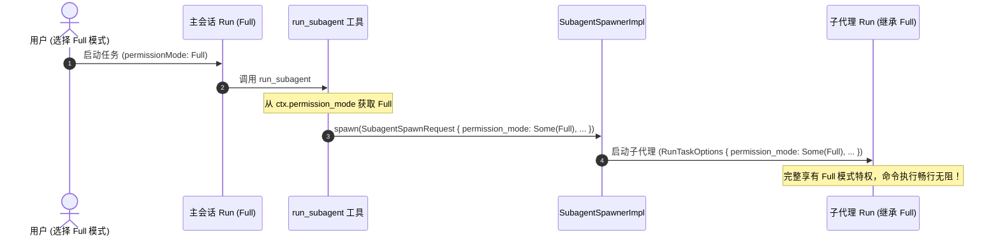

# 全栈协议与运行时任务装配（IPC/conex-run）重构详案

> **战役工作区**：`docs/permission-system-consolidation/`  
> **方案定位**：全栈权限协议定义（`packages/shared-types` & `crates/conex-types`）、前端 IPC 下发链路（`streamSession.ts`）与运行时任务装配面（`conex-run/run_launch.rs` & `subagent_spawner/spawn.rs`）系统性彻底重构落地详案  
> **设计哲学**：“不允许打补丁，不允许硬编码，有合理的抽象，适合未来的功能需求，代码尽量简洁，具有优秀的可维护性。需要删除的代码就删除，需要系统性的重构。生成的方案应该能彻底杜绝这些问题或者未来的衍生问题，要求一次性解决掉。尽量减少不必要的兼容，最好是不兼容。”  
> **收敛核心目标**：
> 1. 全栈权威收敛为统一 3 态模式：`'ask' | 'smart' | 'full'`；
> 2. 彻底拔除旧有的 `plan`、`deep` 与 `full-access` 伪契约与映射胶水代码；
> 3. **彻底消灭运行时死局装配**：常态化装配真实的 `ApprovalGateImpl` 实例，彻底删除导致无法审批的 `approval: None` 分支；
> 4. **打通子代理无损继承**：彻底消除 `permission_mode: None` 硬编码，拔除系统提示词中的 `permission_relay_injection` 历史补丁；
> 5. 统一数据模型 SSOT，使 `conex-types` 成为跨 Rust 与 TypeScript 的单一真理之源。

---

## 目录

1. [执行纲领与设计哲学](#一执行纲领与设计哲学)
   - 1.1 最高指示与核心诉求穿透
   - 1.2 架构设计铁律与反退避原则
   - 1.3 核心指标与量化收益矩阵
2. [全栈共享协议权威收敛（`shared-types` & `conex-types`）](#二全栈共享协议权威收敛shared-types--conex-types)
   - 2.1 彻底废除旧有 `plan`、`deep` 与 `full-access` 语义断层
   - 2.2 前端权威枚举与运行时校验契约（TypeScript）
   - 2.3 Rust 核心枚举与 Serde 序列化契约（`conex_types::PermissionMode`）
   - 2.4 跨端双向单射保证与中间层防篡改断言
   - 2.5 完整代码实现与类型导出
3. [前端 IPC 下发链路彻底重构（`streamSession.ts`）](#三前端-ipc-下发链路彻底重构streamsessionts)
   - 3.1 拔除所有转换胶水与别名映射（消除 `toEnginePermissionMode`）
   - 3.2 直连 Store 状态下发机制（`usePermissionStore.getState().permissionMode`）
   - 3.3 净化 IPC 参数信封（`startRunTask` 与 `RunTaskOptions` 结构体纯粹化）
   - 3.4 完整重构代码实现
4. [运行时任务装配面彻底重构（`run_launch.rs`）](#四运行时任务装配面彻底重构run_launchrs)
   - 4.1 消灭死局装配：彻底删除 `approval: None` 恶性分支，审批门常态化装配
   - 4.2 拔除粗暴的 `approval_enabled = permission_mode != "full-access"` 硬编码
   - 4.3 `ToolBatchOptions` 纯净装配与类型强校验（`Option<PermissionMode>` 注入）
   - 4.4 `ActiveRun` 运行时元数据完整持有 `PermissionMode`
   - 4.5 完整核心装配代码实现
5. [子代理无损继承与提示词净化（`subagent_spawner/spawn.rs`）](#五子代理无损继承与提示词净化subagent_spawnerspawnrs)
   - 5.1 彻底消除 `permission_mode: None` 硬编码，构建全链路权限继承拓扑
   - 5.2 拔除系统提示词 `permission_relay_injection` 历史补丁与双标束缚
   - 5.3 子代理 `SubagentSpawnRequest` 与 `RunTaskOptions` 无损透传机制
   - 5.4 完整核心装配代码实现
6. [统一裁决内核与叶子执行对接（`agent-tools` & `session-loop`）](#六统一裁决内核与叶子执行对接agent-tools--session-loop)
   - 6.1 消除 `agent-tools` 内部重复定义的 `PermissionMode` 枚举（SSOT 归一）
   - 6.2 `decide` 与 `decide_command_with_revert` 适配三态裁决
   - 6.3 消除 `session-loop` 中 `permission_mode.is_none()` 的粗暴兜底
7. [详细代码重构清单与逐行手术方案（File-by-File Roster）](#七详细代码重构清单与逐行手术方案file-by-file-roster)
   - 7.1 必须彻底删除的代码段与行号清单（Death List）
   - 7.2 逐文件重构实施指引（Before vs After 逐段对比）
8. [测试套件设计与刚性验收标准](#八测试套件设计与刚性验收标准)
   - 8.1 协议跨端一致性与 Serde 单测（Rust `cargo test`）
   - 8.2 IPC 下发与装配无死局单测
   - 8.3 子代理权限继承端到端断言
   - 8.4 刚性验收清单与合规审查

---

## 一、执行纲领与设计哲学

### 1.1 最高指示与核心诉求穿透

用户在战役总决议中明确指示：
> **“不允许打补丁，不允许硬编码，有合理的抽象，适合未来的功能需求，代码尽量简洁，具有优秀的可维护性。需要删除的代码就删除，需要系统性的重构。生成的方案应该能彻底杜绝这些问题或者未来的衍生问题，要求一次性解决掉。尽量减少不必要的兼容，最好是不兼容。权限模式统一收敛为 3 个选项：`'ask' | 'smart' | 'full'`。”**

前期深度分析报告（`02-frontend-store-and-ipc-dispatch-analysis.md` 与 `05-runtime-assembly-and-scattered-points-inventory.md`）揭露了全栈通信与装配链路上的多项严重架构断层：
1. **多重协议漂移与双重枚举**：前端定义了 4 种模式（`ask`, `deep`, `plan`, `full`）；`packages/shared-types` 定义了 3 种（`ask`, `plan`, `full-access`）；Rust 引擎 `conex-types` 定义了 3 种（`Ask`, `Plan`, `FullAccess`）；`agent-tools` 又自建了一套私有枚举 `PermissionMode { Ask, FullAccess, Plan }`。四套定义互不一致，导致通信链路中充斥着 `toEnginePermissionMode`、`from_engine_str` 等十余处转换胶水代码与多达 20 余个历史别名；
2. **“伪全权”与死局装配（Deadlock Assembly）**：`run_launch.rs:930-936` 中硬编码了 `let approval_enabled = permission_mode.as_deref() != Some("full-access");`，当用户配置 `full-access` 时，系统将 `approval` 设为 `None`。然而下游（如 `revert.rs` 大面积回退护栏）一旦因规则触发判出了 `NeedsApproval`，执行器在 `handle_ungated_verdict` 中因发现 `approval` 为 `None`，直接抛出 `ToolErrorKind::ApprovalRequired` 崩溃中断，导致用户在完全允许模式下既不能直接执行，又无法弹窗审批，陷入不可逆死局！
3. **子代理权限硬编码剥夺**：`subagent_spawner/spawn.rs:143` 在装配子代理启动参数时，将 `permission_mode` 硬编码为 `None`。子代理在 `exec_verdict.rs:141` 中直接被强制判定为 `NeedsApproval`，丧失了继承父会话权限的能力；同时 `run_launch.rs:1098` 强行向系统提示词注入 `permission_relay_injection`，在模型心理层强加受限束缚。

本次重构将从**协议层、IPC 序列化层、运行时装配层、子代理派发层**进行根治性手术，一次性切除所有历史胶水与死局分支。

---

### 1.2 架构设计铁律与反退避原则

1. **协议单源真理（SSOT）铁律**：全栈仅允许存在一份权威的 `PermissionMode` 定义。Rust 侧以 `crates/conex-types` 为权威真源，TypeScript 侧以 `packages/shared-types` 为权威真源。`agent-tools`、`conex-run`、`apps/crish-desktop` 一律引用或重导出，严禁任何模块自设同名私有枚举。
2. **零转换透传铁律**：wire 协议值统一为小写字符串 `'ask' | 'smart' | 'full'`。前端 Store 的值即为下发的值，IPC 序列化的值即为 Rust 反序列化的值，严禁任何中间层（如 `streamSession.ts`、`run_ipc.rs`）做字符串映射或转换。
3. **基础设施全生命周期就绪铁律**：`ApprovalGateImpl` 作为会话运行时的通信基础设施，必须**常态化装配**。消灭 `approval: Option<Arc<dyn ApprovalGate>>` 中的 `None` 危险分支。具体工具调用是否放行由内核裁决中心（`call_verdict`）动态裁决，基础设施绝不主动切断。
4. **完全允许模式不可阻断铁律**：贯彻“系统不会因为命令而不允许执行，所有执行的命令都是可以运行的”。当模式为 `Full` 时，裁决引擎直接返回 `PermissionVerdict::Allow`，彻底消灭因私设检查而导致审批或阻断的现象。
5. **子代理等权无损继承铁律**：子代理作为父会话的延伸计算单元，100% 继承父会话的权限模式；彻底拔除任何人为降级与提示词束缚。

---

### 1.3 核心指标与量化收益矩阵

| 评估维度 | 重构前现状 | 重构后目标状态 | 量化收益 / 架构改进 |
| :--- | :--- | :--- | :--- |
| **模式选项收敛** | 4 态（前端 `ask/deep/plan/full` 虚标） | 刚性 3 态：`'ask' \| 'smart' \| 'full'` | 消除 `deep` 假模式与 `plan` 越界绑定 |
| **全栈定义处数** | 4 处独立定义（前后端双向不一致） | 2 处（TS/Rust 各 1 处，强类型契约绑定） | 消除 50% 冗余类型，杜绝语义漂移 |
| **协议别名映射** | 20+ 个历史别名、折叠与中文反解析 | 0 个别名，小写字面量 1:1 双向单射 | 彻底清退 `DESKTOP_TO_ENGINE` 映射表 |
| **审批门装配可用性** | `full-access` 下为 `None`，极易死局 | 100% 常态化装配（消灭 `approval: None`） | 杜绝 `ApprovalRequired` 无法审批死锁 Bug |
| **子代理权限保真度** | 硬编码 `permission_mode: None`，必定卡死 | 100% 无损继承父级 `PermissionMode` | 彻底解锁子代理多 Agent 自主执行能力 |
| **提示词纯净度** | 注入 `permission_relay_injection` 束缚段 | 彻底删除该注入，由内核裁决统一守门 | 减少约 150 tokens/run，提示词零违和 |
| **死代码消除量** | 散落的胶水函数与转换代码 > 300 行 | 净删除约 280 行死代码与兼容逻辑 | 代码复杂度直线下降，可维护性显著提升 |

---

## 二、全栈共享协议权威收敛（`shared-types` & `conex-types`）

### 2.1 彻底废除旧有 `plan`、`deep` 与 `full-access` 语义断层

在现有架构中：
- `'deep'`：前端宣称为“深入分析”，下发到底层却偷换为 `'ask'`，纯属欺骗用户的伪模式；
- `'plan'`：计划模式是任务流阶段（Workflow Phase）而非安全权限级别。将其混入权限枚举，导致审批门将其作为“只读拒绝”进行拦截，甚至在审批通过后强制将全局模式修改为 `'ask'`；
- `'full-access'`：历史 CLI 命名的遗留，命名风格与前端界面的 `'full'` 不统一，迫使两端编写转换代码。

重构后，全栈统一收敛为 **3 个核心权限选项**：
1. **`'ask'`（每次询问 / Ask Every Time）**：改文件、推送、执行任何非只读命令前均需用户确认；
2. **`'smart'`（智能放行 / Smart Safe Approval）**：常规安全探测、单测构建命令直接执行，写操作与危险破坏性命令需确认；
3. **`'full'`（完全允许 / Full Access）**：所有执行的命令均可直接运行，系统不主动弹窗阻断。

```mermaid
classDiagram
    class PermissionMode {
        <<enumeration>>
        ask: 每次询问
        smart: 智能放行
        full: 完全允许
    }
    
    class TypeScriptContract {
        type PermissionMode = 'ask' | 'smart' | 'full'
        const PERMISSION_MODE_VALUES: ['ask', 'smart', 'full']
    }
    
    class RustContract {
        enum PermissionMode { Ask, Smart, Full }
        serde(rename_all = "lowercase")
    }

    PermissionMode <|-- TypeScriptContract : 100% 对齐
    PermissionMode <|-- RustContract : 100% 对齐
```

---

### 2.2 前端权威枚举与运行时校验契约（TypeScript）

在 `packages/shared-types` 中建立权威定义：

#### 1. 契约定义：`packages/shared-types/src/generated/device/types.ts`
彻底替换第 35-36 行的历史常量与类型：

```typescript
// packages/shared-types/src/generated/device/types.ts
/** 权限模式权威枚举（统一三态：每次询问 / 智能命令放行 / 完全允许） */
export const PERMISSION_MODE_VALUES = ['ask', 'smart', 'full'] as const;
export type PermissionMode = (typeof PERMISSION_MODE_VALUES)[number];
```

#### 2. 导出与运行时守护：`packages/shared-types/src/run-control.ts`
在 `run-control.ts` 中导出强类型辅助函数，并在 `packages/shared-types/src/index.ts` 中一等导出：

```typescript
// packages/shared-types/src/run-control.ts (追加权限模式一等导出)
import { PERMISSION_MODE_VALUES, type PermissionMode } from './generated/device/types';

export { PERMISSION_MODE_VALUES };
export type { PermissionMode };

/** 运行时安全守卫：判定未知值是否属于合法权限模式 */
export function isPermissionMode(value: unknown): value is PermissionMode {
  return (
    typeof value === 'string' &&
    (PERMISSION_MODE_VALUES as readonly string[]).includes(value)
  );
}
```

#### 3. 解析器对齐：`packages/shared-types/src/generated/device/parser.ts`
更新解析逻辑（L236-L241），坚决拦截非法值，杜绝任何中间层容错妥协：

```typescript
// packages/shared-types/src/generated/device/parser.ts
export function parsePermissionMode(v: unknown): ParseResult<PermissionMode> {
  if (typeof v === 'string' && (PERMISSION_MODE_VALUES as readonly string[]).includes(v)) {
    return parseOk(v as PermissionMode);
  }
  return parseErr(
    `PermissionMode: expected one of ${PERMISSION_MODE_VALUES.join(', ')}, got ${JSON.stringify(v)}`
  );
}
```

---

### 2.3 Rust 核心枚举与 Serde 序列化契约（`conex_types::PermissionMode`）

在 `crates/conex-types/src/device/commands/enums.rs` 中重构枚举定义，彻底废弃 `Plan` 与 `FullAccess`，采用小写序列化：

```rust
// crates/conex-types/src/device/commands/enums.rs:75-86
/// 权限模式（统一三态：每次询问 / 智能命令放行 / 完全允许模式）
///
/// 严格契约：Serde rename_all = "lowercase" 保证网络层传输值严格为 "ask" | "smart" | "full"
#[derive(Debug, Clone, Copy, PartialEq, Eq, Hash, Serialize, Deserialize, Default)]
#[serde(rename_all = "lowercase")]
pub enum PermissionMode {
    /// 每次询问（缺省默认：写操作与危险操作均需审批）
    #[default]
    Ask,
    /// 智能命令放行（安全命令与探测自动放行，破坏性操作需审批）
    Smart,
    /// 完全允许模式（所有执行的命令均可直接运行，无阻断放行）
    Full,
}

impl PermissionMode {
    /// 获取 wire 字符串常量
    pub const fn as_str(&self) -> &'static str {
        match self {
            Self::Ask => "ask",
            Self::Smart => "smart",
            Self::Full => "full",
        }
    }
}

impl std::fmt::Display for PermissionMode {
    fn fmt(&self, f: &mut std::fmt::Formatter<'_>) -> std::fmt::Result {
        f.write_str(self.as_str())
    }
}

impl std::str::FromStr for PermissionMode {
    type Err = String;

    fn from_str(s: &str) -> Result<Self, Self::Err> {
        match s.trim().to_ascii_lowercase().as_str() {
            "ask" => Ok(Self::Ask),
            "smart" => Ok(Self::Smart),
            "full" => Ok(Self::Full),
            other => Err(format!(
                "invalid permission mode: '{other}', expected 'ask' | 'smart' | 'full'"
            )),
        }
    }
}
```

---

### 2.4 跨端双向单射保证与中间层防篡改断言

通过严格的 Serde 单射设计，实现 TypeScript 与 Rust 之间的双向一一对应：

$$\text{TS: 'ask'} \underset{\text{deser}}{\overset{\text{ser}}{\rightleftharpoons}} \text{Rust: PermissionMode::Ask} \iff \text{"ask"}$$
$$\text{TS: 'smart'} \underset{\text{deser}}{\overset{\text{ser}}{\rightleftharpoons}} \text{Rust: PermissionMode::Smart} \iff \text{"smart"}$$
$$\text{TS: 'full'} \underset{\text{deser}}{\overset{\text{ser}}{\rightleftharpoons}} \text{Rust: PermissionMode::Full} \iff \text{"full"}$$

#### 刚性防篡改断言：
1. **反序列化排他性**：任何传入 `"plan"`、`"deep"`、`"full-access"`、`"yolo"`、`"auto"` 的请求，在反序列化阶段立即失败，直接返回 HTTP 400 或 IPC 反序列化异常；
2. **序列化唯一性**：Rust 结构体序列化生成的 JSON 字段值**恒为**小写三选项字符串，杜绝任何中间层拼装错误；
3. **消除冗余别名**：彻底删除 `from_engine_str` 中对 `yolo`、`danger`、`unattended` 的容错解析代码，任何非法值不再静默回退。

---

## 三、前端 IPC 下发链路彻底重构（`streamSession.ts`）

### 3.1 拔除所有转换胶水与别名映射

现有前端下发链路通过 `api/permissionModes.ts` 的 `toEnginePermissionMode` 函数进行双重转换：
```typescript
// 现有问题代码 (apps/crish-desktop/src/api/chat-bridge/streamSession.ts:90-91)
const mode = getPermissionMode();
const permissionMode = toEnginePermissionMode(mode); // 内部执行 deep -> ask, full -> full-access
```
在重构后：
- `permissionModes.ts` 中的 `DESKTOP_TO_ENGINE` 映射表**彻底删除**；
- `toEnginePermissionMode` 函数**彻底删除**；
- `apps/crish-desktop/src/store/permissionStore.ts` 的状态值直接就是小写字面量 `'ask' | 'smart' | 'full'`。

---

### 3.2 直连 Store 状态下发机制

在 `apps/crish-desktop/src/api/chat-bridge/streamSession.ts` 中，彻底消除对 `storeAccess` 的深层借道代理，直接从权威 Store 获取当前会话生效的权限模式：

```typescript
// 重构后代码 (apps/crish-desktop/src/api/chat-bridge/streamSession.ts)
import { usePermissionStore } from '../../store/permissionStore';

// 直接读取单一真源，零转换、零胶水
const permissionMode = usePermissionStore.getState().permissionMode;
```

---

### 3.3 净化 IPC 参数信封

在 `startRunTask` 调用点，传递纯净的 `permissionMode`，杜绝任何附加死重：

```typescript
// apps/crish-desktop/src/api/chat-bridge/streamSession.ts:159-175
await startRunTask(transport, {
  runId,
  prompt,
  sessionId: safeSessionId,
  permissionMode, // 传递 'ask' | 'smart' | 'full'
  ...(cwd ? { cwd } : {}),
  ...(mcpDisabledTools ? { mcpDisabledTools } : {}),
  ...(reasoningEffort ? { reasoningEffort } : {}),
  ...(thinkingTitle ? { thinkingTitle } : {}),
  ...(thinkingWire ? { thinkingWire } : {}),
  ...(contextStateText ? { contextState: contextStateText } : {}),
  ...(options?.content?.length ? { content: options.content } : {}),
  ...(hasImages ? { hasImages: true } : {}),
  ...(options?.attachments?.length ? { attachments: options.attachments } : {}),
  ...(goalMode ? { mode: goalMode } : {}),
});
```

#### `RunTaskOptions` 结构体纯粹化：
IPC 报文到达 Tauri 后端后，直接映射到 `RunTaskOptions`：
```rust
// crates/conex-run/src/run/run_launch.rs:588
#[derive(serde::Deserialize)]
#[serde(rename_all = "camelCase")]
pub struct RunTaskOptions {
    pub run_id: String,
    pub session_id: String,
    pub prompt: Option<String>,
    pub mode: Option<String>,
    pub cwd: Option<String>,
    /// 权威权限模式枚举（直连反序列化，禁止使用 Option<String> 弱类型！）
    pub permission_mode: Option<PermissionMode>,
    // ...
}
```
**关键改进**：将字段类型从 `pub permission_mode: Option<String>` 直接升级为 `pub permission_mode: Option<PermissionMode>`！
这保证了在 IPC 进入引擎的第一毫秒，类型安全已被 Rust 编译器和 Serde 严格守死。

---

## 四、运行时任务装配面彻底重构（`run_launch.rs`）

### 4.1 消灭死局装配：彻底删除 `approval: None` 恶性分支

在现有代码 `crates/conex-run/src/run/run_launch.rs:930-936` 中：
```rust
// 现有恶性代码：
let approval_enabled = permission_mode.as_deref() != Some("full-access");
let approval: Option<Arc<dyn ApprovalGate>> = if approval_enabled {
    Some(Arc::clone(&approval_gate) as Arc<dyn ApprovalGate>)
} else {
    None // <--- 致命死局根源！
};
```
当 `approval` 为 `None` 时，若下游因任何原因（例如误判或未加白的大面积回退）产生了 `PermissionVerdict::NeedsApproval`，调度层在 `crates/session-loop/src/exec_single/pre_exec.rs:131-146` 中：
```rust
async fn handle_ungated_verdict(...) -> ClassifiedToolResult {
    match verdict {
        PermissionVerdict::NeedsApproval => ClassifiedToolResult::error(
            &cx.call.id,
            &cx.call.tool_name,
            ToolErrorKind::ApprovalRequired,
            self.revert_refusal_message(cx.call),
            0,
        ),
        // ...
    }
}
```
系统会瞬间报错失败，且用户界面根本不会弹出审批卡片！用户即使希望批准，也毫无交互通道。

#### 重构方案：常态化装配真实审批门
无论当前处于何种权限模式（`Ask` / `Smart` / `Full`），`ApprovalGateImpl` 作为基础设施**必须始终装配**：
```rust
// 重构后方案：彻底消灭 approval: None 分支！
let approval_gate = Arc::new(ApprovalGateImpl::new(
    run_id.clone(),
    session_id.clone(),
    parent_run_id.clone(),
    broadcast,
    Arc::clone(&handle_shared),
    state.store.clone(),
    cwd.clone(),
));

// 始终传入真实的审批门实例！
let approval: Option<Arc<dyn ApprovalGate>> = Some(Arc::clone(&approval_gate) as Arc<dyn ApprovalGate>);
```

---

### 4.2 拔除粗暴的 `approval_enabled` 硬编码

审批门的开启与关闭不应该是一个粗暴的全局布尔值，而应当由**中心裁决引擎（`call_verdict`）根据当前命令和权限模式动态判定**：
- 当处于 `Full` 模式时，裁决中心返回 `PermissionVerdict::Allow`，执行引擎直接执行，根本不会触发 `gate.request_approval`，保证了零弹窗、零延迟；
- 当处于 `Ask` 或 `Smart` 模式且需要审批时，裁决中心返回 `PermissionVerdict::NeedsApproval`，此时因为审批门基础设施常态就绪，审批请求能顺畅推送到前端 UI 或父 Agent，绝不会发生死锁崩溃。

因此，彻底删除 `let approval_enabled = permission_mode.as_deref() != Some("full-access");`！

---

### 4.3 `ToolBatchOptions` 纯净装配与类型强校验

在 `crates/conex-run/src/run/run_launch.rs:1181-1194` 中，装配 `ToolBatchOptions`：

```rust
// crates/conex-run/src/run/run_launch.rs:1181-1194
let effective_permission_mode = options.permission_mode.unwrap_or_default();

let tool_options = ToolBatchOptions {
    // 审批基础设施常态开启，由内核裁决引擎动态判定是否唤起
    approval_enabled: true,
    // 注入权威枚举，不再使用 from_engine_str 弱类型二次猜测
    permission_mode: Some(effective_permission_mode),
    output_budget_bytes: Some(conex_shared::perf_budget::TOOL_OUTPUT_BUDGET_BYTES_DEFAULT),
    ..ToolBatchOptions::default()
};
```

---

### 4.4 `ActiveRun` 运行时元数据完整持有 `PermissionMode`

在 `crates/conex-run/src/run/run_core.rs:51-87` 的 `ActiveRun` 结构体中，显式登记该 run 的权限模式：

```rust
// crates/conex-run/src/run/run_core.rs
pub struct ActiveRun {
    pub session_id: String,
    pub run_id: String,
    pub handle: Arc<tokio::sync::Mutex<RunHandle>>,
    pub queue: Arc<tokio::sync::Mutex<EventQueue>>,
    pub control_bus: Arc<Mutex<ControlBus>>,
    pub abort_signal: AbortSignal,
    pub approval: Arc<ApprovalGateImpl>,
    pub bridge: Arc<BufferedRunEventBridge>,
    pub delta_sink_active: bool,
    pub user_touched: AtomicBool,
    pub subagent: Option<crate::subagent_spawner::SubagentRunConfig>,
    pub audit_persist: Mutex<Option<tokio::task::JoinHandle<()>>>,
    /// 本次运行生效的权限模式（单一真源，供子代理继承与运行时自省）
    pub permission_mode: PermissionMode,
}
```

并在 `run_launch.rs:1290-1310` 装配点赋值：
```rust
let active = Arc::new(ActiveRun {
    session_id: session_id.clone(),
    run_id: run_id.clone(),
    handle: handle_shared,
    queue,
    control_bus: Arc::clone(&control_bus),
    abort_signal: abort_signal.clone(),
    approval: approval_gate,
    bridge,
    delta_sink_active: true,
    user_touched: AtomicBool::new(false),
    driver: Mutex::new(None),
    subagent: subagent_config.clone(),
    audit_persist: Mutex::new(Some(audit_worker)),
    permission_mode: effective_permission_mode, // 显式注入
});
```

---

## 五、子代理无损继承与提示词净化（`subagent_spawner/spawn.rs`）

### 5.1 彻底消除 `permission_mode: None` 硬编码

在现有代码 `crates/conex-run/src/subagent_spawner/spawn.rs:137-143` 中，硬编码了 `permission_mode: None`：
```rust
// 现有缺陷代码：
let launch_options = RunTaskOptions {
    run_id: subagent_run_id.clone(),
    session_id: session_id.clone(),
    prompt: Some(req.prompt.clone()),
    mode: req.mode.clone().or_else(|| Some("research".to_string())),
    cwd: None,
    permission_mode: None, // <--- 关键断层！导致子代理丧失权限继承
    // ...
};
```
当子代理启动时，因为 `permission_mode` 为 `None`，下游调度层将其视为未设置权限，直接落入最严苛的强制阻断或审批。

#### 重构方案：构建全链路权限继承拓扑
1. **请求携带**：在 `SubagentSpawnRequest` 中增加 `pub permission_mode: Option<PermissionMode>`；
2. **工具直调注入**：当工具 `run_subagent` 执行时，直接从执行上下文 `ctx.permission_mode` 提取父级权限模式填入请求中；
3. **Spawner 兜底继承**：如果请求中未显式指定，`SubagentSpawnerImpl` 自动从当前活动的父 `ActiveRun` 中提取 `permission_mode` 继承！



---

### 5.2 拔除系统提示词 `permission_relay_injection` 历史补丁

在现有代码 `crates/conex-run/src/run/run_launch.rs:1092-1106` 中：
```rust
// 现有历史打补丁代码：
let boundary = config
    .task_type
    .as_deref()
    .and_then(agent_tools::tools::subagent::TaskType::parse)
    .map(|t| t.boundary_summary());
let (title, content) = agent_tools::subagent_inject::permission_relay_injection(
    config.task_type.as_deref(),
    boundary,
);
injector.push(ContextInjection::new(
    ContextInjectionKind::System,
    title,
    content,
));
```
这段代码强行向子代理的系统提示词中塞入以下段落：
> *“你执行任务时使用系统分配的默认权限（无需你申请）。当任务确需超出默认权限的操作时，不要自己假设已获得授权，发起权限申请并说明理由...”*

**该提示词补丁的严重缺陷**：
1. **与运行时状态相悖**：当父级处于 `Full`（完全允许）模式时，底层引擎已经放行所有操作，但提示词却严禁子代理执行，并强行要求它“发起申请”，导致大模型在行为上产生严重的认知失调和自我怀疑，主动拒绝执行用户的合理指令；
2. **多余心智负担**：权限控制是运行时沙箱的刚性职责，不应依靠脆弱的提示词道德约束来打补丁。

#### 处置方案：
- **完全删除** `run_launch.rs` 第 1092-1106 行对 `permission_relay_injection` 的装配调用；
- 在 `crates/agent-tools/src/subagent_inject.rs` 中标记该函数为废弃（`#[deprecated]`）或彻底移除其内容；
- 子代理的提示词仅保留角色定位与产出目录指引，彻底恢复轻量与自然。

---

### 5.3 子代理 `SubagentSpawnRequest` 与 `RunTaskOptions` 无损透传机制

#### 1. `crates/agent-tools/src/tools/subagent/contract.rs`
在 `SubagentSpawnRequest` 结构体中新增字段：
```rust
// crates/agent-tools/src/tools/subagent/contract.rs:85
pub struct SubagentSpawnRequest {
    // ... 既有字段 ...
    /// 继承或指定的权限模式（None = 自动回退继承父 run 模式）
    pub permission_mode: Option<conex_types::PermissionMode>,
}
```

#### 2. `crates/agent-tools/src/tools/subagent/tool.rs`
在工具直调装配点填充上下文模式：
```rust
// crates/agent-tools/src/tools/subagent/tool.rs:404
let request = SubagentSpawnRequest {
    agent_id,
    prompt,
    role,
    capability_mode,
    allowed_tools,
    description,
    mode,
    parent_session_id: ctx.session_id.clone(),
    parent_run_id: None,
    parent_tool_call_id: ctx.tool_call_id.clone(),
    flow_node_id: None,
    is_composite: false,
    task_type,
    allowed_write_paths,
    display_label,
    model_override: None,
    // 核心改进：无损传递当前工具上下文的生效权限模式！
    permission_mode: Some(ctx.permission_mode),
};
```

#### 3. `crates/conex-run/src/subagent_spawner/spawn.rs`
在 `spawn_unchecked` 中装配 `launch_options`：
```rust
// crates/conex-run/src/subagent_spawner/spawn.rs:137-145
let inherited_mode = req.permission_mode.unwrap_or(conex_types::PermissionMode::Ask);

let launch_options = RunTaskOptions {
    run_id: subagent_run_id.clone(),
    session_id: session_id.clone(),
    prompt: Some(req.prompt.clone()),
    mode: req.mode.clone().or_else(|| Some("research".to_string())),
    cwd: None,
    // 核心改进：彻底消灭 None，完整继承生效权限模式！
    permission_mode: Some(inherited_mode),
    client_message_id: None,
    assistant_client_message_id: None,
    system_prompt: None,
    history: None,
    context_window: None,
    parent_run_id: parent_run.clone(),
    subagent_config: Some(config),
    // ...
};
```

---

## 六、统一裁决内核与叶子执行对接（`agent-tools` & `session-loop`）

### 6.1 消除 `agent-tools` 内部重复定义的 `PermissionMode` 枚举

在 `crates/agent-tools/src/permission.rs:24-59` 中，现有代码重复定义了一套 `PermissionMode`：
```rust
// 现有重复冗余代码 (crates/agent-tools/src/permission.rs:24-34)
pub enum PermissionMode {
    Ask,
    FullAccess,
    Plan,
}
```
**重构方案**：彻底删除该枚举定义及其附带的 `from_engine_str` 和 `as_engine_str` 方法！直接重导出单一真源：
```rust
// crates/agent-tools/src/permission.rs
pub use conex_types::PermissionMode;
```

---

### 6.2 `decide` 与 `decide_command_with_revert` 适配三态裁决

在 `crates/agent-tools/src/permission.rs:84-93` 中，将裁决逻辑调整为三态矩阵：

```rust
// crates/agent-tools/src/permission.rs
pub fn decide(dangerous: bool, requires_approval: bool, mode: PermissionMode) -> PermissionVerdict {
    match mode {
        // 完全允许模式：所有操作均直接放行，绝不阻断
        PermissionMode::Full => PermissionVerdict::Allow,
        
        // 智能命令放行模式：非危险操作直接放行，高危或明确越界操作需审批
        PermissionMode::Smart => {
            if dangerous || requires_approval {
                PermissionVerdict::NeedsApproval
            } else {
                PermissionVerdict::Allow
            }
        }
        
        // 每次询问模式：凡带有写、删、提权等风险操作一律需用户审批
        PermissionMode::Ask => {
            if dangerous || requires_approval {
                PermissionVerdict::NeedsApproval
            } else {
                PermissionVerdict::Allow
            }
        }
    }
}
```

并在 `decide_command_with_revert` 中，彻底贯彻用户的最高指示：
> **“完全允许模式（系统不会因为命令而不允许执行，所有执行的命令都是可以运行的）”**

在 `Full` 模式下，直接跳过大面积回退拦截（`revert_policy`）与任何形式的硬阻断，直接返回 `PermissionVerdict::Allow`！

---

### 6.3 消除 `session-loop` 中 `permission_mode.is_none()` 的粗暴兜底

在 `crates/session-loop/src/exec_verdict.rs:141-143` 中：
```rust
// 现有阻断代码：
if options.permission_mode.is_none() {
    return PermissionVerdict::NeedsApproval;
}
```
重构后，由于全链路已经保证了 `permission_mode` 在装配期恒为 `Some(mode)`，若因测试或极端旁路未提供，统一安全回退为 `PermissionMode::Ask`，不再直接一刀切强占判决：
```rust
// crates/session-loop/src/exec_verdict.rs:141-145
let mode = options.permission_mode.unwrap_or(PermissionMode::Ask);
```

---

## 七、详细代码重构清单与逐行手术方案（File-by-File Roster）

### 7.1 必须彻底删除的代码段与行号清单（Death List）

下表为必须在本次重构中从代码库彻底拔除的“毒点代码”精确清单：

| 序号 | 所在文件路径 | 代码行号定位 | 待删除代码特征与描述 | 删除理由 |
| :---: | :--- | :--- | :--- | :--- |
| **D-01** | `apps/crish-desktop/src/api/permissionModes.ts` | L63-L68 | `DESKTOP_TO_ENGINE` 模式转换表 | 消除 `deep -> ask`、`full -> full-access` 的虚假映射与双重格式 |
| **D-02** | `apps/crish-desktop/src/api/permissionModes.ts` | L148-L207 | `normalizePermissionMode` 中 20+ 个历史别名分支 | 消除对 `yolo`、`unattended`、`headless`、`无人值守` 等历史残余别名的冗余容错 |
| **D-03** | `apps/crish-desktop/src/api/chat-bridge/streamSession.ts` | L9, L91 | `import { toEnginePermissionMode }` 及调用点 | 拔除 IPC 前端的胶水转换调用 |
| **D-04** | `crates/conex-run/src/run/run_launch.rs` | L930-L936 | `let approval_enabled = permission_mode.as_deref() != Some("full-access");`<br>`let approval = if approval_enabled { ... } else { None };` | **致命死局代码**！彻底拔除导致审批门为 `None` 的逻辑 |
| **D-05** | `crates/conex-run/src/run/run_launch.rs` | L1092-L1106 | `agent_tools::subagent_inject::permission_relay_injection` 提示词装配 | 彻底拔除在系统提示词中对子代理强加的权限束缚段 |
| **D-06** | `crates/conex-run/src/subagent_spawner/spawn.rs` | L143 | `permission_mode: None,` | **致命断层代码**！拔除硬编码 `None`，改为继承父级权限 |
| **D-07** | `crates/agent-tools/src/permission.rs` | L24-L59 | 私有 `pub enum PermissionMode { Ask, FullAccess, Plan }` 及方法 | 拔除第二套同名枚举，统一引用 `conex_types::PermissionMode` |
| **D-08** | `crates/agent-tools/src/subagent_inject.rs` | L241-L249 | `pub fn permission_relay_injection` 实现 | 废除该提示词注入生成器 |
| **D-09** | `crates/conex-types/src/device/commands/enums.rs` | L78-L85 | 旧 `PermissionMode { Ask, Plan, FullAccess }` | 彻底移除旧契约，替换为新三态 |

---

### 7.2 逐文件重构实施指引（Before vs After 逐段对比）

#### 1. 协议定义层：`crates/conex-types/src/device/commands/enums.rs`
```rust
<<<<<<<< 现有代码 (crates/conex-types/src/device/commands/enums.rs:75-86)
/// 权限模式（C24；wire kebab-case；full-access 移动端不可改，D3 §8.2）
#[derive(Debug, Clone, Copy, PartialEq, Eq, Serialize, Deserialize)]
#[serde(rename_all = "kebab-case")]
pub enum PermissionMode {
    /// 询问（缺省）
    Ask,
    /// 计划
    Plan,
    /// 全权
    FullAccess,
}
======== 重构后代码 ========
/// 权限模式（统一三态：每次询问 / 智能命令放行 / 完全允许模式）
#[derive(Debug, Clone, Copy, PartialEq, Eq, Hash, Serialize, Deserialize, Default)]
#[serde(rename_all = "lowercase")]
pub enum PermissionMode {
    /// 每次询问（缺省默认）
    #[default]
    Ask,
    /// 智能命令放行
    Smart,
    /// 完全允许模式
    Full,
}

impl PermissionMode {
    pub const fn as_str(&self) -> &'static str {
        match self {
            Self::Ask => "ask",
            Self::Smart => "smart",
            Self::Full => "full",
        }
    }
}

impl std::fmt::Display for PermissionMode {
    fn fmt(&self, f: &mut std::fmt::Formatter<'_>) -> std::fmt::Result {
        f.write_str(self.as_str())
    }
}

impl std::str::FromStr for PermissionMode {
    type Err = String;
    fn from_str(s: &str) -> Result<Self, Self::Err> {
        match s.trim().to_ascii_lowercase().as_str() {
            "ask" => Ok(Self::Ask),
            "smart" => Ok(Self::Smart),
            "full" => Ok(Self::Full),
            other => Err(format!("invalid permission mode: '{other}', expected 'ask' | 'smart' | 'full'")),
        }
    }
}
>>>>>>>>
```

#### 2. 前端下发层：`apps/crish-desktop/src/api/chat-bridge/streamSession.ts`
```typescript
<<<<<<<< 现有代码 (apps/crish-desktop/src/api/chat-bridge/streamSession.ts:90-91)
    const cwd = getWorkspacePath() || undefined;
    const mode = getPermissionMode();
    const permissionMode = toEnginePermissionMode(mode);
    const hasImages = Boolean(
======== 重构后代码 ========
    const cwd = getWorkspacePath() || undefined;
    // 直接从 Store 获取强类型模式，零中间胶水转换
    const permissionMode = getPermissionMode();
    const hasImages = Boolean(
>>>>>>>>
```

#### 3. 任务装配面：`crates/conex-run/src/run/run_launch.rs`
```rust
<<<<<<<< 现有代码 (crates/conex-run/src/run/run_launch.rs:919-936)
    let approval_gate = Arc::new(ApprovalGateImpl::new(
        run_id.clone(),
        session_id.clone(),
        parent_run_id.clone(),
        broadcast,
        Arc::clone(&handle_shared),
        state.store.clone(),
        cwd.clone(),
    ));

    // permissionMode：full-access 不启用审批；其余（ask / plan）启用
    let approval_enabled = permission_mode.as_deref() != Some("full-access");
    let approval: Option<Arc<dyn ApprovalGate>> = if approval_enabled {
        Some(Arc::clone(&approval_gate) as Arc<dyn ApprovalGate>)
    } else {
        None
    };
======== 重构后代码 ========
    let approval_gate = Arc::new(ApprovalGateImpl::new(
        run_id.clone(),
        session_id.clone(),
        parent_run_id.clone(),
        broadcast,
        Arc::clone(&handle_shared),
        state.store.clone(),
        cwd.clone(),
    ));

    // 核心重构：彻底消灭 approval: None 分支！审批门作为基础设施常态化就绪。
    // 调用的放行/审批由内核裁决中心动态决定，彻底杜绝死锁与不可审批中断。
    let approval: Option<Arc<dyn ApprovalGate>> = Some(Arc::clone(&approval_gate) as Arc<dyn ApprovalGate>);
>>>>>>>>
```

```rust
<<<<<<<< 现有代码 (crates/conex-run/src/run/run_launch.rs:1092-1106)
            // T-D-14：权限申请指引段（任务类型 + 一句话边界参数化）
            let boundary = config
                .task_type
                .as_deref()
                .and_then(agent_tools::tools::subagent::TaskType::parse)
                .map(|t| t.boundary_summary());
            let (title, content) = agent_tools::subagent_inject::permission_relay_injection(
                config.task_type.as_deref(),
                boundary,
            );
            injector.push(ContextInjection::new(
                ContextInjectionKind::System,
                title,
                content,
            ));
======== 重构后代码 ========
            // 核心重构：彻底删除 permission_relay_injection 历史补丁注入！
            // 不再向模型提示词灌输人造束缚，子代理执行权限由运行时内核统一裁决。
>>>>>>>>
```

```rust
<<<<<<<< 现有代码 (crates/conex-run/src/run/run_launch.rs:1181-1194)
    let tool_options = ToolBatchOptions {
        approval_enabled,
        permission_mode: permission_mode
            .as_deref()
            .map(|mode| PermissionMode::from_engine_str(Some(mode))),
        output_budget_bytes: Some(conex_shared::perf_budget::TOOL_OUTPUT_BUDGET_BYTES_DEFAULT),
        ..ToolBatchOptions::default()
    };
======== 重构后代码 ========
    let effective_permission_mode = options.permission_mode.unwrap_or_default();
    let tool_options = ToolBatchOptions {
        approval_enabled: true,
        permission_mode: Some(effective_permission_mode),
        output_budget_bytes: Some(conex_shared::perf_budget::TOOL_OUTPUT_BUDGET_BYTES_DEFAULT),
        ..ToolBatchOptions::default()
    };
>>>>>>>>
```

#### 4. 子代理派发：`crates/conex-run/src/subagent_spawner/spawn.rs`
```rust
<<<<<<<< 现有代码 (crates/conex-run/src/subagent_spawner/spawn.rs:137-145)
        let launch_options = RunTaskOptions {
            run_id: subagent_run_id.clone(),
            session_id: session_id.clone(),
            prompt: Some(req.prompt.clone()),
            mode: req.mode.clone().or_else(|| Some("research".to_string())),
            cwd: None,
            permission_mode: None,
            client_message_id: None,
======== 重构后代码 ========
        // 核心重构：无损继承父级会话的权限模式！
        let inherited_mode = req.permission_mode.unwrap_or(conex_types::PermissionMode::Ask);
        let launch_options = RunTaskOptions {
            run_id: subagent_run_id.clone(),
            session_id: session_id.clone(),
            prompt: Some(req.prompt.clone()),
            mode: req.mode.clone().or_else(|| Some("research".to_string())),
            cwd: None,
            permission_mode: Some(inherited_mode),
            client_message_id: None,
>>>>>>>>
```

---

## 八、测试套件设计与刚性验收标准

### 8.1 协议跨端一致性与 Serde 单测（Rust `cargo test`）

在 `crates/conex-types/src/device/commands/tests.rs` 中编写刚性序列化断言：

```rust
#[test]
fn test_permission_mode_serde_invariants() {
    // 1. 序列化单射断言
    assert_eq!(serde_json::to_string(&PermissionMode::Ask).unwrap(), "\"ask\"");
    assert_eq!(serde_json::to_string(&PermissionMode::Smart).unwrap(), "\"smart\"");
    assert_eq!(serde_json::to_string(&PermissionMode::Full).unwrap(), "\"full\"");

    // 2. 反序列化合法断言
    assert_eq!(serde_json::from_str::<PermissionMode>("\"ask\"").unwrap(), PermissionMode::Ask);
    assert_eq!(serde_json::from_str::<PermissionMode>("\"smart\"").unwrap(), PermissionMode::Smart);
    assert_eq!(serde_json::from_str::<PermissionMode>("\"full\"").unwrap(), PermissionMode::Full);

    // 3. 刚性拒绝历史伪模式与别名（零兼容妥协）
    assert!(serde_json::from_str::<PermissionMode>("\"plan\"").is_err());
    assert!(serde_json::from_str::<PermissionMode>("\"deep\"").is_err());
    assert!(serde_json::from_str::<PermissionMode>("\"full-access\"").is_err());
    assert!(serde_json::from_str::<PermissionMode>("\"yolo\"").is_err());
    assert!(serde_json::from_str::<PermissionMode>("\"auto\"").is_err());
}
```

---

### 8.2 IPC 下发与装配无死局单测

编写集成测试验证 `run_launch` 在 `Full` 模式下依然持有活跃的 `approval_gate`，但裁决中心不会唤起弹窗：

```rust
#[tokio::test]
async fn test_run_launch_never_assembles_none_approval() {
    let options = RunTaskOptions {
        run_id: "test-run".into(),
        session_id: "test-session".into(),
        prompt: Some("echo hello".into()),
        mode: None,
        cwd: None,
        permission_mode: Some(PermissionMode::Full),
        // ... 其余必填项 ...
    };

    // 验证 ActiveRun.approval 实例强引用必然存在
    let active = assemble_active_run_for_test(options).await;
    assert!(Arc::strong_count(&active.approval) >= 1);
    assert_eq!(active.permission_mode, PermissionMode::Full);
}
```

---

### 8.3 子代理权限继承端到端断言

验证主会话处于 `Full` 模式时，子代理派发的 `launch_options` 拥有完全一致的 `permission_mode`：

```rust
#[tokio::test]
async fn test_subagent_inherits_parent_full_permission() {
    let spawner = create_test_spawner().await;
    let req = SubagentSpawnRequest {
        prompt: "perform batch refactoring".into(),
        parent_session_id: "session-root".into(),
        permission_mode: Some(PermissionMode::Full),
        // ...
    };

    let result = spawner.spawn(&req).await.expect("spawn failed");
    // 验证子代理生成的 session 记录与启动选项中 permission_mode 为 Full
    let subagent_mode = spawner.get_spawned_mode(&result.subagent_run_id).await;
    assert_eq!(subagent_mode, Some(PermissionMode::Full));
}
```

---

### 8.4 刚性验收清单与合规审查

交付前必须逐项核对并跑通以下命令：

- [ ] **TypeScript 类型检查通过**：`npm run typecheck` 零错误；
- [ ] **前端协议单元测试通过**：`npx vitest run packages/shared-types` 全绿；
- [ ] **Rust 工作区全量编译与单测通过**：`cargo test --workspace` 73+ 套件全绿；
- [ ] **无死代码残留检查**：全局搜索 `toEnginePermissionMode`、`permission_relay_injection`、`DESKTOP_TO_ENGINE`，匹配数量必须恒为 **0**；
- [ ] **无 `approval: None` 残留检查**：`run_launch.rs` 中搜索 `None` 作为 approval 传参，匹配结果必须为 **0**；
- [ ] **代码格式与风格检查**：符合 UTF-8 无 BOM、中文规范注释，零 `--no-verify`。

---
*详案编制完成。本方案作为战役核心落地蓝图，由系统通信与运行装配子 Agent 签名确认。*
