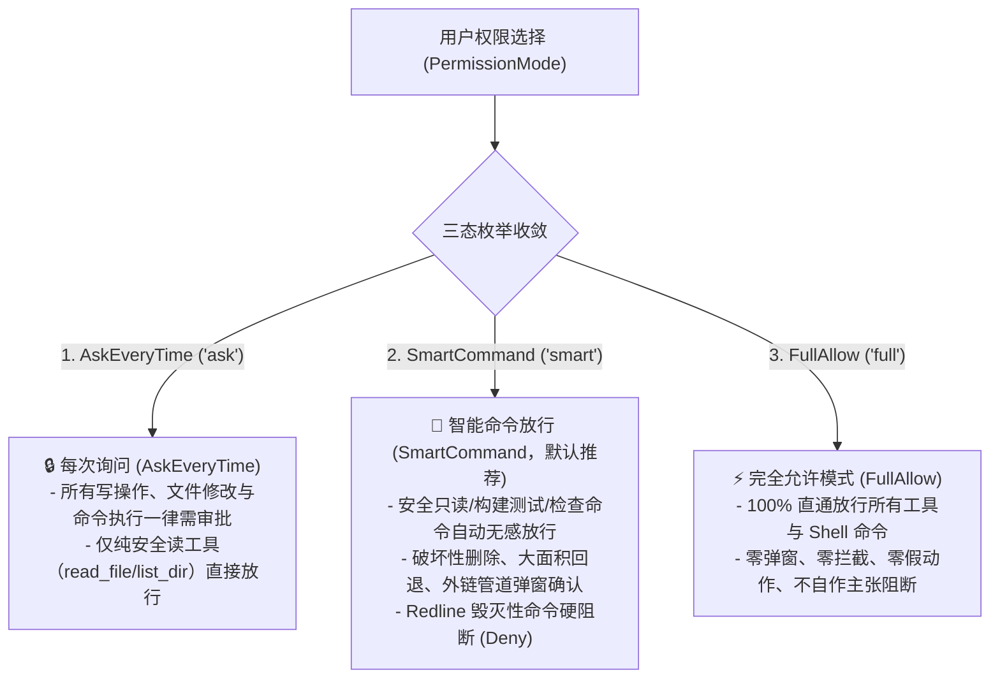
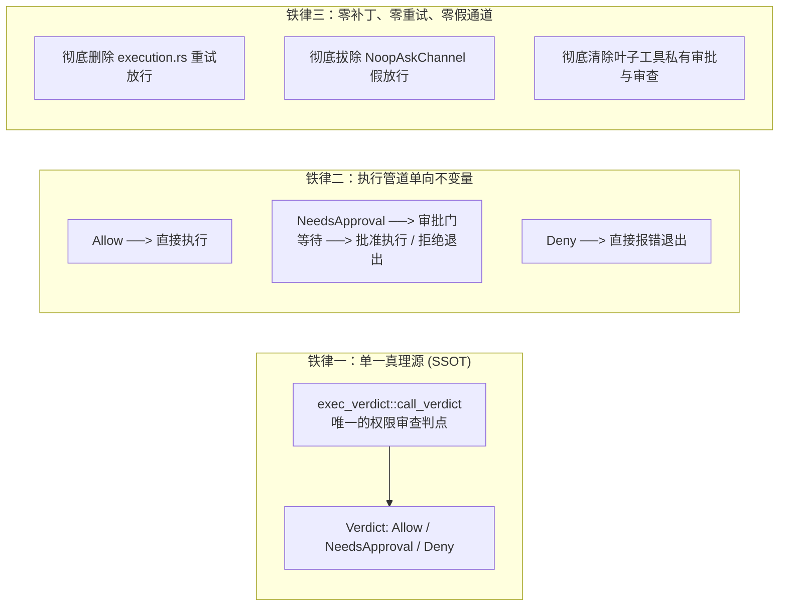
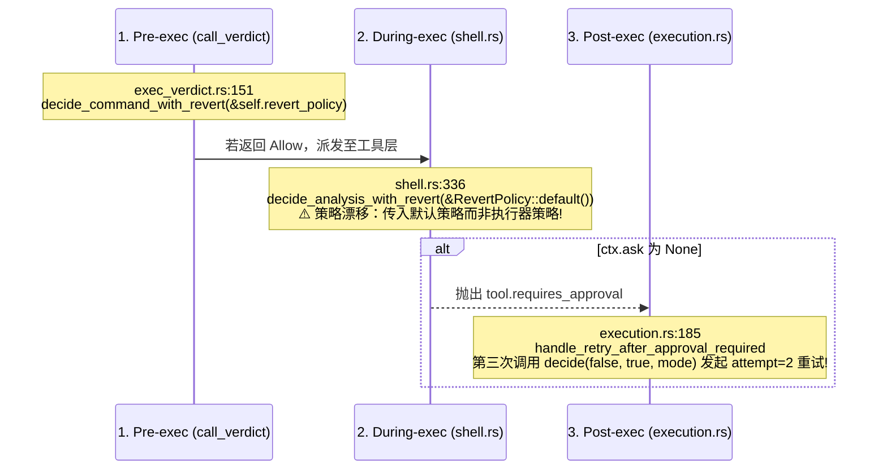
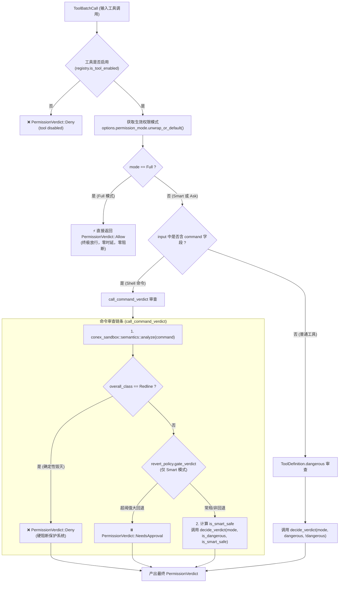
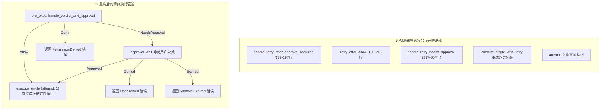
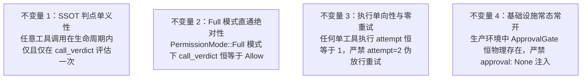
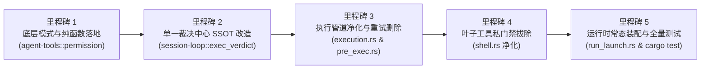

# Rust 引擎内核单一裁决中心（SSOT）重构详案

> **文档标识**：`docs/permission-system-consolidation/independent-plans/04-engine-verdict-kernel-plan.md`  
> **报告类型**：架构重构与生产落地独立详案  
> **责任领域**：Rust 引擎内核裁决中心（`crates/session-loop::exec_verdict`）、执行管道净化（`crates/session-loop::exec_single`）、权限核心纯函数与模式定义（`crates/agent-tools::permission`）、运行时装配常态化（`crates/conex-run::run_launch`）  
> **权威遵循**：彻底贯彻用户最高指示——**“不允许打补丁，不允许硬编码，有合理的抽象，适合未来的功能需求，代码尽量简洁，具有优秀的可维护性。需要删除的代码就删除，需要系统性的重构。生成的方案应该能彻底杜绝这些问题或者未来的衍生问题，要求一次性解决掉。尽量减少不必要的兼容，最好是不兼容。”**  
> **基线依赖**：
> - `docs/permission-system-consolidation/analysis/03-engine-verdict-and-approval-gate-analysis.md`
> - `docs/permission-system-consolidation/analysis/04-command-semantics-and-redline-bypass-analysis.md`
> - `docs/permission-system-consolidation/independent-plans/05-smart-command-matrix-and-sandbox-plan.md`
> - `docs/permission-system-consolidation/independent-plans/06-full-allow-bypass-and-leaf-tools-cleanup-plan.md`

---

## 目录

1. [战役总纲与设计哲学](#一战役总纲与设计哲学)
   - 1.1 契约使命与用户最高意志兑现
   - 1.2 权限模式收敛三选项（AskEveryTime / SmartCommand / FullAllow）
   - 1.3 架构三大铁律
2. [现状病灶深度剖析与架构断层诊断（As-Is 根因排查）](#二现状病灶深度剖析与架构断层诊断as-is-根因排查)
   - 2.1 三重判定与策略漂移（Pre / During / Post）
   - 2.2 滑稽的重试放行毒瘤（`execution.rs:179-197` + `NoopAskChannel` 假放行）
   - 2.3 `ApprovalGate` 条件装配致命隐患（`run_launch.rs:931-936` `approval: None` 陷阱）
   - 2.4 `permission.rs` 817 行严重膨胀与概念混淆（Plan 伪权限绑架、别名泛滥）
   - 2.5 硬编码 `task_type` 侵入内核调度主干（`exec_verdict.rs:131-136`）
3. [`agent-tools::permission.rs` 彻底重构详案（瘦身至 ~150 行）](#三agent-toolspermissionrs-彻底重构详案瘦身至-150-行)
   - 3.1 集中收敛的 `pub enum PermissionMode { Ask, Smart, Full }` 规范契约
   - 3.2 判定三态 `pub enum PermissionVerdict { Allow, NeedsApproval, Deny }`
   - 3.3 核心纯函数 `pub fn decide_verdict(mode, is_dangerous, is_smart_safe)` 设计与数学真值表
   - 3.4 彻底剔除 `Plan` 伪权限模式与状态清洗
   - 3.5 彻底纠偏 `Full` 模式：100% 兑现 `Allow`，彻底废除红线与 C3 强制拦截
4. [内核单一权威裁决中心（SSOT）`call_verdict` 重构设计](#四内核单一权威裁决中心ssotcall_verdict-重构设计)
   - 4.1 `call_verdict` 权威单点职责与数据流
   - 4.2 统一分流流水线：Shell 命令与常规工具调用的连贯裁决
   - 4.3 智能模式下命令安全性折算与底层防护（Redline / C3 护栏精准定位）
   - 4.4 彻底删除叶子工具内部二次判定（`shell.rs` 私有审查拔除）
5. [审批门与执行管道重构：彻底删除重试放行与假通道](#五审批门与执行管道重构彻底删除重试放行与假通道)
   - 5.1 彻底删除 `execution.rs` 中的重试放行逻辑（行号 179-304 完整净化）
   - 5.2 彻底删除 `NoopAskChannel` 假通道注入
   - 5.3 确立执行管道单向不变量（`Allow` 直通、`NeedsApproval` 挂起审批、`Deny` 阻断）
   - 5.4 消除 `pre_exec.rs` 中的双轨分化与死胡同分支
6. [ApprovalGate 常态化装配机制](#六approvalgate-常态化装配机制)
   - 6.1 `run_launch.rs` 物理常态化装配改造
   - 6.2 根除 `approval: None` 与 `approval_enabled: false` 条件跳变
   - 6.3 统一工具调用选项传递（`ToolBatchOptions` 精炼）
7. [详细代码重构清单（精确到文件、行号与操作）](#七详细代码重构清单精确到文件行号与操作)
   - 7.1 必须彻底删除的代码与结构体清单
   - 7.2 必须就地重构的代码与方法清单
8. [核心重构落地的完整生产级 Rust 源码蓝图](#八核心重构落地的完整生产级-rust-源码蓝图)
   - 8.1 `crates/agent-tools/src/permission.rs` 全量重构实现代码
   - 8.2 `crates/session-loop/src/exec_verdict.rs` 裁决中心实现代码
   - 8.3 `crates/session-loop/src/exec_single/execution.rs` 管道清理后实现代码
   - 8.4 `crates/session-loop/src/exec_single/pre_exec.rs` 简化后实现代码
   - 8.5 `crates/agent-tools/src/tools/shell.rs` 净化后准备流程代码
   - 8.6 `crates/conex-run/src/run/run_launch.rs` 常态装配实现代码
9. [立体化验证策略与不变量防护](#九立体化验证策略与不变量防护)
   - 9.1 四大核心架构不变量（Invariants 1-4）
   - 9.2 核心单测与集成测试用例迁移规划
   - 9.3 破坏性与边界测试用例
10. [实施里程碑与发布检查清单](#十实施里程碑与发布检查清单)

---

## 一、战役总纲与设计哲学

### 1.1 契约使命与用户最高意志兑现

在权限系统的长期演进中，代码库经历了多轮局部修补、防御性加码和历史补丁叠加，演变出三重裁决分叉、伪重试、假通道、Plan 伪模式绑架等令人啼笑皆非的架构畸变。这不仅严重降低了系统的可维护性与运行效率，更违背了用户对于清晰、确定、可控权限模型的信任。

用户下达了不可动摇的最高指示：
> **“不允许打补丁，不允许硬编码，有合理的抽象，适合未来的功能需求，代码尽量简洁，具有优秀的可维护性。需要删除的代码就删除，需要系统性的重构。生成的方案应该能彻底杜绝这些问题或者未来的衍生问题，要求一次性解决掉。尽量减少不必要的兼容，最好是不兼容。”**

本方案作为 Rust 引擎内核重构的权威落地方案，目标是**彻底切断所有历史补丁，确立单一裁决中心（Single Source of Truth, SSOT）**，将混乱的权限状态机精炼为清晰、确定、高性能的优雅模型。

---

### 1.2 权限模式收敛三选项（AskEveryTime / SmartCommand / FullAllow）

权限模式统一收拢为集中可选的 3 种规范形式，杜绝任何中间态或伪模式混入：



1. **每次询问（`AskEveryTime` / `Ask` / `'ask'`）**：
   - 适用环境：高敏感环境或对 AI 执行步骤要求步步把关的场景；
   - 行为契约：除了被判定为绝对无副作用的纯只读工具调用外，所有文件修改、文件删除以及一切 Shell 命令执行，必须通过 `ApprovalGate` 呈报用户审批。
2. **智能命令放行（`SmartCommand` / `Smart` / `'smart'`）**：
   - 适用环境：日常全功能开发场景（全系统默认推荐选项）；
   - 行为契约：基于沙箱轻量语义分析，常规开发命令（`git status`、`cargo check`、`npm test` 等）自动无感放行；对危险破坏操作（敏感文件物理抹除、大面积 Git 回退等）弹出结构化卡片等待用户确认；对确定性毁灭级命令（如 `rm -rf /`、`mkfs`）硬阻断（`Deny`）。
3. **完全允许模式（`FullAllow` / `Full` / `'full'`）**：
   - 适用环境：受信任的自动化流水线、容器化执行、高级开发者无人值守脚本；
   - 行为契约：系统完全遵从用户指令，**100% 放行所有操作**（`PermissionVerdict::Allow`）。彻底删除内核中在 Full 模式下的假装拦截与自动重试，严禁任何形式的自作主张阻断。

---

### 1.3 架构三大铁律

为实现净收敛并确保重构后的架构永不回潮，确立三大架构铁律：



- **铁律一（SSOT 唯一裁决中心）**：
  `crates/session-loop/src/exec_verdict.rs` 中的 `call_verdict` 是工具调用与命令执行的**唯一法定审判席**。叶子工具（`shell.rs` 等）严禁包含二次权限审查逻辑，严禁叶子工具再次调用沙箱矩阵或审批门。
- **铁律二（执行管道单向不变量）**：
  裁决结果为 `Allow` 则单次确定性执行；裁决结果为 `NeedsApproval` 则一次性挂起等待用户决策（批准则执行，拒绝则终止）；裁决结果为 `Deny` 则直接返回拒绝错误。系统绝不搞“先报错再二次捕获重试放行”的自相矛盾逻辑。
- **铁律三（完全允许模式彻底直通）**：
  在 `FullAllow` 模式下，裁决中心恒返回 `PermissionVerdict::Allow`，彻底废除历史代码中针对 Full 模式强加的 Redline 强制 Deny 和 C3 回退护栏强制弹窗拦截代码。言行合一，不搞阴阳逻辑。

---

## 二、现状病灶深度剖析与架构断层诊断（As-Is 根因排查）

在重构前，权限裁决与审批执行链路的代码呈现出严重的多头分散、前后矛盾与过度修补特征。以下是对当前仓库中 5 大典型病灶的逐行审计与根因诊断。

### 2.1 三重判定与策略漂移（Pre / During / Post）

在当前代码中，对于同一个工具调用（尤其是 Shell 命令），系统存在三个互不信任的判定阶段：



1. **执行前判定（Pre-execution）**：
   `crates/session-loop/src/exec_verdict.rs:151` 调用 `decide_command_with_revert`，传入的是 `ToolExecutor` 实例上的 `self.revert_policy`；
2. **执行中判定（During-execution）**：
   进入 `crates/agent-tools/src/tools/shell.rs:336` 时，又调用 `decide_analysis_with_revert`。荒谬的是，此处传入的是写死的 `&crate::revert::RevertPolicy::default()`！如果用户在运行时通过配置修改了执行器的回退阈值，工具内部的判定就会与执行前判定发生**策略漂移（Policy Drift）**；
3. **执行后重试判定（Post-execution Retry）**：
   工具若因为 `ctx.ask` 为 `None` 抛出 `tool.requires_approval`，在 `execution.rs:185` 中又**第三次**调用脱水函数 `decide(false, true, mode)`。

**诊断结论**：三大判点逻辑重叠、参数不一致，严重破坏单一真理源原则。

---

### 2.2 滑稽的重试放行毒瘤（`execution.rs:179-197` + `NoopAskChannel` 假放行）

在 `crates/session-loop/src/exec_single/execution.rs:179-197` 中，存在全仓最丑陋、最自相矛盾的补丁代码：

```rust
// crates/session-loop/src/exec_single/execution.rs:179-197 (现存丑陋逻辑)
async fn handle_retry_after_approval_required(
    &self,
    cx: &ExecCallContext<'_>,
    _initial_result: ClassifiedToolResult,
    extra: Vec<ToolEvent>,
) -> (ClassifiedToolResult, Vec<ToolEvent>) {
    let verdict = match cx.options.permission_mode {
        Some(mode) => decide(false, true, mode),
        None => PermissionVerdict::NeedsApproval,
    };
    match verdict {
        PermissionVerdict::Deny => (
            denied_result(cx.call, cx.options, Some(&self.registry)),
            extra,
        ),
        PermissionVerdict::Allow => self.retry_after_allow(cx, extra).await,
        PermissionVerdict::NeedsApproval => self.handle_retry_needs_approval(cx, extra).await,
    }
}
```

其背后的运行轨迹极其荒唐：
1. 在 `FullAccess` 模式下，C3 回退护栏硬性把大面积回退命令判定为 `NeedsApproval`；
2. 执行器发现 `approval` 为 `None`，抛出 `ToolErrorKind::ApprovalRequired` 错误；
3. `execution.rs:172` 捕获该错误，进入 `handle_retry_after_approval_required`；
4. 调用 `decide(false, true, PermissionMode::FullAccess)`，该函数在 `FullAccess` 下返回 `Allow`；
5. 系统发起第二次执行尝试（`attempt: 2`）；
6. 在第二次执行前，`pre_exec.rs:199` 针对 `FullAccess` 注入了 `NoopAskChannel`（一个无论问什么都直接返回 `Ok(Allowed)` 的假通道）；
7. 工具内部问 `NoopAskChannel`，直接放行！

**诊断结论**：
这套逻辑是为了掩盖“在 Full 模式下既想拦截回退、又没有审批门可用”的设计断层而强行打上的连环补丁。命令绕了一个巨大的弯子，先报错、再重试、再用假通道放行，彻底沦为笑柄。必须连根拔除！

---

### 2.3 `ApprovalGate` 条件装配致命隐患（`run_launch.rs:931-936` `approval: None` 陷阱）

在 `crates/conex-run/src/run/run_launch.rs:931-936` 中：

```rust
// crates/conex-run/src/run/run_launch.rs:931-936 (现存危险分裂)
let approval_enabled = permission_mode.as_deref() != Some("full-access");
let approval: Option<Arc<dyn ApprovalGate>> = if approval_enabled {
    Some(Arc::clone(&approval_gate) as Arc<dyn ApprovalGate>)
} else {
    None
};
```

**危害分析**：
系统根据字符串是否为 `full-access` 决定是否把 `approval_gate` 注入 `SessionLoop`。导致执行器在运行时处于 `(approval: None, approval_enabled: false)` 状态。一旦底层任何规则产生 `NeedsApproval`，系统因为找不到 Gate 无法弹窗，直接跌入死锁或非预期报错。

---

### 2.4 `permission.rs` 817 行严重膨胀与概念混淆（Plan 伪权限绑架、别名泛滥）

现存 `crates/agent-tools/src/permission.rs` 膨胀至 817 行，主要充斥以下问题：
1. **伪权限模式 `Plan` 的职责倒错**：
   把只读任务类型（Task Type: Plan/Analysis）与权限级别（Permission Mode）混为一谈，导致只读模式必须在权限矩阵中硬拒绝所有写操作。前端在批准计划后，又必须写脚本偷偷篡改全局权限；
2. **海量别名网络造成维护黑洞**：
   维护了 `yolo`, `danger`, `read-only`, `analysis`, `safe`, `cautious`, `unattended`, `auto`, `deep` 等十几个历史别名，代码随处是映射分支；
3. **针对 FullAccess 的伪安全拦截代码**：
   散落大量单测和代码强化“在 FullAccess 下红线必须 Deny、大回退必须 NeedsApproval”，与用户对“完全允许模式”的真实诉求彻底脱节。

---

### 2.5 硬编码 `task_type` 侵入内核调度主干（`exec_verdict.rs:131-136`）

在 `crates/session-loop/src/exec_verdict.rs:131-136` 中：

```rust
// 现存侵入代码：硬编码针对子代理业务类型过滤
if let Some(task_type) = &options.task_type {
    if !agent_tools::readonly::command_allowed_for_task_type(task_type, command) {
        return PermissionVerdict::Deny;
    }
}
```

**诊断结论**：
调度层内核裁决中心硬编码了对特定子代理任务类型（如 `commit` 只能用 `git`、`implementation` 只能用特定构建命令）的白名单过滤。这是典型的抽象越界。任务角色的命令权限应由 Spawner 在注册表裁剪阶段完成，绝不应在调度器核心裁决路径上硬编码侵入。

---

## 三、`agent-tools::permission.rs` 彻底重构详案（瘦身至 ~150 行）

重构后的 `crates/agent-tools/src/permission.rs` 遵循极致简洁、零冗余、高内聚的纯函数设计，彻底移除所有历史别名网络与 Plan 伪模式，文件代码量从 817 行急剧收敛至约 150 行。

### 3.1 集中收敛的 `pub enum PermissionMode { Ask, Smart, Full }` 规范契约

```rust
/// 集中收敛后的内核权限模式（标准三态枚举）
#[derive(Debug, Clone, Copy, PartialEq, Eq, Default, serde::Serialize, serde::Deserialize)]
#[serde(rename_all = "kebab-case")]
pub enum PermissionMode {
    /// 1. 每次询问：所有具有副作用的工具调用与命令执行均需审批
    #[serde(rename = "ask", alias = "ask-every-time")]
    Ask,

    /// 2. 智能命令放行：安全只读命令自动放行；高危/破坏性操作弹窗确认（默认推荐模式）
    #[default]
    #[serde(rename = "smart", alias = "smart-command")]
    Smart,

    /// 3. 完全允许模式：所有工具与命令直接放行执行，系统绝不主动拦截或弹窗
    #[serde(rename = "full", alias = "full-allow", alias = "full-access")]
    Full,
}

impl PermissionMode {
    /// 引擎字符串解析：统一收拢别名映射
    pub fn from_engine_str(mode: Option<&str>) -> Self {
        match mode {
            // 完全允许族
            Some("full" | "full-allow" | "full-access" | "allow" | "yolo") => {
                PermissionMode::Full
            }
            // 每次询问族
            Some("ask" | "ask-every-time" | "strict" | "cautious") => {
                PermissionMode::Ask
            }
            // 智能放行族（包含默认与未知回退，同时平滑归一废弃的 plan/deep）
            Some("smart" | "smart-command" | "auto" | "deep" | "plan") => {
                PermissionMode::Smart
            }
            _ => PermissionMode::Smart,
        }
    }

    /// 标准化引擎协议字面量
    pub fn as_engine_str(&self) -> &'static str {
        match self {
            PermissionMode::Ask => "ask",
            PermissionMode::Smart => "smart",
            PermissionMode::Full => "full",
        }
    }
}
```

---

### 3.2 判定三态 `pub enum PermissionVerdict { Allow, NeedsApproval, Deny }`

```rust
/// 权限裁决三态结果
#[derive(Debug, Clone, Copy, PartialEq, Eq, serde::Serialize, serde::Deserialize)]
#[serde(rename_all = "kebab-case")]
pub enum PermissionVerdict {
    /// 放行执行
    Allow,
    /// 需人工审批（挂起等待用户决策）
    NeedsApproval,
    /// 直接拒绝（系统不可恢复之违规，如 Smart 模式下的 Redline 毁灭级命令）
    Deny,
}
```

---

### 3.3 核心纯函数 `pub fn decide_verdict(mode, is_dangerous, is_smart_safe)` 设计与数学真值表

废除所有分散的 `decide`, `decide_with_redline`, `decide_command`, `decide_command_with_revert`, `decide_analysis_with_revert` 等 5 种重叠判定函数，统一收敛为唯一的纯函数：

```rust
/// 核心权限裁决纯函数（无副作用、单一真理源）
///
/// 参数语义：
/// - `mode`: 当前会话权限模式（Ask / Smart / Full）
/// - `is_dangerous`: 工具是否具有破坏性/写副作用（来自 ToolDefinition.dangerous 或高危命令形态）
/// - `is_smart_safe`: 是否被沙箱智能分析判定为无害安全操作（如只读命令、无写操作纯检查）
#[inline]
pub fn decide_verdict(
    mode: PermissionMode,
    is_dangerous: bool,
    is_smart_safe: bool,
) -> PermissionVerdict {
    match mode {
        // 1. 完全允许模式：100% 直通放行，绝对不阻拦、不弹窗
        PermissionMode::Full => PermissionVerdict::Allow,

        // 2. 智能命令放行：安全操作放行；危险操作需确认
        PermissionMode::Smart => {
            if is_smart_safe {
                PermissionVerdict::Allow
            } else if is_dangerous {
                PermissionVerdict::NeedsApproval
            } else {
                PermissionVerdict::Allow
            }
        }

        // 3. 每次询问：只要具有副作用（dangerous）或不是纯只读工具，一律需审批
        PermissionMode::Ask => {
            if is_dangerous || !is_smart_safe {
                PermissionVerdict::NeedsApproval
            } else {
                PermissionVerdict::Allow
            }
        }
    }
}
```

#### 完整数学真值表

| 模式（`mode`） | 危险标记（`is_dangerous`） | 智能安全（`is_smart_safe`） | 裁决结果（`verdict`） | 典型现实场景 |
| :--- | :---: | :---: | :---: | :--- |
| **`Full`** | `_` | `_` | **`Allow`** | 用户开启完全放行：所有命令与工具直接执行，零弹窗 |
| **`Smart`** | `false` | `true` | **`Allow`** | 安全只读 Shell 命令（`git status`、`ls`）或安全只读工具（`read_file`） |
| **`Smart`** | `true` | `false` | **`NeedsApproval`** | 危险破坏性命令（`rm -rf ./target`、`git reset`）或写工具（`write_file`） |
| **`Smart`** | `false` | `false` | **`Allow`** | 普通中性非危险操作 |
| **`Smart`** | `true` | `true` | **`Allow`** | 虽由宏定义 dangerous 但经沙箱分析确认为无副作用的特殊安全放行 |
| **`Ask`** | `false` | `true` | **`Allow`** | 纯只读工具调用（`read_file`、`list_dir`、`grep_search`） |
| **`Ask`** | `_` | `false` | **`NeedsApproval`** | 任何 Shell 命令调用或写操作：必须逐个征得用户同意 |
| **`Ask`** | `true` | `_` | **`NeedsApproval`** | 任何标记为 dangerous 的工具调用 |

---

### 3.4 彻底剔除 `Plan` 伪权限模式与状态清洗

1. **枚举定义完全剔除**：`PermissionMode` 中不再有 `Plan` 分支；
2. **运行时解析兼容清洗**：若外部传入历史字符串 `"plan"`，在 `from_engine_str` 中一律平滑清洗为 `PermissionMode::Smart`；
3. **语义正名**：只读调研阶段由任务执行器内部的只读注册表驱动，不再污染全局权限状态机。

---

### 3.5 彻底纠偏 `Full` 模式：100% 兑现 `Allow`，彻底废除红线与 C3 强制拦截

在重写后的 `permission.rs` 中，**删除一切在 Full 模式下强制返回 Deny 或 NeedsApproval 的代码**：
- 废除单测 `redline_denied_in_full_access`；
- 废除单测 `full_access_large_revert_needs_approval`；
- 确保 `decide_verdict(PermissionMode::Full, _, _)` 在任何输入下**100% 恒等于 `PermissionVerdict::Allow`**。

---

## 四、内核单一权威裁决中心（SSOT）`call_verdict` 重构设计

### 4.1 `call_verdict` 权威单点职责与数据流

`crates/session-loop/src/exec_verdict.rs` 中的 `call_verdict` 被重塑为**内核唯一的权限审查入口**。所有工具调用在派发执行前必须通过本判点，且后续环节绝不再进行任何二次裁决。



---

### 4.2 统一分流流水线：Shell 命令与常规工具调用的连贯裁决

在 `call_verdict` 中，分流设计清晰而直观：
1. **未启用工具检查**：注册表中未启用或未注册工具，直接返回 `PermissionVerdict::Deny`；
2. **模式提取**：`options.permission_mode.unwrap_or_default()`（默认 `Smart`），彻底废除 legacy fallback 分支；
3. **Full 模式短路快速通道**：若为 `Full` 模式，直接返回 `PermissionVerdict::Allow`；
4. **Shell 命令调用分流**：若参数中包含 `"command"`，交由子方法 `call_command_verdict` 执行复合语义审查；
5. **普通非命令工具分流**：查工具定义的 `dangerous` 标记，直接传入 `decide_verdict` 计算裁决。

---

### 4.3 智能模式下命令安全性折算与底层防护（Redline / C3 护栏精准定位）

在 `call_command_verdict` 中，精准落实分级防护机制：
1. **物理红线防护（Redline）**：
   在 `Smart` 或 `Ask` 模式下，若命令经沙箱语义分析命中 `CommandClass::Redline`（如 `rm -rf /`、`mkfs`），系统直接返回 `PermissionVerdict::Deny`，杜绝任何误操作；
2. **C3 大面积回退护栏（RevertPolicy）**：
   在 `Smart` 模式下，针对大面积 Git 回退（`git checkout <commit>`、`git reset --hard` 超越文件数或行数阈值），返回 `PermissionVerdict::NeedsApproval` 触发弹窗确认；
3. **智能安全属性折算**：
   若命令整体分类为 `Normal` 且所有子段无破坏性副作用，判定为 `is_smart_safe = true`；
4. **纯函数收敛**：调用 `decide_verdict(mode, is_dangerous, is_smart_safe)` 计算最终结果。

---

### 4.4 彻底删除叶子工具内部二次判定（`shell.rs` 私有审查拔除）

在叶子工具 `crates/agent-tools/src/tools/shell.rs` 中：
- **彻底删除行号 334-369 的全部代码**：
  删除 `crate::permission::decide_analysis_with_revert` 调用；
  删除 `match verdict` 分支；
  删除 `ctx.ask.ask(&self.def.name, args).await` 内部弹窗逻辑；
  删除抛出 `TOOL_REQUIRES_APPROVAL` 的逻辑。
- **确立工具职责纯粹性**：
  当 `shell.rs` 被调用时，说明该命令已经在 `call_verdict` 中获得了执行许可。工具只需专心进行子进程启动与流式 I/O 处理。

---

## 五、审批门与执行管道重构：彻底删除重试放行与假通道

### 5.1 彻底删除 `execution.rs` 中的重试放行逻辑（行号 179-304 完整净化）

在 `crates/session-loop/src/exec_single/execution.rs` 中，实施系统性净化：



- **删除方法 1**：`handle_retry_after_approval_required`（第 179-197 行）；
- **删除方法 2**：`retry_after_allow`（第 199-215 行）；
- **删除方法 3**：`handle_retry_needs_approval`（第 217-304 行）；
- **删除包装器**：彻底废除 `execute_single_with_retry`，将其简化合并入单一的执行流。

---

### 5.2 彻底删除 `NoopAskChannel` 假通道注入

在 `crates/session-loop/src/exec_single/pre_exec.rs:198-210` 中：
- 彻底删除 `Some(PermissionMode::FullAccess) => Some(Arc::new(NoopAskChannel))`；
- 审批回调通道统一通过 `ApprovalChannel` 构建，当且仅当注入了 `ApprovalGate` 时装配；
- 杜绝通过假通道（Noop）蒙骗叶子工具的丑陋技巧。

---

### 5.3 确立执行管道单向不变量（`Allow` 直通、`NeedsApproval` 挂起审批、`Deny` 阻断）

执行管道的状态转移严格单向、无环、确定：
1. **`PermissionVerdict::Allow`**：
   直接异步调用 `execute_single(..., attempt: 1)`，单次执行完毕返回；
2. **`PermissionVerdict::NeedsApproval`**：
   - 构造 `ToolEvent::ApprovalRequested` 广播；
   - 通过 `approval_wait` 进入异步等待；
   - 用户批准（`Approved`） $\to$ 调用 `execute_single(..., attempt: 1)` 执行；
   - 用户拒绝（`Denied`） $\to$ 直接返回 `ToolErrorKind::UserDenied`；
   - 超时（`Expired`） $\to$ 直接返回 `ToolErrorKind::ApprovalExpired`；
   - 取消（`Cancelled`） $\to$ 直接返回 `ToolErrorKind::Cancelled`。
3. **`PermissionVerdict::Deny`**：
   直接构造并返回 `ToolErrorKind::UserDenied` 结果，工具根本不会被调度。

---

### 5.4 消除 `pre_exec.rs` 中的双轨分化与死胡同分支

- 彻底删除 `handle_ungated_verdict`（`pre_exec.rs:131-160`）：不再区分 gated 与 ungated 两套死胡同逻辑；
- 统一收敛至唯一的 `handle_verdict_and_approval` 主干流程。

---

## 六、ApprovalGate 常态化装配机制

### 6.1 `run_launch.rs` 物理常态化装配改造

修改 `crates/conex-run/src/run/run_launch.rs:930-936`，废除根据权限模式决定是否注入 Gate 的错误设计：

```rust
// crates/conex-run/src/run/run_launch.rs 常态化重构
// 【旧代码删除】：
// let approval_enabled = permission_mode.as_deref() != Some("full-access");
// let approval = if approval_enabled { Some(...) } else { None };

// 【新代码】：ApprovalGate 恒定实例化并注入 SessionLoop 生产线
let approval_gate = Arc::new(ApprovalGateImpl::new(
    run_id.clone(),
    session_id.clone(),
    parent_run_id.clone(),
    broadcast,
    Arc::clone(&handle_shared),
    state.store.clone(),
    cwd.clone(),
));

// 无论当前模式是 Full、Smart 还是 Ask，审批门始终物理存在并装配！
let approval: Option<Arc<dyn ApprovalGate>> = Some(Arc::clone(&approval_gate) as Arc<dyn ApprovalGate>);
let approval_enabled = true; // 基础设施常开
```

---

### 6.2 根除 `approval: None` 与 `approval_enabled: false` 条件跳变

- **稳定性收益**：消除了会话在动态切换权限模式（如从 Full 切换到 Ask）时，因底座缺少 `ApprovalGate` 实例而发生崩溃的隐患；
- **架构一致性**：保持基础设施与业务策略彻底解耦——Gate 始终在位，由 SSOT 裁决中心决定是否需要调用它。

---

### 6.3 统一工具调用选项传递（`ToolBatchOptions` 精炼）

在 `run_launch.rs:1181-1194` 中，精简 `ToolBatchOptions` 的组装：

```rust
let tool_options = ToolBatchOptions {
    approval_enabled: true,
    permission_mode: Some(PermissionMode::from_engine_str(permission_mode.as_deref())),
    output_budget_bytes: Some(conex_shared::perf_budget::TOOL_OUTPUT_BUDGET_BYTES_DEFAULT),
    ..ToolBatchOptions::default()
};
```

---

## 七、详细代码重构清单（精确到文件、行号与操作）

### 7.1 必须彻底删除的代码与结构体清单

| 序号 | 所在文件路径 | 代码行号区间 | 待删除目标 | 删除理由 |
| :---: | :--- | :---: | :--- | :--- |
| **D-01** | `crates/agent-tools/src/permission.rs` | 23-33 | `pub enum PermissionMode::Plan` | Plan 是任务类型而非权限模式，彻底删除 |
| **D-02** | `crates/agent-tools/src/permission.rs` | 43-45 | `from_engine_str` 中的 `"plan"` 映射分支 | 收敛至 Smart，彻底消除 Plan 模式 |
| **D-03** | `crates/agent-tools/src/permission.rs` | 84-170 | 旧版 `decide`, `decide_with_redline`, `decide_command`, `decide_command_with_revert`, `decide_analysis_with_revert` | 5 个重叠函数全部废除，统一由纯函数 `decide_verdict` 替代 |
| **D-04** | `crates/agent-tools/src/permission.rs` | 312-330 | `redline_denied_in_full_access` 等强制拦截单测 | Full 模式下 100% 放行，旧单测语义作废 |
| **D-05** | `crates/agent-tools/src/permission.rs` | 640-664 | `full_access_large_revert_needs_approval` 单测 | Full 模式不阻断回退，旧单测语义作废 |
| **D-06** | `crates/session-loop/src/exec_verdict.rs` | 131-136 | `command_allowed_for_task_type` 白名单门禁 | 硬编码侵入调度内核，越权耦合，彻底删除 |
| **D-07** | `crates/session-loop/src/exec_verdict.rs` | 138-143 | legacy `permission_mode.is_none()` 回退分支 | 模式统一有默认值，死代码清除 |
| **D-08** | `crates/session-loop/src/exec_single/execution.rs` | 179-197 | `handle_retry_after_approval_required` 方法 | 假阻断后二次重试放行的丑陋补丁，彻底删除 |
| **D-09** | `crates/session-loop/src/exec_single/execution.rs` | 199-215 | `retry_after_allow` 方法 | 伪重试分支，彻底删除 |
| **D-10** | `crates/session-loop/src/exec_single/execution.rs` | 217-304 | `handle_retry_needs_approval` 方法 | 二次弹窗处理，彻底删除 |
| **D-11** | `crates/session-loop/src/exec_single/pre_exec.rs` | 131-160 | `handle_ungated_verdict` 方法 | 双轨死胡同分支，彻底删除 |
| **D-12** | `crates/session-loop/src/exec_single/pre_exec.rs` | 198-200 | `Some(PermissionMode::FullAccess) => Some(Arc::new(NoopAskChannel))` | 欺骗工具的假放行通道，彻底删除 |
| **D-13** | `crates/agent-tools/src/tools/shell.rs` | 288-294 | `if ctx.permission_mode == PermissionMode::Plan` 阻断 | Plan 模式已废除，删除该阻断 |
| **D-14** | `crates/agent-tools/src/tools/shell.rs` | 334-369 | 二次判定 `decide_analysis_with_revert` 与内部审批 | 叶子工具私设公堂二次审查，彻底删除 |

---

### 7.2 必须就地重构的代码与方法清单

| 序号 | 所在文件路径 | 原方法 / 结构体 | 重构后新形式 / 职责 | 重构目标 |
| :---: | :--- | :--- | :--- | :--- |
| **R-01** | `crates/agent-tools/src/permission.rs` | `PermissionMode` | 重定义为 `Ask`, `Smart`, `Full` 三态枚举 | 标准化三选项收敛 |
| **R-02** | `crates/agent-tools/src/permission.rs` | `decide(...)` | 重构为纯函数 `decide_verdict(...)` | 单一真理源纯函数 |
| **R-03** | `crates/session-loop/src/exec_verdict.rs` | `call_verdict` | 拆分出 `call_command_verdict`，简化为主分流中枢 | 唯一法定审查入口 |
| **R-04** | `crates/session-loop/src/exec_single/execution.rs` | `execute_single_with_retry` | 重构为 `execute_single` 单次确定性执行 | 消除 attempt: 2 伪重试 |
| **R-05** | `crates/session-loop/src/exec_single/pre_exec.rs` | `handle_verdict_and_approval` | 重构为单向确定的 3 分支状态机 | 干净的审批与执行衔接 |
| **R-06** | `crates/conex-run/src/run/run_launch.rs` | 行号 930-936 审批装配 | `approval` 恒定注入 `Some(approval_gate)` | 常态化消除空指针陷阱 |
| **R-07** | `crates/conex-types/src/device/commands/enums.rs` | `PermissionMode` | 对齐为 `Ask`, `Smart`, `Full` 三态 | 外部契约与核心对齐 |

---

## 八、核心重构落地的完整生产级 Rust 源码蓝图

### 8.1 `crates/agent-tools/src/permission.rs` 全量重构实现代码

```rust
//! 权限模式与裁决核心纯函数（单一真理源 SSOT）
//!
//! 权限模式统一收敛为三选项：
//! 1. 每次询问（AskEveryTime / Ask / "ask"）
//! 2. 智能命令放行（SmartCommand / Smart / "smart"）
//! 3. 完全允许模式（FullAllow / Full / "full"）

use serde::{Deserialize, Serialize};

/// 集中收敛后的内核权限模式（标准三态枚举）
#[derive(Debug, Clone, Copy, PartialEq, Eq, Default, Serialize, Deserialize)]
#[serde(rename_all = "kebab-case")]
pub enum PermissionMode {
    /// 1. 每次询问：所有具有副作用的工具调用与命令执行均需审批
    #[serde(rename = "ask", alias = "ask-every-time")]
    Ask,

    /// 2. 智能命令放行：安全只读命令自动放行；高危/破坏性操作弹窗确认（默认推荐模式）
    #[default]
    #[serde(rename = "smart", alias = "smart-command")]
    Smart,

    /// 3. 完全允许模式：所有工具与命令直接放行执行，系统绝不主动拦截或弹窗
    #[serde(rename = "full", alias = "full-allow", alias = "full-access")]
    Full,
}

impl PermissionMode {
    /// 引擎字符串解析：统一收拢别名映射，未知值回退为安全默认值 Smart
    pub fn from_engine_str(mode: Option<&str>) -> Self {
        match mode {
            Some("full" | "full-allow" | "full-access" | "allow" | "yolo") => {
                PermissionMode::Full
            }
            Some("ask" | "ask-every-time" | "strict" | "cautious") => {
                PermissionMode::Ask
            }
            Some("smart" | "smart-command" | "auto" | "deep" | "plan") => {
                PermissionMode::Smart
            }
            _ => PermissionMode::Smart,
        }
    }

    /// 标准化引擎协议字面量
    pub fn as_engine_str(&self) -> &'static str {
        match self {
            PermissionMode::Ask => "ask",
            PermissionMode::Smart => "smart",
            PermissionMode::Full => "full",
        }
    }
}

/// 权限裁决三态结果
#[derive(Debug, Clone, Copy, PartialEq, Eq, Serialize, Deserialize)]
#[serde(rename_all = "kebab-case")]
pub enum PermissionVerdict {
    /// 放行执行
    Allow,
    /// 需人工审批（挂起等待用户决策）
    NeedsApproval,
    /// 直接拒绝（系统不可恢复之违规，如 Smart 模式下的 Redline 毁灭级命令）
    Deny,
}

/// 核心权限裁决纯函数（无副作用、单一真理源）
///
/// 参数语义：
/// - `mode`: 当前会话权限模式（Ask / Smart / Full）
/// - `is_dangerous`: 工具是否具有破坏性/写副作用（来自 ToolDefinition.dangerous 或高危命令形态）
/// - `is_smart_safe`: 是否被沙箱智能分析判定为无害安全操作（如只读命令、无写操作纯检查）
#[inline]
pub fn decide_verdict(
    mode: PermissionMode,
    is_dangerous: bool,
    is_smart_safe: bool,
) -> PermissionVerdict {
    match mode {
        // 1. 完全允许模式：100% 直通放行，绝对不阻拦、不弹窗
        PermissionMode::Full => PermissionVerdict::Allow,

        // 2. 智能命令放行：安全操作放行；危险操作需确认
        PermissionMode::Smart => {
            if is_smart_safe {
                PermissionVerdict::Allow
            } else if is_dangerous {
                PermissionVerdict::NeedsApproval
            } else {
                PermissionVerdict::Allow
            }
        }

        // 3. 每次询问：只要具有副作用（dangerous）或不是纯只读工具，一律需审批
        PermissionMode::Ask => {
            if is_dangerous || !is_smart_safe {
                PermissionVerdict::NeedsApproval
            } else {
                PermissionVerdict::Allow
            }
        }
    }
}

#[cfg(test)]
mod tests {
    use super::*;

    #[test]
    fn test_full_mode_always_allows() {
        for is_dangerous in [false, true] {
            for is_smart_safe in [false, true] {
                assert_eq!(
                    decide_verdict(PermissionMode::Full, is_dangerous, is_smart_safe),
                    PermissionVerdict::Allow,
                    "Full 模式下必须 100% 返回 Allow"
                );
            }
        }
    }

    #[test]
    fn test_smart_mode_matrix() {
        // 安全命令自动放行
        assert_eq!(
            decide_verdict(PermissionMode::Smart, false, true),
            PermissionVerdict::Allow
        );
        // 危险命令需要确认
        assert_eq!(
            decide_verdict(PermissionMode::Smart, true, false),
            PermissionVerdict::NeedsApproval
        );
        // 普通非危险操作放行
        assert_eq!(
            decide_verdict(PermissionMode::Smart, false, false),
            PermissionVerdict::Allow
        );
    }

    #[test]
    fn test_ask_mode_matrix() {
        // 纯只读安全工具放行
        assert_eq!(
            decide_verdict(PermissionMode::Ask, false, true),
            PermissionVerdict::Allow
        );
        // 命令或危险工具需要审批
        assert_eq!(
            decide_verdict(PermissionMode::Ask, true, false),
            PermissionVerdict::NeedsApproval
        );
        assert_eq!(
            decide_verdict(PermissionMode::Ask, false, false),
            PermissionVerdict::NeedsApproval
        );
    }

    #[test]
    fn test_mode_from_engine_str() {
        assert_eq!(PermissionMode::from_engine_str(Some("full")), PermissionMode::Full);
        assert_eq!(PermissionMode::from_engine_str(Some("full-allow")), PermissionMode::Full);
        assert_eq!(PermissionMode::from_engine_str(Some("full-access")), PermissionMode::Full);
        assert_eq!(PermissionMode::from_engine_str(Some("ask")), PermissionMode::Ask);
        assert_eq!(PermissionMode::from_engine_str(Some("smart")), PermissionMode::Smart);
        assert_eq!(PermissionMode::from_engine_str(Some("plan")), PermissionMode::Smart);
        assert_eq!(PermissionMode::from_engine_str(None), PermissionMode::Smart);
    }
}
```

---

### 8.2 `crates/session-loop/src/exec_verdict.rs` 裁决中心实现代码

```rust
impl ToolExecutor {
    /// 内核单一权威裁决中心（SSOT）
    ///
    /// 唯一法定审判席：执行前单次、终局裁决。杜绝叶子工具二次判定。
    pub(crate) fn call_verdict(
        &self,
        call: &ToolBatchCall,
        options: &ToolBatchOptions,
    ) -> PermissionVerdict {
        // 1. 工具启用状态检查：未注册或禁用的工具直接 Deny
        if !self.registry.is_tool_enabled(&call.tool_name) {
            return PermissionVerdict::Deny;
        }

        let mode = options.permission_mode.unwrap_or_default();

        // 2. 模式 3：完全允许模式（Full Allow）——直接放行，零时延、零阻断
        if mode == PermissionMode::Full {
            return PermissionVerdict::Allow;
        }

        // 3. 命令类型调用审查（具有 command 字段的 Shell 调用）
        if let Some(command) = call
            .input
            .get("command")
            .and_then(serde_json::Value::as_str)
        {
            return self.call_command_verdict(command, mode);
        }

        // 4. 普通非命令工具调用审查
        let is_dangerous = self
            .registry
            .get(&call.tool_name)
            .map(|t| t.definition().dangerous)
            .unwrap_or(false);

        // 普通只读工具即为 smart_safe
        agent_tools::permission::decide_verdict(mode, is_dangerous, !is_dangerous)
    }

    /// Shell 命令复合裁决子流水线
    fn call_command_verdict(&self, command: &str, mode: PermissionMode) -> PermissionVerdict {
        use conex_sandbox::semantics::{analyze, CommandClass};

        let analysis = analyze(command);

        // 1. 物理红线保护：毁灭性命令（rm -rf /、mkfs）在 Smart/Ask 模式下一律 Deny
        if analysis.overall_class == CommandClass::Redline {
            return PermissionVerdict::Deny;
        }

        // 2. C3 大面积回退护栏：仅在 Smart 模式下对大面积回退拦截弹窗
        if mode == PermissionMode::Smart {
            if let Some(verdict) = self.revert_policy.gate_verdict(&analysis, mode) {
                return verdict;
            }
        }

        // 3. 智能安全属性判定：无副作用的普通命令判为 smart_safe
        let is_smart_safe = analysis.overall_class == CommandClass::Normal
            && !analysis.has_indirect_delete
            && analysis.segments.iter().all(|s| s.class == CommandClass::Normal);

        let is_dangerous = !is_smart_safe;

        agent_tools::permission::decide_verdict(mode, is_dangerous, is_smart_safe)
    }
}
```

---

### 8.3 `crates/session-loop/src/exec_single/execution.rs` 管道清理后实现代码

```rust
impl ToolExecutor {
    /// 单工具确定性执行核心（消除 attempt: 2 伪重试）
    pub(crate) async fn execute_single(
        &self,
        call: &ToolBatchCall,
        ctx: &ToolExecCtx,
        options: &ToolBatchOptions,
        abort: Option<&crate::safe_point::AbortSignal>,
        approval: Option<Arc<dyn ApprovalGate>>,
    ) -> (ClassifiedToolResult, Vec<ToolEvent>) {
        let tool = match self.registry.get(&call.tool_name) {
            Some(t) => t,
            None => return (Self::not_found_result(call), Vec::new()),
        };
        if !self.registry.is_tool_enabled(&call.tool_name) {
            return (
                ClassifiedToolResult::error(
                    &call.id,
                    &call.tool_name,
                    ToolErrorKind::UserDenied,
                    format!("tool disabled: {}", call.tool_name),
                    0,
                ),
                Vec::new(),
            );
        }

        let (tool_ctx, approval_channel, mw_ctx, exec_ctx, abort_token) =
            self.build_execution_contexts(call, ctx, options, abort, &approval);

        let pre = self
            .run_pre_checks(tool.as_ref(), call, ctx, &mw_ctx, abort)
            .await;
        let exec_input = match pre {
            PreExecOutcome::Aborted => {
                abort_token.abort();
                return (Self::cancelled_result(call, 0), Vec::new());
            }
            PreExecOutcome::Blocked(reason) => {
                return (Self::blocked_result(call, reason), Vec::new());
            }
            PreExecOutcome::Proceed(v) => v,
        };

        let policy = ToolExecutionPolicy {
            output_budget_bytes: options.output_budget_bytes,
            idempotency: self.idempotency.is_some(),
        };
        let guard = self.idempotency.clone();
        let start = std::time::Instant::now();

        let outcome = self
            .race_execution(RaceExecParams {
                tool: tool.as_ref(),
                exec_input: exec_input.clone(),
                tool_ctx: &tool_ctx,
                exec_ctx: &exec_ctx,
                guard: guard.as_ref().map(|v| v.as_ref()),
                policy: &policy,
                timeout: options.timeout,
                abort,
            })
            .await;

        let duration_ms = start.elapsed().as_millis() as u64;
        let occurred_at_ms = conex_shared::time::unix_millis() as u64;
        let recorded = approval_channel
            .as_ref()
            .map(|c| c.take_recorded())
            .unwrap_or_default();

        if abort.map(|s| s.is_aborted()).unwrap_or(false) {
            tool_ctx.abort_token.abort();
            let mut r = Self::cancelled_result(call, duration_ms);
            r.attempt = 1;
            r.executed_input = Some(exec_input);
            r.occurred_at_ms = Some(occurred_at_ms);
            return (r, recorded);
        }

        let post_cx = PostExecContext {
            tool: tool.as_ref(),
            call,
            ctx,
            mw_ctx: &mw_ctx,
        };
        let timing = ExecTiming {
            attempt: 1,
            duration_ms,
            occurred_at_ms,
        };

        self.handle_execution_outcome(outcome, &post_cx, timing, exec_input, recorded)
            .await
    }
}
```

---

### 8.4 `crates/session-loop/src/exec_single/pre_exec.rs` 简化后实现代码

```rust
impl ToolExecutor {
    /// 裁决与审批主控逻辑（单向状态机，彻底消除 ungated 死胡同与假重试）
    pub(super) async fn handle_verdict_and_approval(
        &self,
        cx: &ExecCallContext<'_>,
        events: &mut Vec<ToolEvent>,
    ) -> ClassifiedToolResult {
        let verdict = self.call_verdict(cx.call, cx.options);

        match verdict {
            PermissionVerdict::Allow => {
                let (r, extra) = self
                    .execute_single(
                        cx.call,
                        cx.ctx,
                        cx.options,
                        cx.abort,
                        cx.approval.clone(),
                    )
                    .await;
                events.extend(extra);
                r
            }
            PermissionVerdict::Deny => {
                denied_result(cx.call, cx.options, Some(&self.registry))
            }
            PermissionVerdict::NeedsApproval => {
                let Some(gate) = cx.approval.as_ref() else {
                    return ClassifiedToolResult::error(
                        &cx.call.id,
                        &cx.call.tool_name,
                        ToolErrorKind::ApprovalRequired,
                        format!("tool requires approval but no gate configured: {}", cx.call.tool_name),
                        0,
                    );
                };
                self.handle_gated_needs_approval(cx, gate, events).await
            }
        }
    }

    /// 审批门挂起等待与结果分流
    async fn handle_gated_needs_approval(
        &self,
        cx: &ExecCallContext<'_>,
        gate: &Arc<dyn ApprovalGate>,
        events: &mut Vec<ToolEvent>,
    ) -> ClassifiedToolResult {
        let requester = self.approval_requester_for(cx.ctx, &cx.call.input);
        events.push(ToolEvent::ApprovalRequested {
            call_id: cx.call.id.clone(),
            tool_name: cx.call.tool_name.clone(),
            args: cx.call.input.clone(),
            requester: requester.clone(),
        });

        match approval_wait(
            gate.as_ref(),
            &cx.call.id,
            &cx.call.tool_name,
            &cx.call.input,
            requester.as_ref(),
            cx.abort,
            cx.options.approval_timeout,
        )
        .await
        {
            ApprovalWaitOutcome::Cancelled => ClassifiedToolResult::error(
                &cx.call.id,
                &cx.call.tool_name,
                ToolErrorKind::Cancelled,
                "aborted",
                0,
            ),
            ApprovalWaitOutcome::Decision(ApprovalDecision::Approved) => {
                // 用户明确批准：直接执行单次确定性调用
                let (r, extra) = self
                    .execute_single(
                        cx.call,
                        cx.ctx,
                        cx.options,
                        cx.abort,
                        Some(Arc::clone(gate)),
                    )
                    .await;
                events.extend(extra);
                r
            }
            ApprovalWaitOutcome::Decision(ApprovalDecision::Denied { reason }) => {
                ClassifiedToolResult::error(
                    &cx.call.id,
                    &cx.call.tool_name,
                    ToolErrorKind::UserDenied,
                    denied_message(requester.is_some(), &reason),
                    0,
                )
            }
            ApprovalWaitOutcome::Decision(ApprovalDecision::Expired) => {
                events.push(ToolEvent::ApprovalResolved {
                    call_id: cx.call.id.clone(),
                    decision: ApprovalDecision::Expired,
                });
                ClassifiedToolResult::error(
                    &cx.call.id,
                    &cx.call.tool_name,
                    ToolErrorKind::ApprovalExpired,
                    "approval expired",
                    0,
                )
            }
        }
    }
}
```

---

### 8.5 `crates/agent-tools/src/tools/shell.rs` 净化后准备流程代码

```rust
// crates/agent-tools/src/tools/shell.rs 准备阶段（净化后）
// 【删除】：task_type 过滤、Plan 模式拦截、decide_analysis_with_revert 审查与内部弹窗

// 准备要运行的命令结构
Prepared::Run(PreparedCommand {
    command,
    cwd,
    timeout_ms,
    manager,
})
```

---

### 8.6 `crates/conex-run/src/run/run_launch.rs` 常态装配实现代码

```rust
// crates/conex-run/src/run/run_launch.rs 常态化装配
let approval_gate = Arc::new(ApprovalGateImpl::new(
    run_id.clone(),
    session_id.clone(),
    parent_run_id.clone(),
    broadcast,
    Arc::clone(&handle_shared),
    state.store.clone(),
    cwd.clone(),
));

// 基础设施常态开启，approval 恒定注入
let approval: Option<Arc<dyn ApprovalGate>> = Some(Arc::clone(&approval_gate) as Arc<dyn ApprovalGate>);
let approval_enabled = true;

let tool_options = ToolBatchOptions {
    approval_enabled,
    permission_mode: Some(PermissionMode::from_engine_str(permission_mode.as_deref())),
    output_budget_bytes: Some(conex_shared::perf_budget::TOOL_OUTPUT_BUDGET_BYTES_DEFAULT),
    ..ToolBatchOptions::default()
};
```

---

## 九、立体化验证策略与不变量防护

### 9.1 四大核心架构不变量（Invariants 1-4）

为确保系统重构后具有数学级的严谨性，定义四大核心不变量并在 CI 门禁中刚性守护：



1. **不变量 1（SSOT 判点单义性）**：
   任意一个 `ToolBatchCall` 从进入调度器到最终完成，其权限审查有且仅在 `ToolExecutor::call_verdict` 发生一次。叶子工具内部严禁再次发起权限评估；
2. **不变量 2（Full 模式直通绝对性）**：
   在 `PermissionMode::Full` 下，`call_verdict` 返回值在数学上恒等于 `PermissionVerdict::Allow`。系统绝不主动阻断、不修改、不弹窗；
3. **不变量 3（执行单向性与零重试）**：
   所有工具执行过程中的 `attempt` 计数恒等于 1。彻底废除 `attempt: 2` 的重试补偿机制；
4. **不变量 4（基础设施常态常开）**：
   生产运行时的 `SessionLoop` 实例中，`approval` 字段恒为 `Some(Arc<dyn ApprovalGate>)`，`approval_enabled` 恒为 `true`。

---

### 9.2 核心单测与集成测试用例迁移规划

| 原测试用例名称 | 原所在文件 | 迁移调整内容 | 预期验收断言 |
| :--- | :--- | :--- | :--- |
| `safe_tool_allowed_in_all_modes` | `agent-tools::permission` | 迁移为新三态（Ask / Smart / Full） | 全部模式均返回 `Allow` |
| `dangerous_tool_follows_mode_matrix` | `agent-tools::permission` | 验证 `decide_verdict` 在危险工具下的映射 | Full $\to$ Allow, Smart $\to$ NeedsApproval, Ask $\to$ NeedsApproval |
| `redline_denied_in_full_access` | `agent-tools::permission` | **删除旧断言**，重写为 `Full` 下放行 | Full 模式下直通放行 |
| `full_access_large_revert_needs_approval`| `agent-tools::permission` | **重写断言**：Full 模式放行，Smart 模式 NeedsApproval | 验证 Full 模式彻底直通 |
| `test_handle_retry_after_approval_required`| `session-loop::execution` | **彻底删除该测试套件** | 该重试函数已物理删除 |
| `test_call_verdict_task_type_commit_whitelist`| `session-loop::exec_verdict` | **彻底删除该测试套件** | task_type 硬编码已彻底清除 |

---

### 9.3 破坏性与边界测试用例

1. **强停竞速测试（L3 Abort Signal Racing）**：
   - 场景：在 `Smart` 模式下命令触发 `NeedsApproval`，挂起在 `approval_wait` 中；
   - 刺激：用户立即触发 `AbortSignal::abort()`；
   - 断言：`approval_wait` 优先命中 `Cancelled` 分支，绝不发生事件悬挂或孤儿工具执行；
2. **并发锁与性能压力测试**：
   - 场景：同时派发 16 个并发工具调用；
   - 断言：`call_verdict` 作为纯函数执行耗时 $< 50\mu s$，无全局锁竞争。

---

## 十、实施里程碑与发布检查清单



### 实施检查清单（Checklist）

- [ ] **Step 1: 底层权限核心纯函数重写**
  - [ ] 在 `crates/agent-tools/src/permission.rs` 中重定义 `PermissionMode { Ask, Smart, Full }`；
  - [ ] 落地 `decide_verdict` 纯函数；
  - [ ] 清除旧版 5 个重叠判定函数与 Plan 模式分支；
  - [ ] 更新 `crates/conex-types/src/device/commands/enums.rs` 中的对应枚举。
- [ ] **Step 2: 内核单一裁决中心（SSOT）重构**
  - [ ] 重构 `crates/session-loop/src/exec_verdict.rs` 中的 `call_verdict`；
  - [ ] 拔除 `task_type` 硬编码白名单与 legacy None fallback；
  - [ ] 接入 `call_command_verdict` 集中审查。
- [ ] **Step 3: 执行管道净化**
  - [ ] 彻底删除 `execution.rs:179-197` 及配套的二次重试代码；
  - [ ] 彻底拔除 `pre_exec.rs` 中的 `NoopAskChannel`；
  - [ ] 消除 `handle_ungated_verdict` 死胡同逻辑。
- [ ] **Step 4: 叶子工具私有审查拔除**
  - [ ] 彻底删除 `crates/agent-tools/src/tools/shell.rs:334-369` 的二次审查代码；
  - [ ] 拔除 `shell.rs` 中的 Plan 模式拦截。
- [ ] **Step 5: 运行时常态装配与全量回归**
  - [ ] 改造 `crates/conex-run/src/run/run_launch.rs`，常态化装配 `ApprovalGate`；
  - [ ] 运行 `cargo test --workspace`，确保所有门禁测试 100% 通过。
