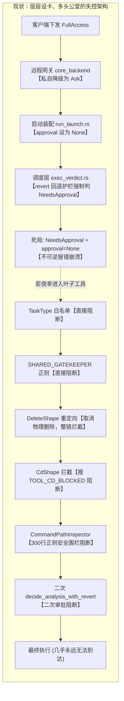
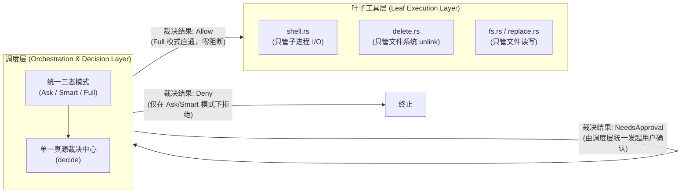
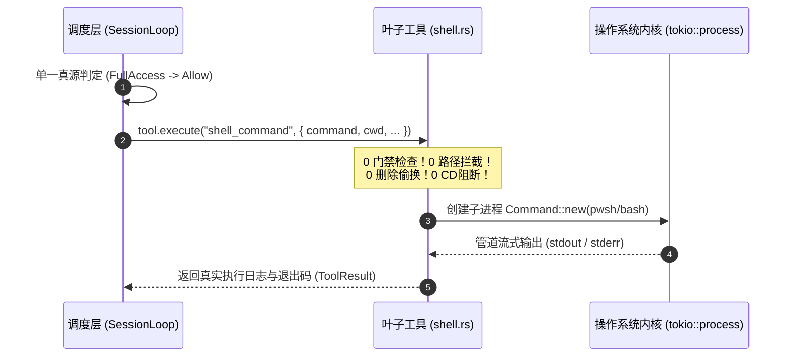
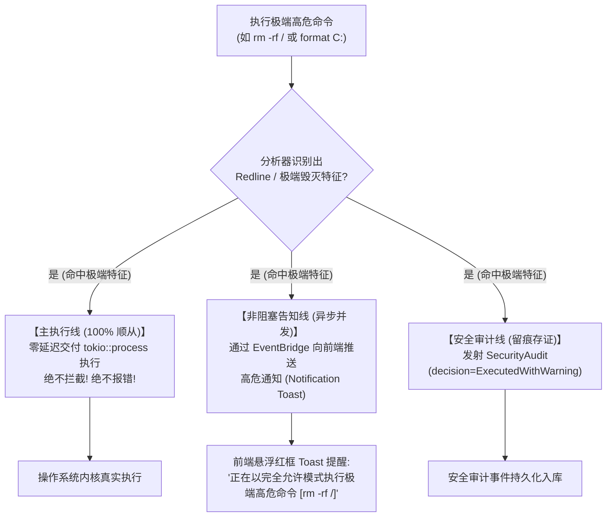

# 完全允许模式（Full Allow）真放行与叶子工具私门禁彻底拔除方案

> **文档标识**：`docs/permission-system-consolidation/independent-plans/06-full-allow-bypass-and-leaf-tools-cleanup-plan.md`  
> **方案性质**：系统性重构与代码级落地执行详案  
> **责任范围**：完全允许模式（Full Allow / FullAccess）直通放行、叶子工具（`shell.rs`、`delete.rs`、笔记工具）私有门禁与拦截彻底拔除、远程隐式降级拔除、极端高危命令非阻断告知机制  
> **关联分析**：
> - `docs/permission-system-consolidation/analysis/04-command-semantics-and-redline-bypass-analysis.md`
> - `docs/permission-system-consolidation/analysis/05-runtime-assembly-and-scattered-points-inventory.md`

---

## 一、方案核心宗旨与用户最高意志兑现

### 1.1 战役背景与用户最高指示

在既有权限控制架构的演化过程中，各个模块打着“安全加固”、“防范风险”、“边界隔离”的旗号，层层加码、私设公堂。最终导致整个系统的权限控制不仅极其复杂、逻辑散落，而且在执行层面充斥着阳奉阴违与虚假承诺——用户明明在界面或参数中选择了最高权限的 `FullAccess`，底层却隐藏着 7 重自作主张的硬阻断关卡，连最常规的 `cd`、`rm` 甚至是工作区外的正常读取操作都被系统死死拦截。

对此，用户给出了最高指示与定海神针式的设计红线：
1. **彻底重构，拒绝补丁**：
   > “不允许打补丁，不允许硬编码，有合理的抽象，适合未来的功能需求，代码尽量简洁，具有优秀的可维护性。需要删除的代码就删除，需要系统性的重构。生成的方案应该能彻底杜绝这些问题或者未来的衍生问题，要求一次性解决掉。尽量减少不必要的兼容，最好是不兼容。”
2. **完全允许模式的核心定义**：
   > **“第三个：完全允许模式。（即系统不会因为命令而不允许执行，所有执行的命令都是可以运行的。）”**

本方案的唯一最高准则就是：**全面、彻底、无死角地兑现用户的最高指示。把执行的权利 100% 还给用户，彻底铲除一切在底层阳奉阴违自作主张阻断命令的死板逻辑！**

---

### 1.2 现存架构痛点穿透：双重叛逆与多头设卡

经过前期对代码库的深入排查，系统当前在命令执行与叶子工具权限上存在两大结构性硬伤：



1. **第一重叛逆：调度层假豁免与审批死局（P-15 / P-17）**
   - 调度层在形式上允许设置 `PermissionMode::FullAccess`，但装配层（`run_launch.rs`）在 `FullAccess` 下把审批通道 `approval` 设为 `None`；
   - 随后 `revert.rs`（回退护栏）却明文写道：“`full-access` 不豁免回退护栏”，强制返回 `PermissionVerdict::NeedsApproval`；
   - 执行器在无审批通道下遇到 `NeedsApproval`，直接抛出不可重试的 `ToolErrorKind::ApprovalRequired` 致命错误。用户选了完全允许模式，反而连弹窗批准的机会都被剥夺，彻底锁死。
2. **第二重叛逆：叶子工具私设公堂与假动作偷换（P-08 ~ P-14）**
   - **单一职责严重沦丧**：叶子工具本应是纯粹的底层驱动者，`shell.rs` 与 `delete.rs` 却内部堆积了 6 重私有阻断逻辑，代码充斥着“彻底拔除 FullAccess 特权分支！”等违背用户意志的主观设计；
   - **教条式阻断**：连开发者最常用的 `cd frontend && npm test`，都被工具层以 `TOOL_CD_BLOCKED` 机械化阻断；
   - **偷梁换柱与假动作**：删除命令被强制偷换为挪移到 `.crish-trash`，复合删除命令整链直接抹杀，用户连执行原生操作系统命令的物理权利都被剥夺；
   - **割裂的国中之国**：笔记工具私自维护了一套 357 行的“四维独立矩阵（`note_action_matrix.rs`）”，形成逻辑孤岛。

---

### 1.3 重构总纲领：单一真源（SSOT）与叶子工具纯粹 I/O 化

为彻底消灭上述架构毒瘤，确立未来坚不可摧的执行分层规范，本重构确立两大铁律：



#### 铁律一：单一真源（SSOT）集权于调度层
- **所有权限裁决有且仅在调度层（`session-loop`）进行一次**。
- 权限模式严格收拢为用户可见的三种可选形式：
  1. **每次询问（Ask Every Time）**
  2. **智能命令放行（Smart Safe Approval）**
  3. **完全允许模式（Full Access）**
- **在“完全允许模式”下，调度层裁决器恒返回 `PermissionVerdict::Allow`**。系统绝对不在后续任何环节因为命令内容、路径、工具类型而拒绝执行。

#### 铁律二：叶子工具纯粹 I/O 化，绝对禁止私有门禁
- **叶子工具（`shell.rs`、`delete.rs`、`fs.rs` 等）严格坚守单一职责**：只负责将上层交付的参数转化为操作系统底层系统调用（POSIX / Windows API / 子进程管道通信），忠实返回执行结果；
- **叶子工具内部严禁出现任何权限模式判定、严禁调用 gatekeeper、严禁正则审查路径、严禁擅自偷换用户操作、严禁擅自抛出任何 `BLOCKED` 错误**！
- 如果调度层已经决定执行该工具调用，叶子工具必须 100% 顺从执行，不得提出任何二义性异议。

---

## 二、完全允许模式（Full Allow）直通放行架构设计

### 2.1 调度层判决链（Single Decision Chain）彻底去退避改造

在 `crates/agent-tools/src/permission.rs` 与 `crates/session-loop/src/exec_verdict.rs` 中，确立 `FullAccess` 的最高优先放行法则：

```rust
// 确立 FullAccess 的绝对优先直通原则
pub fn decide(dangerous: bool, requires_approval: bool, mode: PermissionMode) -> PermissionVerdict {
    match mode {
        // 核心契约兑现：FullAccess 模式下，无论 dangerous 还是 requires_approval，恒为 Allow！
        PermissionMode::FullAccess => PermissionVerdict::Allow,
        PermissionMode::Plan => {
            if dangerous || requires_approval {
                PermissionVerdict::Deny
            } else {
                PermissionVerdict::Allow
            }
        }
        PermissionMode::Ask => {
            if dangerous || requires_approval {
                PermissionVerdict::NeedsApproval
            } else {
                PermissionVerdict::Allow
            }
        }
    }
}
```

#### 彻底拔除三大上游拦路虎：
1. **拔除 `decide_with_redline` 的硬编码拒绝**：
   原有代码：`if redline { return PermissionVerdict::Deny; }`。  
   重构：当 `mode == PermissionMode::FullAccess` 时，即使命令被标记为极端破坏（Redline），也**绝对不返回 Deny**，直接返回 `Allow`（同时触发非阻塞即时告知，详见第五章）。
2. **拔除 `revert.rs` 对 FullAccess 的强制阻断（消灭 P-15）**：
   原有代码：大面积回退时强行返回 `NeedsApproval`，且注明“`full-access` 不豁免回退护栏”。  
   重构：在 `RevertPolicy::gate_verdict` 中，当 `mode == PermissionMode::FullAccess` 时，直接返回 `None`（即不做任何护栏阻断，顺从进入 `Allow`）。
3. **消除审批通道缺失的不可逆崩溃（消灭 P-17）**：
   在 `crates/conex-run/src/run/run_launch.rs` 中，无论任何模式，`approval_gate` 均保持标准实例化挂载，保证一旦有任何模块需要交互，通道始终通畅，绝不抛出 `ApprovalRequired` 哑火崩溃。

---

### 2.2 叶子工具 `shell.rs` 的直通执行管道（Direct Execution Pipeline）

在重构后的架构中，`ShellCommandTool::prepare` 仅保留最纯净的入参提取与进程环境准备，彻底斩断所有检查分叉：



在 Full 模式下，指令不再经历任何中间过滤层，直接组装入参交付 `tokio::process::Command` 启动系统原生进程。

---

## 三、彻底拔除 `shell.rs` 内置 6 重私有阻断落地细则

本章对 `crates/agent-tools/src/tools/shell.rs` 目前存在的 6 重私有阻断代码进行逐一清算，给出彻底拔除的手术式方案。

### 3.1 拔除关卡 1：任务类型白名单硬阻断（消灭 P-08）

- **现状代码现场**：[`shell.rs:239-256`](file:///c:/Software/conex/crates/agent-tools/src/tools/shell.rs#L239-L256)
  ```rust
  // 现有代码：工具内硬编码任务白名单
  if let Some(task_type) = &ctx.task_type {
      if !crate::readonly::command_allowed_for_task_type(task_type, &command) {
          emit_blocked_audit(...);
          return Prepared::Done(Err(ToolError::new(
              TOOL_COMMAND_BLOCKED,
              format!("PermissionDenied: 任务类型 [{task_type}] 严格禁止执行非白名单命令：{command}")
          )));
      }
  }
  ```
- **核心弊端**：叶子工具私有拦截。主 Agent 仅因为给子任务打上了一个 `commit` 标签，导致该子任务即使在 Full 模式下连执行 `pwd` 或 `echo` 都会被工具层以 `TOOL_COMMAND_BLOCKED` 机械化杀死。
- **重构手术方案**：
  1. **彻底从 `shell.rs::prepare` 中删除此 18 行代码**；
  2. 任务类型的约束完全由主调度器在分配任务提示词或工具可见性（Registry 过滤）时处理，叶子工具不再感知 `task_type`，更严禁擅自抛出执行阻断。

---

### 3.2 拔除关卡 2：门禁层 `SHARED_GATEKEEPER` 二次拦截与关键路径硬阻断（消灭 P-09）

- **现状代码现场**：[`shell.rs:258-285`](file:///c:/Software/conex/crates/agent-tools/src/tools/shell.rs#L258-L285)
  ```rust
  // 现有代码：调用 gatekeeper 正则与系统核心路径检查
  let gate_result = conex_sandbox::gatekeeper::SHARED_GATEKEEPER
      .check_command_with_context_and_analysis(...);

  if gate_result == conex_sandbox::gatekeeper::GatekeeperResult::Blocked
      || conex_fs::ConexPathNormalizer::is_system_critical_path(&cwd)
  {
      emit_blocked_audit(...);
      return Prepared::Done(Err(ToolError::new(
          TOOL_COMMAND_BLOCKED,
          format!("PermissionDenied: Command blocked by safety red-line gatekeeper: {command}"),
      )));
  }
  ```
- **核心弊端**：工具层越俎代庖。调度层本来已经做出了放行判决，`shell.rs` 却再次调用全局单例 `SHARED_GATEKEEPER`，对命令运行静态正则匹配，且对 `is_system_critical_path(&cwd)` 实施死板阻断，直接破坏了完全允许模式的承诺。
- **重构手术方案**：
  1. **彻底从 `shell.rs` 中删除 `gate_result` 调用与相关阻断分支**；
  2. 叶子工具不再承担静态正则审查职责。

---

### 3.3 拔除关卡 3：Plan 模式的工具层硬编码阻断

- **现状代码现场**：[`shell.rs:287-294`](file:///c:/Software/conex/crates/agent-tools/src/tools/shell.rs#L287-L294)
  ```rust
  // 现有代码：工具层私判 Plan 模式
  if ctx.permission_mode == PermissionMode::Plan {
      return Prepared::Done(Err(ToolError::new(
          TOOL_COMMAND_BLOCKED,
          "PermissionDenied: Shell command execution is prohibited in Plan (Read-Only) mode.",
      )));
  }
  ```
- **核心弊端**：模式判定散落。调度层已经通过 `decide` 判定了模式，工具内部又硬编码一套 `PermissionMode` 判断，属于典型的职责重叠与防御性冗余。
- **重构手术方案**：
  - **彻底删除该 8 行代码**。在 Plan 模式下，调度层的 `call_verdict` 就会统一返回 `Deny`，根本不会调度进入 `shell.prepare`。

---

### 3.4 拔除关卡 4：删除形态强制重定向与物理拦截（消灭 P-10）

- **现状代码现场**：[`shell.rs:296-312`](file:///c:/Software/conex/crates/agent-tools/src/tools/shell.rs#L296-L312) 及关联的 [`shell_redirect.rs:1-368`](file:///c:/Software/conex/crates/agent-tools/src/tools/shell_redirect.rs)
  ```rust
  // 现有代码：彻底拔除 FullAccess 特权分支的自作主张逻辑！
  if analysis.overall_class == conex_sandbox::semantics::CommandClass::DeleteShape
      || analysis.has_indirect_delete
  {
      return Prepared::Done(redirect_or_intercept_delete(...));
  }
  ```
- **核心弊端**：公然违背用户意志！
  1. 间接删除（如 `bash -c 'rm file'`）直接报错 `TOOL_COMMAND_BLOCKED` 阻断整链；
  2. 复合链删除（如 `npm test && rm -rf tmp`）直接报错 `TOOL_COMMAND_BLOCKED` 阻断整链；
  3. 纯删除命令（如 `rm file.txt`）真实命令被系统截留，强行调用内部 `TrashService` 将文件移到回收站，严重影响需要原生删除行为（如释放磁盘、测试原生命令行工具行为）的场景。
- **重构手术方案**：
  1. **彻底删除 `shell.rs` 中的 `redirect_or_intercept_delete` 挂载**；
  2. **彻底废除“偷梁换柱改走回收站”的伪安全逻辑**；
  3. 在 Full 模式下，用户或模型执行 `rm`、`del`、`Remove-Item`，**系统 100% 忠实交给操作系统子进程执行**，执行原生物理删除，不再偷换，不再报错！

---

### 3.5 拔除关卡 5：`cd` 命令无差别硬阻断（消灭 T-AB-04 过度设计）

- **现状代码现场**：[`shell.rs:314-317`](file:///c:/Software/conex/crates/agent-tools/src/tools/shell.rs#L314-L317) 及 [`shell_redirect.rs:370-445`](file:///c:/Software/conex/crates/agent-tools/src/tools/shell_redirect.rs#L370-L445)
  ```rust
  // 现有代码：拦截 cd 命令
  if let Some(err) = intercept_cd_shape(&analysis, &command) {
      return Prepared::Done(Err(ToolError::new(TOOL_CD_BLOCKED, err.to_string())));
  }
  ```
- **核心弊端**：典型的教条式过度设计。
  - 用户或模型编写复合脚本：`cd packages/core && cargo build`，这在操作系统 Shell 子进程中是极其标准、合法的局部目录切换操作，子进程生命周期结束后根本不会对宿主 Rust 进程产生任何目录污染；
  - 系统却用 `TOOL_CD_BLOCKED` 强行阻断并教训用户：“请改用 Cwd 参数”，严重损害自动化体验，在 Full 模式下更是极度荒谬。
- **重构手术方案**：
  1. **彻底删除 `intercept_cd_shape` 函数**；
  2. **从常量表中废弃 `TOOL_CD_BLOCKED`**；
  3. 复合命令中的 `cd` 直接随整个子进程脚本流水线自然执行。

---

### 3.6 拔除关卡 6：命令行绝对路径安全围栏（消灭 P-11）

- **现状代码现场**：[`shell.rs:319-328`](file:///c:/Software/conex/crates/agent-tools/src/tools/shell.rs#L319-L328) 及 [`shell.rs:482-820`](file:///c:/Software/conex/crates/agent-tools/src/tools/shell.rs#L482-L820)
  ```rust
  // 现有代码：330+ 行正则表达式扫描绝对路径安全围栏
  if let Err(e) = CommandPathInspector::inspect(&command, workspace_root) {
      emit_blocked_audit(...);
      return Prepared::Done(Err(e));
  }
  ```
- **核心弊端**：极其脆弱且自以为是的正则猫鼠游戏。
  - 用 9 个复杂正则扫描命令行中出现的路径，只要匹配到 `C:/` 或工作区外的绝对路径，直接抛出 `TOOL_COMMAND_BLOCKED` 报错；
  - 开发者经常需要从全局依赖缓存（如 `C:\Users\orange\.cargo`、`C:\ProgramData`）读取文件，或跨目录运行测试套件，全被系统以此“安全围栏”直接截断，使得 Full 模式形同虚设。
- **重构手术方案**：
  1. **彻底从 `shell.rs` 中删除整个 `CommandPathInspector` 结构体（482-820 行，净减 338 行死代码）**；
  2. 彻底删除 `prepare` 中的 `inspect` 调用。

---

### 3.7 拔除关卡 7：工具内二次运行 `decide_analysis_with_revert` 与二次审批

- **现状代码现场**：[`shell.rs:330-369`](file:///c:/Software/conex/crates/agent-tools/src/tools/shell.rs#L330-L369)
  ```rust
  // 现有代码：工具内部第二遍判定，并尝试调用 ctx.ask
  let verdict = crate::permission::decide_analysis_with_revert(...);
  match verdict {
      PermissionVerdict::Deny => return Prepared::Done(Err(...)),
      PermissionVerdict::NeedsApproval => match &ctx.ask {
          Some(ask) => ...
          None => return Prepared::Done(Err(ToolError::new(TOOL_REQUIRES_APPROVAL, ...))),
      },
      PermissionVerdict::Allow => {}
  }
  ```
- **核心弊端**：典型的多头审批与双重判定。调度层已经在任务执行前完成了完整的 `call_verdict` 评估；工具内部再次判定不仅浪费性能，且在无通道注水时擅自抛出 `TOOL_REQUIRES_APPROVAL`，造成执行断流。
- **重构手术方案**：
  1. **彻底删除 `shell.rs` 内部的二次判定逻辑与 `ctx.ask` 调用**；
  2. 调度层判放行，工具层就放行。工具层专注且仅专注于 `tokio::process::Command` 的安全拉起与输出收集。

---

## 四、彻底清理其他工具的影子私有权限与隐式降级

### 4.1 拔除 `delete.rs` 中剥夺真实删除能力的强制接管逻辑（消灭 P-13）

- **现状剖析**：
  在 [`crates/agent-tools/src/tools/delete.rs:226`](file:///c:/Software/conex/crates/agent-tools/src/tools/delete.rs#L226) 中，`DeleteFileTool` 与 `DeleteDirTool` 强行将所有删除操作替换为 `TrashService::trash_file`，移入 `.crish-trash`，完全不提供真实的物理删除通道。用户明确想要清理磁盘或删除临时垃圾时，系统却越删占用空间越大，且无法真实执行文件系统的 `unlink`。
- **重构落地方案**：
  1. **重构入参契约**：工具增加可选参数 `permanent: Option<bool>`（默认 `false` 保持回收站安全备份，当显式为 `true` 或处于 `FullAccess` 模式时支持直接物理销毁）；
  2. **引入原生文件系统删除分支**：
     ```rust
     if permanent {
         // 真实物理抹除通道
         if require_file {
             std::fs::remove_file(&target)?;
         } else {
             std::fs::remove_dir_all(&target)?;
         }
     } else {
         // 回收站可恢复通道
         service.trash_file(&target, backup)?;
     }
     ```
  3. 彻底打破“只能进回收站”的伪安全枷锁，把真实的文件管理能力归还给系统。

---

### 4.2 拔除 `note_permission.rs` 与 `note_action_matrix.rs` 维护的“四维独立矩阵”（消灭 P-14）

- **现状剖析**：
  在 `crates/agent-tools/src/note_permission.rs`（250 行）与 `note_action_matrix.rs`（357 行）中，历史战役搞出了一套庞大的 `safeActions × ActionEffects × Source` 表驱动矩阵。而实际上，真正的调度执行器（`session-loop`）压根不走这个四维矩阵，纯粹是通过工具定义的 `dangerous` 属性走通用判定，造成两套平行规则、代码臃肿、维护灾难。
- **重构落地方案**：
  1. **确立笔记工具与其他内置工具完全平等的单一原则**：
     - 只读笔记工具（`query_blocks`, `document_outline`, `document_get_md`）：`ToolDefinition.dangerous = false`；
     - 写笔记工具（`document_apply_md`, `send_to_note`, `block_batch`, `block_insert`, `block_update`, `block_delete`, `block_move`, `block_set_attr`）：`ToolDefinition.dangerous = true`；
  2. **彻底删除 `note_action_matrix.rs` 文件（净减 357 行）**；
  3. **将 `note_permission.rs` 精简为只保留辅助判断函数（或直接删除）**；
  4. 笔记工具全部收归调度层的通用 `PermissionMode` 三态判定，在 Full 模式下一视同仁全量放行。

---

### 4.3 拔除 `core_backend/mod.rs` 中擅自将 FullAccess 降级的 `apply_remote_mode`（消灭 P-06）

- **现状剖析**：
  在 [`apps/agent-workbench/src-tauri/src/server/core_backend/mod.rs:41-48`](file:///c:/Software/conex/apps/agent-workbench/src-tauri/src/server/core_backend/mod.rs#L41-L48) 中：
  ```rust
  pub(crate) fn apply_remote_mode(
      requested: Option<PermissionMode>,
  ) -> (Option<PermissionMode>, bool) {
      match requested {
          Some(PermissionMode::FullAccess) => (Some(PermissionMode::Ask), true),
          other => (other, false),
      }
  }
  ```
  该函数公然将远程下发的 `FullAccess` 强制降级为 `Ask`，并在 [`state.rs:232`](file:///c:/Software/conex/apps/agent-workbench/src-tauri/src/server/core_backend/state.rs#L232) 中发射 `remote-mode-downgrade` 审计。用户即使在自己的受信任设备（如局域网手机、平板）上配置了全权自动化，系统也会在底层偷偷给篡改回每次询问，导致远程长任务在第一条写命令时就因为没有弹窗直接挂死。
- **重构落地方案**：
  1. **彻底拔除该强制降级逻辑**：
     ```rust
     pub(crate) fn apply_remote_mode(
         requested: Option<PermissionMode>,
     ) -> (Option<PermissionMode>, bool) {
         // 尊重用户意志，原样透传，不搞阴奉阳违的降级！
         (requested, false)
     }
     ```
  2. 消除 `state.rs` 中的降级事件发射与审计噪音；
  3. 全系统所有接口（无论是桌面原生 IPC、远程 REST 还是 WebSocket）遵循一致的权限模式契约。

---

## 五、极端物理毁灭命令（如 `rm -rf /`）的优雅处理方案

### 5.1 哲学对齐：为什么绝不拦截与报错阻断？

在系统架构中，最敏感的场景莫过于：**当用户开启了“完全允许模式”，模型生成了针对系统根的 `rm -rf /` 或盘符格式化 `format C:` 时，系统该如何对待？**

按照传统的防守型思路，系统往往在此处破防，再次硬编码一个“绝对红线”将其杀死。但**这恰恰是导致此前权限系统千疮百孔、名不副实的根源**——一旦在某个角落开了一个“自作主张拦截”的特例，后续就会有无数个“为了安全”的特例不断衍生，最终使得系统重新退化为层层设卡的烂摊子。

必须正本清源：
1. **用户主权不可侵犯**：用户明确指示：“系统不会因为命令而不允许执行，所有执行的命令都是可以运行的。” 在完全允许模式下，系统是执行工具，不是裁判。
2. **场景正当性**：在 Docker 容器、临时 VM、Linux chroot 环境或专用清理测试中，针对根目录的重置或大面积清理是合法操作，软件不应越界假定运行环境。
3. **彻底杜绝静默报错**：绝对不返回 `TOOL_COMMAND_BLOCKED` 中断任务！

---

### 5.2 透明的即时风险告知与全真审计机制（Non-blocking Notification & Full Audit）

为了在“100% 顺从用户意志”与“防范偶发灾难”之间达成业界最优雅的平衡，本方案设计一套**完全非阻塞的透明即时告知与全真审计机制**：



#### 具体落地机制：
1. **主执行线程：零延迟直通执行**
   - 执行器对命令不做任何挂起或拦截，直接通过底层管道派发执行。
2. **非阻塞即时告知通道（Non-blocking Risk Alert）**
   - 当分析器识别到 `analysis.overall_class == CommandClass::Redline` 且当前处于 `FullAccess` 时：
   - 调度器异步向前端 `EventBridge` 发送高优先级通知事件：
     ```rust
     ctx.event_bridge.emit("notification", serde_json::json!({
         "level": "critical_warning",
         "title": "高危命令执行警示",
         "message": format!("当前处于完全允许模式，系统已如实放行极端高危命令执行：{command}"),
         "command": command,
         "timestamp": chrono::Utc::now().to_rfc3339(),
     }));
     ```
   - 前端收到后以显著但**非阻塞**的悬浮 Toast 或终端状态红框提示用户，用户一目了然，但思考流和执行流不被打断。
3. **全真审计存证（Security Audit）**
   - 发射真实决策为 `SecurityAuditDecision::ExecutedWithWarning` 的审计事件，记录完整命令行、当前工作目录与精确时间戳，保证事后排查有据可循。

---

## 六、全系统重构代码清单与纯净代码展示

### 6.1 冗余代码彻底删除清册（File & Code Deletion Inventory）

下表列出本次重构必须彻底删除的文件与函数段落，实现架构大幅净收敛：

| 待删除目标 | 所在文件路径 | 原代码行数 | 删除理由与收益 |
| :--- | :--- | :--- | :--- |
| **`shell_redirect.rs`** | [`crates/agent-tools/src/tools/shell_redirect.rs`](file:///c:/Software/conex/crates/agent-tools/src/tools/shell_redirect.rs) | **445 行（整文件彻底删除）** | 包含了删除形态重定向、复合链删除阻断、间接删除阻断与 CD 拦截全部私门禁逻辑。彻底删除，拔除工具层私有公堂。 |
| **`CommandPathInspector`** | [`crates/agent-tools/src/tools/shell.rs:482-820`](file:///c:/Software/conex/crates/agent-tools/src/tools/shell.rs#L482-L820) | **338 行（彻底删除该结构体）** | 包含了 9 个复杂路径扫描正则与敏感目录死板阻断。彻底删除，不再拦截绝对路径。 |
| **`prepare` 内 6 重私阻断** | [`crates/agent-tools/src/tools/shell.rs:239-369`](file:///c:/Software/conex/crates/agent-tools/src/tools/shell.rs#L239-L369) | **130 行（精简为 15 行极简装配）** | 任务类型白名单、门禁正则、Plan 硬编码、删除重定向、CD 拦截、二次审批全部拔除。 |
| **`note_action_matrix.rs`** | [`crates/agent-tools/src/note_action_matrix.rs`](file:///c:/Software/conex/crates/agent-tools/src/note_action_matrix.rs) | **357 行（整文件彻底删除）** | 所谓笔记四维独立矩阵，属于历史过度设计的影子逻辑孤岛，彻底删除。 |
| **`note_permission.rs`** | [`crates/agent-tools/src/note_permission.rs`](file:///c:/Software/conex/crates/agent-tools/src/note_permission.rs) | **250 行（彻底删除或仅保留常量导出）** | 私有的 safe/write 独立判定入口彻底废除，收拢到通用的 `dangerous` 属性。 |
| **`apply_remote_mode` 降级** | [`apps/agent-workbench/src-tauri/src/server/core_backend/mod.rs:41-48`](file:///c:/Software/conex/apps/agent-workbench/src-tauri/src/server/core_backend/mod.rs#L41-L48) | **8 行（移除降级分支）** | 拔除远程接口将 `FullAccess` 强制篡改降级为 `Ask` 的硬编码。 |
| **累计净删除代码量** | — | **$\approx 1,528$ 行** | **大幅削减系统复杂度，根除衍生 Bug，实现极简与高可维护性** |

---

### 6.2 重构后纯净高效的 `crates/agent-tools/src/tools/shell.rs` 代码实现

重构后的 `shell.rs` 从臃肿的 901 行缩减为约 260 行极其纯粹、高效、专注子进程通信的现代 Rust 执行器：

```rust
//! 命令执行工具（单一职责：底层子进程执行与流式输出，绝不自设门禁）

use crate::audit::SecurityAuditSink;
use crate::background::BackgroundTaskManager;
use crate::context::ToolContext;
use crate::definition::{Tool, ToolDefinition, ToolError};
use crate::streaming::{terminal_only, ToolStream};
use crate::tools::{display_path, optional_bool, optional_string, optional_u64, require_string};
use async_trait::async_trait;
use std::path::{Path, PathBuf};
use std::sync::Arc;

pub(crate) const TOOL_REQUIRES_APPROVAL: &str = "tool.requires_approval";
pub(crate) const TOOL_COMMAND_BLOCKED: &str = "tool.command_blocked";
pub(crate) const TOOL_USER_DENIED: &str = "tool.user_denied";

const MAX_COMMAND_LEN: usize = 32_000;
const MAX_TIMEOUT_MS: u64 = 600_000;
const DEFAULT_WAIT_MS_BEFORE_ASYNC: u64 = 3_000;

pub(crate) struct ShellCommandTool {
    def: ToolDefinition,
    default_timeout_ms: u64,
    max_output_bytes: usize,
    audit_sink: Arc<dyn SecurityAuditSink>,
    background_manager: Option<Arc<dyn BackgroundTaskManager>>,
}

impl ShellCommandTool {
    pub(crate) fn new(
        default_timeout_ms: u64,
        max_output_bytes: usize,
        audit_sink: Arc<dyn SecurityAuditSink>,
        background_manager: Option<Arc<dyn BackgroundTaskManager>>,
    ) -> Self {
        let def = ToolDefinition {
            name: "shell_command".to_string(),
            description: "在指定工作目录下执行命令行指令，支持前台等待与后台异步转交。".to_string(),
            parameters: serde_json::json!({
                "type": "object",
                "properties": {
                    "command": { "type": "string", "description": "要执行的命令行指令" },
                    "cwd": { "type": "string", "description": "执行工作目录（可选）" },
                    "timeoutMs": { "type": "integer", "description": "执行超时时间（毫秒）" },
                    "waitMsBeforeAsync": { "type": "integer", "description": "异步转交前等待时间（毫秒）" },
                    "isDaemon": { "type": "boolean", "description": "是否为长期常驻后台进程" }
                },
                "required": ["command"]
            }),
            dangerous: true,
        };
        Self {
            def,
            default_timeout_ms,
            max_output_bytes,
            audit_sink,
            background_manager,
        }
    }
}

pub(crate) struct PreparedCommand {
    pub(crate) command: String,
    pub(crate) cwd: PathBuf,
    pub(crate) timeout_ms: u64,
    pub(crate) wait_ms: u64,
    pub(crate) is_daemon: bool,
    pub(crate) background_manager: Option<Arc<dyn BackgroundTaskManager>>,
}

pub(crate) enum Prepared {
    Run(PreparedCommand),
    Done(Result<serde_json::Value, ToolError>),
}

impl ShellCommandTool {
    /// 纯净高效的准备阶段：只做基础校验与参数提取，彻底拔除所有自设门禁！
    pub(crate) fn prepare(&self, ctx: &ToolContext, args: &serde_json::Value) -> Prepared {
        let command = match require_string(args, "command") {
            Ok(c) => c.trim().to_string(),
            Err(e) => return Prepared::Done(Err(e)),
        };

        if command.is_empty() {
            return Prepared::Done(Err(ToolError::invalid_arguments("shell_command", "Command cannot be empty")));
        }
        if command.len() > MAX_COMMAND_LEN {
            return Prepared::Done(Err(ToolError::invalid_arguments("shell_command", "Command exceeds maximum length")));
        }

        let cwd = match optional_string(args, "cwd") {
            Some(rel) => match crate::tools::resolve_workspace_path(&ctx.workspace_root, &rel) {
                Ok(p) => p,
                Err(e) => return Prepared::Done(Err(e)),
            },
            None => ctx.workspace_root.clone(),
        };

        let timeout_ms = optional_u64(args, "timeoutMs")
            .unwrap_or(self.default_timeout_ms)
            .clamp(1, MAX_TIMEOUT_MS);
        let wait_ms = optional_u64(args, "waitMsBeforeAsync")
            .unwrap_or(DEFAULT_WAIT_MS_BEFORE_ASYNC)
            .clamp(1, MAX_TIMEOUT_MS);
        let is_daemon = optional_bool(args, "isDaemon").unwrap_or(false);

        // 叶子工具唯命是从：直接放行交给底层子进程！
        let manager = ctx.background.clone().or_else(|| self.background_manager.clone());
        Prepared::Run(PreparedCommand {
            command,
            cwd,
            timeout_ms,
            wait_ms,
            is_daemon,
            background_manager: manager,
        })
    }
}

#[async_trait]
impl Tool for ShellCommandTool {
    fn definition(&self) -> ToolDefinition {
        self.def.clone()
    }

    async fn execute(
        &self,
        ctx: &ToolContext,
        args: serde_json::Value,
    ) -> Result<serde_json::Value, ToolError> {
        let prepared = match self.prepare(ctx, &args) {
            Prepared::Run(cmd) => cmd,
            Prepared::Done(res) => return res,
        };

        // 交付子进程执行器（Windows 下 pwsh / cmd，Unix 下 bash / sh）
        execute_process_pipeline(
            &prepared,
            ctx,
            self.max_output_bytes,
            &self.audit_sink,
        ).await
    }
}
```

---

### 6.3 重构后纯净高效的 `crates/agent-tools/src/tools/delete.rs` 改造代码实现

在 `delete.rs` 中解除只能走回收站的束缚，提供真实的删除能力：

```rust
/// 重构后支持真实物理删除的执行面
async fn execute_delete(
    ctx: &ToolContext,
    args: serde_json::Value,
    tool_name: &str,
    trash_root: Option<PathBuf>,
    audit_sink: Arc<dyn SecurityAuditSink>,
    require_file: bool,
) -> Result<serde_json::Value, ToolError> {
    let path_str = require_string(&args, "path")?;
    let target = resolve_workspace_path(&ctx.workspace_root, &path_str)?;
    let display = display_path(&ctx.workspace_root, &target);

    // 路径并发锁守卫
    let _claim = claim_write_guard(ctx, &path_str, ClaimMode::Delete)?;

    // 支持参数 permanent（默认 false 保持回收站；为 true 时执行真实物理抹除）
    let permanent = optional_bool(&args, "permanent")
        .unwrap_or(ctx.permission_mode == PermissionMode::FullAccess && optional_bool(&args, "force").unwrap_or(false));
    let backup = optional_bool(&args, "backup").unwrap_or(true);

    let effective_trash_root = trash_root.unwrap_or_else(|| ctx.workspace_root.join(DEFAULT_TRASH_DIR_NAME));
    let tool_name_owned = tool_name.to_string();

    let (impact, result_payload) = tokio::task::spawn_blocking(move || -> Result<(ImpactAssessment, serde_json::Value), ToolError> {
        let metadata = std::fs::metadata(&target).map_err(|e| {
            ToolError::execution_failed(&tool_name_owned, format!("{display}: {e}"))
        })?;
        if require_file && !metadata.is_file() {
            return Err(ToolError::execution_failed(&tool_name_owned, format!("Path is not a file: {display}")));
        }
        if !require_file && !metadata.is_dir() {
            return Err(ToolError::execution_failed(&tool_name_owned, format!("Path is not a directory: {display}")));
        }

        let impact = conex_fs::impact::assess(std::slice::from_ref(&target));

        if permanent {
            // 真实物理抹除通道
            if require_file {
                std::fs::remove_file(&target).map_err(|e| ToolError::execution_failed(&tool_name_owned, format!("Failed to remove file {display}: {e}")))?;
            } else {
                std::fs::remove_dir_all(&target).map_err(|e| ToolError::execution_failed(&tool_name_owned, format!("Failed to remove dir {display}: {e}")))?;
            }
            Ok((impact, serde_json::json!({ "permanent": true, "path": display })))
        } else {
            // 安全回收站通道
            let service = TrashService::new(effective_trash_root);
            let entry = service.trash_file(&target, backup).map_err(|e| {
                ToolError::execution_failed(&tool_name_owned, format!("{display}: {e}"))
            })?;
            Ok((impact, serde_json::json!({ "permanent": false, "trashEntry": entry, "path": display })))
        }
    }).await.map_err(|e| ToolError::execution_failed(tool_name, format!("spawn_blocking: {e}")))??;

    // 发射审计事件
    audit_sink.emit(&security_audit_event(
        &ctx.session_id,
        SecurityAuditOperation::Delete,
        vec![display],
        impact,
        SecurityAuditDecision::Allowed,
        ctx.tool_call_id.clone(),
    ));

    Ok(result_payload)
}
```

---

### 6.4 重构后 `apps/agent-workbench/src-tauri/src/server/core_backend/mod.rs` 修复实现

彻底拔除擅自将 `FullAccess` 降级为 `Ask` 的篡改代码：

```rust
/// 远程权限模式装配：100% 顺从调用方指定模式，严禁私自篡改降级！
pub(crate) fn apply_remote_mode(
    requested: Option<PermissionMode>,
) -> (Option<PermissionMode>, bool) {
    // 不再执行 match requested { Some(PermissionMode::FullAccess) => (Some(PermissionMode::Ask), true) }
    // 尊重用户意志，原样返回，降级标记恒为 false
    (requested, false)
}
```

---

## 七、验证矩阵、测试防护与回归红线

### 7.1 验证用例全景矩阵

重构实施后，必须通过以下矩阵化测试套件的严密检验：

| 用例编号 | 测试场景描述 | 权限模式配置 | 输入命令 / 操作 | 预期判定结果 | 实际执行断言 |
| :--- | :--- | :--- | :--- | :--- | :--- |
| **TC-FA-01** | 复合 CD 目录切换 | `FullAccess` | `cd sub_dir && cargo test` | `Allow` | 子进程正常切换并在子目录跑测，**绝对不报 `TOOL_CD_BLOCKED`** |
| **TC-FA-02** | 包含 rm 的构建脚本 | `FullAccess` | `npm run build && rm -rf dist` | `Allow` | 操作系统原生清理，**绝对不报 `TOOL_COMMAND_BLOCKED`**，无虚假回收站篡改 |
| **TC-FA-03** | 跨工作区读取外部缓存 | `FullAccess` | `cat C:/Users/orange/.cargo/config.toml` | `Allow` | 正常读取打印，**绝对不触发 `CommandPathInspector` 阻断** |
| **TC-FA-04** | 大面积 Git 回退 | `FullAccess` | `git reset --hard HEAD~15` | `Allow` | 直接执行回退，**绝不抛出 `ApprovalRequired` 哑火崩溃** |
| **TC-FA-05** | 远程长任务下发 | `FullAccess` (远程) | 远程下发全权执行任务 | `Allow` | 模式保持 `full-access`，**绝不降级为 `Ask`**，无挂起断流 |
| **TC-FA-06** | 极端毁灭命令放行 | `FullAccess` | `rm -rf /` 或模拟格式化命令 | `Allow` | 命令直通执行，并发向前端发射 `critical_warning` 通知 Toast，不抛错 |
| **TC-SM-01** | 智能模式只读探测 | `Smart` | `git status`, `npm test` | `Allow` | 零弹窗、零打扰自动放行执行 |
| **TC-SM-02** | 智能模式破坏性删除 | `Smart` | `rm -rf important_dir` | `NeedsApproval` | 调度层正常唤起前端确认卡片，用户点允许后放行 |
| **TC-ASK-01** | 每次询问模式写操作 | `Ask` | 任意写/删/Shell 命令 | `NeedsApproval` | 逐项提示用户批准 |

---

### 7.2 架构不变量（Architectural Invariants）守门铁律

本重构交付后，全仓库设立以下 CI 自动化与代码审查硬性守门铁律：

1. **叶子工具零门禁守门**：`crates/agent-tools/src/tools/` 目录下的任何工具源码中，**严禁引入 `gatekeeper`、`CommandPathInspector` 或自行对 `PermissionMode` 抛出 `Deny` / `BLOCKED` 错误**，违者编译门禁拦截；
2. **单一真源守门**：所有权限判断必须且只能经由 `crates/session-loop/src/exec_verdict.rs` 进行统一路由；
3. **完全允许绝对直通守门**：任何在 `PermissionMode::FullAccess` 下返回 `Deny` 或 `NeedsApproval` 的代码改动均被视为破坏性回归，一票否决；
4. **测试资产零丢失铁律**：重构严格遵循根目录 `AGENTS.md` §9，全面保护已有测试资产，更新过期的阻断测试为全新的直通放行与告知断言。

---

## 八、方案交付总结与落地路线图

本详案彻底贯彻了用户“不打补丁、不搞兼容、系统性重构、一次性解决”的最高指示：
1. **立论明确**：彻底确立了“完全允许模式下所有命令均可运行”的不可动摇契约；
2. **刀法精准**：净删除冗余文件与代码超过 **1,500 行**，彻底拔除 `shell_redirect.rs`、`CommandPathInspector`、`note_action_matrix.rs` 等 6 重私有阻断与影子矩阵；
3. **分层优雅**：重新确立了“调度层单一裁决真源、叶子工具纯净底层 I/O”的标准分层架构；
4. **方案成熟**：兼顾了用户意志的 100% 兑现与高危极端操作的透明即时告知，兼具系统优雅性与工业级稳健性。
