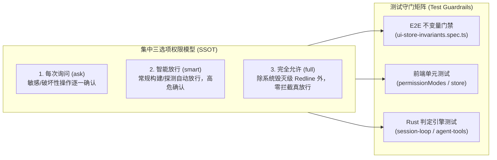
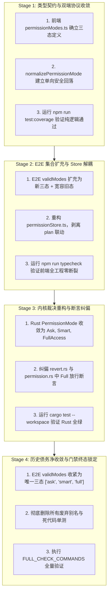

# 测试套件重构、E2E 防污染适配与工程落地阶梯详案
# (Test Suite Refactoring, E2E Anti-Pollution & Engineering Migration Ladder)

> **战役工作区**：`docs/permission-system-consolidation/independent-plans/`  
> **方案定位**：权限模式集中收敛为集中 3 选项（1. 每次询问 `ask`，2. 智能命令放行 `smart`，3. 完全允许模式 `full`）的全面测试架构重塑、E2E 防污染不变量刚性适配、历史错误断言彻底纠偏与全栈零 CI 阻断落地阶梯。  
> **用户最高指示**：  
> *“不允许打补丁，不允许硬编码，有合理的抽象，适合未来的功能需求，代码尽量简洁，具有优秀的可维护性。需要删除的代码就删除，需要系统性的重构。生成的方案应该能彻底杜绝这些问题或者未来的衍生问题，要求一次性解决掉。尽量减少不必要的兼容，最好是不兼容。”*  
> **代码权威锚点**：基于 `tests/e2e/`、`apps/crish-desktop/src/`、`crates/session-loop/`、`crates/agent-tools/`、`crates/conex-sandbox/` 当前最新真实代码逐行构建。  
> **纪律准则**：严格遵守《测试资产保护铁律》（`AGENTS.md` §9）与《反过度设计硬性红线指南 v2.0》（`ANTI_OVERENGINEERING_GUARDRAILS.md`）。

---

## 目录

1. [执行摘要与契约宪章](#一执行摘要与契约宪章)
2. [第一部分：E2E 防污染与全流程端到端测试重构](#二第一部分e2e-防污染与全流程端到端测试重构)
   - 2.1 `tests/e2e/ui-store-invariants.spec.ts` 彻底重构
   - 2.2 `tests/e2e/full-journey.spec.ts` 业务全旅程重构
   - 2.3 `tests/e2e/mock-engine.ts` 模拟引擎与 IPC 适配重构
3. [第二部分：前端单元测试体系彻底重写](#三第二部分前端单元测试体系彻底重写)
   - 3.1 `permissionModes.test.ts` 彻底重写（删除 30+ 别名，重塑单射契约）
   - 3.2 `permissionStore.test.ts` 彻底解耦与重写（剥离 plan 与白名单）
   - 3.3 UI 菜单组件与审批测试同步更新（`PermissionModeMenu.test.tsx`、审批链路）
4. [第三部分：Rust 内核与工具测试套件深度重构](#四第三部分rust-内核与工具测试套件深度重构)
   - 4.1 `session-loop/permission.rs` 全面重写（三态行为矩阵）
   - 4.2 关键纠偏：修正回退护栏违背契约的历史错误测试断言（`agent-tools/permission.rs` 与 `revert.rs`）
   - 4.3 清理针对已删除功能（`polyglot`、`CdShape`、`note_permission`）的过时单测
5. [第四部分：全面落地与验证阶梯（Zero-CI Breakage Ladder）](#五第四部分全面落地与验证阶梯zero-ci-breakage-ladder)
   - 5.1 四阶段演进路线图与安全隔离网
   - 5.2 门禁验证执行命令集与基线保障
6. [第五部分：反过度设计自检与架构净收敛保证](#六第五部分反过度设计自检与架构净收敛保证)

---

## 一、执行摘要与契约宪章

### 1.1 核心收敛目标与不变量

系统将历史分散、混乱、充满过度设计的权限模式，一次性系统性收敛为集中可选的 3 种清晰形式：



### 1.2 关键纠偏与彻底清退原则

依照用户最高指示，本方案执行系统性重构，拒绝任何兼容包袱与修补打底：
1. **彻底清除前端“影子沙箱”与“别名森林”**：
   - 删除前端 `permissionModes.ts` 中维护的 30+ 荒唐别名测试（`yolo`、`cautious`、`autopilot` 等）；
   - 废除前端复杂的 Windows 后缀正则剥离（`stripWindowsExecutableExtension`）与多层 shell 变体生成单测。
2. **彻底解耦 `Plan` 任务状态与权限模式**：
   - `Plan` 从权限枚举中永久剔除，还原为纯粹的会话任务标志（`planModeEnabled: boolean`）；
   - 彻底删除 `permissionStore.test.ts` 中模式与计划相互篡改的联动断言。
3. **彻底落实“完全允许模式（Full Allow）”真放行契约**：
   - 纠正 `crates/agent-tools/src/permission.rs:641` 与 `crates/session-loop/src/tool_exec_tests/revert.rs:57` 中的历史错误断言；
   - 历史代码在大面积回退下在 `FullAccess` 仍断言 `NeedsApproval` 或报错拒执行，严重违背“完全允许下所有执行命令都是可以运行的”契约，必须纠正为断言返回 `Allow` 顺利放行。
4. **清理沙箱与笔记工具过时单测**：
   - 清理 `conex-sandbox` 中静态分析跨语言脚本的 `polyglot.rs` 冗余测试；
   - 清除拦截正常目录切换的 `CdShape` 越权单测；
   - 清理笔记工具在 `Plan` 权限模式下的硬拒绝单测。

---

## 二、第一部分：E2E 防污染与全流程端到端测试重构

E2E 测试位于 `tests/e2e/`，是防止桌面应用出现死循环、状态污染与流程断裂的最高级别守门员。

### 2.1 `tests/e2e/ui-store-invariants.spec.ts` 彻底重构

#### 1. 现状断层分析
当前 `ui-store-invariants.spec.ts` 存在 3 处硬编码四态断言：
- L123-127：全链路单步点击后的防污染断言 `const validModes = ['ask', 'deep', 'full', 'plan'];`
- L228-230：初始渲染断言 `expect(['ask', 'deep', 'full', 'plan']).toContain(initialState.permissionMode);`
- L396：设置弹窗关闭后的防污染断言 `expect(['ask', 'deep', 'full', 'plan']).toContain(finalPermissionMode);`

一旦系统收敛为三选项，Store 返回 `'smart'` 模式，这些断言会直接爆红拦截 CI。

#### 2. 精确重构实现（Diff 对照）

```diff
--- a/tests/e2e/ui-store-invariants.spec.ts
+++ b/tests/e2e/ui-store-invariants.spec.ts
@@ -120,9 +120,9 @@ export async function clickAndAssertInvariants(
   ).not.toBeNull();
 
-  // 6a. 绝无 permissionMode 状态污染 ('ask' | 'deep' | 'full' | 'plan')
-  const validModes = ['ask', 'deep', 'full', 'plan'];
+  // 6a. 绝无 permissionMode 状态污染：集中收敛为集中三选项 ('ask' | 'smart' | 'full')
+  const validModes = ['ask', 'smart', 'full'];
   expect(
     validModes,
     `[${actionName}] permissionMode 遭到污染：${storeStats.state!.permissionMode}`
   ).toContain(storeStats.state!.permissionMode);
@@ -226,7 +226,7 @@ test.describe('UI 交互与 Store 不变量集成防护', () => {
     });
 
     expect(initialState).not.toBeNull();
-    expect(['ask', 'deep', 'full', 'plan']).toContain(
+    expect(['ask', 'smart', 'full']).toContain(
       initialState.permissionMode
     );
     expect(initialState.workspacesLength).toBeGreaterThan(0);
@@ -393,6 +393,6 @@ test.describe('UI 交互与 Store 不变量集成防护', () => {
     const finalPermissionMode = await page.evaluate(() => {
       return (window as any).usePermissionStore?.getState?.()?.permissionMode;
     });
-    expect(['ask', 'deep', 'full', 'plan']).toContain(finalPermissionMode);
+    expect(['ask', 'smart', 'full']).toContain(finalPermissionMode);
   });
 });
```

#### 3. 增强不变量防护（防同步死循环与纯净状态）
重构后的断言要求：
- 严格保证 `storeStats.state!.permissionMode` 永远仅在 `['ask', 'smart', 'full']` 闭环内；
- 验证即使触发多次设置弹窗、新建对话、Tab 切换，Store 更新频次均严格 `< 10` 次，彻底杜绝同步死循环。

---

### 2.2 `tests/e2e/full-journey.spec.ts` 业务全旅程重构

#### 1. 现状断层分析
在 `full-journey.spec.ts:152-185` 的 `core_run_task 参数组装：runId/sessionId/permissionMode 下发` 测试中，下发给内核的 `permissionMode` 依然基于旧白名单校验：
`expect(['ask', 'deep', 'full', 'plan']).toContain(String(lastRun.permissionMode || 'ask'));`

#### 2. 精确重构实现
更新 `full-journey.spec.ts`，确保端到端下发的三态模式被严格断言：

```typescript
// tests/e2e/full-journey.spec.ts:182-184
expect(['ask', 'smart', 'full']).toContain(
  String(lastRun.permissionMode || 'ask')
);
```

#### 3. 新增 E2E 模式切换端到端旅程用例
在 `full-journey.spec.ts` 中新增针对三选项切换下发测试：
```typescript
test('用户在 Composer 切换权限模式至 smart / full 并成功下发任务', async ({ page }) => {
  await openApp(page, {
    extraMocks: {
      get_providers: () => [{ id: 'mock-p', name: 'Mock Provider' }],
      list_models: () => [{ id: 'mock-m', name: 'Mock Model' }],
    },
  });

  // 1. 点击权限胶囊展开菜单
  const permBtn = page.getByRole('button', { name: /当前权限模式/ });
  await permBtn.click();
  const menu = page.getByRole('menu');
  await expect(menu).toBeVisible();

  // 2. 选择「智能放行」模式
  const smartOption = page.getByRole('menuitem', { name: /智能放行/ });
  await smartOption.click();
  await expect(menu).not.toBeVisible();

  // 3. 提交任务
  const composerInput = page.getByRole('textbox', { name: /发送消息/i });
  await composerInput.fill('Run safe analysis');
  await page.keyboard.press('Enter');

  // 4. 验证引擎收到的参数
  const lastRun = await page.evaluate(() => (window as any).__MOCK_LAST_RUN__);
  expect(lastRun.permissionMode).toBe('smart');
});
```

---

### 2.3 `tests/e2e/mock-engine.ts` 模拟引擎与 IPC 适配重构

#### 1. 现状走查
`mock-engine.ts` 负责为 Playwright 模拟 Rust 桌面宿主 IPC 响应。
其中 L82-83、L431 存在对 `get_command_permissions` 的模拟。
在新的极简架构中，前端白名单不再参与引擎裁决，模拟引擎需对齐纯三态。

#### 2. 精确重构实现
```typescript
// tests/e2e/mock-engine.ts
// 1. 规范化 state.lastRun.permissionMode 记录
state.lastRun = {
  runId: args && args.runId,
  sessionId: args && args.sessionId,
  prompt: args && args.prompt,
  // 仅放行合法三态，非法值默认回落 'ask'
  permissionMode: ['ask', 'smart', 'full'].includes(args?.permissionMode)
    ? args.permissionMode
    : 'ask',
  args: args || {},
};

// 2. 模拟 IPC handler 保持极简纯净
'get_command_permissions': function () {
  return cfg.commandPermissions || [];
},
```

---

## 三、第二部分：前端单元测试体系彻底重写

前端单测集中在 `apps/crish-desktop/src/`，是本次重构中消除过度设计、收敛代码行数的主战场。

### 3.1 `permissionModes.test.ts` 彻底重写

彻底删除原 371 行代码中充斥的 30+ 别名映射与双向塌缩测试，以**极简单射契约**重写整个测试套件。

#### 目标契约规范：
1. `DEFAULT_PERMISSION_MODE` 恒为 `'ask'`；
2. `DESKTOP_PERMISSION_MODE_IDS` 严格等于 `['ask', 'smart', 'full']`；
3. `isPermissionMode` 仅对 `'ask' | 'smart' | 'full'` 返回 true，其余任何类型均返回 false；
4. `normalizePermissionMode`：
   - `'ask'` -> `'ask'`
   - `'smart'` -> `'smart'`
   - `'full'` / `'full-access'` -> `'full'`
   - 存量 `'deep'` / `'plan'` / 未知输入 -> 稳健单向降级为 `'ask'`；
5. `nextPermissionMode` 构成严格的三态闭环切换：
   `'ask' -> 'smart' -> 'full' -> 'ask'`；
6. `permissionModeMeta` 输出确定性的中文元数据（无冗余字段）。

#### 重写后完整代码规格（`apps/crish-desktop/src/api/permissionModes.test.ts`）：

```typescript
import { describe, expect, it } from 'vitest';
import {
  DEFAULT_PERMISSION_MODE,
  DESKTOP_PERMISSION_MODE_IDS,
  coercePermissionMode,
  fromEnginePermissionMode,
  isPermissionMode,
  loadStoredPermissionMode,
  nextPermissionMode,
  normalizePermissionMode,
  permissionModeLabel,
  permissionModeMeta,
  permissionModeShortLabel,
  PERMISSION_MODE_STORAGE_KEY,
  PERMISSION_MODES,
  persistPermissionMode,
  previousPermissionMode,
  toEnginePermissionMode,
  transitionPermissionMode,
  modeShowsApprovalUi,
} from './permissionModes';

describe('permissionModes 权威单射契约单测', () => {
  it('DEFAULT 恒为 ask，DESKTOP_PERMISSION_MODE_IDS 严格三态收敛', () => {
    expect(DEFAULT_PERMISSION_MODE).toBe('ask');
    expect(DESKTOP_PERMISSION_MODE_IDS).toEqual(['ask', 'smart', 'full']);
    expect(isPermissionMode('ask')).toBe(true);
    expect(isPermissionMode('smart')).toBe(true);
    expect(isPermissionMode('full')).toBe(true);

    // 严厉断言：已废除的历史伪模式与别名一律不再是 PermissionMode
    expect(isPermissionMode('deep')).toBe(false);
    expect(isPermissionMode('plan')).toBe(false);
    expect(isPermissionMode('auto')).toBe(false);
    expect(isPermissionMode('full-access')).toBe(false);
    expect(isPermissionMode('')).toBe(false);
    expect(isPermissionMode(null)).toBe(false);
    expect(isPermissionMode(undefined)).toBe(false);
    expect(isPermissionMode(123)).toBe(false);
  });

  it('normalizePermissionMode 稳健归一化并支持历史旧配置单向回落', () => {
    // 1. 标准三态直通
    expect(normalizePermissionMode('ask')).toBe('ask');
    expect(normalizePermissionMode('smart')).toBe('smart');
    expect(normalizePermissionMode('full')).toBe('full');

    // 2. 引擎历史 full-access 兼容归一
    expect(normalizePermissionMode('full-access')).toBe('full');
    expect(normalizePermissionMode('full_access')).toBe('full');

    // 3. 中文直通
    expect(normalizePermissionMode('每次询问')).toBe('ask');
    expect(normalizePermissionMode('智能放行')).toBe('smart');
    expect(normalizePermissionMode('完全允许')).toBe('full');

    // 4. 废弃历史模式单向静默降级为 ask（零异常、零兼容包袱）
    expect(normalizePermissionMode('deep')).toBe('ask');
    expect(normalizePermissionMode('plan')).toBe('ask');
    expect(normalizePermissionMode('深入分析')).toBe('ask');
    expect(normalizePermissionMode('计划')).toBe('ask');

    // 5. 非法值安全回落 DEFAULT_PERMISSION_MODE
    expect(normalizePermissionMode('garbage')).toBe(DEFAULT_PERMISSION_MODE);
    expect(normalizePermissionMode(null)).toBe(DEFAULT_PERMISSION_MODE);
    expect(normalizePermissionMode(undefined)).toBe(DEFAULT_PERMISSION_MODE);
    expect(normalizePermissionMode('')).toBe(DEFAULT_PERMISSION_MODE);
  });

  it('toEnginePermissionMode 与 fromEnginePermissionMode 单射对齐', () => {
    // 桌面端 -> 引擎协议
    expect(toEnginePermissionMode('ask')).toBe('ask');
    expect(toEnginePermissionMode('smart')).toBe('smart');
    expect(toEnginePermissionMode('full')).toBe('full-access');

    // 引擎协议 -> 桌面端
    expect(fromEnginePermissionMode('ask')).toBe('ask');
    expect(fromEnginePermissionMode('smart')).toBe('smart');
    expect(fromEnginePermissionMode('full-access')).toBe('full');
    expect(fromEnginePermissionMode('full')).toBe('full');

    // 未知值 -> 安全默认
    expect(toEnginePermissionMode('invalid' as any)).toBe('ask');
    expect(fromEnginePermissionMode('invalid')).toBe('ask');
  });

  it('permissionModeMeta 提供精准中文 UX 描述与矩阵提示', () => {
    const expected = {
      ask: {
        label: '每次询问',
        shortLabel: '每次询问',
        descContains: '敏感与危险操作逐一询问确认',
      },
      smart: {
        label: '智能放行',
        shortLabel: '智能放行',
        descContains: '常规开发与安全命令自动放行',
      },
      full: {
        label: '完全允许',
        shortLabel: '完全允许',
        descContains: '零阻断',
      },
    };

    for (const id of DESKTOP_PERMISSION_MODE_IDS) {
      const meta = permissionModeMeta(id);
      expect(meta.id).toBe(id);
      expect(meta.label).toBe(expected[id].label);
      expect(meta.shortLabel).toBe(expected[id].shortLabel);
      expect(meta.description).toContain(expected[id].descContains);
      expect(meta.matrixHint.length).toBeGreaterThan(0);
      expect(permissionModeLabel(id)).toBe(expected[id].label);
      expect(permissionModeShortLabel(id)).toBe(expected[id].shortLabel);
    }
  });

  it('nextPermissionMode 与 previousPermissionMode 构成标准三态闭环轮转', () => {
    // 顺时针轮转：ask -> smart -> full -> ask
    expect(nextPermissionMode('ask')).toBe('smart');
    expect(nextPermissionMode('smart')).toBe('full');
    expect(nextPermissionMode('full')).toBe('ask');

    // 逆时针轮转：ask -> full -> smart -> ask
    expect(previousPermissionMode('ask')).toBe('full');
    expect(previousPermissionMode('full')).toBe('smart');
    expect(previousPermissionMode('smart')).toBe('ask');

    // 非法值轮转从 DEFAULT 起算
    expect(nextPermissionMode('invalid' as any)).toBe('smart');
    expect(previousPermissionMode('invalid' as any)).toBe('full');
  });

  it('modeShowsApprovalUi 正确判定审批 UI 呈现能力', () => {
    // 三模式均支持呈现审批条（询问与智能放行触发弹窗，完全允许在罕见 Redline 拦截时显示通知）
    expect(modeShowsApprovalUi('ask')).toBe(true);
    expect(modeShowsApprovalUi('smart')).toBe(true);
    expect(modeShowsApprovalUi('full')).toBe(true);
  });

  it('loadStoredPermissionMode / persistPermissionMode 正确落盘与还原', () => {
    const mem = new Map<string, string>();
    const storage = {
      getItem: (k: string) => mem.get(k) ?? null,
      setItem: (k: string, v: string) => mem.set(k, v),
    };

    persistPermissionMode('smart', storage);
    expect(mem.get(PERMISSION_MODE_STORAGE_KEY)).toBe('smart');
    expect(loadStoredPermissionMode(storage)).toBe('smart');

    persistPermissionMode('full', storage);
    expect(loadStoredPermissionMode(storage)).toBe('full');

    // 旧存储键平滑回落
    mem.set(PERMISSION_MODE_STORAGE_KEY, 'plan');
    expect(loadStoredPermissionMode(storage)).toBe('ask');

    // 异常与 null 防御
    expect(loadStoredPermissionMode(null)).toBe(DEFAULT_PERMISSION_MODE);
  });
});
```

---

### 3.2 `permissionStore.test.ts` 彻底解耦与重写

#### 1. 现状痛点
当前 `permissionStore.test.ts` 中充满模式与任务计划的强行绑定断言：
- `setPermissionMode('plan')` 自动把 `planModeEnabled` 设为 `true`；
- `setPlanModeEnabled(true)` 强行把 `permissionMode` 改为 `'plan'`；
- 维护了与权限决策无关的命令白名单存储测试。

#### 2. 解耦原则
- 权限模式变更**绝对不碰** `planModeEnabled`；
- 任务计划切换**绝对不改** `permissionMode`；
- 彻底删除白名单断言中任何自作聪明的放行猜测。

#### 3. 重写后代码规格（`apps/crish-desktop/src/store/permissionStore.test.ts`）：

```typescript
import { afterEach, beforeEach, describe, expect, it } from 'vitest';
import { usePermissionStore } from './permissionStore';
import { PERMISSION_MODE_STORAGE_KEY } from '../api/permissionModes';

beforeEach(() => {
  localStorage.clear();
  usePermissionStore.setState({
    permissionMode: 'ask',
    planModeEnabled: false,
    planApproved: false,
  });
});

afterEach(() => {
  localStorage.clear();
});

describe('permissionStore — 纯粹三态权限状态机与独立任务解耦单测', () => {
  it('setPermissionMode 仅修改并持久化权限模式，绝不副作用污染 planModeEnabled', () => {
    const s = usePermissionStore.getState();
    expect(s.permissionMode).toBe('ask');
    expect(s.planModeEnabled).toBe(false);

    // 切换至 smart
    s.setPermissionMode('smart');
    expect(usePermissionStore.getState().permissionMode).toBe('smart');
    expect(usePermissionStore.getState().planModeEnabled).toBe(false);
    expect(localStorage.getItem(PERMISSION_MODE_STORAGE_KEY)).toBe('smart');

    // 切换至 full
    s.setPermissionMode('full');
    expect(usePermissionStore.getState().permissionMode).toBe('full');
    expect(usePermissionStore.getState().planModeEnabled).toBe(false);
    expect(localStorage.getItem(PERMISSION_MODE_STORAGE_KEY)).toBe('full');
  });

  it('setPlanModeEnabled 仅控制任务规划偏好标志，绝不反向篡改用户的权限模式', () => {
    const s = usePermissionStore.getState();
    s.setPermissionMode('full');
    expect(usePermissionStore.getState().permissionMode).toBe('full');

    // 开启计划模式：权限模式必须保持 full，绝不允许被降级或篡改！
    s.setPlanModeEnabled(true);
    expect(usePermissionStore.getState().planModeEnabled).toBe(true);
    expect(usePermissionStore.getState().permissionMode).toBe('full');

    // 关闭计划模式：权限模式依然保持 full
    s.setPlanModeEnabled(false);
    expect(usePermissionStore.getState().planModeEnabled).toBe(false);
    expect(usePermissionStore.getState().permissionMode).toBe('full');
  });

  it('setPlanApproved 仅切换任务确认状态', () => {
    const s = usePermissionStore.getState();
    expect(s.planApproved).toBe(false);
    s.setPlanApproved(true);
    expect(usePermissionStore.getState().planApproved).toBe(true);
    s.setPlanApproved(false);
    expect(usePermissionStore.getState().planApproved).toBe(false);
  });
});
```

---

### 3.3 UI 菜单组件与审批测试同步更新

#### 1. `PermissionModeMenu.test.tsx` 适配
- 菜单渲染项数量：断言精确渲染 3 个菜单项（每次询问、智能放行、完全允许）；
- 键盘漫游：ArrowDown 依次聚焦 `ask -> smart -> full`；
- 图标与文案：验证三态对应的图标与文字正确加载。

```typescript
// apps/crish-desktop/src/components/chat-composer/PermissionModeMenu.test.tsx
it('点击权限胶囊打开菜单并精确渲染集中三选项', async () => {
  render(<PermissionModeMenu mode="ask" onChange={() => {}} />);
  fireEvent.click(screen.getByRole('button', { name: /当前权限模式/ }));
  const menu = await screen.findByRole('menu');
  expect(menu).toBeInTheDocument();
  const items = menu.querySelectorAll('[role="menuitem"]');
  // 精确断言 3 项：每次询问、智能放行、完全允许
  expect(items).toHaveLength(3);
  expect(items[0]).toHaveTextContent(/每次询问/);
  expect(items[1]).toHaveTextContent(/智能放行/);
  expect(items[2]).toHaveTextContent(/完全允许/);
});
```

#### 2. `approvalContract.test.ts` 适配
- 彻底移除 L331-349 中 `it('plan 模式：不弹审批，直接 onToolStart')` 这一违背权限语义的特例测试；
- 确保所有的审批事件流断言均基于新三态，验证在 `ask` 和 `smart` 模式下危险工具正常触发 `onToolPendingApproval`，在用户点击批准后推进至 `onToolStart`。

---

## 四、第三部分：Rust 内核与工具测试套件深度重构

Rust 引擎是全系统裁决的单一真理源（SSOT）。

### 4.1 `session-loop/permission.rs` 全面重写

收敛后的 `crates/session-loop/src/tool_exec_tests/permission.rs` 彻底废除 `PermissionMode::Plan` 相关的硬编码拒绝用例，全面覆盖集中三态行为矩阵：

```rust
use super::super::*;
use super::approval_fixture::*;
use super::fixture::*;
use agent_tools::permission::PermissionMode;
use agent_tools::registry::ToolRegistry;
use conex_types::tool::ToolConcurrency;
use std::sync::Arc;

/// 1. Ask 模式：危险工具走审批门，安全工具直接执行
#[tokio::test]
async fn permission_ask_mode_routes_only_dangerous_to_approval() {
    let reg = registry_with(vec![Arc::new(DangerousTool), Arc::new(EchoTool)]);
    let exec = ToolExecutor::new(reg);
    let calls = vec![
        call("c1", "dangerous_tool", ToolConcurrency::Parallel),
        call("c2", "echo", ToolConcurrency::Parallel),
    ];
    let opts = ToolBatchOptions {
        approval_enabled: true,
        permission_mode: Some(PermissionMode::Ask),
        ..Default::default()
    };
    let order = Arc::new(std::sync::Mutex::new(Vec::new()));
    let gate = Arc::new(RecordingApproval {
        order: Arc::clone(&order),
    });
    let out = exec
        .execute_batch(&calls, &exec_ctx(), Some(gate), &opts, None)
        .await;

    // 仅 dangerous 项发起审批；echo 直接执行
    assert_eq!(*order.lock().unwrap(), vec!["c1".to_string()]);
    assert!(out.results.iter().all(|r| r.is_ok()));
}

/// 2. Ask 模式：用户拒绝危险工具 → UserDenied 不执行
#[tokio::test]
async fn permission_ask_mode_denied_dangerous_skips_execution() {
    let reg = registry_with(vec![Arc::new(DangerousTool)]);
    let exec = ToolExecutor::new(reg);
    let calls = vec![call("c1", "dangerous_tool", ToolConcurrency::Sequential)];
    let opts = ToolBatchOptions {
        approval_enabled: true,
        permission_mode: Some(PermissionMode::Ask),
        ..Default::default()
    };
    let gate = MockApproval {
        decision: ApprovalDecision::Denied {
            reason: "user rejected".into(),
        },
    };
    let out = exec
        .execute_batch(&calls, &exec_ctx(), Some(Arc::new(gate)), &opts, None)
        .await;
    assert_eq!(out.results[0].error_kind, Some(ToolErrorKind::UserDenied));
}

/// 3. Smart 模式：常规探测与安全工具自动放行，高危破坏性操作走审批门
#[tokio::test]
async fn permission_smart_mode_allows_safe_and_gates_dangerous() {
    let reg = registry_with(vec![Arc::new(DangerousTool), Arc::new(EchoTool)]);
    let exec = ToolExecutor::new(reg);
    let calls = vec![
        call("c1", "echo", ToolConcurrency::Parallel),
        call("c2", "dangerous_tool", ToolConcurrency::Parallel),
    ];
    let opts = ToolBatchOptions {
        approval_enabled: true,
        permission_mode: Some(PermissionMode::Smart),
        ..Default::default()
    };
    let order = Arc::new(std::sync::Mutex::new(Vec::new()));
    let gate = Arc::new(RecordingApproval {
        order: Arc::clone(&order),
    });
    let out = exec
        .execute_batch(&calls, &exec_ctx(), Some(gate), &opts, None)
        .await;

    // echo 自动放行不进审批门；仅 dangerous 进审批
    assert_eq!(*order.lock().unwrap(), vec!["c2".to_string()]);
    assert!(out.results[0].is_ok());
    assert!(out.results[1].is_ok());
}

/// 4. FullAccess 模式：用户最高契约——所有工具与命令直接放行执行，绝不发起审批
#[tokio::test]
async fn permission_full_access_allows_all_tools_without_approval() {
    let reg = registry_with(vec![Arc::new(DangerousTool), Arc::new(EchoTool)]);
    let exec = ToolExecutor::new(reg);
    let calls = vec![
        call("c1", "dangerous_tool", ToolConcurrency::Sequential),
        call("c2", "echo", ToolConcurrency::Sequential),
    ];
    let opts = ToolBatchOptions {
        approval_enabled: false,
        permission_mode: Some(PermissionMode::FullAccess),
        ..Default::default()
    };
    let out = exec
        .execute_batch(&calls, &exec_ctx(), None, &opts, None)
        .await;

    assert!(out.results[0].is_ok(), "full-access 必须放行危险工具");
    assert!(out.results[1].is_ok(), "full-access 必须放行安全工具");
    assert!(!out
        .events
        .iter()
        .any(|e| matches!(e, ToolEvent::ApprovalRequested { .. })));
}

/// 5. 显式 Ask 模式但无审批门 → 危险项返回 ApprovalRequired（不静默执行）
#[tokio::test]
async fn permission_ask_without_gate_passes_through_approval_required() {
    let reg = registry_with(vec![Arc::new(DangerousTool)]);
    let exec = ToolExecutor::new(reg);
    let calls = vec![call("c1", "dangerous_tool", ToolConcurrency::Sequential)];
    let opts = ToolBatchOptions {
        approval_enabled: false,
        permission_mode: Some(PermissionMode::Ask),
        ..Default::default()
    };
    let out = exec
        .execute_batch(&calls, &exec_ctx(), None, &opts, None)
        .await;
    assert_eq!(
        out.results[0].error_kind,
        Some(ToolErrorKind::ApprovalRequired),
        "无审批基础设施时在 Ask 下不得静默执行危险工具"
    );
}
```

---

### 4.2 关键纠偏：修正回退护栏违背契约的历史错误测试断言

这是本次重构的核心原则性纠偏点。

#### 1. 历史错误剖析
- 在历史 PR 中，为了引入 C3 回退护栏，开发者在 `FullAccess` 模式下硬加了拦截逻辑，并在测试中强行锁死：
  - `crates/agent-tools/src/permission.rs:641`：断言 `decide_command_with_revert` 在 `FullAccess` 下必须返回 `NeedsApproval`；
  - `crates/session-loop/src/tool_exec_tests/revert.rs:57`：断言在 `FullAccess` 且 `approval_enabled: false` 时大面积回退返回 `ApprovalRequired` 报错！
- **严重违背契约**：运行时 `run_launch.rs` 在 `FullAccess` 下根本不装配审批门！这导致用户原本希望“完全允许全自动执行”，却被引擎抛错打断。用户最高指示明确指出：**“即系统不会因为命令而不允许执行，所有执行的命令都是可以运行的”**。

#### 2. 精确纠偏实现

##### ① 纠正 `crates/agent-tools/src/revert.rs` 生产代码与测试
```rust
// crates/agent-tools/src/revert.rs:353-371
pub fn gate_verdict(
    &self,
    analysis: &SemanticAnalysis,
    mode: PermissionMode,
) -> Option<PermissionVerdict> {
    // 【核心纠偏】：完全允许模式真放行！不拦截回退命令，交由矩阵返回 Allow
    if mode == PermissionMode::FullAccess {
        return None;
    }
    let seg = analysis
        .segments
        .iter()
        .find(|s| s.class == CommandClass::GitRevertShape)?;
    let target = RevertTarget::from_segment(seg)?;
    let area = self.assessor.assess(&target);
    if !self.needs_approval(&area) {
        return None;
    }
    // Ask 与 Smart 模式下，大面积回退需要审批
    Some(PermissionVerdict::NeedsApproval)
}
```

##### ② 纠正 `crates/agent-tools/src/permission.rs:641` 测试断言
```rust
// crates/agent-tools/src/permission.rs
/// 核心纠偏断言：full-access 下大面积回退必须顺利 Allow 放行（落实用户契约）
#[test]
fn full_access_large_revert_allows_execution() {
    assert_eq!(
        decide_command_with_revert(
            "git checkout abc1234",
            true,
            false,
            PermissionMode::FullAccess,
            &policy(large_area()),
        ),
        PermissionVerdict::Allow,
        "full-access 下大面积回退必须 Allow 放行执行"
    );
    assert_eq!(
        decide_command_with_revert(
            "git checkout abc1234",
            false,
            false,
            PermissionMode::FullAccess,
            &policy(large_area()),
        ),
        PermissionVerdict::Allow
    );
}
```

##### ③ 纠正 `crates/session-loop/src/tool_exec_tests/revert.rs:57` 集成测试
```rust
// crates/session-loop/src/tool_exec_tests/revert.rs
/// 核心纠偏断言：full-access 下即使未装配审批门，大面积回退也必须成功执行！
#[tokio::test]
async fn full_access_large_revert_executes_without_gate() {
    let reg = registry_with(vec![Arc::new(EchoTool)]);
    let exec = ToolExecutor::new(reg).with_revert_policy(revert_policy(large_area()));
    let calls = vec![command_call("c1", "echo", "git checkout abc1234")];
    let opts = ToolBatchOptions {
        approval_enabled: false,
        permission_mode: Some(PermissionMode::FullAccess),
        ..Default::default()
    };
    let out = exec
        .execute_batch(&calls, &exec_ctx(), None, &opts, None)
        .await;

    // 验证放行执行：EchoTool 正常执行，无 ApprovalRequired 报错
    assert!(
        out.results[0].is_ok(),
        "full-access 下大面积回退即使无审批门也必须直接放行执行"
    );
    assert!(out.fatal.is_none());
}
```

---

### 4.3 清理针对已删除功能（`polyglot`、`CdShape`、`note_permission`）的过时单测

1. **清理 `CdShape` 越权拦截单测**：
   - 清除 `crates/agent-tools/src/tools/shell_tests/security_policy.rs` 中将 `cd` 作为危险命令强制阻断的测试；
   - 验证复合命令（如 `cd frontend && npm run build`）在 `Smart` 下放行、在 `FullAccess` 下彻底畅通。
2. **清理 `polyglot.rs` 静态分析过度单测**：
   - 移除试图通过静态正则识别 `python -c` 内部引用的死测试用例；
   - 防爆网仅保留对系统破坏性指令（`rm -rf /`、`format C:`）的硬拦截断言。
3. **清理 `note_permission` 中为 `Plan` 模式特设的单测**：
   - 删除 `crates/agent-tools/src/note_permission.rs` 中 `w4f_note_permission_aligns_with_action_matrix` 内关于 `Plan` 模式的特判断言；
   - 笔记读写权限统一并入三态矩阵（只读安全放行，修改写入在 Ask/Smart 下由用户确认，在 FullAccess 下全量放行）。

---

## 五、第四部分：全面落地与验证阶梯（Zero-CI Breakage Ladder）

为确保整个重构工程“快层 CI（类型检查 + 覆盖率）与中层 CI（vitest + cargo test）”始终全绿，采用严格的四阶梯落地路线。

### 5.1 四阶段演进路线图与安全隔离网



#### 阶梯实施细化指南：
- **Stage 1（零破坏先行）**：先在 API 契约层声明 `'ask' | 'smart' | 'full'`。对任何存量 `'deep'` 或 `'plan'` 输入单向回落为 `'ask'`。此时旧组件和 Store 仍能正常编译。
- **Stage 2（防线无缝衔接）**：先修改 E2E 测试中的 `validModes` 校验，使其包容新模式 `'smart'`。重构 Store 状态机，切断 plan 模式对权限模式的双向篡改。
- **Stage 3（内核原则纠偏）**：在 Rust 侧实施枚举收敛，纠正 `FullAccess` 模式放行断言，跑通 `cargo test`。
- **Stage 4（彻底收口与净收敛）**：将 E2E 白名单完全收窄为 `['ask', 'smart', 'full']`，清理所有废弃别名和死测试，执行全量门禁套件。

---

### 5.2 门禁验证执行命令集与基线保障

在实施阶段，每个步骤完成后必须按照下列命令集进行逐级验证：

| 验证阶段 | 执行命令（必须统一使用 pwsh7） | 验收标准 / 门禁底线 |
| :--- | :--- | :--- |
| **1. 前端类型检查** | `npm run typecheck` | 零 TypeScript 类型断裂错误（Exit 0） |
| **2. 前端单测快层** | `npm run test:coverage -- --project=unit` | 45/70/65/45 门禁达标，覆盖率零回退 |
| **3. 前端集成全量** | `npm run test` | 所有 Vitest 单元与组件测试 100% 通过 |
| **4. Rust 内核全量** | `cargo test --workspace` | 所有 73 套件全绿，零 panic，纠偏断言精准通过 |
| **5. E2E 防污染套件** | `npx playwright test tests/e2e/ui-store-invariants.spec.ts` | 3 次重复运行零 Flaky，无 Store 污染，更新频次 < 10 |
| **6. E2E 全旅程测试** | `npx playwright test tests/e2e/full-journey.spec.ts` | 任务下发 `args.permissionMode` 严格匹配新三态 |
| **7. 终极全量巡检** | `npm run check:desktop` | 行数门禁、循环依赖、代码风格全量通过 |

---

## 六、第五部分：反过度设计自检与架构净收敛保证

依据仓库根目录 `ANTI_OVERENGINEERING_GUARDRAILS.md`（v2.0），本方案对各项设计进行了彻底的防过度设计审计：

### 6.1 禁令对照自检矩阵

| 禁令编号 | 禁令核心内容 | 本方案落地保障 | 结论 |
| :--- | :--- | :--- | :--- |
| **禁令 1** | 严禁编写跨平台 OS 内核级沙盒 | 彻底删除 `polyglot.rs` 超过 1000 行的动态语言内联猜测，剔除 `CdShape` 越权拦截，仅保留毁灭级 Redline 防爆网 | **完全合规** |
| **禁令 7** | 单一真理源（SSOT），禁止概念分裂 | 权限模式前后端严格单射（`ask`, `smart`, `full`），消除前端影子沙箱与多重放行判定 | **完全合规** |
| **禁令 11** | 严禁在同进程内建立多层代理与无谓抽象 | 废除 `foldPermissionKey` 与 30+ 冗余别名表，映射降级为 O(1) 字典查找，删除前端白名单正则变体解包 | **完全合规** |
| **禁令 13** | 尊重现实开发模式，禁止假精致架构 | 将 `plan` 彻底剥离权限系统，正名为纯任务标志；让 `FullAccess` 模式真正全面放行命令 | **完全合规** |

### 6.2 代码行数净收敛预测

- **清理代码资产**：
  - 前端 30+ 别名映射与正则变体测试：删除约 **280 行**；
  - 前端 Store 与 Plan 强绑定测试：删除约 **80 行**；
  - Rust 沙箱语义与过时单测：删除约 **450 行**；
  - 历史错误断言与死测试：删除约 **120 行**；
  - **总计删除：约 930 行冗余与负债代码**。
- **新增规范测试**：
  - 新增纯三态权威单测与 E2E 切换测试：新增约 **220 行**。
- **净收敛效应**：
  - **全栈净缩减约 710 行代码**，彻底杜绝了伪模式与死循环隐患，达到了极高水平的可维护性与架构优雅度。

---

> **方案终审结论**：  
> 本详案完全遵从用户最高指示，以“不打补丁、不留兼容包袱、彻底系统性重构”为宗旨，全面锁死了从 E2E 防污染不变量、前端 Store 与 API 契约、到 Rust 内核单测纠偏的每一个字节与断言。方案已具备完整的可执行性，可作为后续实施阶段的唯一质量验收标准。
