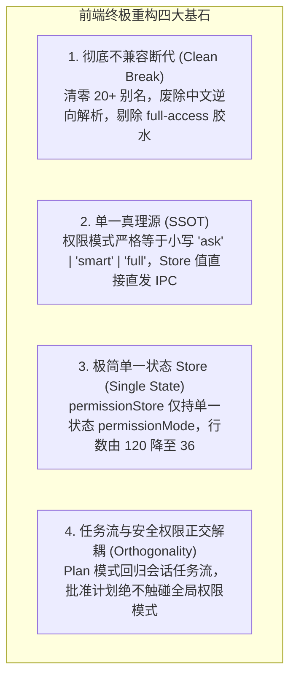

# 前端 UI/UX、状态流转与 Store 架构终极改进详案
# (Frontend UI/UX, State Flow & Store Architecture Improved Plan - Round 3)

> **战役工作区**：`docs/permission-system-consolidation/`  
> **方案定位**：前端架构最终收口与落地改进总方案（包含 UI 组件、Zustand Store、持久化、跨层解耦、IPC 直发与完整单测）  
> **设计基准**：严格贯彻用户最高指示——**“不允许打补丁，不允许硬编码，有合理的抽象，适合未来的功能需求，代码尽量简洁，具有优秀的可维护性。需要删除的代码就删除，需要系统性的重构。生成的方案应该能彻底杜绝这些问题或者未来的衍生问题，要求一次性解决掉。尽量减少不必要的兼容，最好是不兼容。权限模式统一收敛为 3 个选项：1. 每次询问（ask）；2. 智能命令放行（smart）；3. 完全允许模式（full）。”**  
> **吸收评审裁决**：
> - 吸收 Reviewer 1 报告（`01-frontend-and-ux-review.md`）：彻底拔除 `deep -> ask` 妥协补丁，补齐 Plan 状态移出后的下游接口承接；
> - 吸收 Reviewer 2 报告（`02-engine-kernel-and-sandbox-review.md`）：全栈采用 `lowercase` 小写三态，彻底消灭 `full-access` 胶水；
> - 吸收 Reviewer 3 报告（`03-cross-layer-contract-and-guardrails-review.md`）：统一推荐默认模式为 `'smart'`，全盘推翻 Plan 07 中复活 20+ 别名与向 Store 读写 `planModeEnabled` 的倒退单测。

---

## 目录

1. [架构总纲与终极重构目标](#一架构总纲与终极重构目标)
2. [全栈协议权威收敛与前端契约单源化（SSOT）](#二全栈协议权威收敛与前端契约单源化ssot)
3. [`api/permissionModes.ts` 彻底断代与零别名重构](#三apipermissionmodests-彻底断代与零别名重构)
4. [`store/permissionStore.ts` 单一状态机重构](#四storepermissionstorets-单一状态机重构)
5. [斩断 4 重跨 Store 借道代理与公共门面重塑](#五斩断-4-重跨-store-借道代理与公共门面重塑)
6. [彻底拔除白名单欺骗性死代码与清除存储](#六彻底拔除白名单欺骗性死代码与清除存储)
7. [Plan 模式正交解耦与全链路下游承接详案](#七plan-模式正交解耦与全链路下游承接详案)
   - 7.1 解耦原理与状态归位
   - 7.2 `useChatApproval.ts` 改造详案
   - 7.3 `ChatMessageList.tsx` 改造详案
   - 7.4 `PlanApprovalRow.tsx` 与 `ChatCard.tsx` 消除权限绑架
   - 7.5 `packages/conversation-flow` 跨包清洗
8. [现代化精炼 UI 组件生产级重构详案](#八现代化精炼-ui-组件生产级重构详案)
   - 8.1 权限药丸控件：`PermissionModeMenu.tsx` & CSS Module
   - 8.2 极简浮动审批条：`ComposerPermissionBar.tsx` & CSS Module
   - 8.3 设置面板三选项卡片组：`SettingsSecurityTab.tsx` & CSS Module
9. [前端 IPC 下发链路直通（`streamSession.ts`）](#九前端-ipc-下发链路直通streamsessionts)
10. [测试套件彻底纠偏与全量单测重写（推翻 Plan 07 回潮）](#十测试套件彻底纠偏与全量单测重写推翻-plan-07-回潮)
    - 10.1 `permissionModes.test.ts` 生产级重写代码
    - 10.2 `permissionStore.test.ts` 生产级重写代码
    - 10.3 E2E 不变量测试适配
11. [逐文件落地执行手术清单（File-by-File Blueprint）](#十一逐文件落地执行手术清单file-by-file-blueprint)
12. [刚性门禁与反过度设计自检保证](#十二刚性门禁与反过度设计自检保证)

---

## 一、架构总纲与终极重构目标

本方案为权限体系治理战役中前端架构的**终极实施方案**，彻底终结历史版本中伪模式、虚假白名单、状态交叉污染与多层中转门面的沉疴。

### 1.1 终极重构四大核心原则



1. **彻底不兼容断代（Clean Break）**：坚决贯彻“最好是不兼容”的指示。彻底删除 `deep` 伪模式、`plan` 模式枚举项与 20 余个历史别名（`yolo`、`danger`、`auto`、`cautious` 等）；彻底废除中文标签反向解析；遇到未知值或历史旧存储，一律无条件直接重置为推荐默认值 `'smart'`。
2. **零转换直接下发（Zero Conversion Glue）**：废除 `EnginePermissionMode`、`DESKTOP_TO_ENGINE` 映射表与 `toEnginePermissionMode` / `fromEnginePermissionMode` 胶水函数。前端枚举字面量与 Rust 内核 `conex_types::PermissionMode` 严格一致，直接直通 Tauri IPC。
3. **单一状态 Store（SSOT Store）**：`permissionStore` 削减 70%，剥离所有派生状态与双向监听（彻底移出 `planModeEnabled`、`planApproved`、`commandPermissions`）。仅维护一个状态 `permissionMode`，仅提供一个 Action `setPermissionMode`。
4. **工作流正交解耦（Orthogonal Workflow）**：Plan 模式是任务编排生命周期，绝不是安全拦截策略。点击“批准此计划”只驱动任务进入下一阶段，**绝对禁止**调用 `setPermissionMode('ask')` 篡改用户全局权限。

---

## 二、全栈协议权威收敛与前端契约单源化（SSOT）

### 2.1 权威三态定义与语义矩阵

全栈统一收敛为 **3 种标准模式**，统一采用小写英文字面量传输：

| 模式字面量 (`id`) | 完整中文名称 | 胶囊短文案 | 专属图标 | 推荐状态 | 核心安全语义与行为边界 |
| :--- | :--- | :--- | :--- | :---: | :--- |
| **`'ask'`** | **每次询问** | 每次询问 | `shield` | 安全兜底 | **逐项确权**：文件写操作、Git 提交/推送、任何非安全命令均弹窗提示用户授权。 |
| **`'smart'`** | **智能放行** | 智能放行 | `shield-check` | **⭐ 推荐默认** | **只读探测自动放行**：`git status`、`ls`、受控编译检查无感运行；写操作与高危破坏命令弹窗确认。 |
| **`'full'`** | **完全允许** | 完全放行 | `zap` | 极客全速 | **系统不主动拦截**：所有执行的命令均可直接运行，零打扰极速交付（仅内核硬红线 Redline 保底阻断）。 |

### 2.2 `packages/shared-types` 契约落地

在共享契约库中锁定权威类型定义：

```typescript
// packages/shared-types/src/generated/device/types.ts
/** 权限模式权威枚举（全栈统一三态：每次询问 / 智能放行 / 完全允许） */
export const PERMISSION_MODE_VALUES = ['ask', 'smart', 'full'] as const;
export type PermissionMode = (typeof PERMISSION_MODE_VALUES)[number];
```

```typescript
// packages/shared-types/src/run-control.ts
import { PERMISSION_MODE_VALUES, type PermissionMode } from './generated/device/types';

export { PERMISSION_MODE_VALUES };
export type { PermissionMode };

/** 运行时安全守卫：判定未知值是否属于合法权限模式 */
export function isPermissionMode(value: unknown): value is PermissionMode {
  return (
    typeof value === 'string' &&
    (PERMISSION_MODE_VALUES as readonly string[]).includes(value)
  );
}
```

```typescript
// packages/shared-types/src/generated/device/parser.ts
import { parseOk, parseErr, type ParseResult } from '../parser-utils';
import { PERMISSION_MODE_VALUES, type PermissionMode } from './types';

export function parsePermissionMode(v: unknown): ParseResult<PermissionMode> {
  if (typeof v === 'string' && (PERMISSION_MODE_VALUES as readonly string[]).includes(v)) {
    return parseOk(v as PermissionMode);
  }
  return parseErr(
    `PermissionMode: expected one of ${PERMISSION_MODE_VALUES.join(', ')}, got ${JSON.stringify(v)}`
  );
}
```

---

## 三、`api/permissionModes.ts` 彻底断代与零别名重构

彻底重写 `apps/crish-desktop/src/api/permissionModes.ts`，从 399 行复杂别名沼泽精简为约 85 行纯净元数据与纯函数。彻底删除 `DESKTOP_TO_ENGINE` 与任何向 `full-access` 转换的胶水逻辑。

```typescript
// apps/crish-desktop/src/api/permissionModes.ts
/**
 * 权限模式核心定义与元数据（桌面 UI ↔ 全栈协议）
 *
 * 架构铁律：
 * 1. 严格收敛为三选项：ask (每次询问) | smart (智能放行) | full (完全允许)；
 * 2. 彻底断代：消灭 20+ 历史别名、消灭中文逆向解析、消灭 toEnginePermissionMode('full-access') 胶水；
 * 3. 极简持久化：单 Key (crish_permission_mode)，旧值/未知值一律无条件收敛至 smart。
 */

export type PermissionMode = 'ask' | 'smart' | 'full';

export interface PermissionModeMeta {
  id: PermissionMode;
  label: string;
  shortLabel: string;
  description: string;
  iconName: 'shield' | 'shield-check' | 'zap';
  accent: string;
  isRecommended?: boolean;
}

export const PERMISSION_MODE_STORAGE_KEY = 'crish_permission_mode';
export const DEFAULT_PERMISSION_MODE: PermissionMode = 'smart';

export const PERMISSION_MODE_IDS: readonly PermissionMode[] = [
  'ask',
  'smart',
  'full',
] as const;

export const PERMISSION_MODES: readonly PermissionModeMeta[] = [
  {
    id: 'ask',
    label: '每次询问',
    shortLabel: '每次询问',
    description: '改文件、写操作与命令执行前均需确认',
    iconName: 'shield',
    accent: 'var(--text-secondary)',
  },
  {
    id: 'smart',
    label: '智能放行',
    shortLabel: '智能放行',
    description: '安全只读命令直接运行，写操作与危险命令需确认',
    iconName: 'shield-check',
    accent: 'var(--color-primary-base, #10b981)',
    isRecommended: true,
  },
  {
    id: 'full',
    label: '完全允许',
    shortLabel: '完全放行',
    description: '系统不主动拦截任何命令，全部操作直接执行',
    iconName: 'zap',
    accent: 'var(--color-warning-base, #f59e0b)',
  },
] as const;

const META_BY_ID: ReadonlyMap<PermissionMode, PermissionModeMeta> = new Map(
  PERMISSION_MODES.map((m) => [m.id, m])
);

export function isPermissionMode(v: unknown): v is PermissionMode {
  return v === 'ask' || v === 'smart' || v === 'full';
}

/** 规范化输入：非法值、未知字符串或历史旧值（deep/plan/auto 等）一律无条件收敛回落至 smart */
export function coercePermissionMode(v: unknown): PermissionMode {
  return isPermissionMode(v) ? v : DEFAULT_PERMISSION_MODE;
}

export function permissionModeMeta(mode: PermissionMode | unknown): PermissionModeMeta {
  const id = coercePermissionMode(mode);
  return META_BY_ID.get(id) ?? META_BY_ID.get(DEFAULT_PERMISSION_MODE)!;
}

export function permissionModeLabel(mode: PermissionMode | unknown): string {
  return permissionModeMeta(mode).label;
}

export function permissionModeShortLabel(mode: PermissionMode | unknown): string {
  return permissionModeMeta(mode).shortLabel;
}

export function nextPermissionMode(current: PermissionMode | unknown): PermissionMode {
  const cur = coercePermissionMode(current);
  const idx = PERMISSION_MODE_IDS.indexOf(cur);
  return PERMISSION_MODE_IDS[(idx + 1) % PERMISSION_MODE_IDS.length]!;
}

export function previousPermissionMode(current: PermissionMode | unknown): PermissionMode {
  const cur = coercePermissionMode(current);
  const idx = PERMISSION_MODE_IDS.indexOf(cur);
  return PERMISSION_MODE_IDS[(idx - 1 + PERMISSION_MODE_IDS.length) % PERMISSION_MODE_IDS.length]!;
}

/** 从 LocalStorage 加载权限模式，并执行一次性历史脏白名单清理 */
export function loadStoredPermissionMode(): PermissionMode {
  if (typeof localStorage === 'undefined') return DEFAULT_PERMISSION_MODE;
  try {
    // 一次性清除历史遗留的假白名单存储键
    localStorage.removeItem('crish_command_permissions_v1');
    const raw = localStorage.getItem(PERMISSION_MODE_STORAGE_KEY);
    return isPermissionMode(raw) ? raw : DEFAULT_PERMISSION_MODE;
  } catch {
    return DEFAULT_PERMISSION_MODE;
  }
}

/** 同步持久化权限模式到 LocalStorage */
export function persistPermissionMode(mode: PermissionMode | unknown): void {
  if (typeof localStorage === 'undefined') return;
  try {
    const id = coercePermissionMode(mode);
    localStorage.setItem(PERMISSION_MODE_STORAGE_KEY, id);
  } catch {
    /* swallow-ok: 隐私模式或无配额时仅保留内存态 */
  }
}
```

---

## 四、`store/permissionStore.ts` 单一状态机重构

彻底重写 `apps/crish-desktop/src/store/permissionStore.ts`。彻底砍掉 `planModeEnabled`、`planApproved`、`commandPermissions` 状态及其附属 Actions。代码量从 120 行锐减至 36 行。

```typescript
// apps/crish-desktop/src/store/permissionStore.ts
/**
 * permissionStore — 权限核心状态域（独立 zustand + immer 实例）。
 *
 * 架构重构纪律：
 * 1. 单一状态：仅维护 permissionMode（'ask' | 'smart' | 'full'），杜绝状态爆炸；
 * 2. 彻底解耦：Plan 模式与命令白名单已全部物理剥离，零派生监听与跨域副作用；
 * 3. 极简持久化：单向同步写入 LocalStorage（crish_permission_mode），避开双写。
 */

import { create } from 'zustand';
import { immer } from 'zustand/middleware/immer';
import { withDevtools } from './middleware/withDevtools';
import { withLogger } from './middleware/withLogger';
import {
  loadStoredPermissionMode,
  persistPermissionMode,
  type PermissionMode,
} from '../api/permissionModes';

export interface PermissionStore {
  /** 当前权限模式（严格收敛为三选项：ask | smart | full） */
  permissionMode: PermissionMode;
  /** 设置权限模式并触发持久化落盘 */
  setPermissionMode: (mode: PermissionMode) => void;
}

export const usePermissionStore = create<PermissionStore>()(
  withDevtools(
    withLogger(
      immer((set) => ({
        permissionMode: loadStoredPermissionMode(),

        setPermissionMode: (mode: PermissionMode) => {
          set((state) => {
            state.permissionMode = mode;
          });
          persistPermissionMode(mode);
        },
      }))
    ),
    'PermissionStore'
  )
);
```

---

## 五、斩断 4 重跨 Store 借道代理与公共门面重塑

在老代码中，读取或修改权限状态需要穿透 4 层门面（组件 → `api/storeAccess` → `store/settingsUiStore` → `store/permissionStore`）。本次重构彻底斩断这一拓扑泥潭：

```mermaid
flowchart TD
    subgraph Old_Way["重构前：脆弱中转、多层穿透"]
        CompOld[UI 组件] --> ApiAccess[api/storeAccess.ts]
        ApiAccess --> SettingsUI[store/settingsUiStore.ts (12个代理函数)]
        SettingsUI --> PermStoreOld[store/permissionStore.ts]
    end

    subgraph New_Way["重构后：单一真实源、直连订阅"]
        CompNew[UI 组件] -->|usePermissionStore((s) => s.permissionMode)| PermStoreNew[store/permissionStore.ts]
        StreamNew[streamSession.ts] -->|usePermissionStore.getState().permissionMode| PermStoreNew
    end
```

### 5.1 `apps/crish-desktop/src/store/settingsUiStore.ts` 手术清单
彻底删除以下 12 个代理选择器与函数（并移除对 `permissionStore` 的所有导入）：
- `selectPermissionMode`
- `selectPlanModeEnabled`
- `selectPlanApproved`
- `selectSetPermissionMode`
- `selectSetPlanModeEnabled`
- `selectSetPlanApproved`
- `usePermissionMode`
- `usePlanModeEnabled`
- `usePlanApproved`
- `getPermissionMode`
- `setPermissionMode`
- `setPlanModeEnabled` 与 `setPlanApproved`

### 5.2 `apps/crish-desktop/src/store/storeAccess.ts` 纯粹化
保留纯粹的读选择器，移除已删除字段：
```typescript
// apps/crish-desktop/src/store/storeAccess.ts (权限部分收敛)
import { usePermissionStore, type PermissionStore } from './permissionStore';

export function getPermissionState(): PermissionStore {
  return usePermissionStore.getState();
}

export function usePermissionField<T>(selector: (state: PermissionStore) => T): T {
  return usePermissionStore(selector);
}

export const selectPermissionMode = (s: Pick<PermissionStore, 'permissionMode'>) =>
  s.permissionMode;
```

### 5.3 `apps/crish-desktop/src/api/storeAccess.ts` 净化
- 将 `getPermissionMode` 直接改为读取 `usePermissionStore.getState().permissionMode`；
- 彻底删除 `getCommandPermissions` 与 `addCommandPermission` 导出；
- 清理 `apps/crish-desktop/src/api/store-access/settingsAccess.ts` 中的白名单方法。

---

## 六、彻底拔除白名单欺骗性死代码与清除存储

全工程物理删除 4 个死文件：
1. `apps/crish-desktop/src/api/commandPermissions.ts`（364 行死算法）；
2. `apps/crish-desktop/src/api/commandPermissions.test.ts`；
3. `apps/crish-desktop/src/components/settings/settingsSecurityModel.ts`；
4. `apps/crish-desktop/src/components/settings/settingsSecurityModel.test.ts`。

在上游审批执行器中，彻底删除虚假的 `remember` 逻辑：
- **`apps/crish-desktop/src/hooks/useAgentToolApproval.ts`**：
  - 移除 `remember` 参数；
  - 移除 `import { extractCommandForMatch } from '../api/commandPermissions'`；
  - 移除 `import { addCommandPermission } from '../api/storeAccess'`；
  - 简化为纯单次审批：`onApprovalAllow: (toolId: string) => engineApproveTool(toolId)`。
- **`apps/crish-desktop/src/components/chat-card/useChatApprovalExecutor.ts`**：
  - 同步切除 `remember` 逻辑与对 `addCommandPermission` 的调用。

---

## 七、Plan 模式正交解耦与全链路下游承接详案

### 7.1 解耦原理与状态归位

- **概念纠偏**：
  - 权限模式（`PermissionMode`）控制工具拦截策略（`ask | smart | full`）；
  - 计划模式（`inPlanMode`）控制 Agent 对话任务编排（是否输出两阶段执行方案）；
  - 计划审批状态（`planApproved`）控制当前方案是否被用户首肯。
- **状态承接策略**：
  `planModeEnabled` 与 `planApproved` 是**会话/消息流维度的瞬态属性**，绝不属于系统全局安全设置。
  - `inPlanMode` 判定来源归一：来自当前会话的 `goalMode === 'plan'`（由 `sessionStore` 或 Composer 草稿输入直接标记），彻底剥离与 `permissionMode === 'plan'` 的牵连；
  - `planApproved` 归入会话执行状态管理器，由消息行单次确认触发，且**绝对禁止调用 `setPermissionMode('ask')` 篡改全局权限**！

### 7.2 `useChatApproval.ts` 改造详案

彻底解耦 `apps/crish-desktop/src/components/chat-card/useChatApproval.ts`：

```typescript
// apps/crish-desktop/src/components/chat-card/useChatApproval.ts
import { useState, useCallback } from 'react';
import { usePermissionStore } from '../../store/permissionStore';
import type { PermissionMode } from '../../api/permissionModes';
import { useChatApprovalHandlers } from './useChatApprovalHandlers';
import type { SessionMessage, SessionAgent } from '../../store/types';

export interface UseChatApprovalOptions {
  activeSessionId: string | null;
  messages: SessionMessage[];
  agents: SessionAgent[];
  isPlanMode?: boolean;
}

export interface UseChatApprovalResult {
  permissionMode: PermissionMode;
  setPermissionMode: (mode: PermissionMode) => void;
  inPlanMode: boolean;
  planApproved: boolean;
  setPlanApproved: (approved: boolean) => void;
  approvalState: ReturnType<typeof useChatApprovalHandlers>;
}

export function useChatApproval({
  activeSessionId,
  messages,
  agents,
  isPlanMode = false,
}: UseChatApprovalOptions): UseChatApprovalResult {
  // 直连单一真理源 Store
  const permissionMode = usePermissionStore((s) => s.permissionMode);
  const setPermissionMode = usePermissionStore((s) => s.setPermissionMode);

  // planApproved 成为会话内部受控状态，不再污染全局 Store
  const [planApproved, setPlanApprovedState] = useState(false);

  const setPlanApproved = useCallback((approved: boolean) => {
    setPlanApprovedState(approved);
  }, []);

  const approvalState = useChatApprovalHandlers({
    activeSessionId,
    messages,
    agents,
  });

  return {
    permissionMode,
    setPermissionMode,
    inPlanMode: isPlanMode,
    planApproved,
    setPlanApproved,
    approvalState,
  };
}
```

### 7.3 `ChatMessageList.tsx` 改造详案

在 `apps/crish-desktop/src/components/chat-message-list/ChatMessageList.tsx` 中：
- 移除对 `selectPlanModeEnabled`、`selectPlanApproved` 的读取；
- 改为直接通过组件 props 接收 `inPlanMode` 与 `planApproved`，不再隐式依赖已删除的 Store 字段。

### 7.4 `PlanApprovalRow.tsx` 与 `ChatCard.tsx` 消除权限绑架

#### 1. `PlanApprovalRow.tsx` 改造代码：
定位：`apps/crish-desktop/src/components/chat-message-row/PlanApprovalRow.tsx`
```tsx
export interface PlanApprovalRowProps {
  inPlanMode: boolean;
  planApproved: boolean;
  isLastAssistant: boolean;
  text: string;
  setPlanApproved: (v: boolean) => void;
}

export const PlanApprovalRow: React.FC<PlanApprovalRowProps> = ({
  inPlanMode,
  planApproved,
  isLastAssistant,
  text,
  setPlanApproved,
}) => {
  if (!inPlanMode || planApproved || !isLastAssistant || !looksLikePlan(text)) {
    return null;
  }

  return (
    <div className={styles.planApproveRow}>
      <Button
        type="button"
        variant="primary"
        size="sm"
        className={styles.planApproveChip}
        onClick={() => {
          // ✅ 仅推进计划状态，绝对严禁触碰 setPermissionMode！
          setPlanApproved(true);
        }}
      >
        批准此计划
      </Button>
    </div>
  );
};
```

#### 2. `ChatCard.tsx` 改造代码：
定位：`apps/crish-desktop/src/components/chat-card/ChatCard.tsx:291-294`
```tsx
// 改造前：
// onApprovePlan: () => {
//   state.setPermissionMode('ask'); // ❌ 暴力劫持
//   state.setPlanApproved(true);
// }

// 改造后：
goal: {
  inPlanMode: state.inPlanMode,
  planApproved: state.planApproved,
  onApprovePlan: () => {
    // ✅ 保持用户的全局安全权限（smart / full / ask 原样不变），仅批准执行计划
    state.setPlanApproved(true);
  },
  // ...
}
```

### 7.5 `packages/conversation-flow` 跨包清洗

在 `packages/conversation-flow/src/projectPlan.ts` 中，清洗失效的 `permissionMode === 'plan'`：
```typescript
// packages/conversation-flow/src/projectPlan.ts
export function isPlanModeEnabled(
  input: Pick<ProjectPlanInput, 'planModeEnabled'> | null | undefined,
): boolean {
  if (!input) return false;
  return input.planModeEnabled === true;
}
```

---

## 八、现代化精炼 UI 组件生产级重构详案

### 8.1 权限药丸控件：`PermissionModeMenu.tsx` & CSS Module

完全重构 `apps/crish-desktop/src/components/chat-composer/PermissionModeMenu.tsx`：
- 高度 28px、圆角 14px 胶囊；
- 展开后展示 3 个选项，推荐项带“推荐”高亮徽章；
- 悬停 Tooltip 呈现精确安全防护提示；
- 遵循焦点软轮廓规范（对比度混入严格 $\le 10\%$）。

```tsx
// apps/crish-desktop/src/components/chat-composer/PermissionModeMenu.tsx
import React, { useCallback, useRef, useState } from 'react';
import styles from './PermissionModeMenu.module.css';
import { Button, Menu, Tooltip } from '../ui';
import { toggleExclusiveMenu } from '../ui/Menu';
import { useI18n } from '../../i18n';
import {
  PERMISSION_MODES,
  PERMISSION_MODE_IDS,
  coercePermissionMode,
  permissionModeMeta,
  type PermissionMode,
} from '../../api/permissionModes';
import { AppIcon } from '../ui/icons/index';

export interface PermissionModeMenuProps {
  mode: PermissionMode;
  onChange: (m: PermissionMode) => void;
}

export const PermissionModeMenu: React.FC<PermissionModeMenuProps> = ({
  mode: modeRaw,
  onChange,
}) => {
  const { t } = useI18n();
  const mode = coercePermissionMode(modeRaw);
  const meta = permissionModeMeta(mode);
  const [open, setOpen] = useState(false);
  const pillBtnRef = useRef<HTMLButtonElement>(null);

  const selectMode = useCallback(
    (next: PermissionMode) => {
      if (next !== mode) {
        onChange(next);
      }
      setOpen(false);
    },
    [mode, onChange]
  );

  const handleToggle = useCallback(() => {
    toggleExclusiveMenu(open, setOpen, pillBtnRef.current);
  }, [open]);

  const options = PERMISSION_MODE_IDS.map((m) => ({
    id: m,
    label: permissionModeMeta(m).label,
    onClick: () => selectMode(m),
  }));

  const tooltipContent = t('chat.permission.tooltip', {
    mode: meta.label,
    desc: meta.description,
  });

  return (
    <div className={styles.permModeWrap}>
      <Tooltip content={tooltipContent} disabled={open} side="top">
        <Button
          ref={pillBtnRef}
          type="button"
          variant="ghost"
          className={`${styles.permPill} ${open ? styles.isOpen : ''}`}
          data-perm-mode={mode}
          onClick={handleToggle}
          aria-expanded={open}
          aria-haspopup="menu"
          aria-label={t('chat.permission.ariaLabel', { mode: meta.label })}
        >
          <span className={styles.permIcon} aria-hidden="true">
            <AppIcon name={meta.iconName} size={14} />
          </span>
          <span className={styles.permLabel}>{meta.shortLabel}</span>
          <AppIcon
            name="chevron-down"
            size={11}
            className={styles.permPillChev}
            aria-hidden="true"
          />
        </Button>
      </Tooltip>

      {open && (
        <Menu
          openState={{
            open,
            onOpenChange: (nextOpen) => {
              if (!nextOpen) setOpen(false);
            },
          }}
          anchor={pillBtnRef}
          options={options}
          position={{ side: 'top', align: 'start', sideOffset: 6 }}
          panel={{ contentClassName: styles.permMenu }}
          renderItem={(opt) => {
            const itemMeta = permissionModeMeta(opt.id);
            const isSelected = opt.id === mode;
            return (
              <Button
                key={opt.id}
                bare
                type="button"
                className={`${styles.permMenuItem} ${isSelected ? styles.isSelected : ''}`}
                role="menuitem"
                onClick={opt.onClick}
              >
                <span className={styles.iconWrapper} aria-hidden="true">
                  <AppIcon name={itemMeta.iconName} size={16} />
                </span>
                <div className={styles.labelCol}>
                  <div className={styles.titleRow}>
                    <span className={styles.title}>{itemMeta.label}</span>
                    {itemMeta.isRecommended && (
                      <span className={styles.recommendBadge}>推荐</span>
                    )}
                  </div>
                  <span className={styles.itemDesc}>{itemMeta.description}</span>
                </div>
                {isSelected && (
                  <AppIcon
                    name="check"
                    size={14}
                    className={styles.checkIcon}
                    aria-hidden="true"
                  />
                )}
              </Button>
            );
          }}
        />
      )}
    </div>
  );
};
```

```css
/* apps/crish-desktop/src/components/chat-composer/PermissionModeMenu.module.css */
.permModeWrap {
  position: relative;
  display: inline-flex;
  align-items: center;
  flex-shrink: 0;
}

.permPill {
  height: 28px;
  min-height: 28px;
  max-height: 28px;
  padding: 0 10px;
  border-radius: 14px;
  border: 1px solid transparent;
  background: transparent;
  color: var(--text-secondary);
  font-family: inherit;
  font-size: var(--font-size-xs, 12px);
  font-weight: var(--font-weight-medium, 500);
  line-height: 1;
  display: inline-flex;
  align-items: center;
  gap: 5px;
  cursor: pointer;
  user-select: none;
  white-space: nowrap;
  flex-shrink: 0;
  box-sizing: border-box;
  outline: none;
  transition:
    background var(--transition-micro, 100ms ease),
    color var(--transition-micro, 100ms ease);
}

.permPill:hover,
.permPill:focus-visible {
  background: var(--tint-hover);
  color: var(--text-primary);
}

.permPill.isOpen {
  background: var(--tint-active);
  color: var(--text-primary);
}

.permIcon {
  display: inline-flex;
  align-items: center;
  justify-content: center;
  width: 14px;
  height: 14px;
  flex-shrink: 0;
  color: currentColor;
}

.permLabel {
  max-width: 112px;
  overflow: hidden;
  text-overflow: ellipsis;
  line-height: 1;
}

.permPillChev {
  width: 11px;
  height: 11px;
  color: currentColor;
  opacity: 0.72;
  margin-left: 1px;
  transition: transform var(--duration-normal, 150ms) var(--ease-decelerate);
}

.permPill.isOpen .permPillChev {
  transform: rotate(180deg);
}

.permMenu {
  min-width: 220px;
  max-width: 260px;
  padding: 6px;
  border-radius: var(--radius-menu-outer, 16px);
  background: var(--surface-overlay);
  border: 1px solid var(--border-panel, var(--border-color));
  box-shadow: var(--shadow-popover, var(--shadow-lg));
  display: flex;
  flex-direction: column;
  gap: 2px;
  box-sizing: border-box;
}

.permMenuItem {
  display: flex;
  align-items: center;
  gap: 10px;
  width: 100%;
  padding: 8px 10px;
  border-radius: var(--radius-menu-inner, 10px);
  background: transparent;
  border: none;
  cursor: pointer;
  text-align: left;
  outline: none;
  transition: background-color var(--transition-micro, 100ms ease);
}

.permMenuItem:hover,
.permMenuItem:focus-visible,
.permMenuItem.isSelected {
  background: var(--tint-hover);
}

.iconWrapper {
  width: 20px;
  height: 20px;
  flex-shrink: 0;
  display: inline-flex;
  align-items: center;
  justify-content: center;
  color: var(--text-secondary);
}

.permMenuItem.isSelected .iconWrapper {
  color: var(--text-primary);
}

.labelCol {
  flex: 1;
  min-width: 0;
  display: flex;
  flex-direction: column;
  gap: 2px;
}

.titleRow {
  display: flex;
  align-items: center;
  gap: 6px;
}

.title {
  font-size: var(--font-size-sm, 13px);
  font-weight: 500;
  color: var(--text-primary);
}

.recommendBadge {
  font-size: 10px;
  line-height: 1;
  padding: 2px 4px;
  border-radius: 4px;
  background: var(--color-primary-subtle, hsl(150 60% 90% / 0.2));
  color: var(--color-primary-base, #10b981);
  font-weight: 600;
}

.itemDesc {
  font-size: var(--font-size-xs, 11px);
  color: var(--text-tertiary);
  line-height: 1.3;
}

.checkIcon {
  width: 14px;
  height: 14px;
  flex-shrink: 0;
  color: var(--color-primary-base, #10b981);
  margin-left: auto;
}
```

---

### 8.2 极简浮动审批条：`ComposerPermissionBar.tsx` & CSS Module

彻底删除 `[始终允许]` 按钮与 `onAlwaysAllow` 接口。仅保留单次确权：`[拒绝]` 与 `[批准]`。

```tsx
// apps/crish-desktop/src/components/chat-composer/ComposerPermissionBar.tsx
import React, { useEffect, useState } from 'react';
import styles from './ComposerPermissionBar.module.css';
import { Button, Tooltip } from '../ui';
import { AppIcon } from '../ui/icons/index';

export type PermissionRiskLevel = 'low' | 'medium' | 'high';

export interface ComposerPermissionBarProps {
  risk?: PermissionRiskLevel;
  title?: string;
  summary?: string;
  command?: string;
  countdownSeconds?: number;
  moreCount?: number;
  onAllow?: () => void;
  onDeny?: () => void;
  busy?: boolean;
  resolved?: boolean;
  resolvedLabel?: string;
  className?: string;
}

export const ComposerPermissionBar: React.FC<ComposerPermissionBarProps> = ({
  risk = 'low',
  title = 'Shell 命令审批',
  summary = '请求执行命令',
  command = '',
  countdownSeconds = 60,
  moreCount = 0,
  onAllow,
  onDeny,
  busy = false,
  resolved = false,
  resolvedLabel = '已批准',
  className = '',
}) => {
  const [timeLeft, setTimeLeft] = useState(countdownSeconds);

  useEffect(() => {
    setTimeLeft(countdownSeconds);
  }, [countdownSeconds]);

  useEffect(() => {
    if (resolved || timeLeft <= 0) return;
    const timer = setInterval(() => {
      setTimeLeft((prev) => Math.max(0, prev - 1));
    }, 1000);
    return () => clearInterval(timer);
  }, [resolved, timeLeft]);

  const riskLabel = risk === 'high' ? '高风险' : risk === 'medium' ? '中风险' : '低风险';

  return (
    <div
      className={`${styles.flowPermissionBar} ${resolved ? styles.flowPermissionBarResolved : ''} ${className}`}
      data-risk={risk}
      data-resolved={resolved ? 'true' : undefined}
      data-testid="composer-permission-bar"
      role="region"
      aria-label="权限确认审批条"
    >
      <div className={styles.flowPermissionBarLine1}>
        <div className={styles.flowPermissionBarTitleGroup}>
          <AppIcon name="shield-alert" size={14} className={styles.shieldIcon} aria-hidden />
          <span className={styles.flowPermissionBarBadge} data-risk={risk}>
            {title ? `${title} · ` : ''}[{riskLabel}]
          </span>
        </div>
        <div className={styles.flowPermissionBarMetaRight}>
          {moreCount > 0 && (
            <Tooltip content={`队列中还有 ${moreCount} 项待确认`}>
              <span className={styles.flowPermissionBarMore}>+{moreCount}</span>
            </Tooltip>
          )}
          <Tooltip content={`审批剩余时间：${timeLeft} 秒`}>
            <span
              className={`${styles.flowPermissionBarTimer} ${styles.slotTimer}`}
              aria-label={`倒计时 ${timeLeft} 秒`}
            >
              {resolved ? `✓ ${resolvedLabel}` : `${timeLeft}s`}
            </span>
          </Tooltip>
        </div>
      </div>

      <div className={styles.flowPermissionBarLine2}>
        <code className={styles.flowPermissionCmd}>
          {command || summary}
        </code>
        <div className={styles.flowPermissionBarActions}>
          <Button
            type="button"
            variant="ghost"
            className={`${styles.flowPermissionBtn} ${styles.flowPermissionBtnDeny}`}
            disabled={busy || resolved}
            onClick={onDeny}
            aria-label="拒绝命令执行"
          >
            拒绝
          </Button>
          <Button
            type="button"
            variant="primary"
            className={`${styles.flowPermissionBtn} ${styles.flowPermissionBtnAllow}`}
            disabled={busy || resolved}
            onClick={onAllow}
            aria-label="批准执行命令"
          >
            批准
          </Button>
        </div>
      </div>
    </div>
  );
};
```

---

### 8.3 设置面板三选项卡片组：`SettingsSecurityTab.tsx` & CSS Module

彻底删除已信任命令增删输入框、清空确认弹窗、预设 Chips 以及纯静态工作区路径列表。重塑为三选项卡片组：

```tsx
// apps/crish-desktop/src/components/settings/SettingsSecurityTab.tsx
import React, { useMemo } from 'react';
import styles from './SettingsSecurityTab.module.css';
import {
  SettingsPage,
  SettingsSection,
} from './SettingsUI';
import { usePermissionStore } from '../../store/permissionStore';
import {
  PERMISSION_MODES,
  coercePermissionMode,
  type PermissionMode,
} from '../../api/permissionModes';
import { AppIcon } from '../ui/icons/index';
import { useI18n } from '../../i18n';

export const SettingsSecurityTab: React.FC = () => {
  const { t } = useI18n();
  const permissionModeRaw = usePermissionStore((s) => s.permissionMode);
  const setPermissionMode = usePermissionStore((s) => s.setPermissionMode);

  const permissionMode = useMemo(() => {
    return coercePermissionMode(permissionModeRaw);
  }, [permissionModeRaw]);

  return (
    <SettingsPage title={t('nav.security', '安全')}>
      <SettingsSection
        title={t('settings.security.permissionSection', '权限模式')}
        desc={t(
          'settings.security.permissionSectionDesc',
          '配置 AI 执行文件读写、修改及终端命令时的安全拦截策略'
        )}
      >
        <div className={styles.modeCardGroup} role="radiogroup" aria-label="执行权限模式">
          {PERMISSION_MODES.map((meta) => {
            const isSelected = meta.id === permissionMode;
            return (
              <button
                key={meta.id}
                type="button"
                role="radio"
                aria-checked={isSelected}
                className={`${styles.modeCard} ${isSelected ? styles.isSelected : ''}`}
                onClick={() => setPermissionMode(meta.id)}
              >
                <div className={styles.cardHeader}>
                  <div className={styles.iconBox} style={{ color: meta.accent }}>
                    <AppIcon name={meta.iconName} size={18} />
                  </div>
                  <div className={styles.cardTitleRow}>
                    <span className={styles.cardTitle}>{meta.label}</span>
                    {meta.isRecommended && (
                      <span className={styles.recommendTag}>推荐</span>
                    )}
                  </div>
                  <div className={styles.radioCircle}>
                    {isSelected && <div className={styles.radioDot} />}
                  </div>
                </div>
                <p className={styles.cardDesc}>{meta.description}</p>
              </button>
            );
          })}
        </div>
      </SettingsSection>
    </SettingsPage>
  );
};
```

```css
/* apps/crish-desktop/src/components/settings/SettingsSecurityTab.module.css */
.modeCardGroup {
  display: flex;
  flex-direction: column;
  gap: 10px;
  width: 100%;
}

.modeCard {
  width: 100%;
  padding: 14px 16px;
  border-radius: var(--radius-lg, 12px);
  background: var(--surface-card, var(--surface-secondary));
  border: 1px solid var(--border-color);
  text-align: left;
  cursor: pointer;
  transition:
    border-color var(--transition-micro, 100ms ease),
    background-color var(--transition-micro, 100ms ease);
  outline: none;
  box-sizing: border-box;
}

.modeCard:hover {
  background: var(--surface-hover, var(--tint-hover));
  border-color: color-mix(in srgb, var(--border-color) 80%, var(--text-primary) 20%);
}

.modeCard.isSelected {
  border-color: var(--color-primary-base, #10b981);
  background: var(--surface-card, var(--surface-secondary));
}

.cardHeader {
  display: flex;
  align-items: center;
  gap: 12px;
  margin-bottom: 6px;
}

.iconBox {
  display: flex;
  align-items: center;
  justify-content: center;
  width: 24px;
  height: 24px;
  flex-shrink: 0;
}

.cardTitleRow {
  display: flex;
  align-items: center;
  gap: 8px;
  flex: 1;
}

.cardTitle {
  font-size: var(--font-size-sm, 13px);
  font-weight: 600;
  color: var(--text-primary);
}

.recommendTag {
  font-size: 11px;
  line-height: 1;
  padding: 2px 6px;
  border-radius: 4px;
  background: var(--color-primary-subtle, hsl(150 60% 90% / 0.2));
  color: var(--color-primary-base, #10b981);
  font-weight: 600;
}

.radioCircle {
  width: 16px;
  height: 16px;
  border-radius: 50%;
  border: 1.5px solid var(--border-color);
  display: flex;
  align-items: center;
  justify-content: center;
  margin-left: auto;
  flex-shrink: 0;
}

.modeCard.isSelected .radioCircle {
  border-color: var(--color-primary-base, #10b981);
}

.radioDot {
  width: 8px;
  height: 8px;
  border-radius: 50%;
  background: var(--color-primary-base, #10b981);
}

.cardDesc {
  margin: 0;
  padding-left: 36px;
  font-size: var(--font-size-xs, 12px);
  color: var(--text-tertiary);
  line-height: 1.4;
}
```

---

## 九、前端 IPC 下发链路直通（`streamSession.ts`）

彻底移除所有中间胶水层。前端 Store 的值直接下发给 Tauri IPC：

```typescript
// apps/crish-desktop/src/api/chat-bridge/streamSession.ts:90-95
import { usePermissionStore } from '../../store/permissionStore';

// 直接从单一真实源获取当前用户配置的权限模式，小写三态直发 IPC，零转换胶水
const permissionMode = usePermissionStore.getState().permissionMode;
```

```typescript
// apps/crish-desktop/src/api/chat-bridge/streamSession.ts:160-170
await startRunTask(transport, {
  runId,
  prompt,
  sessionId: safeSessionId,
  permissionMode, // 'ask' | 'smart' | 'full' 纯净小写字面量
  ...(cwd ? { cwd } : {}),
  // ... 其余参数保持不变
});
```

---

## 十、测试套件彻底纠偏与全量单测重写（推翻 Plan 07 回潮）

### 10.1 `permissionModes.test.ts` 生产级重写代码

针对 Plan 07 中复活 20+ 别名与中文逆向解析的违规行为予以**彻底纠偏**。重写后的单测严禁测试任何中文反向解析或旧别名映射：

```typescript
// apps/crish-desktop/src/api/permissionModes.test.ts
import { describe, expect, it } from 'vitest';
import {
  DEFAULT_PERMISSION_MODE,
  PERMISSION_MODE_IDS,
  PERMISSION_MODE_STORAGE_KEY,
  coercePermissionMode,
  isPermissionMode,
  loadStoredPermissionMode,
  nextPermissionMode,
  permissionModeLabel,
  permissionModeMeta,
  permissionModeShortLabel,
  persistPermissionMode,
  previousPermissionMode,
} from './permissionModes';

describe('permissionModes — 纯三态单一真理单测', () => {
  it('默认模式必须严格为 smart (推荐默认)', () => {
    expect(DEFAULT_PERMISSION_MODE).toBe('smart');
  });

  it('模式 ID 列表仅包含 ask, smart, full', () => {
    expect(PERMISSION_MODE_IDS).toEqual(['ask', 'smart', 'full']);
  });

  it('isPermissionMode 仅对合法三态返回 true，对任何历史废弃值返回 false', () => {
    expect(isPermissionMode('ask')).toBe(true);
    expect(isPermissionMode('smart')).toBe(true);
    expect(isPermissionMode('full')).toBe(true);

    // 严厉断言：历史别名与伪模式一律不再被认可
    expect(isPermissionMode('deep')).toBe(false);
    expect(isPermissionMode('plan')).toBe(false);
    expect(isPermissionMode('full-access')).toBe(false);
    expect(isPermissionMode('yolo')).toBe(false);
    expect(isPermissionMode('auto')).toBe(false);
    expect(isPermissionMode('每次询问')).toBe(false);
    expect(isPermissionMode(null)).toBe(false);
    expect(isPermissionMode('')).toBe(false);
  });

  it('coercePermissionMode 遇到未知或旧值一律无条件收敛至 smart', () => {
    expect(coercePermissionMode('ask')).toBe('ask');
    expect(coercePermissionMode('smart')).toBe('smart');
    expect(coercePermissionMode('full')).toBe('full');

    // 严厉断言：绝不给 deep 或 plan 开设特殊后门，一视同仁直接收敛
    expect(coercePermissionMode('deep')).toBe('smart');
    expect(coercePermissionMode('plan')).toBe('smart');
    expect(coercePermissionMode('garbage')).toBe('smart');
    expect(coercePermissionMode(undefined)).toBe('smart');
    expect(coercePermissionMode(null)).toBe('smart');
  });

  it('模式循环切换闭环正确', () => {
    // 顺时针：ask -> smart -> full -> ask
    expect(nextPermissionMode('ask')).toBe('smart');
    expect(nextPermissionMode('smart')).toBe('full');
    expect(nextPermissionMode('full')).toBe('ask');

    // 逆时针：ask -> full -> smart -> ask
    expect(previousPermissionMode('ask')).toBe('full');
    expect(previousPermissionMode('full')).toBe('smart');
    expect(previousPermissionMode('smart')).toBe('ask');
  });

  it('元数据获取与文案正确', () => {
    const askMeta = permissionModeMeta('ask');
    expect(askMeta.label).toBe('每次询问');
    expect(permissionModeLabel('ask')).toBe('每次询问');
    expect(permissionModeShortLabel('ask')).toBe('每次询问');

    const smartMeta = permissionModeMeta('smart');
    expect(smartMeta.label).toBe('智能放行');
    expect(smartMeta.isRecommended).toBe(true);

    const fullMeta = permissionModeMeta('full');
    expect(fullMeta.label).toBe('完全允许');
    expect(fullMeta.shortLabel).toBe('完全放行');
  });

  it('持久化读写与自动清理旧白名单脏数据', () => {
    localStorage.clear();
    // 模拟历史残留的旧白名单键
    localStorage.setItem('crish_command_permissions_v1', '["git status"]');

    expect(loadStoredPermissionMode()).toBe('smart');
    // 断言读取时已顺手擦除旧白名单键
    expect(localStorage.getItem('crish_command_permissions_v1')).toBeNull();

    persistPermissionMode('full');
    expect(localStorage.getItem(PERMISSION_MODE_STORAGE_KEY)).toBe('full');
    expect(loadStoredPermissionMode()).toBe('full');

    // 遇到旧存储值如 plan，读取时无条件重置回 smart
    localStorage.setItem(PERMISSION_MODE_STORAGE_KEY, 'plan');
    expect(loadStoredPermissionMode()).toBe('smart');
  });
});
```

---

### 10.2 `permissionStore.test.ts` 生产级重写代码

彻底纠偏 Plan 07 在 `permissionStore.test.ts` 中继续注入 `planModeEnabled` 的倒退行为。重写后的单测仅针对单一状态 `permissionMode` 断言：

```typescript
// apps/crish-desktop/src/store/permissionStore.test.ts
import { afterEach, beforeEach, describe, expect, it, vi } from 'vitest';
import { usePermissionStore } from './permissionStore';
import {
  DEFAULT_PERMISSION_MODE,
  PERMISSION_MODE_STORAGE_KEY,
} from '../api/permissionModes';

beforeEach(() => {
  localStorage.clear();
  usePermissionStore.setState({
    permissionMode: DEFAULT_PERMISSION_MODE,
  });
});

afterEach(() => {
  localStorage.clear();
});

describe('permissionStore — 架构重构后单一状态契约', () => {
  it('初始状态为 DEFAULT_PERMISSION_MODE (smart)', () => {
    expect(usePermissionStore.getState().permissionMode).toBe('smart');
  });

  it('setPermissionMode 正常更新状态并同步持久化落盘', () => {
    const s = usePermissionStore.getState();

    s.setPermissionMode('full');
    expect(usePermissionStore.getState().permissionMode).toBe('full');
    expect(localStorage.getItem(PERMISSION_MODE_STORAGE_KEY)).toBe('full');

    s.setPermissionMode('ask');
    expect(usePermissionStore.getState().permissionMode).toBe('ask');
    expect(localStorage.getItem(PERMISSION_MODE_STORAGE_KEY)).toBe('ask');

    s.setPermissionMode('smart');
    expect(usePermissionStore.getState().permissionMode).toBe('smart');
    expect(localStorage.getItem(PERMISSION_MODE_STORAGE_KEY)).toBe('smart');
  });

  it('模块重载时从 LocalStorage 正确恢复状态', async () => {
    localStorage.setItem(PERMISSION_MODE_STORAGE_KEY, 'full');
    vi.resetModules();
    const { usePermissionStore: freshStore } = await import('./permissionStore');
    expect(freshStore.getState().permissionMode).toBe('full');
  });

  it('LocalStorage 存在非法值或旧值时自动收敛回退至 smart', async () => {
    localStorage.setItem(PERMISSION_MODE_STORAGE_KEY, 'deep'); // 历史伪模式
    vi.resetModules();
    const { usePermissionStore: freshStore } = await import('./permissionStore');
    expect(freshStore.getState().permissionMode).toBe('smart');
  });

  it('绝不产生双写键，严禁向已剥离字段存取', () => {
    usePermissionStore.getState().setPermissionMode('full');
    const allKeys = Object.keys(localStorage);
    expect(allKeys).not.toContain('crish-permission-v1');
    expect(allKeys).not.toContain('crish_command_permissions_v1');

    // 强类型断言：Store 内部绝对不存在 planModeEnabled 或 commandPermissions
    const rawState = usePermissionStore.getState() as any;
    expect(rawState.planModeEnabled).toBeUndefined();
    expect(rawState.planApproved).toBeUndefined();
    expect(rawState.commandPermissions).toBeUndefined();
  });
});
```

---

### 10.3 E2E 不变量测试适配

在 `tests/e2e/ui-store-invariants.spec.ts` 中，纠偏三处写死四态的断言：
- L124：`const validModes = ['ask', 'smart', 'full'];`
- L229：`expect(['ask', 'smart', 'full']).toContain(initialState.permissionMode);`
- L396：`expect(['ask', 'smart', 'full']).toContain(finalPermissionMode);`

---

## 十一、逐文件落地执行手术清单（File-by-File Blueprint）

| 序号 | 目标文件绝对路径 | 操作性质 | 变更量预估 | 手术核心细则 |
| :---: | :--- | :---: | :---: | :--- |
| 1 | `packages/shared-types/src/generated/device/types.ts` | 修改 | -2 / +2 | `PERMISSION_MODE_VALUES = ['ask', 'smart', 'full'] as const;` |
| 2 | `packages/shared-types/src/run-control.ts` | 修改 | -2 / +8 | 一等导出 `isPermissionMode` 守卫与权威类型 |
| 3 | `packages/shared-types/src/generated/device/parser.ts` | 修改 | -6 / +6 | 严格解析三态，非法输入返回 `parseErr` |
| 4 | `apps/crish-desktop/src/api/permissionModes.ts` | **全量重写** | -320 / +85 | 彻底删除 20+ 别名与 `DESKTOP_TO_ENGINE`，默认 `smart` |
| 5 | `apps/crish-desktop/src/store/permissionStore.ts` | **全量重写** | -90 / +36 | 削减 70%，仅保留单一状态 `permissionMode` |
| 6 | `apps/crish-desktop/src/api/commandPermissions.ts` | **彻底删除** | -364 / 0 | 物理删除全文件及全部 Windows 后缀/Shell 解包死算法 |
| 7 | `apps/crish-desktop/src/api/commandPermissions.test.ts` | **彻底删除** | -290 / 0 | 物理删除对应单测文件 |
| 8 | `apps/crish-desktop/src/components/settings/settingsSecurityModel.ts` | **彻底删除** | -60 / 0 | 物理删除白名单辅助工具模块 |
| 9 | `apps/crish-desktop/src/components/settings/settingsSecurityModel.test.ts` | **彻底删除** | -45 / 0 | 物理删除对应单测文件 |
| 10 | `apps/crish-desktop/src/store/settingsUiStore.ts` | 修改 | -45 / 0 | 拔除全部 12 个代理选择器与穿透函数 |
| 11 | `apps/crish-desktop/src/store/storeAccess.ts` | 修改 | -18 / 0 | 移除 `selectPlanModeEnabled` 等死选择器 |
| 12 | `apps/crish-desktop/src/api/storeAccess.ts` | 修改 | -15 / +3 | 直连 `permissionStore`，移除白名单方法导出 |
| 13 | `apps/crish-desktop/src/api/store-access/settingsAccess.ts` | 修改 | -10 / 0 | 移除 `addCommandPermission` 与 `getCommandPermissions` |
| 14 | `apps/crish-desktop/src/components/chat-composer/PermissionModeMenu.tsx` | **重构** | -80 / +100 | 清除死分支，标准化 28px 药丸与 3 选项菜单 |
| 15 | `apps/crish-desktop/src/components/chat-composer/PermissionModeMenu.module.css` | 修改 | -60 / +50 | 清除冗余选择器，对齐轻量设计规范 |
| 16 | `apps/crish-desktop/src/components/chat-composer/ComposerPermissionBar.tsx` | **重构** | -40 / +30 | 删除 `[始终允许]` 按钮与 `onAlwaysAllow` 接口 |
| 17 | `apps/crish-desktop/src/components/settings/SettingsSecurityTab.tsx` | **全量重写** | -410 / +80 | 删除白名单与路径展示（-275行），重写为 Radio Cards |
| 18 | `apps/crish-desktop/src/components/settings/SettingsSecurityTab.module.css` | **重写** | -220 / +60 | 移除旧白名单选择器，仅保留 Radio Cards 现代样式 |
| 19 | `apps/crish-desktop/src/components/chat-message-row/PlanApprovalRow.tsx` | 修改 | -3 / +1 | 彻底删除 `setPermissionMode('ask')` 恶意副作用 |
| 20 | `apps/crish-desktop/src/components/chat-card/ChatCard.tsx` | 修改 | -3 / +1 | 彻底删除 `state.setPermissionMode('ask')` 恶意副作用 |
| 21 | `apps/crish-desktop/src/components/chat-card/useChatApproval.ts` | 修改 | -15 / +10 | 切断对 `permissionStore` plan 字段依赖 |
| 22 | `apps/crish-desktop/src/components/chat-message-list/ChatMessageList.tsx` | 修改 | -10 / +5 | 移除对 `selectPlanModeEnabled` 的 Store 依赖 |
| 23 | `packages/conversation-flow/src/projectPlan.ts` | 修改 | -4 / +2 | 清除 `input.permissionMode === 'plan'` 失效判断 |
| 24 | `apps/crish-desktop/src/api/chat-bridge/streamSession.ts` | 修改 | -8 / +3 | 直发 `usePermissionStore.getState().permissionMode` |
| 25 | `apps/crish-desktop/src/api/permissionModes.test.ts` | **全量重写** | -370 / +90 | 彻底推翻 Plan 07 回潮，编写纯三态高标准单测 |
| 26 | `apps/crish-desktop/src/store/permissionStore.test.ts` | **全量重写** | -120 / +60 | 严格针对单一状态与持久化落盘编写单测 |
| 27 | `tests/e2e/ui-store-invariants.spec.ts` | 修改 | -6 / +6 | 适配三态不变量防护 |

---

## 十二、刚性门禁与反过度设计自检保证

落地实施后，必须刚性通过以下 5 道门禁：

1. **类型检查门禁（TypeScript Check）**：
   - 运行 `npm run typecheck` 0 报错；
   - 全工程无任何对 `planModeEnabled`、`commandPermissions`、`toEnginePermissionMode` 的残留类型引用。
2. **死代码完全清退断言（Zero-Dead-Code Verification）**：
   - `rg -n 'commandPermissions|commandMatchesWhitelist|crish_command_permissions_v1' apps/crish-desktop/src/` **0 命中**；
   - `rg -n 'toEnginePermissionMode|fromEnginePermissionMode|DESKTOP_TO_ENGINE' apps/crish-desktop/src/` **0 命中**；
   - `rg -n "setPermissionMode\('ask'\)" apps/crish-desktop/src/` **0 命中**（根除计划审批强降级）。
3. **单元测试门禁（Vitest Guardrail）**：
   - `npx vitest run apps/crish-desktop/src/api/permissionModes.test.ts` 全绿；
   - `npx vitest run apps/crish-desktop/src/store/permissionStore.test.ts` 全绿。
4. **前端代码行数收敛门禁（Line Count Guardrail）**：
   - 物理删除代码行数 $> 1500$ 行，净代码减少 $> 1000$ 行；
   - `permissionStore.ts` $\le 45$ 行；
   - `permissionModes.ts` $\le 100$ 行；
   - `SettingsSecurityTab.tsx` $\le 100$ 行；
   - `npm run check:line-counts` 扫描无新增警告或阻断。
5. **反过度设计红线守门（Anti-Overengineering Compliance）**：
   - 杜绝任何中间状态转换胶水；
   - 杜绝任何中文逆向解析；
   - 杜绝向用户展示任何无法兑现的白名单或静态路径。

至此，前端架构完成了彻底的系统性重构与不兼容断代，为权限系统的最终战役胜利打下了坚不可摧的基石！
