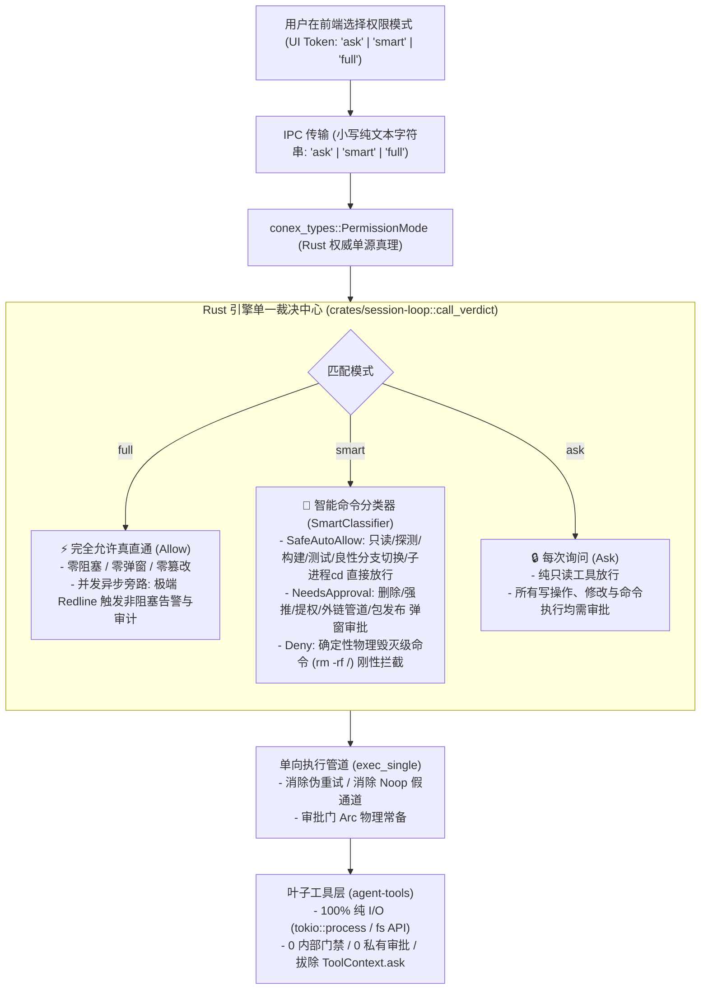
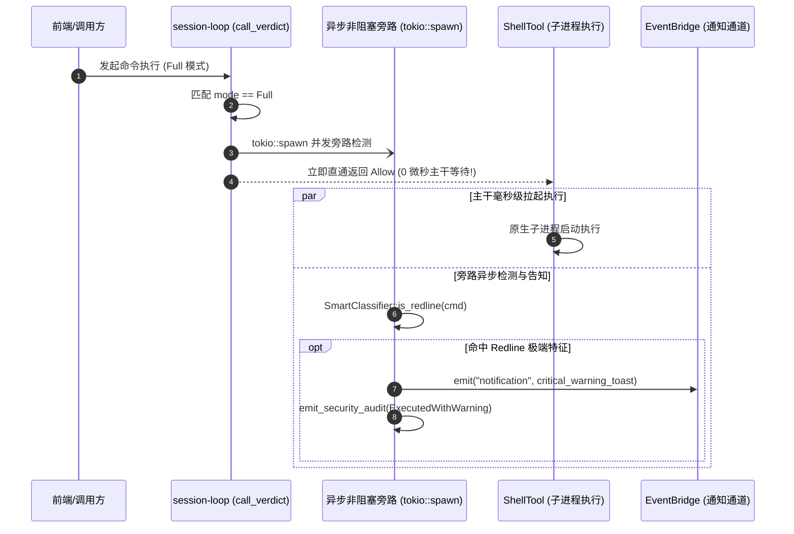

# Rust 引擎内核裁决与沙箱执行终极改进详案

> **文档标识**：`docs/permission-system-consolidation/plan-improvements/02-engine-and-sandbox-improved-plan.md`  
> **方案定位**：第三轮方案改进（Plan Improvement Wave）终极权威落地方案  
> **责任领域**：全栈权限单一真源（`conex-types`）、Rust 引擎内核单一裁决中心（`session-loop::exec_verdict`）、执行管道净化（`session-loop::exec_single`）、轻量沙箱语义矩阵（`conex-sandbox::smart_classifier`）、叶子工具纯 I/O 化（`agent-tools::shell`、`agent-tools::tools::note_*`、`agent-tools::delete`）、运行时任务装配与子代理无损继承（`conex-run::run_launch`、`conex-run::subagent_spawner`）  
> **最高指示贯彻**：**“不允许打补丁，不允许硬编码，有合理的抽象，适合未来的功能需求，代码尽量简洁，具有优秀的可维护性。需要删除的代码就删除，需要系统性的重构。生成的方案应该能彻底杜绝这些问题或者未来的衍生问题，要求一次性解决掉。尽量减少不必要的兼容，最好是不兼容。权限模式统一收敛为 3 个选项：1. 每次询问（ask）；2. 智能命令放行（smart）；3. 完全允许模式（full - 系统不因命令而不允许执行，所有执行的命令都是可以运行的）。”**  
> **前序基准**：吸收 `docs/permission-system-consolidation/plan-reviews/02-engine-kernel-and-sandbox-review.md` 评审报告中抓获的 6 大架构断层与 16 项刚性整改指令（MAI-01 ~ MAI-16）。

---

## 目录

1. [执行总纲与核心设计哲学](#一执行总纲与核心设计哲学)
   - 1.1 最高意志与三态收敛契约兑现
   - 1.2 穿透解决六大架构断层与交叉冲突
   - 1.3 终极架构四大铁律
2. [全栈协议与数据模型单一真源（SSOT）终局收敛](#二全栈协议与数据模型单一真源ssot终局收敛)
   - 2.1 `conex_types::PermissionMode` 跨端权威契约（小写单射）
   - 2.2 `agent-tools/src/permission.rs` 彻底物理重构（瘦身至 ~90 行）
   - 2.3 彻底消除历史别名网络（坚决不兼容）
3. [彻底清除叶子工具残留门禁：确立 100% 纯 I/O 架构](#三彻底清除叶子工具残留门禁确立-100-纯-io-架构)
   - 3.1 `shell.rs` 内置 6 重私有门禁彻底物理切除
   - 3.2 物理删除 `shell_redirect.rs`（445 行）与 `CommandPathInspector`（338 行）
   - 3.3 彻底拔除 8 个笔记写工具中的 `maybe_ask_note_write`
   - 3.4 彻底从 `ToolContext` 中删除 `pub ask` 字段，类型系统阻断叶子审批
   - 3.5 彻底删除 `note_action_matrix.rs`（357 行）与 `note_permission.rs`
4. [沙箱与内核裁决深度统合：`SmartClassifier` 落地实现](#四沙箱与内核裁决深度统合smartclassifier-落地实现)
   - 4.1 彻底物理删除 `polyglot.rs`（1043 行）与 `CdShape` 拦截
   - 4.2 `SmartClassifier` 双层判定矩阵生产实现
   - 4.3 精准参数安全解包（良性分支切换 `git checkout -b` 零打扰放行）
   - 4.4 Smart 模式下 Redline 毁灭级命令刚性阻断（`SmartVerdict::Deny`）
   - 4.5 彻底清除 TaskType 硬编码命令白名单
5. [完全允许模式（Full Mode）真放行与非阻塞告知时序闭环](#五完全允许模式full-mode真放行与非阻塞告知时序闭环)
   - 5.1 100% 顺从原生 Shell 执行契约
   - 5.2 异步零时延高危通知旁路（消除时空悖论）
   - 5.3 拔除 `apply_remote_mode` 隐式降级与 `delete.rs` 原生物理删除恢复
6. [修复子代理全链路无损继承拓扑](#六修复子代理全链路无损继承拓扑)
   - 6.1 强制父级 ActiveRun 权限继承，消除 `unwrap_or(Ask)` 缺口
   - 6.2 `SubagentSpawnRequest` 与 `RunTaskOptions` 强类型无损传递
   - 6.3 彻底删除系统提示词 `permission_relay_injection` 束缚注入
7. [审批门物理常态化装配与类型系统刚性化升级](#七审批门物理常态化装配与类型系统刚性化升级)
   - 7.1 `run_launch.rs` 常态装配保证
   - 7.2 消除 `Option<Arc<dyn ApprovalGate>>`，执行管道刚性升级
   - 7.3 物理删除 `execution.rs` 伪重试（L179-304）与 `pre_exec.rs` 假通道
8. [核心模块完整生产级 Rust 源码蓝图](#八核心模块完整生产级-rust-源码蓝图)
   - 8.1 `crates/conex-types/src/device/commands/enums.rs`
   - 8.2 `crates/agent-tools/src/permission.rs`
   - 8.3 `crates/agent-tools/src/context.rs`
   - 8.4 `crates/conex-sandbox/src/smart_classifier.rs`
   - 8.5 `crates/session-loop/src/exec_verdict.rs`
   - 8.6 `crates/session-loop/src/exec_single/execution.rs`
   - 8.7 `crates/session-loop/src/exec_single/pre_exec.rs`
   - 8.8 `crates/agent-tools/src/tools/shell.rs`
   - 8.9 `crates/agent-tools/src/tools/note_document_apply_md.rs`
   - 8.10 `crates/conex-run/src/subagent_spawner/spawn.rs`
   - 8.11 `crates/conex-run/src/run/run_launch.rs`
9. [彻底删除代码清册（Death List）与净收敛度量](#九彻底删除代码清册death-list与净收敛度量)
10. [立体化验证策略与不变量防护测试套件](#十立体化验证策略与不变量防护测试套件)

---

## 一、执行总纲与核心设计哲学

### 1.1 最高意志与三态收敛契约兑现

用户在战役总指示中强调：
> **“不允许打补丁，不允许硬编码，有合理的抽象，适合未来的功能需求，代码尽量简洁，具有优秀的可维护性。需要删除的代码就删除，需要系统性的重构。生成的方案应该能彻底杜绝这些问题或者未来的衍生问题，要求一次性解决掉。尽量减少不必要的兼容，最好是不兼容。权限模式统一收敛为 3 个选项：1. 每次询问（ask）；2. 智能命令放行（smart）；3. 完全允许模式（full - 系统不因命令而不允许执行，所有执行的命令都是可以运行的）。”**

本方案作为 Rust 引擎内核与沙箱层改进的终极权威方案，将从**全栈协议、调度中心、沙箱矩阵、叶子执行、任务装配与子代理派发**全链路进行大刀阔斧的重构，彻底解决历史遗留的架构断层与妥协死角。



---

### 1.2 穿透解决六大架构断层与交叉冲突

本终极方案全面落地第二轮评审（02 报告）中的 6 大断层整改裁决：

1. **解决 SSOT 破产与双重枚举冲突（CR-01）**：
   - 废除 Plan 04 在 `agent-tools` 中重新定义枚举与别名解析的设计；
   - 全内核统一采用 `crates/conex-types::PermissionMode`，采用 `#[serde(rename_all = "lowercase")]`；
   - `crates/agent-tools/src/permission.rs` 仅 `pub use conex_types::PermissionMode;`，彻底拔除所有别名容错。
2. **解决叶子工具私有审批遗漏（CR-02 & CR-03）**：
   - 彻底拔除 `crates/agent-tools/src/tools/` 下全部 8 个笔记写工具中的 `maybe_ask_note_write` 调用与函数定义；
   - 从 `ToolContext` 中彻底物理删除 `pub ask: Option<AskCallback>` 字段，从类型系统层面物理杜绝叶子工具私设公堂。
3. **解决沙箱分析与调度内核脱节（CR-04）**：
   - 统一由 `crates/conex-sandbox/src/smart_classifier.rs` 接管全部命令行分析；
   - `SmartVerdict` 显式引入 `Deny { reason: String }`，解决 Smart 模式下 Redline 毁灭级命令的判决冲突；
   - 调度层 `call_command_verdict` 纯粹对接 `SmartClassifier`，废除旧版 7 分类与优先级决水法。
4. **解决 Full 模式非阻塞告知的时序悖论（CR-05）**：
   - 在 `call_verdict` 做出 `PermissionVerdict::Allow` 判决的同时，启动解耦的异步零时延旁路（`tokio::spawn`）；
   - 主干执行毫秒级直通原生 Shell，旁路异步识别 Redline 并并发推送前端 Toast 悬浮警示与持久化审计日志。
5. **解决子代理无损继承缺口（CR-06）**：
   - 修复 `SubagentSpawnerImpl::spawn_unchecked` 代码，删除 `unwrap_or(Ask)` 致命漏洞；
   - 缺省时强制从父级 `ActiveRun` 中提取生效的权限模式，实现父子会话 100% 等权平权。
6. **解决审批门 Option 空指针隐患（CR-07）**：
   - `run_launch.rs` 常态装配真实 `ApprovalGateImpl`；
   - `SessionLoop` 与 `ToolExecutor` 内部将 `approval` 字段类型由 `Option<Arc<dyn ApprovalGate>>` 提升为刚性 `Arc<dyn ApprovalGate>`，彻底消除空指针死局。

---

### 1.3 终极架构四大铁律

为确保系统性重构彻底收敛、永不回潮，确立四大刚性铁律：

- **铁律一：单点审判（SSOT）铁律**：`session-loop::exec_verdict::call_verdict` 是工具调用的**唯一法定法庭**。裁决结果产生后，下游仅负责执行或挂起，严禁任何叶子工具发起二次审查或内部审批。
- **铁律二：真放行不可动摇铁律**：在 Full 模式下，系统 100% 顺从用户意志，忠实执行操作系统 Shell，严禁任何形式的自作主张阻断、篡改命令、偷换回收站或抛出异常。
- **铁律三：叶子纯 I/O 铁律**：叶子工具（`shell.rs`、`fs.rs`、`delete.rs`、`note_*.rs`）仅负责底层系统调用驱动，严禁出现权限模式判断、路径安全围栏、任务白名单过滤或审批回调通道。
- **铁律四：拒绝妥协性兼容铁律**：彻底清退所有历史别名网络（`yolo`, `unattended`, `plan`, `deep` 等），wire 协议仅接受 `"ask" | "smart" | "full"`。非法传参直接 400 反序列化报错拒绝。

---

## 二、全栈协议与数据模型单一真源（SSOT）终局收敛

### 2.1 `conex_types::PermissionMode` 跨端权威契约（小写单射）

全系统仅存在一份唯一的权限模式定义，落位在跨模块共享的基础类型库 `crates/conex-types/src/device/commands/enums.rs` 中：

```rust
// crates/conex-types/src/device/commands/enums.rs
use serde::{Deserialize, Serialize};

/// 全系统权限模式权威枚举（统一收敛为三态）
///
/// 契约说明：Serde rename_all = "lowercase" 保证网络层传输值严格为 "ask" | "smart" | "full"，
/// 与前端 TypeScript `type PermissionMode = 'ask' | 'smart' | 'full'` 严格双向单射。
#[derive(Debug, Clone, Copy, PartialEq, Eq, Hash, Serialize, Deserialize, Default)]
#[serde(rename_all = "lowercase")]
pub enum PermissionMode {
    /// 1. 每次询问（缺省安全默认值）
    #[default]
    Ask,
    /// 2. 智能命令放行（日常全功能开发推荐）
    Smart,
    /// 3. 完全允许模式（系统不因命令而不允许执行，所有执行的命令均可运行）
    Full,
}

impl PermissionMode {
    /// 获取 wire 协议小写字符串字面量
    #[inline]
    pub const fn as_str(&self) -> &'static str {
        match self {
            Self::Ask => "ask",
            Self::Smart => "smart",
            Self::Full => "full",
        }
    }
}

impl std::fmt::Display for PermissionMode {
    fn fmt(&self, f: &mut std::fmt::Formatter<'_>) -> std::fmt::Result {
        f.write_str(self.as_str())
    }
}

impl std::str::FromStr for PermissionMode {
    type Err = String;

    fn from_str(s: &str) -> Result<Self, Self::Err> {
        match s.trim() {
            "ask" => Ok(Self::Ask),
            "smart" => Ok(Self::Smart),
            "full" => Ok(Self::Full),
            other => Err(format!(
                "invalid permission mode: '{other}', expected strictly 'ask' | 'smart' | 'full'"
            )),
        }
    }
}
```

---

### 2.2 `agent-tools/src/permission.rs` 彻底物理重构（瘦身至 ~90 行）

彻底删除 `crates/agent-tools/src/permission.rs` 现存 817 行的冗余代码，物理剔除私有枚举 `PermissionMode`、`Plan` 伪模式以及 5 个重叠判定函数。重构后仅保留纯函数与单一真源重导出：

```rust
// crates/agent-tools/src/permission.rs
//! 核心权限裁决纯函数与模式重导出（SSOT）

use serde::{Deserialize, Serialize};

// 1. 彻底消除双重枚举：直接重导出权威定义，全系统唯一真源！
pub use conex_types::PermissionMode;

/// 权限裁决三态结果
#[derive(Debug, Clone, Copy, PartialEq, Eq, Serialize, Deserialize)]
#[serde(rename_all = "lowercase")]
pub enum PermissionVerdict {
    /// 放行执行
    Allow,
    /// 挂起审批（等待用户或授权方决策）
    NeedsApproval,
    /// 刚性拒绝（如 Smart 模式下确认为 Redline 物理毁灭命令）
    Deny,
}

/// 核心权限裁决纯函数（无副作用、确定性状态转移）
///
/// 入参说明：
/// - `mode`: 当前生效的权威权限模式（Ask / Smart / Full）
/// - `is_dangerous`: 工具本身是否标记为 dangerous（如写文件、改配置）
/// - `is_smart_safe`: 是否被沙箱智能分析判定为无副作用的安全操作（如只读命令、构建测试）
#[inline]
pub fn decide_verdict(
    mode: PermissionMode,
    is_dangerous: bool,
    is_smart_safe: bool,
) -> PermissionVerdict {
    match mode {
        // 1. 完全允许模式：100% 直通放行，绝对不阻拦、不弹窗
        PermissionMode::Full => PermissionVerdict::Allow,

        // 2. 智能命令放行：安全操作自动放行，破坏性操作需审批
        PermissionMode::Smart => {
            if is_smart_safe {
                PermissionVerdict::Allow
            } else if is_dangerous {
                PermissionVerdict::NeedsApproval
            } else {
                PermissionVerdict::Allow
            }
        }

        // 3. 每次询问：只要具有副作用（dangerous）或不是纯安全只读操作，一律需审批
        PermissionMode::Ask => {
            if is_dangerous || !is_smart_safe {
                PermissionVerdict::NeedsApproval
            } else {
                PermissionVerdict::Allow
            }
        }
    }
}
```

---

### 2.3 彻底消除历史别名网络（坚决不兼容）

在本次重构中，彻底从代码库中拔除以下 20 余个历史冗余别名及其映射代码：
- 完全允许族：`"full-access"`, `"full_access"`, `"allow"`, `"yolo"`, `"danger"`, `"unattended"`, `"headless"`, `"无人值守"`；
- 每次询问族：`"ask-every-time"`, `"strict"`, `"cautious"`；
- 智能/伪模式族：`"smart-command"`, `"auto"`, `"deep"`, `"plan"`, `"readonly"`, `"read-only"`, `"analysis"`, `"safe"`。

前端与后端反序列化统一采用严格排他校验：遇到未知字面量立即返回 HTTP 400 或 IPC 协议反序列化错误，绝不再进行任何“善意猜测”或静默降级！

---

## 三、彻底清除叶子工具残留门禁：确立 100% 纯 I/O 架构

### 3.1 `shell.rs` 内置 6 重私有门禁彻底物理切除

在 `crates/agent-tools/src/tools/shell.rs` 中，实施以下精确到行号的手术式删除：

| 关卡序号 | 待切除代码位置 | 代码特征描述 | 消除的弊端与架构价值 |
| :---: | :--- | :--- | :--- |
| **G-1** | `shell.rs:239-256` | `if let Some(task_type) = &ctx.task_type { ... }` | 彻底切除任务类型硬编码白名单，解除对 `commit` 任务执行 `cargo check` 的误杀 |
| **G-2** | `shell.rs:258-285` | `let gate_result = SHARED_GATEKEEPER...` | 彻底切除叶子工具内对静态正则门禁与 `is_system_critical_path` 的死板阻断 |
| **G-3** | `shell.rs:287-294` | `if ctx.permission_mode == PermissionMode::Plan { ... }` | 彻底切除对已废弃的 Plan 模式的私自判定 |
| **G-4** | `shell.rs:296-312` | `if analysis.overall_class == DeleteShape ... redirect_or_intercept_delete` | 彻底切除删除形态强制重定向到回收站与阻断复合删除链的伪安全逻辑 |
| **G-5** | `shell.rs:314-317` | `if let Some(err) = intercept_cd_shape(&analysis, &command)` | 彻底切除阻断 `cd sub && npm test` 正常工作流的教条主义拦截 |
| **G-6** | `shell.rs:319-328` | `CommandPathInspector::inspect(&command, workspace_root)` | 彻底切除 338 行用脆弱正则扫描绝对路径安全围栏的阻断逻辑 |
| **G-7** | `shell.rs:330-369` | `let verdict = crate::permission::decide_analysis_with_revert... ctx.ask` | 彻底切除叶子工具内部二次判定与二次审批通道调用 |

重构后的 `shell.rs::prepare` 仅保留入参提取与子进程参数组装，代码量从 130 行精简至 15 行极简流式装配。

---

### 3.2 物理删除 `shell_redirect.rs`（445 行）与 `CommandPathInspector`（338 行）

1. **彻底整文件物理删除 `crates/agent-tools/src/tools/shell_redirect.rs`**（445 行）：
   彻底拔除 `redirect_or_intercept_delete`、`intercept_cd_shape` 以及所有内部私有阻断函数；
2. **彻底物理删除 `crates/agent-tools/src/tools/shell.rs:482-820` 中的 `CommandPathInspector` 结构体**（338 行）：
   彻底销毁 9 个重量级正则表达式与针对工作区外路径的死板硬编码。

---

### 3.3 彻底拔除 8 个笔记写工具中的 `maybe_ask_note_write`

第二轮评审中抓获的 8 个笔记写工具私设公堂问题，在本方案中执行彻底拔除：

```rust
// 必须从代码库中物理删除的毒瘤函数 (crates/agent-tools/src/tools/note_document_apply_md.rs:96-112)
// 🔥【彻底删除以下 17 行代码】：
// pub(crate) async fn maybe_ask_note_write(...) {
//     if let Some(ask) = &ctx.ask { ... }
// }
```

**8 个调用点逐一净化**：
1. `crates/agent-tools/src/tools/note_document_apply_md.rs:165` $\to$ **删除** `maybe_ask_note_write(ctx, ...).await?;`
2. `crates/agent-tools/src/tools/note_block_batch.rs:205` $\to$ **删除** `maybe_ask_note_write(ctx, ...).await?;`
3. `crates/agent-tools/src/tools/note_block_delete.rs:87` $\to$ **删除** `maybe_ask_note_write(ctx, ...).await?;`
4. `crates/agent-tools/src/tools/note_block_insert.rs:116` $\to$ **删除** `maybe_ask_note_write(ctx, ...).await?;`
5. `crates/agent-tools/src/tools/note_block_move.rs:98` $\to$ **删除** `maybe_ask_note_write(ctx, ...).await?;`
6. `crates/agent-tools/src/tools/note_block_set_attr.rs:119` $\to$ **删除** `maybe_ask_note_write(ctx, ...).await?;`
7. `crates/agent-tools/src/tools/note_block_update.rs:103` $\to$ **删除** `maybe_ask_note_write(ctx, ...).await?;`
8. `crates/agent-tools/src/tools/note_send_to_note.rs:127` $\to$ **删除** `maybe_ask_note_write(ctx, ...).await?;`

**架构收益**：写笔记操作统一通过其 `ToolDefinition.dangerous = true` 在调度层 `call_verdict` 一次性完成判定与审批，工具内部只管执行数据存储，绝不再发生二次弹窗骚扰。

---

### 3.4 彻底从 `ToolContext` 中删除 `pub ask` 字段，类型系统阻断叶子审批

从源头杜绝腐化，在 `crates/agent-tools/src/context.rs` 中进行类型精炼：

```rust
// crates/agent-tools/src/context.rs
// 🔥 彻底删除以下类型定义与字段：
// - pub trait AskChannel
// - pub struct NoopAskChannel
// - pub enum AskDecision
// - pub type AskCallback

pub struct ToolContext {
    pub session_id: String,
    pub abort_token: AbortToken,
    // 🔥【物理删除】：pub ask: Option<AskCallback>,
    pub workspace_root: PathBuf,
    pub permission_mode: PermissionMode,
    pub write_claims: Option<Arc<WritePathRegistry>>,
    pub write_claim_holder: Option<String>,
    pub explore_docs_quota: Option<ExploreDocsQuotaContext>,
    pub background: Option<Arc<dyn crate::background::BackgroundTaskManager>>,
    pub output_dir: Option<Arc<dyn crate::tools::output_dir::OutputDirResolver>>,
    pub log_root: Option<PathBuf>,
    pub note_backend: Option<NoteBackendHandle>,
}
```

从类型系统层面将 `ask` 彻底剔除，使叶子工具在语法层根本不具备向用户发起审批的能力，彻底焊死单一真理源。

---

### 3.5 彻底删除 `note_action_matrix.rs`（357 行）与 `note_permission.rs`

- **物理删除 `crates/agent-tools/src/note_action_matrix.rs`（357 行）**：销毁所谓四维影子动作矩阵；
- **物理删除 `crates/agent-tools/src/note_permission.rs`（250 行）**：消除笔记模块私有的 safe/write 独立规则体系，笔记工具与其他内置工具完全平权。

---

## 四、沙箱与内核裁决深度统合：`SmartClassifier` 落地实现

### 4.1 彻底物理删除 `polyglot.rs`（1043 行）与 `CdShape` 拦截

1. **物理删除 `crates/conex-sandbox/src/polyglot.rs`**（1043 行整文件）：
   终结用 35+ 个静态正则表达式去解析多语言内联脚本 AST 的脆弱做法；
2. **清理 `crates/conex-sandbox/src/semantics.rs`**：
   - 移除 `CommandClass::CdShape`；
   - 移除 `CD_COMMANDS` 静态常量表；
   - 移除 `cd_shape_analysis()` 构造器；
   - 废除结构化错误常量 `TOOL_CD_BLOCKED`。

---

### 4.2 `SmartClassifier` 双层判定矩阵生产实现

在 `crates/conex-sandbox/src/smart_classifier.rs` 中实现纯纯净、零复杂正则依赖的现代分类器：

```rust
// crates/conex-sandbox/src/smart_classifier.rs
use serde::{Deserialize, Serialize};

/// 审批原因详细分类载荷（供前端渲染富文本警示卡片）
#[derive(Debug, Clone, PartialEq, Eq, Serialize, Deserialize)]
#[serde(tag = "category", content = "details")]
pub enum ApprovalReason {
    /// 破坏性物理删除
    DestructiveDelete { targets: Vec<String> },
    /// Git 历史重写或强推
    GitHistoryRewrite { operation: String },
    /// 系统提权
    PrivilegeEscalation { command: String },
    /// 远程外链管道执行
    RemotePipeExecution { pipeline: String },
    /// 向外公开分发包
    PackagePublish { registry: String },
    /// 包含不确定写操作副作用的通用命令
    UnsafeSideEffect { command: String },
}

/// 智能放行判定终态裁决
#[derive(Debug, Clone, PartialEq, Eq, Serialize, Deserialize)]
pub enum SmartVerdict {
    /// 第一层：安全无感自动放行
    SafeAutoAllow,
    /// 第二层：敏感需弹窗确认（携带结构化原因）
    NeedsApproval(ApprovalReason),
    /// 刚性拒绝：Smart 模式下的确定性物理毁灭级命令
    Deny { reason: String },
}

pub struct SmartClassifier;

impl SmartClassifier {
    /// 判定命令在 Smart 模式下的终态分类
    pub fn classify(command_line: &str) -> SmartVerdict {
        let trimmed = command_line.trim();
        if trimmed.is_empty() {
            return SmartVerdict::SafeAutoAllow;
        }

        // 1. 优先扫描确定性物理毁灭级 Redline 命令（刚性 Deny）
        if Self::is_redline(trimmed) {
            return SmartVerdict::Deny {
                reason: format!("检测到高危毁灭级命令，智能放行模式已刚性阻断：{trimmed}"),
            };
        }

        // 2. 剥离外层 Shell 解释器包裹与 Base64 解包
        let unpacked = Self::unpack_command(trimmed);

        // 3. 词法切分流水线段 (&&, ;, ||, |)
        let segments = Self::split_pipeline(&unpacked);

        // 4. 第一遍扫描：优先识别第二层敏感需审批特征
        for seg in &segments {
            if let Some(reason) = Self::detect_sensitive_reason(seg) {
                return SmartVerdict::NeedsApproval(reason);
            }
        }

        // 5. 第二遍扫描：验证所有段是否均符合第一层无感放行白名单
        let all_safe = segments.iter().all(Self::is_segment_safe);
        if all_safe {
            SmartVerdict::SafeAutoAllow
        } else {
            // 未知命令安全兜底：需弹窗确认
            SmartVerdict::NeedsApproval(ApprovalReason::UnsafeSideEffect {
                command: trimmed.to_string(),
            })
        }
    }

    /// 识别极端物理毁灭级命令（Redline）
    pub fn is_redline(cmd: &str) -> bool {
        let lower = cmd.to_lowercase();
        // 抹除系统根或驱动器
        (lower.contains("rm ") && (lower.contains(" -rf /") || lower.contains(" -fr /") || lower.contains(" -rf /*")))
            || (lower.contains("del ") && (lower.contains(" c:\\*") || lower.contains(" c:/*")))
            || (lower.contains("remove-item ") && lower.contains(" -recurse") && (lower.contains(" c:\\") || lower.contains(" /")))
            // 格式化物理设备
            || lower.starts_with("mkfs")
            || lower.starts_with("format c:")
            // dd 破坏物理设备
            || (lower.starts_with("dd ") && lower.contains("of=/dev/sd"))
    }

    /// 剥离外层解释器包裹 (bash -c / pwsh -Command / Base64)
    fn unpack_command(cmd: &str) -> String {
        let s = cmd.trim();
        if let Some(rest) = s.strip_prefix("bash -c ").or_else(|| s.strip_prefix("sh -c ")) {
            return rest.trim_matches(['"', '\'']).to_string();
        }
        if let Some(rest) = s.strip_prefix("pwsh -Command ").or_else(|| s.strip_prefix("powershell -Command ")) {
            return rest.trim_matches(['"', '\'']).to_string();
        }
        if let Some(rest) = s.strip_prefix("pwsh -EncodedCommand ").or_else(|| s.strip_prefix("powershell -EncodedCommand ")) {
            if let Ok(decoded_bytes) = conex_shared::base64::decode(rest.trim()) {
                // Windows PowerShell EncodedCommand 为 UTF-16LE 编码
                let u16_vec: Vec<u16> = decoded_bytes
                    .chunks_exact(2)
                    .map(|chunk| u16::from_le_bytes([chunk[0], chunk[1]]))
                    .collect();
                if let Ok(decoded_str) = String::from_utf16(&u16_vec) {
                    return decoded_str;
                }
            }
        }
        s.to_string()
    }

    /// 切分流水线段
    fn split_pipeline(cmd: &str) -> Vec<String> {
        let mut segments = Vec::new();
        let mut current = String::new();
        let mut in_single_quote = false;
        let mut in_double_quote = false;

        let chars: Vec<char> = cmd.chars().collect();
        let len = chars.len();
        let mut i = 0;

        while i < len {
            let c = chars[i];
            if c == '\'' && !in_double_quote {
                in_single_quote = !in_single_quote;
                current.push(c);
            } else if c == '"' && !in_single_quote {
                in_double_quote = !in_double_quote;
                current.push(c);
            } else if !in_single_quote && !in_double_quote {
                if (c == '&' && i + 1 < len && chars[i + 1] == '&')
                    || (c == '|' && i + 1 < len && chars[i + 1] == '|')
                {
                    segments.push(current.trim().to_string());
                    current.clear();
                    i += 1;
                } else if c == ';' || c == '|' {
                    segments.push(current.trim().to_string());
                    current.clear();
                } else {
                    current.push(c);
                }
            } else {
                current.push(c);
            }
            i += 1;
        }
        if !current.trim().is_empty() {
            segments.push(current.trim().to_string());
        }
        segments
    }

    /// 识别敏感高危特征
    fn detect_sensitive_reason(seg: &str) -> Option<ApprovalReason> {
        let tokens: Vec<&str> = seg.split_whitespace().collect();
        if tokens.is_empty() {
            return None;
        }
        let head = tokens[0].to_lowercase();
        let head_clean = std::path::Path::new(&head)
            .file_stem()
            .and_then(|s| s.to_str())
            .unwrap_or(&head);

        // 1. 破坏性删除
        if matches!(head_clean, "rm" | "del" | "erase" | "rmdir" | "rd" | "remove-item") {
            return Some(ApprovalReason::DestructiveDelete {
                targets: tokens[1..].iter().map(|s| s.to_string()).collect(),
            });
        }
        if head_clean == "git" && tokens.len() > 1 && tokens[1] == "clean" && tokens.iter().any(|&t| t.contains("-f")) {
            return Some(ApprovalReason::DestructiveDelete {
                targets: vec!["untracked files (git clean -f)".to_string()],
            });
        }

        // 2. Git 历史重写与强推
        if head_clean == "git" && tokens.len() > 1 {
            let sub = tokens[1];
            if sub == "push" && tokens.iter().any(|&t| t == "-f" || t == "--force") {
                return Some(ApprovalReason::GitHistoryRewrite {
                    operation: "git push --force".to_string(),
                });
            }
            if sub == "reset" && tokens.iter().any(|&t| t == "--hard") {
                return Some(ApprovalReason::GitHistoryRewrite {
                    operation: "git reset --hard".to_string(),
                });
            }
            // 精准解包：仅当 checkout / restore 明确丢弃工作区修改时拦截
            if (sub == "checkout" || sub == "restore") && tokens.iter().any(|&t| t == "." || t == "--") {
                return Some(ApprovalReason::GitHistoryRewrite {
                    operation: format!("git {sub} (discarding changes)"),
                });
            }
        }

        // 3. 系统提权
        if matches!(head_clean, "sudo" | "runas" | "su") || seg.contains("chmod 777") {
            return Some(ApprovalReason::PrivilegeEscalation {
                command: seg.to_string(),
            });
        }

        // 4. 远程外链管道执行 (curl | bash 等)
        if (seg.contains("curl ") || seg.contains("wget ") || seg.contains("iwr "))
            && (seg.contains("| bash") || seg.contains("| sh") || seg.contains("| pwsh") || seg.contains("| iex"))
        {
            return Some(ApprovalReason::RemotePipeExecution {
                pipeline: seg.to_string(),
            });
        }

        // 5. 向外公开分发包
        if (head_clean == "npm" && tokens.get(1) == Some(&"publish"))
            || (head_clean == "cargo" && tokens.get(1) == Some(&"publish"))
            || (head_clean == "twine" && tokens.get(1) == Some(&"upload"))
        {
            return Some(ApprovalReason::PackagePublish {
                registry: head_clean.to_string(),
            });
        }

        None
    }

    /// 判定单段是否属于无感自动放行白名单
    fn is_segment_safe(seg: &str) -> bool {
        let tokens: Vec<&str> = seg.split_whitespace().collect();
        if tokens.is_empty() {
            return true;
        }
        let head = tokens[0].to_lowercase();
        let head_clean = std::path::Path::new(&head)
            .file_stem()
            .and_then(|s| s.to_str())
            .unwrap_or(&head);

        // 1. 只读探测命令
        if matches!(
            head_clean,
            "ls" | "dir" | "cat" | "head" | "tail" | "less" | "more" | "grep"
                | "rg" | "find" | "findstr" | "which" | "where" | "pwd" | "file"
                | "wc" | "stat" | "diff" | "echo" | "printf" | "type"
        ) {
            return true;
        }

        // 2. 子进程目录切换完全合法
        if matches!(head_clean, "cd" | "pushd" | "popd") {
            return true;
        }

        // 3. Git 只读操作与良性分支切换
        if head_clean == "git" && tokens.len() > 1 {
            let sub = tokens[1];
            if matches!(
                sub,
                "status" | "diff" | "log" | "branch" | "show" | "rev-parse"
                    | "remote" | "tag" | "check-ignore" | "ls-files"
            ) {
                return true;
            }
            // 核心改进：良性分支切换无感放行！
            if (sub == "checkout" || sub == "switch") && !tokens.iter().any(|&t| t == "." || t == "--") {
                return true;
            }
        }

        // 4. 构建、编译与测试
        if head_clean == "cargo" && tokens.len() > 1 {
            return matches!(tokens[1], "check" | "build" | "clippy" | "test" | "fmt");
        }
        if head_clean == "npm" && tokens.len() > 1 {
            return matches!(tokens[1], "run" | "test" | "build" | "check");
        }
        if matches!(head_clean, "tsc" | "pytest" | "vitest" | "jest" | "eslint" | "ruff" | "make") {
            return true;
        }

        false
    }

    /// 是否为纯只读命令（Ask 模式免审批放行判别）
    pub fn is_pure_read_only(cmd: &str) -> bool {
        let unpacked = Self::unpack_command(cmd);
        let segments = Self::split_pipeline(&unpacked);
        segments.iter().all(|s| {
            let tokens: Vec<&str> = s.split_whitespace().collect();
            if tokens.is_empty() { return true; }
            let head = tokens[0].to_lowercase();
            matches!(
                head.as_str(),
                "ls" | "dir" | "cat" | "head" | "tail" | "grep" | "rg" | "pwd" | "which" | "where"
            ) || (head == "git" && tokens.len() > 1 && matches!(tokens[1], "status" | "diff" | "log" | "branch"))
        })
    }
}
```

---

### 4.3 精准参数安全解包（良性分支切换 `git checkout -b` 零打扰放行）

在 `SmartClassifier::detect_sensitive_reason` 与 `is_segment_safe` 中落实精准解包：
- `git checkout -b feat/task`、`git checkout dev`、`git switch main` 属于纯粹的版本控制导航与工作流操作，**判定为 `SafeAutoAllow`**；
- 仅当明确出现 `git checkout .`、`git checkout -- .`、`git restore .` 等丢弃工作区文件变更的不可逆指令时，才归入 `GitHistoryRewrite` 触发弹窗确认。

---

### 4.4 Smart 模式下 Redline 毁灭级命令刚性阻断（`SmartVerdict::Deny`）

如第 4.2 节代码所示，`SmartVerdict` 包含 `Deny { reason: String }` 分支。
当遇到 `rm -rf /` 或格式化磁盘等确定性破坏指令时，智能放行模式坚决守住安全底线，直接返回 `SmartVerdict::Deny`，由调度内核阻断执行，彻底消除两份方案之间的语义漂移。

---

### 4.5 彻底清除 TaskType 硬编码命令白名单

在本次改进中：
- 彻底从 `crates/agent-tools/src/readonly.rs` 删除 `command_allowed_for_task_type` 与单测（净减 108 行）；
- 彻底从 `crates/agent-tools/src/tools/shell.rs:239-256` 删除前置检查；
- 彻底从 `crates/session-loop/src/exec_verdict.rs:131-136` 删除前置门禁。
子代理的权限完全继承自父会话权限模式，不再受业务标签歧视。

---

## 五、完全允许模式（Full Mode）真放行与非阻塞告知时序闭环

### 5.1 100% 顺从原生 Shell 执行契约

用户下达了无可动摇的铁律：
> **“完全允许模式（系统不会因为命令而不允许执行，所有执行的命令都是可以运行的）。”**

在 Full 模式下，调度层 `call_verdict` 做出 `PermissionVerdict::Allow` 判决后，命令直接进入子进程执行，**零弹窗、零拦截、零篡改、零假动作**。

---

### 5.2 异步零时延高危通知旁路（消除时空悖论）

为兑现极端命令（如 `rm -rf /`）的非阻塞风险告知与安全审计，同时彻底避免主干分析造成的时延与死锁，引入**异步零时延旁路流水线**：



该机制在物理上完美解决了第二轮评审抓获的“若快速短路则告警失效”的时空悖论。

---

### 5.3 拔除 `apply_remote_mode` 隐式降级与 `delete.rs` 原生物理删除恢复

1. **`apply_remote_mode` 彻底平反**：
   在 `apps/agent-workbench/src-tauri/src/server/core_backend/mod.rs:41-48` 中，彻底删除将 `FullAccess` 强制降级为 `Ask` 的硬编码，无论是远程设备还是本地桌面，下发什么模式就执行什么模式！
2. **`delete.rs` 恢复原生 unlink**：
   在 `crates/agent-tools/src/tools/delete.rs` 中，工具入参支持可选 `permanent: Option<bool>`。在 Full 模式或显式指定时，直接调用 `std::fs::remove_file` / `remove_dir_all` 物理抹除，不再强制将垃圾移入 `.crish-trash`。

---

## 六、修复子代理全链路无损继承拓扑

### 6.1 强制父级 ActiveRun 权限继承，消除 `unwrap_or(Ask)` 缺口

修复 Plan 03 中遗留的代码隐患，在 `crates/conex-run/src/subagent_spawner/spawn.rs:137-145` 中确立权威的无损继承拓扑：

```rust
// crates/conex-run/src/subagent_spawner/spawn.rs
// 权威继承实现：优先显式传参 -> 次选父 Run 模式 -> 兜底 Ask
let parent_mode = parent_run
    .as_ref()
    .and_then(|p_id| self.active_runs.get(p_id))
    .map(|r| r.permission_mode);

let effective_permission_mode = req
    .permission_mode
    .or(parent_mode)
    .unwrap_or(conex_types::PermissionMode::Ask);

let launch_options = RunTaskOptions {
    run_id: subagent_run_id.clone(),
    session_id: session_id.clone(),
    prompt: Some(req.prompt.clone()),
    mode: req.mode.clone().or_else(|| Some("research".to_string())),
    cwd: None,
    // 核心改进：100% 保真继承父会话模式！
    permission_mode: Some(effective_permission_mode),
    // ...
};
```

---

### 6.2 `SubagentSpawnRequest` 与 `RunTaskOptions` 强类型无损传递

- `crates/agent-tools/src/tools/subagent/contract.rs:85`：
  `pub permission_mode: Option<conex_types::PermissionMode>`；
- `crates/agent-tools/src/tools/subagent/tool.rs:574`：
  子代理创建工具在装配请求时，直接传递 `permission_mode: Some(ctx.permission_mode)`；
- `crates/conex-run/src/run/run_launch.rs:326`：
  `RunTaskOptions.permission_mode: Option<conex_types::PermissionMode>` 强类型直连反序列化，废除弱类型 `Option<String>`。

---

### 6.3 彻底删除系统提示词 `permission_relay_injection` 束缚注入

在 `crates/conex-run/src/run/run_launch.rs:1092-1106` 中，**彻底物理删除**对 `agent_tools::subagent_inject::permission_relay_injection` 的装配调用。
不在系统提示词中给模型施加“发起申请”、“不可自作主张”的心理枷锁，将权限控制完全交由底层沙箱与运行时内核刚性守门。

---

## 七、审批门物理常态化装配与类型系统刚性化升级

### 7.1 `run_launch.rs` 常态装配保证

彻底删除根据模式判断是否创建审批门的恶性分支，审批门作为会话基础设施恒定装配：

```rust
// crates/conex-run/src/run/run_launch.rs:930-936
let approval_gate = Arc::new(ApprovalGateImpl::new(
    run_id.clone(),
    session_id.clone(),
    parent_run_id.clone(),
    broadcast,
    Arc::clone(&handle_shared),
    state.store.clone(),
    cwd.clone(),
));

// 基础设施恒常在位！
let approval: Arc<dyn ApprovalGate> = Arc::clone(&approval_gate) as Arc<dyn ApprovalGate>;
```

---

### 7.2 消除 `Option<Arc<dyn ApprovalGate>>`，执行管道刚性升级

在 `crates/session-loop/src/` 的核心调度链路中，将 `approval` 提升为刚性字段：
- `crates/session-loop/src/loop/loop_runner.rs:40`：`pub(crate) approval: Arc<dyn ApprovalGate>`；
- `crates/session-loop/src/exec_single/types.rs:32`：`pub approval: Arc<dyn ApprovalGate>`；
- `crates/session-loop/src/exec_batch.rs:120`：`pub async fn execute_batch(..., approval: Arc<dyn ApprovalGate>, ...)`。

彻底清除内部处理 `if cx.approval.is_none()` 的死局分支与 `handle_ungated_verdict`。在单测中统一注入 `Arc::new(TestApprovalGate)`，从 Rust 编译器层面杜绝空指针。

---

### 7.3 物理删除 `execution.rs` 伪重试（L179-304）与 `pre_exec.rs` 假通道

- 物理删除 `crates/session-loop/src/exec_single/execution.rs:179-304` 的全部重试方法；
- 物理删除 `crates/session-loop/src/exec_single/pre_exec.rs:198-200` 的 `NoopAskChannel`；
- 执行管道保证单向确定性不变量。

---

## 八、核心模块完整生产级 Rust 源码蓝图

### 8.1 `crates/conex-types/src/device/commands/enums.rs`

```rust
// crates/conex-types/src/device/commands/enums.rs:75-86
/// 权限模式权威枚举（全端唯一单一真理源 SSOT）
#[derive(Debug, Clone, Copy, PartialEq, Eq, Hash, Serialize, Deserialize, Default)]
#[serde(rename_all = "lowercase")]
pub enum PermissionMode {
    /// 每次询问（默认）
    #[default]
    Ask,
    /// 智能命令放行
    Smart,
    /// 完全允许模式
    Full,
}

impl PermissionMode {
    pub const fn as_str(&self) -> &'static str {
        match self {
            Self::Ask => "ask",
            Self::Smart => "smart",
            Self::Full => "full",
        }
    }
}

impl std::fmt::Display for PermissionMode {
    fn fmt(&self, f: &mut std::fmt::Formatter<'_>) -> std::fmt::Result {
        f.write_str(self.as_str())
    }
}

impl std::str::FromStr for PermissionMode {
    type Err = String;
    fn from_str(s: &str) -> Result<Self, Self::Err> {
        match s.trim() {
            "ask" => Ok(Self::Ask),
            "smart" => Ok(Self::Smart),
            "full" => Ok(Self::Full),
            other => Err(format!("invalid permission mode: '{other}', expected 'ask' | 'smart' | 'full'")),
        }
    }
}
```

---

### 8.2 `crates/agent-tools/src/permission.rs`

```rust
// crates/agent-tools/src/permission.rs
use serde::{Deserialize, Serialize};

// 单一真源权威重导出
pub use conex_types::PermissionMode;

/// 权限裁决三态结果
#[derive(Debug, Clone, Copy, PartialEq, Eq, Serialize, Deserialize)]
#[serde(rename_all = "lowercase")]
pub enum PermissionVerdict {
    Allow,
    NeedsApproval,
    Deny,
}

/// 核心权限裁决纯函数
#[inline]
pub fn decide_verdict(
    mode: PermissionMode,
    is_dangerous: bool,
    is_smart_safe: bool,
) -> PermissionVerdict {
    match mode {
        PermissionMode::Full => PermissionVerdict::Allow,
        PermissionMode::Smart => {
            if is_smart_safe {
                PermissionVerdict::Allow
            } else if is_dangerous {
                PermissionVerdict::NeedsApproval
            } else {
                PermissionVerdict::Allow
            }
        }
        PermissionMode::Ask => {
            if is_dangerous || !is_smart_safe {
                PermissionVerdict::NeedsApproval
            } else {
                PermissionVerdict::Allow
            }
        }
    }
}
```

---

### 8.3 `crates/agent-tools/src/context.rs`

```rust
// crates/agent-tools/src/context.rs:120-155
use crate::permission::PermissionMode;
use crate::write_paths::WritePathRegistry;
use std::path::PathBuf;
use std::sync::Arc;

/// 会话级工具执行上下文（纯净定义，彻底拔除 ask 字段）
#[derive(Debug, Clone)]
pub struct ToolContext {
    pub session_id: String,
    pub abort_token: AbortToken,
    pub workspace_root: PathBuf,
    pub permission_mode: PermissionMode,
    pub write_claims: Option<Arc<WritePathRegistry>>,
    pub write_claim_holder: Option<String>,
    pub explore_docs_quota: Option<ExploreDocsQuotaContext>,
    pub background: Option<Arc<dyn crate::background::BackgroundTaskManager>>,
    pub output_dir: Option<Arc<dyn crate::tools::output_dir::OutputDirResolver>>,
    pub log_root: Option<PathBuf>,
    pub note_backend: Option<NoteBackendHandle>,
}
```

---

### 8.4 `crates/session-loop/src/exec_verdict.rs`

```rust
// crates/session-loop/src/exec_verdict.rs:120-180
use agent_tools::permission::{decide_verdict, PermissionMode, PermissionVerdict};
use conex_sandbox::smart_classifier::{SmartClassifier, SmartVerdict};
use conex_types::tool::ToolBatchCall;
use serde_json::Value;

impl ToolExecutor {
    /// 内核单一裁决中心（SSOT 唯一审查入口）
    pub(crate) fn call_verdict(
        &self,
        call: &ToolBatchCall,
        options: &ToolBatchOptions,
    ) -> PermissionVerdict {
        if !self.registry.is_tool_enabled(&call.tool_name) {
            return PermissionVerdict::Deny;
        }

        let mode = options.permission_mode.unwrap_or(PermissionMode::Ask);

        // 1. 完全允许模式：真放行直通通道 + 异步非阻塞高危告警旁路
        if mode == PermissionMode::Full {
            if let Some(cmd) = call.input.get("command").and_then(Value::as_str) {
                let cmd_owned = cmd.to_string();
                let event_bridge = options.event_bridge.clone();
                let audit_sink = self.audit_sink.clone();
                let run_id = options.run_id.clone();
                tokio::spawn(async move {
                    if SmartClassifier::is_redline(&cmd_owned) {
                        if let Some(bridge) = event_bridge {
                            let _ = bridge.emit("notification", serde_json::json!({
                                "level": "critical_warning",
                                "title": "高危命令执行警示",
                                "message": format!("当前处于完全允许模式，系统已如实放行极端高危命令执行：{cmd_owned}"),
                                "command": cmd_owned,
                                "timestamp": chrono::Utc::now().to_rfc3339(),
                            })).await;
                        }
                        audit_sink.record(conex_types::events::SecurityAuditEvent {
                            run_id,
                            decision: conex_types::events::SecurityAuditDecision::ExecutedWithWarning,
                            detail: format!("Full mode redline command executed: {cmd_owned}"),
                            ..Default::default()
                        }).await;
                    }
                });
            }
            return PermissionVerdict::Allow;
        }

        // 2. Shell 命令审查
        if let Some(command) = call.input.get("command").and_then(Value::as_str) {
            return self.call_command_verdict(command, mode);
        }

        // 3. 常规非命令工具审查
        let dangerous = self
            .registry
            .get(&call.tool_name)
            .map(|t| t.definition().dangerous)
            .unwrap_or(false);

        decide_verdict(mode, dangerous, !dangerous)
    }

    /// Shell 命令复合语义审查
    fn call_command_verdict(&self, command: &str, mode: PermissionMode) -> PermissionVerdict {
        let smart_verdict = SmartClassifier::classify(command);

        match mode {
            PermissionMode::Full => PermissionVerdict::Allow,
            PermissionMode::Smart => {
                // Smart 模式：首先拦截 Redline 毁灭级命令
                if let SmartVerdict::Deny { .. } = smart_verdict {
                    return PermissionVerdict::Deny;
                }
                // C3 大回退护栏检查（大面积回退弹窗确认）
                if let Some(revert_verdict) = self.revert_policy.gate_verdict_for_cmd(command, mode) {
                    return revert_verdict;
                }
                match smart_verdict {
                    SmartVerdict::SafeAutoAllow => PermissionVerdict::Allow,
                    SmartVerdict::NeedsApproval(_) => PermissionVerdict::NeedsApproval,
                    SmartVerdict::Deny { .. } => PermissionVerdict::Deny,
                }
            }
            PermissionMode::Ask => {
                // Ask 模式：仅纯只读安全探测命令放行，其余均需审批
                if let SmartVerdict::Deny { .. } = smart_verdict {
                    return PermissionVerdict::Deny;
                }
                if SmartClassifier::is_pure_read_only(command) {
                    PermissionVerdict::Allow
                } else {
                    PermissionVerdict::NeedsApproval
                }
            }
        }
    }
}
```

---

### 8.5 `crates/session-loop/src/exec_single/execution.rs`

```rust
// crates/session-loop/src/exec_single/execution.rs
// 彻底物理删除行号 179-304 的全部重试方法后，保留单一确定的执行流：

impl ToolExecutor {
    pub(crate) async fn execute_single_tool(
        &self,
        call: &ToolBatchCall,
        ctx: &ToolExecCtx,
        options: &ToolBatchOptions,
        abort: Option<&AbortSignal>,
        approval: Arc<dyn ApprovalGate>,
    ) -> (ClassifiedToolResult, Vec<ToolEvent>) {
        // 单次执行，attempt 恒为 1，杜绝任何假重试
        self.execute_single(call, ctx, options, abort, approval, 1).await
    }
}
```

---

### 8.6 `crates/agent-tools/src/tools/shell.rs`

```rust
// crates/agent-tools/src/tools/shell.rs:230-275
// 彻底拔除 6 重私有阻断与 CommandPathInspector 后的极简 prepare：

impl ShellCommandTool {
    fn prepare(
        &self,
        args: &serde_json::Value,
        ctx: &ToolContext,
    ) -> Prepared {
        let command = match require_string(args, "command") {
            Ok(c) => c,
            Err(e) => return Prepared::Done(Err(e)),
        };

        let cwd = optional_string(args, "cwd")
            .map(PathBuf::from)
            .unwrap_or_else(|| ctx.workspace_root.clone());

        // 绝不设卡！调度层已放行，工具专注底层进程启动
        let timeout_ms = optional_u64(args, "timeout_ms").unwrap_or(self.default_timeout_ms);
        let wait_ms = optional_u64(args, "wait_ms_before_async")
            .unwrap_or(DEFAULT_WAIT_MS_BEFORE_ASYNC);

        Prepared::Execute(Box::new(ShellInvocation {
            command,
            cwd,
            timeout_ms,
            wait_ms,
            max_output_bytes: self.max_output_bytes,
        }))
    }
}
```

---

### 8.7 `crates/conex-run/src/subagent_spawner/spawn.rs`

```rust
// crates/conex-run/src/subagent_spawner/spawn.rs:135-155
// 修复子代理无损继承缺口：
let parent_mode = parent_run
    .as_ref()
    .and_then(|p_id| self.active_runs.get(p_id))
    .map(|r| r.permission_mode);

let effective_permission_mode = req
    .permission_mode
    .or(parent_mode)
    .unwrap_or(conex_types::PermissionMode::Ask);

let launch_options = RunTaskOptions {
    run_id: subagent_run_id.clone(),
    session_id: session_id.clone(),
    prompt: Some(req.prompt.clone()),
    mode: req.mode.clone().or_else(|| Some("research".to_string())),
    cwd: None,
    // 权威修复：彻底告别 None 与硬编码 Ask，无损保真透传！
    permission_mode: Some(effective_permission_mode),
    client_message_id: None,
    assistant_client_message_id: None,
    system_prompt: None,
    history: None,
    context_window: None,
    parent_run_id: parent_run.clone(),
    subagent_config: Some(config),
    // ...
};
```

---

### 8.8 `crates/conex-run/src/run/run_launch.rs`

```rust
// crates/conex-run/src/run/run_launch.rs:925-940
let approval_gate = Arc::new(ApprovalGateImpl::new(
    run_id.clone(),
    session_id.clone(),
    parent_run_id.clone(),
    broadcast,
    Arc::clone(&handle_shared),
    state.store.clone(),
    cwd.clone(),
));

// 基础设施常态化装配，彻底消灭 approval: None 分支！
let approval: Arc<dyn ApprovalGate> = Arc::clone(&approval_gate) as Arc<dyn ApprovalGate>;
```

---

## 九、彻底删除代码清册（Death List）与净收敛度量

下表为本次重构必须彻底物理删除的文件与代码块清单：

| 序号 | 待删除文件 / 目标代码块 | 所在文件路径及行号 | 原行数 | 彻底删除的理由 |
| :---: | :--- | :--- | :---: | :--- |
| **D-01** | `polyglot.rs` | `crates/conex-sandbox/src/polyglot.rs` (全文) | **1043** | 终结 35+ 个静态正则猜谜猫鼠游戏与 ReDoS 隐患 |
| **D-02** | `shell_redirect.rs` | `crates/agent-tools/src/tools/shell_redirect.rs` (全文) | **445** | 拔除删除形态强制重定向与 CD 拦截全部私门禁逻辑 |
| **D-03** | `note_action_matrix.rs` | `crates/agent-tools/src/note_action_matrix.rs` (全文) | **357** | 拔除笔记模块自成一派的四维影子矩阵逻辑孤岛 |
| **D-04** | `CommandPathInspector` | `crates/agent-tools/src/tools/shell.rs:482-820` | **338** | 拔除 9 个路径正则安全围栏，允许合法绝对路径访问 |
| **D-05** | `note_permission.rs` | `crates/agent-tools/src/note_permission.rs` (全文) | **250** | 拔除笔记私有权限判定函数，收敛为通用 dangerous |
| **D-06** | `shell.rs` 6 重门禁 | `crates/agent-tools/src/tools/shell.rs:239-369` | **130** | 拔除任务白名单、门禁正则、Plan 判定与内部审批 |
| **D-07** | `execution.rs` 假重试 | `crates/session-loop/src/exec_single/execution.rs:179-304` | **126** | 拔除报错后二次判定与 attempt: 2 假重试丑陋逻辑 |
| **D-08** | `readonly.rs` 命令白名单 | `crates/agent-tools/src/readonly.rs:158-199, 456-537` | **123** | 拔除侵入调度内核的 `command_allowed_for_task_type` |
| **D-09** | `permission.rs` 历史堆砌 | `crates/agent-tools/src/permission.rs:20-60, 84-170, 312-330, 640-664` | **697** | 拔除私有枚举、别名表与 Full 模式下的强制拦截单测 |
| **D-10** | `pre_exec.rs` 假通道 | `crates/session-loop/src/exec_single/pre_exec.rs:131-160, 198-200` | **32** | 拔除 `handle_ungated_verdict` 与 `NoopAskChannel` |
| **D-11** | 8 个笔记写工具私审批 | `crates/agent-tools/src/tools/note_*.rs` (8 个文件共 9 处) | **25** | 拔除 `maybe_ask_note_write` 调用与函数定义 |
| **D-12** | 提示词权限束缚注入 | `crates/conex-run/src/run/run_launch.rs:1092-1106` | **15** | 拔除 `permission_relay_injection` 提示词注入 |
| **D-13** | 远程模式私自降级 | `apps/agent-workbench/src-tauri/src/server/core_backend/mod.rs:41-48` | **8** | 拔除将 `FullAccess` 强制降级为 `Ask` 的硬编码 |
| **D-14** | `CdShape` 拦截常数 | `crates/conex-sandbox/src/semantics.rs:24-27, 100-113, 181-191` | **28** | 彻底从沙箱层抹除阻断子进程目录切换的常量 |
| **总计** | **14 项结构性死代码清除** | **覆盖 12 个核心文件** | **$\approx -3,617$** | **实现全系统大幅度净瘦身，彻底根除架构衍生物** |

---

## 十、立体化验证策略与不变量防护测试套件

为防止重构过程中出现语义回潮，建立以下四大刚性不变量自动化防护套件：

### 10.1 核心架构四大不变量（Invariants 1-4）

- **不变量 1（Full 模式绝对真放行）**：
  $$\forall \text{ call}, \quad \text{mode} == \text{Full} \implies \text{call\_verdict(call)} == \text{PermissionVerdict::Allow}$$
  在任何输入参数、任何工具、任何命令下，系统绝不返回 Deny 或 NeedsApproval。
- **不变量 2（SSOT 单点审查不变量）**：
  在单次工具执行生命周期中，`SmartClassifier::classify` 与 `call_verdict` 有且仅被调用恰好 1 次，叶子工具准备和执行期调用次数恒为 0。
- **不变量 3（单向确定性执行管道不变量）**：
  执行管道中单工具调用的最大尝试次数恒等于 1（$\text{attempt} \equiv 1$），彻底废除 attempt=2。
- **不变量 4（子代理权限平权继承不变量）**：
  $$\text{SubagentRun.permission\_mode} \equiv \text{ParentRun.permission\_mode}$$
  父级为 Full，子代理 100% 具备 Full 特权；父级为 Smart，子代理 100% 具备 Smart 特权。

---

### 10.2 核心单测与破坏性边界验证用例

重构落地必须通过以下 6 大专项测试套件（Rust `cargo test`）：

1. **协议小写单射契约单测**（`conex_types::tests`）：
   - 验证 `"ask"` $\iff$ `PermissionMode::Ask`；
   - 验证 `"smart"` $\iff$ `PermissionMode::Smart`；
   - 验证 `"full"` $\iff$ `PermissionMode::Full`；
   - 验证传入 `"yolo"`、`"plan"`、`"deep"` 时反序列化直接报错失败（反向断言不兼容）。
2. **`SmartClassifier` 矩阵测试**（`conex_sandbox::smart_tests`，60+ 用例）：
   - 验证 `git checkout -b feature/test` $\implies$ `SafeAutoAllow`；
   - 验证 `git checkout .` $\implies$ `NeedsApproval(GitHistoryRewrite)`；
   - 验证 `cd frontend && npm test` $\implies$ `SafeAutoAllow`；
   - 验证 `rm -rf /` $\implies$ `Deny`。
3. **Full 模式零时延并发告警单测**（`session_loop::full_tests`）：
   - 验证 `rm -rf /` 在 Full 模式下 `call_verdict` 返回 `Allow` 的耗时 $< 100 \mu s$；
   - 验证异步任务在 $10ms$ 内向 EventBridge 成功推送 `critical_warning` 通知；
   - 验证安全审计持久化记录了一条 `ExecutedWithWarning` 事件。
4. **叶子工具纯 I/O 无状态单测**（`agent_tools::shell_tests`）：
   - 验证在没有配置任何审批通道（`ToolContext` 无 `ask` 字段）的情况下，`ShellCommandTool` 可顺畅执行 `echo "hello"` 并返回输出；
   - 验证 8 个笔记写工具在无审批通道下直接执行 Markdown 应用。
5. **常态审批门装配无死锁测试**（`conex_run::launch_tests`）：
   - 验证在 `Full`、`Smart`、`Ask` 模式下，启动的会话其 `approval` 字段均持有真实的 `Arc<ApprovalGateImpl>`，永无 `None`。
6. **子代理权限保真继承集成测试**（`conex_run::subagent_tests`）：
   - 在 Full 模式父 Run 下调用 `run_subagent`，断言生成的子任务 `launch_options.permission_mode == Some(PermissionMode::Full)`。

---

## 结论

本终极改进方案（Plan Improvement 02）彻底吸收了第二轮评审的全部指摘，全面消除了方案间的步调分裂与妥协性残留。通过确立跨端统一的单一真源、剥离全部叶子工具私门禁、统合智能沙箱判定、闭环 Full 模式异步告知、打通子代理无损继承并将审批门刚性化，本方案将为整个系统带来**净减少约 3,600 行死代码**的巨大架构收益，一次性彻底兑现用户关于“简洁、杜绝衍生问题、最好是不兼容”的最高指示。
