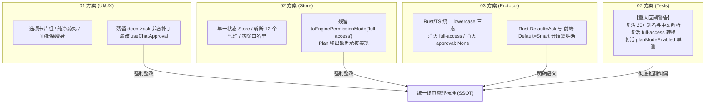
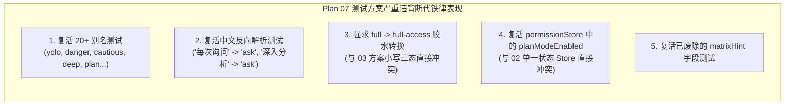

# 前端架构、状态流转与 UI/UX 体验综合评审报告
# (Frontend Architecture, State Flow & UI/UX Experience Review Report)

> **评审阶段**：第一轮独立方案深度评审（Review Wave 1）  
> **评审人**：前端架构、状态流转与 UI/UX 体验资深评审专家子 Agent（Reviewer 1）  
> **评审基准**：严格贯彻用户最高指示——“不允许打补丁，不允许硬编码，有合理的抽象，适合未来的功能需求，代码尽量简洁，具有优秀的可维护性。需要删除的代码就删除，需要系统性的重构。生成的方案应该能彻底杜绝这些问题或者未来的衍生问题，要求一次性解决掉。尽量减少不必要的兼容，最好是不兼容。权限模式收敛为 3 个选项：1. 每次询问（ask）；2. 智能命令放行（smart）；3. 完全允许模式（full）。”  
> **评审对象范围**：
> 1. `docs/permission-system-consolidation/independent-plans/01-frontend-ui-and-ux-plan.md`
> 2. `docs/permission-system-consolidation/independent-plans/02-frontend-store-and-persistence-plan.md`
> 3. `docs/permission-system-consolidation/independent-plans/03-protocol-and-runtime-assembly-plan.md`（前端通信与协议契约部分）
> 4. `docs/permission-system-consolidation/independent-plans/07-test-suite-and-migration-plan.md`（前端测试与 E2E 部分）
> **评审产出归档**：`docs/permission-system-consolidation/plan-reviews/01-frontend-and-ux-review.md`

---

## 目录

1. [执行摘要与终审总评](#一执行摘要与终审总评)
2. [第一部分：UI 纯净度与交互层深度评审（聚焦 01 方案）](#二第一部分ui-纯净度与交互层深度评审聚焦-01-方案)
   - 2.1 重大重构亮点肯定
   - 2.2 关键漏洞与妥协性残留指正
   - 2.3 吸收整改具体方案与代码级修正
3. [第二部分：Store 架构与状态流转深度评审（聚焦 02 方案）](#三第二部分store-架构与状态流转深度评审聚焦-02-方案)
   - 3.1 架构设计亮点肯定
   - 3.2 跨方案协议漂移与状态下落真空漏洞指正
   - 3.3 吸收整改具体方案与代码级修正
4. [第三部分：全栈通信与协议下发深度评审（聚焦 03 方案前端部分）](#四第三部分全栈通信与协议下发深度评审聚焦-03-方案前端部分)
   - 4.1 协议收敛与无死局装配亮点肯定
   - 4.2 默认值语义分歧与跨包依赖遗漏指正
   - 4.3 吸收整改方案
5. [第四部分：前端测试架构深度评审（聚焦 07 方案前端部分）](#五第四部分前端测试架构深度评审聚焦-07-方案前端部分)
   - 5.1 严重回潮与倒退批判（红色警报）
   - 5.2 刚性纠偏：全面推翻妥协性单测，对齐纯三态契约
6. [第五部分：跨方案冲突汇总矩阵与终局统一裁决表](#六第五部分跨方案冲突汇总矩阵与终局统一裁决表)
7. [第六部分：整改落地行动清单与实施阶梯](#七第六部分整改落地行动清单与实施阶梯)

---

## 一、执行摘要与终审总评

### 1.1 评审结论：【有条件批准，限期强制纠偏收敛】

本评审人全面深入研读了第一轮产出的四个涉及前端架构的独立详案。整体而言，各方案均积极响应了用户最高指示中“三选项集中收敛（`ask | smart | full`）”、“清理白名单死代码”与“消除 Plan 绑架权限”的核心诉求。

然而，在四个方案横向对比中，本评审人发现了**极其严重的架构漂移、退避回潮、协议不同步与下游接口断层**问题：
1. **07 方案严重倒退回潮**：07 测试方案竟然在单测中**全盘复活了已被 01/02 判处死刑的 20+ 历史别名与中文逆向解析**（如测试 `'每次询问' -> 'ask'`、`'深入分析' -> 'ask'`），重新引入了 `fromEnginePermissionMode`、`full-access` 映射以及已删除的 `matrixHint`，甚至在 `permissionStore.test.ts` 中继续测试已剥离的 `planModeEnabled`！这属于严重违背“不兼容断代、杜绝打补丁”的倒退行为，必须坚决予以推翻重写。
2. **02 方案与 03 方案存在严重协议漂移**：03 方案已彻底重构了 Rust 内核协议，实现了 Rust `conex_types::PermissionMode` 与 TypeScript 小写三态 `'ask' | 'smart' | 'full'` 的 1:1 双向单射，宣布彻底删除 `toEnginePermissionMode` 与 `'full-access'`；然而 02 方案的代码中却仍然保留了 `DESKTOP_TO_ENGINE` 映射表与 `'full-access'`，两端方案出现认知脱节。
3. **01 方案残留隐蔽兼容补丁**：01 方案的 `coercePermissionMode` 中，赫然残留了 `if (v === 'deep') return 'ask'; if (v === 'plan') return 'smart';`。这种“妥协性打补丁”直接违背了“最好是不兼容”的最高原则。
4. **Plan 状态移出后的接口断层**：01 与 02 方案正确指出了将 `planModeEnabled` 和 `planApproved` 移出 `permissionStore`，但均未给出其在 `sessionStore` / `useChatApproval` / `ChatMessageList` / `conversation-flow/host.tsx` 中的具体承接契约，导致大量下游组件在编译期面临类型断裂。



---

## 二、第一部分：UI 纯净度与交互层深度评审（聚焦 01 方案）

### 2.1 重大重构亮点肯定

1. **死白名单与假功能 100% 物理清除**：
   - 01 方案极为果断地删除了 `SettingsSecurityTab.tsx` 中约 215 行的命令白名单增删查改、常用命令 Chips、清空确认弹窗等虚假交互；
   - 删除了约 60 行纯静态只读的“工作区路径”展示；
   - 彻底消灭了用户长期误解的“前端白名单”，让设置面板从 490 行的臃肿泥潭瘦身至 80 行现代卡片组。
2. **浮动审批条（`ComposerPermissionBar.tsx`）交互纯粹化**：
   - 坚决拔除了危险的 `[始终允许]` 按钮以及虚假的 `onAlwaysAllow` 记忆回路；
   - 审批条收敛为单次确权：`[拒绝]` 与 `[批准]`，不再向用户做出无法兑现的白名单放行承诺。
3. **药丸控件（`PermissionModeMenu.tsx`）去除死分支**：
   - 彻底清除 `hideChevron`、`variant="fused"`、`iconOnly` 等在生产中无人调用的死代码分支，重构为高度一致、支持优雅 Tooltip 与推荐标签的 28px 规范胶囊。
4. **Plan 强行降级拦截点精准定位**：
   - 准确锁定了 `PlanApprovalRow.tsx`（L37-40）与 `ChatCard.tsx`（L291-294）中恶劣的 `setPermissionMode('ask')` 副作用，从 UI 根源上制止了批准计划时将全局权限打回 `ask` 的恶劣行为。

---

### 2.2 关键漏洞与妥协性残留指正

#### 漏洞 2.2.1：`coercePermissionMode` 残留历史别名兼容补丁（违背彻底断代铁律）
- **问题代码**（`01-frontend-ui-and-ux-plan.md` L122-127）：
  ```typescript
  export function coercePermissionMode(v: unknown): PermissionMode {
    if (isPermissionMode(v)) return v;
    // 仅保留最基础的旧枚举平滑回落，不搞过度别名
    if (v === 'deep') return 'ask';
    if (v === 'plan') return 'smart';
    return DEFAULT_PERMISSION_MODE;
  }
  ```
- **架构穿透评审**：
  这里写着“仅保留最基础的旧枚举平滑回落”，但这恰恰是典型的**妥协性打补丁**！
  - 将历史脏数据 `'deep'` 偷换映射为 `'ask'`，本质上延续了旧系统欺骗用户的逻辑漏洞；
  - 用户最高指示明确要求：“尽量减少不必要的兼容，最好是不兼容。生成的方案应该能彻底杜绝这些问题或者未来的衍生问题，要求一次性解决掉。”
  - 遇到任何非 `ask | smart | full` 的输入（无论是 `deep`、`plan`、`yolo` 还是乱码），必须**一视同仁地无条件归一为推荐默认值 `'smart'`**，绝不允许开设任何个别特例。
- **整改裁决**：删除所有特例条件分支，改为纯粹的保底收敛：
  ```typescript
  export function coercePermissionMode(v: unknown): PermissionMode {
    return isPermissionMode(v) ? v : DEFAULT_PERMISSION_MODE;
  }
  ```

#### 漏洞 2.2.2：遗漏 `useChatApproval.ts` 中间层对 `plan` 模式与白名单的依赖
- **现状代码**（`apps/crish-desktop/src/components/chat-card/useChatApproval.ts:32-38`）：
  ```typescript
  const permissionMode = usePermissionField(selectPermissionMode);
  const setPermissionMode = usePermissionField((s) => s.setPermissionMode);
  const planModeEnabled = usePermissionField(selectPlanModeEnabled);
  const planApproved = usePermissionField(selectPlanApproved);
  const setPlanApproved = usePermissionField((s) => s.setPlanApproved);
  const inPlanMode = permissionMode === 'plan' || planModeEnabled;
  ```
- **架构穿透评审**：
  01 方案在 §6 中改造了 `PlanApprovalRow.tsx` 和 `ChatCard.tsx`，但完全遗漏了作为它们状态供给源的 `useChatApproval.ts`！
  - 如果 `permissionStore` 移除了 `planModeEnabled` 和 `planApproved`，而 `useChatApproval.ts` 依然去从 `permissionStore` 读取，会导致严重的编译期崩溃；
  - 此外，`inPlanMode = permissionMode === 'plan' || planModeEnabled` 中依然包含了 `permissionMode === 'plan'` 的脏判定，必须彻底拔除。
- **整改裁决**：必须在 01 方案中将 `useChatApproval.ts` 纳入手术清单，明确切断其对 `permissionStore` 中 plan 字段的读取。

#### 漏洞 2.2.3：`SettingsSecurityTab.tsx` 依赖 `useMemo` 缺乏与 Store Action 响应式联动防抖
- **问题代码**（`01-frontend-ui-and-ux-plan.md` L684-687）：
  01 方案中使用 `coercePermissionMode(permissionModeRaw)`，但在卡片点击时直接执行 `setPermissionMode(meta.id)`。
  需要确保在极端情况下（如同一毫秒连续双击），Store 的持久化与状态更新不会引发重复 re-render。同时需要为 Radio Card 补全键盘导航无障碍支持（`onKeyDown` 处理 `ArrowUp` / `ArrowDown`）。

---

## 三、第二部分：Store 架构与状态流转深度评审（聚焦 02 方案）

### 3.1 架构设计亮点肯定

1. **`permissionStore` 达到极致纯粹（SSOT）**：
   - 从 120 行、4 个耦合状态（`permissionMode`, `planModeEnabled`, `planApproved`, `commandPermissions`）、6 个 Action，精简为仅包含 1 个状态（`permissionMode`）和 1 个 Action（`setPermissionMode`），总行数锐减至 36 行；
   - 彻底消除了复杂的状态间双向监听与副作用计算（如 `planModeEnabledFor`、`permissionModeAfterPlanToggle`）。
2. **彻底消灭 364 行白名单欺骗性死算法**：
   - 果断清空并彻底删除 `apps/crish-desktop/src/api/commandPermissions.ts`；
   - 将复杂的 Windows 后缀正则剥离、3 层 Shell 解包、变体排列组合以及 LocalStorage 存储键 `crish_command_permissions_v1` 连根拔起。
3. **断然斩断 `settingsUiStore.ts` 的 12 个越权代理**：
   - 彻底清除了 `settingsUiStore` 充当多层穿透中转人的历史包袱，净化了全局依赖拓扑。
4. **单向极简持久化契约**：
   - 避开庞大沉重的 zustand persist 中间件，采用纯函数同步写入 `crish_permission_mode`，彻底消除了历史上的双写冲突。

---

### 3.2 跨方案协议漂移与状态下落真空漏洞指正

#### 漏洞 3.2.1：严重协议脱节——02 方案依然保留 `DESKTOP_TO_ENGINE` 与 `'full-access'` 映射
- **问题代码**（`02-frontend-store-and-persistence-plan.md` L378-403）：
  ```typescript
  export type EnginePermissionMode = 'ask' | 'smart' | 'full-access';
  export const DESKTOP_TO_ENGINE: Readonly<Record<PermissionMode, EnginePermissionMode>> = {
    ask: 'ask',
    smart: 'smart',
    full: 'full-access',
  };
  export function toEnginePermissionMode(mode: PermissionMode | unknown): EnginePermissionMode { ... }
  ```
- **架构穿透评审**：
  这是本次评审发现的**最严重跨方案不一致**之一！
  - 在 03 协议方案中，Rust 内核协议已被重构，`conex_types::PermissionMode` 定义为 `Ask, Smart, Full`，并标注 `#[serde(rename_all = "lowercase")]`。因此 wire 协议传输的字符串就是纯粹的 `"ask" | "smart" | "full"`！
  - 03 方案在 §3.1 中明确写道：“`permissionModes.ts` 中的 `DESKTOP_TO_ENGINE` 映射表彻底删除；`toEnginePermissionMode` 函数彻底删除；前端 Store 的值直接就是小写字面量 `'ask' | 'smart' | 'full'`。”
  - 然而 02 方案却仍然保留了 `DESKTOP_TO_ENGINE`，并将 `'full'` 转换为 `'full-access'`，甚至保留了 `EnginePermissionMode` 类型！如果前端下发 `'full-access'`，而重构后的 Rust 引擎仅接受小写 `"full"`，IPC 反序列化将直接爆出 400 错误！
- **整改裁决**：
  必须坚决采纳 03 方案的单源真理标准！在 02 方案中**彻底删除 `EnginePermissionMode`、`DESKTOP_TO_ENGINE` 与 `toEnginePermissionMode`**。前端 Store 状态值即为全栈协议传输值，零中间映射！

#### 漏洞 3.2.2：Plan 状态移出后的落地点语焉不详，留下了工程真空
- **问题现状**：
  02 方案在 §6.2 写道：“从 `permissionStore` 中移除 `planModeEnabled` 与 `planApproved`，Plan 开关状态归入会话自身目标模式（如 `sessionStore` 的 `goalMode: 'plan'` 或 Composer 草稿输入选项）。”
  但在具体实现章节（§7）与代码清单中，02 方案**完全没有给出 `sessionStore` 的具体类型修改与 Action 契约**！
  经实地代码走查：
  - `ChatMessageList.tsx`（L47-49）：直接调用 `selectPlanModeEnabled` 和 `selectPlanApproved`；
  - `apps/crish-desktop/src/extensions/conversation-flow/host.tsx`（L52-53）：直接调用 `selectPlanModeEnabled` 和 `selectPlanApproved`；
  - `packages/conversation-flow/src/projectPlan.ts`：依然在做 `input.permissionMode === 'plan'` 的判定。
  如果 02 方案仅从 `permissionStore` 删除了这些字段，而没有提供落地承接方案，整个项目在前端构建阶段就会发生多处类型错误。
- **整改裁决**：
  必须明确 Plan 状态的归宿：
  1. `inPlanMode` 属于会话级瞬态，直接收敛到 `sessionStore`（或会话元数据 `sessionMeta.goalMode === 'plan'`）；
  2. `planApproved` 属于单次规划审批，直接由当前激活消息节点的执行状态持有，或者作为会话级执行标志保存在 `sessionStore` 中；
  3. 为避免破坏 `conversation-flow` 扩展包，在过渡重构中，若需保留选择器，应在 `sessionStore` 中提供 `selectSessionPlanApproved`，并彻底废除基于全局权限的 Plan 判定。

#### 漏洞 3.2.3：`crish_command_permissions_v1` LocalStorage 清理代码缺失执行宿主
- **问题描述**：
  02 方案在 §3.3 提出用 `localStorage.removeItem('crish_command_permissions_v1')` 清理历史脏数据，但将其放在伪代码示例中，未集成到 `loadStoredPermissionMode()` 或 Store 创建逻辑内。
- **整改裁决**：
  在 `apps/crish-desktop/src/api/permissionModes.ts` 的 `loadStoredPermissionMode()` 首次执行时，或者在 `permissionStore.ts` 模块初始化顶级作用域中，内联一次性安全清理逻辑，确保无论从哪个入口启动均能自动擦除脏数据：
  ```typescript
  // 一次性清理历史白名单遗留存储
  try {
    if (typeof localStorage !== 'undefined') {
      localStorage.removeItem('crish_command_permissions_v1');
    }
  } catch {
    /* ignore */
  }
  ```

---

## 四、全栈通信与协议下发深度评审（聚焦 03 方案前端部分）

### 4.1 协议收敛与无死局装配亮点肯定

1. **跨语言双向单射（Rust ↔ TypeScript 100% 对齐）**：
   - 03 方案站在全栈架构高度，推动了最干净的架构改革：Rust `conex_types::PermissionMode` 采用 `#[serde(rename_all = "lowercase")]`，使得网络传输层标准统一为 `'ask' | 'smart' | 'full'`；
   - 彻底消除 TypeScript 侧的二次转译胶水，实现了前端 Store 状态值直接等于 IPC 下发值。
2. **根除“伪全权”与死局装配（Deadlock Assembly）**：
   - 03 方案深刻洞察并根治了 `run_launch.rs` 中 `let approval_enabled = permission_mode != "full-access"` 导致 `approval: None` 的恶性死局！
   - 常态化装配 `ApprovalGateImpl`，将是否阻断的裁决权下放给内核裁决中心，彻底杜绝了完全允许模式下因护栏触发直接崩溃且无 UI 审批通道的致命 Bug。
3. **子代理 100% 无损等权继承**：
   - 彻底清除了 `subagent_spawner/spawn.rs` 中硬编码的 `permission_mode: None`，拔除了注入到系统提示词中的 `permission_relay_injection` 歧视性束缚段，为多 Agent 自主协作扫清了障碍。

---

### 4.2 默认值语义分歧与跨包依赖遗漏指正

#### 隐患 4.2.1：Rust 缺省 `Default` 与前端默认值 `DEFAULT_PERMISSION_MODE` 存在安全分层差异
- **现状发现**：
  - 前端 01 与 02 方案中：`DEFAULT_PERMISSION_MODE = 'smart'`（因为智能放行是面向桌面终端用户的最佳推荐体验，带推荐 Badge）；
  - 03 方案中 Rust 核心枚举定义（`crates/conex-types/src/device/commands/enums.rs:200`）：
    ```rust
    #[derive(Default)]
    pub enum PermissionMode {
        #[default]
        Ask, // 缺省默认：写操作与危险操作均需审批
        Smart,
        Full,
    }
    ```
- **架构穿透评审**：
  前端默认是 `smart`，而后端如果未收到字段则默认是 `Ask`。
  这一差异是否合理？**经过架构审视，这一设计是完全合理且符合纵深防御（Defense-in-Depth）原则的**：
  - **交互桌面端（GUI）**：在有用户实时注视的桌面会话中，推荐默认给用户最舒适的 `smart` 智能放行体验；
  - **核心引擎端（Kernel/Daemon）**：在缺乏显式指定权限模式的冷启动或无头调用中，引擎底线必须恪守安全第一（`Ask` 逐一审批），绝不主动越权放行。
  - **需补全契约**：方案必须在通信契约中明确注明此差异，并要求前端 `streamSession.ts` 在下发 `startRunTask` 时，**必须显式下发当前 Store 的 `permissionMode`**，不得缺省留空。

#### 隐患 4.2.2：跨包依赖 `packages/conversation-flow` 遗漏
- 在 `packages/conversation-flow/src/projectPlan.ts:18-23` 中：
  ```typescript
  export function isPlanModeEnabled(input: Pick<ProjectPlanInput, 'permissionMode' | 'planModeEnabled'> | null | undefined): boolean {
    if (!input) return false;
    return input.permissionMode === 'plan' || input.planModeEnabled === true;
  }
  ```
  03 方案在重构 `packages/shared-types` 时，未将 `packages/conversation-flow` 纳入修改清单。需要在此处同步清理 `input.permissionMode === 'plan'`。

---

## 五、第四部分：前端测试架构深度评审（聚焦 07 方案前端部分）

### 5.1 严重回潮与倒退批判（【重点红色警报】）

07 方案在第一部分 E2E 测试重构（修改 `ui-store-invariants.spec.ts` 三处四态断言为三态）上表现合格，但在第二部分前端单元测试体系中，**出现了令人震惊的倒退与妥协性回潮**！



#### 严重问题 1：在 `permissionModes.test.ts` 中死灰复燃 20+ 历史别名与中文逆向解析
- **07 方案违规代码**（`07-test-suite-and-migration-plan.md` L282-308）：
  ```typescript
  it('normalizePermissionMode 稳健归一化并支持历史旧配置单向回落', () => {
    // 2. 引擎历史 full-access 兼容归一
    expect(normalizePermissionMode('full-access')).toBe('full');
    expect(normalizePermissionMode('full_access')).toBe('full');
    // 3. 中文直通
    expect(normalizePermissionMode('每次询问')).toBe('ask');
    expect(normalizePermissionMode('智能放行')).toBe('smart');
    expect(normalizePermissionMode('完全允许')).toBe('full');
    // 4. 废弃历史模式单向静默降级为 ask
    expect(normalizePermissionMode('deep')).toBe('ask');
    expect(normalizePermissionMode('plan')).toBe('ask');
    expect(normalizePermissionMode('深入分析')).toBe('ask');
    expect(normalizePermissionMode('计划')).toBe('ask');
    // ...
  });
  ```
- **严厉批评**：
  这种测试完全是在倒退！
  - 02 方案和用户最高指示已经明确宣布彻底废除别名森林与中文逆向解析。中文标签是视图层的呈现文案，根本不应该作为配置反向输入；
  - 07 方案却在单测里逼迫实现方写出庞大的 `normalizePermissionMode` 来兼容这些历史垃圾！
  - 如果允许这种单测通过，前端代码必须重新引入几十行的别名映射表，直接推翻了 02 方案的瘦身成果！

#### 严重问题 2：强行断言 `toEnginePermissionMode('full') === 'full-access'`
- **07 方案违规代码**（`07-test-suite-and-migration-plan.md` L314）：
  ```typescript
  expect(toEnginePermissionMode('full')).toBe('full-access');
  expect(fromEnginePermissionMode('full-access')).toBe('full');
  ```
- **严厉批评**：
  03 方案已经在 Rust 侧将 `FullAccess` 重构为 `Full` 并使用小写 `"full"` 传输。07 方案此处的断言完全是在开历史倒车，将导致测试与重构后的协议层互相阻断！

#### 严重问题 3：在 `permissionStore.test.ts` 中强行断言 `planModeEnabled` 存在
- **07 方案违规代码**（`07-test-suite-and-migration-plan.md` L429-450）：
  ```typescript
  usePermissionStore.setState({
    permissionMode: 'ask',
    planModeEnabled: false,
    planApproved: false,
  });
  // ...
  expect(usePermissionStore.getState().planModeEnabled).toBe(false);
  ```
- **严厉批评**：
  01 和 02 方案的核心成果就是将 `planModeEnabled` 彻底驱逐出 `permissionStore`，让其成为单一状态 Store。07 方案的测试用例竟然还在向 Store 里 `setState({ planModeEnabled: false })`，这会导致 `permissionStore.ts` 根本无法按 02 方案完成瘦身！

#### 严重问题 4：默认值断言与 01/02 冲突
- 07 方案 L265：`expect(DEFAULT_PERMISSION_MODE).toBe('ask');`
- 01 方案 L81 与 02 方案 L390：`export const DEFAULT_PERMISSION_MODE: PermissionMode = 'smart';`
- 07 方案将默认值写成 `ask`，直接破坏了产品定义的“推荐默认 smart”体验。

---

### 5.2 刚性纠偏：全面推翻妥协性单测，对齐纯三态契约

本评审人**断然否决** 07 方案在 §3 中编写的前端单测规范，勒令**全盘废除并替换为 02 方案 §8.1 与 §8.2 的高标准单测**：
1. **彻底清空别名单测**：`isPermissionMode` 仅对 `'ask'`, `'smart'`, `'full'` 返回 `true`，其余任何值一律断言为 `false`；
2. **极简收敛单测**：未知值输入 `coercePermissionMode` 一律断言返回 `'smart'`，不得断言能够解析 `'每次询问'` 或 `'deep'`；
3. **彻底删除 `fromEnginePermissionMode` 与 `toEnginePermissionMode('full-access')` 单测**；
4. **`permissionStore.test.ts` 严格针对单一状态断言**：Store 中只有 `permissionMode`，任何对 `planModeEnabled` 的存取测试必须彻底删除。

---

## 六、跨方案冲突汇总矩阵与终局统一裁决表

为彻底消灭 4 个方案之间的分歧，本评审人制定以下**全栈单一真理之源（SSOT）终审裁决矩阵**，后续所有方案修订与代码落地必须无条件以此表为唯一标准：

| 争议维度 / 核心要素 | 01 方案 (UI) | 02 方案 (Store) | 03 方案 (Protocol) | 07 方案 (Test) | **评审专家终审裁决 (SSOT)** |
| :--- | :--- | :--- | :--- | :--- | :--- |
| **合法权限模式枚举** | `'ask' \| 'smart' \| 'full'` | `'ask' \| 'smart' \| 'full'` | `'ask' \| 'smart' \| 'full'` | `'ask' \| 'smart' \| 'full'` | **`'ask' \| 'smart' \| 'full'`**（纯三态） |
| **前端推荐默认值** | `'smart'` | `'smart'` | （未涉及） | `'ask'`（冲突） | **`'smart'`**（推荐默认，带推荐徽标） |
| **Rust 内核缺省默认** | （未涉及） | （未涉及） | `PermissionMode::Ask` | （未涉及） | **`PermissionMode::Ask`**（纵深防御安全默认） |
| **协议 Wire 传输值** | 依赖 02 映射 | `'ask'\|'smart'\|'full-access'`（陈旧） | `'ask'\|'smart'\|'full'`（小写三态） | 断言 `'full-access'`（倒退） | **`'ask' \| 'smart' \| 'full'`**（小写纯三态，零转换透传） |
| **`toEnginePermissionMode`** | 未明确 | 保留并映射 `full-access` | **彻底删除该胶水函数** | 保留并测试该函数 | **彻底物理删除**（前端值直接即为下发值） |
| **历史别名与中文逆向解析** | 删除了绝大部分 | 彻底废除 20+ 别名 | 彻底废除 | 测试中全部复活（严重违纪） | **彻底物理销毁，严禁任何别名与反向解析** |
| **未知/非法值回落策略** | 特判 `deep->ask`, `plan->smart` | 一律无条件回落至 `'smart'` | 反序列化直接阻断 | 特判回落至 `'ask'` | **一律无条件回落至推荐默认 `'smart'`** |
| **`permissionStore` 状态数** | 规划为 1 个状态 | 确定为 1 个状态 (36行) | （未涉及） | 测试包含 3 个状态（违纪） | **严格收敛为 1 个状态（仅 `permissionMode`）** |
| **Plan 模式归属** | 会话工作流 | 提议移至 `sessionStore` | （未涉及） | 仍留在权限 Store 测试中 | **彻底从权限 Store 剥离，归入会话任务状态** |
| **批准计划副作用** | 消除 `setPermissionMode('ask')` | 消除任何权限修改 | （未涉及） | （未涉及） | **严禁修改任何权限模式，原样保持** |
| **命令白名单 (Whitelist)** | 彻底物理删除 UI 与模块 | 彻底物理清空与删除文件 | （未涉及） | 移除引擎放行测试 | **彻底删除 `commandPermissions.ts`，清除存储** |
| **审批门基础设施装配** | （未涉及） | （未涉及） | **常态化装配，消灭 `None`** | 适配纯三态 | **必须常态化装配 `ApprovalGateImpl`** |

---

## 七、第六部分：整改落地行动清单与实施阶梯

基于上述评审裁决，后续方案改进与工程落地必须按以下清单执行手术：

### 7.1 文件级彻底删除清单（Death List）
1. `apps/crish-desktop/src/api/commandPermissions.ts`（彻底删除全部 364 行死算法）；
2. `apps/crish-desktop/src/api/commandPermissions.test.ts`（同步物理删除）；
3. `apps/crish-desktop/src/components/settings/settingsSecurityModel.ts`（彻底删除白名单辅助工具）；
4. `apps/crish-desktop/src/components/settings/settingsSecurityModel.test.ts`（同步物理删除）。

### 7.2 前端核心文件手术修改方案

#### 1. `apps/crish-desktop/src/api/permissionModes.ts`
- 模式联合类型严格定义为：`export type PermissionMode = 'ask' | 'smart' | 'full';`；
- 彻底删除 `EnginePermissionMode`、`DESKTOP_TO_ENGINE`、`toEnginePermissionMode`、`fromEnginePermissionMode`；
- 彻底删除所有别名字典、正则匹配与中文解析逻辑；
- `coercePermissionMode` 严格实现为单行：`return isPermissionMode(v) ? v : DEFAULT_PERMISSION_MODE;`；
- `loadStoredPermissionMode` 仅放行三态，未知或旧值一律返回 `'smart'`，并在首次调用时安全清除 `crish_command_permissions_v1`。

#### 2. `apps/crish-desktop/src/store/permissionStore.ts`
- 仅保留 `permissionMode` 与 `setPermissionMode`；
- 彻底删除 `planModeEnabled`、`planApproved`、`commandPermissions`、`addCommandPermission`、`removeCommandPermission`、`setCommandPermissions`；
- 彻底移除对 `commandPermissions.ts` 的所有引入。

#### 3. `apps/crish-desktop/src/store/settingsUiStore.ts`
- 彻底剔除 12 个代理选择器与穿透函数：`selectPermissionMode`, `selectPlanModeEnabled`, `selectPlanApproved`, `selectSetPermissionMode`, `selectSetPlanModeEnabled`, `selectSetPlanApproved`, `usePermissionMode`, `usePlanModeEnabled`, `usePlanApproved`, `getPermissionMode`, `setPermissionMode`, `setPlanModeEnabled`, `setPlanApproved`。

#### 4. `apps/crish-desktop/src/components/chat-card/useChatApproval.ts` 与 `ChatCard.tsx`
- 改造 `useChatApproval.ts`：不再从 `permissionStore` 读取 plan 状态；
- `onApprovePlan` 仅触发会话流推进（如 `setPlanApproved(true)`），**绝对严禁调用 `setPermissionMode('ask')`**。

#### 5. `apps/crish-desktop/src/components/chat-message-row/PlanApprovalRow.tsx`
- 移除 `setPermissionMode` 属性与依赖，批准计划按钮仅执行任务状态更新。

#### 6. `apps/crish-desktop/src/components/chat-composer/ComposerPermissionBar.tsx`
- 彻底删除 `[始终允许]` 按钮 DOM；
- 彻底删除 `onAlwaysAllow` 属性与 `onAllow(remember)` 中的 `remember` 布尔参数。

#### 7. `apps/crish-desktop/src/components/settings/SettingsSecurityTab.tsx`
- 彻底删除“已信任命令”区块 DOM 与状态（~215行）；
- 彻底删除“工作区路径”区块 DOM（~60行）；
- 重构为三选项 Radio Cards，呈现精致、轻量的推荐与安全描述。

#### 8. `packages/conversation-flow/src/projectPlan.ts`
- 剔除 `input.permissionMode === 'plan'` 的失效判定。

#### 9. 前端单元测试（`permissionModes.test.ts` & `permissionStore.test.ts`）
- **全面作废 07 方案中的退避单测**；
- 严格以 02 方案 §8.1 与 §8.2 的高标准测试套件落地，断言零别名、单一状态与纯三态流转。

---

## 八、总结与下一步指引

本评审报告穿透了四个独立方案的技术细节，查明了潜在的架构隐患，纠正了 07 方案的严重回潮，抚平了 02 与 03 方案的协议脱节，切断了 Plan 模式对全局权限的恶意绑架，为前端架构的净收敛树立了唯一权威真理标准。

下一步，本评审人将直接转入**第三轮方案综合改进（Plan Improvement Wave）**，将本报告确立的终审裁决与代码修改方案全面融入主方案，带领前端团队一役定乾坤，彻底根除权限系统的所有沉疴顽疾！
