# Rust 引擎内核裁决、沙箱语义与运行时装配权威评审报告

> **文档标识**：`docs/permission-system-consolidation/plan-reviews/02-engine-kernel-and-sandbox-review.md`  
> **评审对象**：
> - `docs/permission-system-consolidation/independent-plans/03-protocol-and-runtime-assembly-plan.md`（全栈协议与运行时装配详案）
> - `docs/permission-system-consolidation/independent-plans/04-engine-verdict-kernel-plan.md`（引擎内核单一裁决中心 SSOT 详案）
> - `docs/permission-system-consolidation/independent-plans/05-smart-command-matrix-and-sandbox-plan.md`（智能命令放行与沙箱精炼详案）
> - `docs/permission-system-consolidation/independent-plans/06-full-allow-bypass-and-leaf-tools-cleanup-plan.md`（完全允许真放行与叶子工具清理详案）  
> **评审角色**：Rust 引擎内核裁决、沙箱语义与运行时装配资深评审专家子 Agent（Reviewer 2）  
> **审查基准**：用户最高指示——**“不允许打补丁，不允许硬编码，有合理的抽象，适合未来的功能需求，代码尽量简洁，具有优秀的可维护性。需要删除的代码就删除，需要系统性的重构。生成的方案应该能彻底杜绝这些问题或者未来的衍生问题，要求一次性解决掉。尽量减少不必要的兼容，最好是不兼容。权限模式统一收敛为 3 个选项：1. 每次询问（ask）；2. 智能命令放行（smart）；3. 完全允许模式（full - 系统不因命令而不允许执行，所有执行的命令都是可以运行的）。”**  
> **评审裁决**：**【有条件通过，提出 6 大架构断层刚性整改要求（Conditional Pass with Mandatory Rectifications）】**

---

## 目录

1. [评审总览与核心裁决结论](#一评审总览与核心裁决结论)
   - 1.1 总体评估与重构价值肯定
   - 1.2 六大核心架构断层与跨方案冲突穿透
   - 1.3 刚性整改裁决汇总表
2. [维度一：内核单一裁决中心（SSOT）审查与深度穿透](#二维度一内核单一裁决中心ssot审查与深度穿透)
   - 2.1 `call_verdict` 单一法庭地位核查
   - 2.2 毒点指出：双重枚举死灰复燃与别名网络回潮（Plan 03 vs Plan 04 严重冲突）
   - 2.3 遗漏排查：叶子工具私有审批遗毒——8 个笔记写工具 `maybe_ask_note_write` 漏网之鱼
   - 2.4 根治方案：彻底拔除 `ToolContext.ask`，从类型系统物理杜绝叶子工具私设审批
3. [维度二：彻底拔除死局与滑稽重试审查](#三维度二彻底拔除死局与滑稽重试审查)
   - 3.1 `execution.rs` 伪重试逻辑（179-304 行）物理删除审查
   - 3.2 `NoopAskChannel` 欺骗通道与 `handle_ungated_verdict` 拔除审查
   - 3.3 `run_launch.rs` 常态装配审查与 `approval: None` 彻底消灭
   - 3.4 架构推进：消除 `Option<Arc<dyn ApprovalGate>>`，基础设施刚性化升级
4. [维度三：智能命令放行（Smart Mode）精准度与沙箱精炼审查](#四维度三智能命令放行smart-mode精准度与沙箱精炼审查)
   - 4.1 彻底废除 `polyglot.rs`（1043 行）与 `CdShape` 审查
   - 4.2 `SmartClassifier` 双层判定矩阵严密性审查
   - 4.3 漏洞指摘：`git checkout -b` 等良性分支切换误伤风险与修补
   - 4.4 语义断层：Smart 模式下 Redline 命令的终局裁决冲突（Plan 04 `Deny` vs Plan 05 `NeedsApproval`）
   - 4.5 彻底拆除 TaskType 硬编码命令白名单
5. [维度四：完全允许模式（Full Mode）真放行与边界审查](#五维度四完全允许模式full-mode真放行与边界审查)
   - 5.1 100% 真实执行操作系统 Shell 契约兑现核查
   - 5.2 `shell.rs` 内置 6 重私有门禁删除完整度审查
   - 5.3 时空悖论修复：Full 模式下极端高危命令非阻塞告知的时序断层与零延迟异步并发方案
   - 5.4 远程接口 `apply_remote_mode` 隐式降级拔除与 `delete.rs` 原生物理删除恢复
6. [维度五：杜绝补丁与硬编码，系统简洁性与可维护性审查](#六维度五杜绝补丁与硬编码系统简洁性与可维护性审查)
   - 6.1 坚决消灭兼容性别名容错（反向贯彻“最好是不兼容”）
   - 6.2 子代理权限继承链路漏洞：修复 Plan 03 `spawn_unchecked` 中 `unwrap_or(Ask)` 致命缺陷
   - 6.3 净代码消除量审计与架构收敛度量
7. [综合整改指令清单（Mandatory Action Items for Revision Phase）](#七综合整改指令清单mandatory-action-items-for-revision-phase)
   - 7.1 给 Plan 03 的修订指令（MAI-01 ~ MAI-04）
   - 7.2 给 Plan 04 的修订指令（MAI-05 ~ MAI-08）
   - 7.3 给 Plan 05 的修订指令（MAI-09 ~ MAI-12）
   - 7.4 给 Plan 06 的修订指令（MAI-13 ~ MAI-16）

---

## 一、评审总览与核心裁决结论

### 1.1 总体评估与重构价值肯定

本次送审的四份重构独立详案（Plan 03、04、05、06）展现了极高的专业深度与问题穿透力。方案精准击中了当前代码库中存在的一系列历史包袱与架构毒瘤：
1. **直面核心死局**：准确锁定了 `run_launch.rs:930-936` 中 `approval_enabled = permission_mode != "full-access"` 导致的 `approval: None` 恶性死局，以及下游 `revert.rs` 大回退硬判 `NeedsApproval` 导致的 `ApprovalRequired` 崩溃；
2. **勇于物理切除**：果断提出物理删除 `execution.rs:179-304` 的 `handle_retry_after_approval_required` 假重试代码和 `NoopAskChannel` 假通道；
3. **大力消灭过度工程**：坚决提出删除 `conex-sandbox/src/polyglot.rs` 1043 行静态正则堆砌，废除教条主义的 `CdShape` 拦截（`TOOL_CD_BLOCKED`），拔除 `shell.rs` 中的 338 行绝对路径围栏 `CommandPathInspector`；
4. **清理影子逻辑孤岛**：坚决提出删除笔记模块维护的 357 行“四维独立矩阵（`note_action_matrix.rs`）”与 `shell_redirect.rs`（445 行）。

上述方向完全符合用户最高指示中的“需要删除的代码就删除，需要系统性的重构，杜绝补丁”要求。

---

### 1.2 六大核心架构断层与跨方案冲突穿透

然而，经过资深评审对四份详案的交叉比对以及与底层代码库（crates/）的深入审计，发现了 **6 处严重的架构断层、跨方案冲突与隐藏死角**。如果不进行刚性整改，重构落地后不仅无法实现单一真理源（SSOT），甚至会再次演化出新的阴阳逻辑与运行时死锁：

```mermaid
flowchart TD
    subgraph Defect1["🚨 断层一：SSOT 破产与双重枚举回潮"]
        P3["Plan 03: conex_types::PermissionMode (lowercase)<br/>消除 agent-tools 私有枚举"] <-->|冲突| P4["Plan 04: agent-tools/src/permission.rs<br/>重定义 kebab-case + from_engine_str 别名表"]
    end

    subgraph Defect2["🚨 断层二：叶子工具私有审批遗毒漏网"]
        P6["Plan 06 清理了 shell.rs<br/>但漏掉了 8 个笔记写工具!"] --> NoteLeak["note_document_apply_md 等工具内部<br/>仍调用 maybe_ask_note_write(ctx.ask)<br/>造成二次审批与私设公堂!"]
    end

    subgraph Defect3["🚨 断层三：沙箱重构脱节与裁决冲突"]
        P5["Plan 05: SmartClassifier<br/>输出 SmartVerdict (AutoAllow / NeedsApproval)"] <-->|脱节与冲突| P4_Cmd["Plan 04: call_command_verdict<br/>仍调旧 analyze 并判 Redline 为 Deny!"]
    end

    subgraph Defect4["🚨 断层四：Full 模式非阻塞通知的时序悖论"]
        P4_Fast["Plan 04: call_verdict<br/>Full 模式直接快速短路返回 Allow"] <-->|时序断层| P6_Warn["Plan 06: 要求 Redline 时零延迟执行<br/>但要发送非阻塞 Toast 告警与审计!<br/>(若短路则根本无人分析 Redline!)"]
    end

    subgraph Defect5["🚨 断层五：子代理无损继承缺口与兜底违纪"]
        P3_Inherit["Plan 03 宣称 100% 继承"] --> P3_Bug["spawn_unchecked 中却写了:<br/>req.permission_mode.unwrap_or(Ask)!<br/>导致未传参时瞬间降级为 Ask!"]
    end

    subgraph Defect6["🚨 断层六：审批门仍留 Option 隐患"]
        P3_Opt["Plan 03 & 04 常态装配 Some(gate)<br/>但类型签名仍为 Option<Arc<dyn ApprovalGate>>"] --> P3_Leak["若外部传 None 仍会引发死局!<br/>未从类型系统层面彻底消除"]
    end
```



---

### 1.3 刚性整改裁决汇总表

| 断层编号 | 核心病灶描述 | 涉及方案与代码位置 | 严重级别 | 整改裁决要求 |
| :---: | :--- | :--- | :---: | :--- |
| **CR-01** | **双重枚举重现与别名网络回潮**：Plan 03 与 Plan 04 在 `PermissionMode` 定义位置、命名大小写、Serde 规则及别名支持上产生分裂。 | Plan 03 §2.3 / §6.1 vs Plan 04 §3.1 / §8.1 | **BLOCKER (阻断级)** | **以 Plan 03 为唯一准绳**：全栈权威枚举定义在 `crates/conex-types`，小写 `lowercase`，彻底删除 `agent-tools` 私有枚举与全部别名兼容解析函数 `from_engine_str`！ |
| **CR-02** | **叶子工具私有审批遗漏**：8 个笔记写工具仍硬编码 `maybe_ask_note_write`，直接调用 `ctx.ask`，严重破坏叶子工具纯 I/O 化铁律。 | Plan 06 §4.2 遗漏；`agent-tools/src/tools/note_*.rs`（8 个文件） | **CRITICAL (严重级)** | **物理拔除 `maybe_ask_note_write`**：笔记工具写操作的权限审批由调度层 `call_verdict` 一次性完成，彻底从 `ToolContext` 中删除 `ask: Option<AskCallback>` 字段！ |
| **CR-03** | **沙箱语义分析与调度内核脱节**：Plan 05 重构了 `SmartClassifier`，但 Plan 04 内核调度依然调用旧 `analyze`，且对 Redline 的裁决在 Smart 模式下发生冲突。 | Plan 04 §4.3 vs Plan 05 §3.1 / §6.2 | **BLOCKER (阻断级)** | **统一步调与类型对齐**：`SmartVerdict` 显式增加 `Deny { reason: String }` 变体；`call_command_verdict` 统一且仅调用 `SmartClassifier::classify`，彻底废除旧 7 分类与优先级决水法！ |
| **CR-04** | **Full 模式高危告知时序悖论**：Plan 04 在 Full 模式下快速短路返回 `Allow`，导致 Plan 06 承诺的极端命令（Redline）非阻塞 Toast 告警和安全审计根本无法被触发。 | Plan 04 §4.1 / §4.2 vs Plan 06 §5.2 | **CRITICAL (严重级)** | **引入零时延并发告知旁路**：在 Full 模式下快速返回 `Allow` 的同时，若命令包含危险特征，通过轻量异步 Task 并发推送非阻塞告警，绝不在主干阻塞，也绝不丢弃告警。 |
| **CR-05** | **子代理无损继承缺口**：Plan 03 宣称子代理 100% 继承父级权限，但其落地代码却使用 `unwrap_or(PermissionMode::Ask)` 导致子代理在默认缺省时发生权限降级。 | Plan 03 §5.3（行号 582） | **CRITICAL (严重级)** | **强制父 Run 模式透传**：`spawn_unchecked` 必须从父级 `ActiveRun.permission_mode` 中提取模式作为缺省回退值，严禁写死 `unwrap_or(Ask)`！ |
| **CR-06** | **审批门基础设施仍留 Option 漏洞**：装配层虽然常态装配了 `Some(gate)`，但 `ToolExecutor` 和 `SessionLoop` 内部仍将其定义为 `Option<...>`，为衍生 Bug 留下后门。 | Plan 03 §4.1 & Plan 04 §6.1 | **MAJOR (重要级)** | **类型系统刚性化升级**：将 `ToolExecutor.approval` 和 `SessionLoop.approval` 的字段类型从 `Option<Arc<dyn ApprovalGate>>` 直接升级为 `Arc<dyn ApprovalGate>`，从编译期杜绝空指针！ |

---

## 二、维度一：内核单一裁决中心（SSOT）审查与深度穿透

### 2.1 `call_verdict` 单一法庭地位核查

在 Plan 04 中，作者提出将 `crates/session-loop/src/exec_verdict.rs` 中的 `call_verdict` 重塑为**全系统唯一的权限审查入口**。这一设计目标高度正确：
- 所有进入执行管道的工具调用（`ToolBatchCall`）必须首先在 `call_verdict` 中获得法定许可；
- 裁决产物严格收敛为三态：`PermissionVerdict::Allow`、`PermissionVerdict::NeedsApproval`、`PermissionVerdict::Deny`；
- 叶子工具只负责执行操作系统 I/O，严禁二次设卡。

**审查断言**：`call_verdict` 的 SSOT 架构定位成立，符合单一真理源原则。

---

### 2.2 毒点指出：双重枚举死灰复燃与别名网络回潮

这是本次评审抓获的**最严重架构分裂**：

#### 现场比对：
- **Plan 03 的正确主张**（Plan 03 §2.3 & §6.1）：
  - 权威定义位于 `crates/conex-types/src/device/commands/enums.rs`：
    ```rust
    #[derive(Debug, Clone, Copy, PartialEq, Eq, Hash, Serialize, Deserialize, Default)]
    #[serde(rename_all = "lowercase")]
    pub enum PermissionMode {
        #[default]
        Ask,
        Smart,
        Full,
    }
    ```
  - 明确要求：“彻底删除 `crates/agent-tools/src/permission.rs` 中的私有枚举，直接 `pub use conex_types::PermissionMode;`，消除 50% 冗余类型，杜绝别名网络”。
- **Plan 04 的阳奉阴违与历史回潮**（Plan 04 §3.1 & §8.1）：
  - 居然又在 `crates/agent-tools/src/permission.rs` 重新定义了一套 `pub enum PermissionMode { Ask, Smart, Full }`；
  - 居然采用了 `#[serde(rename_all = "kebab-case")]`；
  - 居然重新写了长达 20 行的 `from_engine_str` 方法，里面赫然继续兼容 `"yolo"`、`"cautious"`、`"strict"`、`"deep"`、`"plan"`、`"auto"` 等历史别名！
- **Plan 06 的符号滞后**（Plan 06 §2.1）：
  - 在代码示例中依然保留着 `PermissionMode::FullAccess` 和 `PermissionMode::Plan` 的旧符号（第 113-114 行）！

#### 资深评审严厉指摘：
用户指示极其明确：“**尽量减少不必要的兼容，最好是不兼容。不允许打补丁，不允许硬编码**。”
Plan 04 保留 `from_engine_str` 和海量别名网络，是典型的“嘴上喊着彻底重构，手里却舍不得扔掉历史破烂”的退避妥协行为！
如果 TypeScript 前端、IPC 协议层、Rust 核心层已经统一收敛为小写字面量 `'ask' | 'smart' | 'full'`，那么任何非法传入的字符串（如 `"yolo"` 或 `"plan"`）都应该在反序列化阶段直接报 400 错误拒绝，绝不允许在底座引擎里继续私设容错补丁！

> [!IMPORTANT]
> **刚性整改要求（MAI-01）**：
> 1. 彻底废除 Plan 04 中重新定义 `PermissionMode` 的提议；
> 2. `crates/conex-types::PermissionMode` 是跨全端唯一的单一真理源，`rename_all = "lowercase"`；
> 3. `crates/agent-tools/src/permission.rs` 中**必须物理删除**枚举定义与 `from_engine_str` / `as_engine_str` 方法，改为 `pub use conex_types::PermissionMode;`；
> 4. Plan 06 必须全局替换残留的 `FullAccess` 和 `Plan` 符号，统一为 `PermissionMode::Full`、`Smart`、`Ask`。

---

### 2.3 遗漏排查：叶子工具私有审批遗毒——8 个笔记写工具 `maybe_ask_note_write` 漏网之鱼

在 Plan 06 中，作者宣称彻底拔除了叶子工具私门禁，重点打击了 `shell.rs` 内的 6 重卡扣和 `delete.rs` 的回收站偷换。
**然而，评审通过全仓深度符号扫描，发现 Plan 06 漏掉了一个巨大的历史遗留死角！**

在 `crates/agent-tools/src/tools/note_document_apply_md.rs:96-112` 中，存在以下私有审批函数：
```rust
// crates/agent-tools/src/tools/note_document_apply_md.rs:96-112
pub(crate) async fn maybe_ask_note_write(
    ctx: &ToolContext,
    tool_name: &str,
    args: &JsonValue,
) -> Result<(), ToolError> {
    if let Some(ask) = &ctx.ask {
        match ask.ask(tool_name, args).await? {
            AskDecision::Allowed => Ok(()),
            AskDecision::Denied { reason } => Err(ToolError::new(
                "tool.user_denied",
                format!("user denied: {reason}"),
            )),
        }
    } else {
        Ok(())
    }
}
```
经过实证排查，全仓共有 **8 个笔记工具**在调用此函数进行私有审批：
1. `crates/agent-tools/src/tools/note_document_apply_md.rs:165`
2. `crates/agent-tools/src/tools/note_block_batch.rs:205`
3. `crates/agent-tools/src/tools/note_block_delete.rs:87`
4. `crates/agent-tools/src/tools/note_block_insert.rs:116`
5. `crates/agent-tools/src/tools/note_block_move.rs:98`
6. `crates/agent-tools/src/tools/note_block_set_attr.rs:119`
7. `crates/agent-tools/src/tools/note_block_update.rs:103`
8. `crates/agent-tools/src/tools/note_send_to_note.rs:127`

#### 危害与死局场景：
1. **二次弹窗骚扰**：在 `Ask` 模式下，调度层的 `call_verdict` 已经识别出这些工具为 `dangerous: true`，并通过 `ApprovalGate` 弹窗向用户请求了批准；当用户点击“允许”后，工具开始执行，内部居然又通过 `ctx.ask` 调用了一遍 `maybe_ask_note_write`，导致用户被逼连续点击两次批准！
2. **死锁与断流隐患**：若未来某个执行上下文将 `ctx.ask` 设为特定阻断通道，工具内部再次拦截，完全破坏了“调度层放行即执行”的架构铁律。

> [!CAUTION]
> **刚性整改要求（MAI-02）**：
> 1. Plan 06 必须将上述 8 个笔记写工具中的 `maybe_ask_note_write` 调用**全部物理删除**；
> 2. 彻底删除 `note_document_apply_md.rs` 中的 `maybe_ask_note_write` 函数定义；
> 3. 笔记工具必须严格作为纯粹的存储操作工具，其危险属性统一由其 `ToolDefinition.dangerous = true` 表明，审批权 100% 收归调度层 `call_verdict`。

---

### 2.4 根治方案：彻底拔除 `ToolContext.ask`，从类型系统物理杜绝叶子工具私设审批

为什么历史开发者总喜欢在叶子工具内部写 `if let Some(ask) = &ctx.ask`？
**根本原因在于：执行上下文 `ToolContext` 中提供了 `pub ask: Option<AskCallback>` 这个字段！**
只要类型系统中存在这个字段，未来就会有不知情的开发者在新增工具时图省事，直接在工具里调用 `ctx.ask`，从而再次引狼入室，造成“私设公堂”的历史回潮。

#### 事实审计：
在排除了 `shell.rs` 和上述 8 个笔记写工具之后，**全代码库中再无任何叶子工具消费 `ctx.ask`**！

> [!IMPORTANT]
> **终极整改裁决（MAI-03）**：
> 1. 从 `crates/agent-tools/src/context.rs` 的 `ToolContext` 结构体中，**彻底物理删除 `pub ask: Option<AskCallback>` 字段**；
> 2. 彻底删除 `AskChannel`、`AskDecision`、`AskCallback` 以及 `NoopAskChannel` 的类型定义；
> 3. 从 `crates/session-loop/src/exec_single/pre_exec.rs` 中彻底删除向 `ToolContext` 组装注入 `approval_channel` 的全部胶水代码；
> 4. **收益**：从 Rust 类型系统层面斩断一切后路，使得叶子工具在语法层根本无法发起审批请求，一劳永逸杜绝此类架构腐化！

---

## 三、维度二：彻底拔除死局与滑稽重试审查

### 3.1 `execution.rs` 伪重试逻辑（179-304 行）物理删除审查

在现存代码 `crates/session-loop/src/exec_single/execution.rs:179-304` 中，存在全系统最令人啼笑皆非的“先报错、再二次脱水判定、再伪造 attempt: 2 重试”的逻辑。
Plan 04 §5.1 和 §7.1 对该毒瘤代码做出了精准的死刑判决（D-08、D-09、D-10）。

**审查结论**：
物理删除 `handle_retry_after_approval_required`、`retry_after_allow` 和 `handle_retry_needs_approval` 的规划完全正确，必须刚性执行。执行管道收敛为：
$$\text{Verdict} \implies \begin{cases} \text{Allow} & \implies \text{单次确定性执行 (attempt = 1)} \\ \text{NeedsApproval} & \implies \text{单次挂起审批 } \to \text{批准则执行 / 拒绝则退出} \\ \text{Deny} & \implies \text{单次硬阻断直接返回错误} \end{cases}$$
不存在任何循环重试与伪重试逻辑。

---

### 3.2 `NoopAskChannel` 欺骗通道与 `handle_ungated_verdict` 拔除审查

- 现存 `crates/session-loop/src/exec_single/pre_exec.rs:198-200` 针对 `FullAccess` 注入了一个“无论问什么都直接返回 Allowed”的 `NoopAskChannel`，其唯一目的就是配合第 3.1 节的伪重试，欺骗 `shell.rs` 内部的二次判定。
- 现存 `pre_exec.rs:131-160` 中的 `handle_ungated_verdict` 在发现没有 `approval` 时抛出 `ToolErrorKind::ApprovalRequired`，造成不可恢复的死局。

**审查结论**：
Plan 04 将两者同步彻底物理删除（D-11、D-12），消除了整个欺骗与双轨分化机制，符合高内聚与干净架构标准。

---

### 3.3 `run_launch.rs` 常态装配审查与 `approval: None` 彻底消灭

在 `crates/conex-run/src/run/run_launch.rs:930-936` 中：
```rust
// 现存恶性代码：
let approval_enabled = permission_mode.as_deref() != Some("full-access");
let approval = if approval_enabled { Some(...) } else { None };
```
Plan 03 §4.1 和 Plan 04 §6.1 均提出：
将 `approval` 恒定赋值为 `Some(Arc::clone(&approval_gate) as Arc<dyn ApprovalGate>)`，并将 `approval_enabled` 常态置为 `true`。

**审查结论**：
将审批门作为全生命周期常备的基础设施，使得底座能力与业务模式彻底解耦，彻底消灭了因运行时模式切换或意外抛出 `NeedsApproval` 时因找不到 Gate 发生的断崖式崩溃。方案高度成立。

---

### 3.4 架构推进：消除 `Option<Arc<dyn ApprovalGate>>`，基础设施刚性化升级

**审查挑刺与漏洞指摘**：
Plan 03 和 Plan 04 虽然在 `run_launch.rs` 里写死了 `Some(approval_gate)`，但在 `ToolExecutor`、`SessionLoop` 以及 `ExecContext` 中，`approval` 字段的类型依然是：
`pub approval: Option<Arc<dyn ApprovalGate>>`！
在 `pre_exec.rs` 的重构代码中，依然充斥着：
```rust
match &cx.approval {
    Some(gate) => { ... }
    None => { /* 如果这里还是走兜底，万一有人漏装配怎么办？ */ }
}
```

> [!NOTE]
> **进阶整改要求（MAI-04）**：
> 既然用户要求“一次性彻底解决掉衍生问题，杜绝未来的问题”，那么就应该在内部管道结构体中进行**类型刚性化升级**：
> 1. 将 `ToolExecutor` 内部持有的 `approval` 直接声明为 `Arc<dyn ApprovalGate>`（非 Option）；
> 2. 会话启动（`run_launch.rs`）是进入执行内核的唯一合法入口，装配层保证 100% 提供有效实例；
> 3. 在单测或无头测试中，若不需要真实弹窗，统一注入标准的 `TestApprovalGate`（或 `AutoApproveGate`），而不是传入 `None`！
> 4. 彻底从代码中抹去 `approval: None` 这种危险状态的存在空间。

---

## 四、维度四：智能命令放行（Smart Mode）精准度与沙箱精炼审查

### 4.1 彻底废除 `polyglot.rs`（1043 行）与 `CdShape` 审查

Plan 05 在沙箱治理方面给出了极其坚决的重构措施：
1. **物理删除 `crates/conex-sandbox/src/polyglot.rs`（整文件共 1043 行代码）**：
   放弃用脆弱的有限状态机正则去猜测 Python、Node、Ruby 等内联代码中的 AST 风险，消除了由此带来的合法测试误伤、ReDoS 漏洞和连锁红线死刑拦截；
2. **彻底废除 `CdShape` 与 `TOOL_CD_BLOCKED`**：
   承认操作系统 Shell 子进程具有完全独立的虚拟内存与进程级工作目录（CWD），子进程退出后自动释放，彻底恢复了开发者执行 `cd packages/core && cargo test` 等日常复合命令的合法权利。

**审查结论**：这是本次重构中最具实效性的减负动作，彻底消除了历史过度设计的反噬。全量通过。

---

### 4.2 `SmartClassifier` 双层判定矩阵严密性审查

Plan 05 §3 提出了清晰的两层判定模型：
- **第一层：无感自动放行（Safe Auto-Allow）**：
  涵盖：只读与系统探测、Git 只读状态（status/diff/log 等）、本地编译构建（cargo build/check、npm run build 等）、自动化测试套件（cargo test、npm test、vitest 等）、Linter 静态检查（eslint、clippy 等）、子进程内目录切换（cd）。
- **第二层：敏感需确认（Needs Approval）**：
  涵盖：破坏性物理删除（rm/del）、Git 历史重写与强推（push -f/reset --hard）、系统提权（sudo/runas）、远程外链管道执行（curl | bash）、向外发布包（npm/cargo publish）、工作区外部破坏性越界。

**审查结论**：两层矩阵维度正交，边界极其清晰，完全覆盖了日常软件开发的核心场景。

---

### 4.3 漏洞指摘：`git checkout -b` 等良性分支切换误伤风险与修补

**审查深度挑刺**：
在 Plan 05 §3.3 的“敏感需确认表”中，将 `git checkout` 与 `git restore` 列为 `GitHistoryRewrite`。
如果分类器仅对子命令进行粗暴匹配：
```rust
// 脆弱匹配伪代码：
if cmd == "git" && (subcmd == "checkout" || subcmd == "restore") {
    return NeedsApproval(...);
}
```
那么在现实场景中，开发者和 Agent 最频繁使用的命令：
- `git checkout -b feat/new-feature`（创建并切换分支）
- `git checkout main`（单纯切换分支）
- `git switch dev`（切换分支）
**将会全部被误判为敏感高危操作，导致频繁弹窗打断！**

> [!WARNING]
> **刚性整改要求（MAI-05）**：
> `SmartClassifier` 必须对 `git checkout` / `git switch` 进行精准的参数安全解包（Argument Disambiguation）：
> 1. 只有当命令包含 `-- .`、`-f` / `--force` 或明确指向丢弃工作区修改时（如 `git checkout -- <file>`、`git checkout .`），才归入 `GitHistoryRewrite`；
> 2. 纯分支切换（`git checkout <branch>`、`git checkout -b <branch>`、`git switch <branch>`）**必须 100% 归入第一层 `SafeAutoAllow`**！

---

### 4.4 语义断层：Smart 模式下 Redline 命令的终局裁决冲突（Plan 04 vs Plan 05）

**重大架构冲突排查**：
在 Smart 模式下，如果模型执行了极端毁灭性命令（例如 `rm -rf /` 或 `mkfs.ext4`）：
- **Plan 04 §4.3 明文规定**：
  > “物理红线防护（Redline）：在 Smart 或 Ask 模式下，若命令经沙箱语义分析命中 CommandClass::Redline，系统直接返回 `PermissionVerdict::Deny`，杜绝任何误操作。”
- **Plan 05 §3.1 & §6.2 却明文规定**：
  > `SmartVerdict` 只有两个分支：`SafeAutoAllow` 和 `NeedsApproval(ApprovalReason)`！在 `ApprovalReason` 里有一个 `DestructiveDelete` 分支。
  > 这意味着在 Plan 05 看来，`rm -rf /` 只不过是一个需要弹窗确认的 `DestructiveDelete`，只要用户在弹窗上点了“允许”，它就能执行！

两份方案在最核心的安全边界上出现了**完全相反的结论**！

#### 资深评审权威裁决：
在 `Smart` 模式（智能命令放行，面向日常开发）下，对于 `rm -rf /`、`mkfs` 这类确定性物理毁灭级命令，**必须是绝对拒绝（`Deny`）**！
如果用户真的想在特定的沙箱/容器里执行毁灭性指令，用户应当主动切换到 `Full`（完全允许模式）。智能模式的职责就是保障日常开发的安全底线。

> [!IMPORTANT]
> **终极整改裁决（MAI-06）**：
> 1. Plan 05 的 `SmartVerdict` 枚举必须增加第三个变体：
>    ```rust
>    pub enum SmartVerdict {
>        SafeAutoAllow,
>        NeedsApproval(ApprovalReason),
>        Deny { reason: String }, // 用于 Smart 模式下硬阻断 Redline 毁灭级命令
>    }
>    ```
> 2. `SmartClassifier` 内部统一内置 Redline 规则（如系统根物理抹除、格式化设备）；
> 3. 在 Smart 模式下命中 Redline 返回 `SmartVerdict::Deny`，由 `call_verdict` 直接转换为 `PermissionVerdict::Deny`；
> 4. 彻底废除 Plan 04 中依然调用旧版 `conex_sandbox::semantics::analyze` 并查 `overall_class == CommandClass::Redline` 的分裂做法，**全系统仅使用 `SmartClassifier`**！

---

### 4.5 彻底拆除 TaskType 硬编码命令白名单

在现存代码 `crates/agent-tools/src/readonly.rs:158-183` 中，硬编码了 `command_allowed_for_task_type`，并且侵入了 `shell.rs:239-256` 和 `exec_verdict.rs:131-136`，导致被打上 `commit` 标签的子代理连 `cargo check` 都不能运行。
Plan 04 §7.1（D-06）和 Plan 05 §5 均做出了将其彻底删除的规划。

**审查结论**：
任务类型（TaskType）是调度编排维度的元数据，系统权限的唯一真源是用户配置的 `PermissionMode`。坚决清除调度主干上的 `task_type` 命令硬编码过滤。全量通过。

---

## 五、维度五：完全允许模式（Full Mode）真放行与边界审查

### 5.1 100% 真实执行操作系统 Shell 契约兑现核查

用户对完全允许模式给出了最高指示：
> **“完全允许模式（即系统不会因为命令而不允许执行，所有执行的命令都是可以运行的）。”**

Plan 06 明确了“把执行权 100% 还给用户与操作系统”的原则：
- 调度层 `call_verdict` 判定为 `Allow` 后，直接交付 `tokio::process::Command`；
- 不偷换命令、不拦截 CD、不擅自重定向到回收站、不以绝对路径阻断。

**审查结论**：完全忠实于用户最高指示，契约完备。

---

### 5.2 `shell.rs` 内置 6 重私有门禁删除完整度审查

Plan 06 §3 详细列出了对 `crates/agent-tools/src/tools/shell.rs` 的 6 重私有阻断代码的清除计划：
1. 关卡 1：任务类型白名单（L239-256）$\to$ **删除**
2. 关卡 2：门禁层 `SHARED_GATEKEEPER` 与系统关键路径（L258-285）$\to$ **删除**
3. 关卡 3：Plan 模式私判（L287-294）$\to$ **删除**
4. 关卡 4：删除形态强制重定向与拦截（L296-312）及 `shell_redirect.rs` 全文（445 行）$\to$ **删除**
5. 关卡 5：CD 形态拦截（L314-317）$\to$ **删除**
6. 关卡 6：绝对路径安全围栏 `CommandPathInspector`（L319-328 & L482-820，共 338 行）$\to$ **删除**
7. 关卡 7：工具内二次审批与 `ctx.ask`（L330-369）$\to$ **删除**

**审查结论**：删除清单极其详尽，行号定位精确，执行后将净减代码约 800 余行，叶子工具将彻底蜕变为干净的高性能 I/O 驱动器。全量通过。

---

### 5.3 时空悖论修复：Full 模式下极端高危命令非阻塞告知的时序断层

这是 Plan 04 与 Plan 06 交叉阅读时发现的**严重逻辑断层**：

#### 矛盾现场：
- **Plan 06 §5.2 的设计承诺**：
  在 Full 模式下，当执行到极端高危命令（如 `rm -rf /`）时：
  1. 主执行线 100% 顺从，零延迟执行；
  2. 非阻塞告知线并发向前端推送红框 Toast 告警；
  3. 安全审计线发射留痕事件。
- **Plan 04 §4.1 的调度器实现**：
  在 `call_verdict` 中：
  ```rust
  if mode == PermissionMode::Full {
      // 快速通道：直接返回 Allow，根本不进入 call_command_verdict！
      return PermissionVerdict::Allow;
  }
  ```

#### 致命破绽：
**如果 `call_verdict` 在第一毫秒就发现是 Full 模式直接返回了 `Allow`，根本没有去调用分类器分析该命令是否属于极端毁灭形态，那么 Plan 06 承诺的非阻塞 Toast 告警和安全审计由谁来触发？**
**在物理上它将永远无法被触发！**

#### 根治架构：异步零阻塞旁路告警流水线（Zero-blocking Asynchronous Alert Sidecar）
调度器绝不能在主干同步阻塞执行复杂的分析，但也不能直接盲目返回而丢掉安全告知。必须在 `call_verdict` 做出 `Allow` 判决的同时，启动解耦的异步旁路：

```mermaid
sequenceDiagram
    autonumber
    participant Loop as SessionLoop (call_verdict)
    participant Exec as ToolExecutor (执行主干)
    participant Sidecar as 异步通知旁路 (tokio::spawn)
    participant UI as 前端 EventBridge

    Loop->>Loop: 发现 mode == Full
    Loop->>Exec: 立即返回 PermissionVerdict::Allow (0时延直通!)
    opt 若输入包含 command
        Loop-)Sidecar: tokio::spawn(async move { 轻量扫描 Redline })
        Note over Sidecar: 纯异步执行，不占主线程 CPU
        alt 命中 Redline 极端特征
            Sidecar->>UI: emit("notification", critical_warning_toast)
            Sidecar->>Sidecar: emit_security_audit(ExecutedWithWarning)
        end
    end
    Exec->>Exec: 原生 Shell 子进程飞速启动执行
```

> [!IMPORTANT]
> **刚性整改要求（MAI-07）**：
> Plan 04 与 Plan 06 必须统一收敛该机制：
> 1. 主干执行流绝对不因告警扫描而延迟哪怕 1 微秒；
> 2. 旁路通过 `tokio::spawn` 异步并发执行纯轻量字符串特征匹配；
> 3. 若命中极端破坏特征，异步向事件桥发射通知与全真审计，完美兑现“真放行 + 零打扰即时告知”。

---

### 5.4 远程接口 `apply_remote_mode` 隐式降级拔除与 `delete.rs` 原生物理删除恢复

1. **`apply_remote_mode`**：
   在 `apps/agent-workbench/src-tauri/src/server/core_backend/mod.rs:41-48` 中，将远程下发的 `FullAccess` 强制降级为 `Ask` 并发射降级审计的恶劣补丁，Plan 06 决定彻底移除，原样透传。
2. **`delete.rs`**：
   引入 `permanent: Option<bool>`，在用户明确要求物理删除或处于 Full 模式时调用 `std::fs::remove_file` / `remove_dir_all` 真实释放磁盘，不再强制拐入 `.crish-trash`。

**审查结论**：两项措施彻底终结了“系统比用户更懂安全”的越权设定，坚决捍卫了用户的意志。全量通过。

---

## 六、维度六：杜绝补丁与硬编码，系统简洁性与可维护性审查

### 6.1 坚决消灭兼容性别名容错（反向贯彻“最好是不兼容”）

针对 Plan 04 中仍然打算保留的 `from_engine_str` 别名表，本评审重申用户裁决：
**“尽量减少不必要的兼容，最好是不兼容。”**

历史遗留的别名（`yolo`, `unattended`, `headless`, `danger`, `read-only`, `analysis`, `safe`, `cautious`, `deep`, `auto` 等多达 20 余个）散落在前端和后端的各个转换层，正是导致此前权限系统逻辑发散、语义失真、测试用例臃肿的罪魁祸首。
在本次彻底重构中：
1. 前端 Store 的值**严格且仅能**是 `'ask' | 'smart' | 'full'`；
2. IPC 传输的字符串**严格且仅能**是 `"ask" | "smart" | "full"`；
3. Rust Serde 反序列化使用 `#[serde(rename_all = "lowercase")]`，对任何未知字符串直接报错拒绝；
4. 彻底删除全部别名映射字典与容错函数，消灭一切历史污垢。

---

### 6.2 子代理权限继承链路漏洞：修复 Plan 03 `spawn_unchecked` 中 `unwrap_or(Ask)` 致命缺陷

**审查抓获的严重实现漏洞**：
在 Plan 03 §5.3 的重构代码（第 582 行）中，作者写道：
```rust
// Plan 03 错误代码草案：
let inherited_mode = req.permission_mode.unwrap_or(conex_types::PermissionMode::Ask);
```

#### 逻辑穿透：
如果在主会话中，用户选择了 `Full` 模式启动任务；
主 Agent 调用 `run_subagent` 创建了一个研究或实现类子代理；
如果在派生参数 `SubagentSpawnRequest` 中没有显式传递 `permission_mode`（即为 `None`），按照作者的这句 `unwrap_or(Ask)`，**子代理将直接被强制降级为最严苛的 `Ask` 模式！**
随后子代理在执行命令时，因为处于 `Ask` 模式，所有命令都会被挂起弹窗或者报错，父子会话权限彻底撕裂！

> [!CAUTION]
> **刚性整改要求（MAI-08）**：
> 1. `SubagentSpawnerImpl::spawn_unchecked` 在组装 `RunTaskOptions` 时，权限模式的决议逻辑必须是：
>    ```rust
>    // 权威无损继承逻辑：
>    let effective_mode = req.permission_mode
>        .or_else(|| self.get_active_run_permission_mode(&parent_run_id))
>        .unwrap_or(PermissionMode::Ask);
>    ```
> 2. 当请求未显式指定时，**必须强行从父 ActiveRun 中提取生效的 PermissionMode 继承**，只有当彻底脱离父会话（完全无主独立任务）时，才回退至安全默认值 `Ask`；
> 3. 确保父级是 Full，子代理 100% 也是 Full；父级是 Smart，子代理 100% 也是 Smart！

---

### 6.3 净代码消除量审计与架构收敛度量

本次重构落地后的系统净收敛度量指标测算如下：

| 模块 / 文件路径 | 操作性质 | 原代码行数 | 预计新代码行数 | 净消除代码行数 | 消除的核心复杂度与风险 |
| :--- | :---: | :---: | :---: | :---: | :--- |
| `crates/conex-sandbox/src/polyglot.rs` | **物理删除** | 1043 | 0 | **-1043** | 消除 35+ 个重量级静态正则与 ReDoS 风险 |
| `crates/agent-tools/src/tools/shell_redirect.rs` | **物理删除** | 445 | 0 | **-445** | 消除删除形态重定向、复合链拦截与 CD 拦截 |
| `crates/agent-tools/src/note_action_matrix.rs` | **物理删除** | 357 | 0 | **-357** | 消除笔记独立维护的四维影子矩阵孤岛 |
| `crates/agent-tools/src/tools/shell.rs` (PathInspector) | **物理删除** | 338 | 0 | **-338** | 消除 9 个复杂路径扫描正则与绝对路径围栏 |
| `crates/agent-tools/src/tools/shell.rs` (prepare 门禁) | **就地重写** | 130 | 15 | **-115** | 消除 6 重私有阻断与内部二次审批 |
| `crates/session-loop/src/exec_single/execution.rs` (重试) | **物理删除** | 126 | 0 | **-126** | 消除二次重试、伪放行与 attempt:2 假动作 |
| `crates/agent-tools/src/permission.rs` (瘦身归一) | **就地重写** | 817 | 120 | **-697** | 消除私有枚举、别名网络、Plan 伪模式与旧单测 |
| `crates/agent-tools/src/readonly.rs` (TaskType 门禁) | **物理删除** | 108 | 0 | **-108** | 消除侵入调度内核的硬编码命令白名单 |
| `apps/crish-desktop/src/api/permissionModes.ts` (转换胶水) | **就地重写** | 210 | 40 | **-170** | 消除 20+ 个别名映射与 `toEnginePermissionMode` |
| **全系统总计净消除代码量** | — | — | — | **$\approx -3,399$ 行** | **代码体积极致精简，系统可维护性实现质的飞跃** |

---

## 七、综合整改指令清单（Mandatory Action Items for Revision Phase）

在第三轮（最终方案改进与整合）实施前，四份独立详案的作者必须按照以下刚性指令完成交叉修订与对齐：

### 7.1 给 Plan 03 的修订指令（MAI-01 ~ MAI-04）

- [ ] **MAI-01**：在 §2.3 中锁定 `crates/conex-types::PermissionMode` 为跨端唯一权威枚举，`#[serde(rename_all = "lowercase")]`，字面量仅支持 `"ask" | "smart" | "full"`。坚决不提供任何历史别名反序列化支持。
- [ ] **MAI-02**：在 §5.3 中修正 `spawn_unchecked` 的权限继承代码，删除 `req.permission_mode.unwrap_or(Ask)`，改为**强制从父级 `ActiveRun.permission_mode` 提取继承**。
- [ ] **MAI-03**：在 §4.1 中将 `ToolExecutor` / `SessionLoop` 的 `approval` 字段定义升级为非 Option 的 `Arc<dyn ApprovalGate>`，在装配层物理杜绝空指针。
- [ ] **MAI-04**：从 `ToolBatchOptions` 和 `ActiveRun` 中彻底删除 `approval_enabled` 布尔开关，基础设施恒定就绪。

### 7.2 给 Plan 04 的修订指令（MAI-05 ~ MAI-08）

- [ ] **MAI-05**：**彻底删除 §3.1 和 §8.1 中重新定义 `PermissionMode` 和 `from_engine_str` 的内容**，直接 `pub use conex_types::PermissionMode;`，杜绝一切别名回潮。
- [ ] **MAI-06**：重构 §4.3 的 `call_command_verdict`，全面废除对旧版 `conex_sandbox::semantics::analyze` 的依赖，**改为纯粹对接 Plan 05 的 `SmartClassifier::classify`**。
- [ ] **MAI-07**：在 §4.1 中为 Full 模式补齐**异步零阻塞 Redline 旁路扫描与告警发射流水线**，解决快速短路放行与非阻塞告知之间的时空悖论。
- [ ] **MAI-08**：在 §7.1 死亡清单中补齐对 `crates/agent-tools/src/context.rs` 中 `ToolContext.ask`、`AskChannel`、`NoopAskChannel` 的彻底删除项。

### 7.3 给 Plan 05 的修订指令（MAI-09 ~ MAI-12）

- [ ] **MAI-09**：在 §3.1 和 §6.2 的 `SmartVerdict` 枚举中显式增加 `Deny { reason: String }` 分支，用于在 Smart 模式下刚性阻断 Redline 确定性物理毁灭级命令，与 Plan 04 内核裁决对齐。
- [ ] **MAI-10**：在 §3.3 和 §6.2 的参数解析中增加**良性分支切换（`git checkout -b`、`git switch`）安全解包**，严禁将其误判为 `GitHistoryRewrite`。
- [ ] **MAI-11**：在 §4.2 中确认彻底物理删除 `crates/conex-sandbox/src/polyglot.rs`，不再保留任何 AST 正则猜谜逻辑。
- [ ] **MAI-12**：在 §4.1 中确认彻底物理删除 `semantics.rs` 中的 `CdShape` 与相关 `CD_COMMANDS`，放行子进程内目录切换。

### 7.4 给 Plan 06 的修订指令（MAI-13 ~ MAI-16）

- [ ] **MAI-13**：全面核查并清扫第 2.3 节指出的 **8 个笔记写工具中的 `maybe_ask_note_write`**，将其彻底从代码库拔除，笔记工具不设私有公堂。
- [ ] **MAI-14**：全局更新 Plan 06 中的枚举符号，废除残留的 `FullAccess` 与 `Plan`，统一使用 `PermissionMode::Full`、`Smart`、`Ask`。
- [ ] **MAI-15**：在 §5.2 中与 Plan 04 对齐“零时延并发告知旁路”的实现规范，明确旁路任务绝不阻塞主 Shell 子进程启动。
- [ ] **MAI-16**：在 §6.1 死亡清单中将 `CommandPathInspector`（338 行）与 `shell_redirect.rs`（445 行）标明为物理整包删除。

---

## 八、总结报告与后续行动建议

本评审报告（Reviewer 2）对第一轮产出的四份核心技术方案进行了穿透性审查，不仅指出了单份方案内部的隐藏漏洞，更揭露了多份方案交叉拼装时的 6 大架构断层与语义冲突。

四份方案的整体设计方向完全符合用户最高意志，但在实现细节上存在部分“妥协性残留”与“方案间步调不一”。只要严格按照第七章《综合整改指令清单》进行针对性修复，即可产出一份坚不可摧、高度优雅、零补丁、零死局的生产级终极重构方案。

评审专家子 Agent 将继续配合主控 Agent，推进下一阶段的方案改进与融合工作。
