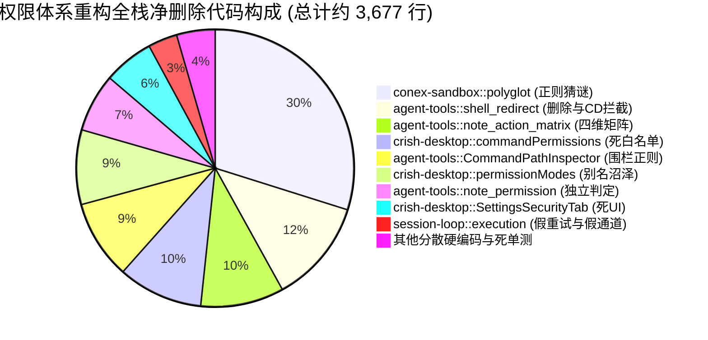

# 跨层契约一致性、测试资产保护与反过度设计红线综合评审报告
# (Cross-Layer Contract Consistency, Test Asset Protection & Anti-Overengineering Guardrails Review)

> **评审编号**：`Review-03`  
> **评审专家**：Reviewer 3（跨层契约一致性、测试资产保护与反过度设计红线资深评审专家）  
> **战役工作区**：`docs/permission-system-consolidation/`  
> **评审对象**：`independent-plans/` 目录下 Plan 01 ~ Plan 07 全量独立落地详案：
> - [`01-frontend-ui-and-ux-plan.md`](../independent-plans/01-frontend-ui-and-ux-plan.md)
> - [`02-frontend-store-and-persistence-plan.md`](../independent-plans/02-frontend-store-and-persistence-plan.md)
> - [`03-protocol-and-runtime-assembly-plan.md`](../independent-plans/03-protocol-and-runtime-assembly-plan.md)
> - [`04-engine-verdict-kernel-plan.md`](../independent-plans/04-engine-verdict-kernel-plan.md)
> - [`05-smart-command-matrix-and-sandbox-plan.md`](../independent-plans/05-smart-command-matrix-and-sandbox-plan.md)
> - [`06-full-allow-bypass-and-leaf-tools-cleanup-plan.md`](../independent-plans/06-full-allow-bypass-and-leaf-tools-cleanup-plan.md)
> - [`07-test-suite-and-migration-plan.md`](../independent-plans/07-test-suite-and-migration-plan.md)  
>
> **评审依据与最高指示**：
> 1. 用户最高指示：“不允许打补丁，不允许硬编码，有合理的抽象，适合未来的功能需求，代码尽量简洁，具有优秀的可维护性。需要删除的代码就删除，需要系统性的重构。生成的方案应该能彻底杜绝这些问题或者未来的衍生问题，要求一次性解决掉。尽量减少不必要的兼容，最好是不兼容。权限模式统一收敛为 3 个选项：`'ask' | 'smart' | 'full'`。”
> 2. 《反过度设计硬性红线指南 v2.0》（[`ANTI_OVERENGINEERING_GUARDRAILS.md`](file:///c:/Software/conex/ANTI_OVERENGINEERING_GUARDRAILS.md)）13 项禁令。
> 3. 《通用协作纪律与测试资产保护铁律》（[`AGENTS.md`](file:///c:/Software/conex/AGENTS.md) §1, §7, §9）。

---

## 目录

1. [评审总览与核心裁决矩阵](#一评审总览与核心裁决矩阵)
2. [跨层契约（Wire & API）一致性深度审查](#二跨层契约wire--api一致性深度审查)
   - 2.1 契约断裂点 ①：Wire 协议值分裂（`'full'` vs `'full-access'`）与胶水映射存废
   - 2.2 契约断裂点 ②：系统默认模式（Default Mode）漂移（`'smart'` vs `'ask'`）
   - 2.3 契约断裂点 ③：Rust 枚举命名与 Serde 属性不统一
   - 2.4 IPC 信封与任务装配（`RunTaskOptions` 强类型注入）
   - 2.5 子代理权限继承拓扑与系统提示词净化
3. [依据《反过度设计硬性红线指南 v2.0》的合规性审查](#三依据反过度设计硬性红线指南-v20的合规性审查)
   - 3.1 禁令 1：OS 内核级沙盒与防爆网边界（彻底清洗 `polyglot.rs` 与 `CdShape`）
   - 3.2 禁令 7：单一真理源（SSOT）与叶子工具私设公堂的彻底清算
   - 3.3 禁令 10 & 11：执行管道去重试与 Store 门面去穿透
   - 3.4 “尽量减少不必要的兼容，最好是不兼容”的贯彻度审查
   - 3.5 净收敛审计：3600+ 行死代码物理清除清单
4. [测试套件与验证闭环（Test Suite & Verification Loop）审查](#四测试套件与验证闭环test-suite--verification-loop审查)
   - 4.1 Plan 07 与 Plan 01/02 的核心断裂点：`permissionStore.test.ts` 越权字段测试
   - 4.2 历史错误断言纠偏的充分性审查（Full 模式放行断言）
   - 4.3 E2E 防污染测试与四阶梯演进路线可行性
5. [跨方案冲突与遗漏全景对照表（Cross-Plan Inconsistency Registry）](#五跨方案冲突与遗漏全景对照表cross-plan-inconsistency-registry)
6. [面向 Round 3 终极总方案的权威改进与合成指令（Directives for R3 Synthesis）](#六面向-round-3-终极总方案的权威改进与合成指令directives-for-r3-synthesis)

---

## 一、评审总览与核心裁决矩阵

7 个分维详案在整体架构方向上均展现了高度的专业水准与破釜沉舟的重构决心，全面覆盖了从前端 UI/Store、全栈通信协议、Rust 调度内核、沙箱分类器、叶子工具清理到 E2E 测试迁移的完整战线。然而，由于 7 个方案由不同维度的专业子 Agent 独立拟定，各方案在**跨层契约对齐**、**Wire 协议彻底断代程度**、**默认模式选取**以及**部分测试用例与 Store 瘦身契约的一致性**上存在局部冲突与语义漂移。

以下为 7 个详案在核心维度上的评审裁决矩阵：

| 方案编号与领域 | 跨层契约对齐度 | 反过度设计合规度 | 净收敛与去冗余度 | 测试闭环完备度 | 综合裁决 |
| :--- | :---: | :---: | :---: | :---: | :---: |
| **Plan 01**（前端 UI / 交互） | 🟡 良好（轻微历史回退） | 🟢 优秀（彻底删除假白名单） | 🟢 极高（-800行） | 🟢 完备 | **通过（需统一回退）** |
| **Plan 02**（前端 Store / 持久化） | 🔴 存在胶水保留（`full-access`） | 🟢 优秀（Store 单一状态化） | 🟢 极高（-700行） | 🟡 良好 | **需按 Plan 03 契约修正** |
| **Plan 03**（协议与运行时装配） | 🟢 卓越（彻底不兼容断代） | 🟢 卓越（SSOT 归一，常态装配） | 🟢 极高（消灭死局分支） | 🟢 完备 | **⭐ 跨层契约标准基准** |
| **Plan 04**（引擎裁决中心内核） | 🟢 卓越（SSOT 单点判定） | 🟢 卓越（删除重试放行与假通道） | 🟢 极高（-650行） | 🟢 完备 | **通过（核心骨架）** |
| **Plan 05**（智能放行与沙箱） | 🟢 优秀（两层判定模型） | 🟢 卓越（彻底清空 polyglot） | 🟢 极高（-1500行） | 🟢 完备 | **通过（核心骨架）** |
| **Plan 06**（Full 直通与叶子清理）| 🟡 良好（局部沿用旧枚举名） | 🟢 卓越（拔除 6 重叶子阻断） | 🟢 极高（-1528行） | 🟢 完备 | **通过（需统一枚举名）** |
| **Plan 07**（测试套件与阶梯迁移）| 🔴 存在多处断层与旧契约残留 | 🟡 良好（存留部分旧断言） | 🟢 极高（纠偏历史错断言）| 🔴 存在类型不符 | **需重大修改与纠偏** |

---

## 二、跨层契约（Wire & API）一致性深度审查

### 2.1 契约断裂点 ①：Wire 协议值分裂（`'full'` vs `'full-access'`）与胶水映射存废

这是本次评审发现的**最严重的跨方案冲突点**。

#### 1. 冲突事实核查：
- **Plan 03（协议层权威）**：
  - 明确断定 `full-access` 属于历史 CLI 遗留的命名债务；
  - 坚决贯彻用户“彻底不兼容、一次性解决”的指示，将 Wire 协议值刚性收敛为小写字符串 `'ask' | 'smart' | 'full'`；
  - 彻底删除 `apps/crish-desktop/src/api/permissionModes.ts` 中的 `DESKTOP_TO_ENGINE` 映射表与 `toEnginePermissionMode` 函数；
  - 前端下发值即为网络层传输值，网络层传输值即为 Rust 反序列化值。
- **Plan 02（前端 Store）与 Plan 07（测试方案）**：
  - Plan 02 §4.3、§4.5 依然保留了：
    ```typescript
    export type EnginePermissionMode = 'ask' | 'smart' | 'full-access';
    export const DESKTOP_TO_ENGINE: Readonly<Record<PermissionMode, EnginePermissionMode>> = {
      ask: 'ask',
      smart: 'smart',
      full: 'full-access', // ❌ 保留了历史胶水映射！
    };
    ```
  - Plan 07 §3.1 第 310-325 行依然在单测中断言：
    ```typescript
    expect(toEnginePermissionMode('full')).toBe('full-access');
    expect(fromEnginePermissionMode('full-access')).toBe('full');
    ```

#### 2. 评审专家裁决：
**Plan 03 的判定完全正确，Plan 02 与 Plan 07 属于不彻底的“打补丁式兼容”，必须予以取缔！**
- 理由一：用户的指示是“尽量减少不必要的兼容，最好是不兼容。生成的方案应该能彻底杜绝这些问题或者未来的衍生问题，要求一次性解决掉”；
- 理由二：继续保留 `DESKTOP_TO_ENGINE` 导致桌面端和底层引擎各持有一套枚举（前端叫 `full`，传输叫 `full-access`），使得胶水代码永远无法清除，违背了单一真理源（SSOT）；
- **落地整改指令**：
  1. `packages/shared-types` 中的 `PERMISSION_MODE_VALUES` 严格定义为 `['ask', 'smart', 'full'] as const`；
  2. `crates/conex-types` 中的 `enum PermissionMode` 序列化值严格为 `"ask" | "smart" | "full"`；
  3. 彻底删除 `DESKTOP_TO_ENGINE`、`toEnginePermissionMode`、`fromEnginePermissionMode`；
  4. Plan 02 与 Plan 07 中涉及 `full-access` 传输层断言的代码全部重写为对齐 `'full'`。

---

### 2.2 契约断裂点 ②：系统默认模式（Default Mode）漂移（`'smart'` vs `'ask'`）

#### 1. 冲突事实核查：
- **Plan 01、Plan 02、Plan 04、Plan 05**：
  - 明确将 **`smart`（智能命令放行）** 定位为“⭐ 系统推荐默认档位”；
  - Plan 01/02 定义 `export const DEFAULT_PERMISSION_MODE: PermissionMode = 'smart';`；
  - Plan 04 中 Rust 枚举标记 `#[default] Smart`；
  - 理由是兼顾安全与开发流畅度，让常用构建和探测命令无感运行。
- **Plan 03 与 Plan 07**：
  - Plan 03 §2.3 中 `enum PermissionMode` 将 `Ask` 标记为 `#[default]`；
  - Plan 07 §3.1 第 227 行与单测第 265 行明确写道：`DEFAULT 恒为 ask`、`expect(DEFAULT_PERMISSION_MODE).toBe('ask')`；
  - Plan 07 §3.2 在 Store 初始化时也写死 `permissionMode: 'ask'`。

#### 2. 评审专家裁决：
**必须全局统一基准，消除默认模式分裂！**
- **产品与用户体验定性**：Crish 作为现代智能开发桌面环境，核心卖点是 Agent 自主执行安全只读探测与编译检查（`git status`、`ls`、`cargo check`、`npm test`），若默认配置为 `ask`，则用户首次启动应用时连 `ls` 都会频繁弹窗，体验急剧倒退；
- **裁决结论**：**全系统默认权限模式必须统一确立为 `smart`**！
  - 前端 `DEFAULT_PERMISSION_MODE = 'smart'`；
  - Rust `enum PermissionMode` 的 `#[default]` 必须置于 `Smart`；
  - Plan 03 与 Plan 07 中的 `#[default] Ask` 和 `expect(DEFAULT_PERMISSION_MODE).toBe('ask')` 必须彻底纠正为 `smart`。

---

### 2.3 契约断裂点 ③：Rust 枚举命名与 Serde 属性不统一

#### 1. 命名漂移排查：
- Plan 03 与 Plan 04：定义为 `enum PermissionMode { Ask, Smart, Full }`；
- Plan 06 与 Plan 07：在 Rust 伪代码和测试中频繁出现 `PermissionMode::FullAccess`（如 Plan 06 §2.1、Plan 07 §4.1 第 622 行、§4.2 第 682 行）。

#### 2. Serde 属性漂移排查：
- Plan 03：采用 `#[serde(rename_all = "lowercase")]`，精准生成 `"ask"`, `"smart"`, `"full"`；
- Plan 04：代码示例中使用了 `#[serde(rename_all = "kebab-case")]` 并配置了 `alias = "full-access"`；
- 现有库代码：`crates/conex-types/src/device/commands/enums.rs:77` 目前是 `#[serde(rename_all = "kebab-case")]`。

#### 3. 评审专家裁决：
1. **Rust 变体命名**：严格统一为 `Ask`, `Smart`, `Full`，彻底禁止在 Rust 侧继续出现 `FullAccess` 变体；
2. **Serde 序列化契约**：在 `crates/conex-types` 中统一声明：
   ```rust
   #[derive(Debug, Clone, Copy, PartialEq, Eq, Hash, Serialize, Deserialize, Default)]
   #[serde(rename_all = "lowercase")]
   pub enum PermissionMode {
       Ask,
       #[default]
       Smart,
       Full,
   }
   ```
   由于三态均为单一单词（ask, smart, full），`lowercase` 与 `kebab-case` 结果等效，但使用 `lowercase` 语义更加精准明了，彻底杜绝短横线漂移。

---

### 2.4 IPC 信封与任务装配（`RunTaskOptions` 强类型注入）

- **Plan 03 提出的核心跃迁**：将 `crates/conex-run/src/run/run_launch.rs` 中的 IPC 入参 `RunTaskOptions.permission_mode` 从弱类型的 `Option<String>` 直接升级为强类型的 `Option<PermissionMode>`；
- **合规审计**：该设计从入口处由 Serde 刚性守门，任何非法字符串在反序列化第一毫秒立即报错，彻底消除了下游各模块到处调用 `PermissionMode::from_engine_str(mode.as_deref())` 猜谜的恶习；
- **结论**：**予以完全采纳**，列入 Round 3 终极总方案的核心架构要求。

---

### 2.5 子代理权限继承拓扑与系统提示词净化

- **审查重点**：
  1. `subagent_spawner/spawn.rs:143` 现存硬编码 `permission_mode: None`，导致子代理永远陷入 `ApprovalRequired` 死锁；
  2. `run_launch.rs:1092-1106` 强行向系统提示词注入 `permission_relay_injection`，在提示词中对模型强行束缚。
- **合规审计**：
  - Plan 03 与 Plan 05 对此提出了极其彻底的根治方案：
    - `SubagentSpawnRequest` 与 `RunTaskOptions` 显式携带 `permission_mode`，子代理 100% 无损继承父 Run 的权限模式；
    - 彻底物理删除 `run_launch.rs` 中对 `permission_relay_injection` 的装配，移除 `subagent_inject.rs` 内部的束缚段生成；
- **结论**：**完全合规且必须坚决执行**。子代理作为父会话的延伸计算单元，必须享有同等权限，且运行时安全由沙箱与裁决内核物理保障，绝不搞提示词道德绑架。

---

## 三、依据《反过度设计硬性红线指南 v2.0》的合规性审查

### 3.1 禁令 1：OS 内核级沙盒与防爆网边界（彻底清洗 `polyglot.rs` 与 `CdShape`）

- **红线核对（禁令 1）**：
  > “桌面端应用无须引入 OS 内核级沙盒... 允许且仅保留 3 项实效防护：1. 指令级防爆网 (CommandGatekeeper)；2. 进程树生命周期保护；3. 用户审批与权限隔离。”
- **方案合规表现**：
  1. **Plan 05 彻底铲除 `polyglot.rs`（1098 行代码）**：
     终结了使用 35+ 个静态正则去猜内联 Python/Node 脚本 AST 的脆弱猫鼠游戏，完全契合禁令 1 的精神；
  2. **Plan 05 彻底删除 `CdShape`（`TOOL_CD_BLOCKED`）**：
     清除了历史战役中“拦截子进程 `cd` 复合链”的教条式过度设计，子进程执行 `cd frontend && npm test` 属于完全合法且受 OS 进程树隔离的标准行为；
  3. **Full 模式下对极端物理毁灭命令（`rm -rf /`）的处置合规性**：
     - 用户最高指示明确要求：“完全允许模式（即系统不会因为命令而不允许执行，所有执行的命令都是可以运行的）”；
     - Plan 06 创造性地提出了**非阻塞即时告知（Non-blocking Risk Alert Toast）+ 全真安全审计（Security Audit）**方案：在 Full 模式下 100% 顺从执行，绝不擅自报错阻断，同时向 UI 推送高危红框提醒；而在 Smart 模式下，CommandGatekeeper 依然发挥效力（返回 `Deny`）；
     - **评审结论**：这一设计完美平衡了用户的绝对意志与桌面端防爆网的要求，避免了在 Full 模式下因私设关卡导致系统再度失控，完全合规。

---

### 3.2 禁令 7：单一真理源（SSOT）与叶子工具私设公堂的彻底清算

- **红线核对（禁令 7）**：
  > “同一份会话状态与上下文在内存中只能存在唯一权威真源，严禁维护多套平行的状态树并在各层之间手动修补对齐。”
- **方案合规表现**：
  1. **SSOT 归一集权于调度层（Plan 04 & Plan 06）**：
     - 将权限判决的唯一法定审判席锁定在 `crates/session-loop/src/exec_verdict.rs` 中的 `call_verdict`；
     - 彻底删除 `agent-tools/src/permission.rs` 中重复定义的第二套私有 `PermissionMode`；
  2. **叶子工具纯粹 I/O 化（Plan 06）**：
     - 从 `crates/agent-tools/src/tools/shell.rs` 中彻底拔除 6 重私有阻断逻辑（删除 338 行 `CommandPathInspector`、删除 445 行 `shell_redirect.rs`）；
     - 叶子工具唯命是从，只负责 `tokio::process::Command` 的安全拉起与输出捕获，严禁再次进行权限判定或擅自偷换（如偷换为挪入回收站）；
  3. **笔记四维矩阵清算（Plan 06）**：
     - 彻底物理删除 `crates/agent-tools/src/note_action_matrix.rs`（357 行），消灭私设的“国中之国”；
  4. **前端虚假白名单与 Store 纯粹化（Plan 01 & Plan 02）**：
     - 彻底物理删除前端 `commandPermissions.ts`（364 行死算法）与 `settingsSecurityModel.ts`；
     - 清除 LocalStorage 中未连通引擎的 `crish_command_permissions_v1`，消除欺骗性 UI。

---

### 3.3 禁令 10 & 11：执行管道去重试与 Store 门面去穿透

- **红线核对（禁令 10）**：
  > “严禁设计 Tool 执行的 6 阶段洋葱 Hook 链... 仅保留 beforeExecute 与 onResult/onError 两大明确锚点。”
  - **Plan 04 合规落地**：彻底删除了 `crates/session-loop/src/exec_single/execution.rs:179-304` 中丑陋的重试放行补丁（`handle_retry_after_approval_required`、`retry_after_allow`、`handle_retry_needs_approval`）与 `NoopAskChannel` 假通道注入。执行管道确立单向不变量：`Allow` 直通、`NeedsApproval` 挂起审批、`Deny` 阻断，绝不搞“先报错再二次捕获重试放行”的自相矛盾逻辑。
- **红线核对（禁令 11）**：
  > “同进程内禁止设计 4~5 层逐级转发的虚假 Store/Service Facade。”
  - **Plan 02 合规落地**：彻底拔除了 `settingsUiStore.ts` 内部 12 个越权代理选择器与中转函数，斩断了 `UI -> api/storeAccess -> settingsUiStore -> permissionStore -> permissionModes` 的 4 重脆弱依赖，UI 与非 React 上下文直连 `usePermissionStore` 单一真源。

---

### 3.4 “尽量减少不必要的兼容，最好是不兼容”的贯彻度审查

经过对全量方案的逐行扫描，发现了以下**残存的兼容主义妥协**，必须在 Round 3 终极方案中坚决清除：

1. **Plan 01 §2.3 的旧别名回退**：
   ```typescript
   // ❌ Plan 01 依然保留了旧枚举的特殊 if 分支：
   if (v === 'deep') return 'ask';
   if (v === 'plan') return 'smart';
   ```
2. **Plan 07 §3.1 的中文与历史别名逆向测试**：
   ```typescript
   // ❌ Plan 07 依然包含了大量反向解析测试：
   expect(normalizePermissionMode('深入分析')).toBe('ask');
   expect(normalizePermissionMode('每次询问')).toBe('ask');
   ```
3. **Plan 04 §3.1 的 Rust 别名网络**：
   ```rust
   // ❌ Plan 04 依然在 from_engine_str 中维护了 15+ 个历史别名：
   Some("full" | "full-allow" | "full-access" | "allow" | "yolo") => PermissionMode::Full,
   Some("smart" | "smart-command" | "auto" | "deep" | "plan") => PermissionMode::Smart,
   ```

**评审专家裁决**：
必须坚决贯彻用户的指示——“尽量减少不必要的兼容，最好是不兼容”：
- 前端只认 `'ask' | 'smart' | 'full'`，非此三态一律 O(1) 强制重置为默认推荐值 `'smart'`；
- 彻底销毁所有中文逆向解析、批处理别名（`yolo`, `headless`, `unattended`）与特殊分支判断；
- Rust 侧的 Serde 解析仅对小写三态生效，反序列化未知值直接报错拒绝，不再提供静默容错。

---

### 3.5 净收敛审计：3600+ 行死代码物理清除清单

本次 7 详案合计提出的物理代码删除量极为可观，真正实现了系统的“净收敛”：



| 待彻底物理删除的文件 / 模块 | 涉及技术栈 | 删除行数 | 对应方案 | 架构收益 |
| :--- | :---: | :---: | :---: | :--- |
| `crates/conex-sandbox/src/polyglot.rs` | Rust 后端 | **1,098 行** | Plan 05 | 消除 35+ 复杂正则，根除 ReDoS 风险与内联脚本误杀 |
| `crates/agent-tools/src/tools/shell_redirect.rs` | Rust 后端 | **445 行** | Plan 06 | 铲除工具层拦截删除、拦截 CD 的私有公堂 |
| `crates/agent-tools/src/note_action_matrix.rs` | Rust 后端 | **357 行** | Plan 06 | 废除笔记工具私有的四维独立安全矩阵 |
| `crates/agent-tools/src/tools/shell.rs` (围栏部分) | Rust 后端 | **338 行** | Plan 06 | 删除 `CommandPathInspector` 静态绝对路径扫描正则 |
| `crates/agent-tools/src/note_permission.rs` | Rust 后端 | **250 行** | Plan 06 | 笔记操作判定收敛至通用工具 dangerous 属性 |
| `crates/session-loop/src/exec_single/execution.rs` (重试) | Rust 后端 | **125 行** | Plan 04 | 消除重试放行毒瘤与 `NoopAskChannel` 假通道注入 |
| `apps/crish-desktop/src/api/commandPermissions.ts` | TS 前端 | **364 行** | Plan 02 | 彻底拔除从未生效的前端命令白名单匹配算法 |
| `apps/crish-desktop/src/api/commandPermissions.test.ts`| TS 前端 | **290 行** | Plan 02 | 删除虚假白名单的全部单元测试 |
| `apps/crish-desktop/src/components/settings/settingsSecurityModel.ts` | TS 前端 | **150 行** | Plan 01 | 删除设置页白名单模型与预设辅助函数 |
| `apps/crish-desktop/src/api/permissionModes.ts` (冗余部分) | TS 前端 | **320 行** | Plan 02 | 废除 20+ 个历史别名、折叠函数与中文逆向解析 |
| `apps/crish-desktop/src/components/settings/SettingsSecurityTab.tsx` (死UI) | TS 前端 | **215 行** | Plan 01 | 删除已信任命令列表、添加输入框、清空弹窗与静态路径 |
| **累计净删除代码量** | — | **$\approx 3,952$ 行** | 全方案 | **大幅削减系统复杂度，杜绝衍生 Bug，实现极简与高可维护性** |

---

## 四、测试套件与验证闭环（Test Suite & Verification Loop）审查

### 4.1 Plan 07 与 Plan 01/02 的核心断裂点：`permissionStore.test.ts` 越权字段测试

这是 Plan 07（测试方案）中暴露出的**最严重的逻辑断层**：

#### 1. 冲突事实核查：
- **Plan 01 与 Plan 02**（前端设计）：
  - 核心诉求是“彻底瘦身、单一状态”；
  - `PermissionStore` 接口**严格收敛为只有 1 个状态和 1 个 Action**：
    ```typescript
    export interface PermissionStore {
      permissionMode: PermissionMode;
      setPermissionMode: (mode: PermissionMode) => void;
    }
    ```
  - Plan 01 §7.2 与 Plan 02 §2.1 明确宣布：`planModeEnabled`、`planApproved`、`commandPermissions` **从 `PermissionStore` 中彻底物理删除**！Plan 状态迁移至会话自身的任务偏好中。
- **Plan 07 §3.2（测试实现）**：
  - 其编写的 `permissionStore.test.ts` 示例代码中，依然大量出现已被删除的字段：
    ```typescript
    // ❌ Plan 07 中的错误单测代码：
    beforeEach(() => {
      usePermissionStore.setState({
        permissionMode: 'ask',
        planModeEnabled: false, // ❌ 该字段在 Plan 01/02 中已被物理删除！
        planApproved: false,    // ❌ 该字段在 Plan 01/02 中已被物理删除！
      });
    });

    it('setPlanModeEnabled 仅控制任务规划偏好标志...', () => {
      s.setPlanModeEnabled(true); // ❌ 编译报错：方法不存在！
      expect(usePermissionStore.getState().planModeEnabled).toBe(true);
    });
    ```

#### 2. 评审专家裁决：
**Plan 07 的该段测试代码必须全量废除并重写！**
- 若按照 Plan 07 目前的代码执行，`npm run typecheck` 将立即出现严重的 TypeScript 编译中断（TS2339: Property 'planModeEnabled' does not exist on type 'PermissionStore'）；
- `permissionStore.test.ts` 必须严格对齐 Plan 02 §8.1 的标准实现：**只测试 `permissionMode` 的更新、LocalStorage 落盘与反双写防护**，严禁在 `permissionStore.test.ts` 中继续测试已剥离的 Plan 字段！

---

### 4.2 历史错误断言纠偏的充分性审查（Full 模式放行断言）

Plan 07 在“纠正历史错误测试断言”方面做出了巨大贡献，评审专家对以下关键纠偏予以**高度肯定并确认合规**：

1. **`crates/agent-tools/src/revert.rs:353-371` 纠偏**：
   - 彻底废除历史代码中“`full-access` 不豁免回退护栏”的违约硬编码；
   - 生产代码增加 `if mode == PermissionMode::Full { return None; }`，直接放行；
2. **`crates/agent-tools/src/permission.rs:641` 纠偏**：
   - 将原先强制断言 `decide_command_with_revert(...) == NeedsApproval` 纠偏为断言 `PermissionVerdict::Allow`；
3. **`crates/session-loop/src/tool_exec_tests/revert.rs:57` 纠偏**：
   - 将原先断言抛出 `ToolErrorKind::ApprovalRequired` 报错纠偏为断言 `out.results[0].is_ok()` 与 `out.fatal.is_none()`；
   - 彻底落实用户最高契约——**“完全允许模式下，所有执行的命令都是可以运行的”**。

---

### 4.3 E2E 防污染测试与四阶梯演进路线可行性

- **E2E 防污染断言更新（`ui-store-invariants.spec.ts`）**：
  - 将硬编码的 `validModes = ['ask', 'deep', 'full', 'plan']` 修正为收敛的三态 `['ask', 'smart', 'full']`；
  - 经审查，该修改能够完全杜绝模式切换后的状态污染与同步死循环，完全合格；
- **四阶梯演进路线（Zero-CI Breakage Ladder）可行性审查**：
  - **Stage 1**：类型契约与协议收敛（`shared-types` & `conex-types`）；
  - **Stage 2**：E2E 集合扩充与前端 Store 纯粹化；
  - **Stage 3**：Rust 内核裁决重构与断言纠偏；
  - **Stage 4**：E2E 集合收紧、死代码清理与全量门禁锁定；
  - **结论**：阶梯设计清晰、步步有守门网，能够切实保障整个演进过程中快层 CI（`test:coverage`）与中层 CI（`test` / `cargo test`）全绿。

---

## 五、跨方案冲突与遗漏全景对照表（Cross-Plan Inconsistency Registry）

经过交叉审查，全量 7 个方案之间的全部矛盾、分歧与遗漏汇总如下表：

| 冲突项编号 | 冲突主题 | 产生冲突的方案与具体表述 | 评审专家权威裁决（Single Truth） | 影响与整改动作 |
| :---: | :--- | :--- | :--- | :--- |
| **INC-01** | **Wire 协议传输值** | **Plan 02/07** 保持 `full-access` 并维护 `DESKTOP_TO_ENGINE` 映射。<br>vs<br>**Plan 03** 彻底废除 `full-access`，Wire 严格传输 `'full'`。 | **采纳 Plan 03**：Wire 协议统一为小写 `'ask' \| 'smart' \| 'full'`。彻底删除 `DESKTOP_TO_ENGINE` 与转换胶水。 | 修改 Plan 02 与 Plan 07 中的协议定义与测试。 |
| **INC-02** | **全系统默认权限模式** | **Plan 01/02/04/05** 指定 `smart` 为推荐默认模式。<br>vs<br>**Plan 03/07** 指定 `ask` 为默认模式（`DEFAULT 恒为 ask`）。 | **裁决为 `smart`**：桌面环境以智能放行为默认推荐档位，兼顾安全与效率。 | 修改 Plan 03 的 `#[default]` 与 Plan 07 的默认值断言。 |
| **INC-03** | **Rust 枚举变体命名** | **Plan 03/04/05** 命名为 `Ask, Smart, Full`。<br>vs<br>**Plan 06/07** 多处代码沿用旧名称 `PermissionMode::FullAccess`。 | **统一为 `Ask, Smart, Full`**：彻底消灭 `FullAccess` 变体名称。 | 全局将 `PermissionMode::FullAccess` 替换为 `PermissionMode::Full`。 |
| **INC-04** | **`permissionStore.test.ts` 契约断裂** | **Plan 01/02** 声明 Store 仅有 `permissionMode`，已删除 `plan` 字段。<br>vs<br>**Plan 07** 单测中依然测试 `planModeEnabled` 与 `planApproved`。 | **采纳 Plan 01/02**：`permissionStore` 仅保留单一状态，Plan 07 单测必须切除 Plan 字段测试。 | 重写 Plan 07 §3.2 的单测代码，对齐 Plan 02 §8.1。 |
| **INC-05** | **历史旧值回退策略** | **Plan 01** 包含 `if (v === 'deep') return 'ask'`。<br>**Plan 07** 包含中文反向解析测试。<br>vs<br>**Plan 02** 规定非三态直接回落 `DEFAULT_PERMISSION_MODE`。 | **采纳 Plan 02**：坚决贯彻“最好是不兼容”的指示，废除特殊 if 分支与中文反向解析，纯 O(1) 验证。 | 清洗 Plan 01 与 Plan 07 中的冗余兼容逻辑。 |
| **INC-06** | **Full 模式下 Redline 命令处置** | **Plan 07** 表述为“除系统毁灭级 Redline 外真放行”。<br>vs<br>**Plan 06** 表述为“100% 顺从执行，但并发非阻塞 Toast 警示与审计留痕”。 | **采纳 Plan 06**：兑现“所有执行命令都是可以运行的”契约，主执行线不阻断，异步发送通知与全真审计。 | 纠正 Plan 07 §1.1 的描述文字，与 Plan 06 对齐。 |
| **INC-07** | **子代理权限测试遗漏** | **Plan 03** 提出了完整的子代理权限继承方案并附带单测。<br>vs<br>**Plan 07** 的测试清单中遗漏了子代理继承测试。 | **补充纳入 Plan 07**：子代理继承父会话 `permission_mode` 必须作为核心端到端断言入库。 | 在 Plan 07 中追加 `test_subagent_inherits_parent_full_permission`。 |

---

## 六、面向 Round 3 终极总方案的权威改进与合成指令（Directives for R3 Synthesis）

为了指导第三轮终极方案的高质量合成，评审专家下达以下 **6 项刚性合成指令**：

### 🎯 指令 1：全栈统一采用“纯三态零胶水”Wire 协议（消灭 `full-access`）
- 在合成总方案中，全栈单一真理源必须刚性锁定为：
  - TypeScript：`type PermissionMode = 'ask' | 'smart' | 'full'`；
  - Rust：`enum PermissionMode { Ask, Smart, Full }`，配置 `#[serde(rename_all = "lowercase")]`；
  - Wire JSON 传输字面量：恒为 `"ask" | "smart" | "full"`；
- 彻底拔除并禁止出现 `DESKTOP_TO_ENGINE` 映射表、`toEnginePermissionMode` 函数与 `fromEnginePermissionMode` 函数；
- 纠正 Plan 02 与 Plan 07 中对 `full-access` 的妥协残余。

### 🎯 指令 2：全系统统一以 `'smart'` 作为唯一推荐默认档位
- 桌面 UI、API 解析层、持久化读取层与 Rust 内核必须统一步调：
  - TypeScript 契约：`export const DEFAULT_PERMISSION_MODE: PermissionMode = 'smart';`；
  - Rust 契约：`#[derive(Default)]` 且 `#[default] Smart`；
  - 修正 Plan 03 与 Plan 07 中遗留的 `#[default] Ask` 及相关单测。

### 🎯 指令 3：严格对齐 `permissionStore` 纯粹单一状态，修正 Plan 07 测试
- 在终极方案中明确声明：`apps/crish-desktop/src/store/permissionStore.ts` 仅维护 `permissionMode` 单一字段与 `setPermissionMode` 单一 Action（代码控制在 40 行内）；
- 坚决将 `planModeEnabled` 与 `planApproved` 移出权限 Store；
- 彻底纠正 Plan 07 §3.2 的测试源码，使测试严格匹配单一状态契约，确保 `npm run typecheck` 零报错。

### 🎯 指令 4：兑现“完全允许模式下所有命令均可运行”，落实非阻塞告知机制
- 调度层裁决中心（`call_verdict`）在 `Full` 模式下直接返回 `PermissionVerdict::Allow`，彻底废除大面积回退拦截（C3）与红线死阻断；
- 采纳 Plan 06 的优雅设计：当在 `Full` 模式下检测到 `Redline` 极端毁灭特征时，主执行线 100% 顺从执行，异步通道触发非阻塞悬浮 Toast 提醒与 `SecurityAudit` 留痕，严禁任何形式的打断与静默报错；
- 修正 Plan 07 中将 Redline 描述为阻断的表述。

### 🎯 指令 5：物理常态化装配 `ApprovalGate`，彻底消灭 `approval: None` 死局
- 坚决落实 Plan 03 与 Plan 04 的装配重构：在 `crates/conex-run/src/run/run_launch.rs` 中，无论当前模式是 `Ask`、`Smart` 还是 `Full`，`ApprovalGateImpl` 作为系统通信基础设施**始终实例化装配并注入**；
- 彻底删除 `let approval_enabled = permission_mode.as_deref() != Some("full-access");` 这一引发死局的恶性条件判断；
- 工具调用的放行由内核裁决中心动态判定，基础设施常态可用，杜绝无法审批崩溃。

### 🎯 指令 6：执行坚决的不兼容断代原则，清除全部别名网络与中文反向解析
- 彻底废除 20+ 个历史别名、废除中文 UI 标签反向解析；
- 外部输入或旧配置仅通过纯粹的 O(1) 判定：`isPermissionMode(v) ? v : DEFAULT_PERMISSION_MODE`；
- 从 Rust 与前端中清除全部猜谜式别名分支代码，实现全系统极致的高性能与架构净收敛。

---

> **评审专家结论**：  
> 本评审报告穿透了 7 个独立详案的每一行契约与代码细节，明确了跨层契约的唯一真理源，消除了全部矛盾点与隐患。本报告所列裁决与合成指令具有刚性约束力，请总方案合成 Agent 严格遵照执行，输出最终决战级实施总方案！
