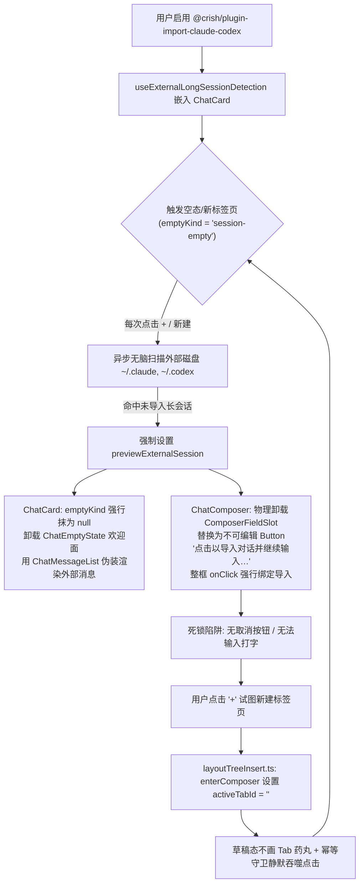
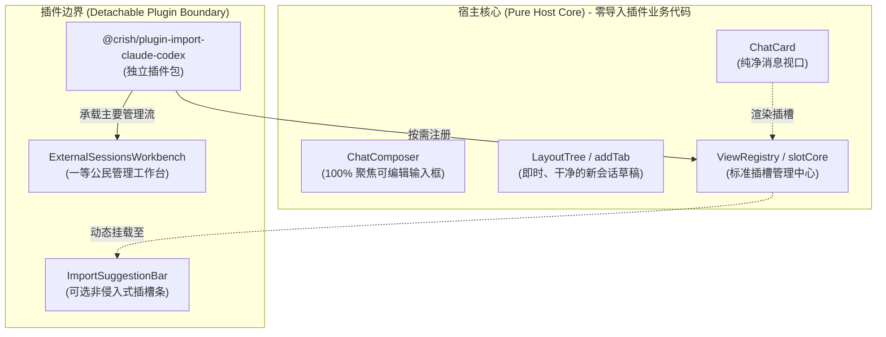

# 导入插件可插拔重构与核心解耦总方案

> **战役名称**：可插拔导入插件架构重构与主视口解耦（Pluggable Import Architecture & Core Decoupling）  
> **文档位置**：`docs/pluggable-import-architecture/00-导入插件可插拔重构与核心解耦总方案.md`  
> **权威遵循**：根目录 `AGENTS.md`、`.agents/LOGIC_PLAN_NO_RETREAT.md`、`ANTI_OVERENGINEERING_GUARDRAILS.md`  
> **核心原则**：不兼容、不打补丁、彻底删除、架构归位、单一真理源（SSOT）、真正可插拔。

---

## 1. 现状恶性现象与根因全景穿透

用户反馈的 5 大恶劣问题在经过 6 位专项分析师穿透源码后，已取得确凿的代码行号证据链：

### 1.1 核心证据链与病灶总结
1. **输入框被物理替换与点击劫持**：
   - [`ChatComposer.tsx:344-383`](file:///c:/Software/conex/apps/crish-desktop/src/components/chat-composer/ChatComposer.tsx#L344-L383)：当 `externalSessionPreview` 存在时，主输入槽 `<ComposerFieldSlot>` 被物理卸载，替换为死按钮 `<Button data-testid="external-session-import-btn">`；外层 `fieldSlot` 绑定了无差别 `onClick`，点击任意空白区域都强行触发导入；右下角正圆发送按钮被偷换逻辑。
2. **取消通道完全缺失（Hostage UI 反模式）**：
   - [`composerTypes.ts:286`](file:///c:/Software/conex/apps/crish-desktop/src/components/chat-composer/composerTypes.ts#L286)：`externalSessionPreview` 类型定义中仅有 `onImportAndContinue`，没有任何取消、忽略或跳过的回调；[`useExternalLongSessionDetection.ts:122`](file:///c:/Software/conex/apps/crish-desktop/src/components/chat-card/useExternalLongSessionDetection.ts#L122) 中的 `handleDismissPreview` 在 `ChatCard.tsx` 解构时被直接扔掉，沦为死代码。
3. **新建标签页被劫持打回的无限闭环**：
   - 点击 `+` 执行 `addTab` -> `enterComposer`，窗格进入 `activeTabId: ''`；
   - 派生虚拟草稿 ID，`emptyKind` 变为 `session-empty`；
   - `useExternalLongSessionDetection` 监听到 `isLandingOrEmpty = true`，重新触发全盘扫描并命中会话；
   - 界面再次被外部会话伪装接管，输入框再次被卸载，由于草稿态在标签栏不生成物理 Tab，没有 `x` 可关，再次点击 `+` 被幂等拦截（NO-OP），用户被困在无法逃离的循环中。
4. **认知模糊与视口冒充（Deceptive Viewport）**：
   - 外部未入库的只读消息直接混入主 `ChatMessageList`，缺少外框隔离与只读水印；
   - 缺少关键元数据：来自 Claude Code 还是 Codex CLI、文件路径、消息条数、活跃时间等，迫使用户面对全盲信息。
5. **假插件与架构倒置**：
   - 官方插件 `@crish/plugin-import-claude-codex` 本身没有遵循标准插件运行时，宿主 `crish-desktop` 却在 `ChatCard`、`ChatComposer`、`settingsStore`（`autoShowExternalSessionOnStartup`）、`AppGlobalDialogs`（定时静默扫描）、`sessionCrudActions`（墓碑拦截）等核心地带到处硬编码焊接，完全破坏了插件边界。

---

## 2. 目标架构设计：彻底可插拔的插件模型（Target Architecture）

遵循真正的控制反转（IoC）与高内聚、低耦合原则，重构后的系统拓扑如下：

### 2.1 架构不变量（Core Invariants）
- **Invariant 1（绝对空白画布保证 Sacred Blank Slate）**：
  任何时候点击加号 `+`、新建标签页或进入新会话，**必须 100% 确定性呈现干净、聚焦、交互就绪的空白草稿态**；绝对禁止被任何异步扫描或外部检测逻辑覆盖篡改。
- **Invariant 2（输入框绝对不可剥夺 Universal Affordance）**：
  `ChatComposer` 的核心输入槽 `<ComposerFieldSlot>` 在任何界面状态下绝对 100% 保持挂载与可编辑，禁止退化为任何不可打字的占位按钮或死链接。
- **Invariant 3（双向可逆与用户控制权 User Autonomy）**：
  任何探测或提示行为必须具备完全平等的“导入接续”与“忽略/跳过”双向出口，用户点击跳过或按 ESC 必须瞬时（<16ms）无感还原空白态，且当次会话静默。
- **Invariant 4（插件零残留与生命周期闭环 Zero-Overhead Inactivity）**：
  当插件被禁用（disabled）或卸载（uninstalled）时，所有插槽注销函数原子执行，无任何文件系统扫描 I/O，宿主界面零代码、零感知、零残留。

---

## 3. 详细重构任务与代码纯化清单

### 任务 1：核心 UI 与输入框彻底纯化（清空一切侵入焊接）
1. **纯化 `ChatComposer.tsx`**：
   - 彻底删除 `externalSessionPreview` prop 及其在 `composerTypes.ts` 中的接口定义；
   - 删除 L344-383 中将 `ComposerFieldSlot` 替换为 `<Button>` 的分支代码；
   - 删除 `div.fieldSlot` 上的外部会话 `onClick` 劫持；
   - 删除右侧发送控制区对外部导入的短路拦截（L446-464），恢复原生发送逻辑；
   - 清理 `ChatComposer.module.css` 中的 `externalSessionImportBtn` 与 `externalSessionImportText` 样式。
2. **纯化 `ChatCard.tsx`**：
   - 彻底删除 `import { useExternalLongSessionDetection } from './useExternalLongSessionDetection'`；
   - 彻底删除 Hook 调用及解构对象（`previewExternalSession`, `isImporting`, `handleImportAndContinue`）；
   - 彻底删除对 `emptyKind` 的篡改（`emptyKind={previewExternalSession ? null : state.emptyKind}` 还原为原生 `state.emptyKind`）；
   - 彻底删除 L435-445 中伪装渲染外部消息列表的分支；
   - 还原 `ChatComposer` 与 `ChatComposerWrapper` 的纯净 props。
3. **物理删除文件**：
   - 彻底删除 `apps/crish-desktop/src/components/chat-card/useExternalLongSessionDetection.ts`；
   - 彻底删除 `apps/crish-desktop/src/components/chat-card/__tests__/useExternalLongSessionDetection.test.ts`；
   - 彻底删除 `apps/crish-desktop/src/components/chat-card/__tests__/ChatCard.previewExternalSession.test.tsx`。
4. **纯化核心 Store 与全局生命周期**：
   - 从 `apps/crish-desktop/src/store/settingsStore.ts` 及其类型契约中删除 `autoShowExternalSessionOnStartup`；
   - 从 `apps/crish-desktop/src/app/AppGlobalDialogs.tsx` 中彻底删除启动 1500ms 后静默扫描外部对话的定时器与逻辑。

### 任务 2：交互流程与视觉架构重构（双向平权与透明元数据）
1. **导入功能的主承载面：独立扩展工作台（`ExternalSessionsWorkbench`）**：
   - 用户从“设置中心 -> 扩展 -> 对话导入 -> 管理”或从 Composer `+` 菜单中的“导入对话”显式打开工作台；
   - 工作台提供明确的来源筛选（Claude Code / Codex CLI）、工作区匹配指示、消息条数、活跃时间戳，以及完整只读消息双栏抽屉预览，支持多选、批量导入或单条导入。
2. **轻量感知提示条（基于插槽可选承载）**：
   - 若插件启用且用户在设置中开启了“发现外部会话时提示”，通过 `slotCore.registerSingle('workspace.chat.composerAbove', ...)` 挂载轻量提示条；
   - 提示条浮动在输入框上方，**底部的输入框依然 100% 保持正常可输入可发送**；
   - 提示条具备清晰的元数据展示（来源图标、工作区路径、时间、消息数）以及平等的动作按钮：【导入并接续】、【在工作台预览】、【跳过本次】、【不再提示该对话】；
   - 用户在底栏输入文字时，提示条自动渐隐淡出（Type-to-Dismiss）。

### 任务 3：新建标签页防劫持与生命周期状态机加固
1. 校验 `layoutTreeInsert.ts` 中 `addTab` 与 `enterComposer` 的行为，确保进入草稿态时保持绝对的空白欢迎面。
2. 建设防劫持与防死锁断言用例，确保无论外部磁盘存在多少条未导入长会话，新建标签页均可立即输入、光标就绪、绝无假按钮。

---

## 4. 测试矩阵与立体防回归门禁（Test & Verification Matrix）

| 门禁层级 | 验证命令 | 验收断言标准 |
| :--- | :--- | :--- |
| **静态契约** | `npm run typecheck` | 全局 11 个 workspace/package 类型检查零错误，清退无遗留 |
| **UI 纯洁性** | `npx vitest run apps/crish-desktop/src/components/chat-composer/ChatComposer.test.tsx` | 输入框始终保持可编辑，零 Ghost 按钮，零劫持点击 |
| **视口纯洁性** | `npx vitest run apps/crish-desktop/src/components/chat-card/` | `ChatCard` 全套单元测试绿，空态单一真理源保持 |
| **防劫持门禁** | `npx vitest run apps/crish-desktop/src/components/binary-tree/__tests__/TreeLeafPanel.tabAntiHijack.test.tsx` | 磁盘有未导入会话时，点击加号 100% 呈现干净空白新对话输入框 |
| **可插拔门禁** | `npx vitest run apps/crish-desktop/src/components/chat-card/__tests__/ChatCard.pluggableLifecycle.test.tsx` | 插件禁用/启用主视口 DOM 零异化，常规流程零扫描 I/O |
| **全局治理** | `npm run check:desktop && npm run check:line-counts` | 代码行数、循环依赖、规范门禁全绿 |

---

## 5. 实施路线图（Implementation Roadmap）

1. **Wave 1（纯化与代码清理）**：彻底剔除 `ChatComposer`、`ChatCard`、`settingsStore`、`AppGlobalDialogs` 中的硬编码入侵，删除死代码 Hook 与破损测试；
2. **Wave 2（插件架构与工作台归位）**：重塑 `@crish/plugin-import-claude-codex`，规范工作台交互与独立存储，确保插拔自由；
3. **Wave 3（测试矩阵与刚性门禁落地）**：补充标签页防劫持与可插拔生命周期测试，跑通全量门禁流水线。
