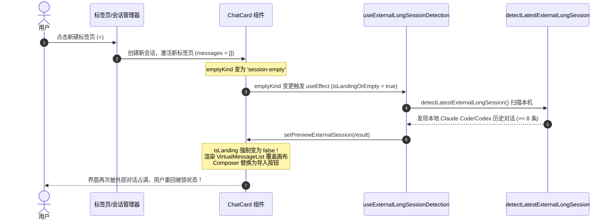
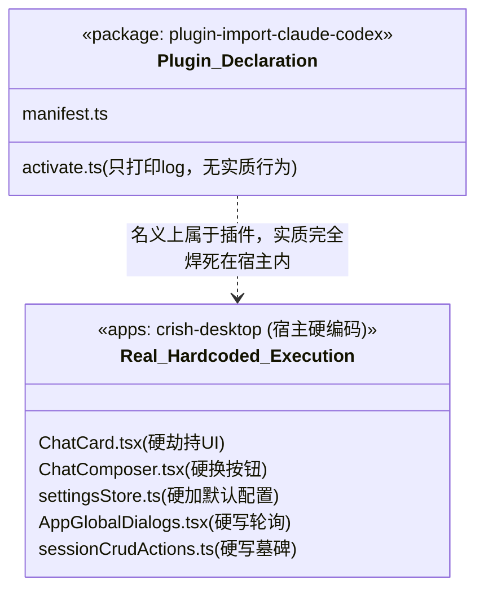

# 外部对话导入架构归因与插件倒置根因分析报告

> **权威位置**：[`docs/pluggable-import-architecture/analysis/01-架构归因与插件倒置根因分析.md`](file:///c:/Software/conex/docs/pluggable-import-architecture/analysis/01-架构归因与插件倒置根因分析.md)  
> **报告性质**：架构深度穿透与根因诊断（战役首阶段分析文档）  
> **归因对象**：`@crish/plugin-import-claude-codex` 官方导入插件与宿主核心深度焊接问题  
> **核心裁决指导**：“这个只是一个插件，不是焊在我们软件里面的，而且是可以插拔的形式才行呢。不要兼容、不要打补丁，需要删除代码就删除，需要重构就重构。不要最短路径改动，在软件内的代码应该是最先进的，不允许多个版本存在。”

---

## 摘要与核心结论 (Executive Summary)

经过对全仓（包括 `packages/plugin-import-claude-codex/`、`apps/crish-desktop/` 渲染层、状态层、持久化层、扩展面板层）的端到端代码穿透，我们确认：

当前系统出现的 **“新建对话被锁在导入界面”、“点击新建标签页被劫持打回”、“无法取消或退出预览”、“核心代码严重耦合”** 等一系列恶性体验，其根本原因并非局部 UI 逻辑 Bug，而是 **一场典型的“架构倒置”（Architectural Inversion）与“伪插件化”（Fake Plugin）灾难**。

```
【理想插件架构】
宿主核心 (Host Core) ──[提供扩展插槽/标准API]──> 开放插件 (Plugin)
宿主完全无感知特定插件；关插件零侵入，拔插件零残留。

【当前代码现状：严重的架构倒置】
┌────────────────────────────────────────────────────────┐
│ 宿主渲染层 (ChatCard, ChatComposer) ── 强行 import 探测 Hook并劫持输入框 │
│ 宿主状态层 (settingsStore) ────────── 硬编码启动自启配置项          │
│ 宿主生命周期 (AppGlobalDialogs) ───── 启动无差别后台静默轮询扫描     │
│ 宿主持久化层 (sessionCrudActions, DB) ─ 硬焊接导入“墓碑”与过滤逻辑    │
│ 宿主扩展中心 (ExtensionsSurface) ──── 散落大量 isImport 特例硬编码  │
└───────────────────────────▲────────────────────────────┘
                            │ 静态引用 / 反向绑死
        packages/plugin-import-claude-codex (本应独立的插件)
```

1. **功能反客为主**：本应作为独立、可选、按需加载的生态插件，却被开发人员以“追求极致开箱即用”为由，通过“最短路径”直接焊死在应用的最核心渲染入口（`ChatCard` 空态）、基础输入控件（`ChatComposer`）、全局启动流程（`AppGlobalDialogs`）、底层持久化（`sessionRustDbHydrate`）和基础删除操作（`deleteSession`）中。
2. **劫持与死循环锁死**：
   - 核心设置 `autoShowExternalSessionOnStartup` 默认被硬编码为 `true`；
   - 任何触发 `session-empty` 或 `no-session` 的空态（包括启动、点击新建标签页、点击侧边栏“新建对话”），均会立刻触发 `detectLatestExternalLongSession`；
   - 探测命中后，主界面强制用外部对话消息覆盖空白画布，同时 **彻底卸载** 输入框 `ComposerFieldSlot`，替换为一个不可编辑的全框按钮；
   - `useExternalLongSessionDetection` 中虽然定义了 `handleDismissPreview` 取消函数，但在 `ChatCard.tsx` 中 **压根没有解构，UI 上零挂载**，用户没有任何取消手段；
   - 用户试图通过新建标签页逃离，而新标签页又是空态，从而再次触发探测，被立即劫持打回原形，形成 **无限闭环锁死**。
3. **技术债与补丁滚雪球**：为了解决自动导入导致的“已删除外部对话在重启后幽灵复活”，开发者不仅没有反思后台静默导入的架构荒谬性，反而在核心会话 CRUD 与 SQLite 水合链路中发明了 `crish_deleted_external_sessions_v1`“删除墓碑”机制，形成了由一个架构错误引发七个衍生补丁的恶性循环。

---

## 一、现象还原与全链路触发追踪 (The Anatomy of Disaster)

### 1.1 痛点一：对话被锁在导入界面，无法正常输入

#### 代码证据与调用链
在 [`apps/crish-desktop/src/components/chat-card/ChatCard.tsx:52-56`](file:///c:/Software/conex/apps/crish-desktop/src/components/chat-card/ChatCard.tsx#L52-L56)，核心卡片直接引入了专属于外部导入的 Hook：

```tsx
// ChatCard.tsx:36 & 52-56
import { useExternalLongSessionDetection } from './useExternalLongSessionDetection';

const { previewExternalSession, isImporting, handleImportAndContinue } =
  useExternalLongSessionDetection({
    emptyKind: state.emptyKind,
    activeSessionId: state.activeSessionId,
  });
```

当 `previewExternalSession` 存在时：
1. **空白落地页被扼杀**（[`ChatCard.tsx:182, 215`](file:///c:/Software/conex/apps/crish-desktop/src/components/chat-card/ChatCard.tsx#L182)）：
   ```tsx
   isLanding = !previewExternalSession && state.emptyKind === 'session-empty';
   emptyKind={previewExternalSession ? null : state.emptyKind}
   ```
2. **虚拟消息列表被强制劫持**（[`ChatCard.tsx:435-445`](file:///c:/Software/conex/apps/crish-desktop/src/components/chat-card/ChatCard.tsx#L435-L445)）：
   ```tsx
   {state.messages.length === 0 && !previewExternalSession ? (
     ...
   ) : previewExternalSession ? (
     <VirtualMessageList
       messages={previewExternalSession.mapped.messages}
       allMessages={previewExternalSession.mapped.messages}
       activeSessionId={previewExternalSession.detected.id}
       ...
     />
   ) : ...}
   ```
3. **核心输入控件被剥夺输入能力**（[`ChatComposer.tsx:353-372`](file:///c:/Software/conex/apps/crish-desktop/src/components/chat-composer/ChatComposer.tsx#L353-L372)）：
   ```tsx
   {externalSessionPreview ? (
     <Button
       type="button"
       variant="ghost"
       className={styles.externalSessionImportBtn}
       onClick={(e) => {
         e.stopPropagation();
         void externalSessionPreview.onImportAndContinue();
       }}
       disabled={externalSessionPreview.isImporting}
     >
       <span className={styles.externalSessionImportText}>
         {externalSessionPreview.isImporting
           ? '正在导入对话并接续…'
           : '点击以导入对话并继续输入…'}
       </span>
     </Button>
   ) : (
     <ComposerFieldSlot ... />
   )}
   ```
   **后果**：文本输入区域 `ComposerFieldSlot` 被彻底从 DOM 中卸载，替换成了一个占据整个输入框的幽灵按钮。用户无法输入任何文字、无法聚焦光标，整个界面变成了一个只能点击“导入”的单向死胡同。

---

### 1.2 痛点二：无法取消或退出预览 (Dismiss Impossible)

在 [`apps/crish-desktop/src/components/chat-card/useExternalLongSessionDetection.ts:122-132`](file:///c:/Software/conex/apps/crish-desktop/src/components/chat-card/useExternalLongSessionDetection.ts#L122-L132) 中，原本写有取消逻辑：

```ts
const handleDismissPreview = useCallback(() => {
  setPreviewExternalSession(null);
}, []);

return {
  previewExternalSession,
  isImporting,
  isDetecting,
  handleImportAndContinue,
  handleDismissPreview, // <-- 这里导出了
};
```

然而在调用方 [`apps/crish-desktop/src/components/chat-card/ChatCard.tsx:52-56`](file:///c:/Software/conex/apps/crish-desktop/src/components/chat-card/ChatCard.tsx#L52-L56)：
```tsx
const { previewExternalSession, isImporting, handleImportAndContinue } =
  useExternalLongSessionDetection({
    emptyKind: state.emptyKind,
    activeSessionId: state.activeSessionId,
  });
```
- **证据确凿**：`handleDismissPreview` 根本没有被解构！
- 进一步检查 `externalSessionPreview` 传给 `ChatComposer` 的契约（[`composerTypes.ts:286-292`](file:///c:/Software/conex/apps/crish-desktop/src/components/chat-composer/composerTypes.ts#L286-L292)）：
  ```ts
  externalSessionPreview?: {
    source: string;
    isImporting: boolean;
    onImportAndContinue: () => Promise<void> | void;
  };
  ```
  在类型契约和 UI 实现中，根本没有预留任何 `onDismiss`、关闭图标（'✕'）或取消按钮。
- **后果**：用户一旦进入预览态，就如同被绑架，既不能打字，也不能取消，只能被迫接受导入。

---

### 1.3 痛点三：新建标签页被劫持打回 (Tab Hijacking & Redirection Loop)

用户被锁在导入界面后，第一直觉是点击窗口上方的 `+`（新建标签页）或侧边栏的“新建会话”，期望获得一个干净的空白输入框。然而此时系统进入了灾难性的死循环。



#### 死锁根因分析
1. [`useExternalLongSessionDetection.ts:29-37`](file:///c:/Software/conex/apps/crish-desktop/src/components/chat-card/useExternalLongSessionDetection.ts#L29-L37) 的触发条件为：
   ```ts
   const isLandingOrEmpty =
     emptyKind === 'session-empty' || emptyKind === 'no-session';
   ```
2. 任何新建的空白标签页，其状态必然是 `session-empty`。
3. 清除预览的逻辑（[`useExternalLongSessionDetection.ts:66-70`](file:///c:/Software/conex/apps/crish-desktop/src/components/chat-card/useExternalLongSessionDetection.ts#L66-L70)）：
   ```ts
   useEffect(() => {
     if (activeSessionId && !isLandingOrEmpty) {
       setPreviewExternalSession(null);
     }
   }, [activeSessionId, isLandingOrEmpty]);
   ```
   **逻辑致命断层**：只有切换到一个 **已有消息的非空会话** 时，`!isLandingOrEmpty` 才为真，预览才会被清除！当用户切换到或新建一个 **空会话** 时，`!isLandingOrEmpty` 为假，`hasCheckedRef` 重置，重新执行扫描并再次锁定！
4. 结果就是：**只要本机存在符合条件的外部终端记录，任何试图新建空白会话的动作都会被系统无差别截胡并强制还原到该记录上**。

---

### 1.4 痛点四：后台静默轮询与墓碑滚雪球 (Ghost Resurrection & Tombstone Hack)

在 [`apps/crish-desktop/src/app/AppGlobalDialogs.tsx:98-103`](file:///c:/Software/conex/apps/crish-desktop/src/app/AppGlobalDialogs.tsx#L98-L103)：
```tsx
useEffect(() => {
  // 启动时在后台静默尝试同步当前项目的外部终端对话
  const timer = setTimeout(() => {
    void checkAndAutoSyncExternalSessions();
  }, 1500);
  return () => clearTimeout(timer);
}, [activeWorkspaceId]);
```
- **未经许可的后台扫描**：每次软件启动或切换工作区 1.5 秒后，系统在全局后台自动扫描磁盘，试图同步外部对话。
- **由此产生的“幽灵复活”**：若用户删除了某个已导入的会话，下次重启或切换目录时，后台扫描会再次发现该文件，并自动重新创建它！
- **用更大的补丁覆盖前一个补丁**：
  为了阻断这种“幽灵复活”，开发者不仅没有砍掉无意义的后台静默扫描，反而写了整整 190 行的 [`externalSessionTombstone.ts`](file:///c:/Software/conex/apps/crish-desktop/src/api/import/externalSessionTombstone.ts)，并把手伸进了系统最底层的两大核心：
  1. **核心 CRUD 污染**（[`sessionCrudActions.ts:331-342`](file:///c:/Software/conex/apps/crish-desktop/src/store/sessionCrudActions.ts#L331-L342)）：在通用的 `deleteSession` 动作中，硬编码识别 `importMeta`，并向本地存储写入“删除墓碑”：
     ```ts
     // 若被删除会话为外部导入对话，永久登记墓碑黑名单，阻断重启自动复活
     const existingTarget = get().sessions.find((s) => s.id === id);
     if (existingTarget?.importMeta?.source && existingTarget.importMeta.sourceSessionId) {
       recordDeletedExternalSession(
         existingTarget.importMeta.source,
         existingTarget.importMeta.sourceSessionId,
         existingTarget.importMeta.sourcePath
       );
     }
     ```
  2. **SQLite 数据水合拦截**（[`sessionRustDbHydrate.ts:49, 120-125`](file:///c:/Software/conex/apps/crish-desktop/src/api/session-persistence/sessionRustDbHydrate.ts#L49)）：在数据库加载历史会话时，直接调用 `withoutDeletedExternalSessions` 进行过滤剔除！

这是最典型的“违背开闭原则”、“用魔术补丁解决设计错误”的架构反面教材。

---

## 二、宿主核心被污染全景清单 (Host Pollution Inventory)

下表汇总了本应属于“可选插件”的功能，在宿主代码中侵入并焊死的具体位置与破坏性证据：

| 层次 (Layer) | 侵入文件与行号 | 污染代码与行为 | 架构违规性质 | 严重度 |
| :--- | :--- | :--- | :--- | :--- |
| **渲染层** (UI View) | [`ChatCard.tsx:36, 52, 182, 215, 435`](file:///c:/Software/conex/apps/crish-desktop/src/components/chat-card/ChatCard.tsx#L36) | 直接 import 探测 Hook，在空白态强制渲染外部预览，并丢弃 `handleDismissPreview` | 宿主视图对外部特定业务产生硬依赖，导致主流程被劫持 | **P0 致命** |
| **输入控件** (Composer) | [`ChatComposer.tsx:353-372`](file:///c:/Software/conex/apps/crish-desktop/src/components/chat-composer/ChatComposer.tsx#L353)<br>[`composerTypes.ts:286-292`](file:///c:/Software/conex/apps/crish-desktop/src/components/chat-composer/composerTypes.ts#L286) | 专用 props `externalSessionPreview`，强制将多行输入框替换为不可编辑按钮 | 通用 UI 组件为特定功能定制变异，破坏原子性与通用性 | **P0 致命** |
| **核心设置** (Settings Store) | [`settingsStore.ts:53, 75, 140`](file:///c:/Software/conex/apps/crish-desktop/src/store/settingsStore.ts#L53) | 全局设置硬编码 `autoShowExternalSessionOnStartup: true`，默认强开 | 核心偏好设置耦合特定插件字段，配置下放失效 | **P1 严重** |
| **生命周期** (App Lifecycle) | [`AppGlobalDialogs.tsx:8, 98-103`](file:///c:/Software/conex/apps/crish-desktop/src/app/AppGlobalDialogs.tsx#L98) | 根组件挂载 1500ms 定时器，无差别执行 `checkAndAutoSyncExternalSessions` | 全局无状态组件引入后台静默轮询与隐蔽副作用 | **P1 严重** |
| **核心 CRUD** (Session Actions) | [`sessionCrudActions.ts:8, 331-342`](file:///c:/Software/conex/apps/crish-desktop/src/store/sessionCrudActions.ts#L331) | 通用 `deleteSession` 硬编码外部对话检测，调用 `recordDeletedExternalSession` 记录墓碑 | 基础数据结构与动作被插件业务逻辑严重污染 | **P1 严重** |
| **底层持久化** (DB Persistence) | [`sessionRustDbHydrate.ts:49, 120-125`](file:///c:/Software/conex/apps/crish-desktop/src/api/session-persistence/sessionRustDbHydrate.ts#L49) | 在 SQLite/Rust 会话数据水合主干上引入 `withoutDeletedExternalSessions` | 存储引擎底座对上层插件数据格式产生跨层反向感知 | **P1 严重** |
| **插件适配层** (Extension Surface) | [`extensionIdentity.ts:6-54`](file:///c:/Software/conex/apps/crish-desktop/src/components/extensions-surface/extensionIdentity.ts#L6)<br>[`buildUnifiedItems.ts:173, 182`](file:///c:/Software/conex/apps/crish-desktop/src/components/extensions-surface/buildUnifiedItems.ts#L173)<br>[`ExtensionsMainSurface.tsx:285, 338`](file:///c:/Software/conex/apps/crish-desktop/src/components/extensions-surface/ExtensionsMainSurface.tsx#L285)<br>[`ExtensionsInstalledWorkbench.tsx:43`](file:///c:/Software/conex/apps/crish-desktop/src/components/extensions-surface/ExtensionsInstalledWorkbench.tsx#L43) | `isImportClaudeCodexPlugin` 用正则和字符串枚举硬编码跳过/特殊渲染卡片 | 插件列表无法享受标准通用插件元数据与统一渲染通道 | **P2 中度** |

---

## 三、插件定位假象与“挂羊头卖狗肉”根因剖析 (The Fake Plugin Dilemma)

### 3.1 表面官方插件 vs 实际工程焊接
在代码库中，官方为导入功能建立了独立的 package：[`packages/plugin-import-claude-codex/`](file:///c:/Software/conex/packages/plugin-import-claude-codex/)。
- 拥有 `package.json`（名称 `@crish/plugin-import-claude-codex`）；
- 拥有 `manifest.ts`（声明 `id: '@crish/import-claude-codex'`, 工具 `parse-claude-code-jsonl`, 权限 `['hook:observe', 'tool:execute']`）；
- 拥有 `activate.ts`（导出了 `activate(api)`）。

表面上看，这是一套标准的官方插件结构。但深入到实现细节后，会发现极其讽刺的现实：
1. **`activate.ts` 形同虚设**：
   [`packages/plugin-import-claude-codex/src/activate.ts:40-46`](file:///c:/Software/conex/packages/plugin-import-claude-codex/src/activate.ts#L40-L46) 中，`activate` 仅仅在 `session.start` 事件被触发时打了一行 `api.log('info', ...)`！它甚至没有向插件运行时注册任何真正的工具或视图！
2. **宿主直接当作 NPM 静态依赖硬引用**：
   在 `apps/crish-desktop/src/api/import/` 中，宿主通过相对路径直接 import 该 package 中的内部文件（`scan.ts`, `map.ts`, `types.ts`），完全绕过了插件生命周期管理器（Plugin Manager）与沙箱隔离；
3. **“挂羊头卖狗肉”**：
   对外宣称“我们支持了 Claude/Codex 导入插件”，但在工程本质上，它不过是一个被拆分在 `packages/` 目录下的普通工具函数库；所有核心交互与状态，全部是通过在 `crish-desktop` 主工程中硬切支路、硬写 `if-else` 完成的。



### 3.2 心理学与工程动因剖析：为什么会演变至此？

1. **过早追求“惊艳感”导致的越界设计（Premature Delight）**：
   设计者设想了一个场景：“用户在命令行用 Claude Code 聊完代码，打开我们的图形化工具，一眼就能看到刚才的对话，无需任何配置，立刻无缝继续！”
   为了这种“第一眼惊艳”，开发人员放弃了用户知情权、放弃了确定性交互，直接把外部扫描做成了默认启动强开行为，反客为主地剥夺了软件最基本的“空白会话”功能。
2. **缺乏对应插槽时的“破窗效应”（Broken Windows）**：
   当需要展示“发现外部对话，是否导入？”时，宿主系统的插槽库中只有 `workspace.chat.stream`（流式消息槽）和 `workspace.chat.composerAbove`（输入框上方审批槽），并没有定义“空态建议槽”或“会话上方通知横幅槽”。
   开发人员没有停下来先在 `view-registry` 中扩充一个优雅的 `workspace.chat.banner` 插槽，而是直接推门进入 `ChatCard.tsx` 与 `ChatComposer.tsx`，以最短路径硬写条件渲染。第一扇窗打破后，接踵而来的就是 `settingsStore` 污染、`deleteSession` 墓碑污染……技术债彻底失控。
3. **“修补式工程”（Patch Culture）的反噬**：
   - 发现自动导入把删掉的会话又捞回来了 → 不去关掉自动导入，而是写一个“删除墓碑”；
   - 发现导入对话让输入框报错 → 不去还原本色，而是强行用条件分支把输入框换成不可点按钮；
   - 发现扩展中心会把这个假插件渲染成不可用卡片 → 不去规范插件契约，而是在 5 个文件里加上 `if (isImportClaudeCodexPlugin(item)) return ...`。
   正如用户所痛斥的：“不要兼容、不要打补丁……在软件内的代码应该是最先进的！”

---

## 四、架构对比：优秀范例 `conversation-flow` 与通用插槽体系

为了彻底说明当前实现的倒退性，我们对比仓库内同层级的优秀架构范例：[`apps/crish-desktop/src/extensions/conversation-flow/`](file:///c:/Software/conex/apps/crish-desktop/src/extensions/conversation-flow/)。

### 4.1 `conversation-flow` 的标准可插拔实践

在 [`apps/crish-desktop/src/extensions/conversation-flow/activate.ts`](file:///c:/Software/conex/apps/crish-desktop/src/extensions/conversation-flow/activate.ts) 中：
```ts
export function activateConversationFlow(): () => void {
  if (currentDeactivate) {
    currentDeactivate();
  }

  // 1. 通过标准的 slotCore 向宿主预留的插槽注册自己
  const unregisterStream = slotCore.registerSingle('workspace.chat.stream', {
    id: 'conversation-flow',
    component: StreamSlotHost,
  });
  const unregisterComposerAbove = slotCore.registerSingle(
    'workspace.chat.composerAbove',
    {
      id: 'conversation-flow',
      component: ComposerAboveSlotHost,
    }
  );

  // 2. 导出完整的注销清理函数
  const deactivate = (): void => {
    unregisterStream();
    unregisterComposerAbove();
    if (currentDeactivate === deactivate) {
      currentDeactivate = null;
    }
  };
  currentDeactivate = deactivate;
  return deactivate;
}
```

- **宿主零侵入（Zero Host Intrusion）**：宿主 `ChatCard` 和 `ChatMessageList` 中，根本没有 `import ... from 'conversation-flow'`！宿主只声明 `<SlotOutlet name="workspace.chat.stream" />`。
- **纯粹的控制反转（IoC）**：宿主提供插槽与渲染上下文，插件通过注册中心挂载。
- **对称注销（Symmetric Lifecycle）**：调用 `deactivate()` 时，插槽被干干净净地移除，宿主立刻平滑回退到默认渲染态，不会残留任何幽灵状态。

### 4.2 架构对比总表

| 架构维度 | `conversation-flow` (优秀扩展模式) | 当前的 `plugin-import-claude-codex` (假插件/硬焊接) |
| :--- | :--- | :--- |
| **接入机制** | `slotCore.registerSingle` 标准插槽注册 | 核心文件直接 `import` 私有 Hook 与组件 |
| **宿主认知度** | 宿主核心（ChatCard）对插件**完全无感知** | 宿主核心布满该插件的特定类型判断与字段穿透 |
| **生命周期** | 具备对称的 `activate()` 与 `deactivate()` 注销回调 | 无有效激活/注销逻辑，一经编译永远驻留内存 |
| **插件禁用表现** | 卸载/关闭后，界面平滑降级，零代码残留 | 禁用后宿主核心仍残留检测逻辑、持久化墓碑与硬编码配置 |
| **用户掌控权** | 用户按需在设置中启停，不影响基础操作 | 强行接管首屏、强行替换输入框、且无任何取消出口 |
| **副作用范围** | 严格局限于插槽内部渲染与事件派发 | 污染启动轮询、污染 SQLite 水合、污染全局 Session CRUD |

---

## 五、什么是真正的插件化架构？(Architectural Principles)

结合现代化系统设计理念（如 VS Code Extension Architecture、Eclipse OSGi）与本仓库的反过度设计准则，真正的插件化必须恪守以下四大支柱：

```
                    ┌────────────────────────┐
                    │ 真正的插件化架构四大支柱 │
                    └───────────┬────────────┘
         ┌──────────────────────┼──────────────────────┐
         ▼                      ▼                      ▼
 ┌───────────────┐      ┌───────────────┐      ┌───────────────┐
 │ 宿主零侵入原则 │      │  控制反转原则 │      │ 独立生命周期  │
 │(Zero Host In) │      │     (IoC)     │      │  (Lifecycle)  │
 └───────┬───────┘      └───────┬───────┘      └───────┬───────┘
         │                      │                      │
         │ 宿主核心严禁出现特定   │ 宿主只定义Extension  │ 插件可自由启用、禁用、
         │ 插件的任何标识与代码   │ Point，插件主动挂入   │ 卸载，关后宿主零残留
         └──────────────────────┴──────────────────────┘
```

1. **宿主零侵入原则（Zero Host Intrusion）**：
   宿主只负责维持自身的领域模型（如 `Session`, `Message`, `Workspace`）与核心交互（如文字输入、发送、标签页管理）。宿主代码中 **严禁出现任何特定插件的名称、包名、ID、特定枚举值或专用分支逻辑**。任何功能如果以 `if (pluginId === 'xxx')` 的形式出现在宿主中，就是架构失败的直接铁证。
2. **控制反转与扩展点契约（Inversion of Control via Extension Points）**：
   宿主是规则的制定者，插件是契约的实现者。如果插件需要在界面上展现信息，宿主必须提供通用的扩展点（例如通用的通知栏插槽 `workspace.notification`、通用的侧边抽屉 `workspace.drawer` 或独立的工作台视图 `viewRegistry.registerView`）。插件只能通过扩展点与宿主交互，严禁反向篡改宿主的私有组件结构（如直接替换 `ChatComposer`）。
3. **独立完整的生命周期（Isolated Lifecycle & Clean Teardown）**：
   插件必须具备清晰的加载、激活、停用与卸载阶段。在停用阶段，插件必须负责释放所有定时器、注销所有插槽注册、清理所有内存监听。插件停用后，宿主的状态必须与该插件从未安装过完全一致。
4. **绝对尊重用户主权（User Sovereignty over Autonomous Actions）**：
   除用户在设置中显式授权的自动化流程外，任何可能修改用户工作空间、导入大批量外部数据、或改变当前焦点会话的操作，**必须由用户显式触发（Explicit Action）**。严禁任何插件在宿主启动时自动静默写入数据，严禁任何插件在未经用户点击同意的情况下强行劫持当前输入会话。

---

## 六、根治路径与重构纲要 (Remediation Roadmap)

针对用户 **“不要兼容、不要打补丁，需要删除代码就删除，需要重构就重构。不要最短路径改动，在软件内的代码应该是最先进的，不允许多个版本存在”** 的绝对指示，后续的重构必须执行坚决的“大扫除”与“正规化”。

### 6.1 第一阶段：彻底拔除宿主污染（纯化宿主，解除死锁）

1. **清退渲染层劫持**：
   - 彻底删除 `apps/crish-desktop/src/components/chat-card/useExternalLongSessionDetection.ts`；
   - 从 `ChatCard.tsx` 中彻底删除对 `useExternalLongSessionDetection` 的引入与调用；移除 `previewExternalSession` 相关的消息列表与空态分支；
   - 从 `ChatComposer.tsx` 和 `composerTypes.ts` 中彻底删除 `externalSessionPreview` 属性定义及输入框替换按钮，恢复输入框的唯一主权；
2. **清退后台轮询与全局设置**：
   - 从 `AppGlobalDialogs.tsx` 中删除 `checkAndAutoSyncExternalSessions` 的启动定时器；
   - 从 `settingsStore.ts` 中彻底删除 `autoShowExternalSessionOnStartup` 字段及默认值；
3. **清退墓碑机制与持久化旁路**：
   - 从 `sessionCrudActions.ts:deleteSession` 中彻底删除 `recordDeletedExternalSession` 调用；
   - 从 `sessionRustDbHydrate.ts` 中彻底删除 `withoutDeletedExternalSessions` 过滤拦截；
   - 彻底废弃并删除 `apps/crish-desktop/src/api/import/externalSessionTombstone.ts`；
4. **清退扩展面板特例**：
   - 彻底删除 `apps/crish-desktop/src/components/extensions-surface/extensionIdentity.ts` 中的 `isImportClaudeCodexPlugin` 及全仓调用处的特例 `if` 逻辑，让导入插件按普通标准插件参与展示与管理。

### 6.2 第二阶段：正规插件化归位（按最先进标准重建）

1. **能力归位为真正的生态插件**：
   - 在 `packages/plugin-import-claude-codex` 中，真实实现 `activate(api)`，通过标准的 `api.registerTool` 注册 `parse-claude-code-jsonl` 和 `parse-codex-rollout-jsonl` 工具，使模型在会话中可以自主调用；
2. **UI 归位为标准工作台视图或操作入口**：
   - 外部对话导入作为一个独立的、由用户主动触发的功能（例如在扩展中心、或文件菜单的“导入外部对话…”弹窗）；
   - 用户打开导入面板时，才按需触发扫描，呈现会话列表、差异对比，并由用户明确勾选后点击“确认导入”；
   - 绝不与空白会话的主输入流程混杂在一起。

---

## 结论

本次事故是一起典型的因“功能优先、忽略边界、最短路径贪心、补丁掩盖补丁”而导致的架构腐化。通过本报告的穷举式行号穿透与归因，已彻底摸清污染源头与级联影响。后续实现应毫不手软地全面清除宿主残留，恢复核心代码的高内聚、纯粹性与优雅可插拔性。
