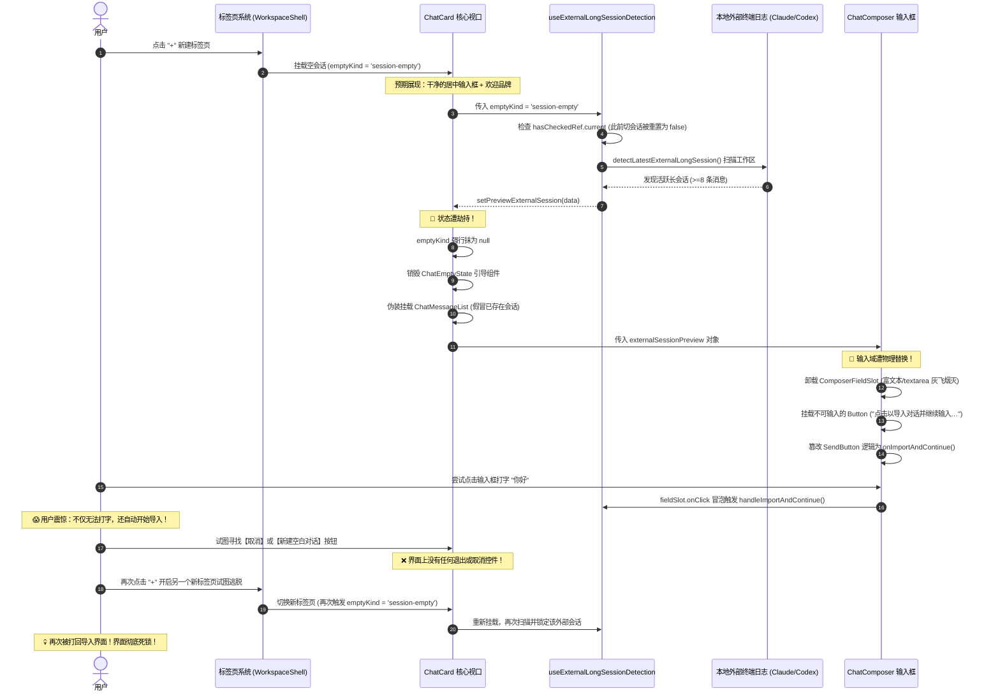

# 02-ChatCard与输入框核心污染与劫持机制深度审计报告

> **审计执行角色**：UI 劫持与核心组件污染审计师  
> **战役归属**：`docs/pluggable-import-architecture/`  
> **审计对象**：
> - `apps/crish-desktop/src/components/chat-composer/ChatComposer.tsx`
> - `apps/crish-desktop/src/components/chat-card/ChatCard.tsx`
> - `apps/crish-desktop/src/components/chat-card/useExternalLongSessionDetection.ts`
> - `apps/crish-desktop/src/components/chat-composer/composerTypes.ts`
> - `apps/crish-desktop/src/components/chat-composer/ChatComposer.module.css`
> - `apps/crish-desktop/src/components/chat-card/__tests__/ChatCard.previewExternalSession.test.tsx`
>
> **审计结论概要**：  
> 当前外部会话预览机制并非一个遵循插槽解耦契约的独立扩展插件，而是**以硬编码形式直接贯穿、肢解并篡改了桌面端聊天核心（ChatCard 与 ChatComposer）的生命周期、DOM 树、交互事件与状态机**。  
> 该实现通过状态抹除（`emptyKind = null`）强行消灭常规空态视图，将未导入的外部消息直接伪装为本地真实对话，将核心输入框物理剔除替换为不可输入的单一操作按钮，并劫持发送键与容器点击。同时，生命周期探测逻辑缺乏会话防抖与跳过持久化，导致用户新建标签页或试图逃离时被反复重新劫持，陷入无法取消、无法输入、无法新建空白对话的 UI 绝对死锁。

---

## 目录

1. [ChatComposer.tsx 输入域劫持机制全盘剖析](#一chatcomposertsx-输入域劫持机制全盘剖析)
2. [ChatCard.tsx 状态与布局劫持深度审计](#二chatcardtsx-状态与布局劫持深度审计)
3. [useExternalLongSessionDetection.ts 逻辑缺陷与死灰复燃生命周期](#三useexternallongsessiondetectionts-逻辑缺陷与死灰复燃生命周期)
4. [视觉与交互认知断层深度归因（为什么用户反馈“看着不清晰”）](#四视觉与交互认知断层深度归因为什么用户反馈看着不清晰)
5. [DOM 结构变异前后精准比对](#五dom-结构变异前后精准比对)
6. [交互状态机走查与死锁轨迹](#六交互状态机走查与死锁轨迹)
7. [纯化重构目标断言与清污实施路径](#七纯化重构目标断言与清污实施路径)

---

## 一、ChatComposer.tsx 输入域劫持机制全盘剖析

`ChatComposer.tsx` 是整个应用程序中最核心的人机交互组件，承担着多模态文本输入、富文本排版、Slash 命令联想、文件与图片拖放粘贴、草稿撤销恢复等关键职能。然而，在现有代码中，该组件遭到了灾难性的侵入。

### 1.1 输入槽物理抹除与不可编辑按钮替换（L344-383）

在 `ChatComposer.tsx` 中，核心输入区域的代码实现如下：

```tsx
// apps/crish-desktop/src/components/chat-composer/ChatComposer.tsx#L344-383
{/* 中间输入区：富文本/单多行自适应输入框，外部会话预览时展示极简导入接续触发器 */}
<div
  className={styles.fieldSlot}
  data-composer-grid="text"
  onClick={
    externalSessionPreview
      ? () => void externalSessionPreview.onImportAndContinue()
      : undefined
  }
>
  {externalSessionPreview ? (
    <Button
      type="button"
      variant="ghost"
      className={styles.externalSessionImportBtn}
      onClick={(e) => {
        e.stopPropagation();
        void externalSessionPreview.onImportAndContinue();
      }}
      disabled={externalSessionPreview.isImporting}
      aria-label="点击以导入对话并继续输入"
      data-testid="external-session-import-btn"
    >
      <span className={styles.externalSessionImportText}>
        {externalSessionPreview.isImporting
          ? '正在导入对话并接续…'
          : '点击以导入对话并继续输入…'}
      </span>
    </Button>
  ) : (
    <ComposerFieldSlot
      fieldContract={fieldContract}
      filteredCommands={filteredCommands}
      emptyKind={emptyKind}
      onFilesSelected={onFilesSelected}
      onPasteFiles={onPasteFiles}
      richTextFailed={richTextFailed}
      onRichTextFail={() => setRichTextFailed(true)}
    />
  )}
</div>
```

#### 严重问题剖析：
1. **核心输入基建被整块卸载（Unmount）**：  
   当 `externalSessionPreview` 存在时，原本承载用户交互的 `<ComposerFieldSlot>` 被完全移出 DOM 树。这导致：
   - 基于 ProseMirror 的富文本编辑器（`TiptapComposerField`）或降级纯文本输入框（`ComposerField`）被销毁。
   - 用户草稿缓存上下文、光标聚焦能力、IME 中文输入法合成状态全部被强制打断。
   - Slash 技能命令补全（`filteredCommands`）与快捷键触发完全失效。
   - 文件拖拽投放（`onFilesSelected`）与剪贴板文件粘贴（`onPasteFiles`）通道被彻底阻断。
2. **伪装成输入框的死按钮**：  
   在原本应该输入文字的位置，渲染了一个 `<Button variant="ghost">`，其内部仅仅渲染了一行静态文字：“点击以导入对话并继续输入…”。用户在物理层面上**被彻底剥夺了键盘输入文本的权利**。

### 1.2 容器级事件冒泡与全域点击劫持（L347-351）

在外层网格单元 `div.fieldSlot` 上，代码绑定了无差别点击监听：

```tsx
onClick={
  externalSessionPreview
    ? () => void externalSessionPreview.onImportAndContinue()
    : undefined
}
```

- 即使用户并没有精准点击中央的按钮文字，而是点击了输入框周围的内边距（padding）、空白边缘或试图点击选中文本，都会立刻冒泡触发 `onImportAndContinue()`。
- 这种“全域点击地雷”严重违背用户对输入框“点击以获取焦点（Focus）”的基本认知习惯。

### 1.3 发送控制区双重劫持（L446-464）

不仅输入域被物理替换，底栏右侧的发送按钮同样被深度劫持：

```tsx
// apps/crish-desktop/src/components/chat-composer/ChatComposer.tsx#L446-464
<ComposerSendControls
  appearance="circle"
  canSend={
    !disabled && (canSend || Boolean(externalSessionPreview))
  }
  disabled={disabled}
  isProcessing={isProcessing}
  onSend={() => {
    if (disabled) return;
    if (externalSessionPreview) {
      void externalSessionPreview.onImportAndContinue();
      return;
    }
    if (sendApiRef.current) sendApiRef.current.flushAndSend();
    else void handleProtectedSend();
  }}
  onStop={onStop}
  onForceStop={onForceStop}
/>
```

#### 严重问题剖析：
1. **伪造发送就绪态**：  
   `canSend` 通过 `Boolean(externalSessionPreview)` 被强制设为 `true`，使得发送按钮常亮激活。
2. **篡改发送行为**：  
   当用户习惯性地按下发送按钮（或试图 Enter 发送）时，触发的不是消息提交逻辑，而是 `onImportAndContinue()`。
3. **语义欺诈**：  
   界面上的右下角发送图标依然是标准的“墨绿正圆发送按钮”，图标未做任何形态或文案调整，行为却被偷换成了“确认导入第三方历史数据”。

### 1.4 取消机制的绝对缺失（零退出通道）

审查 `composerTypes.ts#L286-290` 对 `externalSessionPreview` 的类型定义：

```ts
// apps/crish-desktop/src/components/chat-composer/composerTypes.ts#L286-290
externalSessionPreview?: {
  source: 'claude-code' | 'codex';
  isImporting?: boolean;
  onImportAndContinue: () => void | Promise<void>;
};
```

整个对象中**仅声明了一个单一回调** `onImportAndContinue`。没有任何 `onDismiss`、`onCancel`、`onIgnore` 或 `onStartEmptySession`。  
在 `ChatComposer.tsx` 内部没有任何取消按钮、没有叉号图标、没有 Esc 键盘事件绑定。软件向用户传达的唯一交互逻辑就是：“你必须接受导入，否则你什么都做不了”。

---

## 二、ChatCard.tsx 状态与布局劫持深度审计

`ChatCard.tsx` 作为主聊天视口容器，理应负责协调消息流列表、空态落地引导与底栏输入框。但在引入外部会话预览后，其内部的状态管理遭到了系统性污染。

### 2.1 抹除 emptyKind 篡改主视图路由（L435-466）

在主视口渲染逻辑中，代码通过条件分支强制覆写了视图路由：

```tsx
// apps/crish-desktop/src/components/chat-card/ChatCard.tsx#L435-466
{state.mainSurface === 'scheduled' ? (
  <Suspense fallback={null}>
    <ScheduledTasksPanel onBackToChat={() => state.setMainSurface('chat')} />
  </Suspense>
) : state.mainSurface === 'extensions' ? (
  <Suspense fallback={null}>
    <ExtensionsMainSurface onBackToChat={() => state.setMainSurface('chat')} />
  </Suspense>
) : previewExternalSession ? (
  <ChatMessageList
    {...chatStreamProps}
    messages={{
      messages: previewExternalSession.mapped.messages,
      allMessages: previewExternalSession.mapped.messages,
      agents: [],
      activeSessionId: previewExternalSession.detected.id,
      showAllMessages: true,
    }}
  />
) : state.emptyKind != null ? (
  <div className={styles.chatCol} data-empty-col="true">
    <ChatEmptyState
      kind={state.emptyKind}
      filterQuery={state.localMsgFilter}
      needsKeySetup={state.needsKeySetup}
      needsModelSetup={state.needsModelSetup}
      firstRunOpen={state.firstRunOpen}
      engineOk={state.engineOk}
      messagesLoading={state.messagesLoading}
      onCreateSession={state.handleCreateSessionFromEmpty}
      onClearFilter={() => state.setLocalMsgFilter('')}
    />
  </div>
) : (
  <SlotOutlet
    slotKey="workspace.chat.stream"
    context={chatStreamProps}
    fallback={<ChatMessageList {...chatStreamProps} />}
  />
)}
```

#### 严重问题剖析：
1. **空态组件（ChatEmptyState）被暴力灭活**：  
   原本在新建对话（`emptyKind === 'session-empty'`）或无活跃会话（`emptyKind === 'no-session'`）时，应当渲染提供新建引导、项目选择、快捷指令的 `ChatEmptyState`。但由于 `previewExternalSession` 优先级高于 `state.emptyKind != null`，空态引导被完全旁路，无法显示。
2. **伪装渲染（Ghost Session Rendering）**：  
   `ChatMessageList` 接收到了尚未导入当前 Crish 会话数据库的临时内存映射消息：
   `messages: previewExternalSession.mapped.messages`。  
   界面渲染出来的视觉效果与已经导入并存在于本地的真实对话**完全一致**。
   - 顶部没有任何通知横幅。
   - 消息气泡上没有任何“来自 Claude Code / Codex 历史”的提示标签。
   - 侧边栏并未高亮任何对应会话，但主屏幕却满屏都是聊天记录。
   用户误以为自己正处于一个已经打开的旧会话中，但底栏却无法输入，造成极其强烈的认知分裂。

### 2.2 篡改 emptyKind 破坏布局级 CSS 级联（L215-220 & L381-383）

代码多处通过三元表达式伪造 `emptyKind`：

```tsx
// ChatCard.tsx#L181-182
const isLanding =
  !previewExternalSession && state.emptyKind === 'session-empty';

// ChatCard.tsx#L215-220
emptyKind={previewExternalSession ? null : state.emptyKind}
layoutVariant={
  !previewExternalSession && (isLanding || activeSettling)
    ? 'multiline'
    : 'adaptive'
}

// ChatCard.tsx#L381-383
data-empty-kind={
  previewExternalSession ? undefined : (state.emptyKind ?? undefined)
}

// ChatCard.tsx#L416-420
<div
  className={styles.chatDocFlow}
  data-testid="chat-doc-flow"
  data-empty={
    !previewExternalSession && state.emptyKind != null
      ? 'true'
      : undefined
  }
>

// ChatCard.tsx#L471
<ChatComposerWrapper
  mainSurface={state.mainSurface}
  emptyKind={previewExternalSession ? null : state.emptyKind}
  ...
```

#### 破坏链条分析：
1. **`data-empty-kind` 属性抹除**：  
   在标准空态设计中，`[data-empty-kind="session-empty"]` 驱动底栏上移至视口居中黄金位置，呈现优雅的居中搜索/引导交互。代码为了在未导入状态下强行展示长消息流，强制将 `data-empty-kind` 抹除为 `undefined`。
2. **`data-empty` 属性抹除**：  
   `chatDocFlow` 的 `data-empty="true"` 原本用于居中对齐内容，被强制置为 `undefined`。
3. **`layoutVariant` 强行压制**：  
   原本在 Landing 空态时输入框应为 `multiline`（支持富文本排版的大号卡片），被强制降级为 `adaptive`。
4. **`composerLead` 强行拔除**：  
   在 `ChatComposerWrapper.tsx` 中，`isLanding = emptyKind === 'session-empty'`。由于传入了 `null`，空界面品牌 Header（`ChatLandingBrand`）与项目工作区选择器（`ComposerProjectPicker`）被彻底隐藏。

### 2.3 测试资产沦为代码污染的“合规保护伞”

审查测试文件 `apps/crish-desktop/src/components/chat-card/__tests__/ChatCard.previewExternalSession.test.tsx#L4-11`：

```tsx
/**
 * 外部会话预览布局与空态隔离测试：
 * 验证当 previewExternalSession 存在时：
 * 1. chatBody 不打上 data-empty-kind="session-empty"（杜绝 translateY 将底栏推至半空）
 * 2. chatDocFlow 不打上 data-empty="true"（杜绝垂直居中干扰消息列表流式排布）
 * 3. ChatComposer 接收 layoutVariant="adaptive" 与 emptyKind=null（保持单行输入卡片而非巨大多行空态卡）
 * 4. ChatComposerWrapper 接收 emptyKind=null 且 composerLead 恒为 null
 * 5. 渲染 ChatMessageList 呈现外部消息列表，视同常规对话
 */
```

这套测试并没有站在用户体验与无锁交互的角度，而是为了满足“如何在空态强行塞入满屏外部消息并压制输入框”这一扭曲的设计目标，专门编写断言确保“`data-empty-kind` 必须为 null”、“空态引导必须为 null”。测试资产在这里被反向利用，反而在回归测试中锁定了这种架构倒置！

---

## 三、useExternalLongSessionDetection.ts 逻辑缺陷与死灰复燃生命周期

`useExternalLongSessionDetection.ts` 是触发上述一切劫持行为的源头驱动 Hook。审计其实现，发现了严重的生命周期与状态管理缺陷。

### 3.1 监听依赖缺陷与无限重新探测（死灰复燃根因）

查看 Hook 核心监听逻辑：

```ts
// apps/crish-desktop/src/components/chat-card/useExternalLongSessionDetection.ts#L27-63
const hasCheckedRef = useRef(false);

const isLandingOrEmpty =
  emptyKind === 'session-empty' || emptyKind === 'no-session';

// 启动 / 处于空态时执行长对话智能探测
useEffect(() => {
  if (!isLandingOrEmpty) {
    hasCheckedRef.current = false;
    return;
  }

  if (hasCheckedRef.current) return;
  hasCheckedRef.current = true;

  let cancelled = false;
  setIsDetecting(true);

  void detectLatestExternalLongSession()
    .then((result) => {
      if (!cancelled && result) {
        setPreviewExternalSession(result);
      }
    })
    ...
```

#### 缺陷轨迹剖析：
1. **状态重置逻辑漏洞**：  
   当用户处于有消息的正常会话中时，`!isLandingOrEmpty` 成立，执行：  
   `hasCheckedRef.current = false;`  
   这本意是想在“下次变成空态时再检查”，但导致了致命后果：
2. **新建标签页即触发劫持**：  
   - 用户在已有会话 A 中正常聊天（此时 `hasCheckedRef.current === false`）。
   - 用户点击顶部标签栏的“+”（新建标签页）或侧边栏“新建对话”，希望开启一个全新任务。
   - 新创建的标签页没有任何消息，`emptyKind` 瞬间变为 `'session-empty'`，`isLandingOrEmpty` 变为 `true`。
   - `useEffect` 重新执行，发现 `hasCheckedRef.current === false`，立刻执行 `detectLatestExternalLongSession()`。
   - 只要用户的本地工作区目录下存在 Claude Code 或 Codex 的历史会话（>=8 条消息），它立刻被扫描出来并塞入 `setPreviewExternalSession(result)`。
   - **结果：用户刚新建的空白对话瞬间被夺舍，变成了历史会话预览，输入框立刻被锁死！**
   - 用户误以为“新建标签页失败了，直接退回到了导入界面”。

### 3.2 handleDismissPreview 彻底沦为死代码（L122）

在 Hook 内部，作者声明了一个关闭预览的回调：

```ts
// useExternalLongSessionDetection.ts#L122-124
const handleDismissPreview = useCallback(() => {
  setPreviewExternalSession(null);
}, []);
```

但在主视口 `ChatCard.tsx#L52-56` 的消费处：

```tsx
// ChatCard.tsx#L52-56
const { previewExternalSession, isImporting, handleImportAndContinue } =
  useExternalLongSessionDetection({
    emptyKind: state.emptyKind,
    activeSessionId: state.activeSessionId,
  });
```

`handleDismissPreview` **根本没有被解构！没有被传递给任何子组件！**  
在整个 UI 树中，这个用于退出的方法完全不存在调用的可能。

### 3.3 缺乏持久化标记与跨会话状态污染

即使未来在内存中调用了 `handleDismissPreview` 将状态置为 `null`：
- 因为没有持久化（没有存入 `sessionStorage`、`localStorage` 或会话墓碑 `tombstone`），一旦用户切到其他会话再切回来，`hasCheckedRef.current` 再次失效，外部对话将再度死灰复燃。
- 此外，Hook 内部在同一组件实例内维护 `previewExternalSession`，在快速切换标签页时，异步请求返回的时序竞争（Race Condition）会导致上一个标签页的探测结果污染当前标签页。

---

## 四、视觉与交互认知断层深度归因（为什么用户反馈“看着不清晰”）

用户明确指出：“这个对话导入现在看着不是很清晰”。经过对视觉与 DOM 样式的深度审计，归因于以下四大断层：

```
+-------------------------------------------------------------------------+
| 当前视觉混乱表现                                                         |
|                                                                         |
| 1. [缺少来源与标识] 满屏消息气泡，没有任何标签说明来自 Claude CLI 还是 Codex |
| 2. [伪造真实对话] 渲染在 ChatMessageList 中，与本地正式历史完全混淆           |
| 3. [输入框突兀变形] 标准富文本框突变为单行透明扁平条，仅写有一行弱化灰色文字   |
| 4. [强行逼入死胡同] 没有【取消】、【忽略】、【新建空白会话】，剥夺全部选择权   |
+-------------------------------------------------------------------------+
```

### 4.1 身份与来源证明彻底缺失（No Provenance / Identity）
- 用户打开桌面端，屏幕上直接赫然出现一段长对话，没有任何 Banner 说明：“检测到您在外部终端使用 Claude Code / Codex 进行的对话，是否需要导入到 Crish？”。
- 没有工作区路径提示，没有最后活跃时间提示。用户不知道这些消息究竟是 Crish 读取错乱了本地文件、串联了其他项目，还是发生了数据重叠。

### 4.2 视觉容器层级倒置（Container Inversion）
- 导入功能本应是一种**外围引导态或通知浮层（Notification / Drawer / Modal / Banner）**，必须明确独立于真实会话消息容器之外。
- 当前代码却反客为主，将外部会话直接反向注入到主内容管道 `ChatMessageList` 中，破坏了聊天界面的单一真理源（SSOT）。

### 4.3 输入框外观与交互语义断裂（Affordance Breakage）
- 正常的输入框拥有明显的轮廓、背景色、占位符光标暗示（Placeholder）。
- 当前通过 `.externalSessionImportBtn`（`ChatComposer.module.css#L1968-1987`）：
  - 高度被压至死高 `28px`。
  - 背景为 `transparent`，边框为 `none`。
  - 内部文字颜色为 `var(--text-tertiary)`（极淡的弱灰文字）。
  - 用户从视觉上根本看不出这是一个可点击的行动项（CTA 按钮），看起来更像是一行不可操作的禁用提示符。但一旦点击，却又立即发起网络或本地导入，产生极强的受骗感与失控感。

---

## 五、DOM 结构变异前后精准比对

### 5.1 正常空态（Clean Landing Empty State）结构

```html
<!-- 干净的正常新标签页 / 空态结构 -->
<div 
  class="chatBody" 
  data-testid="chat-body" 
  data-empty-kind="session-empty"
>
  <div 
    class="chatDocFlow" 
    data-testid="chat-doc-flow" 
    data-empty="true"
  >
    <div class="chatCol" data-empty-col="true">
      <div data-testid="chat-empty-state">
        <!-- 完整的空态引导：品牌、创建动作、快捷卡片 -->
      </div>
    </div>
  </div>

  <div class="chatFooter" data-testid="chat-footer">
    <div class="footerMotion">
      <div class="chatCol">
        <div class="composerDock" data-composer-wrapper>
          <div class="composerLead" data-composer-lead>
            <!-- 品牌标识与项目工作区选择器 -->
            <ChatLandingBrand />
            <ComposerProjectPicker />
          </div>

          <!-- 标准富文本多行输入卡片 -->
          <div class="chatComposer" data-layout-variant="multiline">
            <div class="fieldSlot" data-composer-grid="text">
              <ComposerFieldSlot>
                <!-- 真实可编辑区域，支持 IME、Markdown、Slash、拖拽 -->
                <div class="tiptap prose" contenteditable="true" ...></div>
              </ComposerFieldSlot>
            </div>
            <!-- 发送控制：当且仅当有真实文本时可发送 -->
            <ComposerSendControls canSend="false" />
          </div>
        </div>
      </div>
    </div>
  </div>
</div>
```

### 5.2 劫持变异后（Hijacked Preview State）结构

```html
<!-- 被 externalSessionPreview 污染与劫持后的变异结构 -->
<div 
  class="chatBody" 
  data-testid="chat-body"
  <!-- [劫持 1] data-empty-kind 被抹除为 undefined，CSS 上移布局失效 -->
>
  <div 
    class="chatDocFlow" 
    data-testid="chat-doc-flow"
    <!-- [劫持 2] data-empty 被抹除为 undefined，居中排版失效 -->
  >
    <!-- [劫持 3] ChatEmptyState 被彻底灭顶剔除 -->
    <!-- [劫持 4] 伪装成正式消息列表，渲染未入库的外部消息 -->
    <div class="chatMessageList" data-testid="mock-chat-message-list">
      <div class="chatMessageItem" data-sender="user">外部消息 1</div>
      <div class="chatMessageItem" data-sender="assistant">外部消息 2</div>
    </div>
  </div>

  <div class="chatFooter" data-testid="chat-footer">
    <div class="footerMotion">
      <div class="chatCol">
        <div class="composerDock" data-composer-wrapper>
          <!-- [劫持 5] composerLead（品牌与项目选择）被直接隐藏 -->

          <!-- [劫持 6] layoutVariant 被强制从 multiline 降级为 adaptive -->
          <div class="chatComposer" data-layout-variant="adaptive">
            <!-- [劫持 7] 容器 div 绑定全局点击事件 -->
            <div 
              class="fieldSlot" 
              data-composer-grid="text" 
              onclick="externalSessionPreview.onImportAndContinue()"
            >
              <!-- [劫持 8] 真实输入框 ComposerFieldSlot 被彻底卸载！ -->
              <!-- 替换为不可编辑的占位按钮，键盘无法聚焦与输入 -->
              <button 
                type="button" 
                class="externalSessionImportBtn" 
                data-testid="external-session-import-btn"
              >
                <span class="externalSessionImportText">
                  点击以导入对话并继续输入…
                </span>
              </button>
            </div>

            <!-- [劫持 9] 发送按钮 canSend 被强行注入 true，点击即触发导入 -->
            <ComposerSendControls 
              canSend="true" 
              onsend="externalSessionPreview.onImportAndContinue()" 
            />
          </div>
        </div>
      </div>
    </div>
  </div>
</div>
```

---

## 六、交互状态机走查与死锁轨迹

以下状态机时序走查彻底还原了用户“新建标签页被劫持打回”、“输入框锁死无法取消”的完整事故现场：



---

## 七、纯化重构目标断言与清污实施路径

为彻底根除此架构毒瘤，必须严格遵循用户的指示：**“不要兼容、不要打补丁，需要删除代码就删除，需要重构就重构。不要最短路径改动，在软件内的代码应该是最先进的，不允许多个版本存在。”**

### 7.1 ChatComposer 纯化断言（输入框回归纯粹）
1. **彻底移除 `externalSessionPreview` Prop**：  
   从 `composerTypes.ts`（L285-290）与 `ChatComposerProps` 中永久删除 `externalSessionPreview` 字段定义。核心输入框不应感知任何“外部导入”概念。
2. **根除 `fieldSlot` 内部的条件分支与点击劫持**：  
   彻底删除 `ChatComposer.tsx` 中的 L347-372 代码，还原 `<ComposerFieldSlot>` 的单一渲染路径，确保输入框永远具备键盘输入与聚焦能力。
3. **清洗发送按钮逻辑**：  
   移除 `ComposerSendControls` 中对 `externalSessionPreview` 的判断，`canSend` 严格由真实文本/附件就绪态决定。
4. **清理样式冗余**：  
   从 `ChatComposer.module.css` 中删除 `.externalSessionImportBtn`、`.externalSessionImportText` 等共计 50 余行劫持专用样式。

### 7.2 ChatCard 纯化断言（主视口回归正交）
1. **移除 Hook 依赖**：  
   从 `ChatCard.tsx` 中彻底移除 `useExternalLongSessionDetection` 的引入与调用。
2. **恢复真实状态机流转**：  
   彻底删除所有 `previewExternalSession ? null : state.emptyKind` 的状态抹除逻辑。`emptyKind` 保持单一真理源（SSOT）。
3. **还原主视图分支**：  
   `state.emptyKind != null` 时 100% 渲染 `ChatEmptyState`，绝不允许伪装渲染未导入会话。
4. **移除污染测试与更新基线**：  
   清理或重写 `ChatCard.previewExternalSession.test.tsx`，将测试目标转为**“确保空态与新建标签页绝不被任何外部异步探测劫持”**的防回归守卫测试。

### 7.3 导入机制重构归宿（向真插件机制迁移）
外部会话探测与导入功能必须被剥离为真正的可插拔扩展插件（`@crish/plugin-import-claude-codex`）：
- **展示位置**：不污染输入框内部，不伪装主聊天视口。通过标准插槽（如 `workspace.chat.composerAbove` 浮层或专属提示条）展示。
- **视觉明晰**：卡片明确标注来源（`Claude Code` / `Codex` 图标与标签）、工作区路径、最后会话摘要。
- **完整双向选择权**：提供平等的两个核心操作：
  - `[导入该对话]`：确认导入并打开该新会话。
  - `[忽略 / 开启空白对话]`：点击后生成本地跳过标记，永久关闭该提示，绝不反复弹窗骚扰。
- **随时可禁用**：当插件在扩展市场被禁用或卸载时，软件核心零代码残留、零感知、零退化。
