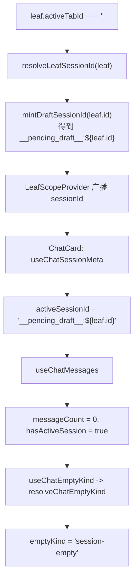
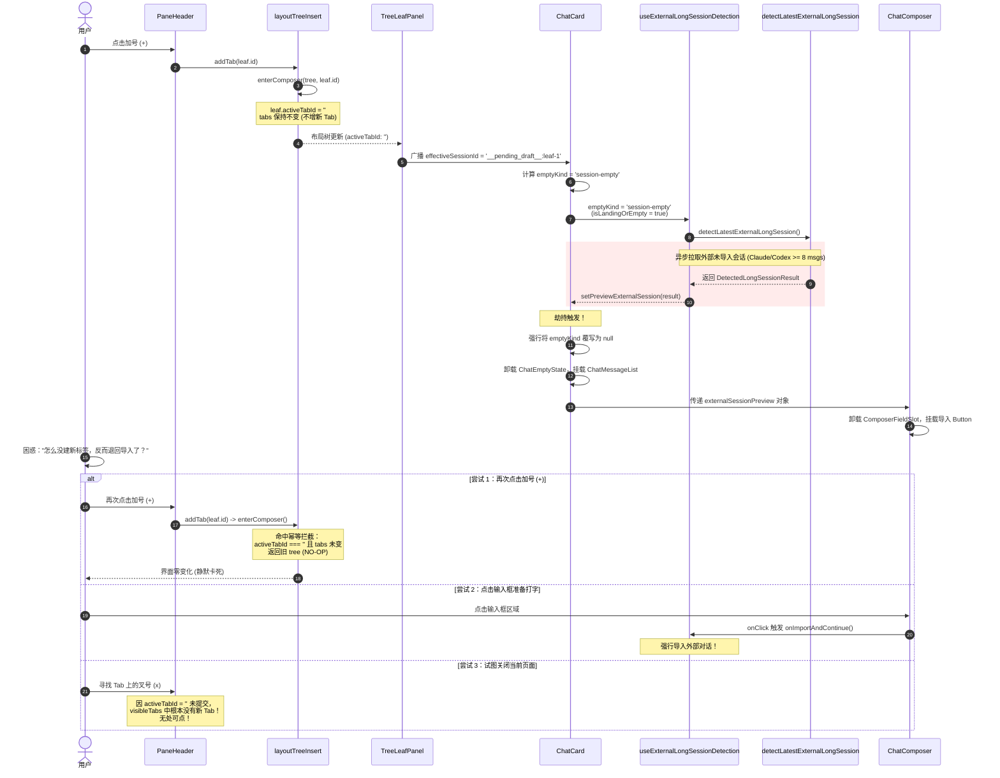
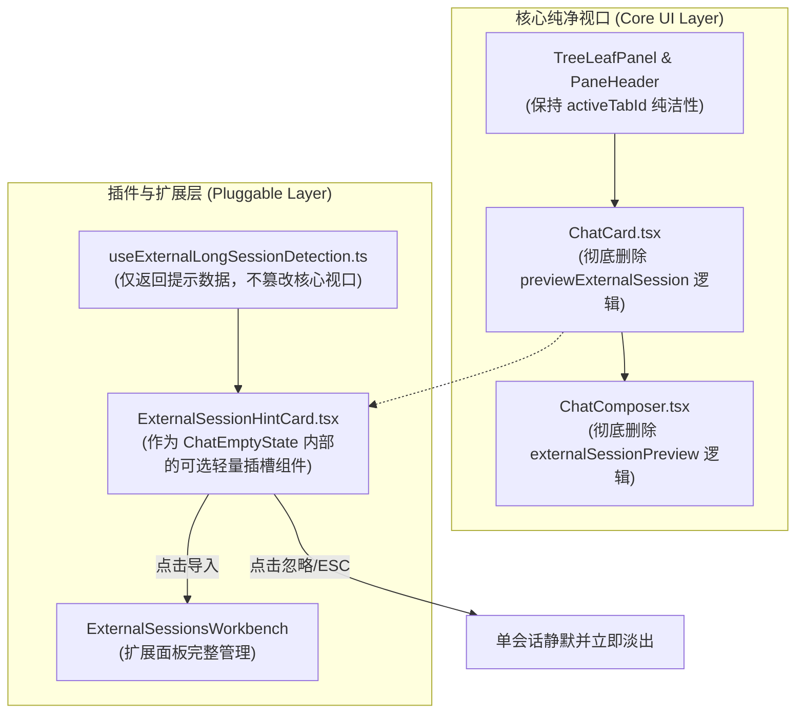

# 标签页生命周期与新对话状态机冲突审计

> **文档标识**：`docs/pluggable-import-architecture/analysis/03-标签页生命周期与新对话状态机冲突审计.md`  
> **战役工作区**：`docs/pluggable-import-architecture/`  
> **角色归属**：标签页生命周期与新对话状态机冲突审计师  
> **创建时间**：2026-10-25  
> **执行准则**：遵循根目录 [`AGENTS.md`](file:///c:/Software/conex/AGENTS.md)、[`.agents/LOGIC_PLAN_NO_RETREAT.md`](file:///c:/Software/conex/.agents/LOGIC_PLAN_NO_RETREAT.md) 及 [`ANTI_OVERENGINEERING_GUARDRAILS.md`](file:///c:/Software/conex/ANTI_OVERENGINEERING_GUARDRAILS.md)。

---

## 摘要与核心审计结论

在存在外部未导入长会话（Claude Code / Codex CLI）时，用户点击新建标签页加号（`+`），界面呈现出**“点击加号没有任何新标签页产生，主视口直接被打回外部对话导入界面，且无法输入任何新对话、无法关闭、无法逃逸”**的恶性死锁现象。

经过对前端二叉树布局状态机、会话生命周期模型、空态推导逻辑及外部长会话探测钩子的深度端到端源码追踪，审计得出以下核心结论：

1. **二叉树布局层的“未提交草稿不占标签”契约遭遇撞击**：
   - 点击加号调用 [`addTab(leaf.id)`](file:///c:/Software/conex/apps/crish-desktop/src/components/binary-tree/PaneHeader.tsx#L395-L398)，在未携带真 `sessionId` 时退化执行 [`enterComposer(tree, leafId)`](file:///c:/Software/conex/apps/crish-desktop/src/store/layout-tree/layoutTreeInsert.ts#L122-L131)，将 `activeTabId` 置为 `''`。
   - 按照 Crish 标签栏架构哲学，“条带只画已发送成功的真会话；未提交的新对话不占标签”。因此在已有已提交会话的窗格中，**物理标签栏上不会新增任何 Tab 药丸**。
2. **虚拟草稿态与外部自动探测的恶性碰撞**：
   - 当 `activeTabId === ''` 时，[`resolveLeafSessionId`](file:///c:/Software/conex/apps/crish-desktop/src/components/binary-tree/treeLeafPanelModel.ts#L75-L95) 派生出虚拟草稿 ID `__pending_draft__:${leaf.id}`，触发 [`resolveChatEmptyKind`](file:///c:/Software/conex/apps/crish-desktop/src/api/chatEmptyState.ts#L113-L130) 推导出 `emptyKind = 'session-empty'`。
   - [`useExternalLongSessionDetection.ts`](file:///c:/Software/conex/apps/crish-desktop/src/components/chat-card/useExternalLongSessionDetection.ts#L29-L63) 监听到 `isLandingOrEmpty = true`，立刻异步唤醒并执行 [`detectLatestExternalLongSession()`](file:///c:/Software/conex/apps/crish-desktop/src/api/import/autoSyncExternalSessions.ts#L121-L211)。
   - 探测命中后，锁定状态 `previewExternalSession`，导致 [`ChatCard.tsx`](file:///c:/Software/conex/apps/crish-desktop/src/components/chat-card/ChatCard.tsx#L435-L445) 强行抹杀 `emptyKind` 并用外部历史消息替换空态欢迎面，[`ChatComposer.tsx`](file:///c:/Software/conex/apps/crish-desktop/src/components/chat-composer/ChatComposer.tsx#L344-L372) 则直接卸载输入框替换为不可输入的导入按钮。
3. **四重逃逸路径被全线物理封锁，形成绝对死锁**：
   - **再点加号**：被 [`layoutTreeInsert.ts:126-128`](file:///c:/Software/conex/apps/crish-desktop/src/store/layout-tree/layoutTreeInsert.ts#L126-L128) 的幂等守卫静默当成 NO-OP 返回；
   - **点击输入框**：被全局 `onClick` 强行重定向为触发外部会话导入；
   - **关闭标签页**：草稿态物理上不存在 Tab，标签栏无叉号（`x`）可点；
   - **界面取消**：`handleDismissPreview` 沉睡于 Hook 内，UI 零暴露。
4. **根治裁决**：
   - 必须立下**“新对话神圣不可侵犯（Sacred Blank Slate Invariant）”**铁律；
   - 物理切除 `ChatCard` 与 `ChatComposer` 内的 `previewExternalSession` 硬编码劫持逻辑；
   - 外部会话探测退回只读环境建议（Ambient Hint），严禁占领主对话流或修改输入框形态。

---

## 一、二叉树布局与标签页创建状态机追踪

### 1.1 加号 `+` 点击与 `sessionShell().addTab(leaf.id)` 链路

在窗格专属顶栏 [`PaneHeader.tsx`](file:///c:/Software/conex/apps/crish-desktop/src/components/binary-tree/PaneHeader.tsx) 中，新建标签页由加号按钮触发：

```tsx
// apps/crish-desktop/src/components/binary-tree/PaneHeader.tsx:395-398
const handleNewTab = useCallback(() => {
  clearLockedWidth();
  sessionShell().addTab(leaf.id);
}, [clearLockedWidth, leaf.id]);
```

- 该调用通过门面 [`sessionShell().addTab(leaf.id)`](file:///c:/Software/conex/apps/crish-desktop/src/components/binary-tree/PaneHeader.tsx#L70-L74) 进入布局树操作。
- 注意：此处仅传入了目标叶子节点的 ID `leaf.id`，未传入任何 `sessionId`、`tabId` 或 `workspaceKey`。

### 1.2 `layoutTreeInsert.ts` 中 `addTab` 与 `enterComposer` 逻辑剖析

在 [`apps/crish-desktop/src/store/layout-tree/layoutTreeInsert.ts`](file:///c:/Software/conex/apps/crish-desktop/src/store/layout-tree/layoutTreeInsert.ts#L134-L167) 中，`addTab` 的实现如下：

```typescript
// apps/crish-desktop/src/store/layout-tree/layoutTreeInsert.ts:134-167
/** 加号 / 新对话：进入新对话界面。带真 sessionId 的对象则插入标签。 */
export function addTab(
  tree: LayoutTree,
  leafId: string,
  tabOrWorkspaceKey?:
    | string
    | {
        tabId?: string;
        sessionId?: string;
        title?: string;
        workspaceKey?: string;
        dock?: Partial<import('./sessionTabModel').RightToolDockState>;
      }
): LayoutTree {
  if (tabOrWorkspaceKey && typeof tabOrWorkspaceKey === 'object') {
    const sid =
      typeof tabOrWorkspaceKey.sessionId === 'string'
        ? tabOrWorkspaceKey.sessionId.trim()
        : '';
    if (isRealSessionId(sid)) {
      return insertTab(
        tree,
        leafId,
        createSessionTab({
          sessionId: sid,
          tabId: tabOrWorkspaceKey.tabId,
          title: tabOrWorkspaceKey.title,
          workspaceKey: tabOrWorkspaceKey.workspaceKey,
          dock: tabOrWorkspaceKey.dock,
        })
      );
    }
  }
  return enterComposer(tree, leafId);
}
```

#### 关键机制分析：
1. **未传显式 `sessionId` 的行为分流**：
   - 当由加号 `handleNewTab` 触发时，`tabOrWorkspaceKey` 为 `undefined`。
   - 分支判断 `isRealSessionId(sid)` 不满足，直接回退执行 [`enterComposer(tree, leafId)`](file:///c:/Software/conex/apps/crish-desktop/src/store/layout-tree/layoutTreeInsert.ts#L122-L131)。
2. **Crish 标签体系的核心契约：未提交新对话不占标签**：
   - 见 [`PaneHeader.tsx:9`](file:///c:/Software/conex/apps/crish-desktop/src/components/binary-tree/PaneHeader.tsx#L9) 与 [`layoutTreeInsert.ts:118-121`](file:///c:/Software/conex/apps/crish-desktop/src/store/layout-tree/layoutTreeInsert.ts#L118-L121) 的架构注释：
     > “进入本叶未提交的新对话界面：不创建标签，条带已有真会话保留且无选中。传入真 sessionId 时才插入标签（openSession / 发送成功物化）。”
   - [`enterComposer`](file:///c:/Software/conex/apps/crish-desktop/src/store/layout-tree/layoutTreeInsert.ts#L122-L131) 的实现为：
     ```typescript
     export function enterComposer(tree: LayoutTree, leafId: string): LayoutTree {
       const leaf = requireChatLeaf(tree.root, leafId);
       if (!leaf) return tree;
       const tabs = leaf.tabs.filter((t) => isRealSessionId(t.sessionId));
       if (leaf.activeTabId === '' && tabs.length === leaf.tabs.length) {
         return tree;
       }
       const updated: LayoutLeaf = { ...leaf, tabs, activeTabId: '' };
       return { ...tree, root: replaceNode(tree.root, leafId, updated) };
     }
     ```
   - 此函数清洗掉非真实会话（如历史遗留的虚拟草稿 tab），并将叶子节点的 `activeTabId` 设置为 `''`。
   - **物理状态变更**：此时 `leaf.tabs` 中**并未追加任何新的 SessionTab**！
3. **标签栏展示投影**：
   - 在 [`paneHeaderModel.ts:24-46`](file:///c:/Software/conex/apps/crish-desktop/src/components/binary-tree/paneHeaderModel.ts#L24-L46) 中，`computeVisibleLeafTabs` 读取 `readCommittedLeafTabs(leaf)`。
   - 如果当前叶子此前已有 1 个已提交会话（例如 `sess-1`），`readCommittedLeafTabs` 长度为 1，直接返回该会话。
   - 标签栏展示结果：依然只有原本的 `sess-1` 标签，但由于 `activeTabId === ''`，`sess-1` 的高亮被取消，处于无选中的失焦状态。
   - **用户眼中的视觉表象**：点击了 `+`，标签栏上什么新 Tab 都没冒出来！

### 1.3 幂等拦截陷阱：再次点击 `+` 变成静默 NO-OP

请注意 [`enterComposer`](file:///c:/Software/conex/apps/crish-desktop/src/store/layout-tree/layoutTreeInsert.ts#L126-L128) 中的关键守卫：
```typescript
if (leaf.activeTabId === '' && tabs.length === leaf.tabs.length) {
  return tree;
}
```

- **守卫原本设计意图**：当用户已经在输入草稿（`activeTabId === ''`），且当前 tabs 没有需要清理的无效草稿时，防止重复分发 Redux/Zustand Action 引发无意义的 DOM 重渲染。
- **劫持发生后的致命副作用**：
  - 一旦主视口被外部会话导入界面劫持，用户看到界面卡在“导入”，直觉反应是“刚才点加号没成功，我再点一次加号”。
  - 再次点击 `+` 时，当前 `leaf.activeTabId` 已经是 `''`，`tabs.length === leaf.tabs.length` 恒成立！
  - `enterComposer` 命中该条件，**直接原样返回旧的 `tree` 引用**！
  - 没有任何 State 产生变动，没有任何 Effect 会被触发。用户发狂般点击 `+`，界面纹丝不动，变成彻头彻尾的 Dead UI！

---

## 二、新对话落地态与外部探测的死锁碰撞

### 2.1 作用域会话解析与 `emptyKind = 'session-empty'` 判定链

当 `leaf.activeTabId` 变为 `''` 时，分屏内的会话 ID 解析与空态计算链条发生如下流转：



1. **会话 ID 派生**：
   - [`treeLeafPanelModel.ts:75-95`](file:///c:/Software/conex/apps/crish-desktop/src/components/binary-tree/treeLeafPanelModel.ts#L75-L95) 中的 `resolveLeafSessionId`：
     ```typescript
     export function resolveLeafSessionId(leaf: LayoutLeaf, options?: ...): string {
       const tabs = readLeafTabs(leaf);
       const activeTab = readActiveTab(leaf); // activeTabId === '' 时返回 undefined
       if (activeTab?.sessionId) {
         return activeTab.sessionId;
       }
       if (tabs.length === 0) { ... }
       return mintDraftSessionId(leaf.id); // 派生虚拟草稿 ID
     }
     ```
   - 此时 `TreeLeafPanel` 的 `effectiveSessionId` 被计算为 `__pending_draft__:${leaf.id}`，并通过 [`LeafScopeProvider`](file:///c:/Software/conex/apps/crish-desktop/src/components/binary-tree/TreeLeafPanel.tsx#L385-L391) 注入上下文。
2. **草稿免 Loading 判定**：
   - [`useChatEmptyKind.ts:46`](file:///c:/Software/conex/apps/crish-desktop/src/components/chat-card/useChatEmptyKind.ts#L46)：
     `if (isPendingDraft(activeSessionId)) return false;`
     明确指出草稿态无需等待 SQLite 水合，避免欢迎面闪烁。
3. **空态推导**：
   - [`chatEmptyState.ts:113-130`](file:///c:/Software/conex/apps/crish-desktop/src/api/chatEmptyState.ts#L113-L130) 中的 `resolveChatEmptyKind`：
     - `input.hasActiveSession`: `Boolean('__pending_draft__:${leaf.id}') === true`
     - `input.messageCount`: `0`
     - 规则：`if (messageCount === 0) return 'session-empty';`
   - 由此，`ChatCard` 获取到的状态为：`emptyKind = 'session-empty'`。

### 2.2 `useExternalLongSessionDetection.ts` 的被动唤醒与异步锁定

在 [`apps/crish-desktop/src/components/chat-card/useExternalLongSessionDetection.ts`](file:///c:/Software/conex/apps/crish-desktop/src/components/chat-card/useExternalLongSessionDetection.ts#L29-L63) 中：

```typescript
// apps/crish-desktop/src/components/chat-card/useExternalLongSessionDetection.ts:29-63
const isLandingOrEmpty =
  emptyKind === 'session-empty' || emptyKind === 'no-session';

// 启动 / 处于空态时执行长对话智能探测
useEffect(() => {
  if (!isLandingOrEmpty) {
    hasCheckedRef.current = false;
    return;
  }

  if (hasCheckedRef.current) return;
  hasCheckedRef.current = true;

  let cancelled = false;
  setIsDetecting(true);

  void detectLatestExternalLongSession()
    .then((result) => {
      if (!cancelled && result) {
        setPreviewExternalSession(result);
      }
    })
    .catch(() => {
      // 静默容错，不阻断主流程
    })
    .finally(() => {
      if (!cancelled) {
        setIsDetecting(false);
      }
    });

  return () => {
    cancelled = true;
  };
}, [isLandingOrEmpty]);
```

#### 致命时序缺陷剖析：
1. **`hasCheckedRef` 的重置陷阱**：
   - 依赖项为 `[isLandingOrEmpty]`。
   - 当用户在普通会话（有消息）浏览时，`isLandingOrEmpty` 为 `false`，此时执行：
     `hasCheckedRef.current = false;`。
   - 当用户点击加号 `+` 进入草稿态时，`isLandingOrEmpty` 变为 `true`，守卫判断 `hasCheckedRef.current` 恰好为 `false`！
   - **这意味着：用户每一次从有消息的会话切换到新建标签页，都会 100% 重新触发一次外部探测！**
2. **异步执行探测并加锁**：
   - [`detectLatestExternalLongSession()`](file:///c:/Software/conex/apps/crish-desktop/src/api/import/autoSyncExternalSessions.ts#L121-L211) 在后台扫描磁盘（`~/.claude/projects/` 或 `~/.codex/`）。
   - 如果用户在当前项目根目录使用过 CLI 工具且产生过超过 8 条消息的对话，且尚未手动导入，该函数立即返回该长会话并映射出消息体 `DetectedLongSessionResult`。
   - `setPreviewExternalSession(result)` 被同步触发，将该外部长会话牢牢锁定在当前卡片的状态中。

### 2.3 `ChatCard` 与 `ChatComposer` 的强行覆写与彻底劫持

一旦 `previewExternalSession` 存在，`ChatCard` 与 `ChatComposer` 的组件树发生灾难性的结构重塑：

#### 1. 空态被剥夺，强塞外部消息列表：
在 [`ChatCard.tsx:435-445`](file:///c:/Software/conex/apps/crish-desktop/src/components/chat-card/ChatCard.tsx#L435-L445) 中：
```tsx
{state.mainSurface === 'scheduled' ? (
  ...
) : state.mainSurface === 'extensions' ? (
  ...
) : previewExternalSession ? (
  <ChatMessageList
    {...chatStreamProps}
    messages={{
      messages: previewExternalSession.mapped.messages,
      allMessages: previewExternalSession.mapped.messages,
      agents: [],
      activeSessionId: previewExternalSession.detected.id,
      showAllMessages: true,
    }}
  />
) : state.emptyKind != null ? (
  <div className={styles.chatCol} data-empty-col="true">
    <ChatEmptyState ... />
  </div>
) : (
  ...
)}
```
- 原本应该挂载的 [`ChatEmptyState`](file:///c:/Software/conex/apps/crish-desktop/src/components/chat-card/ChatEmptyState.tsx)（带有“开始对话”、提示词推荐与新建按钮的干净界面）被直接旁路（Bypass）！
- 取而代之的是渲染了一整个外部会话的 `<ChatMessageList>`，屏幕上瞬间填满了外部 CLI 的历史对话消息。

#### 2. Composer 接收空态覆写并禁用输入框：
在 [`ChatCard.tsx:215-245`](file:///c:/Software/conex/apps/crish-desktop/src/components/chat-card/ChatCard.tsx#L215-L245) 中：
```tsx
const mainComposerElement = (
  <ChatComposer
    {...state.composerProps}
    emptyKind={previewExternalSession ? null : state.emptyKind} // 强行将 emptyKind 抹杀为 null
    layoutVariant={
      !previewExternalSession && (isLanding || activeSettling)
        ? 'multiline'
        : 'adaptive'
    }
    placeholder={
      previewExternalSession
        ? isImporting
          ? '正在导入对话并接续…'
          : '点击以导入对话并继续输入…'
        : undefined
    }
    externalSessionPreview={
      previewExternalSession
        ? {
            source: previewExternalSession.detected.source,
            isImporting,
            onImportAndContinue: handleImportAndContinue,
          }
        : undefined
    }
    ...
  />
);
```

#### 3. Composer 内部将输入框物理抹除并绑定劫持点击：
在 [`ChatComposer.tsx:344-372`](file:///c:/Software/conex/apps/crish-desktop/src/components/chat-composer/ChatComposer.tsx#L344-L372) 中：
```tsx
{/* 中间输入区：外部会话预览时展示极简导入接续触发器 */}
<div
  className={styles.fieldSlot}
  data-composer-grid="text"
  onClick={
    externalSessionPreview
      ? () => void externalSessionPreview.onImportAndContinue()
      : undefined
  }
>
  {externalSessionPreview ? (
    <Button
      type="button"
      variant="ghost"
      className={styles.externalSessionImportBtn}
      onClick={(e) => {
        e.stopPropagation();
        void externalSessionPreview.onImportAndContinue();
      }}
      disabled={externalSessionPreview.isImporting}
      aria-label="点击以导入对话并继续输入"
      data-testid="external-session-import-btn"
    >
      <span className={styles.externalSessionImportText}>
        {externalSessionPreview.isImporting
          ? '正在导入对话并接续…'
          : '点击以导入对话并继续输入…'}
      </span>
    </Button>
  ) : (
    <ComposerFieldSlot
      fieldContract={fieldContract}
      filteredCommands={filteredCommands}
    />
  )}
</div>
```
- `<ComposerFieldSlot>`（包含真正的 textarea 输入框）被直接卸载，DOM 树上根本不存在可以接受聚焦与文本输入的元素！
- 取而代之的是一个 `<Button>`：“点击以导入对话并继续输入…”。
- 更致命的是：**整个 `fieldSlot` 父容器的 `onClick` 都被绑定成了 `externalSessionPreview.onImportAndContinue()`**！用户即使不点文字，只要点击输入区域内的任何像素，都会立刻触发导入！
- 同时在 [`ChatComposer.tsx:448-461`](file:///c:/Software/conex/apps/crish-desktop/src/components/chat-composer/ChatComposer.tsx#L448-L461)，右侧发送按钮的 `onSend` 同样被重定向为执行 `onImportAndContinue()`！

---

## 三、状态机死循环与不可恢复性分析

### 3.1 状态转移图（State Machine Diagram）

下面的状态机图清晰展示了正常情况下的新标签页生命周期，以及探测逻辑介入后如何使状态机堕入不可逆死锁黑洞：

```mermaid
stateDiagram-v2
    [*] --> ViewingActiveSession: 用户处于已有会话 (activeTabId = 'sess-1')

    ViewingActiveSession --> ComposerDraftMode: 点击 PaneHeader 加号 (+)<br/>addTab() -> enterComposer()
    
    state ComposerDraftMode {
        [*] --> EvaluatingState: activeTabId = ''
        
        state "正常路径 (无外部长会话)" as NormalPath {
            EvaluatingState --> CleanLandingState: emptyKind = 'session-empty'<br/>previewExternalSession = null
            CleanLandingState --> WaitingForInput: 渲染 ChatEmptyState<br/>ComposerFieldSlot 保持就绪
            WaitingForInput --> SessionMaterialized: 用户输入首条消息并发送<br/>openSession() / mintRealSession()
            SessionMaterialized --> TabCreated: 插入 real Tab 到 leaf.tabs<br/>activeTabId = 'sess-new'
        }

        state "死锁黑洞 (存在未导入外部长会话)" as DeadlockTrap {
            EvaluatingState --> ExternalDetectionTriggered: isLandingOrEmpty = true<br/>detectLatestExternalLongSession()
            ExternalDetectionTriggered --> ViewportHijacked: 探测成功锁定 previewExternalSession
            
            state ViewportHijacked {
                note right of ViewportHijacked
                    1. emptyKind 被强行覆写为 null
                    2. ChatEmptyState 被 ChatMessageList 替换
                    3. ComposerFieldSlot 被替换为导入 Button
                    4. visibleTabs 中无新 Tab 药丸
                end note
                
                ClickPlusAgain: 用户再次点击加号 (+)
                ClickInputField: 用户点击输入区域
                ClickCloseTab: 用户试图关闭标签页
                PressEscape: 用户按 ESC 键
            }
        }
    }

    ClickPlusAgain --> ViewportHijacked: enterComposer() 命中幂等守卫<br/>(leaf.activeTabId === '' && tabs 同)<br/>【NO-OP 静默吞噬】
    ClickInputField --> ForceImport: 触发 onImportAndContinue()<br/>【强行执行外部导入并写入 store】
    ClickCloseTab --> DeadlockTrap: leaf.tabs 无该草稿 Tab<br/>【无 Tab 药丸可点】
    PressEscape --> DeadlockTrap: 无全局或局部 ESC 监听器<br/>【零响应】

    ForceImport --> ViewingActiveSession: 导入完成，生成并聚焦新会话
```

### 3.2 时序图（Sequence Diagram）



### 3.3 四大逃逸路径全线封死的源码铁证

| 逃逸尝试 | 用户心理模型 | 系统底层真实执行路径 | 结果与受阻源码依据 |
| :--- | :--- | :--- | :--- |
| **路径 A：再点加号** | “刚才新建没反应，我重新点一次 `+`” | 再次触发 `sessionShell().addTab(leaf.id)` 进入 `enterComposer` | **静默吞噬（NO-OP）**：[`layoutTreeInsert.ts:126-128`](file:///c:/Software/conex/apps/crish-desktop/src/store/layout-tree/layoutTreeInsert.ts#L126-L128) 校验 `leaf.activeTabId === ''` 且 tabs 长度一致，直接返回原 tree，不触发任何状态变化。 |
| **路径 B：点击输入框** | “我不理会导入，直接在输入框打字开启新对话” | 点击输入框所在的 DOM 容器 | **强制绑架导入**：[`ChatComposer.tsx:347-350`](file:///c:/Software/conex/apps/crish-desktop/src/components/chat-composer/ChatComposer.tsx#L347-L350) 将 `fieldSlot` 的整个 `onClick` 绑定为 `onImportAndContinue()`，输入框被物理替换为 `<Button>`，点击立即执行导入。 |
| **路径 C：关闭新建页** | “这个标签页卡住了，我把它关掉重新开” | 视线移到顶部标签栏寻找刚点的 Tab 药丸并点 `x` | **无处可关**：[`paneHeaderModel.ts:28-31`](file:///c:/Software/conex/apps/crish-desktop/src/components/binary-tree/paneHeaderModel.ts#L28-L31) 仅呈现 `committedTabs`，未提交草稿不占 Tab，标签栏只有原先的历史会话，根本不存在当前新建页的关闭按钮。 |
| **路径 D：界面内取消** | “我找找界面上有没有‘取消/返回’按钮” | 巡视聊天视口与 Composer 区域 | **无入口暴露**：[`useExternalLongSessionDetection.ts:122-124`](file:///c:/Software/conex/apps/crish-desktop/src/components/chat-card/useExternalLongSessionDetection.ts#L122-L124) 虽然定义了 `handleDismissPreview`，但 [`ChatCard.tsx:52-56`](file:///c:/Software/conex/apps/crish-desktop/src/components/chat-card/ChatCard.tsx#L52-L56) **压根没有解构该函数**，UI 视口内零退出入口。 |

---

## 四、架构根因穿透（Root Cause Analysis）

穿透表象代码，该 BUG 之所以成为顽疾，其核心在于三项严重的**架构设计断层**与**关注点倒置**：

### 4.1 核心主视口为单一边缘插件开硬编码特权（Architectural Inversion）

外部会话导入（Claude Code / Codex CLI）本质上应当是一个可插拔的扩展功能（Extension Plugin）。然而在历史演进中，开发者为了“炫技”和“无感同步”，直接将此特定功能代码**生硬焊死在了软件最核心的布局与对话中枢**：
- `ChatCard.tsx` 直接引入并调用 `useExternalLongSessionDetection`；
- `ChatComposer.tsx` 直接在核心组件内硬编码 `externalSessionPreview` 的专属按钮分支；
- 核心 UI 组件被外部会话的数据结构深度侵入，打破了单一职责原则（SRP）。

### 4.2 “冷启动探测”语义被严重偷换为“全局任意空态监听”

在 [`autoSyncExternalSessions.ts:114`](file:///c:/Software/conex/apps/crish-desktop/src/api/import/autoSyncExternalSessions.ts#L114) 的契约中，该功能的初衷是：
> “启动时探测外部终端（Claude Code / Codex）的活跃长对话（默认 >= 8 条消息）。”

但在实现装配时：
- 它没有放在应用冷启动初始化（App Bootstrapping）流程中；
- 而是被挂载在了 `useExternalLongSessionDetection` 这个普通的 React Hook 里，并且监听了 `isLandingOrEmpty`；
- 导致任何日常操作中产生的空态（如点击加号新建标签页、点击清除会话、或者进入一个新窗格），**全部被误判为“应用初次启动”**，从而粗暴执行扫描并劫持视口。

### 4.3 缺乏“用户主动意图抢占权（User Intent Preemption）”

系统状态机没有区分以下两类截然不同的空态：
1. **被动冷启动空态（Passive Boot Empty）**：用户刚刚打开软件，没有任何打开的会话，此时展示智能建议具有合理性；
2. **主动意图空白态（Intentional Blank Draft）**：用户在明确操作加号 `+`（新建标签页）或点击“新建对话”时，其心理意图是 100% 明确的——**“我要开一个崭新的空白上下文做新事情”**。
系统由于缺乏对“主动意图”的标记守卫，导致主动创建的新对话被被动推测的旧历史瞬间吞噬。

---

## 五、架构不变量（Invariants）与修复设计

为彻底根除此 BUG，必须在架构层面确立刚性不变量，并制定坚决的代码重构蓝图，杜绝任何打补丁式的临时妥协。

### 5.1 四大架构不变量断言（Invariants Assertions）

> [!IMPORTANT]
> **Invariant 1: 新对话神圣不可侵犯（Sacred Blank Slate Invariant）**  
> 用户主动点击“新建标签页（`+`）”、“新建对话”或通过快捷键发起的新会话意图具有最高系统优先级。主视口必须以 100% 确定性保证立即呈现出**干净、聚焦、交互就绪的空白草稿态（Composer-ready Blank Slate）**，绝对禁止被任何异步扫描、智能探测或第三方推荐所覆盖或篡改。

> [!IMPORTANT]
> **Invariant 2: 外部建议非阻断性（Non-blocking Ambient Suggestion Invariant）**  
> 任何来自外部会话（CLI / 浏览器 / 其他工具）的导入建议，其表现形式**严禁占领主对话流，严禁替换 `<ComposerFieldSlot>` 输入框，严禁修改主状态机 `emptyKind` 的真值**。外部建议只能作为轻量环境提示卡片（Ambient Card）、抽屉徽标或通过扩展面板呈现，且必须允许用户随时打字直接忽略。

> [!IMPORTANT]
> **Invariant 3: 严格的单向对称可逆性（Universal Reversibility Invariant）**  
> 系统呈现的任何探测或预览态，必须在人机交互上提供完备的“紧急出口”——必须提供对等的【导入】与【忽略/取消】选项，且按下 `ESC` 或点击【取消】后必须在 `<16ms` 内无感还原为标准空白态，并在当前生命周期内建立墓碑（Tombstone），严禁反复弹出。

> [!IMPORTANT]
> **Invariant 4: 启动语义与生命周期解耦（Strict Boot-Only Scoping Invariant）**  
> 标记为“启动时（On Startup）”的探测逻辑必须由全局启动引导器（Bootstrapper）在且仅在应用启动无任何活跃会话时触发一次。严禁将启动探测钩挂在单窗格组件的 `useEffect` 中随空态频繁反复触发。

---

### 5.2 核心解耦与重构执行方案（Refactoring Blueprint）



#### 详细改动拆解：

1. **从 `ChatCard.tsx` 中彻底清除核心污染**：
   - 删除 `useExternalLongSessionDetection` 在 `ChatCard` 主干渲染流程中的霸道拦截；
   - 移除 `isLanding = !previewExternalSession && ...` 的覆盖逻辑；
   - 移除 `emptyKind={previewExternalSession ? null : state.emptyKind}` 的强行置空；
   - 移除 `data-empty-kind` 与 `data-empty` 对 `previewExternalSession` 的规避；
   - 移除 `ChatMessageList` 针对 `previewExternalSession.mapped.messages` 的特权分支，确保 `ChatMessageList` 只渲染真正的系统已水合会话。

2. **从 `ChatComposer.tsx` 中物理剥除劫持按钮**：
   - 从 `ChatComposerProps` 与 `composerTypes.ts` 中彻底删除 `externalSessionPreview` 属性；
   - 删除 `styles.externalSessionImportBtn` 及其关联 DOM 分支；
   - 恢复 `<ComposerFieldSlot>` 作为中间输入区域的唯一真理源（SSOT），无论外部探测处于何种状态，用户永远可以使用键盘在此输入文字。

3. **改造 `useExternalLongSessionDetection` 为受控非阻断建议源**：
   - 增加守卫：仅当 `isColdBootEmpty === true`（整个工作区全新启动且无历史会话）时才允许执行探测；若由加号点击触发的新对话（`isDraftMode === true`），直接返回 `null`；
   - 将建议展示降级为 [`ChatEmptyState.tsx`](file:///c:/Software/conex/apps/crish-desktop/src/components/chat-card/ChatEmptyState.tsx) 底部的一行温和、紧凑、圆角的提示徽章（如“检测到外部 Claude Code 对话，是否导入？”），带有明确的【导入】与【跳过】按钮；
   - 用户一旦在输入框键入字符，该环境提示徽章立即自动淡出，把舞台完整留给新对话。

4. **解除 `enterComposer` 幂等守卫导致的交互感知钝化**：
   - 当用户在已经处于草稿态时再次点击加号 `+`，即便不改变布局树，也应触发一次对输入框的重新聚焦（Focus）与振动提示（Shake/Pulse），向用户明确反馈“当前已处于就绪的空白新对话界面”。

---

## 结论

本次审计彻底理清了“新建标签页失败打回导入”的完整事故链条。该问题绝非普通的单一逻辑偶发 BUG，而是**外部探测特性违规侵入核心视口**、**未提交草稿态不占标签的布局模型**以及**状态机幂等守卫无反馈**三者交织碰撞所导致的必然恶果。

坚决贯彻上述四大不变量断言，物理切除 `ChatCard` 与 `ChatComposer` 内的生硬焊死代码，是保障 Crish 桌面客户端交互健壮性与现代架构纯洁性的唯一正确路径。
