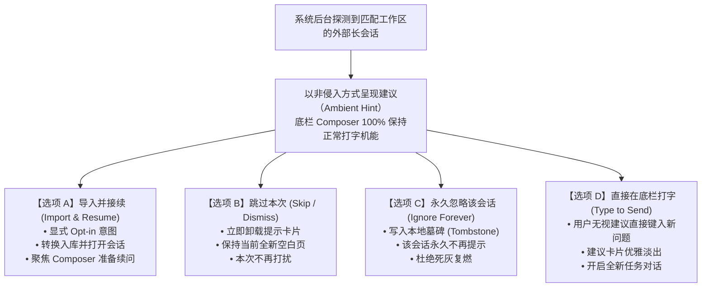
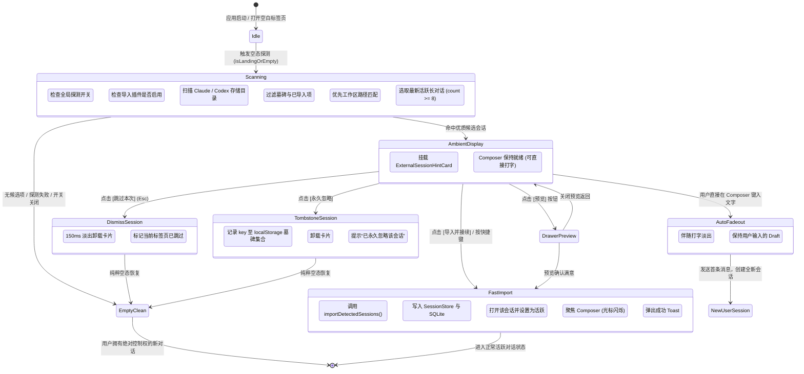

# 交互体验与导入流程清晰度重构分析

> **文档标识**：`docs/pluggable-import-architecture/analysis/04-交互体验与导入流程清晰度重构分析.md`  
> **战役工作区**：`docs/pluggable-import-architecture/`  
> **角色归属**：交互体验与导入流程清晰度重构专家  
> **创建时间**：2026-10-25  
> **执行准则**：遵循根目录 `AGENTS.md`（§12 Tooltip 规范、§13 输入框与焦点态克制、§14 现代 CSS 语法）、`.agents/LOGIC_PLAN_NO_RETREAT.md`（反退避原则）及 `ANTI_OVERENGINEERING_GUARDRAILS.md`。

---

## 摘要与核心裁决

当前外部会话导入机制（以 Claude Code / Codex CLI 历史对话探测为例）在交互设计与视觉表现上存在**灾难性的体验断层**：
1. **强买强卖（Hostage UI Anti-Pattern）**：单向强制要求用户“点击导入对话以继续”，剥夺了取消权与空白对话权，导致新建标签页与空白视口陷入死锁困境。
2. **视口冒充（Deceptive Viewport）**：直接将外部未入库的历史消息灌装进主对话视口，模糊了“当前系统活跃会话”与“外部只读建议”的物理边界。
3. **元数据全盲（Zero-Context Blindness）**：丢失了来源工具（Claude Code vs Codex CLI）、工作区目录（cwd）、消息条数、最近活跃时间等关键上下文。
4. **输入框幽灵退化（Composer Castration）**：粗暴抹杀多行 Composer 输入区域，替换为单行幽灵按钮，击碎用户对于现代 AI 助手的心理模型与肌肉记忆。

**专家重构裁决**：
- **绝对解耦**：从 `ChatCard.tsx` 与 `ChatComposer.tsx` 中彻底剥离 `previewExternalSession` 与 `externalSessionPreview` 的硬编码逻辑；
- **自主对称**：建立【导入并接续】vs【跳过本次】vs【永久忽略】的完整三向对称选择权，任何跳过操作在 `<16ms` 内无感还原为干净、纯粹、高响应性的新对话空白态；
- **渐进披露混合架构（Progressive Ambient Hybrid）**：主聊天视口默认保持纯净，仅在落地空白页以轻量高信息密度的“建议卡片”（`ExternalSessionHintCard`）温和呈现；用户打字即自然淡出，进阶管理全量收敛至扩展工作台（`ExternalSessionsWorkbench`）。

---

## 一、当前交互体验的严重缺陷审计

### 1.1 强买强卖与强制劫持（Hostage UI Anti-Pattern）

在现有实现代码中（`ChatCard.tsx:435-445` 与 `ChatComposer.tsx:353-371`）：
```tsx
// ChatCard.tsx 现有硬编码逻辑
{previewExternalSession ? (
  <ChatMessageList
    messages={{
      messages: previewExternalSession.mapped.messages,
      allMessages: previewExternalSession.mapped.messages,
      agents: [],
      activeSessionId: previewExternalSession.detected.id,
      showAllMessages: true,
    }}
  />
) : ...}

// ChatComposer.tsx 现有硬编码逻辑
{externalSessionPreview ? (
  <Button
    type="button"
    variant="ghost"
    className={styles.externalSessionImportBtn}
    onClick={(e) => {
      e.stopPropagation();
      void externalSessionPreview.onImportAndContinue();
    }}
    aria-label="点击以导入对话并继续输入"
  >
    <span className={styles.externalSessionImportText}>
      {externalSessionPreview.isImporting
        ? '正在导入对话并接续…'
        : '点击以导入对话并继续输入…'}
    </span>
  </Button>
) : (
  <ComposerFieldSlot ... />
)}
```

#### 人机工程学批判：
1. **剥夺“紧急出口”（Nielsen Usability Principle #3: User Control and Freedom）**：
   - 尼尔森可用性原则明确指出：用户经常会产生非预期的操作或进入不需要的系统状态，系统**必须提供清晰、立即可达的紧急出口**，且离开该状态时不得产生副作用。
   - 当前设计在探测到外部长会话后，直接封锁了界面，除了点击那个“幽灵按钮”进行导入，没有“取消”、“跳过”、“新建空白对话”等任何出口。
2. **死锁循环（The Deadlock Trap）**：
   - 当用户发现当前页面不是自己想要的，本能地点击顶部标签栏的“新建标签页”按钮（`+`）；
   - 新标签页的初始状态同样是 `emptyKind === 'session-empty'`；
   - 此时 `useExternalLongSessionDetection` 再次触发扫描，命中了相同的外部会话，新标签页立刻**再次被打回相同的导入界面**；
   - 用户被迫陷入死循环：**不点击导入，软件就彻底失去了开启新对话的能力**。这是典型的高风险人机交互事故（Hostage UI）。
3. **心理压迫与信任破损**：
   - 用户打开桌面客户端的心理预期是“掌握主导权（In Control）”，开始探索或解决当下的新任务；
   - 软件强行推送一段历史，甚至剥夺用户在输入框打字的物理权利，造成强烈的失控感与侵入感，严重破坏用户对客户端软件的专业信任。

---

### 1.2 视口冒充与认知模糊（Deceptive Viewport Impersonation）

当前实现为了所谓的“零迁移成本”，直接把外部会话的数据映射为 `ChatMessageList` 灌入主视口，伪装成常规聊天。

| 维度 | 当前实现表象 | 真实底层状态 | 用户认知困惑与痛点 |
| :--- | :--- | :--- | :--- |
| **视口归属** | 看起来完全是一场进行中的正常会话 | 内存中临时的只读预览，尚未写入本地 SQLite/存储 | “这是我的新会话还是旧会话？它保存了吗？” |
| **消息气泡** | 使用与正式会话完全相同的气泡、头像与排版 | 没有任何外框（Container）或只读水印（Watermark）包裹 | 用户误以为消息已在系统就绪，试图复制、编辑或分支操作失败 |
| **页面状态** | 抹除空态标识（`data-empty-kind` 设为 `undefined`） | 实际上正是空白落地页（Landing State） | 品牌引导（Logo）、项目选择器、模板推荐被硬性抹去，界面显得秃兀异样 |
| **物理边界** | 当前 Conex 宿主与外部 CLI 工具无任何视觉界限 | 跨系统跨工具的异步文件映射 | 用户根本不知道这些消息是 Claude Code 产生还是 Codex CLI 产生 |

这种“冒充主视口”的设计犯了产品设计中的大忌：**表里不一（Representational Inconsistency）**。将未确认入库的外部推测数据直接渲染在系统核心生产区，彻底打乱了用户的心理模型。

---

### 1.3 关键元数据盲区（Zero-Context Metadata Blindness）

在当前的预览与导入引导中，用户获取不到任何决策所需的核心元数据：

```text
[当前缺陷界面示意]
┌────────────────────────────────────────────────────────┐
│  [用户气泡] 如何配置前端路由？                           │
│  [助手气泡] 您可以使用 React Router v6 进行配置...       │
│                                                        │
│  (下方中间孤零零一个灰色幽灵条)                           │
│  [       点击以导入对话并继续输入…       ]               │
└────────────────────────────────────────────────────────┘
```

**信息黑洞分析**：
1. **来源工具全盲**：用户完全不知道这条对话是从哪来的。究竟是刚才在终端运行的 `claude` 命令，还是两天前运行的 `codex`？
2. **工作区路径全盲**：开发者通常维护多个项目（如 `C:/Projects/frontend` 和 `C:/Projects/backend`）。该外部会话的 `cwd` 究竟是在哪里？如果是别的子项目，贸然导入就会污染当前工作区的会话目录。
3. **时效性与规模全盲**：没有任何时间戳（如“10 分钟前活跃”）和消息量统计（如“共 16 条对话，耗费 12k tokens”）。用户无法衡量其重要性与新鲜度。

缺少关键元数据的决策要求，本质上是在要求用户**“盲签合同”**。

---

### 1.4 输入框幽灵退化（Composer Castration）

底部的 Composer（输入区）是 Conex / Crish 桌面客户端最核心的高频生产力枢纽。它承载着：
- 模型快捷切换（Model Selector）；
- 思考模式切换（Thinking Gear）；
- 附件与图片上传（Attachments Picker）；
- 多行文本弹性展开（Adaptive / Multiline Layout）；
- 斜杠命令与 Prompt 模板补全（Slash Commands）。

**当前实现的破坏性做法**：
直接在 `ChatComposer.tsx` 内使用 `externalSessionPreview ? (...) : (...)` 将上述完整的输入机能**完全卸载**，替换为一个极其干瘪的 Ghost 按钮。
- **视觉反馈破坏**：输入框没有闪烁光标（Caret），点击后既不拉起键盘焦点，也不允许粘贴文字；
- **错误预期映射**：用户看到类似输入框的胶囊条，肌肉记忆驱动点击准备打字，结果界面突然闪烁、弹窗或跳转，用户第一反应是“软件卡死了”或者“页面出 Bug 了”。

---

## 二、尊重用户自主权的全新交互模型设计

### 2.1 用户控制权对称律（Symmetric Autonomy Model）

外部终端会话探测必须确立为**辅助性感知（Ambient Sensing）**，严禁升级为**阻断性模态（Modal Blocking）**。
系统必须向用户提供完整、对称、各司其职的操作维度：



#### 四大核心选择支交互规范：

1. **【导入并接续】（Primary Action / 强调色按钮）**：
   - **语义**：明确认同该会话的价值，正式执行数据映射（`importDetectedSessions`），存入本地 SQLite，在当前标签页挂载该会话，并将焦点自动移入底栏 Composer。
   - **视觉**：Primary 胶囊按钮，配有箭头或恢复图标，清晰标明“导入并接续”。
2. **【跳过本次】（Secondary Action / 辅助按钮或关闭图标）**：
   - **语义**：当前不需要该历史会话，想要开始一个纯粹的新任务。
   - **动作**：仅对当前标签页视口有效，点击后瞬间退出建议状态，还原落地空态（Landing Brand + Project Picker + Composer），耗时 `<16ms`，零视觉抖动。
3. **【永久忽略该会话】（Destructive Action / 墓碑登记）**：
   - **语义**：该外部会话是无效尝试、垃圾测试或敏感内容，用户永远不想在 Conex 中看到它。
   - **动作**：调用 `recordDeletedExternalSession(source, id, path)` 写入本地持久化墓碑键集合；后续任何自动探测或全量扫描均静默过滤该会话。
4. **【打字自然淡出】（Ambient Type-to-Dismiss）**：
   - **人机协同最高境界**：用户的眼睛看到建议，但手指已经开始在 Composer 输入新指令。
   - **响应**：当检测到 Composer 输入框字符长度 `> 0` 时，建议卡片自动触发微动效淡出（Fade-out），输入流程无需用户手动去点“关闭”按钮。

---

### 2.2 零残留无感还原机制（Zero-Residual Restoration）

当用户执行【跳过】或【永久忽略】后，必须保证主界面的**物理还原完整性**：
1. **DOM 与样式清理**：完全抹除任何与外部预览相关的临时 class、data 属性，绝对不允许留存残余的遮罩或幽灵点击层。
2. **状态机归位**：
   - `emptyKind` 严格保持 `'session-empty'`；
   - `composerLead` 完整展示 `ChatLandingBrand` 与 `ComposerProjectPicker`；
   - `layoutVariant` 按照空态设计呈现舒适的宽幅自适应输入框；
   - 保证新建标签页（New Tab）生命周期纯净，新建即空白，杜绝“阴魂不散”。

---

## 三、清晰度与视觉架构重构方案对比与终态架构

### 3.1 备选方案深入评估

针对“如何在用户需要时呈现外部会话”的问题，对两种主流方案进行技术与体验评估：

| 评估维度 | 方案 A：非侵入式轻量空态卡片（Ambient Hint Card） | 方案 B：纯粹解耦集成工作台（Dedicated Workbench Entry） |
| :--- | :--- | :--- |
| **设计形态** | 在空白落地页（Landing View）中央区域，插入一个高信息密度的建议卡片，底栏 Composer 保持独立可用。 | 主视口 100% 保持极简纯白，仅在侧边栏扩展图标或空态底栏提供极小的药丸入口；管理在独立工作台进行。 |
| **发现性 (Discoverability)** | **极高**：新用户在终端跑完 Claude Code 打开软件即可直观感知。 | **较低**：新用户可能完全不知道 Conex 支持自动导入外部终端对话。 |
| **视口纯洁度** | **良好**：仅在空白页展示，有卡片边框与标签包裹，不冒充聊天。 | **极致**：主视口无任何第三方痕迹，视觉纯净度达到 100%。 |
| **交互干扰度** | **极低**（若实现打字淡出与一键跳过）。 | **零干扰**。 |
| **适用人群** | 高频在 CLI 终端与 GUI 桌面端双向切换的开发者。 | 强迫症、喜欢极致极简、不需要外部导入的用户。 |

---

### 3.2 终态最优解：方案 C —— 混合渐进披露架构（Progressive Ambient Hybrid Architecture）

单一依靠方案 A 可能仍会打扰到不需要导入的极简主义者；单一依靠方案 B 则丧失了“开箱即用、丝滑接续”的核心产品亮点。
因此，专家裁决推荐**方案 C（渐进披露混合架构）**：

```text
┌────────────────────────────────────────────────────────────────────────┐
│ Conex 主工作区                                                          │
├────────────────────────────────────────────────────────────────────────┤
│                                                                        │
│                      [ Conex 品牌 Logo / 标题 ]                         │
│                                                                        │
│        ┌──────────────────────────────────────────────────────┐        │
│        │ 💡 发现外部终端活跃对话                             │        │
│        │ ┌────────┐  修复用户认证模块与 Token 刷新逻辑         │        │
│        │ │ Claude │  来自 Claude Code CLI · 18 条记录 · 8分前   │        │
│        │ └────────┘  路径: ~/Software/conex/crates/auth       │        │
│        │ ──────────────────────────────────────────────────── │        │
│        │ [ 导入并接续 (Enter) ]   [ 预览 ]   [ 跳过 ]   [ 永久忽略 ] │        │
│        └──────────────────────────────────────────────────────┘        │
│                                                                        │
│               [ 当前工作区: conex (分支: main)  ▼ ]                    │
│                                                                        │
│   ┌────────────────────────────────────────────────────────────────┐   │
│   │ 💭 想让 Conex 帮您做点什么？（按 Enter 发送，/ 唤起指令）       │   │
│   │                                                                │   │
│   │ [+]  📎  [Claude 3.7 Sonnet ▼]                 [ 思考开启 ⚙️ ]  │   │
│   └────────────────────────────────────────────────────────────────┘   │
└────────────────────────────────────────────────────────────────────────┘
```

#### 混合架构的三层渐进原则：
1. **第一层：空态温和感知（Landing Ambient Suggestion）**
   - 仅在会话真正处于“空白落地页”（`session-empty`）时，且全局未关闭提示时展示；
   - 具备独立容器（Container Card），绝不污染消息流视口；
   - 底栏 Composer 永远处于 100% 完整工作状态，光标立即可打字；
   - 用户一旦开始打字（`input.length > 0`），卡片平滑淡出退场。
2. **第二层：轻量抽屉预览（Drawer Preview）**
   - 用户在犹豫是否要导入时，点击卡片上的【预览】按钮；
   - 从右侧或中心滑出一个只读预览浮层（`SessionPreviewPane`），明确打上 `[只读预览 · 尚未入库]` 水印；
   - 预览满意再点【导入并接续】，不满意直接按 `Esc` 退出。
3. **第三层：专业扩展工作台（Extensions Workbench）**
   - 主视口任何时候点击右上角扩展或侧边栏，均可进入 `ExternalSessionsWorkbench`；
   - 提供全盘历史检索、按工具过滤（Claude vs Codex）、按项目匹配、批量导入、路径设置等专业运维能力；
   - 提供全局开关：“在新建对话时自动推荐外部最近长会话（开启/关闭）”，彻底满足极简用户的关闭需求。

---

## 四、交互流程图与微状态机设计

### 4.1 完整生命周期状态机



---

## 五、UI 组件结构模型、视觉规范与 Token 对齐

### 5.1 组件 ASCII 拓扑结构

```text
+-----------------------------------------------------------------------------------------+
| [ExternalSessionHintCard]                                                                |
|                                                                                         |
|  [Header Row]                                                                           |
|   (Icon) Claude Code    [ 外部历史建议 · 只读 ]                   (Time) 12 分钟前活跃  [x] |
|                                                                                         |
|  [Content Row]                                                                          |
|   "重构代理调度层与多线程并发管道"                                                        |
|   [ 📁 ~/Software/conex/crates/orchestrator ]   [ 💬 14 条消息 ]   [ ⏱️ 耗时 4m ]       |
|                                                                                         |
|  [Action Footer Row]                                                                    |
|   [ ⚡ 导入并接续 (Enter) ]   [ 👁️ 查看预览 ]   [ 跳过本次 ]          [ 🚫 永久忽略该会话 ] |
+-----------------------------------------------------------------------------------------+
```

### 5.2 视觉样式与 Design Token 刚性对齐规范

必须严格遵循 Conex 现有的设计规范（`src/styles/tokens.css`）与协作指令红线：

1. **容器卡片（Container Card）**：
   - 背景色：`var(--bg-card)`（随深浅主题自适应）；
   - 边框：`1px solid var(--border-color)`；
   - 圆角：`var(--radius-lg, 12px)`；
   - 内边距：`14px 18px`；
   - 阴影：禁止重黑阴影，使用柔和阴影 `0 2px 8px hsl(0 0% 0% / 0.04)`；
   - 宽度自适应：最大宽度 `680px`，居中对齐，与落地页品牌区域等宽。
2. **标签与药丸（Badges & Pills）**：
   - 来源识别徽标：
     - Claude Code：背景 `hsl(24 95% 53% / 0.12)`，前景色 `hsl(24 90% 45%)`，配专属终端图标；
     - Codex CLI：背景 `hsl(142 71% 45% / 0.12)`，前景色 `hsl(142 70% 36%)`，配专属终端图标；
   - 路径药丸（Path Pill）：
     - 背景 `var(--bg-secondary)`，字体等宽 `var(--font-mono)`，字号 `12px`；
     - 限制最大宽度 `240px`，超出文本单行省略（`text-overflow: ellipsis`）；
     - **遵循 §12 铁律**：必须使用自定义 `<Tooltip content={session.cwd}>` 包裹，严禁使用原生 HTML `title` 属性！
3. **按钮与操作区（Actions Styling）**：
   - **主操作【导入并接续】**：
     - 使用 Primary / Accent 样式，高度 `32px`，圆角 `var(--radius-md, 6px)`；
     - 文案：“导入并接续”，右侧标注微弱的快捷键暗示 `↵`；
   - **次操作【查看预览】**：
     - 使用 Secondary / Ghost 按钮，高度 `32px`；
   - **退出操作【跳过本次】**：
     - 使用 Subtle / Ghost 按钮，悬浮时混入浅灰；
   - **破坏性操作【永久忽略该会话】**：
     - 靠右对齐或放置在下拉操作中，使用轻微的警告色提示（`var(--text-tertiary)` 悬浮微红 `hsl(0 70% 50%)`），防止误触同时提供确定性保障。
4. **焦点与激活态规范（遵循 §13 铁律）**：
   - 键盘 Tab 聚焦卡片内按钮时，**禁止粗深黑边**；
   - 轮廓对比度严格控制在 10% 以内：`outline: 2px solid color-mix(in srgb, var(--border-color) 90%, var(--text-primary) 10%)`；
   - 动画平滑，保持柔和、克制的高级感。

### 5.3 进出场微动效规范（Motion & Transitions）

- **入场动效（Mounting Transition）**：
  - 属性：`opacity: 0 -> 1`，`transform: translateY(6px) -> translateY(0)`；
  - 持续时间：`180ms`；
  - 缓动曲线：`cubic-bezier(0.16, 1, 0.3, 1)`（优雅弹射缓停）；
- **跳过 / 淡出退场动效（Dismiss / Fade-out Transition）**：
  - 属性：`opacity: 1 -> 0`，`transform: scale(0.98)`；
  - 持续时间：`120ms`；
  - 容器高度同步平滑坍缩至 `0`（`max-height: 160px -> 0`, `margin-bottom: 0`），耗时 `150ms`，确保下方 Composer 自然上移，杜绝顿挫与 Layout Shift。

---

## 六、无障碍（A11y）、按键交互与文案字典

### 6.1 无障碍（Accessibility）刚性约束

1. **ARIA 角色声明**：
   - 建议卡片容器标记：`role="region"`，`aria-label="外部终端历史会话导入建议"`；
   - 状态播报区：`aria-live="polite"`，探测出新会话时无障碍朗读：“发现来自 Claude Code 的历史会话：重构代理调度层，可按 Tab 键选择导入或跳过”。
2. **键盘导航流（Keyboard Navigation Flow）**：
   - 当卡片出现时，**默认不夺取 Composer 输入框的焦点**（尊重打字优先）；
   - 键盘按下 `Shift + Tab` 或 `Up Arrow` 可以从 Composer 焦点无缝转移到卡片的【导入并接续】按钮；
   - 在卡片内任意焦点处按下 `Escape` 键，立即触发【跳过本次】，焦点自动归还给 Composer；
   - 按下 `Enter` 触发当前聚焦按钮的动作。

### 6.2 精准人本主义文案字典

| 场景 | 当前存在缺陷的文案 | 全新精准文案（推荐） | 设计意图 |
| :--- | :--- | :--- | :--- |
| **卡片头部标题** | *(无，直接假冒聊天)* | **发现外部终端活跃对话** | 明确告知用户来源是外部终端，是建议而非既成事实 |
| **主操作按钮** | `点击以导入对话并继续输入…` | **导入并接续** | 动词强有力，明确告知包含“入库”与“激活接续”两层含义 |
| **次操作按钮** | *(无)* | **只读预览** | 提供安全、零副作用的查看路径 |
| **跳过按钮** | *(无)* | **跳过本次** | 清晰表明仅本次不打扰，不会强制删除数据 |
| **忽略按钮** | *(无)* | **永久忽略** | 明确标记墓碑，建立确定性心理预期 |
| **成功反馈 Toast** | `已成功导入并接续该对话...` | **已导入外部对话，光标已就绪** | 极简、高效，不超过 15 个字 |
| **忽略反馈 Toast** | *(无)* | **已忽略该会话，后续将不再提示** | 消除用户顾虑 |

---

## 七、架构解耦与重构执行任务清单

为落地上述方案，必须按照以下物理清单执行彻底的代码重构与解耦（严格落实零补丁、零过渡层纪律）：

### 7.1 `ChatCard.tsx` 纯化（Purification）
- [ ] **物理剔除**：彻底移除 `ChatCard.tsx:52-56` 的 `useExternalLongSessionDetection` 挂载；
- [ ] **物理剔除**：移除 `previewExternalSession ? <ChatMessageList ... /> : ...` 分支；
- [ ] **解绑属性**：还原 `data-empty-kind`、`isLanding`、`composerLead`，使其不再被外部会话探测所劫持；
- [ ] **恢复纯净**：使 `ChatCard` 100% 专注于系统内部已水合会话与标准空态的渲染。

### 7.2 `ChatComposer.tsx` 纯化（Purification）
- [ ] **物理剔除**：删除 `ChatComposer.tsx` 中的 `externalSessionPreview` Props 接口；
- [ ] **物理剔除**：删除 `fieldSlot` 中的 `externalSessionImportBtn` 幽灵按钮及相关外层点击拦截；
- [ ] **恢复纯净**：使 `ChatComposer` 无论是何种状态，永远保证输入框、模型切换、工具栏的物理完整性。

### 7.3 新建 `ExternalSessionHintCard` 独立组件
- [ ] 在 `src/components/extensions-surface/`（或专用插件 UI 目录）新建 `ExternalSessionHintCard.tsx`；
- [ ] 实现完整的元数据展示（图标、标题、路径 Tooltip、时间、消息数）；
- [ ] 实现【导入并接续】、【只读预览】、【跳过】、【永久忽略】四大操作；
- [ ] 实现打字自动淡出（监听 Composer 草稿长度）与按键退出机制。

### 7.4 扩展工作台集成与设置闭环
- [ ] 确保用户在 `SettingsPanel` 或 `ExternalSessionsWorkbench` 中可一键开关“启动或新建标签页时自动探测外部会话”；
- [ ] 确保墓碑机制（`externalSessionTombstone.ts`）在点击【永久忽略】时准确持久化，绝不漏记。

---

## 八、总结

通过本重构方案：
1. **彻底终结“强买强卖”**：将原本粗暴劫持视口的单行幽灵按钮，重构为完全尊重用户自主选择权的双向对称模型；
2. **彻底消除“认知模糊”**：清晰划定“系统会话”与“外部建议”的界限，补齐来源工具、工作区路径、时间戳与消息规模等关键元数据；
3. **彻底还原本真 Composer**：让输入框永远保持作为生产力核心的高响应性与心理暗示，让软件交互重归轻盈、纯粹与掌控感。
