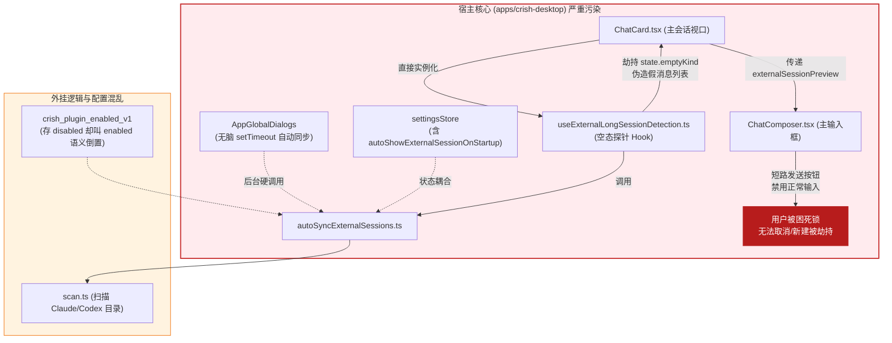
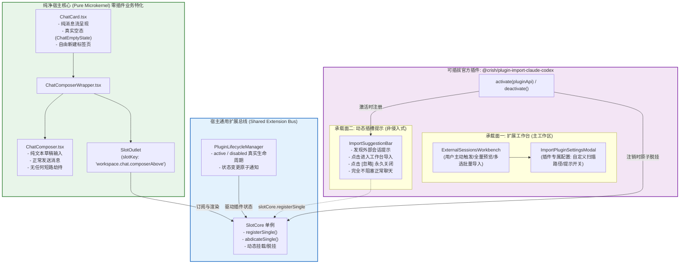
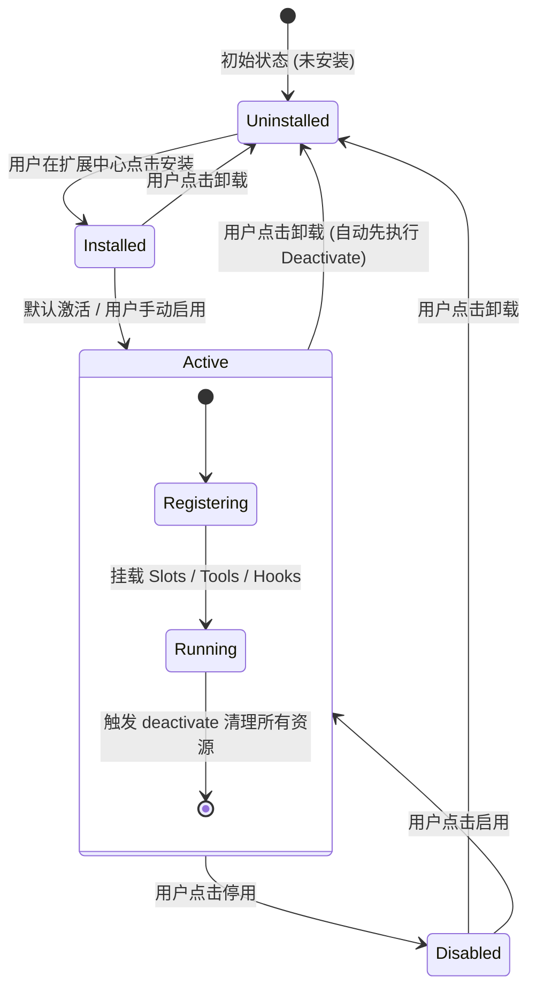

# 05 - 可插拔插件架构与扩展插槽方案设计

> **方案定位**：解密导入插件焊死寄生反模式，建立现代微内核（Microkernel）与动态插槽驱动（Slot-Driven）的可插拔扩展架构  
> **权威遵循**：根目录 `AGENTS.md`、`.agents/LOGIC_PLAN_NO_RETREAT.md`、`ANTI_OVERENGINEERING_GUARDRAILS.md`  
> **核心原则**：零补丁、零过渡层、零多版本。坚决清除寄生于核心 UI 的业务特化代码，推导架构净收敛。

---

## 1. 架构总纲与设计哲学

在现代软件工程中，宿主核心（Host Core）与插件扩展（Extensions/Plugins）之间的关系必须遵循 **“微内核 + 扩展插槽（Microkernel & Extension Slots）”** 架构范式：

1. **宿主核心零业务特化**：
   宿主界面（`ChatCard`、`ChatComposer`）只负责自身的本质职责——呈现活动会话的消息流、处理用户输入与发送交互、承载基础状态机。宿主核心代码中**绝对不允许出现任何特定插件、特定导入业务或第三方数据源的类名、字段名、Hook 或条件分支**。
2. **插件生命周期自包含**：
   插件是一个独立、自治且可热拔插的实体。插件的安装、启用、激活、停用、卸载拥有严密的单向状态机。
   - **激活时（Active）**：通过宿主开放的标准契约（`slotCore`、`viewRegistry`、`toolCore`）动态挂载 UI 与行为；
   - **停用时（Disabled / Uninstalled）**：**原子级收回所有注册资源**（插槽自动脱挂、后台定时器注销、I/O 监听断开），系统瞬时回退至宿主纯净默认态。
   - **静默零开销（Zero Overhead）**：处于未安装或禁用状态的插件，**绝对不消耗 1 字节磁盘扫描 I/O、不占用 1 个后台 Timer、不在 DOM 树中遗留任何冗余节点与判断**。
3. **用户自主权优先（Pull Model vs Push Hijacking）**：
   数据导入属于**重度变更性操作**，必须由用户显式触发（Pull），严禁未经明确授权的静默后台写入；即使存在环境感知与发现机制，也必须作为**轻量、非阻塞、可关闭的提示条（Suggestion Banner）**呈现在输入框上方插槽，**严禁劫持新建标签页、严禁篡改主消息流、严禁短路用户正常输入与发送行为**。

---

## 2. 现状寄生病灶与彻底解耦清单

### 2.1 现状耦合病灶透视

当前代码中，外部对话导入功能（Claude Code / Codex）表面上标榜为“官方插件”，但实际上却以最粗暴的“寄生打补丁”形式焊死在宿主核心深处，构成了四重严重的架构断层：

```
                 [ 当前焊死寄生反模式 ]
┌────────────────────────────────────────────────────────┐
│ AppGlobalDialogs (宿主根组件)                          │
│   └─► useEffect: 启动 1500ms 盲目静默 autoSync 扫描     │
└────────────────────────────────────────────────────────┘
                           │
┌────────────────────────────────────────────────────────┐
│ settingsStore (全局宿主配置)                           │
│   └─► autoShowExternalSessionOnStartup 字段污染         │
└────────────────────────────────────────────────────────┘
                           │
┌────────────────────────────────────────────────────────┐
│ ChatCard (核心会话视口)                                │
│   ├─► useExternalLongSessionDetection (空态探针 Hook)  │
│   ├─► previewExternalSession ? 偷梁换柱伪装假消息流    │
│   └─► externalSessionPreview 强行穿透 Props Drilling   │
└────────────────────────────────────────────────────────┘
                           │
┌────────────────────────────────────────────────────────┐
│ ChatComposer (核心输入组件)                            │
│   ├─► externalSessionPreview Props 污染                │
│   ├─► 输入框被劫持替换为“导入并接续对话”按钮           │
│   └─► Enter 发送动作被短路拦截为 onImportAndContinue   │
└────────────────────────────────────────────────────────┘
```

#### 病灶 1：`ChatCard.tsx` 的假会话偷梁换柱与空态探针（L36, L52-56, L215, L435-442）
- **现象**：`ChatCard` 强行导入 `useExternalLongSessionDetection`。在会话处于 `session-empty` 或 `no-session` 空态时，后台异步调用文件系统扫描。
- **劫持机制**：一旦探测到外部历史会话，`previewExternalSession` 变为真，`ChatCard` 强制将 `emptyKind` 覆写为 `null`，并将原本真实的 `ChatMessageList` 替换为一个假的数据载荷映射，制造“该会话已存在”的视觉假象。
- **死锁后果**：用户点击“新建标签页”希望开启全新空白会话，但新建标签页必然经历 `session-empty` 空态；空态再次触发探针，再次返回该外部长对话，导致新建标签页瞬间被偷换为待导入状态，**形成新建标签页死锁**。

#### 病灶 2：`ChatComposer.tsx` 的单一职责破坏与行为劫持（L90, L348-367, L449-456）
- **现象**：`ChatComposer` 接受 `externalSessionPreview` 属性。
- **劫持机制**：在渲染时，输入区域直接被分支判断替换为大块提示文案和“导入并接续对话”按钮；用户无法正常输入文本。更严重的是，在底栏发送按钮逻辑中，直接硬编码：
  ```tsx
  if (externalSessionPreview) {
    void externalSessionPreview.onImportAndContinue();
    return;
  }
  ```
  输入框的发送热键和发送按钮被彻底篡改为插件导入执行器。

#### 病灶 3：`settingsStore.ts` 的全局 AppSettings 字段污染（L53, L75, L140）
- **现象**：`AppSettings` 核心类型中直接混入了 `autoShowExternalSessionOnStartup: boolean`，并在初始化配置、持久化同步和变更 action 中深度绑定。
- **危害**：宿主配置与具体插件私有配置同居，破坏了宿主状态机的纯粹性；其他平台端（如 crish-mobile）也被迫继承无意义的桌面导入字段。

#### 病灶 4：`AppGlobalDialogs.tsx` 与后台静默 Timer（L8, L97-103）
- **现象**：全局对话框管理器在 `activeWorkspaceId` 变更或启动时，通过 `setTimeout` 无条件调用 `checkAndAutoSyncExternalSessions()`。
- **危害**：不论插件是否处于禁用状态、不论用户是否有导入意图，后台都在频繁产生未授权的跨目录文件 I/O 扫描。

---

### 2.2 彻底删除与物理清除清单（零容忍）

按照用户“不要兼容、不要打补丁，需要删除代码就删除，需要重构就重构”的最高裁决，以下代码必须**彻底从宿主核心物理清除**，严禁使用 `// deprecated` 保留兼容层：

| 文件路径 | 清除目标（代码 / 函数 / 字段） | 解耦后宿主形态（纯净形态） |
| :--- | :--- | :--- |
| `apps/crish-desktop/src/components/chat-card/useExternalLongSessionDetection.ts` | **整个文件彻底物理删除** | 外部会话探测移入插件自身的独立服务，宿主不再持有此 Hook。 |
| `apps/crish-desktop/src/components/chat-card/ChatCard.tsx` | ① 删除 `useExternalLongSessionDetection` 导入与调用；<br>② 删除 `previewExternalSession` 相关的短路判断与假消息流分支；<br>③ 删除向下游传递的 `externalSessionPreview` prop。 | `ChatCard` 恢复为纯粹的会话呈现容器：空态即展示 `ChatEmptyState`，有消息即呈现 `ChatMessageList`。 |
| `apps/crish-desktop/src/components/chat-card/ChatComposerWrapper.tsx` | ① 删除 `externalSessionPreview` 相关 props 与注释；<br>② 确保只通过标准 `SlotOutlet` 挂载 `workspace.chat.composerAbove`。 | 输入框包装器只负责标准 Ribbons 审批坞与标准插槽渲染。 |
| `apps/crish-desktop/src/components/chat-composer/ChatComposer.tsx` | ① 删除 `externalSessionPreview` prop 声明与解构；<br>② 删除第 348-367 行的劫持渲染分支；<br>③ 删除第 449-456 行对发送按钮的短路拦截。 | `ChatComposer` 恢复单一职责：只负责文本草稿、附件、模型控制与正常发送事件触发。 |
| `apps/crish-desktop/src/components/chat-composer/composerTypes.ts` | 删除 `ChatComposerProps` 中的 `externalSessionPreview` 字段定义。 | 输入组件类型契约彻底脱敏。 |
| `apps/crish-desktop/src/store/settingsStore.ts` | ① 删除 `AppSettings` 中的 `autoShowExternalSessionOnStartup` 字段；<br>② 删除 `initialSettings` 默认值与 `setAutoShowExternalSessionOnStartup` action。 | 全局 AppSettings 回归纯粹的系统/外观/核心行为配置。 |
| `apps/crish-desktop/src/app/AppGlobalDialogs.tsx` | 删除 `checkAndAutoSyncExternalSessions` 引用及其 `useEffect` 定时触发器（L8, L97-103）。 | 宿主根容器不再发起任何盲目外部扫描。 |
| `apps/crish-desktop/src/components/chat-card/__tests__/useExternalLongSessionDetection.test.ts` | **彻底物理删除** | 宿主视口不再存在该 hook，无需针对该 hook 进行单元测试。 |
| `apps/crish-desktop/src/components/chat-card/__tests__/ChatCard.previewExternalSession.test.tsx` | **彻底物理删除** | 宿主视口不再存在假消息预览逻辑。 |

---

## 3. 解耦前后架构拓扑对比图

### 3.1 【解耦前】焊死寄生式拓扑（反模式）



### 3.2 【解耦后】基于 SlotCore 与 ViewRegistry 的现代可插拔拓扑



---

## 4. 规范的可插拔扩展承载机制设计

官方导入插件（`@crish/plugin-import-claude-codex`）应当作为**完全独立、可热插拔的一等公民扩展**存在。系统为其提供两个规范的承载面，各司其职，彻底杜绝越界侵入：

### 4.1 承载面一：一等公民扩展工作台（`ExternalSessionsWorkbench`）

这是会话导入功能的**核心宿主工作台**，采用纯粹的用户主动拉取模式（Pull Model）：

1. **入口呈现**：
   - 用户在系统扩展管理面板（`ExtensionsMainSurface`）的“会话导入”侧栏项或插件卡片的“打开工作台”按钮显式进入。
   - 处于独立的一级主视口容器内，拥有完整的屏幕空间，不再挤占聊天窗口。
2. **核心能力集**：
   - **主动按需扫描**：点击“扫描”或选择目录后才执行文件系统 I/O，绝不在后台常驻轮询。
   - **瞬时水合与高效缓存**：首次加载消费 `externalSessionCache`，展示最近一次扫描快照，0ms 瞬时渲染。
   - **深度筛选与工作区对齐**：支持“当前工作区关联 / 全部来源 / Claude Code / Codex CLI”快速切换。
   - **双栏交互（列表 + 预览）**：左侧展示会话列表、更新时间、消息数量、工作区路径；右侧 `SessionPreviewPane` 渲染解析后的真实对话气泡流，清晰标注来源工具与上下文。
   - **批量与单独导入**：用户可以逐条导入，也可以多选后一键导入到对应工作区，并自动建立会话映射（`importMeta`）。
   - **墓碑机制保证（Tombstone Guarantee）**：用户删除已导入的会话时，记录墓碑（Tombstone），后续扫描中明确标记为“已导入且已被用户删除”，坚决不反复提示、坚决不死灰复燃。
3. **专属设置抽屉（`ImportPluginSettingsModal`）**：
   - 属于插件私有视口：配置 Claude 配置文件路径、Codex 安装根目录、是否启用“工作区外部会话感知提示条”。
   - 提供“一键清空所有已导入会话”的危险操作双重确认，绝不将这些配置渗透进宿主全局设置。

---

### 4.2 承载面二：基于 `slotCore` 的动态非侵入式插槽提示条

当用户在插件专属设置中开启了“空闲时感知外部长会话”时，插件绝不能直接修改 `ChatCard` 的 DOM 或 state，而是**通过宿主提供的标准浮动插槽契约（`workspace.chat.composerAbove`）挂载独立的轻量提示条**：

#### 4.2.1 插槽契约扩充（Declaration Merging）
利用宿主现有的 `SlotCore` 机制，在插件或扩展域中扩充插槽类型声明，实现类型安全的动态插槽契约：

```typescript
// packages/plugin-import-claude-codex/src/ui/importSuggestionSlot.ts
import type { ChatComposerAboveProps } from 'apps/crish-desktop/src/components/chat-card/chatComposerAboveProps';

declare module 'apps/crish-desktop/src/services/view-registry/SlotTypes' {
  interface SlotMap {
    'workspace.chat.composerAbove': {
      kind: 'single';
      ownerProps: ChatComposerAboveProps;
    };
  }
}
```

#### 4.2.2 提示条组件设计：`ImportSessionSuggestionBar`
该组件被注册为 `workspace.chat.composerAbove` 插槽的渲染体，具备以下关键行为规范：

1. **绝对非阻塞（Non-Blocking）**：
   - 仅仅是一个高度可控的柔和横幅，悬浮在 Composer 输入框上方（与审批通知坞 `ApprovalDock` 同层或串行排列）。
   - 宿主 `ChatCard` 的主消息区域、空态占位、Composer 输入框、发送按钮保持 100% 正常可交互。用户想聊新话题，直接打字回车，完全不受任何阻碍！
2. **上下文清晰可见**：
   - 横幅清晰展示：“在当前工作区探测到 Claude Code 活跃对话（24 条消息，最后更新于 5 分钟前）”。
   - 操作选项对等提供：
     - **【一键导入并接续】**：执行静默映射写入，完成后自动切换至该会话并聚焦输入框；
     - **【在工作台预览】**：打开 `ExternalSessionsWorkbench` 展开完整消息流供用户审阅；
     - **【忽略此对话】**：将该外部会话加入临时忽略集合，提示条立刻淡出消失，本次会话周期内不再打扰。
3. **动态安全注销（Graceful Abdication & Unregister）**：
   - 组件挂载在 `SlotOutlet` 内，自带 `AppErrorBoundary` 保护。若插件解析出错，`slotCore.abdicateSingle` 自动触发退位，宿主界面绝不受损。
   - 当插件被禁用时，注销句柄被触发，横幅瞬间在 DOM 中消失，零残留。

---

## 5. 插件生命周期与状态治理（Lifecycle & Storage SSOT）

### 5.1 痛点破除：破除语义倒置与真实运行期脱节

在历史代码中：
1. `RUNTIME_CACHE_KEYS.PLUGIN_ENABLED` 的 Storage Key 为 `'crish_plugin_enabled_v1'`。但在 `pluginRegistryAdapter.ts` 中，代码把存入的集合当成“停用黑名单”（`if (enabled) s.delete(id); else s.add(id);`），导致 Key 叫 `enabled`、内容存 `disabled`，极易引起混淆。
2. `pluginRegistryAdapter` 是一个静态硬编码对象，与后台真实执行机制脱节。在 `autoSyncExternalSessions.ts`、`AppGlobalDialogs.tsx`、`useExternalLongSessionDetection.ts` 中充斥着散落的 `isPluginEnabled` 检查，甚至直接跳过检查。

### 5.2 规范化插件生命周期状态机

现代插件架构必须确立严谨的五态生命周期状态机（Single Source of Truth）：



### 5.3 插件激活与注销标准契约

插件必须向系统提供标准生命周期导出：

```typescript
// packages/plugin-import-claude-codex/src/activate.ts
import { slotCore } from 'apps/crish-desktop/src/services/view-registry';
import { ImportSessionSuggestionBar } from './ui/ImportSessionSuggestionBar';

export interface PluginContext {
  pluginId: string;
  storage: PluginStorageFacade;
  log: (level: 'info' | 'warn' | 'error', message: string, meta?: unknown) => void;
}

let activeDisposables: Array<() => void> = [];

/**
 * 插件激活入口：仅在插件处于 Active 状态时由宿主 PluginLifecycleManager 调度
 */
export function activate(ctx: PluginContext): () => void {
  // 1. 若配置开启了插槽提示，则动态挂载到 workspace.chat.composerAbove 插槽
  const unregisterSlot = slotCore.registerSingle('workspace.chat.composerAbove', {
    id: 'import-suggestion-banner',
    component: ImportSessionSuggestionBar,
    priority: 10, // 低优先级，避免挤占高优先级的安全审批条 (ApprovalDock)
  });
  activeDisposables.push(unregisterSlot);

  // 2. 注册可供模型调用的只读纯函数工具（parse-claude-code-jsonl 等）
  // ...

  // 返回原子注销闭包
  return () => {
    activeDisposables.forEach((dispose) => {
      try {
        dispose();
      } catch (err) {
        console.error(`[Plugin:${ctx.pluginId}] Dispose error:`, err);
      }
    });
    activeDisposables = [];
  };
}

/**
 * 插件停用入口：宿主禁用或卸载时刚性调用
 */
export function deactivate(): void {
  activeDisposables.forEach((dispose) => dispose());
  activeDisposables = [];
}
```

### 5.4 零开销准则（Zero-Overhead Inactivity）

必须在宿主层面落地刚性红线：
1. **Disabled 状态完全静止**：
   - 不加载插件的 UI 代码包（通过 Vite 动态 `import()` 懒加载隔离）；
   - 不启动任何扫描 Timer，不执行任何 `fs.watch` 或目录遍历；
   - 宿主 `SlotOutlet` 查无条目，直接返回 fallback（null），0 DOM 开销；
   - 内存中不保留任何未清理的事件回调。
2. **插件存储命名空间隔离（Plugin Storage Namespace）**：
   - 插件私有偏好（如自定义路径、提示开关、临时忽略列表）统一持久化于 `crish_plugin_storage:<plugin_id>` 单一 JSON 命名空间内；
   - 严禁向宿主 `settingsStore`（`AppSettings`）注入任何业务字段；
   - 插件卸载时，宿主自动清理该命名空间，不留任何配置残留。

---

## 6. 文件改造与彻底删除清单（零死角落地路线图）

### 6.1 物理删除文件清单

| 文件路径 | 删除原因 |
| :--- | :--- |
| `apps/crish-desktop/src/components/chat-card/useExternalLongSessionDetection.ts` | 彻底拔除侵入主视口的外部长对话空态探针 Hook，根除新建标签页死锁。 |
| `apps/crish-desktop/src/components/chat-card/__tests__/useExternalLongSessionDetection.test.ts` | 伴生破损测试，功能已移出宿主。 |
| `apps/crish-desktop/src/components/chat-card/__tests__/ChatCard.previewExternalSession.test.tsx` | 伴生破损测试，测试的是侵入假消息逻辑，解耦后无存在意义。 |

### 6.2 重点重构文件清单

#### 1. `apps/crish-desktop/src/components/chat-card/ChatCard.tsx`
- **重构动作**：
  1. 删除第 36 行 `import { useExternalLongSessionDetection } from './useExternalLongSessionDetection';`；
  2. 删除第 52-56 行调用 `useExternalLongSessionDetection` 的代码块；
  3. 删除向下游 `ChatComposerWrapper` 传递的 `externalSessionPreview` 属性（L237-246）；
  4. 恢复正常的 `emptyKind` 判断与渲染（删除 L182, L215, L417, L471 中针对 `previewExternalSession` 的特化三元表达式）；
  5. 删除第 435-442 行用于渲染假消息流的 `previewExternalSession ? (...)` 分支，统一交由 `ChatMessageList` 渲染真实会话数据。

#### 2. `apps/crish-desktop/src/components/chat-composer/ChatComposer.tsx` 与 `composerTypes.ts`
- **重构动作**：
  1. 从 `composerTypes.ts` 中彻底删除 `externalSessionPreview` 接口定义；
  2. 从 `ChatComposer.tsx` Props 解构中删除 `externalSessionPreview`；
  3. 彻底删除第 348-367 行的短路 UI（原先将输入框渲染为“导入并接续对话”按钮的代码分支），恢复输入框纯粹的渲染形态；
  4. 彻底删除第 449-456 行对发送按钮的劫持逻辑，保证回车与点击发送始终走用户正常对话的 `handleSend` 流程。

#### 3. `apps/crish-desktop/src/components/chat-card/ChatComposerWrapper.tsx`
- **重构动作**：
  1. 删除组件 Props 中的 `externalSessionPreview`；
  2. 保持浮动插槽 `SlotOutlet slotKey="workspace.chat.composerAbove"` 的纯净性。插槽内容完全由 `slotCore` 动态提供，Wrapper 本身不关注上方是审批条、还是外部对话提示条。

#### 4. `apps/crish-desktop/src/store/settingsStore.ts` 与 `settingsStore.test.ts`
- **重构动作**：
  1. 从 `AppSettings` 接口中删除 `autoShowExternalSessionOnStartup: boolean;`；
  2. 从 `initialSettings` 中删除默认值 `autoShowExternalSessionOnStartup: true,`；
  3. 从 Store Actions 中删除 `setAutoShowExternalSessionOnStartup` 方法；
  4. 清理 `settingsStore.test.ts` 中对应的测试用例断言。

#### 5. `apps/crish-desktop/src/app/AppGlobalDialogs.tsx`
- **重构动作**：
  1. 删除第 8 行 `import { checkAndAutoSyncExternalSessions } from '../api/import/autoSyncExternalSessions';`；
  2. 删除第 97-103 行启动后 1500ms 盲目静默扫描的 `useEffect`。

#### 6. `apps/crish-desktop/src/components/extensions-surface/ImportPluginSettingsModal.tsx`
- **重构动作**：
  1. 将原先从 `useSettingsStore` 读写的 `autoShowExternalSessionOnStartup`，下沉重构为插件专属存储 `importRootSettings.ts` 中的私有字段（如 `getImportSuggestionEnabled()` / `setImportSuggestionEnabled()`）；
  2. 与全局 Store 彻底脱钩。

#### 7. `apps/crish-desktop/src/components/settings-extensions/pluginRegistryAdapter.ts`
- **重构动作**：
  1. 修复 `crish_plugin_enabled_v1` 的语义倒置问题，重命名并规范存储结构为明确的 `Set<string>`（已启用插件 ID 列表），消除“存 disabled 叫 enabled”的认知陷阱；
  2. 暴露明确的生命周期监听广播（如 `onPluginStateChange`），在插件停用时触发 `deactivate()` 并释放资源。

---

## 7. 架构验收准则（立体验证断言）

重构实施完成后，必须满足以下硬性验收指标，杜绝任何假解耦与形式主义：

1. **静态代码与依赖断言（零残留）**：
   - 全局搜索 `useExternalLongSessionDetection` 与 `externalSessionPreview`，结果**必须为 0**；
   - 宿主 `ChatCard.tsx`、`ChatComposer.tsx`、`settingsStore.ts` 中绝无任何包含 `ExternalSession` 或 `claude-codex` 字样的私有业务代码；
   - `npm run check:desktop` 与 `npm run typecheck` 100% 通过，无类型断裂。
2. **动态生命周期与插槽断言**：
   - 当 `@crish/plugin-import-claude-codex` 被禁用（Disabled）时：
     - `slotCore.getSingle('workspace.chat.composerAbove')` 返回 `undefined`；
     - 宿主新建标签页、切换会话，网络面板与主进程日志中**绝对零扫描请求、零文件 I/O 读取**。
   - 当插件启用且开启提示时：
     - 插槽正确呈现 `ImportSessionSuggestionBar`；
     - 点击【忽略】后，提示条瞬时淡出，当前对话输入框立即可用，绝不劫持焦点与发送行为。
3. **标签页生命周期与防死锁断言**：
   - 无论是否存在外部未导入的长会话，用户点击“新建标签页（New Tab）”或通过快捷键开启新对话，**必须 100% 成功呈现空白空态（`ChatLandingBrand` + `ChatEmptyState`）**；
   - 在空白会话的输入框中输入文本并敲击回车，**必须 100% 触发当前会话的新消息发送，绝对不可触发导入流程**。
4. **工作台体验断言**：
   - 扩展面板中的 `ExternalSessionsWorkbench` 能够稳定、清晰地展示扫描结果、支持多选导入与目录自定义，会话导入流程完全受用户自主意志掌控。
