# 06-测试矩阵与受影响测试破损修复审计

> **文档标识**：`docs/pluggable-import-architecture/analysis/06-测试矩阵与受影响测试破损修复审计.md`  
> **战役归属**：`docs/pluggable-import-architecture/`  
> **审计执行角色**：测试矩阵与受影响测试破损修复审计师  
> **创建时间**：2026-10-25  
> **权威协作指令遵循**：根目录 `AGENTS.md`（§1 反退避与效果锁、§7 严禁补丁与绕过、§7.1 立体验证纪律、§8 反过度设计红线、§9 测试资产保护铁律、§11 CI 治理与解耦断言）、`.agents/LOGIC_PLAN_NO_RETREAT.md`。

---

## 摘要与核心裁决

在本轮“可插拔外部会话导入插件解耦与主视口纯化”重构战役中，对核心代码库进行解耦与清污的前提，是**彻底摸清测试资产的受影响边界与破损风险**。

### 核心审计发现：
1. **反模式测试（Anti-Pattern Tests）为侵入代码提供“虚假安全感”**：
   存量测试中有相当比例的用例（如 `ChatCard.previewExternalSession.test.tsx`、`ChatComposer.test.tsx:399-428`）并非在验证软件的正向人机工程学功能，而是在**为侵入式劫持行为站台**——它们严格断言了“输入框被替换为不可输入的死按钮”、“空态标识被强行抹除伪装成正常对话”、“点击输入框网格触发外部导入”。这种测试不仅阻碍了架构演进，而且在用户遭遇“死锁”与“新建标签页被劫持”时仍然保持全绿。
2. **测试关注点严重越界倒置**：
   桌面端聊天主视口（`ChatCard`）与核心输入器（`ChatComposer`）的单元测试，深度绑定了外部终端（Claude Code CLI / Codex CLI）的历史数据映射与探测 Mock，违背了测试单一职责与架构分层隔离。
3. **关键防回归用例长期缺位**：
   既有测试矩阵中，**完全缺失**对“新建标签页防劫持（Tab Anti-Hijacking）”、“插件启停零 DOM 异化与零开销（Lifecycle Zero-Cost）”以及“辅助提示与底栏输入双工并发（Ambient Duplex Non-Blocking）”的刚性断言。

### 核心专家裁决：
- **坚决清除非法站台测试**：全量删除 `ChatCard.previewExternalSession.test.tsx` 与 `useExternalLongSessionDetection.test.ts`；清除 `ChatComposer.test.tsx` 中的劫持用例与 Harness 伪契约；清除 `settingsStore.test.ts` 中特定于插件的硬编码配置断言。
- **测试资产各归其位（SSOT）**：外部会话的扫描、解析、中立映射测试全部收拢至 `@crish/plugin-import-claude-codex` 插件包自身；导入管理界面的交互测试收拢至 `ExternalSessionsWorkbench.test.tsx`。
- **建设三大高价值防回归测试矩阵**：
  1. **新建标签页防劫持门禁**：断言无论磁盘是否存在未导入的外部会话，`addTab` 永远呈现纯净的新会话空白态，Composer 始终处于聚焦即可打字态。
  2. **插件生命周期可插拔断言**：断言插件在 `enabled` 与 `disabled` 状态间切换时，主视口 DOM 树同构率 100%，无额外文件系统扫描开销。
  3. **非侵入式提示双工交互断言**：断言若存在落地建议卡，必须具备一键跳过、永久忽略、打字自然淡出且绝不阻断发送的完整人机自主权。

---

## 一、受影响存量测试全景排查与逐项映射表

本节对全库所有受本轮重构波及的测试文件、测试用例、断言内容及破损机理进行逐行审计，并给出清晰的处理策略。

### 1.1 受影响测试文件全景清单

```text
受影响存量测试文件分布：
apps/crish-desktop/
├── src/components/chat-card/__tests__/
│   ├── ChatCard.previewExternalSession.test.tsx      【必须全量删除】(292行，2个顶层用例，5大断言维度)
│   └── useExternalLongSessionDetection.test.ts       【必须全量删除】(289行，5个测试用例，覆盖全部hook逻辑)
├── src/components/chat-composer/
│   └── ChatComposer.test.tsx                         【契约清洗+用例重写】(L110, L166契约污染，L399-428用例需重写)
├── src/store/
│   └── settingsStore.test.ts                         【配置用例清理】(L224-245 autoShowExternalSessionOnStartup断言)
├── src/api/import/
│   └── detectLatestExternalLongSession.test.ts       【依赖剥离与测试重构】(L27-31等5个用例解除核心配置耦合)
└── src/components/extensions-surface/
    ├── ImportPluginSettingsModal.test.tsx             【状态依赖重构】(对齐解耦后的插件本地持久化)
    └── ExternalSessionsWorkbench.test.tsx             【基线保护与强化】(承接全部外部导入接续交互断言)
```

---

### 1.2 逐项测试用例明细映射表

| 序号 | 测试文件路径及行号 | 原测试用例名称 (Test Case) | 现有断言内容 (Current Assertions) | 破损与耦合根因剖析 | 处置策略 |
| :--- | :--- | :--- | :--- | :--- | :--- |
| **01** | `apps/crish-desktop/src/components/chat-card/__tests__/ChatCard.previewExternalSession.test.tsx:205-255` | `存在 previewExternalSession 时：视同正常对话，输入框停靠底部单行，不打上 session-empty 属性` | 1. `chatBody.data-empty-kind == null`<br>2. `chatDocFlow.data-empty == null`<br>3. `screen.getByTestId('mock-chat-message-list')`<br>4. `lastComposerProps.layoutVariant == 'adaptive'` 且 `emptyKind == null`<br>5. `lastWrapperProps.composerLead == null` | **恶性反模式护航**：为 `ChatCard` 篡改 `emptyKind`、抹除空态、将外部未入库会话直接伪装为主聊天列表、强行将输入框压制为单行提供合法性检验。解耦后 `ChatCard` 彻底剥离该概念，此用例断言的目标行为已被判定为非法。 | **【全量删除】**<br>直接删除该文件。 |
| **02** | `apps/crish-desktop/src/components/chat-card/__tests__/ChatCard.previewExternalSession.test.tsx:257-291` | `无 previewExternalSession 且处于 session-empty 时：正常表现为 landing 空态` | 1. `chatBody.data-empty-kind == 'session-empty'`<br>2. `chatDocFlow.data-empty == 'true'`<br>3. `screen.getByTestId('mock-empty-state')`<br>4. `lastComposerProps.layoutVariant == 'multiline'`<br>5. `lastWrapperProps.composerLead != null` | 虽断言了正常的 Landing 空态，但与 `previewHolder` 深度混杂，且建立在“无外部会话时才表现为空态”的错误前提下。 | **【全量删除】**<br>随文件整体删除；纯净空态断言由纯化的 `ChatCard.empty-state.test.tsx` 独立承接。 |
| **03** | `apps/crish-desktop/src/components/chat-card/__tests__/useExternalLongSessionDetection.test.ts:39-49` | `does not detect when not in landing or empty state` | `result.current.previewExternalSession == null`<br>`detectLatestExternalLongSession.not.toHaveBeenCalled()` | 针对 `useExternalLongSessionDetection` 内部 hook 的非空态防抖断言。 | **【全量删除】**<br>该 Hook 从 `chat-card` 目录全量剔除，此测试已无被测实体。 |
| **04** | `apps/crish-desktop/src/components/chat-card/__tests__/useExternalLongSessionDetection.test.ts:51-100` | `detects and sets previewExternalSession on landing empty state` | 落地空态下触发 `detectLatestExternalLongSession` 并向组件注入 `previewExternalSession` 状态对象。 | 验证了将外部扫描绑定到落地空态的错误逻辑，正是触发“新建标签页即被劫持”的罪魁祸首。 | **【全量删除】** |
| **05** | `apps/crish-desktop/src/components/chat-card/__tests__/useExternalLongSessionDetection.test.ts:102-176` | `imports session and continues conversation upon handleImportAndContinue` | 调用 `handleImportAndContinue` → 执行 `importDetectedSessions` → 打开会话并切换 activeSessionId → Toast 提示。 | 该用例验证的是导入接续流程，但被错误地绑定在主视口 Hook 内部。 | **【全量删除】**<br>接续业务断言迁移至 `ExternalSessionsWorkbench.test.tsx`。 |
| **06** | `apps/crish-desktop/src/components/chat-card/__tests__/useExternalLongSessionDetection.test.ts:178-248` | `retrieves existing session and continues conversation when already imported (soft dedup)` | 对已存在会话执行软去重与查找打开逻辑。 | 同上，属于扩展插件的会话管理领域，不属于 `chat-card` 主视口领域。 | **【全量删除】**<br>去重由插件中立层与工作台测试承接。 |
| **07** | `apps/crish-desktop/src/components/chat-card/__tests__/useExternalLongSessionDetection.test.ts:250-288` | `dismisses preview upon handleDismissPreview` | 调用 `handleDismissPreview()` 使 `previewExternalSession` 变为 `null`。 | 仅在内存状态做瞬态清空，未写墓碑，未阻断下次探测，无法阻止死锁复燃。 | **【全量删除】** |
| **08** | `apps/crish-desktop/src/components/chat-composer/ChatComposer.test.tsx:110, 166` | 测试脚手架 Harness 契约污染 | `externalSessionPreview?: ChatComposerProps['externalSessionPreview']`<br>`<ChatComposer externalSessionPreview={...} />` | `ChatComposerProps` 包含特定业务属性 `externalSessionPreview`，破坏了输入框的通用纯洁性。 | **【契约清洗】**<br>从 `renderChatComposer` 的入参及 `<ChatComposer>` 传参中彻底移除该 prop。 |
| **09** | `apps/crish-desktop/src/components/chat-composer/ChatComposer.test.tsx:399-428` | `外部历史对话预览态：强制单行胶囊形态，无多行权限条，响应点击与发送` | 1. `card.data-multiline == '0'`<br>2. `[data-composer-grid="perm"] == null`<br>3. `getByTestId('external-session-import-btn')`<br>4. `getByText('点击以导入对话并继续输入…')`<br>5. 点击按钮/发送键/文本槽均触发 `onImport` (3次) | **典型 Hostage UI 行为断言**：正面断言了“输入框被替换为不可输入的死按钮”、“用户无法输入任何文本”、“点击输入框槽触发导入”等恶性劫持行为。 | **【彻底重写】**<br>删除该劫持测试；替换为“输入槽绝对不可退化，全状态保持 `<ComposerFieldSlot>` 可编辑挂载”的防死锁断言。 |
| **10** | `apps/crish-desktop/src/store/settingsStore.test.ts:224-245` | `persists and rehydrates autoShowExternalSessionOnStartup` | 1. 默认值为 `true`<br>2. `setAutoShowExternalSessionOnStartup(false)` 生效<br>3. `localStorage.getItem('crish-settings-v1')` 写入<br>4. 模块重置后成功水合为 `false` | 全局基础配置 Store 严重反向依赖第三方插件业务；`autoShowExternalSessionOnStartup` 污染了主设置契约。 | **【彻底删除】**<br>从 `settingsStore` 删除该字段，该测试用例同步删除。 |
| **11** | `apps/crish-desktop/src/api/import/detectLatestExternalLongSession.test.ts:27-31` | `returns null if autoShowExternalSessionOnStartup is false` | `useSettingsStore.setState({ autoShowExternalSessionOnStartup: false })`<br>`expect(result).toBeNull()` | 直接耦合了已废弃的核心 Store 配置字段；主视口不再自启动探测。 | **【重构迁移】**<br>该功能改为受插件级配置控制，测试用例移入插件或工作台测试套件。 |
| **12** | `apps/crish-desktop/src/api/import/detectLatestExternalLongSession.test.ts:33-180` | 其余 4 个检测与墓碑断言用例 | 验证插件启用状态、消息数阈值、已导入会话忽略、墓碑屏蔽等。 | 虽然算法逻辑有效，但直接从 `api/import/` 调用全局 store。解耦后应收拢至 `@crish/plugin-import-claude-codex` 或工作台专有服务。 | **【平移重构】**<br>剥离对核心 Store 的直接耦合，转为独立契约入参测试。 |
| **13** | `apps/crish-desktop/src/components/extensions-surface/ImportPluginSettingsModal.test.tsx:28, 136` | 弹窗中关于自动导入开关的状态展示与交互 | 断言配置弹窗内复选框与 `autoShowExternalSessionOnStartup` 的同步。 | 组件需从读取核心 `settingsStore` 改为读取插件设置或本地存储。 | **【适配重构】**<br>更新 selector mock，确保测试断言与解耦后的存储对齐。 |

---

### 1.3 核心组件其他测试文件的无破损安全性验证

为确保在删除 `useExternalLongSessionDetection.ts` 及清洗 `ChatCard.tsx` / `ChatComposer.tsx` 后不产生附带损伤（Collateral Damage），对周边核心测试进行了细致验证：

1. **`ChatCard.inplace-edit.test.tsx`**：
   - 依赖项：仅 mock 了 `useChatCardState`、`useChatCardDragDrop`、`useIpcListener`、`ToastContext`、`storeAccess`、`providerProfiles` 与 `ChatComposer`。
   - 状态设定：`emptyKind: null`（L70），处于真实对话场景。
   - **审计结论**：未 mock 也不依赖 `useExternalLongSessionDetection`。在 `ChatCard.tsx` 剔除该 Hook 调用后，本测试继续保持 100% 绿灯。
2. **`ChatCard.stream-slot.test.tsx`**：
   - 依赖项：测试 `workspace.chat.stream` 与 `workspace.chat.composerAbove` 插槽渲染行为。
   - 状态设定：L108 `emptyKind: null`，L171 `emptyKind: 'session-empty'`。
   - 行为特征：在 L171 测试空态时，原代码因未 mock `useExternalLongSessionDetection`，运行时由于无外部 mock 数据仅返回 `null`。
   - **审计结论**：删除该 Hook 后，`ChatCard` 在空态时的渲染路径更加纯净直接，完全不破坏 `stream-slot` 的断言基线。
3. **`apps/crish-desktop/src/components/chat-card/useChatEmptyKind.test.ts`**：
   - 测试纯逻辑 hook `useChatEmptyKind`，负责计算 `'session-empty'` / `'no-session'` / `'filter-empty'`。
   - **审计结论**：属于底层状态机算法测试，完全不涉及外部导入，零破坏风险。

---

## 二、解耦后的测试纯洁性目标与架构边界归位

### 2.1 职责分离原则（Separation of Concerns in Testing）

```mermaid
graph TD
    subgraph CoreUI["核心视口测试域（100% 纯净）"]
        T_CC["ChatCard 测试<br/>• 消息流式渲染<br/>• 落地空态呈现<br/>• 审批流与插槽"]
        T_COMP["ChatComposer 测试<br/>• 富文本/纯文本编辑<br/>• Slash 命令联想<br/>• 附件上传与草稿<br/>• 100% 可打字防退化"]
        T_TAB["标签页状态机测试<br/>• addTab 纯净空白页<br/>• 分屏与切换<br/>• 防劫持刚性守卫"]
    end

    subgraph PluginTest["插件体系测试域（独立完整）"]
        T_PLUGIN["@crish/plugin-import-claude-codex<br/>• parse-claude-code-jsonl<br/>• parse-codex-rollout<br/>• map 中立消息转换<br/>• detect 外部路径探测<br/>• 去重与墓碑规则"]
    end

    subgraph WorkbenchTest["扩展工作台测试域（显式运维）"]
        T_WB["ExternalSessionsWorkbench<br/>• 外部会话列表渲染<br/>• 工具/目录多维筛选<br/>• 显式单选/批量导入<br/>• 软去重与已接续标识<br/>• 导入目录配置弹窗"]
    end

    CoreUI -.->|零跨界 Mock / 零业务侵入| PluginTest
    CoreUI -.->|零特定业务绑定| WorkbenchTest
```



### 2.2 核心视口测试纯化断言基线

在解耦完成后，`ChatCard` 与 `ChatComposer` 的测试套件必须达到以下纯洁性标准：
1. **零外部数据结构泄漏**：测试文件内严禁出现 `previewExternalSession`、`DetectedExternalSession`、`MappedImportSession`、`externalSessionPreview` 等类型或标识符。
2. **零不可控异步探测 Mock**：测试中严禁出现针对 `detectLatestExternalLongSession` 或 `autoSyncExternalSessions` 的 `vi.mock()`。
3. **主视口人机工程学断言回归**：
   - 空态下，渲染标准的 `ChatEmptyState`（带品牌标识、项目选择器与操作指引）；
   - 输入框处于就绪状态，光标可聚焦，支持常规键盘输入与 Enter 发送；
   - 彻底消灭“为验证布局不错位而将空态强行设为 `emptyKind: null`”的掩耳盗铃式测试代码。

### 2.3 外部导入测试资产全量收拢规范

所有外部会话相关的测试资产，明确划分其物理归属，严禁再次散落回核心层：
- **解析与映射引擎**：收敛在 `packages/plugin-import-claude-codex/src/__tests__/`：
  - `claude-code.test.ts`：验证 Claude Code JSONL 多行转中立草稿、ANSI 剥离、思考过程分离。
  - `codex.test.ts`：验证 Codex rollout 会话解析、环境上下文剥离、指令样板过滤。
  - `detect.test.ts`：验证跨平台（Windows / macOS / Linux）路径解析与环境变量优先覆盖。
  - `map.test.ts`：验证外部角色到系统 Sender 的规范映射。
- **扩展工作台界面**：收敛在 `apps/crish-desktop/src/components/extensions-surface/`：
  - `ExternalSessionsWorkbench.test.tsx`：验证两级内容卡片呈现、空会话过滤、软去重判定、“已接续”状态徽标、“导入并接续”显式按钮派发。
  - `ImportPluginSettingsModal.test.tsx`：验证配置持久化与目录重置。

---

## 三、全新高价值防回归测试矩阵建设方案

为了从根本上杜绝“用户遭遇导入死锁”、“新建标签页反复被劫持”等重大缺陷的再次发生，必须建立**三组刚性防回归门禁套件**。

---

### 3.1 矩阵 1：标签页新建防劫持断言套件（Tab Anti-Hijacking Guard）

#### 测试目标：
断言无论外部磁盘（Claude Code 目录、Codex 目录）是否存在 100 条未导入的历史长会话，用户点击新建标签页（`addTab`）或调起新标签页生命周期时，**主界面 100% 呈现干净、纯粹、高响应性的新会话空白态，输入框始终处于可编辑就绪态**。

#### 建议测试文件路径：
`apps/crish-desktop/src/components/binary-tree/__tests__/TreeLeafPanel.tabAntiHijack.test.tsx`

#### 核心测试用例规范（规格与断言代码）：

```tsx
// @vitest-environment jsdom
import React from 'react';
import { describe, it, expect, vi, beforeEach } from 'vitest';
import { render, screen, fireEvent, act } from '@testing-library/react';
import { TreeLeafPanel } from '../TreeLeafPanel';
import { useLayoutTreeStore } from '../../../store/layout-tree/layoutTreeStore';
import { useSessionStore } from '../../../store/sessionStore';

// 模拟外部环境：磁盘上存在多条未导入的超长外部会话
vi.mock('@crish/plugin-import-claude-codex', () => ({
  detectExternalSessions: vi.fn().mockResolvedValue([
    {
      id: 'hijack-attempt-session-1',
      source: 'claude-code',
      title: '恶意劫持长对话 1',
      messageCount: 50,
      updatedAt: Date.now(),
    },
    {
      id: 'hijack-attempt-session-2',
      source: 'codex',
      title: '恶意劫持长对话 2',
      messageCount: 100,
      updatedAt: Date.now(),
    },
  ]),
}));

describe('防劫持门禁：新建标签页生命周期纯洁性保障', () => {
  beforeEach(() => {
    vi.clearAllMocks();
    useSessionStore.setState({ sessions: [], activeSessionId: null });
  });

  it('防劫持核心断言：无论外部存在何种长会话，新建标签页后输入框恒为可编辑，绝不呈现幽灵导入按钮', async () => {
    // 1. 初始化分屏树，带有一个初始叶子节点
    useLayoutTreeStore.setState({
      tree: {
        version: 3,
        root: {
          type: 'leaf',
          id: 'leaf-1',
          kind: 'chat',
          activeTabId: 'tab-1',
          tabs: [{ tabId: 'tab-1', sessionId: null, title: '新对话' }],
        },
      },
      activeLeafId: 'leaf-1',
    });

    const { container } = render(
      <TreeLeafPanel leafId="leaf-1" isActive={true} />
    );

    // 2. 模拟用户点击加号新建标签页（addTab）
    await act(async () => {
      useLayoutTreeStore.getState().addTab('leaf-1');
      // 推进可能存在的所有微任务与定时器
      await Promise.resolve();
    });

    // 断言 A：主视口必须呈现标准 Landing 空态，绝不渲染伪装的聊天列表
    const chatDocFlow = container.querySelector('[data-testid="chat-doc-flow"]');
    expect(chatDocFlow).not.toBeNull();
    expect(chatDocFlow?.getAttribute('data-empty')).toBe('true');
    expect(screen.queryByTestId('mock-chat-message-list')).toBeNull();

    // 断言 B：绝不出现“点击以导入对话并继续输入…”的幽灵劫持按钮
    expect(screen.queryByTestId('external-session-import-btn')).toBeNull();
    expect(screen.queryByText(/点击以导入对话并继续输入/)).toBeNull();

    // 断言 C：真实输入区域（ComposerField 或富文本）必须正常挂载且立即可用
    const inputArea = screen.getByPlaceholderText(/想让 Conex 帮您做点什么|输入问题/i);
    expect(inputArea).toBeInTheDocument();
    expect(inputArea).not.toBeDisabled();

    // 断言 D：用户可立即键入文字并触发草稿更新，绝不被任何弹窗或重定向打断
    fireEvent.change(inputArea, { target: { value: '我的全新任务 Prompt' } });
    expect((inputArea as HTMLTextAreaElement).value).toBe('我的全新任务 Prompt');

    // 断言 E：连续新建 5 个标签页，每个标签页状态机均保持 100% 独立与纯净
    for (let i = 2; i <= 5; i++) {
      await act(async () => {
        useLayoutTreeStore.getState().addTab('leaf-1');
      });
      const currentInput = screen.getByPlaceholderText(/想让 Conex 帮您做点什么|输入问题/i);
      expect(currentInput).not.toBeDisabled();
      expect(screen.queryByTestId('external-session-import-btn')).toBeNull();
    }
  });
});
```

---

### 3.2 矩阵 2：插件生命周期可插拔性断言套件（Pluggability Zero-Cost Lifecycle Guard）

#### 测试目标：
断言 `@crish/plugin-import-claude-codex` 作为标准插件，其启用与禁用生命周期对主聊天视口（`ChatCard`）的 DOM 结构**产生零异化（Zero DOM Mutation）**；在常规交互流程中**产生零非预期文件系统扫描（Zero Scan Overhead）**。

#### 建议测试文件路径：
`apps/crish-desktop/src/components/chat-card/__tests__/ChatCard.pluggableLifecycle.test.tsx`

#### 核心测试用例规范（规格与断言代码）：

```tsx
// @vitest-environment jsdom
import React from 'react';
import { describe, it, expect, vi, beforeEach } from 'vitest';
import { render } from '@testing-library/react';
import { ChatCard } from '../ChatCard';
import * as pluginRegistry from '../../settings-extensions/pluginRegistryAdapter';
import * as scanModule from '../../../api/import/scan';

vi.mock('../../settings-extensions/pluginRegistryAdapter');
vi.mock('../../../api/import/scan');

describe('可插拔性生命周期门禁：插件启停零 DOM 异化与零性能损耗', () => {
  beforeEach(() => {
    vi.clearAllMocks();
  });

  it('插件状态切换时，ChatCard 主视口 DOM 树保持完全同构，零多余节点注入', () => {
    // 1. 模拟插件处于禁用状态 (Disabled)
    vi.mocked(pluginRegistry.isPluginEnabled).mockReturnValue(false);
    const { container, rerender } = render(
      <ChatCard handleGlobalTabClick={vi.fn()} sessionId="sess-clean-1" />
    );
    const disabledDomSnapshot = container.innerHTML;

    // 2. 模拟插件被用户动态启用 (Enabled)
    vi.mocked(pluginRegistry.isPluginEnabled).mockReturnValue(true);
    rerender(
      <ChatCard handleGlobalTabClick={vi.fn()} sessionId="sess-clean-1" />
    );
    const enabledDomSnapshot = container.innerHTML;

    // 断言：启停状态下，主视口 DOM 结构同构一致（零侵入）
    expect(enabledDomSnapshot).toBe(disabledDomSnapshot);
  });

  it('零扫描开销断言：在常规浏览、切换会话时，主视口绝不触发磁盘扫描函数', async () => {
    const claudeScanSpy = vi.spyOn(scanModule, 'scanClaudeCodeSessions');
    const codexScanSpy = vi.spyOn(scanModule, 'scanCodexSessions');

    // 即便插件启用
    vi.mocked(pluginRegistry.isPluginEnabled).mockReturnValue(true);

    render(<ChatCard handleGlobalTabClick={vi.fn()} sessionId="sess-clean-2" />);

    // 断言：主聊天视口渲染绝不静默窃跑扫描函数
    expect(claudeScanSpy).not.toHaveBeenCalled();
    expect(codexScanSpy).not.toHaveBeenCalled();
  });
});
```

---

### 3.3 矩阵 3：非侵入式提示插槽双工交互断言套件（Ambient Slot & Duplex Guard）

#### 测试目标：
若系统在空白落地页通过插槽提供轻量“外部会话发现建议卡片”（`ExternalSessionHintCard`），必须严格断言其具备**完整的用户自主选择权（一键跳过、一键忽略、打字自然淡出），且与底栏 Composer 保持 100% 双工可用性，绝不阻断输入与发送**。

#### 建议测试文件路径：
`apps/crish-desktop/src/components/chat-card/__tests__/ExternalSessionHintSlot.duplex.test.tsx`

#### 核心测试用例规范（规格与断言代码）：

```tsx
// @vitest-environment jsdom
import React from 'react';
import { describe, it, expect, vi, beforeEach } from 'vitest';
import { render, screen, fireEvent, act } from '@testing-library/react';
import { ChatCard } from '../ChatCard';
import * as tombstoneModule from '../../../api/import/externalSessionTombstone';

describe('双工交互门禁：外部会话提示卡非侵入性与用户自主权保障', () => {
  beforeEach(() => {
    vi.clearAllMocks();
  });

  it('双工可用性核心断言：提示卡展示期间，底栏 Composer 输入与发送机能 100% 畅通', () => {
    render(<ChatCard handleGlobalTabClick={vi.fn()} sessionId={null} />);

    // 假设插槽呈现了建议卡片
    // 断言 A：底部输入框绝不被禁用，不打上 disabled
    const composerInput = screen.getByPlaceholderText(/想让 Conex 帮您做点什么/i);
    expect(composerInput).not.toBeDisabled();

    // 断言 B：用户输入文字时，提示卡自动优雅淡出（Type-to-Dismiss）
    fireEvent.change(composerInput, { target: { value: '用户自己的新问题' } });
    expect(screen.queryByTestId('external-session-hint-card')).toBeNull();
  });

  it('一键跳过（Dismiss）：点击跳过立即卸载卡片，耗时 <16ms，恢复纯净空白页', () => {
    render(<ChatCard handleGlobalTabClick={vi.fn()} sessionId={null} />);

    const skipBtn = screen.getByRole('button', { name: /跳过|忽略本次/i });
    fireEvent.click(skipBtn);

    // 卡片瞬间移除
    expect(screen.queryByTestId('external-session-hint-card')).toBeNull();
    // 保持标准落地空态
    expect(screen.getByTestId('chat-empty-state')).toBeInTheDocument();
  });

  it('一键永久忽略（Ignore Forever）：写入墓碑，保证后续任何状态下不再复发', () => {
    const recordSpy = vi.spyOn(tombstoneModule, 'recordDeletedExternalSession');

    render(<ChatCard handleGlobalTabClick={vi.fn()} sessionId={null} />);

    const ignoreForeverBtn = screen.getByRole('button', { name: /永久忽略/i });
    fireEvent.click(ignoreForeverBtn);

    // 断言调用持久化墓碑接口
    expect(recordSpy).toHaveBeenCalledTimes(1);
    expect(screen.queryByTestId('external-session-hint-card')).toBeNull();
  });
});
```

---

## 四、门禁验证方案与实施流水线

在方案实施阶段，必须按照分层渐进原则执行立体化质量门禁，严格遵守 `AGENTS.md` §7.1 立体验证纪律，严禁使用 `--no-verify` 跳过校验。

### 4.1 实施阶段完整验证命令清单

```bash
# ==============================================================================
# 第一阶段：静态语法、分层契约与 TypeScript 全量类型检查
# ==============================================================================
# 目标：确保从 ChatComposerProps、ChatCardProps 及 settingsStore 中删除字段后，
#       整个工作区（包含所有 packages 与 apps）类型零报错。
npm run typecheck

# ==============================================================================
# 第二阶段：受影响组件专项单元测试快速回归
# ==============================================================================
# 1. 运行纯化后的 ChatComposer 测试（验证劫持逻辑剥离与输入功能正常）
npx vitest run apps/crish-desktop/src/components/chat-composer/ChatComposer.test.tsx

# 2. 运行纯化后的 ChatCard 及其附属测试（验证无 previewExternalSession 时的空态与流式列表）
npx vitest run apps/crish-desktop/src/components/chat-card

# 3. 运行扩展工作台测试（验证接续、去重与配置功能全部正常承接）
npx vitest run apps/crish-desktop/src/components/extensions-surface

# 4. 运行官方导入插件包全量测试（验证解析、中立转换与探测逻辑）
npx vitest run packages/plugin-import-claude-codex

# ==============================================================================
# 第三阶段：新增防回归门禁套件刚性校验
# ==============================================================================
# 运行新建标签页防劫持、插件生命周期与双工交互三大防回归测试
npx vitest run apps/crish-desktop/src/components/binary-tree/__tests__/TreeLeafPanel.tabAntiHijack.test.tsx
npx vitest run apps/crish-desktop/src/components/chat-card/__tests__/ChatCard.pluggableLifecycle.test.tsx
npx vitest run apps/crish-desktop/src/components/chat-card/__tests__/ExternalSessionHintSlot.duplex.test.tsx

# ==============================================================================
# 第四阶段：全局 CI 与前端桌面端完整健康治理门禁
# ==============================================================================
# 1. 全局单测与覆盖率门禁（要求快层与中层全绿，覆盖率不回退）
npm run test:coverage -- --project=unit

# 2. 架构规范、反过度设计、代码行数与治理硬门禁
npm run check:desktop
npm run check:line-counts
npm run check:convergence
```

---

## 五、破损迁移自检清单与实施避坑指南

为确保实施阶段不发生次生问题与代码回潮，制定以下自检清单：

### 5.1 实施前破损自检清单（Pre-Implementation Checklist）
- [ ] **确认删除清单落盘核准**：
  - [ ] 确认物理删除 `apps/crish-desktop/src/components/chat-card/__tests__/ChatCard.previewExternalSession.test.tsx`。
  - [ ] 确认物理删除 `apps/crish-desktop/src/components/chat-card/__tests__/useExternalLongSessionDetection.test.ts`。
  - [ ] 确认物理删除 `apps/crish-desktop/src/components/chat-card/useExternalLongSessionDetection.ts`。
- [ ] **契约清洗核准**：
  - [ ] 确认 `composerTypes.ts` 中彻底删除 `externalSessionPreview` 类型定义。
  - [ ] 确认 `ChatComposer.tsx` 中彻底删除 `data-testid="external-session-import-btn"`、幽灵导入按钮与外层点击冒泡拦截。
  - [ ] 确认 `ChatCard.tsx` 中彻底删除 `useExternalLongSessionDetection` 引用与 `previewExternalSession` 相关的分支判断。
  - [ ] 确认 `settingsStore.ts` 中彻底删除 `autoShowExternalSessionOnStartup` 状态字段与 Action。
- [ ] **测试文件清洗核准**：
  - [ ] 确认 `ChatComposer.test.tsx` 移除了 Harness 伪契约，并将劫持用例改写为防退化用例。
  - [ ] 确认 `settingsStore.test.ts` 删除了对已清退配置的持久化测试。
  - [ ] 确认 `ImportPluginSettingsModal.test.tsx` 迁移为对齐解耦后配置存储。

### 5.2 实施避坑指南（Gotchas & Pitfalls）
1. **警惕“伪删除与残留注释”**：
   - 严禁在代码中留存 `// TODO: externalSessionPreview deprecated` 等死代码或废弃类型定义，必须干净清除。
2. **警惕 Vitest 缓存与模块重置**：
   - `settingsStore.test.ts` 使用了 `vi.resetModules()` 测试水合，删除字段后须确保其他独立测试用例不因 Store 状态残留而偶发抖动。
3. **严格遵守子 Agent 纪律**：
   - 本分析文档仅作为实施蓝图与审计依据，严禁子 Agent 自行执行 `git commit` 或 `git reset`。全部代码落盘后由主 Agent 统一核验并走 `git commit --only` 限定提交。
