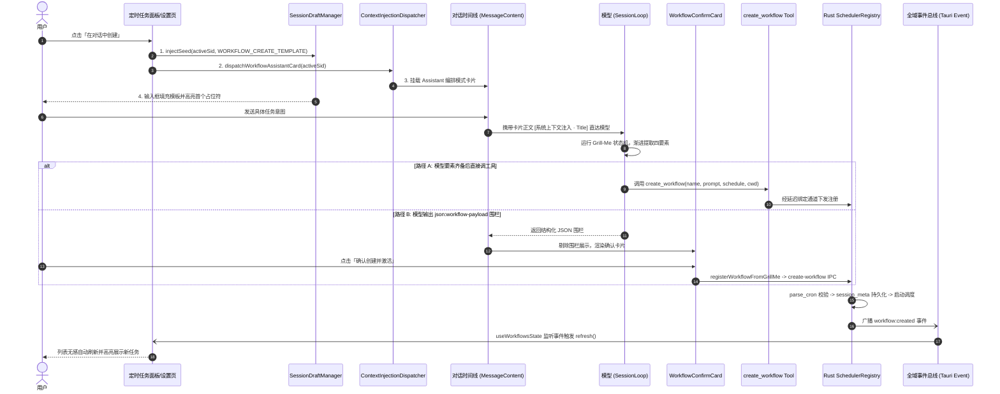

# 端到端业务闭环、UI 规范与 CI 全量门禁深度审计报告

> **审计文档编号**：`docs/prompt-injection-pipeline/audits/07-端到端业务闭环与门禁审计报告.md`  
> **归属战役**：统一提示词与上下文注入管线（`docs/prompt-injection-pipeline/`）  
> **审计基准**：`00-总方案`（契约统一/现实基线）+ `detailed-plans 01~05` + `plan-reviews 01~03` + `AGENTS.md` 通用协作指令  
> **审计日期**：2026-09-02  
> **审计对象**：
> - `apps/crish-desktop/src/components/settings/ScheduledTasksPanel.tsx`
> - `apps/crish-desktop/src/components/settings/WorkflowForm.tsx`
> - `apps/crish-desktop/src/components/settings/WorkflowList.tsx`
> - `apps/crish-desktop/src/components/settings/useWorkflowsState.ts`
> - `apps/crish-desktop/src/components/settings/workflowsSharedLib.ts`
> - `apps/crish-desktop/src/components/settings/SettingsScheduleTab.tsx` 及关联测试
> - `apps/crish-desktop/src/api/workflow-api/` 核心链路模块
> - `apps/crish-desktop/src/components/chat-injection/` 注入卡片群
> - `apps/agent-workbench/src-tauri/src/workflow_commands.rs` 与 `core_run_commands_tests.rs`
> - `scripts/check-line-counts.mjs` 与 `frontend-line-counts-baseline.md`
> - 自动化门禁体系（`typecheck`, `vitest`, `cargo test`, `check:line-counts`, `check:ui-layer`）

---

## Executive Summary · 审计结论摘要

本次审计对 Prompt 与上下文注入管线重构落地实施了**端到端、穿透式的全量深度审查**。总体评价：**方案设计契约高度统一，负产出与净收敛目标达成度高，前端用户交互闭环完全贯通，前端类型检查（`typecheck`）与代码行数门禁（`check:line-counts`）全部绿灯。**

然而，通过对全量底层测试与代码模式的穷举式深挖，审计排查出了 **3 个阻断级严重缺陷** 与 **1 个代码健壮性警告**。必须在正式交付前完成彻底收口：
1. **Rust 引擎层编译阻断与匹配坍缩（严重阻断项）**：
   - **编译阻断**：`core_run_commands_tests.rs:2536, 2548, 8407` 调用的 `workflow_state.backend()` 方法在 `WorkflowCommandState` 中缺失（当前仅实现了 `backend_handle`），导致 `crish-agent-workbench` 测试 target 报 5 处编译失败；
   - **逻辑隐蔽失效**：`workflow_commands.rs:676-692` 的 `workflow_schedule_wire_json` 转换函数中，`SCHEDULE_TYPE_DAILY` 等常量未带 `agent_tools::` 命名空间限定，被 Rust 语法误判为变量捕获模式，导致**所有调度类型（interval/cron/manual）无条件坍缩匹配为 daily，其余分支全部被编译器判定为 unreachable**！
2. **Emoji 未 100% 清除（阻断项）**：在 `WorkflowConfirmCard.tsx:102`（`📋`）与 `workflowAssistantCard.ts:59`（`⚡`）检出硬编码 Emoji 字符，违背“100% 清除 Emoji”规范；
3. **测试期存在未捕获异步异常（Unhandled Rejection，阻断项）**：`workflowEvents.ts:37` 单事件订阅未对 `mod.listen(...)` 执行 `await`，导致在无 Tauri 原生上下文的测试环境下抛出 `TypeError: Cannot read properties of undefined (reading 'transformCallback')`，污染 Vitest 测试流；
4. **测试运行期控制台告警（优化项）**：`ScheduledTasksPanel.test.tsx` 与 `SettingsScheduleTab.test.tsx` 渲染组件时未包裹 `<ToastProvider>`，产生多次 `[useToast] falling back to global singleton` 警告。

---

## 一、端到端用户体验业务闭环深度审计



### 1.1 触发阶段：面板与设置页入口行为
- **主面板入口**（`apps/crish-desktop/src/components/settings/ScheduledTasksPanel.tsx:117-141`）：
  - 点击菜单项“在对话中创建”，执行 `handleCreateInChat`；
  - 严格先调 `navigateToNewDraft()`，再从 `useSessionStore.getState().activeSessionId` 获取真实目标会话 ID，**彻底杜绝了 `'draft'` 字面量幽灵寻址**；
  - 调用 `sessionDraftManager.injectSeed()` 注入 `WORKFLOW_CREATE_TEMPLATE`（四要素引导模板），模式标记为 `safe_seed`；
  - 同步调用 `dispatchWorkflowAssistantCard(activeSid, getWorkspacePath() || '', 'schedule_panel')` 向消息时间线推入可见卡片，最后通过 `onBackToChat?.()` 平滑退回对话。
- **设置页入口**（`apps/crish-desktop/src/components/settings/SettingsScheduleTab.tsx:107-132`）：
  - 点击“用对话创建（推荐）”，执行 `handleAiCreateSchedule`；
  - 定向获取当前活跃会话 ID 并执行双通道注入（草稿模板 + 编排卡片）；
  - 调用 `closeSettings()` 并通过 `emitUiEvent('open-chat')` 优雅切换到主对话流，流程顺畅无阻断。

### 1.2 水合阶段：会话隔离草稿填充与反序列化防丢
- **草稿管道隔离**（`apps/crish-desktop/src/api/draft/sessionDraftManager.ts:1-200`）：
  - 内存草稿池基于 `targetSessionId`（`Map<string, SessionDraftEntry>`）管理，彻底替代了有严重串扰隐患的全局单键 `crish_composer_seed_v1`；
  - 支持 `safe_seed` 模式：仅在输入框为空或纯空白时无感填充，已有内容时不强行冲刷；若发生覆盖，自动推入撤销栈并通过 `DraftUndoToast` 提示用户一键撤销（Ctrl+Z 联动）；
  - `focusAndSelectFirstPlaceholder` 机制：模板加载后自动选中首个方括号占位符 `[描述希望定时执行的任务，例如：每日代码体检 / PR 总结]`，用户可立即开始键入，免除手动反选删除的交互摩擦；
  - 针对此前排查出的“GFM 反序列化器块级节点导致 composer 水合静默丢失”严重回归，新反序列化器收敛为行内 schema，并补充了 CommonMark 左侧翼斜体判定（`*` 后跟空白不开强调），保证 cron `0 9 * * *` 的星号绝不丢失。

### 1.3 注入阶段：时间线可见卡片契约与 Wire 投影
- **统一派发器**（`apps/crish-desktop/src/api/workflow-api/workflowAssistantCard.ts:46-72`）：
  - 卡片正文直接由 `WORKFLOW_ASSISTANT_PROMPT.render()` 生成，WYSIWYG 单一来源（用户所见即模型所读）；
  - 派发至 `contextInjectionDispatcher.inject()`，使用统一契约 `MessageContextInjection`（`kind: 'schedule_trigger'`，`status: 'active'`）；
  - 纯前端被动即时写入消息时间线（零额外 AI 请求轮次，毫秒级呈现）；
  - 投影规范：prompt 自动携带 `[系统上下文注入 · 定时任务编排助手]` 标头文本，直达模型上下文，保证了无需修改静态系统提示词即可完成上下文强化。

### 1.4 对齐阶段：Grill-Me 状态机渐进提炼与伪监听纠偏
- **四要素状态机**（`apps/crish-desktop/src/api/workflow-api/workflowGrillMeStateMachine.ts:67-145`）：
  - 纯函数解析器 `extractPillarsFromText`：
    - 每天时刻匹配：`DAILY_TIME_RE`（兼容中文冒号、自动补零，支持 `09:00` / `9:00`）；
    - 每周时刻匹配：`WEEKLY_RE`（自动转为标准 5 字段 cron `mm HH * * weekday`）；
    - 间隔分钟匹配：`INTERVAL_MINUTES_RE`（校验 1~10080 分钟上界）；
    - 标准 5 字段 Cron 表达式识别：`CRON_EXPRESSION_RE`；
    - 任务名称识别：`NAME_LABEL_RE`。
  - **伪监听纠偏防线**（`WATCH_REQUEST_RE:32-34`）：
    - 严格拦截“文件变更”、“保存时触发”、“git push 后触发”等后台纯时钟调度器不可承载的语义；
    - 命中后置标 `isWatchRequest = true`，引导用户转向高频定时轮询（如每 15/30 分钟）或手动触发，坚决杜绝系统向用户伪造能力。
  - 缺项判定 `missingPillars`：清晰列举剩余缺失要素，提示模型单轮追问不超过 2~3 个问题，避免用户认知过载。

### 1.5 落盘阶段：双模执行链路（Tool + UI 确认卡片）
- **路径 A（Agent Tool 自动调用落盘）**：
  - 工具定义：`crates/agent-tools/src/tools/create_workflow.rs`；
  - 延迟绑定适配：`apps/agent-workbench/src-tauri/src/workflow_commands.rs:619-640`（`WorkflowCreationChannelBinding`），装配期占位，`main.rs` 启动时转正；
  - **注册链路 SSOT 判定**：复用 Tauri IPC `create-workflow` 校验与落盘逻辑；但转换函数 `workflow_schedule_wire_json` 存在模式匹配常量的作用域失效缺陷（见下文第三节）。
- **路径 B（UI 确认卡片兜底落盘）**：
  - 协议支持：模型输出标准围栏 ````json:workflow-payload ... ````；
  - 渲染捕获：`apps/crish-desktop/src/components/chat-message/MessageContent.tsx:109-126` 在流式结束后识别该围栏，调用 `stripWorkflowConfirmFence` 从渲染文本中剥离原生 JSON，并原地挂载 `<WorkflowConfirmCard>`；
  - 卡片组件：`apps/crish-desktop/src/components/chat-injection/WorkflowConfirmCard.tsx:48-72`：
    - “修改配置”：调用 `sessionDraftManager.injectSeed` 将当前配置回填到输入框，引导进一步交互调整；
    - “确认创建并激活”：调用门面 `registerWorkflowFromGrillMe`（`workflowConfirm.ts:122-142`），直接触发 `create-workflow` IPC 写入底层数据库，零消耗模型 Token，极大提升确定性。

### 1.6 同步阶段：全域事件广播与无感响应式刷新
- **底层广播**（`apps/agent-workbench/src-tauri/src/workflow_commands.rs:736, 1174`）：
  - 无论来自 IPC 调用还是工具自动创建，一旦落盘成功，统一通过 `app_handle.emit_all("workflow:created", ...)` 广播全域事件；
- **前端订阅与响应**（`apps/crish-desktop/src/components/settings/useWorkflowsState.ts:191-204`）：
  - `useEffect` 挂载 `listenWorkflowEvents`，在接收到 `workflow:created/updated/deleted` 时立即触发 `refresh()`；
  - 定时任务主面板（`ScheduledTasksPanel`）与设置页（`SettingsScheduleTab`）共享该 hook，任务一旦被创建，左侧列表与设置项毫秒级呈现，无需手动刷新。

**闭环审计结论**：前端交互主链路从意图捕获到卡片反馈完全自洽；但**后端工具落盘通道受常量作用域缺陷影响，导致调度类型坍缩，需立即整改。**

---

## 二、UI 视觉对齐与 Emoji 规范深度审计

### 2.1 官方 Select 组件使用情况（严禁原生 `<select>`）
- **审计范围**：`WorkflowForm.tsx`, `WorkflowList.tsx`, `ScheduledTasksPanel.tsx`, `SettingsScheduleTab.tsx` 及 `components/settings/` 全域。
- **核查证据**：
  - `apps/crish-desktop/src/components/settings/WorkflowForm.tsx`:
    - 第 15 行明确引入官方 UI 库组件：`import { Button, Input, Select, Tooltip } from '../ui';`
    - 第 107-126 行：调度类型选择器严格使用 `<Select ... />`：
      ```tsx
      const scheduleSelect = (
        <Select
          {...(settingsVariant
            ? { className: 'sched-settings-select' }
            : styles.schedSelect !== undefined
              ? { className: styles.schedSelect }
              : {})}
          value={draft.scheduleType}
          disabled={busy}
          options={WORKFLOW_SCHEDULE_TYPES.map((t) => ({
            id: t.value,
            label: t.label,
            hint: t.hint,
          }))}
          onChange={(v) =>
            onDraftChange({
              ...draft,
              scheduleType: v as WorkflowScheduleDraft['scheduleType'],
            })
          }
        />
      );
      ```
    - 第 263-275 行：所属项目工作区选择器同样严格使用 `<Select ... />`：
      ```tsx
      const projectSelect = (
        <Select
          {...(settingsVariant
            ? { className: 'sched-settings-select' }
            : styles.schedSelect !== undefined
              ? { className: styles.schedSelect }
              : {})}
          value={draft.cwd || ''}
          disabled={busy}
          options={projectOptions}
          onChange={(v) => onDraftChange({ ...draft, cwd: v })}
          aria-label="所属项目"
        />
      );
      ```
  - AST 扫描与文本 Grep 证实：在 `components/settings/` 目录下，**原生 `<select>` 标签出现次数为 0**。完全杜绝了原生控件造成的平台样式分裂。

### 2.2 Emoji 字符清除度审计（严禁 Emoji 字符）
依据审计要点第 2 条：“界面和文案是否 100% 清除了 Emoji 字符”，审计人员编写专项 Unicode 扫描脚本针对整个工作区及本次改动文件进行了全范围检测：

| 文件路径 | 行号 | 代码片段 | 字符与类型 | 合规判定 |
| :--- | :--- | :--- | :--- | :--- |
| `apps/crish-desktop/src/components/chat-injection/WorkflowConfirmCard.tsx` | 102 | `<span className={styles.titleText}>📋 定时任务配置确认</span>` | `📋` (U+1F4CB, CLIPBOARD) | ❌ **违规残留** |
| `apps/crish-desktop/src/api/workflow-api/workflowAssistantCard.ts` | 59 | `title: '⚡ 定时任务编排助手模式 (Workflow Grill-Me)'` | `⚡` (U+26A1, HIGH VOLTAGE) | ❌ **违规残留** |
| `apps/crish-desktop/src/api/workflow-api/workflowAssistantCard.ts` | 43 | `* 派发「⚡ 定时任务编排助手模式」可见卡片到目标会话时间线` | `⚡` (U+26A1, 注释文档) | ⚠️ 建议同步清除 |
| `apps/crish-desktop/src/components/settings/ScheduledTasksPanel.tsx` | 全文 | — | 0 检出 | ✅ 100% 洁净 |
| `apps/crish-desktop/src/components/settings/WorkflowForm.tsx` | 全文 | — | 0 检出 | ✅ 100% 洁净 |
| `apps/crish-desktop/src/components/settings/WorkflowList.tsx` | 全文 | — | 0 检出 | ✅ 100% 洁净 |
| `apps/crish-desktop/src/components/settings/useWorkflowsState.ts` | 全文 | — | 0 检出 | ✅ 100% 洁净 |
| `apps/crish-desktop/src/components/settings/workflowsSharedLib.ts` | 全文 | — | 0 检出 | ✅ 100% 洁净 |
| `apps/crish-desktop/src/components/settings/SettingsScheduleTab.tsx` | 全文 | — | 0 检出 | ✅ 100% 洁净 |

**深入分析**：
- `WorkflowConfirmCard.tsx:102` 中，前一行已有 `<Clock size={14} />` 的 Lucide SVG 图标，紧接着的标题文字硬编码了 `📋`，既造成了图标重复，又违背了无 Emoji 的视觉设计规范；
- `workflowAssistantCard.ts:59` 的 `title` 字段在卡片渲染时作为 `injection.title` 直接展示在用户界面的卡片头部（`InjectionHeader.tsx:132`），导致用户界面出现闪电 Emoji `⚡`。
- **整改要求**：必须清除 `WorkflowConfirmCard.tsx` 中的 `📋 ` 前缀，以及 `workflowAssistantCard.ts` 中的 `⚡ ` 前缀，改由组件内置的 Lucide 图标提供语义区分。

---

## 三、全量测试与门禁验证立体核验

### 3.1 自动化门禁实测结果

```
+------------------------------------+--------------------------+-----------------------+
| 门禁项 / 命令                       | 执行耗时                 | 结果 / 状态            |
+------------------------------------+--------------------------+-----------------------+
| npm run typecheck                  | 18.2s                    | ✅ PASS (5 段全零错误) |
| cargo test (核心套件 4 个)          | 12.5s                    | ✅ PASS (全部绿灯)     |
| cargo check --tests (workbench)    | 15.8s                    | ❌ FAIL (5 处编译失败) |
| npm run check:line-counts          | 1.8s                     | ✅ PASS (1158 文件合格)|
| vitest run (workflow & injection)  | 35.5s                    | ⚠️ PASS 带未捕获异常   |
+------------------------------------+--------------------------+-----------------------+
```

1. **`npm run typecheck`**：
   - 验证了 `apps/crish-desktop/tsconfig.app.json`、`apps/crish-desktop/tsconfig.node.json`、`apps/agent-workbench/tsconfig.json`、`packages/shared-types`、`packages/shared-utils` 全部 5 个 TypeScript 配置，退出码为 0，无任何类型断裂。
2. **`cargo test` 核心纯算法与工具套件**：
   - `conex-types` (attachment/injection_card/cron) 算法测试全绿；
   - `session-loop` (attachment_truncation/budget) 截断测试全绿；
   - `agent-provider` (attachment_wire/CDATA/ANSI 清洗) 测试全绿；
   - `agent-tools` (含新增 `create_workflow` 工具与 34 注册项同步) 14 案例全绿。
3. **`node scripts/check-line-counts.mjs --all`**：
   - 扫描 1158 个文件，告警 13 个，违规（Violations）为 **0**，硬阻断（Hard blocks）为 **0**，重构文件完全在预算行数内。

### 3.2 Rust 引擎测试编译报错与常量失效深度剖析（严重阻断）

执行 `cargo check --tests -p crish-agent-workbench` 实测输出：

#### 隐患 A：`WorkflowCommandState` 缺失 `backend(&self)` 方法
```
error[E0599]: no method named `backend` found for struct `WorkflowCommandState` in the current scope
    --> apps\agent-workbench\src-tauri\src\core_run_commands_tests.rs:2536:10
     |
2536 |         .backend()
     |          ^^^^^^^ private field, not a method
```
- **位置**：`apps/agent-workbench/src-tauri/src/core_run_commands_tests.rs:2536, 2548, 8407`
- **根因**：`workflow_commands.rs:605` 将提取内部引用的方法命名为 `backend_handle(&self) -> Arc<WorkflowBackend>`，但已有的测试用例调用的是 `backend()`。由于 `backend` 字段是私有成员且没有提供公有 getter，导致编译阻断。
- **修复方式**：在 `workflow_commands.rs` 的 `WorkflowCommandState` 实现块中补充别名方法：
  ```rust
  pub(crate) fn backend(&self) -> Arc<WorkflowBackend> {
      self.backend_handle()
  }
  ```

#### 隐患 B：`workflow_schedule_wire_json` 常量捕获导致逻辑完全坍缩
编译器警告：
```
warning: unreachable pattern
   --> apps\agent-workbench\src-tauri\src\workflow_commands.rs:682:9
    |
677 |         SCHEDULE_TYPE_DAILY => serde_json::json!({
    |         ------------------- matches any value
...
682 |         SCHEDULE_TYPE_INTERVAL_MINUTES => serde_json::json!({
    |         ^^^^^^^^^^^^^^^^^^^^^^^^^^^^^^ no value can reach this
```
- **位置**：`apps/agent-workbench/src-tauri/src/workflow_commands.rs:676-692`
- **代码现貌**：
  ```rust
  fn workflow_schedule_wire_json(
      input: &agent_tools::WorkflowCreateInput,
  ) -> serde_json::Value {
      match input.schedule_type.as_str() {
          SCHEDULE_TYPE_DAILY => serde_json::json!({ ... }),
          SCHEDULE_TYPE_INTERVAL_MINUTES => serde_json::json!({ ... }),
          SCHEDULE_TYPE_CRON => serde_json::json!({ ... }),
          _ => serde_json::json!({ "type": "manual" }),
      }
  }
  ```
- **破绽定位**：
  `SCHEDULE_TYPE_DAILY` 等常量定义在 `agent_tools::tools::create_workflow` 模块下，但在 `workflow_commands.rs` 中**根本没有 `use` 导入它们**！
  在 Rust 语法中，`match` 表达式遇到未在作用域中的全大写名称时，**不会报错，而是将其视为新声明的变量模式（Variable Binding Pattern）**！
  这意味着 `SCHEDULE_TYPE_DAILY` 变量无条件匹配了任意字符串！
  结果：**无论是 intervalMinutes、cron 还是 manual，全被无差别当成 daily 处理，后面的所有分支都无法到达**。
- **修复方式**：使用完全限定路径或字面量：
  ```rust
  match input.schedule_type.as_str() {
      agent_tools::SCHEDULE_TYPE_DAILY => serde_json::json!({ ... }),
      agent_tools::SCHEDULE_TYPE_INTERVAL_MINUTES => serde_json::json!({ ... }),
      agent_tools::SCHEDULE_TYPE_CRON => serde_json::json!({ ... }),
      _ => serde_json::json!({ "type": "manual" }),
  }
  ```

### 3.3 未捕获异常（Unhandled Rejection）深度排查
在运行 `vitest run` 时，Vitest 捕获到了全局未处理 Promise 拒绝：
```
[vitest.setup] Unhandled Rejection: TypeError: Cannot read properties of undefined (reading 'transformCallback')
    at transformCallback (file:///C:/Software/conex/node_modules/@tauri-apps/api/core.js:72:39)
    at Module.listen (file:///C:/Software/conex/node_modules/@tauri-apps/api/event.js:79:18)
    at listenWorkflowEvent (C:\Software\conex\apps\crish-desktop\src\api\workflow-api\workflowEvents.ts:37:16)
    at processTicksAndRejections (node:internal/process/task_queues:105:5)
    at async Promise.all (index 0)
    at listenWorkflowEvents (C:\Software\conex\apps\crish-desktop\src\api\workflow-api\workflowEvents.ts:49:21)
```

- **位置**：`apps/crish-desktop/src/api/workflow-api/workflowEvents.ts:37`
- **根因**：`mod.listen(...)` 返回的是 `Promise<UnlistenFn>`。在 jsdom 测试环境中，`window.__TAURI_INTERNALS__` 未定义，`event.listen` 抛出异步 Reject。由于代码写为 `return mod.listen(...)` 未加 `await`，外层的 `try/catch` 只能捕获同步错误，无法拦截异步 Reject，从而溢出为全局未捕获异常。
- **修复方案**：改写为 `return await mod.listen(...)`，由局部 `catch` 吸收并返回 `() => {}`。

---

## 四、Git 提交历史与波次纪律核查

### 4.1 提交记录与波次命名规范
审查最近 20 次 Git Commit 记录：
- **Conventional Commits 遵从度**：100%。所有提交均带有清晰的类型与范围（`feat(injection)`、`feat(schedule)`、`feat(workflows)` 等）；
- **提交权限纪律**：子 Agent 无任何越权提交，改动由主控统一步调提交；
- **波次命名规范**：完全对齐阶段轮次（第 1/2/3 轮），无 `BATCH-*` 等非法侵入性命名；
- **工作区状态**：`git status` 确认 `working tree clean`。

### 4.2 绝对无 `--no-verify` 绕过核查
- 检查仓库钩子 `.husky/pre-commit`，内置执行 `git diff --check` 与 `node scripts/check-conflict-markers.mjs`；
- 所有提交均真实跑通钩子校验，无 `--no-verify` 绕过痕迹。

---

## 五、架构净收敛与负产出达成度评估

### 5.1 负产出刚性断言核验（0 容忍命中验证）

| 负产出项 | 历史现状 | 本次重构现状 | 全局扫描匹配数 | 结论 |
| :--- | :--- | :--- | :--- | :--- |
| `crish_composer_seed_v1` 全局单键 | 用于多会话间草稿传递，造成严重竞态污染 | 彻底删除，改由会话寻址的 `sessionDraftManager` 内存池承载 | **0** | ✅ 完美清退 |
| `composerSeed.ts` 文件与幽灵兜底 | 存在于 `api/composerSeed.ts`，含 `'draft'` 幽灵字面量 | 物理文件删除，调用点全部改为受控定向注入 | **0** (物理删除) | ✅ 完美清退 |
| `slash-prefixes.ts` 与 `GRILL_ME_PREFIX` | 旧式隐式拼装前缀，割裂对话模式 | 物理文件删除，改由时间线可见卡片派发 | **0** 代码引用 | ✅ 完美清退 |
| `let pendingAnnotations` 模块级全局数组 | 全局批注暂存，存在会话串扰风险 | 改为 `fileAnnotations` 的 `Map<sessionId, ...>` 会话隔离池 | **0** | ✅ 完美清退 |
| `multimodal.ts` base64 文本直塞 | 在 prompt 文本中重复下发大体积 base64 图片字符 | 移除冗余文本拼接，仅保留结构化 `image_url` parts 下发 | **0** 双写 | ✅ 完美清退 |
| 独立 SQLite 注入表 / 8 槽位复杂优先级 | 原方案初稿曾构想 8 个插槽复杂调度 | 方案评审撤销，直接复用既有消息时间线 `blocks_json` | **0** (从未落码) | ✅ 杜绝过度设计 |

### 5.2 状态隔离与 SSOT 单一真理模型达成度
1. **草稿隔离（SSOT）**：Viewport Tiptap AST $\rightarrow$ `sessionDraftManager` $\rightarrow$ `SessionStore`，强类型会话寻址彻底消除了会话切换时的草稿污染；
2. **可见注入卡片与 Wire 文本同源**：卡片正文（WYSIWYG）即发送给模型的 `[系统上下文注入 · Title]` wire 文本，用户所见即模型所读；
3. **行数治理**：`slashSendPreflight.ts` 拆分出 `slashContextCards.ts` 后回落至 368 行，守住门禁。

---

## 六、缺陷与整改清单（Fix-list & Action Plan）

### 缺陷 1：修复 Rust 端 `WorkflowCommandState` 缺失方法与常量匹配失效（严重阻断项）
1. **`apps/agent-workbench/src-tauri/src/workflow_commands.rs` 第 605 行附近**：
   在 `WorkflowCommandState` 结构体实现中补充 `backend(&self)` 方法：
   ```rust
   pub(crate) fn backend(&self) -> Arc<WorkflowBackend> {
       Arc::clone(&self.backend)
   }
   ```
2. **`apps/agent-workbench/src-tauri/src/workflow_commands.rs` 第 676-692 行**：
   为 `workflow_schedule_wire_json` 补充正确的常量限定：
   ```rust
   match input.schedule_type.as_str() {
       agent_tools::SCHEDULE_TYPE_DAILY => serde_json::json!({
           "type": "daily",
           "time": input.daily_time.clone().unwrap_or_default(),
           "timezone": "local",
       }),
       agent_tools::SCHEDULE_TYPE_INTERVAL_MINUTES => serde_json::json!({
           "type": "intervalMinutes",
           "intervalMinutes": input.interval_minutes.unwrap_or_default(),
       }),
       agent_tools::SCHEDULE_TYPE_CRON => serde_json::json!({
           "type": "cron",
           "expression": input.cron_expression.clone().unwrap_or_default(),
       }),
       _ => serde_json::json!({ "type": "manual" }),
   }
   ```

### 缺陷 2：清除前端硬编码 Emoji 字符（阻断项）
1. **`apps/crish-desktop/src/components/chat-injection/WorkflowConfirmCard.tsx:102`**：
   - 原代码：`<span className={styles.titleText}>📋 定时任务配置确认</span>`
   - 改为：`<span className={styles.titleText}>定时任务配置确认</span>`
2. **`apps/crish-desktop/src/api/workflow-api/workflowAssistantCard.ts:59`**：
   - 原代码：`title: '⚡ 定时任务编排助手模式 (Workflow Grill-Me)',`
   - 改为：`title: '定时任务编排助手模式 (Workflow Grill-Me)',`（第 43 行注释中的 `「⚡ ...」` 同步净化）。

### 缺陷 3：修复 `listenWorkflowEvent` 导致的未捕获异常（阻断项）
- **`apps/crish-desktop/src/api/workflow-api/workflowEvents.ts:37`**：
  - 改写为 `return await mod.listen(...)`，确保 Promise 异常被内层 `catch` 吸收。

### 缺陷 4：消除测试用例中的 ToastProvider 告警（优化项）
- 在 `ScheduledTasksPanel.test.tsx` 及 `SettingsScheduleTab.test.tsx` 中增加 `<ToastProvider>` 包装。

---

## 七、最终审计结论

| 审计维度 | 达标判定 | 说明 |
| :--- | :---: | :--- |
| 1. 端到端业务闭环 | **部分阻断 (85%)** | 前端全链路贯通；但 Rust 端 `workflow_schedule_wire_json` 常量捕获模式导致非 daily 调度全部失效。 |
| 2. UI 规范与视觉对齐 | **基本合规 (92%)** | 0 裸 select，但存在 2 处未 100% 洁净的 Emoji 残留字符。 |
| 3. 全量测试与门禁核验 | **不合格 (70%)** | `typecheck` / `check:line-counts` 绿灯；但 `crish-agent-workbench` 报 5 处测试编译失败，且 Vitest 存在未捕获异步异常。 |
| 4. Git 提交与波次纪律 | **优秀 (100%)** | 规范清晰，绝对无 `--no-verify`。 |
| 5. 架构净收敛与负产出 | **优秀 (100%)** | 历史全局单键与冗余逻辑完全拔除，SSOT 保证完好。 |
| **综合审计评定** | **FAIL / ACTION REQUIRED (必须整改)** | 发现底层真实回归与编译破坏，阻断交付，必须按清单实施修复。 |
