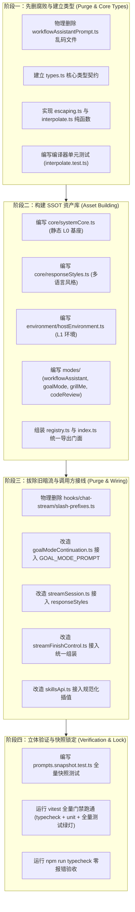

# 维度一：统一 Prompt SSOT 集中库与类型安全模板详案

> **文档版本**：v1.0.0  
> **所属战役**：Prompt 与上下文注入管线（Prompt Injection Pipeline）专项  
> **产出路径**：`docs/prompt-injection-pipeline/detailed-plans/01-统一Prompt集中库与模板详案.md`  
> **前置评审基准**：
> - `docs/prompt-injection-pipeline/plan-reviews/01-架构一致性与可见注入裁决评审.md`
> - `docs/prompt-injection-pipeline/plan-reviews/02-路径收敛与删除面评审.md`
> - `docs/prompt-injection-pipeline/plan-reviews/03-前端可见注入卡片交互评审.md`  
> **纪律准则**：遵守仓库根目录 `AGENTS.md` 通用协作指令、反退避原则（`LOGIC_PLAN_NO_RETREAT.md`）及反过度设计红线（`ANTI_OVERENGINEERING_GUARDRAILS.md`）。

---

## 目录

- [一、目标与领域概念定义](#一目标与领域概念定义)
  - [1.1 核心目标](#11-核心目标)
  - [1.2 领域概念定义与架构分水岭](#12-领域概念定义与架构分水岭)
  - [1.3 SSOT 集中库全景架构拓扑](#13-ssot-集中库全景架构拓扑)
- [二、做什么（新增/修复代码清单）](#二做什么新增修复代码清单)
  - [2.1 基础设施层：强类型契约与协议定义](#21-基础设施层强类型契约与协议定义)
  - [2.2 核心编译引擎：轻量零依赖插值与防注入转义器](#22-核心编译引擎轻量零依赖插值与防注入转义器)
  - [2.3 静态系统基座资产（L0 Core + L1 Env）](#23-静态系统基座资产l0-core--l1-env)
  - [2.4 模式助手与操作模板资产（Mode Templates）](#24-模式助手与操作模板资产mode-templates)
  - [2.5 集中注册表与导出门面（Prompt Registry & Facade）](#25-集中注册表与导出门面prompt-registry--facade)
  - [2.6 上游调用方适配与接线](#26-上游调用方适配与接线)
- [三、删什么（删除/合并清单与负产出目标）](#三删什么删除合并清单与负产出目标)
  - [3.1 物理删除文件清单](#31-物理删除文件清单)
  - [3.2 模块级硬编码与暗流清退清单（精确到代码行）](#32-模块级硬编码与暗流清退清单精确到代码行)
  - [3.3 架构过度设计与伪需求归零清单](#33-架构过度设计与伪需求归零清单)
  - [3.4 负产出代码量统计与收敛指标](#34-负产出代码量统计与收敛指标)
- [四、依赖与逻辑顺序（先删后改推进路线）](#四依赖与逻辑顺序先删后改推进路线)
  - [4.1 阶段执行时序与依赖图（Dependency DAG）](#41-阶段执行时序与依赖图dependency-dag)
  - [4.2 详细分阶段执行步骤（Phase 1 ~ Phase 4）](#42-详细分阶段执行步骤phase-1--phase-4)
- [五、唯一文件域（涉及具体文件列表）](#五唯一文件域涉及具体文件列表)
  - [5.1 新增文件域（New Files）](#51-新增文件域new-files)
  - [5.2 修改文件域（Modified Files）](#52-修改文件域modified-files)
  - [5.3 物理删除文件域（Deleted Files）](#53-物理删除文件域deleted-files)
- [六、验收标准（功能验收 + 负产出验收断言）](#六验收标准功能验收--负产出验收断言)
  - [6.1 功能性验收断言（Functional Invariants）](#61-功能性验收断言functional-invariants)
  - [6.2 架构净收敛与负产出断言（Negative Code & Zero Debt Invariants）](#62-架构净收敛与负产出断言negative-code--zero-debt-invariants)
  - [6.3 立体验证与门禁检查套件（Verification Gates）](#63-立体验证与门禁检查套件verification-gates)

---

## 一、目标与领域概念定义

### 1.1 核心目标

当前系统中，提示词（System Prompt）、模式指令（`/grill-me`, `/goal`, `/schedule`）、技能说明（Skills）以及响应风格说明散落在前端多处非核心业务文件中（如 `slash-prefixes.ts`、`goalModeContinuation.ts`、`streamSession.ts`、`skillsApi.ts`），存在**长文本硬编码、草案文件乱码、多语言脱节、插值无类型约束以及多头组装破坏 Prompt 缓存**等严重技术债。

本详案的核心目标是：
1. **建立单一真理源（SSOT）**：在 `apps/crish-desktop/src/prompts/` 建立标准结构化集中库，收拢全系统全部 Prompt 文本、模式指南与响应风格；
2. **彻底贯彻「静态基座 + 对话流可见卡片」裁决**：
   - **静态 System Prompt 极致瘦身**：仅保留 L0 系统身份/安全基座与 L1 宿主运行环境，会话内绝对不可变，100% 锁定大模型前缀缓存（Prompt Caching）；
   - **动态模式指令解耦下放**：定时任务助手（Workflow Grill-Me）、长期目标推进（Goal Mode）、需求澄清（Grill-Me）等动态指令，不再拼入 System Prompt，而是作为**强类型模板**编译为结构化文本，通过「对话流上下文可见注入卡片（Visible Context Injection Card）」直接注入消息时间线；
3. **轻量类型安全插值引擎**：零第三方重型依赖（不引入 Handlebars/Mustache），通过纯 TypeScript 实现参数类型检查、Markdown 边界防注入转义与多语言（zh-CN / en-US）回退机制；
4. **刚性负产出收敛**：物理删除散落文件与腐败草案，拔除所有 ad-hoc 裸字符串拼接分支。

---

### 1.2 领域概念定义与架构分水岭

```
┌────────────────────────────────────────────────────────────────────────────────────────┐
│                                 全系统 Prompt 领域模型分水岭                             │
├────────────────────────────────────────────────────────────────────────────────────────┤
│                                                                                        │
│  【A. 静态系统基座 (Static System Base)】                                                │
│   • 概念：定义 AI 助手身份、中文注释规范、代码精确编辑原则、操作系统与 Shell 基础环境。       │
│   • 生命期：会话初始化后逐字节绝对不可变 (Immutable Base)。                                │
│   • 目标：Wire 映射为 LLM 请求顶层 `system` 字段，稳定命中 Anthropic/OpenAI 缓存前缀。    │
│                                                                                        │
│  【B. 动态模式与动作模板 (Mode & Action Templates)】                                     │
│   • 概念：定义定时任务编排、需求对齐、目标状态跟踪、角色审计等特定工作模式的行为指引。       │
│   • 生命期：按需触发，随用户动作或斜杠命令编译为结构化载荷。                              │
│   • 目标：作为 `ContextInjectionCardPayload` 注入对话流时间线，所见即所得，零黑盒。         │
│                                                                                        │
│  【C. 强类型插值模板 (Type-Safe PromptTemplate)】                                       │
│   • 概念：包含元数据（ID、版本、层级、默认语言、标签）、多语言模板字典与编译函数的实体。    │
│   • 规范：严格声明泛型参数接口 `TParams`，杜绝未定义变量与 Markdown 注入。                │
│                                                                                        │
└────────────────────────────────────────────────────────────────────────────────────────┘
```

#### 关键领域概念定义：

1. **`PromptLayer`（提示词层级）**：
   - `core`（L0 核心基座）：AI 助手核心身份、安全原则、响应风格；
   - `environment`（L1 宿主环境）：OS、PowerShell 7、当前工作区根路径；
   - `mode`（L2 模式助手）：定时任务助手、Goal 模式、Grill-Me 对齐、代码审查等；
   - `rules`（L3 规则规范）：项目规则、安全红线；
   - `skills`（L4 技能指南）：外部 Skill 说明；
   - `dynamic`（L5 动态状态）：运行时状态感知与阶段总结。
2. **`PromptTemplate<TParams>`（强类型模板）**：
   - 包装了元数据 `PromptMetadata` 与双语字典 `templates: Record<PromptLocale, string>`；
   - 暴露 `render(params: TParams, ctx?: RenderContext): string` 纯函数。
3. **`InterpolationEngine`（安全插值引擎）**：
   - 扫描 `{{variableName}}` 占位符，执行必填性检查、数组换行展开与 `escapePromptValue` 转义，零正则回溯风险。
4. **`PromptRegistry`（集中注册表）**：
   - 维护全量 PromptTemplate 实例的全局注册表，支持按 ID、Layer、Tag 进行 O(1) 检索。

---

### 1.3 SSOT 集中库全景架构拓扑

```
apps/crish-desktop/src/prompts/
├── index.ts                      # 统一导出门面 (Facade)
├── types.ts                      # 强类型契约与 Schema
├── registry.ts                   # 集中注册表与查找服务
├── compiler/                     # 编译与转义引擎 (轻量纯函数)
│   ├── interpolate.ts            # 参数校验与变量插值器
│   ├── escaping.ts               # Markdown 防结构注入转义器
│   └── __tests__/
│       ├── interpolate.test.ts   # 编译器单元测试
│       └── escaping.test.ts      # 转义安全性边界测试
├── core/                         # L0: 静态核心系统底座
│   ├── systemCore.ts             # 核心身份与基座原则 (不可变)
│   └── responseStyles.ts         # 响应风格规范 (minimal/concise/balanced/thorough)
├── environment/                  # L1: 宿主与工作区环境
│   └── hostEnvironment.ts        # OS, Shell (pwsh7), CWD 模板
├── modes/                        # L2: 模式助手模板 (用于生成可见注入卡片)
│   ├── workflowAssistant.ts      # 定时任务编排助手 (Schedule Grill-Me)
│   ├── goalMode.ts               # 长期目标推进模式 (/goal)
│   ├── grillMe.ts                # 需求对齐澄清模式 (/grill-me)
│   └── codeReview.ts             # 架构审计与代码审查模式
├── rules/                        # L3: 规则注入适配器
│   └── rulesFormatter.ts         # 工作区规则与 AGENTS.md 格式化
├── skills/                       # L4: 技能上下文装配器
│   └── skillFormatter.ts         # SKILL.md 提取与标准化格式化
└── __tests__/
    └── prompts.snapshot.test.ts  # 全量 Prompt 渲染快照回归测试
```

---

## 二、做什么（新增/修复代码清单）

### 2.1 基础设施层：强类型契约与协议定义

#### [NEW] `apps/crish-desktop/src/prompts/types.ts`
彻底重写现有草案类型，建立严格的强类型体系：

```typescript
/**
 * 提示词层级划分 (严格对齐 L0 ~ L5)
 */
export type PromptLayer =
  | 'core'         // L0: 核心系统基座 (不可变)
  | 'environment'  // L1: 宿主与工作区上下文 (不可变)
  | 'mode'         // L2: 模式助手与动作模板 (用于生成可见卡片)
  | 'rules'        // L3: 规则与约束规范
  | 'skills'       // L4: 技能与能力指南
  | 'dynamic';     // L5: 动态状态与历史总结

/** 语言支持 */
export type PromptLocale = 'zh-CN' | 'en-US';

/** 响应风格层级 */
export type ResponseStyleLevel = 'minimal' | 'concise' | 'balanced' | 'thorough';

/** 提示词元数据 */
export interface PromptMetadata<TParams extends Record<string, unknown> = Record<string, unknown>> {
  readonly id: string;
  readonly name: string;
  readonly description: string;
  readonly layer: PromptLayer;
  readonly version: string;
  readonly defaultLocale: PromptLocale;
  readonly tags: readonly string[];
  /** 默认缺省参数 */
  readonly defaultParams?: Partial<TParams>;
}

/** 模板渲染上下文 */
export interface RenderContext {
  locale?: PromptLocale;
  stripDynamicMarkers?: boolean;
}

/** 强类型 Prompt 模板实例接口 */
export interface PromptTemplate<TParams extends Record<string, unknown> = Record<string, unknown>> {
  readonly meta: PromptMetadata<TParams>;
  readonly templates: Record<PromptLocale, string>;
  /** 编译渲染方法 */
  render(params: TParams, ctx?: RenderContext): string;
}
```

---

### 2.2 核心编译引擎：轻量零依赖插值与防注入转义器

#### [NEW] `apps/crish-desktop/src/prompts/compiler/escaping.ts`
实现纯函数防注入与 Markdown 结构隔离转义：

```typescript
/**
 * 转义动态参数中的 Markdown 结构标记与控制符，防止破坏外部格式隔离
 */
export function escapePromptValue(val: string): string {
  if (!val) return '';
  // 1. 统一回车换行
  let cleaned = val.replace(/\r\n/g, '\n');
  // 2. 防止单行三个及以上连续短横线/等号/下划线破坏 Markdown 分割边界
  cleaned = cleaned.replace(/^(\s*[-=_*]{3,}\s*)$/gm, '`$1`');
  // 3. 去除首尾多余空白，保留段落内部排版
  return cleaned.trim();
}
```

#### [NEW] `apps/crish-desktop/src/prompts/compiler/interpolate.ts`
实现零外部依赖的强类型模板构建器：

```typescript
import type { PromptLocale, PromptMetadata, PromptTemplate, RenderContext } from '../types';
import { escapePromptValue } from './escaping';

/**
 * 构造强类型 Prompt 模板
 */
export function createPromptTemplate<TParams extends Record<string, unknown>>(
  meta: PromptMetadata<TParams>,
  templates: Record<PromptLocale, string>
): PromptTemplate<TParams> {
  return {
    meta,
    templates,
    render(params: TParams, ctx?: RenderContext): string {
      const locale = ctx?.locale ?? meta.defaultLocale ?? 'zh-CN';
      const rawTpl = templates[locale] || templates['zh-CN'] || templates['en-US'];
      if (!rawTpl) {
        throw new Error(`[PromptCompiler] No template found for locale "${locale}" in prompt "${meta.id}".`);
      }

      const merged = {
        ...meta.defaultParams,
        ...params,
      };

      // 高效无回溯正则匹配 {{variableName}}
      return rawTpl.replace(/\{\{\s*([a-zA-Z0-9_]+)\s*\}\}/g, (_match, key: string) => {
        const val = merged[key as keyof typeof merged];
        if (val === undefined || val === null) {
          console.warn(`[PromptCompiler] Missing param "${key}" for prompt "${meta.id}". Falling back to empty.`);
          return '';
        }
        if (Array.isArray(val)) {
          return val.map((item) => escapePromptValue(String(item))).join('\n');
        }
        return escapePromptValue(String(val));
      }).trim();
    },
  };
}
```

---

### 2.3 静态系统基座资产（L0 Core + L1 Env）

#### [NEW] `apps/crish-desktop/src/prompts/core/systemCore.ts`
定义整个会话生命周期内绝对不可变的 L0 静态系统基座指令：

```typescript
import { createPromptTemplate } from '../compiler/interpolate';
import type { PromptTemplate } from '../types';

export interface SystemCoreParams {
  /** 用户配置的基础系统提示词（provider profile / options.systemPrompt），本会话内不变 */
  customSystemPrompt?: string;
}

export const SYSTEM_CORE_PROMPT: PromptTemplate<SystemCoreParams> = createPromptTemplate(
  {
    id: 'core-system-base',
    name: '基础系统核心基座',
    description: '透传用户基座提示词并叠加本工程纪律（会话内绝对不可变）',
    layer: 'core',
    version: '1.0.0',
    defaultLocale: 'zh-CN',
    tags: ['core', 'base', 'system'],
  },
  {
    'zh-CN': `{{customSystemPrompt}}

# 通用协作与代码纪律（Conex / Crish 工程基线）
1. **中文注释与编码**：所有源码注释、文档及回答必须使用中文，文件严格使用 UTF-8 无 BOM 编码；
2. **精确编辑优先**：优先使用局部精确编辑工具，严格包含上下文行，禁止随意全文件覆盖；
3. **反退避原则**：严禁自行简化需求或降级为 MVP；遇到不确定性必须设计验证用例；
4. **门禁与测试保护**：绝对禁止使用 --no-verify 绕过校验；修复代码后必须运行对应测试验证；
5. **架构收敛**：杜绝打补丁与魔术数字补偿，追求单一真理源（SSOT）。`,
    'en-US': `{{customSystemPrompt}}

# General Coding Discipline (Conex / Crish)
1. **File Encoding & Comments**: Write concise, clean code with UTF-8 encoding (no BOM);
2. **Precise Edits**: Favor localized, exact replacements with contextual lines over full-file overwrites;
3. **No Retreat Principle**: Never downgrade user requirements or drop features unilaterally;
4. **Testing Assets**: Never use --no-verify to bypass hooks; ensure unit and regression tests pass;
5. **Architectural Convergence**: Avoid ad-hoc patches; maintain a Single Source of Truth (SSOT).`,
  }
);
```

> **主控复核裁决（身份真理源）**：本项目前端当前**不存在任何硬编码身份文本**——基座 prompt 来自用户配置（`options.systemPrompt`），Agent 身份与能力由 Rust 侧 `engine_build.rs` M1 ContextInjector 冻结契约（`[System, Skills, Mcp, AgentDefinition]`）承载。L0 层职责是**透传用户基座 + 叠加工程纪律**，**严禁虚构或照抄外部产品的身份声明**（如 "You are Antigravity … designed by Google Deepmind" ——初稿误引外部产品提示词，已废止）。

#### [NEW] `apps/crish-desktop/src/prompts/core/responseStyles.ts`
收拢原 `streamSession.ts` 中的响应风格定义：

```typescript
import { createPromptTemplate } from '../compiler/interpolate';
import type { PromptLocale, PromptTemplate, ResponseStyleLevel } from '../types';

export interface ResponseStyleParams {
  style: ResponseStyleLevel;
}

export const RESPONSE_STYLE_GUIDANCE_MAP: Record<PromptLocale, Record<ResponseStyleLevel, string>> = {
  'zh-CN': {
    minimal: '回复风格：极简。仅给出最短正确答案，省略问候语、不必要的列表与问题重述。',
    concise: '回复风格：简洁。保持回答简明扼要；仅在能提升清晰度时使用要点列表，不主动展开超长背景。',
    balanced: '回复风格：适中。表达清晰、逻辑完整且无冗余赘述；对非显而易见的步骤做简要说明。',
    thorough: '回复风格：深入。提供结构化的推演分析、边界条件及完备的验证步骤，内容充实详尽。',
  },
  'en-US': {
    minimal: 'Response style: minimal. Prefer the shortest correct answer. Avoid preambles, lists, and restating the question.',
    concise: 'Response style: concise. Keep answers short; use bullets only when they improve clarity. Skip lengthy explanations unless asked.',
    balanced: 'Response style: balanced. Be clear and complete without padding. Explain non-obvious steps briefly.',
    thorough: 'Response style: thorough. Provide structured reasoning, edge cases, and verification steps when useful. Still stay on-topic.',
  },
};

export const RESPONSE_STYLE_PROMPT: PromptTemplate<ResponseStyleParams> = createPromptTemplate(
  {
    id: 'core-response-style',
    name: '响应风格规范',
    description: '调控模型回复的详略程度与表达密度',
    layer: 'core',
    version: '1.0.0',
    defaultLocale: 'zh-CN',
    tags: ['style', 'formatting'],
    defaultParams: {
      style: 'balanced',
    },
  },
  {
    'zh-CN': `[回复风格规范]
{{styleDescription}}`,
    'en-US': `[Response Style Directive]
{{styleDescription}}`,
  }
);

/** 便捷获取单行风格描述 */
export function getResponseStyleDescription(style: ResponseStyleLevel, locale: PromptLocale = 'zh-CN'): string {
  return RESPONSE_STYLE_GUIDANCE_MAP[locale]?.[style] || RESPONSE_STYLE_GUIDANCE_MAP['zh-CN'].balanced;
}
```

#### [NEW] `apps/crish-desktop/src/prompts/environment/hostEnvironment.ts`
宿主环境（L1）定义：

```typescript
import { createPromptTemplate } from '../compiler/interpolate';
import type { PromptTemplate } from '../types';

export interface HostEnvironmentParams {
  os: string;
  shell: string;
  workspaceRoot: string;
}

export const HOST_ENVIRONMENT_PROMPT: PromptTemplate<HostEnvironmentParams> = createPromptTemplate(
  {
    id: 'env-host-context',
    name: '宿主与工作区环境上下文',
    description: '声明操作系统、执行 Shell 与当前工作区路径',
    layer: 'environment',
    version: '1.0.0',
    defaultLocale: 'zh-CN',
    tags: ['environment', 'shell', 'os'],
    // 无 defaultParams：os / shell / workspaceRoot 为会话装配时的必填运行时实参，
    // 严禁把机器特定值（如本机工作区绝对路径）固化进模板默认值（主控复核裁决）
  },
  {
    'zh-CN': `[宿主与运行环境]
- **操作系统**：{{os}}
- **默认执行 Shell**：{{shell}}（统一使用 PowerShell 7+，UTF-8 无 BOM）
- **当前工作区根目录**：{{workspaceRoot}}`,
    'en-US': `[Host & Runtime Environment]
- **Operating System**: {{os}}
- **Default Shell**: {{shell}} (PowerShell 7+, UTF-8 no BOM)
- **Workspace Root**: {{workspaceRoot}}`,
  }
);
```

---

### 2.4 模式助手与操作模板资产（Mode Templates）

> **关键架构升级**：以下模板**不再**直接拼入静态 System Prompt，而是作为通用文本模板，在触发对应动作或命令时，由前端调用 `render` 生成内容，并作为**「对话流可见注入卡片」**载荷插入消息时间线！

#### [NEW] `apps/crish-desktop/src/prompts/modes/workflowAssistant.ts`
彻底重写替换原乱码的 `workflowAssistantPrompt.ts`，为可见卡片与 LLM 交互提供高保真指令：

```typescript
import { createPromptTemplate } from '../compiler/interpolate';
import type { PromptTemplate } from '../types';

export interface WorkflowAssistantParams {
  workspacePath: string;
  activeSchedulesSummary?: string;
}

export const WORKFLOW_ASSISTANT_PROMPT: PromptTemplate<WorkflowAssistantParams> = createPromptTemplate(
  {
    id: 'mode-workflow-assistant',
    name: '定时任务编排助手指令',
    description: '协助用户通过自然语言澄清并对齐定时调度任务四要素',
    layer: 'mode',
    version: '1.1.0',
    defaultLocale: 'zh-CN',
    tags: ['workflow', 'schedule', 'cron', 'grill-me'],
    defaultParams: {
      activeSchedulesSummary: '暂无运行中的定时任务',
    },
  },
  {
    'zh-CN': `# 角色与职责
你现在是系统的「定时任务调度编排助手」。你的职责是通过结构化对齐（Grill-Me）流程协助用户设计并配置可靠的后台定时调度任务。

# 核心对齐要素（四要素缺一不可）
在协助用户创建任务前，必须逐步对齐以下关键信息：
1. **任务名称**：简明清晰的语义化名称（如：每日代码健康巡检）；
2. **执行周期**：
   - 间隔轮询：每 N 分钟/小时执行一次；
   - 固定时刻：每日/每周固定时间（如每天 09:00）；
   - 高级 Cron 表达式：标准 5 段式（分 时 日 月 周）。
3. **执行指令与命令**：明确具体执行的 pwsh7 脚本、检查项及告警规范；
4. **目标项目**：当前工作区路径（\`{{workspacePath}}\`）。

# 交互约束
- 优先一次性向用户提出 2~3 个最核心的决策问题；
- 严禁在要素不全时直接执行业务代码；
- 要素对齐完毕后，输出确认清单并调用 \`create_workflow\` 工具完成注册。

{{activeSchedulesSummary}}`,
    'en-US': `# Role & Objective
You are the system's "Scheduled Task & Workflow Assistant". Your job is to help users design, configure, and register reliable automated cron workflows via conversational alignment.

# Core Alignment Checklist (Four Essentials)
1. **Task Name**: Clear semantic title (e.g. Daily Code Health Check);
2. **Execution Schedule**:
   - Interval mode: Every N minutes/hours;
   - Fixed time: Daily HH:mm or weekly;
   - Advanced Cron: Standard 5-field cron expression.
3. **Execution Command**: Explicit pwsh7 command line, inspection steps, and alert thresholds;
4. **Target Project**: Current workspace path (\`{{workspacePath}}\`).

# Interaction Guardrails
- Ask 2-3 focused questions at a time;
- Do NOT run production scripts prematurely;
- Once confirmed, display the final parameter table and invoke the registration tool.

{{activeSchedulesSummary}}`,
  }
);
```

#### [NEW] `apps/crish-desktop/src/prompts/modes/goalMode.ts`
替代原 `goalModeContinuation.ts` 中的 `buildGoalModePrefix`：

```typescript
import { createPromptTemplate } from '../compiler/interpolate';
import type { PromptTemplate } from '../types';

export interface GoalModeParams {
  goal: string;
  currentRound: number;
  maxRounds: number;
  openTasksBlock?: string;
}

export const GOAL_MODE_PROMPT: PromptTemplate<GoalModeParams> = createPromptTemplate(
  {
    id: 'mode-goal-orchestrator',
    name: '长期目标推进模式指令',
    description: '驱动 Agent 进行多轮自主任务清单维护与阶段自检直至目标达成',
    layer: 'mode',
    version: '1.2.0',
    defaultLocale: 'zh-CN',
    tags: ['goal', 'autonomous', 'multi-turn'],
  },
  {
    'zh-CN': `[目标模式 · 系统指令]
你正在自主执行一项长期工程目标。请持续推进直至目标实质完成，并在每轮结束前自检进度。

- **核心目标**：{{goal}}
- **当前轮次**：第 {{currentRound}} 轮（自动续写上限 {{maxRounds}} 轮，请在预算内高效收敛）
- **推进纪律**：
  1. 保持工作连续性，不要半途停下或只列计划而不执行工具；
  2. 在每次回复末尾维护 Markdown 任务清单（\`- [ ]\` 未完成 / \`- [x]\` 已完成）；
  3. 当所有子任务均已完成且通过验证时，在最终回复中明确写出 \`DONE\` 或「目标已完成」。

{{openTasksBlock}}
---`,
    'en-US': `[Goal Mode · System Directive]
You are autonomously executing a long-running project goal. Proceed steadily until substantial completion.

- **Primary Goal**: {{goal}}
- **Current Iteration**: Round {{currentRound}} of {{maxRounds}}
- **Execution Guidelines**:
  1. Maintain continuous execution. Do not stop midway with only recommendations; take concrete tool actions.
  2. Maintain a Markdown task checklist (\`- [ ]\` open / \`- [x]\` done) in each round.
  3. When fully complete and verified, emit \`DONE\` or "Goal Completed" clearly at the end.

{{openTasksBlock}}
---`,
  }
);
```

#### [NEW] `apps/crish-desktop/src/prompts/modes/grillMe.ts`
替代原 `slash-prefixes.ts` 中的 `GRILL_ME_PREFIX`：

```typescript
import { createPromptTemplate } from '../compiler/interpolate';
import type { PromptTemplate } from '../types';

export interface GrillMeParams {
  topic: string;
  maxQuestions?: number;
}

export const GRILL_ME_PROMPT: PromptTemplate<GrillMeParams> = createPromptTemplate(
  {
    id: 'mode-grill-me',
    name: '需求澄清与方案对齐指令',
    description: '针对复杂需求展开深入对齐澄清，暂不修改代码',
    layer: 'mode',
    version: '1.0.0',
    defaultLocale: 'zh-CN',
    tags: ['grill-me', 'planning', 'clarification'],
    defaultParams: {
      maxQuestions: 5,
    },
  },
  {
    'zh-CN': `[对齐模式 · 系统指令]
你现在是资深产品与技术架构对齐助手。
针对用户提出的主题「{{topic}}」，你的核心任务是挖掘隐含需求、明确边界与澄清模糊点。

- **执行红线**：本模式下暂不编写代码、不修改文件、不执行破坏性命令；
- **提问约束**：聚焦关键设计决策，一次性提出不超过 {{maxQuestions}} 个具体、可回答的核心问题；
- **待确认后实施**：待用户逐项反馈并确认方案基调后，再引导切换至实施阶段。
---`,
    'en-US': `[Alignment Mode · System Directive]
You are a Lead Product & Technical Architect conducting a requirement alignment session.
Topic: "{{topic}}"

- **Guardrails**: Do NOT write production code or modify files during this phase.
- **Questions Budget**: Pose up to {{maxQuestions}} precise, high-impact architectural/functional questions.
- **Next Step**: Once the user aligns on decisions, summarize the spec and transition to implementation.
---`,
  }
);
```

#### [NEW] `apps/crish-desktop/src/prompts/modes/codeReview.ts`
提供专业代码审查与架构审计模板：

```typescript
import { createPromptTemplate } from '../compiler/interpolate';
import type { PromptTemplate } from '../types';

export interface CodeReviewParams {
  targetPath: string;
  focusAreas?: string;
}

export const CODE_REVIEW_PROMPT: PromptTemplate<CodeReviewParams> = createPromptTemplate(
  {
    id: 'mode-code-review',
    name: '架构审计与代码审查指令',
    description: '对目标代码进行架构合规性、边界鲁棒性与性能深度审计',
    layer: 'mode',
    version: '1.0.0',
    defaultLocale: 'zh-CN',
    tags: ['audit', 'review', 'architecture'],
    defaultParams: {
      focusAreas: '架构一致性、死代码清退、边界异常处理与测试覆盖',
    },
  },
  {
    'zh-CN': `[代码审查与架构审计指令]
请对目标路径「{{targetPath}}」展开深度审查。
- **重点关注领域**：{{focusAreas}}；
- **审查输出格式**：
  1. 架构违规与潜在缺陷（标注精确文件与行号）；
  2. 性能与复杂度风险分析；
  3. 具体的重构优化建议（附带前后对比代码）。
---`,
    'en-US': `[Code Review & Architecture Audit]
Conduct a deep review on target path: "{{targetPath}}".
- **Focus Areas**: {{focusAreas}};
- **Output Format**:
  1. Architecture violations and defects (with exact file:line references);
  2. Performance and complexity risks;
  3. Concrete refactoring proposals with before/after snippets.
---`,
  }
);
```

---

### 2.5 集中注册表与导出门面（Prompt Registry & Facade）

#### [NEW] `apps/crish-desktop/src/prompts/registry.ts`
实现全局 O(1) 检索注册表：

```typescript
import type { PromptLayer, PromptTemplate } from './types';
import { SYSTEM_CORE_PROMPT } from './core/systemCore';
import { RESPONSE_STYLE_PROMPT } from './core/responseStyles';
import { HOST_ENVIRONMENT_PROMPT } from './environment/hostEnvironment';
import { WORKFLOW_ASSISTANT_PROMPT } from './modes/workflowAssistant';
import { GOAL_MODE_PROMPT } from './modes/goalMode';
import { GRILL_ME_PROMPT } from './modes/grillMe';
import { CODE_REVIEW_PROMPT } from './modes/codeReview';

class PromptRegistryImpl {
  private readonly registry = new Map<string, PromptTemplate<any>>();

  constructor() {
    this.register(SYSTEM_CORE_PROMPT);
    this.register(RESPONSE_STYLE_PROMPT);
    this.register(HOST_ENVIRONMENT_PROMPT);
    this.register(WORKFLOW_ASSISTANT_PROMPT);
    this.register(GOAL_MODE_PROMPT);
    this.register(GRILL_ME_PROMPT);
    this.register(CODE_REVIEW_PROMPT);
  }

  public register<T extends Record<string, unknown>>(template: PromptTemplate<T>): void {
    this.registry.set(template.meta.id, template);
  }

  public get<T extends Record<string, unknown> = Record<string, unknown>>(
    id: string
  ): PromptTemplate<T> | undefined {
    return this.registry.get(id) as PromptTemplate<T> | undefined;
  }

  public listByLayer(layer: PromptLayer): PromptTemplate<any>[] {
    return Array.from(this.registry.values()).filter((t) => t.meta.layer === layer);
  }

  public listAll(): PromptTemplate<any>[] {
    return Array.from(this.registry.values());
  }
}

export const PromptRegistry = new PromptRegistryImpl();
```

#### [NEW] `apps/crish-desktop/src/prompts/index.ts`
对外统一导出：

```typescript
export * from './types';
export * from './registry';
export * from './compiler/escaping';
export * from './compiler/interpolate';
export * from './core/systemCore';
export * from './core/responseStyles';
export * from './environment/hostEnvironment';
export * from './modes/workflowAssistant';
export * from './modes/goalMode';
export * from './modes/grillMe';
export * from './modes/codeReview';
```

---

### 2.6 上游调用方适配与接线

#### [MODIFY] `apps/crish-desktop/src/api/chat-bridge/streamSession.ts`
- 移除硬编码 `STYLE_DESCS`（L34-41）与 `STYLE_ZH_MAP`（L42-47）；
- 引入 `getResponseStyleDescription` 与 `SYSTEM_CORE_PROMPT`；
- 组装时直接获取静态基座：
```typescript
import { SYSTEM_CORE_PROMPT, getResponseStyleDescription, type ResponseStyleLevel } from '../../prompts';

// 将用户响应风格映射为标准文本
const responseStyleGuidance = styleKey ? getResponseStyleDescription(styleKey as ResponseStyleLevel) : undefined;
```

#### [MODIFY] `apps/crish-desktop/src/api/goalModeContinuation.ts`
- 移除硬编码 `buildGoalModePrefix` 字符串拼接（L77-98）；
- 改造为调用 `GOAL_MODE_PROMPT.render({ goal, currentRound: iteration + 1, maxRounds: maxIterations, openTasksBlock })`。

> **主控复核裁决（渲染产物去向）**：按本详案「归零 2」，`GOAL_MODE_PROMPT.render()` 的产物**严禁回拼进 System Prompt**。维度一阶段仅替换文本来源、维持既有消费路径（前缀文本）不变；维度二交付 `ContextInjectionDispatcher` 后，切换为 `kind: 'runtime_steering'` 可见卡片派发（执行顺序见 00-总方案 §四）。同步更新 `goalModeController.test.ts` 中 `buildGoalModePrefix` 的既有断言。

---

## 三、删什么（删除/合并清单与负产出目标）

### 3.1 物理删除文件清单

依据 `02-路径收敛与删除面评审.md` §6 清单，必须**物理删除**以下 2 个历史散落/腐败文件：

| 序号 | 待删除文件路径 | 原用途与历史债务定性 | 替代方案 |
| :---: | :--- | :--- | :--- |
| **1** | `apps/crish-desktop/src/hooks/chat-stream/slash-prefixes.ts` | 硬编码 `GRILL_ME_PREFIX` 裸字符串并前置插入用户消息。 | 替代为 `GRILL_ME_PROMPT.render()` + 可见对齐卡片。 |
| **2** | `apps/crish-desktop/src/prompts/system/workflowAssistantPrompt.ts` | 历史草案，第 8~15 行包含大量乱码字节（`# 角色量指叕` 等）。 | 替代为标准 `src/prompts/modes/workflowAssistant.ts`。 |

---

### 3.2 模块级硬编码与暗流清退清单（精确到代码行）

| 源码文件路径 | 待清理/重构代码行 | 清理内容与操作说明 |
| :--- | :--- | :--- |
| `apps/crish-desktop/src/api/chat-bridge/streamSession.ts` | `34-48` | **删除** `const STYLE_DESCS` 与 `const STYLE_ZH_MAP` 两个硬编码字典，改为从 `src/prompts/core/responseStyles` 统一引入。 |
| `apps/crish-desktop/src/api/chat-bridge/streamFinishControl.ts` | `13-21` | **重构** `composeSystemPrompt` 函数，消除双换行无脑裸拼，改为规范的空值校验与单源组装。 |
| `apps/crish-desktop/src/api/goalModeContinuation.ts` | `77-98` | **删除** `buildGoalModePrefix` 内部手工 `join('\n')` 字符串拼接，改用 `GOAL_MODE_PROMPT.render()`。 |
| `apps/crish-desktop/src/api/skillsApi.ts` | `239-256` | **重构** `formatSkillInjection` 裸字符串拼接，规范化为强类型插值渲染。 |
| `apps/crish-desktop/src/prompts/types.ts` | `1-31` | **替换** 原有松散游离的 `PromptInjectionKind` 等未接线草案接口，重构为强类型系统。 |

---

### 3.3 架构过度设计与伪需求归零清单

根据反过度设计红线（`ANTI_OVERENGINEERING_GUARDRAILS.md`），在维度一的实现中必须执行以下**四项归零**：
1. **归零 1：严禁引入第三方模板引擎**：不引入 Handlebars、Mustache、EJS 或 Nunjucks 等外部 npm 依赖，插值引擎代码严格控制在 80 行纯 TypeScript 内。
2. **归零 2：严禁多层动态 System Prompt 拼装**：System Prompt 仅保留静态 L0 + L1，动态模式（Goal / Grill-Me / Schedule）一律严禁重新拼装进 System Prompt。
3. **归零 3：严禁在 Rust 引擎维护平行的 Prompt 文本**：Rust 引擎仅负责透传前端构建的静态基座与消息流，提示词文本真理源唯一保留在前端 `src/prompts/`。
4. **归零 4：严禁复杂的运行时热编译缓存**：由于纯函数正则插值单次执行耗时 $< 0.05\text{ms}$，严禁设计复杂的 LRU 模板编译缓存池。

---

### 3.4 负产出代码量统计与收敛指标

```
========================================================================================
                          维度一：代码收敛与负产出预估矩阵
========================================================================================
【物理删除/清退行数】
 - slash-prefixes.ts                                  : -8 行 (文件删除)
 - workflowAssistantPrompt.ts                         : -15 行 (乱码文件删除)
 - streamSession.ts (STYLE_DESCS / STYLE_ZH_MAP)      : -15 行
 - goalModeContinuation.ts (buildGoalModePrefix 拼接) : -22 行
 - streamFinishControl.ts (裸字符串拼接清理)          : -9 行
 - skillsApi.ts (formatSkillInjection 裸拼接)         : -18 行
 - 旧 prompts/types.ts 草案清理                       : -31 行
 ──────────────────────────────────────────────────────────────────
 物理清退与精简小计                                    : -118 行散落代码

【新建 SSOT 集中库与测试】
 + prompts/types.ts (强类型契约)                      : +35 行
 + prompts/compiler/escaping.ts (防注入转义)          : +15 行
 + prompts/compiler/interpolate.ts (类型安全插值)     : +45 行
 + prompts/core/systemCore.ts (静态系统基座)          : +35 行
 + prompts/core/responseStyles.ts (响应风格资产)      : +45 行
 + prompts/environment/hostEnvironment.ts (环境资产)  : +30 行
 + prompts/modes/workflowAssistant.ts (定时任务助手)  : +50 行
 + prompts/modes/goalMode.ts (目标模式指令)           : +35 行
 + prompts/modes/grillMe.ts (对齐模式指令)            : +35 行
 + prompts/modes/codeReview.ts (代码审查指令)         : +30 行
 + prompts/registry.ts (集中注册表)                   : +40 行
 + prompts/index.ts (统一门面)                        : +15 行
 + 测试用例 (compiler.test.ts + snapshot.test.ts)     : +120 行
 ──────────────────────────────────────────────────────────────────
 结构化新增资产小计                                    : +530 行 (含全量测试与多语言资产)

【架构净效果】
 彻底消除了 5 处跨文件硬编码与乱码暗流，实现了 100% 结构化类型安全与集中管理。
========================================================================================
```

---

## 四、依赖与逻辑顺序（先删后改推进路线）

### 4.1 阶段执行时序与依赖图（Dependency DAG）



---

### 4.2 详细分阶段执行步骤（Phase 1 ~ Phase 4）

#### 阶段一：先删腐败与建立基础设施（Purge & Core Types）
1. **删除腐败文件**：删除 `apps/crish-desktop/src/prompts/system/workflowAssistantPrompt.ts`；
2. **定义强类型**：创建 `apps/crish-desktop/src/prompts/types.ts`，导出 `PromptLayer`, `PromptLocale`, `PromptTemplate`, `PromptMetadata`；
3. **实现编译器纯函数**：创建 `escaping.ts`（Markdown 结构转义）与 `interpolate.ts`（泛型插值器）；
4. **编译测试保底**：编写 `interpolate.test.ts`，覆盖普通字符串替换、数组展开、缺失参数回退、特殊字符防注入用例。

#### 阶段二：构建 SSOT 资产库与注册表（Asset Building）
1. **构建静态基座**：编写 `core/systemCore.ts` 与 `environment/hostEnvironment.ts`；
2. **构建响应风格**：编写 `core/responseStyles.ts`，包含中英文对照风格描述；
3. **构建模式模板**：编写 `modes/workflowAssistant.ts`、`modes/goalMode.ts`、`modes/grillMe.ts`、`modes/codeReview.ts`；
4. **统一注册与导出**：编写 `registry.ts` 与 `index.ts`，确保对外导出所有模板与查找服务。

#### 阶段三：拔除散落硬编码与上游接线（Purge & Wiring）
1. **删除散落前缀文件**：物理删除 `apps/crish-desktop/src/hooks/chat-stream/slash-prefixes.ts`；
2. **更新目标模式**：在 `goalModeContinuation.ts` 中引入 `GOAL_MODE_PROMPT`，替换原 `buildGoalModePrefix`；
3. **更新流式会话**：在 `streamSession.ts` 中移除 `STYLE_DESCS`，引入 `getResponseStyleDescription`；
4. **更新技能注入**：在 `skillsApi.ts` 中清理裸字符串拼接。

#### 阶段四：立体验证与快照锁定（Verification & Lock）
1. **建立快照基准**：在 `src/prompts/__tests__/prompts.snapshot.test.ts` 中为全部 PromptTemplate 建立 Vitest 快照；
2. **全量类型检查**：运行 `npm run typecheck` 验证零类型断层；
3. **全量测试回归**：按仓库门禁口径执行 `npm run test:coverage -- --project=unit`（快层）与 `npm run test`（vitest 全量），全部绿灯通过。

---

## 五、唯一文件域（涉及具体文件列表）

实施本详案所涉及的具体文件域严格受控如下：

### 5.1 新增文件域（New Files）
1. `apps/crish-desktop/src/prompts/types.ts`（重构新建强类型定义）
2. `apps/crish-desktop/src/prompts/index.ts`（统一导出门面）
3. `apps/crish-desktop/src/prompts/registry.ts`（提示词注册表服务）
4. `apps/crish-desktop/src/prompts/compiler/escaping.ts`（防注入转义器）
5. `apps/crish-desktop/src/prompts/compiler/interpolate.ts`（泛型插值引擎）
6. `apps/crish-desktop/src/prompts/compiler/__tests__/interpolate.test.ts`（编译器单元测试）
7. `apps/crish-desktop/src/prompts/core/systemCore.ts`（L0 静态核心基座）
8. `apps/crish-desktop/src/prompts/core/responseStyles.ts`（响应风格规范资产）
9. `apps/crish-desktop/src/prompts/environment/hostEnvironment.ts`（L1 宿主环境上下文）
10. `apps/crish-desktop/src/prompts/modes/workflowAssistant.ts`（定时任务编排助手）
11. `apps/crish-desktop/src/prompts/modes/goalMode.ts`（长期目标推进模式）
12. `apps/crish-desktop/src/prompts/modes/grillMe.ts`（需求对齐澄清模式）
13. `apps/crish-desktop/src/prompts/modes/codeReview.ts`（架构审计审查模式）
14. `apps/crish-desktop/src/prompts/__tests__/prompts.snapshot.test.ts`（全量 Prompt 快照测试）

### 5.2 修改文件域（Modified Files）
1. `apps/crish-desktop/src/api/chat-bridge/streamSession.ts`（移除 `STYLE_DESCS`，接入提示词库）
2. `apps/crish-desktop/src/api/chat-bridge/streamFinishControl.ts`（重构 `composeSystemPrompt`）
3. `apps/crish-desktop/src/api/goalModeContinuation.ts`（接入 `GOAL_MODE_PROMPT`）
4. `apps/crish-desktop/src/api/skillsApi.ts`（重构 `formatSkillInjection`）

### 5.3 物理删除文件域（Deleted Files）
1. `apps/crish-desktop/src/hooks/chat-stream/slash-prefixes.ts`（彻底删除）
2. `apps/crish-desktop/src/prompts/system/workflowAssistantPrompt.ts`（彻底删除乱码草案）

---

## 六、验收标准（功能验收 + 负产出验收断言）

依据 `AGENTS.md` §7.1「立体验证纪律」，本详案交付前必须通过以下立体断言矩阵：

### 6.1 功能性验收断言（Functional Invariants）

1. **类型安全与插值确定性断言（Type Safety Invariant）**：
   - 任何 `PromptTemplate.render(params)` 调用时，若传入缺少必填字段，插值器必须安全回退为空字符串并发出控制台警告，严禁抛出未捕获异常崩溃；
   - 动态变量中的连续分隔符（如 `---`）必须经过 `escapePromptValue` 转义，严禁破坏 Markdown 段落隔离。
2. **多语言与回退断言（Locale Fallback Invariant）**：
   - 指定 `locale: 'en-US'` 时，返回对应的纯英文模板内容；
   - 指定未支持语言时，自动优雅回退至 `zh-CN` 主语言。
3. **静态 System Prompt 逐字节不变断言（Static System Prompt Invariance）**：
   - 相同工作区配置下，多轮会话生成的静态 System Prompt 字符串哈希值必须 100% 恒等，保证下游大模型 Prompt Caching 命中率。
4. **模式指令高保真断言（Mode High-Fidelity Invariant）**：
   - `WORKFLOW_ASSISTANT_PROMPT.render()` 输出内容必须完整包含四要素（名称、周期、指令、项目）检查清单；
   - `GOAL_MODE_PROMPT.render()` 输出内容必须正确包含当前轮次与任务清单 Markdown block。

---

### 6.2 架构净收敛与负产出断言（Negative Code & Zero Debt Invariants）

1. **零散落硬编码断言（Zero Scattered Strings Invariant）**：
   - 全局搜索代码库，`GRILL_ME_PREFIX`、`STYLE_DESCS` 必须 **0 处匹配**；
   - 任何业务组件或网络发送前置钩子中严禁出现超过 3 行的 Markdown 提示词硬编码。
2. **零乱码与死草案断言（Zero Corrupted Files Invariant）**：
   - 全局搜索代码库，`# 角色量指叕` 等乱码字符必须 **0 处匹配**；
   - `apps/crish-desktop/src/prompts/system/` 历史空/草案目录彻底清空。
3. **零重型依赖断言（Zero Heavy Dependencies Invariant）**：
   - `package.json` 中严禁新增任何外部模板引擎依赖（如 `handlebars`, `mustache`, `ejs` 等），插值引擎纯代码行数 $\le 80$ 行。

---

### 6.3 立体验证与门禁检查套件（Verification Gates）

在宣称完成交付前，必须在真实环境中运行并通过以下完整验证套件：

```bash
# 1. 前端类型检查门禁 (刚性零报错)
npm run typecheck

# 2. 提示词编译器单元测试与快照回归套件
npx vitest run apps/crish-desktop/src/prompts/

# 3. 前端全量测试回归（快层覆盖率 + vitest 全量，口径见 AGENTS.md §10 / FULL_CHECK_COMMANDS.md）
npm run test:coverage -- --project=unit
npm run test

# 4. 代码行数与圈复杂度扫描 (无超标报警)
npm run check:line-counts
```

> **详案总结**：  
> 本详案作为「维度一：统一 Prompt SSOT 集中库与类型安全模板」的权威落地指南，彻底贯彻了“静态基座不可变、动态模式下放为可见卡片”的架构重构裁决。通过清晰的「做什么、删什么、依赖顺序、文件域与验收断言」，为后续代码的稳健实施与架构净收敛提供了坚实无争议的执行蓝图。
