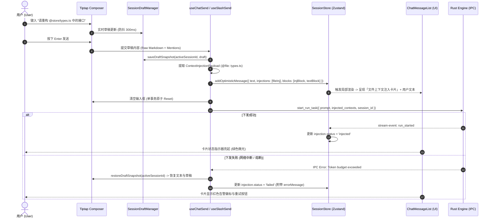
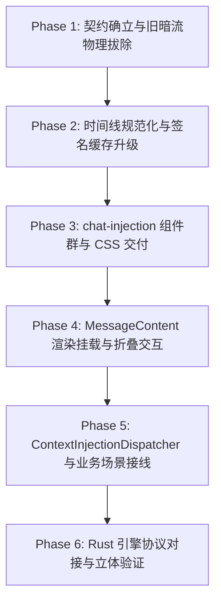

# 对话流可见注入卡片协议与呈现体系详案（维度二）

> **文档位置**：`docs/prompt-injection-pipeline/detailed-plans/02-对话流可见注入卡片协议与呈现详案.md`
> **所属战役**：Prompt 与上下文注入管线（Prompt Injection Pipeline）工程详案
> **方案定位**：维度二 ——「对话流可见注入卡片协议与呈现体系」连贯可执行详案
> **权威裁决**：用户最新核心裁决——**“不用隐式通道了，这种注入应该是在上下文里面的，所以正常在对话流里面显示为对应的注入显示即可，当做工具调用的效果一样就行，只是这个不用ai主动调用，是直接注入的。”**
> **契约 SSOT 声明（主控复核裁决）**：本详案定义的 `MessageContextInjection`（位于 `src/store/types.ts`）是**全战役唯一**的时间线注入卡片契约——`kind` 9 类 snake_case、`status` 5 态、字段名 `summary` / `tokenEstimate`。详案 04/05 及评审 01 中出现的 `ContextAttachmentPayload`、`ContextInjectionCardPayload`（`types/injectionCard.ts`）一律不另立：前者降级为本契约 `metadata` 内的类型化子结构，后者废止（`mode-assistant` 场景映射为 `kind: 'schedule_trigger'`）。见 00-总方案 §三。
> **遵守纪律**：仓库根目录 `AGENTS.md` 通用协作指令、反退避原则（`LOGIC_PLAN_NO_RETREAT.md`）及反过度设计红线（`ANTI_OVERENGINEERING_GUARDRAILS.md`）。

---

## 目录

- [一、目标与领域概念定义](#一目标与领域概念定义)
  - [1.1 核心业务目标与痛点根除](#11-核心业务目标与痛点根除)
  - [1.2 领域核心概念与统一语义](#12-领域核心概念与统一语义)
  - [1.3 三种交互呈现范式对比与架构定性](#13-三种交互呈现范式对比与架构定性)
  - [1.4 双向投影模型（Dual Projection Architecture）](#14-双向投影模型dual-projection-architecture)
- [二、做什么：新增与重构代码清单](#二做什么新增与重构代码清单)
  - [2.1 数据模型与强类型契约扩展（TypeScript & Rust）](#21-数据模型与强类型契约扩展typescript--rust)
  - [2.2 时间线管道与规范化器改造（Normalizer & Reconciler）](#22-时间线管道与规范化器改造normalizer--reconciler)
  - [2.3 注入卡片专用组件群（`components/chat-injection/`）](#23-注入卡片专用组件群componentschat-injection)
  - [2.4 时间线交错流与 MessageContent 渲染挂载](#24-时间线交错流与-messagecontent-渲染挂载)
  - [2.5 统一派发器（ContextInjectionDispatcher）与业务场景接线](#25-统一派发器contextinjectiondispatcher与业务场景接线)
  - [2.6 草稿隔离、输入法保护与失败回滚状态机](#26-草稿隔离输入法保护与失败回滚状态机)
- [三、删什么：删除、合并与清退清单](#三删什么删除合并与清退清单)
  - [3.1 彻底移除原方案 02 的过度设计资产（SQLite 临时表与 8 槽位状态机）](#31-彻底移除原方案-02-的过度设计资产sqlite-临时表与-8-槽位状态机)
  - [3.2 清退全系统散落的隐式拼接与全局单键（Negative Code Inventory）](#32-清退全系统散落的隐式拼接与全局单键negative-code-inventory)
- [四、依赖与逻辑顺序（先删后改）](#四依赖与逻辑顺序先删后改)
  - [4.1 六阶段执行依赖时序拓扑](#41-六阶段执行依赖时序拓扑)
  - [4.2 阶段落地细节与实施路径](#42-阶段落地细节与实施路径)
- [五、唯一文件域清单](#五唯一文件域清单)
  - [5.1 新建文件域（New Files）](#51-新建文件域new-files)
  - [5.2 核心改造文件域（Modified Files）](#52-核心改造文件域modified-files)
  - [5.3 物理删除与清退文件域（Deleted Files）](#53-物理删除与清退文件域deleted-files)
- [六、验收标准与防回归断言](#六验收标准与防回归断言)
  - [6.1 功能性验收标准（Functional Criteria）](#61-功能性验收标准functional-criteria)
  - [6.2 负产出与架构净收敛验收断言（Negative Invariants）](#62-负产出与架构净收敛验收断言negative-invariants)
  - [6.3 刚性自动化测试与门禁验证清单（CI Gate）](#63-刚性自动化测试与门禁验证清单ci-gate)

---

## 一、目标与领域概念定义

### 1.1 核心业务目标与痛点根除

在 Conex / Crish 桌面端智能协作系统中，AI 的多轮推理高度依赖于规则（Rules）、专家技能（Skills）、工作区快照（Workspace Context）、定时任务编排（Workflow Schedule）、目标推进（Goal Mode）与运行时纠偏（Steering Nudges）等上下文。

既往架构中面临两大极端断层：
1. **隐式黑盒拼接（Blackbox Bleed）**：将动态模式指令与上下文直接塞入底层的 `System Prompt` 或私下硬拼到用户输入的字符串头部（如 `GRILL_ME_PREFIX + slash.topic`、`buildGoalModePrefix`）。用户在 UI 上对“AI 为什么会进入此模式”、“生效了哪些约束”、“消耗了多少 Token”处于完全盲盒状态；
2. **LLM 轮次浪费式工具调用（Active Tool Call Overhead）**：若为了让用户看见上下文加载而要求大模型主动发起 `load_rule` 或 `inspect_context` 工具调用，不仅引入 1~3 秒额外的网络与推理往返延迟（Round-Trip Latency），浪费大量输出 Token，更极易因模型漏调或错调导致上下文链彻底断裂。

**核心重构目标**：
- 落实用户最新权威裁决，**彻底废除隐式系统提示词通道**；
- 确立**「对话流上下文可见注入卡片（Visible Context Injection Card）」**为单一真理模型；
- 建立**「被动直接注入（Passive Direct Injection）」**机制，由系统/前端在动作触发时直接向对话时间线插入高质感卡片，**零 AI 轮次开销，所见即所得**。

---

### 1.2 领域核心概念与统一语义

```
┌────────────────────────────────────────────────────────────────────────────────────────┐
│                              可见注入卡片核心概念架构图                                 │
├────────────────────────────────────────────────────────────────────────────────────────┤
│                                                                                        │
│   [外部触发源 (Triggers)]                                                              │
│    • Slash 命令 (/schedule, /goal, /grill-me)                                          │
│    • UI 面板动作 (定时任务面板「在对话中创建」、设置中心「AI辅助」)                     │
│    • 编辑器上下文 (@file 引用、代码选区批注、Git Diff 快照、终端报错日志)              │
│    • 系统事件 (Cron 定时唤醒、工作区规则热载入、运行时纠偏)                             │
│                                                                                        │
│                                   │ (触发事件)                                         │
│                                   ▼                                                    │
│   ┌────────────────────────────────────────────────────────────────────────────────┐   │
│   │ ContextInjectionDispatcher (统一可见注入派发器)                                │   │
│   │ ├─ 构建标准 ContextInjectionCardPayload (计算 Token 估算、生成唯一 ID)          │   │
│   │ └─ 写入 useSessionStore (按 targetSessionId 插入 SessionMessage.blocks 时间线) │   │
│   └───────────────────────────────────┬────────────────────────────────────────────┘   │
│                                       │                                                │
│                 ┌─────────────────────┴─────────────────────┐                          │
│                 ▼                                           ▼                          │
│   【UI 视图投影 (UI Projection)】             【LLM 协议投影 (Wire Projection)】       │
│   • <ContextInjectionBlock />                 • messages 数组中的标准结构化消息块       │
│   • 同构于 ToolCard (CompactToolRow)          • 带 [系统上下文注入 · Title] 标头        │
│   • 语义色调 (Tone)、图标、状态微光           • 纯天然时间因果序排布                   │
│   • Token Badge、Markdown 折叠面板            • 静态 System Prompt 保持 100% 缓存命中  │
│                                                                                        │
└────────────────────────────────────────────────────────────────────────────────────────┘
```

#### 核心概念定义：

1. **被动直接注入（Passive Direct Injection）**：
   与模型发起的 `tool_call`（主动）截然相反，被动注入是由宿主环境（用户操作或系统事件）在特定动作发生瞬间直接生成并提交给时间线的上下文实体，**无需经过大模型推理，确定性 100%，零延迟即时呈现**。
2. **对话流上下文可见注入卡片（Visible Context Injection Card）**：
   在消息时间线（Timeline）中作为一等公民节点（`type: 'context_injection'`）存在的结构化实体。视觉上继承 Conex 现有 `ToolCard`（`CompactToolRow`）的设计语言（圆角边框、柔和背景色、图标槽位、分类徽标、Token 消耗胶囊、折叠展开抽屉与代码高亮）。
3. **注入类别（ContextInjectionKind）**：
   对注入内容做严格正交的领域划分，包含 9 大类别：
   - `rule`：项目与工作区持久规则（`AGENTS.md`、安全基线）；
   - `skill`：激活的专家技能指南（`antigravity-guide` 等）；
   - `file_context`：文件引用与代码片段（`@file`、代码选区）；
   - `git_status`：Git 工作区改动与分支快照；
   - `terminal_output`：终端命令回执与测试失败日志；
   - `runtime_steering`：运行时纠偏、Goal Mode 任务状态；
   - `schedule_trigger`：定时任务编排助手（Workflow Grill-Me）与定时唤醒；
   - `memory`：会话阶段性记忆与总结；
   - `workspace_env`：工作区目录拓扑与环境配置。
4. **注入生命周期（ContextInjectionStatus）**：
   - `pending`：准备注入 / 正在校验；
   - `injected`：已成功注入当前 Turn 上下文，处于活跃状态；
   - `active`：持续跨轮次生效中（如持久规则）；
   - `expired`：单次已消费 / 随时间线推进沉淀为历史；
   - `failed`：注入熔断或失败（卡片标红并提供重试按钮）。

---

### 1.3 三种交互呈现范式对比与架构定性

| 评估维度 | 范式 A：隐式注入（System/Hidden） | 范式 B：LLM 主动工具调用（Tool Call） | 范式 C：对话流可见注入卡片（本方案 SSOT） |
| :--- | :--- | :--- | :--- |
| **触发机制** | 后台静默拼接字符串 | 大模型生成 `tool_call` 请求 | **宿主系统在动作触发时被动直接注入** |
| **首字延迟（TTFT）** | 极低（零额外轮次） | 极高（需经历 1 次完整 LLM 思考与往返） | **极低（零额外 LLM 轮次，毫秒级即时落盘渲染）** |
| **用户可见性与透明度** | 完全不可见（黑盒漂移） | 可见（作为工具卡片显示） | **完全可见（时间线独立卡片，所见即所知）** |
| **Token 生成消耗** | 仅输入 Token | 输入 Token + 输出 Token + 结构化返回 | **仅输入 Token（零多余 LLM 轮次生成开销）** |
| **确定性与抗幻觉** | 100% 确定注入 | 依赖模型遵从度（存在漏调/错调风险） | **100% 确定注入（由宿主门禁硬性保障）** |
| **大模型缓存命中率** | 极差（高频修改 System Prompt 导致失效） | 较差（多轮工具往返导致断点漂移） | **极高（System 保持静态，卡片享受消息流增量缓存）** |
| **调试与审计能力** | 差（需翻阅原始 IPC 日志） | 良好（在工具行查看） | **极佳（直观查看卡片 Payload、Token 与状态）** |

---

### 1.4 双向投影模型（Dual Projection Architecture）

可见注入卡片采用统一实体、双向投影机制，彻底打通 UI 渲染与大模型消费：

```
                              [ContextInjectionCardPayload]
                                           │
             ┌─────────────────────────────┴─────────────────────────────┐
             ▼                                                           ▼
   【UI 视图投影 (UI Projection)】                             【LLM Wire 协议投影 (Wire Projection)】
   ┌───────────────────────────────────────────┐               ┌───────────────────────────────────────────┐
   │ ⚡ 规则注入 · AGENTS.md        [250 t] [−] │               │ {                                         │
   ├───────────────────────────────────────────┤               │   "role": "user",                         │
   │ 1. 必须使用 UTF-8 无 BOM                   │               │   "content": [                            │
   │ 2. 严禁使用 --no-verify 绕过门禁           │               │     { "type": "text",                     │
   │ 3. 任何改动须履行立体验证                  │ ────────────> │       "text": "[系统上下文注入 · 规则: ...]\n │
   └───────────────────────────────────────────┘               │       1. 必须使用 UTF-8 无 BOM\n..." }    │
   (React: ContextInjectionBlock / CompactRow)                 │   ]                                       │
                                                               │ }                                         │
                                                               └───────────────────────────────────────────┘
```

1. **UI 视图投影（UI Projection）**：
   - 在前端时间线内渲染为精美卡片，支持 7 种语义色调微光（Tone Matrix）、图标插槽、Token 胶囊、一键复制、代码语法高亮与折叠抽屉；
   - 保证 120Hz 丝滑滚动，签名缓存实现流式正文追加时零卡顿、零无效重渲染。
2. **LLM 协议投影（Wire Projection）**：
   - 在向下游 Provider 下发时，卡片作为 `role: "user"`（或标准上下文消息块）按时间戳自然排布在 `messages` 数组中；
   - 带有标准的 `[系统上下文注入 · <Title>]` 与 `[元数据: ...]` 隔离标头，大模型按天然阅读顺序理解上下文因果关系；
   - `System Prompt` 仅保留 L0 基础基座 + L1 宿主环境，整个会话期间**逐字节绝对不可变**，100% 稳定命中 Prompt Caching。

---

## 二、做什么：新增与重构代码清单

### 2.1 数据模型与强类型契约扩展（TypeScript & Rust）

#### 2.1.1 前端类型扩展（`apps/crish-desktop/src/store/types.ts`）

```typescript
// ── 新增：上下文注入分类与状态枚举 ──────────────────────────────────────────

/** 上下文注入来源分类 */
export type ContextInjectionKind =
  | 'rule'              // 项目/全局规则注入 (如 AGENTS.md, custom rules)
  | 'skill'             // 专家技能/提示词模板注入 (如 antigravity-guide)
  | 'file_context'      // 文件引用与代码快照 (@file, 选区批注)
  | 'git_status'        // Git 工作区状态与改动快照 (Diff, 分支状态)
  | 'terminal_output'   // 终端历史上下文与命令回执 (错误日志)
  | 'runtime_steering'  // 运行时纠偏与目标模式指令 (/goal 状态)
  | 'schedule_trigger'  // 定时任务/助手模式唤醒元数据 (/schedule, Workflow Grill-Me)
  | 'memory'            // 会话记忆与阶段性总结
  | 'workspace_env';    // 工作区目录拓扑与运行环境契约

/** 注入项生命周期状态 */
export type ContextInjectionStatus =
  | 'pending'           // 准备注入 (待下发)
  | 'injected'          // 已成功注入当前 Turn 上下文 (活跃生效)
  | 'active'            // 持续跨轮次生效中 (Persistent)
  | 'expired'           // 已过期/单次有效已消费
  | 'failed';           // 注入失败 (如超限熔断/文件读取错误)

/**
 * 统一可见上下文注入卡片实体（MessageContextInjection）
 * 对应对话流中独立呈现的可见卡片，同构于 ToolCard
 */
export interface MessageContextInjection {
  /** 唯一标识符 (UUID 或基于内容 Blake3 哈希) */
  id: string;
  /** 注入分类 */
  kind: ContextInjectionKind;
  /** 卡片展示标题 (如 "⚡ 规则注入: AGENTS.md", "📎 文件引用: sessionStore.ts") */
  title: string;
  /** 简明副标题/摘要 (展示于卡片 Header 右侧) */
  summary?: string;
  /** 当前状态 */
  status: ContextInjectionStatus;
  /** 注入源标识 (如 "rule_loader", "slash_command", "schedule_panel", "user_mention") */
  source: string;
  /** 核心正文内容 (Markdown / 代码 / 结构化文本) */
  content: string;
  /** 估算的 Token 消耗量 (用于展示 Token 胶囊) */
  tokenEstimate?: number;
  /** 关联的文件 Diff 快照列表 (可选) */
  diffs?: FileDiff[];
  /** 关联的目标文件路径列表 (可选) */
  targetPaths?: string[];
  /** 注入时间戳 (epoch ms) */
  timestamp: number;
  /** 是否支持展开查看详情 (默认 true) */
  isFoldable?: boolean;
  /** 初始是否默认折叠 (内容 > 160 字符默认 true) */
  defaultFolded?: boolean;
  /** 失败时的错误诊断信息 */
  errorMessage?: string;
  /** 结构化扩展元数据 */
  metadata?: Record<string, unknown>;
}

// ── 扩展：时间线块类型与 SessionMessage ──────────────────────────────────────

/** 扩充时间线块类型，新增 'context_injection' 分支 */
export type MessageTimelineBlockType =
  | 'thought'
  | 'text'
  | 'tool_call'
  | 'context_injection' // 新增：系统上下文注入卡片一等公民
  | 'image'
  | 'step_start'
  | 'step_end';

/** 扩充 MessageTimelineBlock */
export interface MessageTimelineBlock {
  type: MessageTimelineBlockType;
  /** tool_call 对应 toolCall.id; context_injection 对应 injection.id; thought 对应 stepId */
  id?: string;
  /** 文本或思考内容 / 注入纯文本摘要 */
  content?: string;
  /** 关联的轮次索引 (0-based) */
  turnIndex?: number;
  durationMs?: number;
  isStreaming?: boolean;
  isHistoricalCollapsed?: boolean;
  redacted?: boolean;
  images?: MessageImageRef[];
  /** 当 type === 'context_injection' 时挂载的结构化数据 */
  injection?: MessageContextInjection;
}

/** SessionMessage 扩充 injections 数组字段 */
export interface SessionMessage extends Pick<
  AgentMessage,
  'id' | 'clientMessageId'
> {
  sender: MessageSender;
  text?: string | undefined;
  metadata?: unknown | undefined;
  thinking?: string | undefined;
  thinkingTurns?: Array<{
    turnIndex: number;
    content: string;
    durationMs?: number;
    id?: string;
    isStreaming?: boolean;
  }>;
  timestamp: number;
  toolCalls?: MessageToolCall[] | undefined;
  status?: SessionMessageStatus | undefined;
  precomputedHtml?: string | undefined;
  toolCallResults?: SessionMessageToolCallResult[] | undefined;
  /** 新增：本条消息包含的系统上下文注入项集合 */
  injections?: MessageContextInjection[] | undefined;
  blocks?: MessageTimelineBlock[] | undefined;
  streamTextOffset?: number | undefined;
  thinkingTime?: number | undefined;
  images?: MessageImageRef[] | undefined;
  errorDetail?: { ... };
}
```

#### 2.1.2 Rust 内核核心模型（`crates/conex-types/src/injection_card.rs`）

```rust
use serde::{Deserialize, Serialize};

#[derive(Debug, Clone, Copy, PartialEq, Eq, Serialize, Deserialize)]
#[serde(rename_all = "snake_case")]
pub enum ContextInjectionCardKind {
    Rule,
    Skill,
    FileContext,
    GitStatus,
    TerminalOutput,
    RuntimeSteering,
    ScheduleTrigger,
    Memory,
    WorkspaceEnv,
}

#[derive(Debug, Clone, Copy, PartialEq, Eq, Serialize, Deserialize)]
#[serde(rename_all = "snake_case")]
pub enum ContextInjectionStatus {
    Pending,
    Injected,
    Active,
    Expired,
    Failed,
}

#[derive(Debug, Clone, PartialEq, Serialize, Deserialize)]
#[serde(rename_all = "camelCase")]
pub struct ContextInjectionCardPayload {
    pub id: String,
    pub kind: ContextInjectionCardKind,
    pub title: String,
    pub summary: Option<String>,
    pub status: ContextInjectionStatus,
    pub source: String,
    pub content: String,
    pub token_estimate: Option<u32>,
    pub target_paths: Option<Vec<String>>,
    pub timestamp: u64,
    pub is_foldable: Option<bool>,
    pub default_folded: Option<bool>,
    pub error_message: Option<String>,
    pub metadata: Option<serde_json::Value>,
}
```

---

### 2.2 时间线管道与规范化器改造（Normalizer & Reconciler）

#### 2.2.1 扩展时间线项契约（`apps/crish-desktop/src/api/tool-presentation/toolPresentationTypes.ts`）

```typescript
export type TimelineInjectionItem = {
  kind: 'injection';
  key: string;
  injection: MessageContextInjection;
  turnIndex?: number;
};

export type AssistantTimelineItem =
  | TimelineThoughtItem
  | TimelineTextItem
  | TimelineToolsItem
  | TimelineInjectionItem; // 新增注入项分支
```

#### 2.2.2 规范化算法升级（`apps/crish-desktop/src/api/tool-presentation/timelineNormalizer.ts`）

在 `buildAssistantTimeline(msg: SessionMessage)` 中增加对 `type === 'context_injection'` 的解构与排布逻辑：

```typescript
export function buildAssistantTimeline(msg: SessionMessage): AssistantTimelineItem[] {
  try {
    const tools = msg.toolCalls || [];
    const toolsById = new Map(tools.map((t) => [t.id, t]));
    const injections = msg.injections || [];
    const injectionsById = new Map(injections.map((inj) => [inj.id, inj]));
    const blocks = msg.blocks || [];
    const items: AssistantTimelineItem[] = [];
    let toolBuf: MessageToolCall[] = [];
    let ti = 0;
    const xi = { val: 0 };
    const thi = { val: 0 };

    const flushTools = () => {
      if (!toolBuf.length) return;
      const rendered = buildToolRenderItems(toolBuf);
      if (rendered.length) {
        items.push({ kind: 'tools', items: rendered, key: `tools-${ti++}` });
      }
      toolBuf = [];
    };

    if (blocks.length > 0) {
      const usedTools = new Set<string>();
      const usedInjections = new Set<string>();

      if (!blocks.some((b) => b.type === 'thought')) {
        pushFallbackTurns(msg, items);
      }

      for (const b of blocks) {
        if (b.type === 'context_injection') {
          flushTools();
          const inj = (b.id ? injectionsById.get(b.id) : undefined) || b.injection;
          if (inj) {
            items.push({
              kind: 'injection',
              key: `injection-${inj.id}`,
              injection: inj,
              turnIndex: b.turnIndex,
            });
            usedInjections.add(inj.id);
          }
        } else if (b.type === 'thought') {
          flushTools();
          const thoughtContent = (b.content || '').trim();
          if (thoughtContent || b.isStreaming) {
            items.push({
              kind: 'thought',
              content: thoughtContent,
              id: b.id,
              turnIndex: b.turnIndex,
              durationMs: b.durationMs,
              isStreaming: b.isStreaming,
              isHistoricalCollapsed: b.isHistoricalCollapsed,
              key: `thought-${b.id || (b.turnIndex !== undefined ? `turn-${b.turnIndex}` : thi.val++)}`,
            });
          }
        } else if (b.type === 'text') {
          flushTools();
          const c = b.content || '';
          if (c.trim() || b.isStreaming) {
            pushParsedText(c, b.turnIndex, Boolean(b.isStreaming), items, thi, xi);
          }
        } else if (b.type === 'tool_call' && b.id) {
          const tc = toolsById.get(b.id);
          if (tc) {
            toolBuf.push(tc);
            usedTools.add(b.id);
          }
        }
      }
      flushTools();

      // 孤儿注入项兜底：若 injections 存在未在 blocks 中声明的项，自动置顶挂载
      const orphanInjections = injections.filter((inj) => !usedInjections.has(inj.id));
      for (const inj of orphanInjections) {
        items.unshift({
          kind: 'injection',
          key: `injection-orphan-${inj.id}`,
          injection: inj,
        });
      }

      // 孤儿工具调用兜底
      const orphanTools = tools.filter((t) => !usedTools.has(t.id));
      if (orphanTools.length) {
        const rendered = buildToolRenderItems(orphanTools);
        if (rendered.length) {
          items.push({ kind: 'tools', items: rendered, key: 'tools-orphan' });
        }
      }

      if (!items.some((i) => i.kind === 'text') && (msg.text || '').trim()) {
        pushParsedText(msg.text || '', undefined, msg.status === 'processing', items, thi, xi);
      }
      return items;
    }

    // 历史无 blocks 消息兼容降级：按 injections -> thoughts -> tools -> text 顺序列出
    for (const inj of injections) {
      items.push({ kind: 'injection', key: `injection-${inj.id}`, injection: inj });
    }
    pushFallbackTurns(msg, items);
    if (tools.length) {
      const rendered = buildToolRenderItems(tools);
      if (rendered.length) {
        items.push({ kind: 'tools', items: rendered, key: 'tools-0' });
      }
    }
    if ((msg.text || '').trim()) {
      pushParsedText(msg.text || '', undefined, msg.status === 'processing', items, thi, xi);
    }
    return items;
  } catch (err) {
    console.error('[buildAssistantTimeline] Error parsing timeline:', err);
    if ((msg.text || '').trim()) {
      return [{ kind: 'text', content: msg.text || '', key: 'text-fallback' }];
    }
    return [];
  }
}
```

#### 2.2.3 签名缓存与虚拟滚动更新

1. **时间线签名算法（`apps/crish-desktop/src/api/tool-presentation/timelineCache.ts`）**：
   在 `timelineSignature(msg)` 中将注入卡片的 `id + status + tokenEstimate` 编入签名：
   ```typescript
   const injSig = (msg.injections || [])
     .map((inj) => `${inj.id}:${inj.status}:${inj.tokenEstimate ?? 0}`)
     .join(';');
   return `${baseSig}|inj:[${injSig}]`;
   ```
   当注入项状态（如 `pending` $\rightarrow$ `injected`）变更时精确触发局部渲染；纯文本流式帧更新时不改变注入签名，保持 `TimelineBody` memo 稳定命中。
2. **虚拟滚动高度估算（`apps/crish-desktop/src/api/VirtualScrollManager.ts`）**：
   ```typescript
   // 遍历 blocks 时，对 context_injection 块进行准确高度估算
   if (b.type === 'context_injection') {
     h += 40; // 紧凑单行高度约 40px
   }
   ```

---

### 2.3 注入卡片专用组件群（`components/chat-injection/`）

在 `apps/crish-desktop/src/components/chat-injection/` 下建立完整的卡片组件群：

```
apps/crish-desktop/src/components/chat-injection/
├── ContextInjectionBlock.tsx          # 容器组件（负责批量堆栈与无障碍封装）
├── ContextInjectionBlock.module.css   # 专用样式（语义色调微光、无重阴影）
├── CompactInjectionRow.tsx            # 单行卡片组件（折叠展开、Token胶囊、重试）
├── InjectionHeader.tsx                # 紧凑 Header 栏（图标、Badge、标题、摘要）
├── InjectionBody.tsx                  # 展开面板（Markdown 异步解析、代码高亮、Diff跳转）
├── contextInjectionUtils.ts           # 纯逻辑工具（图标映射、色调提取、Token格式化）
└── __tests__/
    ├── ContextInjectionBlock.test.tsx # 容器渲染与无障碍测试
    └── CompactInjectionRow.test.tsx   # 折叠、重试与异常交互测试
```

#### 2.3.1 容器组件 `ContextInjectionBlock.tsx`

```tsx
import React from 'react';
import styles from './ContextInjectionBlock.module.css';
import type { ContextInjectionBlockProps } from './contextInjectionTypes';
import { CompactInjectionRow } from './CompactInjectionRow';

export const ContextInjectionBlock: React.FC<ContextInjectionBlockProps> = React.memo(
  ({ injections, className, ...sharedProps }) => {
    if (!injections || injections.length === 0) return null;

    return (
      <div
        className={`${styles.injectionStack} ${className || ''}`}
        role="region"
        aria-label={`系统上下文注入（共 ${injections.length} 项）`}
      >
        {injections.map((inj) => (
          <CompactInjectionRow
            key={inj.id}
            rowKey={inj.id}
            injection={inj}
            {...sharedProps}
          />
        ))}
      </div>
    );
  }
);

ContextInjectionBlock.displayName = 'ContextInjectionBlock';
```

#### 2.3.2 单行卡片组件 `CompactInjectionRow.tsx`

```tsx
import React, { useCallback, useMemo, useState } from 'react';
import { ChevronRight, RefreshCw, AlertCircle } from 'lucide-react';
import styles from './ContextInjectionBlock.module.css';
import type { CompactInjectionRowProps } from './contextInjectionTypes';
import {
  getInjectionIcon,
  getInjectionKindLabel,
  getInjectionToneClass,
  formatTokenCount,
} from './contextInjectionUtils';
import { Tooltip } from '../ui/Tooltip/Tooltip';
import { StreamingMarkdownView } from '../chat-message-row/StreamingMarkdownView';
import { Priority } from '../../workers';

export const CompactInjectionRow: React.FC<CompactInjectionRowProps> = React.memo(
  ({
    injection,
    rowKey,
    expandedInjections,
    onToggleInjection,
    onOpenPath,
    onOpenDiff,
    onRetryInjection,
  }) => {
    // 默认折叠策略：受控优先；默认内容 > 160 字符折叠
    const defaultOpen = !(injection.defaultFolded ?? (injection.content.length > 160));
    const [localOpen, setLocalOpen] = useState(defaultOpen);
    const isOpen = expandedInjections?.[injection.id] ?? localOpen;

    const handleToggle = useCallback(() => {
      const next = !isOpen;
      setLocalOpen(next);
      onToggleInjection?.(injection.id, next);
    }, [isOpen, injection.id, onToggleInjection]);

    const toneClass = useMemo(
      () => getInjectionToneClass(injection.kind, styles),
      [injection.kind]
    );
    const IconComponent = useMemo(
      () => getInjectionIcon(injection.kind),
      [injection.kind]
    );
    const kindLabel = useMemo(
      () => getInjectionKindLabel(injection.kind),
      [injection.kind]
    );

    const isFailed = injection.status === 'failed';
    const isPending = injection.status === 'pending';

    return (
      <div
        className={`${styles.injectionRow} ${toneClass} ${
          isOpen ? styles.isOpen : styles.isCollapsed
        } ${isFailed ? styles.isFailed : ''}`}
        data-injection-id={injection.id}
        data-injection-kind={injection.kind}
        data-testid={`injection-row-${injection.id}`}
      >
        {/* Header 栏 */}
        <button
          type="button"
          className={styles.rowHead}
          onClick={handleToggle}
          aria-expanded={isOpen}
          aria-controls={`injection-body-${injection.id}`}
        >
          <div className={styles.rowHeadMain}>
            {/* 图标槽位 */}
            <span className={styles.iconSlot} aria-hidden>
              {isPending ? (
                <span className="loading-spinner" style={{ width: 12, height: 12 }} />
              ) : isFailed ? (
                <AlertCircle size={14} className={styles.failIcon} />
              ) : (
                <IconComponent size={14} />
              )}
            </span>

            {/* 分类徽章 */}
            <span className={styles.kindBadge}>{kindLabel}</span>

            {/* 标题 */}
            <span className={styles.titleText}>{injection.title}</span>

            {/* 简明摘要 */}
            {injection.summary && (
              <span className={styles.summaryText}>{injection.summary}</span>
            )}
          </div>

          {/* 右侧元数据与操作区 */}
          <div className={styles.rowHeadMeta} onClick={(e) => e.stopPropagation()}>
            {/* Token 消耗指示胶囊 */}
            {injection.tokenEstimate !== undefined && (
              <Tooltip content={`估算占用上下文: ~${injection.tokenEstimate} Tokens`}>
                <span className={styles.tokenBadge}>
                  {formatTokenCount(injection.tokenEstimate)}
                </span>
              </Tooltip>
            )}

            {/* 失败重试按钮 */}
            {isFailed && onRetryInjection && (
              <Tooltip content="重新注入此上下文">
                <button
                  type="button"
                  className={styles.retryBtn}
                  onClick={() => onRetryInjection(injection.id)}
                  aria-label="重试注入"
                >
                  <RefreshCw size={12} />
                </button>
              </Tooltip>
            )}

            {/* 折叠箭头 */}
            <span className={`${styles.chevronSlot} ${isOpen ? styles.open : ''}`} aria-hidden>
              <ChevronRight size={14} />
            </span>
          </div>
        </button>

        {/* 展开详情区 */}
        {isOpen && (
          <div
            id={`injection-body-${injection.id}`}
            className={styles.rowBody}
            role="region"
            aria-label={`${injection.title} 详情`}
          >
            <div className={styles.bodyInner}>
              <StreamingMarkdownView
                text={injection.content}
                isStreaming={false}
                priority={Priority.Normal}
                messageId={`inj-${injection.id}`}
              />

              {/* 关联 Diff 快捷操作 */}
              {injection.diffs && injection.diffs.length > 0 && onOpenDiff && (
                <div className={styles.diffActionGroup}>
                  {injection.diffs.map((d) => (
                    <button
                      key={d.filePath}
                      type="button"
                      className={styles.diffChipBtn}
                      onClick={() => onOpenDiff(d)}
                    >
                      查看 Diff ({d.filePath})
                    </button>
                  ))}
                </div>
              )}
            </div>
          </div>
        )}
      </div>
    );
  }
);

CompactInjectionRow.displayName = 'CompactInjectionRow';
```

#### 2.3.3 纯逻辑映射工具库 `contextInjectionUtils.ts`

```typescript
import React from 'react';
import {
  ShieldCheck,
  Sparkles,
  FileCode2,
  GitBranch,
  Terminal,
  Navigation,
  Clock,
  Brain,
  FolderTree,
  Box,
} from 'lucide-react';
import type { ContextInjectionKind } from '../../store/types';

export function getInjectionIcon(kind: ContextInjectionKind): React.FC<{ size?: number; className?: string }> {
  switch (kind) {
    case 'rule': return ShieldCheck;
    case 'skill': return Sparkles;
    case 'file_context': return FileCode2;
    case 'git_status': return GitBranch;
    case 'terminal_output': return Terminal;
    case 'runtime_steering': return Navigation;
    case 'schedule_trigger': return Clock;
    case 'memory': return Brain;
    case 'workspace_env': return FolderTree;
    default: return Box;
  }
}

export function getInjectionKindLabel(kind: ContextInjectionKind): string {
  switch (kind) {
    case 'rule': return '规则注入';
    case 'skill': return '技能上下文';
    case 'file_context': return '文件上下文';
    case 'git_status': return 'Git 状态';
    case 'terminal_output': return '终端上下文';
    case 'runtime_steering': return '运行时纠偏';
    case 'schedule_trigger': return '定时唤醒';
    case 'memory': return '会话记忆';
    case 'workspace_env': return '工作区环境';
    default: return '系统注入';
  }
}

export function getInjectionToneClass(
  kind: ContextInjectionKind,
  styles: Record<string, string>
): string {
  switch (kind) {
    case 'rule': return styles.toneRule || '';
    case 'skill': return styles.toneSkill || '';
    case 'file_context': return styles.toneFile || '';
    case 'git_status': return styles.toneGit || '';
    case 'terminal_output': return styles.toneTerminal || '';
    case 'runtime_steering': return styles.toneSteering || '';
    case 'schedule_trigger': return styles.toneSchedule || '';
    default: return styles.toneDefault || '';
  }
}

export function formatTokenCount(tokens: number): string {
  if (tokens < 1000) return `${tokens} t`;
  return `${(tokens / 1000).toFixed(1)}k t`;
}
```

#### 2.3.4 CSS Module 规范（`ContextInjectionBlock.module.css`）

严格遵循 `AGENTS.md` §13~14 的无重阴影与感知均匀 HSLA 规范：

```css
.injectionStack {
  display: flex;
  flex-direction: column;
  gap: 2px;
  margin: 4px 0;
  padding: 0;
  width: 100%;
}

.injectionRow {
  position: relative;
  border-radius: var(--radius-lg, 8px);
  background: var(--bg-surface-subtle, hsl(0 0% 100% / 0.03));
  border: 1px solid var(--border-color, hsl(0 0% 50% / 0.12));
  contain: layout style;
  color: var(--text-secondary);
  box-shadow: none;
  outline: none;
  transition:
    background var(--transition-micro, 150ms ease),
    border-color var(--transition-micro, 150ms ease);
}

.injectionRow:hover {
  background: var(--tint-hover, hsl(0 0% 50% / 0.05));
  border-color: color-mix(in srgb, var(--border-color) 92%, var(--text-primary) 8%);
}

.rowHead {
  display: flex;
  align-items: center;
  justify-content: space-between;
  width: 100%;
  padding: 6px 10px;
  background: transparent;
  border: none;
  cursor: pointer;
  font-family: inherit;
  font-size: var(--font-size-xs, 12px);
  color: inherit;
  text-align: left;
  border-radius: inherit;
  box-sizing: border-box;
}

.rowHeadMain {
  display: flex;
  align-items: center;
  gap: var(--space-2, 8px);
  min-width: 0;
  flex: 1;
}

.iconSlot {
  display: inline-flex;
  align-items: center;
  justify-content: center;
  width: 16px;
  height: 16px;
  flex-shrink: 0;
}

.kindBadge {
  font-size: 10px;
  font-weight: 500;
  padding: 1px 5px;
  border-radius: var(--radius-sm, 4px);
  background: var(--tint-subtle, hsl(0 0% 50% / 0.08));
  color: var(--text-tertiary);
  flex-shrink: 0;
}

.titleText {
  font-weight: 500;
  color: var(--text-primary);
  overflow: hidden;
  text-overflow: ellipsis;
  white-space: nowrap;
}

.summaryText {
  color: var(--text-tertiary);
  font-size: 11px;
  overflow: hidden;
  text-overflow: ellipsis;
  white-space: nowrap;
}

.rowHeadMeta {
  display: flex;
  align-items: center;
  gap: 6px;
  flex-shrink: 0;
}

.tokenBadge {
  font-size: 10px;
  color: var(--text-tertiary);
  background: hsl(0 0% 50% / 0.08);
  padding: 1px 6px;
  border-radius: 10px;
  font-family: var(--font-mono, monospace);
}

.chevronSlot {
  display: inline-flex;
  align-items: center;
  justify-content: center;
  color: var(--text-tertiary);
  transition: transform var(--transition-micro, 150ms ease);
}

.chevronSlot.open {
  transform: rotate(90deg);
}

.rowBody {
  border-top: 1px solid var(--border-color, hsl(0 0% 50% / 0.08));
  padding: 8px 12px;
  font-size: var(--font-size-xs, 12px);
  background: hsl(0 0% 0% / 0.02);
  border-bottom-left-radius: inherit;
  border-bottom-right-radius: inherit;
}

.bodyInner {
  max-height: 360px;
  overflow-y: auto;
}

/* 7 色语义色调矩阵 (HSLA 柔和微光) */
.toneRule { border-left: 2.5px solid var(--accent-green, hsl(142 70% 45%)); }
.toneRule .iconSlot { color: var(--accent-green, hsl(142 70% 45%)); }

.toneSkill { border-left: 2.5px solid var(--accent-warning, hsl(38 92% 50%)); }
.toneSkill .iconSlot { color: var(--accent-warning, hsl(38 92% 50%)); }

.toneFile { border-left: 2.5px solid var(--accent-info, hsl(217 91% 60%)); }
.toneFile .iconSlot { color: var(--accent-info, hsl(217 91% 60%)); }

.toneGit { border-left: 2.5px solid var(--accent-cyan, hsl(187 85% 45%)); }
.toneGit .iconSlot { color: var(--accent-cyan, hsl(187 85% 45%)); }

.toneTerminal { border-left: 2.5px solid var(--accent-purple, hsl(270 70% 60%)); }
.toneTerminal .iconSlot { color: var(--accent-purple, hsl(270 70% 60%)); }

.toneSteering { border-left: 2.5px solid var(--accent-danger, hsl(350 89% 60%)); }
.toneSteering .iconSlot { color: var(--accent-danger, hsl(350 89% 60%)); }

.toneSchedule { border-left: 2.5px solid var(--accent-primary, hsl(220 80% 55%)); }
.toneSchedule .iconSlot { color: var(--accent-primary, hsl(220 80% 55%)); }

.isFailed {
  border-color: hsl(350 89% 60% / 0.3) !important;
  background: hsl(350 89% 60% / 0.04);
}
```

---

### 2.4 时间线交错流与 MessageContent 渲染挂载

在 `apps/crish-desktop/src/components/chat-message/MessageContent.tsx`（注意：目录为 `chat-message/`，非 `chat-message-row/`——主控复核订正）中，将 `TimelineInjectionItem` 接线至渲染树：

```tsx
// 在 TimelineBody 内部的 items.map 分支中：
if (item.kind === 'injection') {
  return (
    <CompactInjectionRow
      key={item.key}
      rowKey={item.key}
      injection={item.injection}
      activeSessionId={activeSessionId}
      msgId={msg.id}
      expandedInjections={expandedInjections}
      onToggleInjection={onToggleInjection}
      onOpenPath={onOpenPath}
      onOpenDiff={onOpenDiff}
      onRetryInjection={onRetryInjection}
    />
  );
}
```

---

### 2.5 统一派发器（ContextInjectionDispatcher）与业务场景接线

创建轻量单例派发器 `apps/crish-desktop/src/api/contextInjectionDispatcher.ts`：

```typescript
import { useSessionStore } from '../store/sessionStore';
import type { MessageContextInjection } from '../store/types';

export class ContextInjectionDispatcher {
  private static instance: ContextInjectionDispatcher;

  static getInstance(): ContextInjectionDispatcher {
    if (!this.instance) {
      this.instance = new ContextInjectionDispatcher();
    }
    return this.instance;
  }

  /**
   * 向目标会话的时间线派发可见注入卡片
   */
  inject(targetSessionId: string, injection: Omit<MessageContextInjection, 'id' | 'timestamp'> & { id?: string }): string {
    const store = useSessionStore.getState();
    const sid = targetSessionId || store.activeSessionId;
    if (!sid) {
      console.warn('[ContextInjectionDispatcher] Drop injection: No active session');
      return '';
    }

    const finalId = injection.id || `inj_${Date.now()}_${Math.random().toString(36).slice(2, 8)}`;
    const fullInjection: MessageContextInjection = {
      ...injection,
      id: finalId,
      timestamp: Date.now(),
      status: injection.status || 'injected',
    };

    // 作为新消息或追加到当前活跃消息中
    store.addContextInjection(sid, fullInjection);
    return finalId;
  }
}

export const contextInjectionDispatcher = ContextInjectionDispatcher.getInstance();
```

#### 业务场景全面接线：

1. **定时任务助手（Workflow Grill-Me）**：
   用户点击「在对话中创建」或输入 `/schedule` 时，直接调用：
   ```typescript
   contextInjectionDispatcher.inject(sessionId, {
     kind: 'schedule_trigger',
     title: '⚡ 定时任务编排助手模式 (Workflow Grill-Me)',
     summary: '对齐名称/周期/指令/项目四要素',
     content: WORKFLOW_ASSISTANT_CARD_CONTENT,
     source: 'schedule_panel',
     tokenEstimate: 320,
   });
   ```
2. **方案对齐模式（`/grill-me`）**：
   用户输入 `/grill-me <topic>` 时，派发 `kind: 'runtime_steering'` 的可见对齐卡片；
3. **目标模式（`/goal`）**：
   用户输入 `/goal <objective>` 时，派发 `kind: 'runtime_steering'` 的目标推进状态卡片；
4. **编辑器选区与 `@file` 引用**：
   在发送前置校验时，提取文件选区并派发 `kind: 'file_context'` 的代码选区卡片。

---

### 2.6 草稿隔离、输入法保护与失败回滚状态机



#### 关键保护不变量：
1. **TargetSessionId 边界隔离**：注入必须绑定 `targetSessionId`，非目标会话输入框零感知；
2. **DOM 零覆写（Zero DOM Mutation）**：注入卡片直接写入消息时间线，严禁分发任何修改 Tiptap 编辑器 AST 的事务；
3. **IME 合成态绝对保护**：卡片追加走 React 列表局部更新，不抢夺焦点，不中断中文/日文 IME 组合流。

---

## 三、删什么：删除、合并与清退清单

依据 `AGENTS.md` §7「净收敛与死代码清退」纪律，本次重构必须**刚性删除**以下历史旧路径代码与过度设计组件：

### 3.1 彻底移除原方案 02 的过度设计资产（SQLite 临时表与 8 槽位状态机）

1. **撤销 `session_prompt_injections` SQLite 临时表**：
   - 彻底取消在 SQLite 中新建独立的注入数据表与 DDL 迁移；
   - 注入卡片随 `SessionMessage` 自然存入 `session_messages` 表，会话加载与导出天然一致，存储成本归零。
2. **废除 8 级槽位（Slot 0~7）物理矩阵与 32 位复合优先级键**：
   - 废除 `SlotIndex << 16 + (65535 - LocalPriority)` 位移算法；
   - 排序直接依赖时间线数组天然的时间戳因果序，消除 200+ 行排序与权重加权算法。
3. **废除 `mark_consumed` 独立 IPC 与后台 GC 状态机**：
   - 彻底取消单次消费（Ephemeral）的专门状态转移与定时 GC 清理逻辑；
   - 在对话流中，历史注入卡片随轮次推移自然成为历史上下文，模型与用户均能回溯。
4. **废除 5 个重型 Coordinator 胶水层**：
   - 取消 `SystemPromptCoordinator`、`ComposerSeedCoordinator`、`ContextAttachmentCoordinator`、`AgentRulesSkillsCoordinator`、`RuntimeSteeringCoordinator`；
   - 统一收敛为单一轻量的 `ContextInjectionDispatcher` 门面。

---

### 3.2 清退全系统散落的隐式拼接与全局单键（Negative Code Inventory）

```
========================================================================================
                          全系统死代码与旧路径物理清退清单
========================================================================================
【前端清退清单 (apps/crish-desktop/src/)】
 1. [物理删除] api/composerSeed.ts
    - 彻底移除 sessionStorage 全局单键 KEY = 'crish_composer_seed_v1' 与 takeComposerSeed()；
 2. [物理删除] hooks/chat-stream/slash-prefixes.ts
    - 彻底移除 GRILL_ME_PREFIX 纯文本前缀硬编码；
 3. [重构清理] prompts/system/workflowAssistantPrompt.ts
    - 彻底清除第 12~15 行乱码草稿字符（# 角色量指叕 等），重写为标准 Card Payload 生成器；
 4. [重构清理] hooks/chat-stream/slashSendPreflight.ts
    - 删除第 121~141 行针对 isNavigationSlash('schedule') 的拦截吞掉分支；
    - 删除第 157~186 行 formatSkillInjection 拼入 modelText 的分支；
    - 删除第 288~308 行 buildGoalModePrefix 拼入 modelText 的分支；
    - 删除第 310~349 行 annBlock + modelText + promptAttachBlock 的三次暴力拼接；
 5. [重构清理] api/fileAnnotations.ts
    - 删除第 17 行模块级全局变量 let pendingAnnotations = [];
    - 废除 takePendingFileAnnotations() 全局清空函数，改为基于 sessionId 的即时卡片派发；
 6. [重构清理] api/provider-profiles/contextStatePending.ts
    - 废除 PENDING_CONTEXT_STATE_KEY LocalStorage 单键与 takePendingContextState()；
 7. [重构清理] api/chat-bridge/streamFinishControl.ts
    - 废除 composeSystemPrompt 的裸字符串拼接；
 8. [重构清理] api/skillsApi.ts
    - 废除 formatSkillInjection 纯文本拼装函数，改为生成 ActiveSkillCard 注入卡片；
 9. [重构清理] api/goalModeContinuation.ts
    - 废除 buildGoalModePrefix 纯文本前缀构造，改为生成 GoalModeStatusCard 可见卡片。

【后端清退清单 (apps/agent-workbench/ & crates/)】
 1. [核对收敛] apps/agent-workbench/src-tauri/src/engine_build.rs
    - M1 ContextInjector 是既有冻结契约（注入顺序 [System, Skills, Mcp, AgentDefinition]，
      动态字段带 @dynamic 标记保护缓存）——本战役**只做核对与收敛接入，禁止盲删**；
      与可见卡片通道的职责边界在 Phase 6 由主控对照现状裁决；
 2. [路径勘误+核对] crates/agent-tools/src/subagent_inject.rs（初稿误写为 session-loop/，
    主控复核已确认真实路径在 **agent-tools**）
    - 该文件承载子代理注入段纯函数构造（started_at_section / permission_relay_section /
      output_dir_section 等），是 Rust→LLM 的注入段构造器；是否纳入可见卡片化须先核对
      其消费面（engine_build.rs ContextInjector::push 挂载链）再由主控裁决，禁止盲改；
 3. [架构撤销] 彻底撤销方案 02 中规划的 session_prompt_injections SQLite 数据表与 mark_consumed IPC。
========================================================================================
```

---

## 四、依赖与逻辑顺序（先删后改）

### 4.1 六阶段执行依赖时序拓扑



---

### 4.2 阶段落地细节与实施路径

#### Phase 1：契约确立与旧暗流物理拔除（先删后改）
1. 物理删除 `src/api/composerSeed.ts` 与 `src/hooks/chat-stream/slash-prefixes.ts`；
2. 清理 `fileAnnotations.ts` 与 `contextStatePending.ts` 中的全局变量与单键；
3. 在 `src/store/types.ts` 与 `crates/conex-types/src/injection_card.rs` 中确立 `MessageContextInjection` 强类型契约。

#### Phase 2：时间线规范化与签名缓存升级
1. 升级 `toolPresentationTypes.ts`，新增 `TimelineInjectionItem`；
2. 改造 `timelineNormalizer.ts` 中的 `buildAssistantTimeline`，支持 `context_injection` 时间线排布与孤儿兜底；
3. 改造 `timelineCache.ts` 签名哈希与 `VirtualScrollManager.ts` 高度估算模型。

#### Phase 3：`chat-injection` 组件群与 CSS 交付
1. 创建 `components/chat-injection/` 目录；
2. 编写 `ContextInjectionBlock.tsx`、`CompactInjectionRow.tsx`、`contextInjectionUtils.ts`；
3. 编写 `ContextInjectionBlock.module.css`，落实 7 种语义色调与 Design Tokens。

#### Phase 4：MessageContent 渲染挂载与折叠交互
1. 在 `MessageContent.tsx` 中挂载 `item.kind === 'injection'` 渲染分支；
2. 对接 `expandedInjections` 折叠状态，验证流式文本生成时零卡顿、零闪烁。

#### Phase 5：ContextInjectionDispatcher 与业务场景接线
1. 实现 `ContextInjectionDispatcher` 单例；
2. 解除 `slashSendPreflight.ts` 对 `/schedule` 的拦截，重构为向时间线派发 `WorkflowAssistantCard`；
3. 改造 `/goal`、`/grill-me`、`@file` 选区等业务场景，全部切到可见卡片派发。

#### Phase 6：Rust 引擎协议对接与立体验证
1. 验证 Provider 请求中 `messages` 数组对可见卡片的无损透传；
2. 锁定静态 `System Prompt`，验证 Prompt Caching 命中率；
3. 跑通前端全量测试（`npm run typecheck` + `npm test`）与 Rust 全量测试（`cargo test --workspace`）。

---

## 五、唯一文件域清单

### 5.1 新建文件域（New Files）

| 文件路径 | 职责与定位 |
| :--- | :--- |
| `apps/crish-desktop/src/components/chat-injection/ContextInjectionBlock.tsx` | 注入卡片容器组件（负责批量堆栈与无障碍封装） |
| `apps/crish-desktop/src/components/chat-injection/ContextInjectionBlock.module.css` | 专用样式模块（语义色调矩阵、无重阴影） |
| `apps/crish-desktop/src/components/chat-injection/CompactInjectionRow.tsx` | 单行卡片组件（折叠展开、Token胶囊、重试交互） |
| `apps/crish-desktop/src/components/chat-injection/contextInjectionTypes.ts` | 注入组件群内部专属属性与上下文契约 |
| `apps/crish-desktop/src/components/chat-injection/contextInjectionUtils.ts` | 纯逻辑工具（图标映射、色调类提取、Token格式化） |
| `apps/crish-desktop/src/components/chat-injection/__tests__/CompactInjectionRow.test.tsx` | 单行卡片渲染、折叠与重试交互测试 |
| `apps/crish-desktop/src/components/chat-injection/__tests__/ContextInjectionBlock.test.tsx` | 容器渲染与批量堆栈测试 |
| `apps/crish-desktop/src/api/contextInjectionDispatcher.ts` | 统一可见注入派发器单例 |
| `crates/conex-types/src/injection_card.rs` | Rust 核心注入卡片契约与 Serde 模型 |

---

### 5.2 核心改造文件域（Modified Files）

| 文件路径 | 改造范围与核心改动说明 |
| :--- | :--- |
| `apps/crish-desktop/src/store/types.ts` | 扩充 `ContextInjectionKind`、`MessageContextInjection`、`MessageTimelineBlockType` 与 `SessionMessage` |
| `apps/crish-desktop/src/store/sessionStore.ts`（action 实现落 `sessionCrudActions.ts`，随既有拆分模式） | **新增 `addContextInjection` action**：按 `targetSessionId` 向目标会话消息时间线写入注入卡片（底层复用既有 `addMessage` 的 `injections` 字段写入链路）。主控复核补充：派发器依赖此方法，初稿遗漏本文件域 |
| `apps/crish-desktop/src/api/tool-presentation/toolPresentationTypes.ts` | 扩充 `AssistantTimelineItem`，新增 `TimelineInjectionItem` |
| `apps/crish-desktop/src/api/tool-presentation/timelineNormalizer.ts` | 升级 `buildAssistantTimeline`，支持 `context_injection` 块解析与孤儿兜底 |
| `apps/crish-desktop/src/api/tool-presentation/timelineCache.ts` | 升级 `timelineSignature`，编码注入项 ID、状态与 Token 估算 |
| `apps/crish-desktop/src/api/VirtualScrollManager.ts` | 升级 `estimateTimelineMessageHeight`，增加注入行高度估算（$40\text{px}$） |
| `apps/crish-desktop/src/components/chat-message/MessageContent.tsx` | 在 `TimelineBody` 中挂载 `CompactInjectionRow` 渲染插槽（目录为 `chat-message/`，主控复核订正） |
| `apps/crish-desktop/src/hooks/chat-stream/slashSendPreflight.ts` | 解除 `/schedule` 拦截，废除所有 ad-hoc 字符串拼接，切入派发器 |
| `apps/crish-desktop/src/prompts/system/workflowAssistantPrompt.ts` | 清除乱码草稿，重构为标准 Card Payload 生成函数 |
| `apps/crish-desktop/src/api/fileAnnotations.ts` | 废除全局数组，改为基于 `sessionId` 的即时卡片派发 |
| `crates/conex-types/src/lib.rs` | 导出 `injection_card` 模块 |

---

### 5.3 物理删除与清退文件域（Deleted Files）

| 文件路径 | 删除理由与清退判定 |
| :--- | :--- |
| `apps/crish-desktop/src/api/composerSeed.ts` | 彻底移除全局 `sessionStorage` 单键（`crish_composer_seed_v1`），由草稿三级缓冲取代 |
| `apps/crish-desktop/src/hooks/chat-stream/slash-prefixes.ts` | 彻底移除 `GRILL_ME_PREFIX` 硬编码文本前缀拼接，由可见卡片取代 |

---

## 六、验收标准与防回归断言

### 6.1 功能性验收标准（Functional Criteria）

1. **可见注入卡片呈现完整度（WYSIWYG Fidelity）**：
   - 触发规则加载、技能激活、代码选区、Git Diff、定时任务模式时，时间线中**100% 渲染对应的可见卡片**；
   - 卡片 Header 正确展示对应图标、语义色调微光、中文分类 Badge、标题、摘要与 Token 估算胶囊；
   - 内容 $> 160$ 字符默认折叠，点击 Header 能够平滑展开查看 Markdown 正文或语法高亮代码；
2. **零 AI 轮次即时响应（Zero Extra LLM Round-Trip）**：
   - 动作触发后，可见卡片在 **16ms 内**完成时间线落盘渲染，无需等待大模型生成 `tool_call`；
3. **草稿绝对隔离与 IME 保护（Draft & IME Invariance）**：
   - 注入发生时，正在键入的 Composer 草稿 100% 保留，零光标跳动，零 IME 组合流中断；
   - 跨会话切换时，草稿互不干扰、互不覆盖；
4. **失败诊断与原位重试（Fault Tolerance & Retry）**：
   - 若注入因 Token 溢出或 IPC 异常失败，卡片原位标红并展示错误信息，点击重试按钮可重新发起注入。

---

### 6.2 负产出与架构净收敛验收断言（Negative Invariants）

依据 `AGENTS.md` §7.1，实施完成后必须满足以下刚性负产出断言：

```typescript
// 架构净收敛与防退避断言清单
describe('架构净收敛与单一真理路径断言', () => {
  it('断言 1: 全局单键与临时全局变量彻底归零', () => {
    // 搜索代码库，确保 0 匹配
    expect(searchCodebase('crish_composer_seed_v1')).toHaveLength(0);
    expect(searchCodebase('crish_pending_context_state_v1')).toHaveLength(0);
    expect(searchCodebase('let pendingAnnotations')).toHaveLength(0);
  });

  it('断言 2: System Prompt 保持绝对静态，无动态前缀污染', () => {
    const payload = buildProviderRequest(mockSessionWithInjections);
    // 动态注入内容绝不出现在 system_prompt 字段中
    expect(payload.systemPrompt).not.toContain('AGENTS.md');
    expect(payload.systemPrompt).not.toContain('[对齐模式 · 系统指令]');
    // 动态卡片必须存在于 messages 数组中
    expect(payload.messages.some((m) => m.content.includes('[系统上下文注入 · 规则注入]'))).toBe(true);
  });

  it('断言 3: 零 SQLite 注入临时表与零 8 槽位复杂算法', () => {
    expect(searchCodebase('session_prompt_injections')).toHaveLength(0);
    expect(searchCodebase('CompositePriority')).toHaveLength(0);
    expect(searchCodebase('prompt_injection_mark_consumed')).toHaveLength(0);
  });
});
```

---

### 6.3 刚性自动化测试与门禁验证清单（CI Gate）

1. **类型检查**：`npm run typecheck` 零类型报错；
2. **前端单元与组件测试**：
   - 按仓库门禁口径执行 `npm run test:coverage -- --project=unit` 与 `npm run test`，100% 绿灯；
   - 新增 `CompactInjectionRow.test.tsx` 与 `ContextInjectionBlock.test.tsx` 覆盖率 $> 95\%$；
3. **Rust 全量测试**：`cargo test --workspace` 100% 绿灯通过；
4. **行数与解耦门禁**：`npm run check:line-counts` 零超标违规；
5. **严禁绕过**：**绝对禁止使用 `--no-verify`**。

---

> **详案结语**：
> 本详案彻底贯彻了用户关于“对话流可见注入卡片”的核心裁决。通过将隐式通道重构为「被动直接注入、ToolCard 同构呈现、双向投影」的可见体系，并在清退清单中刚性删除了 SQLite 临时表、8 槽位复杂状态机及散落全局单键，实现了架构的极致清晰、透明、优雅与净收敛。
