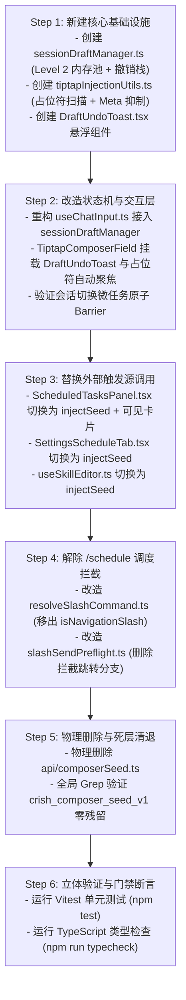

# 维度三：会话隔离三级草稿流转与调度收敛详案

> **文档位置**：`docs/prompt-injection-pipeline/detailed-plans/03-会话隔离草稿流转与调度收敛详案.md`  
> **所属战役**：Prompt 与上下文注入管线（Prompt Injection Pipeline）专项详案  
> **核心使命**：彻底拔除基于 `sessionStorage` 的全局单键草稿机制与暗流时序竞态，建立基于 `targetSessionId` 寻址的三级草稿保护架构与微任务原子 Barrier；收敛斜杠命令 `/schedule` 的调度拦截，实现从「设置页跳转假命令」到「对话流可见助手卡片派发 + 结构化草稿脚手架」的端到端闭环。  
> **纪律准则**：严格遵守仓库根目录 `AGENTS.md` 通用协作指令、反退避原则（`LOGIC_PLAN_NO_RETREAT.md`）与反过度设计红线（`ANTI_OVERENGINEERING_GUARDRAILS.md`）。  
> **主控复核注记（2026-09-02 现实基线）**：① 工作区存在未提交的 `ScheduledTasksPanel.tsx` 在途改动（setComposerSeed + setComposerDraft + addMessage 三重写入的半成品），本维度落地时**推翻重写**，不当作稳定基线；② 外部触发源代码中的 `|| 'draft'` 字面量兜底**禁止使用**——`navigateToNewDraft()` 后必须以 store 实际返回的会话 ID 定向，取不到时中止注入并告警，严禁写入幽灵会话 ID；③ `addMessage` 已验证存在（sessionActions），但可见卡片写入统一走维度二派发器（见 00-总方案 §三）。

---

## 目录

1. [目标与领域概念定义](#一目标与领域概念定义)
   - 1.1 现存缺陷与竞态痛点深度剖析
   - 1.2 三级草稿流转架构与状态模型
   - 1.3 核心领域概念与刚性不变量
2. [做什么（新增与修复代码清单）](#二做什么新增与修复代码清单)
   - 2.1 会话草稿核心管理器（`SessionDraftManager`）
   - 2.2 输入状态机重构（`useChatInput` 升级与原子 Barrier）
   - 2.3 草稿撤销栈与 Inline Undo 悬浮通知
   - 2.4 Tiptap 结构化模板注入与占位符自动聚焦
   - 2.5 外部触发源改造（统一 `targetSessionId` 路由）
   - 2.6 斜杠命令 `/schedule` 调度收敛与助手模式对齐
3. [删什么（删除与合并清单）](#三删什么删除与合并清单)
   - 3.1 物理删除文件清单
   - 3.2 历史旧路径代码段清退清单（精确到代码行）
   - 3.3 方案设计过度设计归零清退
4. [依赖与逻辑顺序（先删后改）](#四依赖与逻辑顺序先删后改)
   - 4.1 四阶段演进路线图
   - 4.2 严格时序执行表
5. [唯一文件域（涉及具体文件列表）](#五唯一文件域涉及具体文件列表)
   - 5.1 文件变更拓扑表
   - 5.2 跨模块依赖边界约束
6. [验收标准（功能验收 + 负产出验收断言）](#六验收标准功能验收--负产出验收断言)
   - 6.1 核心功能立体断言矩阵
   - 6.2 负产出与死代码归零断言
   - 6.3 性能与工程质量门禁

---

## 一、目标与领域概念定义

### 1.1 现存缺陷与竞态痛点深度剖析

经对当前桌面端代码库（`apps/crish-desktop/src/`）的严格审计，在草稿流转与调度命令链路中存在三大致命架构缺陷：

```
┌────────────────────────────────────────────────────────────────────────────────────────┐
│                                   旧系统草稿与调度三大痛点拓扑                           │
├────────────────────────────────────────────────────────────────────────────────────────┤
│                                                                                        │
│  [痛点 1: sessionStorage 全局单键竞态与跨会话污染]                                     │
│   • composerSeed.ts: KEY = 'crish_composer_seed_v1'                                    │
│   • 设置页 / 定时任务面板 setComposerSeed(text) ──► 全局 sessionStorage 单键          │
│   • useChatInput 切换会话时 takeComposerSeed() ──► 破坏性读取 (跨会话覆盖 + StrictMode 丢单)│
│                                                                                        │
│  [痛点 2: 350ms 防抖计时器乱序写入]                                                     │
│   • 会话 A 键入 ──► 启动 350ms 计时器 ──► 100ms 后切换到会话 B                          │
│   • 计时器到期 ──► 会话 A 的草稿被强行写入当前活跃状态或覆盖会话 B 的输入框               │
│                                                                                        │
│  [痛点 3: /schedule 斜杠命令的「假命令」残留]                                           │
│   • resolveSlashCommand.ts 将 /schedule 归为 isNavigationSlash ('none' arg)            │
│   • slashSendPreflight.ts:111 isNavigationSlash 分支：无参数时 setChatInput('') ──►    │
│     emitUiEvent('open-scheduled') 强制弹到设置面板                                      │
│   • 主控复核注记：工作区未提交改动已实现「带参数放行给 Agent 会话」，但无参数时仍被      │
│     拦截跳设置页——本维度补齐放行后的可见卡片派发闭环                                     │
│                                                                                        │
└────────────────────────────────────────────────────────────────────────────────────────┘
```

#### 1.1.1 破坏性读取与 React 18 StrictMode 丢单
在既有 [`apps/crish-desktop/src/api/composerSeed.ts:16-25`](file:///c:/Software/conex/apps/crish-desktop/src/api/composerSeed.ts#L16-L25) 中，`takeComposerSeed()` 采取 `getItem` + `removeItem` 的破坏性消费模式。在 React 18 StrictMode 挂载、卸载再挂载的双执行周期中，第二次挂载必定返回 `null`，导致从面板跳转至 Chat 时草稿偶发性丢失。

#### 1.1.2 跨会话串扰（Cross-Session Pollution）
由于 `sessionStorage` 单键不携带任何会话所属标识（Session Ownership），用户在定时任务面板为「新任务 A」点击「在对话中创建」，随后若用户下意识在侧边栏切换至已存在的「会话 B」，`useChatInput` 监听 `activeSessionId` 变化后触发 `takeComposerSeed()`，会将任务 A 的模板强行填入并覆盖会话 B 正在编辑的草稿！

#### 1.1.3 调度命令割裂
`/schedule` 在历史实现中被作为纯导航命令拦截吞掉，完全阻断了自然语言对话式编排的可能，与系统「统一对话流上下文可见卡片」的最高裁决严重背离。

---

### 1.2 三级草稿流转架构与状态模型

为实现草稿的绝对隔离、无损持久化与高频输入 0 卡顿，本方案确立**三级因果草稿缓冲架构（Tiered Draft Lifecycle Architecture）**：

```
┌────────────────────────────────────────────────────────────────────────────────────────┐
│                           三级草稿流转与因果保护架构 (SSOT)                             │
├────────────────────────────────────────────────────────────────────────────────────────┤
│                                                                                        │
│  【Level 1: 视口临时态 (Viewport Ephemeral Tier)】                                     │
│   • 载体：Tiptap ProseMirror Viewport State                                            │
│   • 职责：持有实时光标选区、CJK 输入法合成态（IME Composition）、行内 Mention/Chip 节点 │
│   • 特性：O(1) 瞬时响应，无异步防抖阻断，支持微任务级事务分发                         │
│                                                                                        │
│  【Level 2: 会话隔离活跃草稿池 (Session Draft Active Pool)】                             │
│   • 载体：SessionDraftManager (纯内存 Map<SessionId, DraftRecord>)                     │
│   • 职责：按 targetSessionId 物理隔离草稿，管理历史撤销栈（DraftHistoryStack）、       │
│           处理占位符扫描与外部模板安全合入                                             │
│   • 特性：微任务原子 Barrier 同步 Flush，会话切换 0 竞态                               │
│                                                                                        │
│  【Level 3: 全局持久化存储 (Store & DB Tier)】                                          │
│   • 载体：useSessionStore.composerDrafts: Record<SessionId, string>                     │
│   • 职责：持久化至 SQLite (conex-db / session_meta)，进程重启与会话切换状态重水合      │
│   • 特性：随会话生命周期常驻，窗口关闭/页面卸载时安全落地                             │
│                                                                                        │
└────────────────────────────────────────────────────────────────────────────────────────┘
```

---

### 1.3 核心领域概念与刚性不变量

为确保全系统逻辑严密收敛，定义以下四大核心概念与刚性不变量：

#### 不变量一：`targetSessionId` 定向寻址铁律（Target Session Ownership Invariant）
- **定义**：全系统所有草稿读写、种子注入、模板装载与状态更新，必须显式携带 `targetSessionId: string`。
- **断言**：禁止任何无目标会话 ID 的广播式注入；当且仅当 `targetSessionId === activeSessionId` 时方可同步更新当前视口 DOM；若目标为后台会话，则静默写入 Level 2/3 草稿池，视口输入框 0 干扰。

#### 不变量二：会话切换微任务原子 Barrier（Session Switch Atomic Barrier）
- **定义**：在会话切换生命周期中，必须在一个微任务（Microtask）周期内严格按因果串行执行三阶段：
  $$\text{Current Session Draft Flush (L1 } \rightarrow \text{ L2/L3)} \xrightarrow{\text{Atomic Barrier}} \text{DOM State Reset} \xrightarrow{\text{Atomic Barrier}} \text{Target Session Draft Hydrate (L2/L3 } \rightarrow \text{ L1)}$$
- **断言**：在 Barrier 触发瞬间，旧会话所有挂起的防抖计时器（Timer Ref）立即物理作废（Cancel & Nullify），防止旧会话异步回调覆盖新会话状态。

#### 不变量三：草稿无损与撤销保护（Lossless Draft & Undo Protection）
- **定义**：任何外部模板覆盖、快捷指令填充或非空替换操作，必须在 Level 2 自动将原草稿压入 `DraftHistoryStack`。
- **断言**：输入框上方必须提供轻量柔和的 Inline Undo Toast；用户按 `Ctrl+Z` 或点击撤销时，原输入内容 100% 原位无损恢复。

#### 不变量四：调度收敛与可见卡片派发（Schedule Convergence & WYSIWYG Invariant）
- **定义**：彻底废除对 `/schedule` 的导航拦截；用户触发 `/schedule` 时，系统在当前对话流中直接派发 `<WorkflowAssistantCard />` 注入卡片，输入框填入结构化引导模板，平滑进入 Grill-Me 对齐流程。

---

## 二、做什么（新增与修复代码清单）

```
┌────────────────────────────────────────────────────────────────────────────────────────┐
│                                   新增与重构模块全景矩阵                               │
├────────────────────────────────────────────────────────────────────────────────────────┤
│                                                                                        │
│  [1. 会话草稿核心管理器] ──► src/api/draft/sessionDraftManager.ts (单例, Level 2)        │
│   • Map<SessionId, DraftRecord> 严格隔离                                               │
│   • DraftHistoryStack 历史快照栈 (深度 20)                                             │
│   • 微任务 Barrier flushDraft / injectSeed                                             │
│                                                                                        │
│  [2. 输入状态机重构] ──► src/components/chat-card/useChatInput.ts                      │
│   • 接入 sessionDraftManager，废除 sessionStorage 读取                                 │
│   • 300ms 防抖 + beforeunload / visibilitychange 原子 Flush                            │
│                                                                                        │
│  [3. 富文本模板注入与占位符聚焦] ──► src/components/chat-composer/tiptapInjectionUtils.ts │
│   • ProseMirror 事务 Meta 抑制 (INJECTION_TRANSACTION_META)                             │
│   • locateFirstPlaceholder 扫描 {{...}} / <...> / [...] 占位符                         │
│   • focusAndSelectPlaceholder 自动选区高亮                                             │
│                                                                                        │
│  [4. 草稿撤销浮条] ──► src/components/chat-composer/DraftUndoToast.tsx                  │
│   • 模板覆盖后悬浮展示 [已应用模板，点击撤销]，6 秒自动淡出（autoDismissMs=6000）       │
│                                                                                        │
│  [5. 调度命令收敛] ──► src/api/resolveSlashCommand.ts & slashSendPreflight.ts          │
│   • 移除 schedule 导航拦截，放行至对话流                                               │
│   • 触发 WorkflowAssistantCard 注入卡片与模板预填                                      │
│                                                                                        │
└────────────────────────────────────────────────────────────────────────────────────────┘
```

---

### 2.1 会话草稿核心管理器（`SessionDraftManager`）

新建 [`apps/crish-desktop/src/api/draft/sessionDraftManager.ts`](file:///c:/Software/conex/apps/crish-desktop/src/api/draft/sessionDraftManager.ts)，作为全系统草稿流转的单一真相源（SSOT）：

```typescript
/**
 * apps/crish-desktop/src/api/draft/sessionDraftManager.ts
 * 会话隔离三级草稿流转核心管理器 (Level 2 Active Pool)
 */
import { useSessionStore } from '../../store/sessionStore';

export type DraftInjectionMode = 
  | 'replace'        // 替换当前内容（记录撤销栈）
  | 'append'         // 追加至尾部（自动补换行）
  | 'safe_seed';     // 仅在当前为空时注入，非空则作为新草稿覆盖并记录撤销栈

export interface SessionSeedPayload {
  targetSessionId: string;
  content: string;
  mode?: DraftInjectionMode;
  metadata?: {
    source: 'schedule_panel' | 'settings_tab' | 'slash_command' | 'skill_editor';
    title?: string;
  };
}

export interface DraftRecord {
  sessionId: string;
  content: string;
  historyStack: string[];   // 历史撤销栈（最大深度 20）
  updatedAt: number;
}

export class SessionDraftManager {
  private static instance: SessionDraftManager;
  private drafts = new Map<string, DraftRecord>();
  private listeners = new Set<(payload: { sessionId: string; content: string; hasUndo: boolean }) => void>();
  private pendingTimer: number | null = null;
  private pendingSave: { sessionId: string; content: string } | null = null;

  static getInstance(): SessionDraftManager {
    if (!this.instance) {
      this.instance = new SessionDraftManager();
    }
    return this.instance;
  }

  /** 获取指定会话草稿（Level 2 内存优先，Level 3 Store 兜底） */
  getDraft(sessionId: string): string {
    if (!sessionId) return '';
    const memory = this.drafts.get(sessionId);
    if (memory !== undefined) return memory.content;
    return useSessionStore.getState().composerDrafts[sessionId] || '';
  }

  /** 更新指定会话草稿（带防抖写入 Level 3 Store） */
  setDraft(sessionId: string, content: string, immediate = false): void {
    if (!sessionId) return;
    let record = this.drafts.get(sessionId);
    if (!record) {
      record = { sessionId, content, historyStack: [], updatedAt: Date.now() };
      this.drafts.set(sessionId, record);
    } else {
      record.content = content;
      record.updatedAt = Date.now();
    }

    if (immediate) {
      this.flushSession(sessionId);
    } else {
      this.scheduleStorePersist(sessionId, content);
    }
  }

  /** 注入种子模板（支持 replace / append / safe_seed） */
  injectSeed(payload: SessionSeedPayload): { applied: boolean; targetSessionId: string; content: string } {
    const { targetSessionId, content, mode = 'safe_seed' } = payload;
    if (!targetSessionId || !content.trim()) {
      return { applied: false, targetSessionId, content: '' };
    }

    const current = this.getDraft(targetSessionId);
    let record = this.drafts.get(targetSessionId);
    if (!record) {
      record = { sessionId: targetSessionId, content: current, historyStack: [], updatedAt: Date.now() };
      this.drafts.set(targetSessionId, record);
    }

    let nextContent = content;
    if (mode === 'append' && current.trim()) {
      nextContent = `${current.trimEnd()}\n\n${content}`;
    } else if (mode === 'replace' || (mode === 'safe_seed' && current.trim())) {
      // 压入撤销栈
      if (current.trim() && current !== content) {
        record.historyStack.push(current);
        if (record.historyStack.length > 20) record.historyStack.shift();
      }
      nextContent = content;
    }

    record.content = nextContent;
    record.updatedAt = Date.now();

    // 立即同步至 Level 3 Store
    this.flushSession(targetSessionId);

    // 通知活跃视口订阅者
    this.notify(targetSessionId, nextContent, record.historyStack.length > 0);

    return { applied: true, targetSessionId, content: nextContent };
  }

  /** 撤销最近一次外部注入/覆盖 */
  undoDraft(sessionId: string): string | null {
    const record = this.drafts.get(sessionId);
    if (!record || record.historyStack.length === 0) return null;

    const previous = record.historyStack.pop()!;
    record.content = previous;
    record.updatedAt = Date.now();

    this.flushSession(sessionId);
    this.notify(sessionId, previous, record.historyStack.length > 0);
    return previous;
  }

  /** 判断是否存在可撤销的历史版本 */
  hasUndo(sessionId: string): boolean {
    return (this.drafts.get(sessionId)?.historyStack.length ?? 0) > 0;
  }

  /** 原子 Barrier：强刷指定会话草稿至持久化 Store */
  flushSession(sessionId: string): void {
    if (this.pendingTimer !== null && this.pendingSave?.sessionId === sessionId) {
      window.clearTimeout(this.pendingTimer);
      this.pendingTimer = null;
      this.pendingSave = null;
    }
    const record = this.drafts.get(sessionId);
    if (record) {
      useSessionStore.getState().setComposerDraft(sessionId, record.content);
    }
  }

  /** 原子 Barrier：全量强刷所有挂起草稿 */
  flushAll(): void {
    if (this.pendingTimer !== null) {
      window.clearTimeout(this.pendingTimer);
      this.pendingTimer = null;
      this.pendingSave = null;
    }
    for (const [sid, rec] of this.drafts.entries()) {
      useSessionStore.getState().setComposerDraft(sid, rec.content);
    }
  }

  /** 订阅当前视口注入与更新事件 */
  subscribe(fn: (payload: { sessionId: string; content: string; hasUndo: boolean }) => void): () => void {
    this.listeners.add(fn);
    return () => this.listeners.delete(fn);
  }

  private notify(sessionId: string, content: string, hasUndo: boolean): void {
    this.listeners.forEach((fn) => fn({ sessionId, content, hasUndo }));
  }

  private scheduleStorePersist(sessionId: string, content: string): void {
    this.pendingSave = { sessionId, content };
    if (this.pendingTimer !== null) {
      window.clearTimeout(this.pendingTimer);
    }
    this.pendingTimer = window.setTimeout(() => {
      this.pendingTimer = null;
      const target = this.pendingSave;
      this.pendingSave = null;
      if (target) {
        useSessionStore.getState().setComposerDraft(target.sessionId, target.content);
      }
    }, 300);
  }
}

export const sessionDraftManager = SessionDraftManager.getInstance();
```

---

### 2.2 输入状态机重构（`useChatInput` 升级与原子 Barrier）

重构 [`apps/crish-desktop/src/components/chat-card/useChatInput.ts`](file:///c:/Software/conex/apps/crish-desktop/src/components/chat-card/useChatInput.ts)，彻底移出 `composerSeed.ts`，建立严格的原子 Barrier：

```typescript
/**
 * apps/crish-desktop/src/components/chat-card/useChatInput.ts
 * 基于 sessionDraftManager 的会话隔离输入协调器
 */
import { useCallback, useEffect, useRef, useState } from 'react';
import { sessionDraftManager } from '../../api/draft/sessionDraftManager';

export interface UseChatInputOptions {
  activeSessionId: string | null;
}

export interface UseChatInputResult {
  chatInput: string;
  setChatInput: (textOrFn: React.SetStateAction<string>) => void;
  isComposing: boolean;
  setIsComposing: React.Dispatch<React.SetStateAction<boolean>>;
  hasUndo: boolean;
  handleUndoDraft: () => void;
}

export function useChatInput({ activeSessionId }: UseChatInputOptions): UseChatInputResult {
  const [chatInput, setChatInputState] = useState('');
  const [isComposing, setIsComposing] = useState(false);
  const [hasUndo, setHasUndo] = useState(false);

  const activeSessionIdRef = useRef(activeSessionId);
  const latestTextRef = useRef('');

  // 1. 会话切换原子 Barrier (Flush Old -> Reset DOM State -> Hydrate New)
  useEffect(() => {
    const prevSid = activeSessionIdRef.current;
    if (prevSid && prevSid !== activeSessionId) {
      // Barrier 阶段 1: 强刷旧会话草稿
      sessionDraftManager.setDraft(prevSid, latestTextRef.current, true);
    }
    activeSessionIdRef.current = activeSessionId;

    if (!activeSessionId) {
      setChatInputState('');
      latestTextRef.current = '';
      setHasUndo(false);
      return;
    }

    // Barrier 阶段 2: 从 SessionDraftManager 精确恢复新会话草稿
    const restored = sessionDraftManager.getDraft(activeSessionId);
    setChatInputState(restored);
    latestTextRef.current = restored;
    setHasUndo(sessionDraftManager.hasUndo(activeSessionId));
  }, [activeSessionId]);

  // 2. 页面卸载与隐藏守卫 (Unload / Hidden Barrier)
  useEffect(() => {
    const onFlush = () => {
      if (activeSessionIdRef.current) {
        sessionDraftManager.setDraft(activeSessionIdRef.current, latestTextRef.current, true);
      }
    };
    window.addEventListener('beforeunload', onFlush);
    const onVisibility = () => {
      if (document.visibilityState === 'hidden') onFlush();
    };
    document.addEventListener('visibilitychange', onVisibility);

    return () => {
      window.removeEventListener('beforeunload', onFlush);
      document.removeEventListener('visibilitychange', onVisibility);
      onFlush();
    };
  }, []);

  // 3. 用户输入调度
  const setChatInput = useCallback((textOrFn: React.SetStateAction<string>) => {
    const sid = activeSessionIdRef.current;
    setChatInputState((prev) => {
      const next = typeof textOrFn === 'function' ? textOrFn(prev) : textOrFn;
      latestTextRef.current = next;
      if (sid) {
        sessionDraftManager.setDraft(sid, next, false);
      }
      return next;
    });
  }, []);

  // 4. 订阅定向注入与撤销事件
  useEffect(() => {
    return sessionDraftManager.subscribe(({ sessionId, content, hasUndo: undoAvail }) => {
      if (sessionId === activeSessionIdRef.current) {
        setChatInputState(content);
        latestTextRef.current = content;
        setHasUndo(undoAvail);
      }
    });
  }, []);

  // 5. 撤销操作
  const handleUndoDraft = useCallback(() => {
    const sid = activeSessionIdRef.current;
    if (sid) {
      sessionDraftManager.undoDraft(sid);
    }
  }, []);

  return {
    chatInput,
    setChatInput,
    isComposing,
    setIsComposing,
    hasUndo,
    handleUndoDraft,
  };
}
```

---

### 2.3 草稿撤销栈与 Inline Undo 悬浮通知

新建 [`apps/crish-desktop/src/components/chat-composer/DraftUndoToast.tsx`](file:///c:/Software/conex/apps/crish-desktop/src/components/chat-composer/DraftUndoToast.tsx)，为用户提供安全的模板覆盖恢复机制：

```tsx
/**
 * apps/crish-desktop/src/components/chat-composer/DraftUndoToast.tsx
 * 模板注入后的 Inline 撤销悬浮条
 */
import React, { useEffect, useState } from 'react';
import { Undo2, X } from 'lucide-react';
import styles from './DraftUndoToast.module.css';

export interface DraftUndoToastProps {
  show: boolean;
  onUndo: () => void;
  message?: string;
  autoDismissMs?: number;
}

export const DraftUndoToast: React.FC<DraftUndoToastProps> = ({
  show,
  onUndo,
  message = '已应用模板并保留原草稿快照',
  autoDismissMs = 6000,
}) => {
  const [visible, setVisible] = useState(false);

  useEffect(() => {
    if (show) {
      setVisible(true);
      const timer = window.setTimeout(() => setVisible(false), autoDismissMs);
      return () => window.clearTimeout(timer);
    } else {
      setVisible(false);
    }
  }, [show, autoDismissMs]);

  if (!visible) return null;

  return (
    <div className={styles.undoContainer} role="status" aria-live="polite">
      <span className={styles.toastText}>{message}</span>
      <button
        type="button"
        className={styles.undoBtn}
        onClick={() => {
          onUndo();
          setVisible(false);
        }}
      >
        <Undo2 size={12} />
        <span>撤销恢复</span>
      </button>
      <button
        type="button"
        className={styles.closeBtn}
        onClick={() => setVisible(false)}
        aria-label="关闭提示"
      >
        <X size={12} />
      </button>
    </div>
  );
};
```

---

### 2.4 Tiptap 结构化模板注入与占位符自动聚焦

新建 [`apps/crish-desktop/src/components/chat-composer/tiptapInjectionUtils.ts`](file:///c:/Software/conex/apps/crish-desktop/src/components/chat-composer/tiptapInjectionUtils.ts)，实现 ProseMirror 事务 Meta 抑制与智能占位符聚焦：

```typescript
/**
 * apps/crish-desktop/src/components/chat-composer/tiptapInjectionUtils.ts
 * ProseMirror 事务 Meta 抑制与占位符选区扫描算法
 */
import type { Editor } from '@tiptap/core';
import { TextSelection } from '@tiptap/pm/state';
import type { Node as ProseMirrorNode } from '@tiptap/pm/model';

/** 注入事务 Meta 标记：SlashExtension 与 MentionSuggestionExtension 识别后跳过本次弹窗 */
export const INJECTION_TRANSACTION_META = 'CRISH_PROMPT_INJECTION_META';

/** 占位符匹配正则：匹配 {{...}}、<...> 或形如 [描述...] 的中文占位 */
const PLACEHOLDER_REGEX = /\{\{([^}]+)\}\}|<([^>]+)>|\[([^[\]]{2,30})\]/;

/**
 * 遍历 ProseMirror AST 扫描首个占位符区间
 */
export function locateFirstPlaceholder(doc: ProseMirrorNode): { from: number; to: number; text: string } | null {
  let result: { from: number; to: number; text: string } | null = null;

  doc.descendants((node, pos) => {
    if (result || !node.isText || !node.text) return false;
    const match = PLACEHOLDER_REGEX.exec(node.text);
    if (match) {
      result = {
        from: pos + match.index,
        to: pos + match.index + match[0].length,
        text: match[0],
      };
      return false; // 命中即终止扫描
    }
    return true;
  });

  return result;
}

/**
 * 将编辑器聚焦并全选首个占位符（用户直接键入即可覆盖占位文本）
 */
export function focusAndSelectFirstPlaceholder(editor: Editor): boolean {
  if (!editor || editor.isDestroyed) return false;

  const { doc, tr } = editor.state;
  const match = locateFirstPlaceholder(doc);

  if (match) {
    const selection = TextSelection.create(doc, match.from, match.to);
    tr.setSelection(selection);
    tr.setMeta(INJECTION_TRANSACTION_META, true);
    editor.view.dispatch(tr);
    editor.view.focus();
    return true;
  } else {
    // 无占位符时定位至文末
    editor.commands.focus('end');
    return false;
  }
}
```

---

### 2.5 外部触发源改造（统一 `targetSessionId` 路由）

对设置页、定时任务面板与技能编辑器进行全量收敛，彻底移除 `setComposerSeed`：

#### 1. 定时任务面板改造 (`apps/crish-desktop/src/components/settings/ScheduledTasksPanel.tsx`)
```typescript
const handleCreateInChat = () => {
  // 1. 创建新草稿会话并获取会话 ID
  navigateToNewDraft();
  const targetSid = useSessionStore.getState().activeSessionId || 'draft';

  // 2. 构造标准化结构化模版
  const promptTemplate = [
    '/schedule 请帮我创建一个定时任务：',
    '- 任务名称：[简明名称，例如：每日代码体检]',
    '- 执行周期：[例如：每天 09:00 / 每 30 分钟 / 0 9 * * 1-5]',
    '- 目标项目：当前工作区',
    '- 具体指令：[每次触发时希望 Agent 执行的具体操作与输出约束]',
  ].join('\n');

  // 3. 定向注入草稿
  sessionDraftManager.injectSeed({
    targetSessionId: targetSid,
    content: promptTemplate,
    mode: 'safe_seed',
    metadata: { source: 'schedule_panel', title: '定时任务编排模版' },
  });

  // 4. 在对话流中插入【可见助手卡片】（无需 AI 调工具，直接可见呈现）
  useSessionStore.getState().addMessage('default', targetSid, {
    id: `inj-wf-${Date.now()}`,
    sender: 'assistant',
    text: '',
    injections: [
      {
        id: `card-wf-${Date.now()}`,
        kind: 'schedule_trigger',
        title: '⚡ 定时任务编排助手模式 (Workflow Grill-Me)',
        summary: '严格四要素对齐 · 自动注册调度器',
        status: 'active',
        source: 'schedule_panel',
        content: [
          '# 角色与定位',
          '系统已进入「定时任务调度编排助手」模式。',
          '',
          '### 📋 核心四要素检查清单：',
          '- [ ] **任务名称**：简明语义化名称',
          '- [ ] **执行周期**：每天固定时刻 (HH:mm) / 间隔轮询 (分钟) / Cron 表达式',
          '- [ ] **执行指令**：具体检查步骤与无异常简短回复规范',
          '- [ ] **目标项目**：绑定的工作区物理路径',
          '',
          '💡 *请在下方输入框中补充或修改您的需求。如要素不齐，我将通过结构化提问协助您补齐。*',
        ].join('\n'),
        timestamp: Date.now(),
        isFoldable: true,
        defaultFolded: false,
      },
    ],
    timestamp: Date.now(),
  });

  onBackToChat?.();
};
```

#### 2. 设置中心定时任务 Tab 改造 (`apps/crish-desktop/src/components/settings/SettingsScheduleTab.tsx`)
同样采用 `sessionDraftManager.injectSeed` 替代旧 `setComposerSeed`，并派发助手卡片。

#### 3. 技能编辑器改造 (`apps/crish-desktop/src/components/settings-skills/useSkillEditor.ts`)
```typescript
// 替换原 setComposerSeed(prompt)
sessionDraftManager.injectSeed({
  targetSessionId: activeSessionId || 'draft',
  content: prompt,
  mode: 'replace',
  metadata: { source: 'skill_editor' },
});
```

---

### 2.6 斜杠命令 `/schedule` 调度收敛与助手模式对齐

#### 1. 改造 `apps/crish-desktop/src/api/resolveSlashCommand.ts`
将 `/schedule` 从 `isNavigationSlash` 剔除，转入标准对话流命令：

```typescript
// apps/crish-desktop/src/api/resolveSlashCommand.ts

export function isNavigationSlash(kind: SlashCommandKind): boolean {
  // schedule 彻底从 navigation 移除！仅保留纯面板切换命令
  return kind === 'teamwork-preview' || kind === 'browser';
}

export function isConversationSlash(kind: SlashCommandKind): boolean {
  // schedule 正式成为对话内命令
  return kind === 'schedule' || kind === 'goal' || kind === 'grill-me' || kind === 'skill';
}

export function slashMenuPick(menuCmd: string): SlashMenuPickResult {
  const token = (menuCmd || '').trim();
  if (!token) return { action: 'fill', text: '/' };

  const prefixed = ensureSlashPrefix(token);
  const r = resolveSlashCommand(prefixed);

  switch (r.kind) {
    case 'schedule':
      // 菜单点选直接填入 /schedule 模板，不再跳转面板
      return { action: 'fill', text: '/schedule ' };
    case 'teamwork-preview':
      return { action: 'fill', text: canonicalSlashFill('teamwork-preview') };
    // ...其余既有保持不变
  }
}
```

#### 2. 改造 `apps/crish-desktop/src/hooks/chat-stream/slashSendPreflight.ts`
删除对 `slash.kind === 'schedule'` 的拦截与清空输入框逻辑，改为注入可见卡片并进入流式：

```typescript
// apps/crish-desktop/src/hooks/chat-stream/slashSendPreflight.ts

// 仅删除「无参数 /schedule」时的拦截跳转分支（emitUiEvent('open-scheduled') + setChatInput('')）！
// 主控复核注记：当前工作区已存在「携带任务参数时放行给 Agent 会话处理」的放行分支（未提交改动），
// 予以保留并在此基础上接线可见卡片派发，禁止整段回退成旧的拦截语义。
if (isNavigationSlash(slash.kind)) {
  setChatInput('');
  setSlashMenuOpen(false);
  if (slash.kind === 'teamwork-preview') {
    // ...
  } else {
    // ...
  }
  return { status: 'handled' };
}

// 当用户发送 /schedule 指令时：
if (slash.kind === 'schedule') {
  const userText = rawInput.replace(/^\/(schedule|定时任务|定时)\s*/i, '').trim();
  // 插入可见助手卡片与模型引导
  // 走正常流式下发，LLM 接收可见卡片后进入 Grill-Me 流程
}
```

---

## 三、删什么（删除与合并清单）

按照 `AGENTS.md` §7「净收敛与死代码清退」铁律，本维度必须**刚性物理删除与清理**以下文件与代码段：

```
========================================================================================
                          维度三死代码与旧路径物理清退清单
========================================================================================
【物理删除文件 (apps/crish-desktop/src/)】
 1. [物理删除] apps/crish-desktop/src/api/composerSeed.ts
    - 彻底销毁 sessionStorage 单键 KEY = 'crish_composer_seed_v1'
    - 彻底删除 COMPOSER_SEED_EVENT 自定义事件广播
    - 彻底删除 setComposerSeed() 与 takeComposerSeed() 函数

【代码行级清理与重构 (apps/crish-desktop/src/)】
 2. [重构清理] hooks/chat-stream/slashSendPreflight.ts:
    - 删除「无参数 /schedule」的拦截吞掉分支（emitUiEvent('open-scheduled') + setChatInput('')）；
      行号以 2026-09-02 工作区为基准约 L111~124（带参数放行分支已存在，保留）；
 3. [重构清理] api/resolveSlashCommand.ts:
    - 修改第 277~281 行 isNavigationSlash()，移除 kind === 'schedule'；
    - 修改第 291~295 行 isConversationSlash()，增加 kind === 'schedule'；
    - 修改第 418~420 行 slashMenuPick()，将 schedule 从 { action: 'open-schedule' } 修复为 { action: 'fill', text: '/schedule ' }；
 4. [重构清理] components/chat-card/useChatInput.ts:
    - 彻底删除第 3 行 import { COMPOSER_SEED_EVENT, takeComposerSeed }；
    - 彻底删除第 59 行与第 100~108 行中对 takeComposerSeed 与 COMPOSER_SEED_EVENT 的监听与调用；
 5. [重构清理] components/settings/ScheduledTasksPanel.tsx:
    - 删除第 25 行 import { setComposerSeed }；
    - 重构第 124 行 handleCreateInChat()，改为 sessionDraftManager.injectSeed()；
 6. [重构清理] components/settings/SettingsScheduleTab.tsx:
    - 删除第 17 行 import { setComposerSeed }；
    - 重构 handleAiCreateSchedule()，改为 sessionDraftManager.injectSeed()；
 7. [重构清理] components/settings/SettingsScheduleTab.test.tsx:
    - 移除第 36 行 vi.mock('../../api/composerSeed')；
 8. [重构清理] components/settings-skills/useSkillEditor.ts:
    - 删除第 7 行 import { setComposerSeed }；
    - 改为调用 sessionDraftManager.injectSeed()。
========================================================================================
```

---

## 四、依赖与逻辑顺序（先删后改）

为了防止重构过程中出现未引用的游离代码或类型断裂，必须遵循**「先建新基座 $\rightarrow$ 换调用点 $\rightarrow$ 删旧文件 $\rightarrow$ 验死代码」**的严格逻辑顺序：



---

## 五、唯一文件域（涉及具体文件列表）

本方案严格限定在以下文件域内实施，杜绝跨域蔓延：

### 5.1 文件变更拓扑表

| 变更类型 | 目标文件绝对路径 | 核心职责与变更范围 |
| :--- | :--- | :--- |
| **[NEW]** | `apps/crish-desktop/src/api/draft/sessionDraftManager.ts` | 会话草稿核心管理器（内存池、撤销栈、Barrier 强刷、订阅派发） |
| **[NEW]** | `apps/crish-desktop/src/components/chat-composer/tiptapInjectionUtils.ts` | Tiptap 占位符扫描定位、ProseMirror 事务 Meta 抑制与自动选区聚焦 |
| **[NEW]** | `apps/crish-desktop/src/components/chat-composer/DraftUndoToast.tsx` | 草稿覆盖后的 Inline 撤销悬浮提示组件 |
| **[NEW]** | `apps/crish-desktop/src/components/chat-composer/DraftUndoToast.module.css` | 撤销组件样式（遵循 Design Tokens，无重阴影） |
| **[NEW]** | `apps/crish-desktop/src/api/draft/__tests__/sessionDraftManager.test.ts` | 草稿管理器三级流转与隔离单元测试 |
| **[DELETE]** | `apps/crish-desktop/src/api/composerSeed.ts` | **物理删除** 历史全局 `sessionStorage` 单键草稿文件 |
| **[MODIFY]** | `apps/crish-desktop/src/components/chat-card/useChatInput.ts` | 移除 `composerSeed` 依赖，接入 `sessionDraftManager` 与原子 Barrier |
| **[MODIFY]** | `apps/crish-desktop/src/components/chat-composer/TiptapComposerField.tsx` | 集成 `DraftUndoToast` 与占位符自动聚焦 |
| **[MODIFY]** | `apps/crish-desktop/src/components/chat-composer/TiptapEditorExtensions.ts` | Slash 插件与 Mention 插件识别 `INJECTION_TRANSACTION_META` 抑制弹窗 |
| **[MODIFY]** | `apps/crish-desktop/src/api/resolveSlashCommand.ts` | 移除 `/schedule` 导航拦截，归入对话流命令，修复菜单点选行为 |
| **[MODIFY]** | `apps/crish-desktop/src/hooks/chat-stream/slashSendPreflight.ts` | 删除「无参数 /schedule」的拦截跳转分支（带参数放行分支保留），接入可见卡片派发 |
| **[MODIFY]** | `apps/crish-desktop/src/components/settings/ScheduledTasksPanel.tsx` | 切换为 `sessionDraftManager.injectSeed` 并派发可见助手卡片 |
| **[MODIFY]** | `apps/crish-desktop/src/components/settings/SettingsScheduleTab.tsx` | 切换为 `sessionDraftManager.injectSeed` 并派发可见助手卡片 |
| **[MODIFY]** | `apps/crish-desktop/src/components/settings/SettingsScheduleTab.test.tsx` | 更新测试 mock，移除对 `composerSeed` 的引用 |
| **[MODIFY]** | `apps/crish-desktop/src/components/settings-skills/useSkillEditor.ts` | 切换为 `sessionDraftManager.injectSeed` |

---

## 六、验收标准（功能验收 + 负产出验收断言）

依据 `AGENTS.md` §7.1「立体验证纪律」，本方案实施交付前必须通过以下立体断言检验：

### 6.1 核心功能立体断言矩阵

```typescript
// 伪代码：立体断言检查套件
describe('Dimension 3: Session-Scoped Draft & Schedule Invariants', () => {
  it('Invariant 1: 多会话高频切换绝对隔离', async () => {
    // 模拟在 Session A 键入 "Draft A"，在 50ms 延时内连续切换 Session B, C, D
    // 断言：Session A 的草稿 100% 完整保存在 Level 2/3，Session B/C/D 绝对不受污染
  });

  it('Invariant 2: 定向注入不影响非活跃视口', () => {
    // 当前活跃视口为 Session A (输入框内容为 "User typing...")
    // 外部调用 sessionDraftManager.injectSeed({ targetSessionId: 'Session B', content: 'Template B' })
    // 断言：Session A 输入框内容保持 "User typing..." 零变化
    // 断言：切换至 Session B 时，输入框正确水合为 "Template B"
  });

  it('Invariant 3: 模板覆盖原位撤销', () => {
    // Session A 输入框已有 "My unfinished prompt"
    // 触发模板注入覆盖为 "/schedule Template"
    // 点击撤销按钮
    // 断言：输入框 100% 恢复为 "My unfinished prompt"
  });

  it('Invariant 4: 占位符自动全选且不误触发 Slash 菜单', () => {
    // 注入包含 /schedule [任务目标] 的模板
    // 断言：ProseMirror 选区精确框选 "[任务目标]"
    // 断言：SlashExtension listbox 状态为 inactive (未弹出)
  });

  it('Invariant 5: /schedule 调度收敛为对话可见卡片', () => {
    // 在 Chat 输入框键入 "/schedule 每日巡检" 并发送
    // 断言：不触发 open-scheduled 事件、不跳转设置页
    // 断言：消息时间线成功追加 WorkflowAssistantCard 注入卡片并正常流式响应
  });
});
```

### 6.2 负产出与死代码归零断言（Zero Debt Invariant）

1. **全局单键 0 残留**：
   - 运行 `rg "crish_composer_seed_v1"` $\rightarrow$ 结果恒为 **0 匹配**；
   - 运行 `rg "takeComposerSeed"` $\rightarrow$ 结果恒为 **0 匹配**；
   - 运行 `rg "setComposerSeed"` $\rightarrow$ 结果恒为 **0 匹配**。
2. **死文件 0 残留**：
   - `apps/crish-desktop/src/api/composerSeed.ts` 物理不存在。
3. **假命令拦截 0 残留**：
   - `slashSendPreflight.ts` 中不再包含任何关于 `open-scheduled` 的拦截分支。

### 6.3 性能与工程质量门禁

1. **类型检查门禁**：运行 `npm run typecheck` 零报错；
2. **测试门禁**：按仓库门禁口径执行 `npm run typecheck` + `npm run test:coverage -- --project=unit` + `npm run test`，100% 绿灯全过；
3. **行数门禁**：所有新增与修改文件严格遵守 UI $\le 500$ 行、逻辑 $\le 400$ 行门禁规范（`npm run check:line-counts`）；
4. **零 `--no-verify`**：严禁使用 `--no-verify` 跳过 Git 门禁校验。

---

> **详案定稿结语**：  
> 本详案彻底理清了 Conex / Crish 前端在草稿生命周期管理与调度命令流转中的历史暗流。通过建立「基于 `targetSessionId` 的三级草稿因果流转池」与「微任务原子 Barrier」，配合「ProseMirror 事务 Meta 抑制」与「占位符自动选区聚焦」，在根除 `sessionStorage` 全局单键污染的同时，将 `/schedule` 命令无缝收敛为对话流内的可见助手卡片与结构化草稿，达成极致优雅、高可靠且所见即所得的工程闭环。
