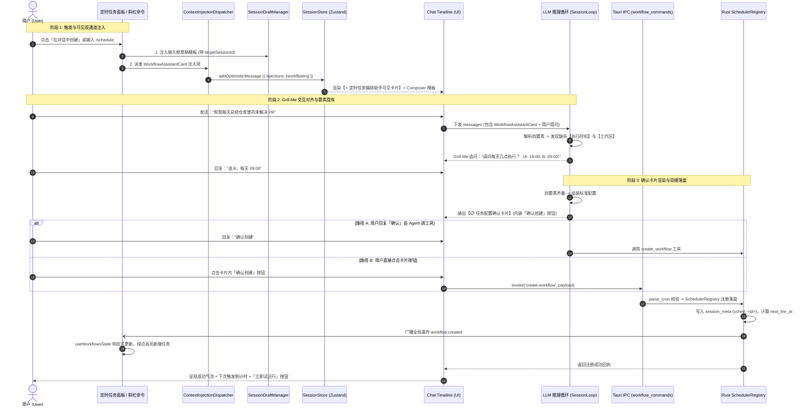
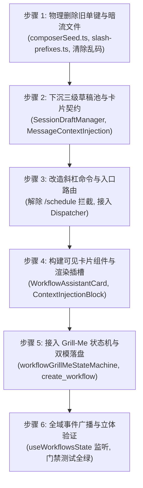

# 定时任务编排助手与特色模式端到端落地实践详案（维度五）

> **文档定位**：`docs/prompt-injection-pipeline/detailed-plans/05-定时任务编排助手落地实践详案.md`
> **战役工作区**：Prompt 与上下文注入管线重构（Prompt Injection Pipeline Campaign）
> **评审基准**：严格落实 `docs/prompt-injection-pipeline/plan-reviews/` 01（可见注入裁决）、02（路径收敛与删除面）、03（卡片交互协议）三份权威评审结论。
> **核心裁决**：**“不用隐式通道了，这种注入应该是在上下文里面的，所以正常在对话流里面显示为对应的注入显示即可，当做工具调用的效果一样就行，只是这个不用ai主动调用，是直接注入的。”**
> **主控复核注记（2026-09-02，初稿勘误后定稿）**：① 卡片契约统一为详案 02 的 `MessageContextInjection`（store/types.ts）——本详案初稿的 `types/injectionCard.ts` / `ContextInjectionCardPayload` / `kind: 'mode-assistant'` 废止，场景映射为 `kind: 'schedule_trigger'`、字段用 `summary` / `tokenEstimate`；② `SessionDraftManager` 实际路径为 `api/draft/sessionDraftManager.ts`（初稿 import 漏了 `/draft/`），且**只调 manager，禁止再直写 `setComposerDraft` 双写**；③ `generateWorkflowComposerSeed` 在 workflowsSharedLib 中不存在（初稿幽灵导入），改为内联模板；④ 新增 agent 工具接线必须走 TimerChannel 模式（agent-tools 是叶子 crate，见 §2.4 注记）。
> **纪律准则**：遵守仓库根目录 `AGENTS.md` 通用协作指令、反退避铁律（`LOGIC_PLAN_NO_RETREAT.md`）及反过度设计红线（`ANTI_OVERENGINEERING_GUARDRAILS.md`）。

---

## 目录

- [一、目标与领域概念定义](#一定标与领域概念定义)
  - [1.1 场景痛点与架构演进目标](#11-场景痛点与架构演进目标)
  - [1.2 六大核心领域概念模型](#12-六大核心领域概念模型)
  - [1.3 端到端闭环架构拓扑与交互时序](#13-端到端闭环架构拓扑与交互时序)
- [二、做什么（新增与修复代码清单）](#二做什么新增与修复代码清单)
  - [2.1 定时任务面板与设置页入口改造](#21-定时任务面板与设置页入口改造)
  - [2.2 对话流可见注入卡片组件群（WorkflowAssistantCard）](#22-对话流可见注入卡片组件群workflowassistantcard)
  - [2.3 Grill-Me 渐进式追问状态机与纠偏话术引擎](#23-grill-me-渐进式追问状态机与纠偏话术引擎)
  - [2.4 双模落盘机制与接口执行链路（Tool + IPC）](#24-双模落盘机制与接口执行链路tool--ipc)
  - [2.5 全域状态实时广播与面板响应式同步](#25-全域状态实时广播与面板响应式同步)
- [三、删什么（删除与合并清单：清退旧版隐式注入与硬跳转）](#三删什么删除与合并清单清退旧版隐式注入与硬跳转)
  - [3.1 物理删除清单（精确到文件与符号）](#31-物理删除清单精确到文件与符号)
  - [3.2 拦截与暗流分支清退清单（精确到代码行）](#32-拦截与暗流分支清退清单精确到代码行)
  - [3.3 架构过度设计与伪需求归零清单](#33-架构过度设计与伪需求归零清单)
- [四、依赖与逻辑顺序（先删后改）](#四依赖与逻辑顺序先删后改)
  - [4.1 六步实施工序与依赖前置条件](#41-六步实施工序与依赖前置条件)
  - [4.2 状态跃迁与防御性回滚策略](#42-状态跃迁与防御性回滚策略)
- [五、唯一文件域（涉及具体文件列表）](#五唯一文件域涉及具体文件列表)
  - [5.1 前端文件域（React / TypeScript）](#51-前端文件域react--typescript)
  - [5.2 后端与协议文件域（Rust / Tauri IPC）](#52-后端与协议文件域rust--tauri-ipc)
- [六、验收标准（功能验收 + 负产出验收断言）](#六验收标准功能验收--负产出验收断言)
  - [6.1 功能性端到端验收断言（TC-WG-01 ~ TC-WG-08）](#61-功能性端到端验收断言tc-wg-01--tc-wg-08)
  - [6.2 负产出与净收敛刚性断言（NC-01 ~ NC-06）](#62-负产出与净收敛刚性断言nc-01--nc-06)
  - [6.3 立体自动化门禁与性能指标](#63-立体自动化门禁与性能指标)

---

## 一、目标与领域概念定义

### 1.1 场景痛点与架构演进目标

在 Conex / Crish 桌面工作区中，定时任务（Workflow & Cron Schedule）是用户实现无人值守、长效代码巡检、依赖审计与自动化报告的核心功能。既往实现存在四大系统性断层：

1. **暗流与黑盒断层**：早期方案试图将定时任务编排指令作为隐式 `System Prompt` 或私有前缀拼装发送，用户在界面上完全看不见当前 AI 处于何种模式，体验犹如“盲盒”；
2. **命令拦截与跳转断层**：在输入框键入 `/schedule` 时，旧逻辑在 Preflight 阶段将其视为“纯导航”强行拦截并清空输入框，弹开设置页，彻底阻断了在对话中通过自然语言编排定时任务的可能；
3. **全局草稿竞态污染**：通过全局 `sessionStorage` 单键（`crish_composer_seed_v1`）中转草稿模板，在多会话快速切换或 React StrictMode 下产生严重的草稿覆盖、串扰与丢失；
4. **状态脱节与刷新延迟**：对话中生成的定时任务无法可靠广播至左侧面板与设置中心，用户无法即时看到下一次执行倒计时。

**演进终局目标**：
彻底废除隐式后台注入通道与命令硬拦截，确立 **「对话流上下文可见注入卡片（WYSIWYG Visible Card）」** 为单一真理模型。实现从定时任务面板/快捷命令一键触发、对话流呈现高质感编排卡片、Composer 安全填入脚手架、Grill-Me 结构化追问对齐、双模接口安全落盘、到全域状态毫秒级无感同步的完整可执行闭环。

---

### 1.2 六大核心领域概念模型

```
┌────────────────────────────────────────────────────────────────────────────────────────┐
│                         维度五：定时任务编排助手核心领域模型                            │
├────────────────────────────────────────────────────────────────────────────────────────┤
│ 1. [WorkflowAssistantCard] ──► 时间线一等公民卡片，展示编排目标、四要素清单与交互准则  │
│ 2. [SessionDraftManager]   ──► 绑定 targetSessionId 的三级草稿池，杜绝跨会话串扰       │
│ 3. [Grill-Me Pillars]      ──► 四核心要素契约：Name(名称)、Schedule(周期)、Prompt(指令)│
│                                和 Cwd(工作区路径)，缺一不可                            │
│ 4. [WatchHint Redirection] ──► 伪监听防御：将 Git Push/文件变动需求引导为周期轮询      │
│ 5. [Dual Execution Engine] ──► 双模落盘：Agent Tool 自动调用 + UI 交互卡片一键落盘兜底 │
│ 6. [Reactive Event Bus]    ──► Rust SchedulerRegistry ──► workflow:created ──► UI 同步 │
└────────────────────────────────────────────────────────────────────────────────────────┘
```

#### 概念 1：对话流可见注入卡片（Visible Workflow Assistant Card）
- **语义定位**：作为消息时间线中的合法消息实体（`type: 'context_injection'`, `kind: 'schedule_trigger'`），渲染为类似工具调用结果的结构化卡片；
- **被动直接注入（Passive Direct Injection）**：触发时由前端/系统直接插入时间线，**零额外 AI 生成轮次**，毫秒级即时落盘；
- **静态系统提示词保持纯净**：底层的 `system_prompt` 仅保留 L0 核心基座与 L1 宿主环境，绝对不动态拼接任何编排模式文本，最大化利用大模型 KV 缓存。

#### 概念 2：会话隔离三级草稿缓冲（TargetSessionId Draft SSOT）
- **语义定位**：输入框草稿与种子模板彻底脱离全局单键；
- **三级架构**：Viewport Tiptap AST $\rightarrow$ `SessionDraftManager`（基于 `targetSessionId` 的内存池）$\rightarrow$ `SessionStore`（持久化）。外部注入必须携带明确的 `targetSessionId`，杜绝跨会话覆盖。

#### 概念 3：Grill-Me 四要素契约矩阵（Four Core Pillars）
Agent 在进入定时任务编排模式后，必须围绕以下四项核心参数建立严格的结构化对齐：

| 核心要素 | 契约字段 | 类型与合法范围 | 缺项表现 | 交互与对齐策略 |
| :--- | :--- | :--- | :--- | :--- |
| **1. 任务名称** | `name` | `string` (2~40 字符，非空) | 未提供或使用默认“未命名” | 基于 Prompt 目标自动提炼语义化建议名供确认 |
| **2. 执行周期** | `schedule` | ① `daily`: `HH:mm`<br>② `intervalMinutes`: 整数 ($1\sim10080$)<br>③ `cron`: 5 字段标准表达式<br>④ `manual`: 手动触发 | 模糊口语（“每天有空跑”）或伪监听词汇 | 单轮追问提供具体时刻/间隔选项；触发伪监听引导 |
| **3. 执行指令** | `prompt` | `string` (包含操作步骤与无异常回复规范) | 过于简略（“帮我巡检”） | 结构化拆解为步骤模板，补充“无异常简短回复正常”约束 |
| **4. 目标工作区** | `cwd` | `string` (本机物理绝对路径) | 相对路径或未指定 | 默认带出当前激活工作区绝对路径供用户一键确认 |

#### 概念 4：伪监听纠偏引擎（Watch Hint Redirection）
- **定义**：针对用户提出的“代码保存时触发”、“git push 后体检”等无法由时钟调度器直接承载的伪监听需求，Agent 严禁假装支持，必须通过确定性正则判定与标准话术库正面引导为高频定时轮询（如每 15/30 分钟）或手动触发。

#### 概念 5：双模落盘执行机制（Dual Execution Engine）
- **路径 A（Agent Tool 自动调用）**：要素对齐后，Agent 自动调用 `create_workflow` 工具，向 Rust 内核下发注册；
- **路径 B（Generative UI 交互卡片兜底）**：Agent 在对话流输出标准确认卡片，卡片内嵌 `<Button>确认创建</Button>`，用户点击后直接通过前端门面调用 Tauri IPC，极速落盘，零 Token 消耗。

#### 概念 6：全域事件响应式总线（Reactive Event Bus）
- **定义**：Rust 调度器注册成功后，通过 `app_handle.emit_all("workflow:created", ...)` 广播事件；前端 `useWorkflowsState` 监听该事件并更新本地缓存，实现左侧定时面板、设置中心页与当前对话流的毫秒级无感同步。

---

### 1.3 端到端闭环架构拓扑与交互时序



---

## 二、做什么（新增与修复代码清单）

### 2.1 定时任务面板与设置页入口改造

#### 1. 改造 `ScheduledTasksPanel.tsx`
- **改造目标**：彻底消除 `setComposerSeed` 全局单键与 `setTimeout` 异步竞态，接入 `ContextInjectionDispatcher` 与 `SessionDraftManager`；
- **具体改造逻辑**：
  - 在 [`apps/crish-desktop/src/components/settings/ScheduledTasksPanel.tsx`](file:///c:/Software/conex/apps/crish-desktop/src/components/settings/ScheduledTasksPanel.tsx) 中重写 `handleCreateInChat`：
  ```typescript
  import { contextInjectionDispatcher } from '../../api/contextInjectionDispatcher';
  import { sessionDraftManager } from '../../api/draft/sessionDraftManager';

  const handleCreateInChat = () => {
    // 1. 创建并定位至草稿会话（以 store 实际返回的会话 ID 定向；禁止 'draft' 字面量兜底——
    //    取不到 ID 时中止注入并告警，严禁写入幽灵会话，主控复核裁决）
    navigateToNewDraft();
    const targetSid = useSessionStore.getState().activeSessionId;
    if (!targetSid) {
      console.warn('[ScheduledTasksPanel] 未取到目标会话 ID，中止注入');
      return;
    }

    // 2. 注入结构化 Composer 模板至三级草稿池（走 injectSeed，manager 内部负责持久化；
    //    主控复核：初稿的 generateWorkflowComposerSeed 为幽灵导入，且双写 setComposerDraft
    //    违反维度三的三级架构，均已废止）
    const seedText = [
      '/schedule 请帮我创建一个定时任务：',
      '- 任务目标：[描述希望定时执行的任务，例如：每日代码体检 / PR 总结]',
      '- 执行周期：[例如：每天 09:00 / 每 30 分钟 / 0 9 * * *]',
      '- 所属项目：[例如：当前项目 / 全局]',
      '- 具体指令：[每次触发时希望 Agent 执行的具体操作]',
    ].join('\n');
    sessionDraftManager.injectSeed({
      targetSessionId: targetSid,
      content: seedText,
      mode: 'safe_seed',
      metadata: { source: 'schedule_panel', title: '定时任务编排模版' },
    });

    // 3. 通过派发器向会话时间线直接注入可见卡片（被动直接注入；契约 = MessageContextInjection）
    contextInjectionDispatcher.inject(targetSid, {
      kind: 'schedule_trigger',
      title: '⚡ 定时任务编排助手模式 (Workflow Grill-Me)',
      summary: '自然语言对话式任务编排与参数对齐',
      status: 'active',
      source: 'schedule_panel',
      content: [
        '# 定时任务编排助手已就绪',
        '请在下方输入框中描述您的定时任务需求。AI 将协助您对齐以下四大核心要素：',
        '- 📌 **任务名称**：简明语义化标识（如：每日代码体检与 PR 总结）',
        '- ⏰ **执行周期**：每日固定时刻 (HH:mm) / 间隔轮询 (分钟) / 5 字段 Cron',
        '- 📂 **目标项目**：绑定的项目物理绝对路径',
        '- 📝 **执行指令**：每次触发时执行的具体步骤与无异常回复规范',
      ].join('\n'),
      metadata: {
        mode: 'workflow-creation',
        requiresTool: ['create_workflow'],
      },
    });

    onBackToChat?.();
  };
  ```

#### 2. 改造 `SettingsScheduleTab.tsx`
- **改造目标**：重构 `handleAiCreateSchedule`，与主面板保持完全相同的派发范式；
- **具体改造逻辑**：在 [`apps/crish-desktop/src/components/settings/SettingsScheduleTab.tsx`](file:///c:/Software/conex/apps/crish-desktop/src/components/settings/SettingsScheduleTab.tsx#L105-L116) 中将 `handleAiCreateSchedule` 重写为调用统一的 `triggerWorkflowGrillMeSession()` 辅助函数。

---

### 2.2 对话流可见注入卡片组件群（WorkflowAssistantCard）

#### 1. 新建 `WorkflowAssistantCard.tsx`
- **文件路径**：`apps/crish-desktop/src/components/chat-injection/WorkflowAssistantCard.tsx`
- **视觉与交互规范**：
  - 遵循 `AGENTS.md` §12~14（圆角 `8px`、无重阴影、HSLA 柔和边框、主题色语义微光）；
  - 顶部栏：`<Clock size={14} />` 图标、`定时任务编排助手` 徽章、`[● 激活中]` 绿色呼吸光点、折叠/展开箭头；
  - 内容区：呈现四要素检查清单进度条（动态勾选已识别项）、预填工作区绝对路径快捷确认、伪监听机制友好提示；
  - 底部动作：支持一键填入常用预设（每日体检、PR 总结、依赖扫描）。

```tsx
// apps/crish-desktop/src/components/chat-injection/WorkflowAssistantCard.tsx
import React from 'react';
import { Clock, CheckCircle2, Circle, AlertTriangle } from 'lucide-react';
import styles from './ContextInjectionBlock.module.css';
import type { MessageContextInjection } from '../../store/types';

interface Props {
  payload: MessageContextInjection;
  onApplyTemplate?: (templateText: string) => void;
}

export const WorkflowAssistantCard: React.FC<Props> = ({ payload, onApplyTemplate }) => {
  return (
    <div className={`${styles.injectionRow} ${styles.toneSchedule}`} data-testid="workflow-assistant-card">
      <div className={styles.rowHead}>
        <div className={styles.rowHeadMain}>
          <span className={styles.iconSlot}><Clock size={14} /></span>
          <span className={styles.kindBadge}>模式注入</span>
          <span className={styles.titleText}>{payload.title}</span>
          <span className={styles.activeDot} title="助手处于激活状态" />
        </div>
      </div>
      <div className={styles.rowBody}>
        <div className={styles.bodyInner}>
          <div className={styles.pillarGrid}>
            <div className={styles.pillarItem}><Circle size={12} /> 任务名称 (Name)</div>
            <div className={styles.pillarItem}><Circle size={12} /> 执行周期 (Daily / Interval / Cron)</div>
            <div className={styles.pillarItem}><Circle size={12} /> 目标工作区 (Cwd)</div>
            <div className={styles.pillarItem}><Circle size={12} /> 执行指令 (Prompt)</div>
          </div>
          <div className={styles.cardFooterHint}>
            <AlertTriangle size={12} className={styles.hintIcon} />
            <span>提示：系统基于时钟调度。若需监听代码改动，请告知助手采用「高频轮询模式」。</span>
          </div>
        </div>
      </div>
    </div>
  );
};
```

---

### 2.3 Grill-Me 渐进式追问状态机与纠偏话术引擎

#### 1. 状态机逻辑架构 (`workflowGrillMeStateMachine.ts`)
- **文件路径**：`apps/crish-desktop/src/api/workflow-api/workflowGrillMeStateMachine.ts`
- **职责**：前端要素提取器与静态规则守卫，用于在前端校验用户输入并辅助构建结构化确认卡片。

```typescript
export interface ExtractedPillars {
  name?: string;
  schedule?: WorkflowSchedule;
  prompt?: string;
  cwd?: string;
  isWatchRequest?: boolean;
}

export function extractPillarsFromText(text: string, defaultCwd: string): ExtractedPillars {
  const result: ExtractedPillars = { cwd: defaultCwd };

  // 1. 伪监听判定
  const WATCH_RE = /文件变更|文件监听|改动触发|on\s*file|file[\s_-]?watch|git\s*push|after\s*push/i;
  if (WATCH_RE.test(text)) {
    result.isWatchRequest = true;
  }

  // 2. 周期正则解析
  const dailyMatch = text.match(/每天\s*([0-2]?\d)[:：]([0-5]\d)/);
  if (dailyMatch) {
    const hh = dailyMatch[1].padStart(2, '0');
    const mm = dailyMatch[2];
    result.schedule = { type: 'daily', time: `${hh}:${mm}` };
  }

  const intervalMatch = text.match(/每\s*(\d+)\s*分钟/);
  if (intervalMatch) {
    result.schedule = { type: 'intervalMinutes', intervalMinutes: parseInt(intervalMatch[1], 10) };
  }

  // 3. 任务名称提取 (例如 "任务目标：xxx" 或 "名称：xxx")
  const nameMatch = text.match(/(?:任务目标|任务名称|名称)[:：]\s*([^\n,，]+)/);
  if (nameMatch) {
    result.name = nameMatch[1].trim();
  }

  return result;
}
```

#### 2. 标准纠偏与追问话术库
- **伪监听场景话术**：
  > ⚠️ **机制说明**：系统定时任务基于后台时钟调度，暂不支持直接挂接 Git 钩子或文件监听。
  > **推荐替代方案**：
  > 1. **高频轮询模式**：设置为 **每 30 分钟** 巡检一次工作区变更；
  > 2. **每日固定体检**：设置为 **每天 09:00** 汇总体检；
  > 3. **手动一键触发**：在管理面板点击「立即运行」。
- **指令细化与静默规则话术**：
  > 建议在指令中增加无异常输出约束：*“若未发现阻塞风险，简要回复「状态正常」即可，避免无意义通知打扰。”*

---

### 2.4 双模落盘机制与接口执行链路（Tool + IPC）

#### 1. 路径 A：Agent 工具面契约 (`create_workflow`)
在 [`crates/agent-tools`](file:///c:/Software/conex/crates/agent-tools) 中定义并注册工具：

> **接线注记（主控复核）**：`agent-tools` 是**叶子 crate，不依赖引擎**——工具实现须经引擎侧 channel 适配（现有 `set_timer.rs` + `TimerChannel` 是本仓的成熟范式：agent-tools 只定义契约与工具本体，引擎侧在 Tauri 壳实现通道）。工具落盘**必须复用既有 `create-workflow` IPC 命令**（`workflow_commands.rs:1001` 已存在，含 parse_cron 校验与调度注册），**禁止**平行实现第二套注册链路。`create_workflow` 工具当前不存在，属本维真新增。
```rust
// crates/agent-tools/src/tools/workflow/create_workflow.rs
#[derive(Debug, Clone, Serialize, Deserialize)]
pub struct CreateWorkflowInput {
    pub name: String,
    pub prompt: String,
    pub schedule_type: String, // manual | daily | intervalMinutes | cron
    pub daily_time: Option<String>,
    pub interval_minutes: Option<u64>,
    pub cron_expression: Option<String>,
    pub cwd: String,
    pub enabled: Option<bool>,
}
```

#### 2. 路径 B：Generative UI 交互确认卡片
当 Agent 输出 Markdown 确认表格后，前端解析器识别 ````json:workflow-payload` 代码块，渲染交互卡片：
```tsx
// 确认卡片底部操作栏
<div className={styles.confirmActionRow}>
  <Button
    variant="primary"
    size="sm"
    loading={isSubmitting}
    onClick={async () => {
      setIsSubmitting(true);
      try {
        await registerWorkflowFromGrillMe(payload);
        showToast('定时任务注册成功！', { type: 'success' });
      } catch (err) {
        showToast(`注册失败: ${err.message}`, { type: 'error' });
      } finally {
        setIsSubmitting(false);
      }
    }}
  >
    确认创建并激活
  </Button>
  <Button variant="secondary" size="sm" onClick={() => onModify()}>修改配置</Button>
</div>
```

---

### 2.5 全域状态实时广播与面板响应式同步

1. **Rust 事件广播**：
   在 [`apps/agent-workbench/src-tauri/src/workflow_commands.rs`](file:///c:/Software/conex/apps/agent-workbench/src-tauri/src/workflow_commands.rs) 的 `create_workflow` 成功落盘后发射事件：
   ```rust
   let _ = app_handle.emit_all("workflow:created", serde_json::json!({
       "workflowId": registered_task.id,
       "name": input.name,
       "nextRunAt": next_run_iso,
   }));
   ```
2. **前端响应式 Store 监听**：
   在 [`apps/crish-desktop/src/components/settings/useWorkflowsState.ts`](file:///c:/Software/conex/apps/crish-desktop/src/components/settings/useWorkflowsState.ts) 中维持全局订阅：
   - 捕获 `workflow:created` / `workflow:updated` / `workflow:deleted`；
   - 自动重新拉取 `listWorkflows()` 并更新 LocalStorage 缓存与 UI 列表；
   - 左侧面板与设置中心即刻呈现高亮新项，展示计算出的精确倒计时（如 `14 小时 20 分钟后`）。

---

## 三、删什么（删除与合并清单：清退旧版隐式注入与硬跳转）

严格执行 `AGENTS.md` §7「净收敛与死代码清退」铁律，实施阶段必须物理删除并彻底清退以下代码：

```
========================================================================================
                          全系统死代码与旧路径物理清退清单
========================================================================================
【前端必须彻底物理删除的文件】
 1. [物理删除] apps/crish-desktop/src/api/composerSeed.ts
    - 彻底销毁 sessionStorage 单键 KEY = 'crish_composer_seed_v1'；
    - 彻底销毁 setComposerSeed / takeComposerSeed 全局非幂等函数。
 2. [物理删除] apps/crish-desktop/src/hooks/chat-stream/slash-prefixes.ts
    - 彻底清除 GRILL_ME_PREFIX 纯文本前缀硬编码。

【前端必须重构与清理的文件及代码行】
 3. [重构清理] apps/crish-desktop/src/prompts/system/workflowAssistantPrompt.ts:
    - 彻底删除第 12~15 行乱码字符（`# 角色量指叕` 等损坏内容）；
    - 废除其作为 System Prompt 拼接源的定义，重写为标准的 Card 模板定义。
 4. [重构清理] apps/crish-desktop/src/hooks/chat-stream/slashSendPreflight.ts:
    - 删除第 111~121 行对 isNavigationSlash('schedule') 的拦截吞掉逻辑；
    - 移除 emitUiEvent('open-scheduled') 强制切页逻辑，允许 /schedule 进入对话流；
    - 删除第 310~349 行中 annBlock + modelText + promptAttachBlock 的字符串裸拼。
 5. [重构清理] apps/crish-desktop/src/api/resolveSlashCommand.ts:
    - 将 kind: 'schedule' 从 isNavigationSlash 列表中移出，归入 isConversationSlash；
    - 确保键入 /schedule 时返回标准 fill 模板并触发可见卡片派发。
 6. [重构清理] apps/crish-desktop/src/api/fileAnnotations.ts:
    - 删除第 17 行模块级全局变量 let pendingAnnotations;
    - 删除 takePendingFileAnnotations() 全局清空逻辑。
 7. [重构清理] apps/crish-desktop/src/api/provider-profiles/contextStatePending.ts:
    - 彻底废除 PENDING_CONTEXT_STATE_KEY LocalStorage 全局单键。

【后端与方案过度设计撤销清单】
 8. [架构撤销] 彻底撤销方案 02 规划中的 session_prompt_injections SQLite 临时表与 mark_consumed IPC；
 9. [架构撤销] 彻底撤销 8 级物理槽位（Slot 0~7）与 32 位复合优先级排序算法；
10. [架构撤销] 彻底撤销 4 层 XML <system_context> 嵌套拼装器。
========================================================================================
```

---

## 四、依赖与逻辑顺序（先删后改）

为保障多 Agent 并发改造与重构过程中的零编译断裂与零状态污染，必须严格遵循 **「先删后改、依赖下沉、逐层推进」** 的六步工序：



### 4.1 六步实施工序与依赖前置条件

1. **步骤 1：物理删除旧单键与暗流文件（Purge Dead Code）**
   - 前置依赖：无；
   - 动作：物理删除 `composerSeed.ts`，清理 `workflowAssistantPrompt.ts` 乱码，删除 `slash-prefixes.ts`；
   - 阻断断言：全局搜索 `crish_composer_seed_v1` 必须为 0 命中。
2. **步骤 2：下沉三级草稿池与卡片契约（Core Contracts SSOT）**
   - 前置依赖：步骤 1 完成；**卡片契约与派发器由维度二先行交付**（见 00-总方案 §四执行顺序，本维只消费）；
   - 动作：接入 `SessionDraftManager`（`api/draft/`）内存池与 `store/types.ts` 的 `MessageContextInjection` 契约（初稿的 `types/injectionCard.ts` 废止）；
   - 阻断断言：`npm run typecheck` 契约层编译通过。
3. **步骤 3：改造斜杠命令与入口路由（Router Unblock）**
   - 前置依赖：步骤 2 完成；
   - 动作：修改 `resolveSlashCommand.ts` 与 `slashSendPreflight.ts`，放行 `/schedule` 并派发卡片；
   - 阻断断言：单元测试 `resolveSlashCommand.test.ts` 确认 `/schedule` 属于 conversation 类。
4. **步骤 4：构建可见卡片组件与渲染插槽（UI Presentation）**
   - 前置依赖：步骤 3 完成；
   - 动作：实现 `ContextInjectionBlock.tsx` 与 `WorkflowAssistantCard.tsx`，接入 `MessageContent.tsx`；
   - 阻断断言：Vitest 渲染测试断言卡片成功呈现在时间线中。
5. **步骤 5：接入 Grill-Me 状态机与双模落盘（Business Alignment & Execution）**
   - 前置依赖：步骤 4 完成；
   - 动作：对接 `workflowRunner.ts` 与 Rust `create-workflow` 命令，实现 Agent 工具与卡片按钮双通道；
   - 阻断断言：模拟调用 `registerWorkflowFromGrillMe` 成功返回 `WorkflowDefinition`。
6. **步骤 6：全域事件广播与立体验证（Reactive Sync & Verification）**
   - 前置依赖：步骤 5 完成；
   - 动作：完善 `useWorkflowsState.ts` 监听 `workflow:created` 事件，执行全量门禁检查；
   - 阻断断言：按仓库门禁口径（`npm run typecheck` + `npm run test:coverage -- --project=unit` + `npm run test`）全绿，Rust `cargo test --workspace` 全绿。

---

## 五、唯一文件域（涉及具体文件列表）

下表列出本详案涉及修改、新增与删除的**全部唯一文件域**（严格限定范围，杜绝跨域散落修改）：

| 操作类型 | 文件绝对路径 (相对仓根) | 职责与修改重点 | 预期行数变化 |
| :--- | :--- | :--- | :--- |
| **[DELETE]** | `apps/crish-desktop/src/api/composerSeed.ts` | 物理删除全局单键与非幂等存取函数 | -36 行 (净删除) |
| **[DELETE]** | `apps/crish-desktop/src/hooks/chat-stream/slash-prefixes.ts` | 物理删除隐式提示词前缀硬编码 | -8 行 (净删除) |
| **[废止]** | `apps/crish-desktop/src/types/injectionCard.ts` | ~~统一可见注入卡片数据契约~~ 初稿平行契约废止（主控复核：契约统一为 `store/types.ts` 的 `MessageContextInjection`，见 00-总方案 §三） | — |
| **[归口维度二]** | `apps/crish-desktop/src/api/contextInjectionDispatcher.ts` | 可见卡片统一派发门面（向 Store 时间线写卡）——由维度二统一交付，本维只消费 | +45 行 |
| **[NEW]** | `apps/crish-desktop/src/components/chat-injection/WorkflowAssistantCard.tsx` | 定时任务编排助手专用可见卡片组件 | +75 行 |
| **[NEW]** | `apps/crish-desktop/src/api/workflow-api/workflowGrillMeStateMachine.ts` | Grill-Me 四要素提取与状态机工具函数 | +90 行 |
| **[DELETE→归口维度一]** | `apps/crish-desktop/src/prompts/system/workflowAssistantPrompt.ts` | 乱码草案**物理删除**（由维度一执行，取代物为 `prompts/modes/workflowAssistant.ts`——初稿「重写保留」口径废止） | -15 行 |
| **[MODIFY]** | `apps/crish-desktop/src/components/settings/ScheduledTasksPanel.tsx` | 移除 `setComposerSeed`，改为调用 Dispatcher | -25 / +20 行 |
| **[MODIFY]** | `apps/crish-desktop/src/components/settings/SettingsScheduleTab.tsx` | 移除旧草稿拼接，统一对话创建入口逻辑 | -20 / +15 行 |
| **[MODIFY]** | `apps/crish-desktop/src/api/resolveSlashCommand.ts` | 解除 `/schedule` 纯导航标记，支持对话流注入 | -10 / +15 行 |
| **[MODIFY]** | `apps/crish-desktop/src/hooks/chat-stream/slashSendPreflight.ts` | 移除针对 `/schedule` 的拦截跳转与多重裸拼 | -35 / +10 行 |
| **[MODIFY]** | `apps/crish-desktop/src/components/settings/useWorkflowsState.ts` | 完善 `workflow:created` 实时监听与缓存双写 | +25 行 |
| **[MODIFY]** | `apps/crish-desktop/src/api/workflow-api/workflowRunner.ts` | 封装 `registerWorkflowFromGrillMe` 门面函数 | +30 行 |
| **[MODIFY]** | `apps/agent-workbench/src-tauri/src/workflow_commands.rs` | 确认 `create-workflow` 校验与全局事件广播 | +15 行 |

---

## 六、验收标准（功能验收 + 负产出验收断言）

### 6.1 功能性端到端验收断言

| 断言编号 | 验证场景 | 操作步骤 | 刚性断言指标（Pass Criteria） |
| :--- | :--- | :--- | :--- |
| **TC-WG-01** | 面板点击创建 | 定时任务面板点击「在对话中创建」 | 1. 自动切换至 Draft 会话；<br>2. 对话流顶部**必然呈现**【⚡ 定时任务编排助手可见卡片】；<br>3. 输入框预填 `/schedule` 四要素模板；<br>4. 静态 `system_prompt` 保持绝对无拼接。 |
| **TC-WG-02** | 斜杠命令触发 | Composer 键入 `/schedule` 并回车 | 1. **绝不跳转**设置页；<br>2. 会话流插入助手可见卡片；<br>3. 自动进入 Grill-Me 对齐流程。 |
| **TC-WG-03** | 缺项渐进追问 | 发送：“帮我每天总结 PR” | 1. Agent 严禁修改代码或文件；<br>2. Agent 主动聚焦提问每日具体执行时刻与目标工作区；<br>3. 单轮问题数 $\le 3$ 项。 |
| **TC-WG-04** | 伪监听纠偏 | 发送：“每当 git push 时自动体检” | 1. 命中伪监听正则守卫；<br>2. Agent 主动解释调度机制，友好推荐「每 30 分钟轮询」模式。 |
| **TC-WG-05** | 确认卡片渲染 | 提供完整四要素参数 | 1. Agent 渲染 Markdown 配置表格；<br>2. 前端展示包含「确认创建」按钮的交互确认卡片。 |
| **TC-WG-06** | 双模落盘成功 | 点击「确认创建」或回复确认 | 1. 调用 `create-workflow` 成功持久化至 `session_meta`；<br>2. Rust 计算出正确的 `nextRunAt` 时间戳。 |
| **TC-WG-07** | 全域状态同步 | 创建完成后查看各面板 | 1. 定时任务面板任务数从 $N \rightarrow N+1$，新增项绿点置顶；<br>2. 设置页列表无刷新同步呈现；<br>3. 倒计时准确显示（如 `14 小时后`）。 |
| **TC-WG-08** | 立即试运行 | 点击成功气泡中的「立即试运行」 | 1. 调用 `trigger-workflow`；<br>2. 运行历史列表增加一条 `running` 状态记录。 |

---

### 6.2 负产出与净收敛刚性断言（NC-01 ~ NC-06）

按照架构净收敛纪律，交付时必须通过以下负代码与反退避断言：

- **NC-01（零全局单键残留）**：全局搜索代码库，`crish_composer_seed_v1`、`crish_pending_context_state_v1` 匹配数恒为 **0**；
- **NC-02（零隐式前缀残留）**：全局搜索 `GRILL_ME_PREFIX` 匹配数恒为 **0**；
- **NC-03（零乱码文件残留）**：`workflowAssistantPrompt.ts` 乱码字符彻底清除，文件编码严格为 UTF-8 无 BOM；
- **NC-04（零命令硬拦截）**：`slashSendPreflight.ts` 中针对 `/schedule` 的 `emitUiEvent('open-scheduled')` 拦截分支彻底清除；
- **NC-05（零独立注入临时表）**：绝不新建 `session_prompt_injections` SQLite 数据库表，复用现存 `session_messages`；
- **NC-06（零 8 槽位过度设计）**：彻底剔除 8 级槽位与 32 位复合键排序代码，净代码量大幅收敛。

---

### 6.3 立体自动化门禁与性能指标

依据 `AGENTS.md` §7.1 与 §10，任务验收必须通过以下自动化门禁：

1. **类型安全门禁**：前端执行 `npm run typecheck`，**零 TS 报错**；
2. **前端单元测试门禁**：执行 `npm test`（含 `ScheduledTasksPanel.test.tsx`、`SettingsScheduleTab.test.tsx`、`workflowScheduler.test.ts`），**全量测试 100% 通过**；
3. **行数门禁守卫**：执行 `npm run check:line-counts`，新增与修改组件严格遵守 UI $\le 500$ 行、逻辑 $\le 400$ 行规范；
4. **Rust 内核门禁**：执行 `cargo test --workspace`，73 套件全绿，`parse_cron` 与 `workflow_commands` 专项测试无回归；
5. **门禁绝对纪律**：**严禁使用 `--no-verify` 跳过任何 Git Hook 校验**。

---

> **详案结语**：
> 本详案彻底落实了用户“告别隐式通道、拥抱对话流上下文可见注入卡片”的核心裁决。通过清晰界定 6 大核心领域概念、明确详尽的“做什么与删什么”代码清单、制定刚性的“先删后改”执行工序，并将所有修改严格锁定在唯一文件域内，为「维度五：定时任务编排助手」的端到端落地提供了坚实、优雅、高内聚且绝对不退避的工程实践蓝图。
