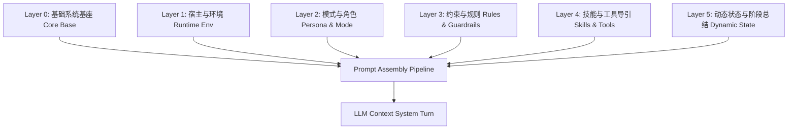
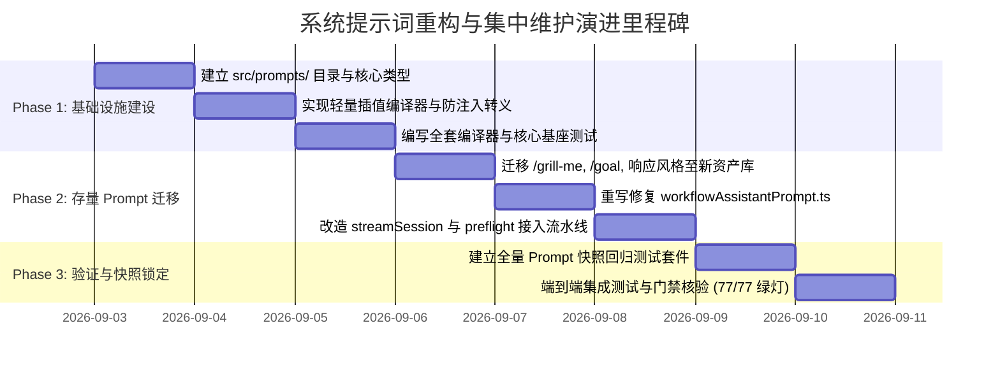

# 系统提示词（System Prompt）与模板集中维护架构方案

> **文档版本**：v1.0.0  
> **所属战役**：Prompt Injection Pipeline（提示词组装流水线）  
> **产出路径**：`docs/prompt-injection-pipeline/independent-plans/01-系统提示词组织与维护方案.md`  
> **状态**：独立方案定稿（Ready for Review）  

---

## 一、方案背景与现状痛点分析

在 Conex / Crish 桌面工作台与 Agent 引擎演进过程中，AI 的行为高度依赖各类「系统指令（System Prompt）」与「上下文注入段（Context Injections）」。然而，随着目标模式（`/goal`）、对齐模式（`/grill-me`）、定时任务助手（`/schedule`）、技能系统（`/skill`）、子 Agent 调度以及多级审计等能力的快速引入，系统提示词的维护面临严峻的架构碎片化问题。

### 1.1 现状散落点与代码实录（Pain Points）

经对代码库的深入审计，当前系统提示词及模板存在以下核心问题：

1. **前端长文本硬编码散落，缺乏单一真理源（SSOT）**：
   - `apps/crish-desktop/src/hooks/chat-stream/slash-prefixes.ts:1-8`：硬编码 `GRILL_ME_PREFIX` 对齐模式字符串，直接使用 `join('\n')` 拼装。
   - `apps/crish-desktop/src/api/goalModeContinuation.ts:77-98`：硬编码 `buildGoalModePrefix` 与 `formatOpenGoalTasksForPrompt`，字符串拼接中夹杂业务逻辑。
   - `apps/crish-desktop/src/api/chat-bridge/streamSession.ts:34-47`：硬编码 `STYLE_DESCS` 英文响应风格说明（如 `minimal`, `concise`, `balanced`, `thorough`）。
   - `apps/crish-desktop/src/api/skillsApi.ts:239-256`：硬编码 `formatSkillInjection` 技能提示词模板。
   - `apps/crish-desktop/src/prompts/system/workflowAssistantPrompt.ts`：存在历史遗留乱码与草案未接线问题，未形成标准管理。
2. **前后端职责重叠与协议断层**：
   - 前端在 `streamFinishControl.ts:13-21` (`composeSystemPrompt`) 做简单二元拼接，而 Rust 引擎端在 `apps/agent-workbench/src-tauri/src/run/run_idle.rs:957` (`assemble_system_prompt_with_stages`) 与 `crates/agent-tools/src/subagent_inject.rs` (`started_at_section`, `git_revert_caution_section`, `comment_preservation_section`, `permission_relay_section`, `output_dir_section`) 各自维护片段。
   - 缺少前后端统一的提示词分层契约模型，导致提示词的拼装顺序、段落层级与覆盖关系难以可视化与可预测。
3. **缺乏类型安全与插值防注入**：
   - 现存插值主要靠 ES6 模板字符串（`${var}`）或 Rust `format!`，缺乏字段存在性校验、类型约束（如数字范围、数组格式化）以及 Markdown 结构转义，存在提示词注入（Prompt Injection）被破坏边界的风险。
4. **多语言（i18n）脱节**：
   - 系统中部分 Prompt 仅有中文（如子 Agent 指引、代码规范），部分仅有英文（如响应风格 `STYLE_DESCS`），无法根据用户设置或模型能力进行平滑语言切换。
5. **阶段提示词（docs/agent-roles/prompts/）缺乏运行时抽象**：
   - `docs/agent-roles/prompts/` 存放了 28 个阶段 Markdown 提示词文件，采用自由格式的 `{{...}}` 占位符，缺少统一的元数据、Schema 校验与程序化读取接口。

---

## 二、架构愿景与设计原则

```
┌─────────────────────────────────────────────────────────────────────────┐
│                      Prompt Registry & Asset Hub                        │
│                     (apps/crish-desktop/src/prompts)                    │
├─────────────────────────────────────────────────────────────────────────┤
│  Layer 0: 基础系统基座 (System Core Base)                                 │
│  Layer 1: 宿主与工作区上下文 (Runtime & Environment Context)              │
│  Layer 2: 模式助手与角色指令 (Persona & Mode Assistants)                  │
│  Layer 3: 约束与规范注入 (Rules, Safety & Anti-Overengineering)         │
│  Layer 4: 技能与工具导引 (Skills & Capability Guides)                   │
│  Layer 5: 动态状态与历史总结 (Dynamic State & Stage Summaries)            │
└─────────────────────────────────────────────────────────────────────────┘
                                    │
                                    ▼ Compile & Interpolate
┌─────────────────────────────────────────────────────────────────────────┐
│              Type-Safe Interpolation Engine (Zod / TypeScript)          │
│         - Strict Variable Validation  - Markdown Boundary Escaping      │
│         - Fallback Defaults           - Multilingual Resolution         │
└─────────────────────────────────────────────────────────────────────────┘
                                    │
                                    ▼ Transport / IPC Payload
┌─────────────────────────────────────────────────────────────────────────┐
│                 Rust Engine Assembly & Execution Stream                 │
│         - Stage Summaries Append      - started_at Dynamic Mark         │
│         - Token Budget Compaction     - Provider Wire Adaptor           │
└─────────────────────────────────────────────────────────────────────────┘
```

### 2.1 核心设计原则

1. **单一真理源（SSOT）**：
   所有系统提示词、模式指令、角色定义及动态模板必须在结构化资产库中集中定义，严禁在业务组件、事件处理器或网络发送前置钩子中硬编码长文本。
2. **六层严格装配模型（6-Layer Stack Hierarchy）**：
   确立严格的从 L0 到 L5 的层级顺序，自底向上装配，保证模型首先理解自身核心边界，再明确当前任务模式，最后获取具体工作区上下文。
3. **强类型安全插值（Type-Safe Interpolation）**：
   每个 Prompt 模板均作为一个强类型对象存在，必须声明其参数接口与 Schema。所有动态插值在编译期获得 TypeScript 静态类型提示，在运行期经过安全校验与转义。
4. **反过度设计与轻量化（Anti-Overengineering）**：
   坚决遵守仓库根目录 `ANTI_OVERENGINEERING_GUARDRAILS.md`，不引入厚重的外部模板引擎（如 Handlebars/Mustache 庞大依赖库），采用原生高性能轻量级 AST/微插值解析器，控制纯代码在 300 行内。
5. **资产版本化与快照防回归（Snapshot Verifiability）**：
   每个提示词拥有语义化版本（SemVer），修改 Prompt 必须配套自动化快照回归测试，杜绝隐式文案劣化。

---

## 三、系统提示词六层分类与装配体系

系统提示词的组织必须依据其生命周期、变化频率与职责范围进行严格分层：



### 3.1 六层体系详细定义

| 层级 | 名称 | 职责定位 | 变化周期 | 典型内容 / 模块 |
| :--- | :--- | :--- | :--- | :--- |
| **L0** | **基础系统基座 (Core Base)** | 定义 AI 核心身份（Conex/Crish 智能助手）、遵循的通用代码原则（精确匹配编辑、中文注释无 BOM、反退避纪律） | 极低（随系统发版） | `base/systemCore.ts` |
| **L1** | **宿主与环境 (Runtime Env)** | 操作系统（Windows/macOS）、Shell 类型（PowerShell 7/bash）、当前工作区根目录、产出目录（`output_dir`） | 会话级（会话初始化确定） | `environment/runtimeContext.ts` |
| **L2** | **模式助手与角色 (Persona & Mode)** | 当前运行模式的具体指令（常规编程、定时任务编排助手、方案对齐 Grill-Me、长期目标推进、代码评审专家、子 Agent 角色） | 运行级 / 用户显式切换 | `modes/workflowAssistant.ts`<br>`modes/goalMode.ts`<br>`modes/grillMe.ts`<br>`roles/subagentRoles.ts` |
| **L3** | **约束与规则 (Rules & Guardrails)** | 用户自定义全局规则、工作区专用规则（`.agents/rules`）、安全操作红线（git 回退审批门禁） | 会话/项目级 | `rules/rulesAdapter.ts` |
| **L4** | **技能与工具导引 (Skills & Tools)** | 当前激活的 Skill 指引（`SKILL.md` 提取）、已挂载 MCP 工具集使用约束与格式要求 | 动态装载 | `skills/skillInjector.ts` |
| **L5** | **动态状态与阶段总结 (Dynamic State)** | 引擎历史压缩生成的阶段总结（Stage Summaries）、状态变更感知（Context State）、时间戳（`started_at`） | 单 Run / Turn 级动态生成 | `dynamic/stageSummaries.ts`<br>`dynamic/contextState.ts` |

---

## 四、Prompt 资产目录结构与组织规范

在 `apps/crish-desktop/src/prompts/` 建立标准结构：

```
apps/crish-desktop/src/prompts/
├── index.ts                      # 统一对外导出门面
├── types.ts                      # 提示词协议核心类型定义
├── registry.ts                   # 提示词注册表与查找服务
├── compiler/                     # 模板编译与安全插值引擎
│   ├── interpolate.ts            # 纯函数安全变量替换
│   ├── escaping.ts               # Markdown / Prompt 防注入转义
│   └── compiler.test.ts          # 编译器单元测试与属性测试
├── core/                         # L0: 基础系统基座
│   ├── systemCore.ts             # 核心系统底座指令
│   └── responseStyles.ts         # 响应风格指引 (minimal/concise/balanced/thorough)
├── environment/                  # L1: 环境与宿主上下文
│   ├── hostEnvironment.ts        # OS, Shell, CWD 注入模板
│   └── outputDirGuide.ts         # 产出目录与持久化指引
├── modes/                        # L2: 各种模式助手指令 (Modes)
│   ├── workflowAssistant.ts      # 定时任务编排助手 (Schedule Grill-Me)
│   ├── goalMode.ts               # 长期目标执行模式 (/goal)
│   ├── grillMe.ts                # 方案对齐模式 (/grill-me)
│   └── codeReview.ts             # 深度代码审查与架构审计
├── roles/                        # L2-Sub: 子 Agent 调度角色预设
│   ├── catalog.ts                # 角色元数据清单 (research/plan/impl/audit)
│   └── roleTemplates.ts          # 角色专属模板与任务书结构
├── rules/                        # L3: 规则适配器
│   └── rulesFormatter.ts         # 用户/工作区规则格式化
├── skills/                       # L4: 技能注入适配
│   └── skillFormatter.ts         # SKILL.md 上下文装配器
├── dynamic/                      # L5: 动态状态注入
│   ├── contextState.ts           # 运行时配置切换快照
│   └── stageSummary.ts           # 阶段里程碑总结包装
└── locales/                      # 多语言字典资源
    ├── zh-CN/                    # 中文主资源
    └── en-US/                    # 英文对照资源
```

---

## 五、核心数据结构与强类型契约

### 5.1 基础类型定义 (`src/prompts/types.ts`)

```typescript
/** 提示词层级划分 (L0 ~ L5) */
export type PromptLayer =
  | 'core'         // L0: 核心系统底座
  | 'environment'  // L1: 宿主与工作区
  | 'mode'         // L2: 模式助手 / 角色
  | 'rules'        // L3: 规则与约束
  | 'skills'       // L4: 技能与工具
  | 'dynamic';     // L5: 动态状态与总结

/** 语言代码 */
export type PromptLocale = 'zh-CN' | 'en-US';

/** 提示词元数据 */
export interface PromptMetadata<TParams extends Record<string, unknown> = Record<string, unknown>> {
  readonly id: string;
  readonly name: string;
  readonly description: string;
  readonly layer: PromptLayer;
  readonly version: string;
  readonly defaultLocale: PromptLocale;
  readonly tags: readonly string[];
  /** 默认参数（可选） */
  readonly defaultParams?: Partial<TParams>;
}

/** 模板渲染上下文 */
export interface RenderContext {
  locale?: PromptLocale;
  stripDynamicMarkers?: boolean;
}

/** 强类型 Prompt 模板定义 */
export interface PromptTemplate<TParams extends Record<string, unknown> = Record<string, unknown>> {
  readonly meta: PromptMetadata<TParams>;
  /** 多语言模板字典或模板函数 */
  readonly templates: Record<PromptLocale, string>;
  /** 编译/渲染方法 */
  render(params: TParams, ctx?: RenderContext): string;
}

/** 流水线组装项 */
export interface PromptInjectionItem {
  id: string;
  layer: PromptLayer;
  title?: string;
  content: string;
  priority: number;
  metadata?: Record<string, unknown>;
}
```

### 5.2 泛型安全模板构建器 (`src/prompts/compiler/interpolate.ts`)

```typescript
import type { PromptLocale, PromptMetadata, PromptTemplate, RenderContext } from '../types';
import { escapePromptValue } from './escaping';

/**
 * 创建强类型 Prompt 模板
 */
export function createPromptTemplate<TParams extends Record<string, unknown>>(
  meta: PromptMetadata<TParams>,
  templates: Record<PromptLocale, string>
): PromptTemplate<TParams> {
  return {
    meta,
    templates,
    render(params: TParams, ctx?: RenderContext): string {
      const locale = ctx?.locale ?? meta.defaultLocale ?? 'zh-CN';
      const rawTpl = templates[locale] || templates['zh-CN'] || templates['en-US'];
      if (!rawTpl) {
        throw new Error(`[PromptRegistry] No template available for locale: ${locale} in prompt: ${meta.id}`);
      }

      const mergedParams = {
        ...meta.defaultParams,
        ...params,
      };

      // 纯函数高性能变量插值: {{variableName}}
      return rawTpl.replace(/\{\{\s*([a-zA-Z0-9_]+)\s*\}\}/g, (match, key: string) => {
        const val = mergedParams[key as keyof typeof mergedParams];
        if (val === undefined || val === null) {
          // 缺失必填字段时记录警告并回退为空串，不破坏整体输出
          console.warn(`[PromptCompiler] Missing template parameter "${key}" in prompt "${meta.id}".`);
          return '';
        }
        if (Array.isArray(val)) {
          return val.map((v) => escapePromptValue(String(v))).join('\n');
        }
        return escapePromptValue(String(val));
      }).trim();
    },
  };
}
```

### 5.3 防注入转义策略 (`src/prompts/compiler/escaping.ts`)

为防止用户输入（如任务名称、目标描述、路径字符串）恶意注入或破坏 Markdown 结构，插值引擎内置转义器：

```typescript
/**
 * 转义动态插入内容中的 Markdown 标题与结构分隔符，保留正常文本内容
 */
export function escapePromptValue(val: string): string {
  if (!val) return '';
  // 1. 规范化换行
  let cleaned = val.replace(/\r\n/g, '\n');
  // 2. 防止破坏系统设定的多级隔离边界 (如截断 --- 标记)
  // 当用户文本中连续出现三次及以上短横线单独成行时，给予轻量转义
  cleaned = cleaned.replace(/^(\s*[-=_*]{3,}\s*)$/gm, '`$1`');
  return cleaned;
}
```

---

## 六、典型模式助手提示词实装设计

### 6.1 定时任务编排助手 (`modes/workflowAssistant.ts`)

彻底替换原乱码的 `workflowAssistantPrompt.ts`，为用户提供专业的交互式调度编排引导（Planning & Schedule Grill-Me 模式）：

```typescript
import { createPromptTemplate } from '../compiler/interpolate';
import type { PromptTemplate } from '../types';

export interface WorkflowAssistantParams {
  workspacePath: string;
  activeSchedulesSummary?: string;
  defaultTimezone?: string;
}

export const WORKFLOW_ASSISTANT_PROMPT: PromptTemplate<WorkflowAssistantParams> = createPromptTemplate(
  {
    id: 'mode-workflow-assistant',
    name: '定时任务编排助手',
    description: '协助用户通过自然语言设计、配置、验证并创建可靠的后台定时调度任务',
    layer: 'mode',
    version: '1.1.0',
    defaultLocale: 'zh-CN',
    tags: ['schedule', 'workflow', 'cron', 'grill-me'],
    defaultParams: {
      defaultTimezone: 'Local/UTC',
      activeSchedulesSummary: '暂无运行中的定时任务',
    },
  },
  {
    'zh-CN': `# 角色与目标
你现在是系统的「定时任务调度编排助手」，专门协助用户通过交互对齐（Grill-Me 方式）设计、配置、推演并创建稳定可靠的定时任务（Scheduled Task / Cron Workflow）。

# 核心职责与设计步骤
在正式为用户创建或执行定时任务前，必须按以下步骤逐步对齐并最终确认：
1. **任务意图与目标明确**：澄清该任务是用于「代码体检」、「自动化测试」、「定期数据备份」、「定时巡检」还是「周期性报告产出」。
2. **执行触发周期对齐**：
   - 间隔模式（Interval）：每 N 分钟/小时执行一次；
   - 每日/每周固定时刻（Daily/Weekly）：每日 HH:mm 或每周特定日期；
   - 高级 Cron 表达式：标准 5 段式（分 时 日 月 周）。
3. **执行环境与工作区上下文**：
   - 当前工作区路径：\`{{workspacePath}}\`；
   - 明确执行命令（PowerShell 7 / Shell）、超时阈值与失败重试策略。
4. **单次任务与长期守护声明**：明确该任务运行完毕即结束，还是需守护常驻（IsDaemon）。

# 交互约束
- 优先一次性向用户提出 2~3 个最关键的决策问题，避免冗长问询；
- 不在需求含糊时盲目调用创建工具，待用户确认最终参数清单后再行创建；
- 当前已有任务摘要参考：
{{activeSchedulesSummary}}`,
    'en-US': `# Role & Objective
You are the system's "Scheduled Task & Workflow Assistant". Your job is to help users design, configure, verify, and register reliable automated cron tasks and workflows via conversational alignment (Grill-Me).

# Core Steps
1. **Clarify Task Intent**: Confirm whether the job is for linting, testing, data backup, or recurring reporting.
2. **Execution Schedule**:
   - Interval Mode: Every N minutes/hours;
   - Fixed Time: Daily at HH:mm or weekly;
   - Advanced Cron: Standard 5-field cron expression.
3. **Environment & Context**:
   - Current Workspace: \`{{workspacePath}}\`;
   - Command line (pwsh7), timeout budget, and retry policy.
4. **Daemon Lifecycle**: Single run completion vs. standing background daemon.

# Existing Schedules Summary
{{activeSchedulesSummary}}`,
  }
);
```

### 6.2 长期目标执行模式 (`modes/goalMode.ts`)

解耦并重构 `goalModeContinuation.ts` 中的硬编码指令：

```typescript
import { createPromptTemplate } from '../compiler/interpolate';
import type { PromptTemplate } from '../types';

export interface GoalModeParams {
  goal: string;
  currentRound: number;
  maxRounds: number;
  openTasksBlock?: string;
}

export const GOAL_MODE_PROMPT: PromptTemplate<GoalModeParams> = createPromptTemplate(
  {
    id: 'mode-goal-orchestrator',
    name: '长期目标自主推进指令',
    description: '驱动 Agent 进行多轮自主规划、任务清单维护与阶段自检直至目标达成',
    layer: 'mode',
    version: '1.2.0',
    defaultLocale: 'zh-CN',
    tags: ['goal', 'autonomous', 'multi-turn'],
  },
  {
    'zh-CN': `[目标模式 · 系统指令]
你正在自主执行一项长期工程目标。你拥有工具执行权限，请持续推进直至目标实质完成，并在每轮结束前自检进度。

- **核心目标**：{{goal}}
- **当前轮次**：第 {{currentRound}} 轮（自动续写上限 {{maxRounds}} 轮，请在预算内高效收敛）
- **推进纪律**：
  1. 保持工作连续性，不要半途停下或只输出建议而不执行工具；
  2. 在每次回复末尾维护 Markdown 任务清单（\`- [ ]\` 未完成 / \`- [x]\` 已完成）；
  3. 当所有子任务均已完成且通过验证时，在最终回复中明确写出 \`DONE\` 或「目标已完成」。

{{openTasksBlock}}
---`,
    'en-US': `[Goal Mode · System Directive]
You are autonomously executing a long-running project goal. Proceed steadily until substantial completion.

- **Primary Goal**: {{goal}}
- **Current Iteration**: Round {{currentRound}} of {{maxRounds}}
- **Execution Guidelines**:
  1. Maintain continuous execution. Do not stop midway with only recommendations; take concrete tool actions.
  2. Maintain a Markdown task checklist (\`- [ ]\` open / \`- [x]\` done) in each round.
  3. When fully complete and verified, emit \`DONE\` or "Goal Completed" clearly at the end.

{{openTasksBlock}}
---`,
  }
);
```

### 6.3 需求对齐与设计澄清助手 (`modes/grillMe.ts`)

重构 `slash-prefixes.ts` 中的硬编码：

```typescript
import { createPromptTemplate } from '../compiler/interpolate';
import type { PromptTemplate } from '../types';

export interface GrillMeParams {
  topic: string;
  maxQuestions?: number;
}

export const GRILL_ME_PROMPT: PromptTemplate<GrillMeParams> = createPromptTemplate(
  {
    id: 'mode-grill-me',
    name: '对齐模式澄清指令',
    description: '对用户提出的复杂需求进行深入澄清与边界确认，暂不修改代码',
    layer: 'mode',
    version: '1.0.0',
    defaultLocale: 'zh-CN',
    tags: ['grill-me', 'planning', 'clarification'],
    defaultParams: {
      maxQuestions: 5,
    },
  },
  {
    'zh-CN': `[对齐模式 · 系统指令]
你现在是资深产品与架构对齐助手。
针对用户提出的主题「{{topic}}」，你的核心任务是挖掘隐含需求、明确边界与澄清模糊点。

- **执行红线**：本模式下暂不编写代码、不修改文件、不执行破坏性命令；
- **提问约束**：聚焦关键设计决策，一次性提出不超过 {{maxQuestions}} 个具体、可回答的核心问题；
- **待确认后实施**：待用户逐项反馈并确认方案基调后，再引导切换至实施阶段。
---`,
    'en-US': `[Alignment Mode · System Directive]
You are a Lead Product & Technical Architect conducting a requirement alignment session.
Topic: "{{topic}}"

- **Guardrails**: Do NOT write production code or modify files during this phase.
- **Questions Budget**: Pose up to {{maxQuestions}} precise, high-impact architectural/functional questions.
- **Next Step**: Once the user aligns on decisions, summarize the spec and transition to implementation.
---`,
  }
);
```

---

## 七、多语言与响应风格适配机制

### 7.1 响应风格统一定义 (`core/responseStyles.ts`)

将散落在 `streamSession.ts` 中的 `STYLE_DESCS` 与 `STYLE_ZH_MAP` 提升为多语言标准资产：

```typescript
import { createPromptTemplate } from '../compiler/interpolate';
import type { PromptTemplate } from '../types';

export type ResponseStyleLevel = 'minimal' | 'concise' | 'balanced' | 'thorough';

export interface ResponseStyleParams {
  style: ResponseStyleLevel;
}

export const RESPONSE_STYLE_PROMPT: PromptTemplate<ResponseStyleParams> = createPromptTemplate(
  {
    id: 'core-response-style',
    name: '响应风格指引',
    description: '调控模型回复的详略程度与结构密度',
    layer: 'core',
    version: '1.0.0',
    defaultLocale: 'zh-CN',
    tags: ['style', 'verbosity'],
    defaultParams: {
      style: 'balanced',
    },
  },
  {
    'zh-CN': `[回复风格规范]
{{styleGuidance}}`,
    'en-US': `[Response Style Directive]
{{styleGuidance}}`,
  }
);

export const RESPONSE_STYLE_GUIDANCE_MAP: Record<PromptLocale, Record<ResponseStyleLevel, string>> = {
  'zh-CN': {
    minimal: '回复风格：极简。仅给出最短正确答案，省略问候语、不必要的列表与问题重述。',
    concise: '回复风格：简洁。保持回答简明扼要；仅在能提升清晰度时使用要点列表，不主动展开超长背景。',
    balanced: '回复风格：适中。表达清晰、逻辑完整且无冗余赘述；对非显而易见的步骤做简要说明。',
    thorough: '回复风格：深入。提供结构化的推演分析、边界条件及完备的验证步骤，内容充实详尽。',
  },
  'en-US': {
    minimal: 'Response style: minimal. Prefer the shortest correct answer. Avoid preambles, lists, and restating the question.',
    concise: 'Response style: concise. Keep answers short; use bullets only when they improve clarity. Skip lengthy explanations unless asked.',
    balanced: 'Response style: balanced. Be clear and complete without padding. Explain non-obvious steps briefly.',
    thorough: 'Response style: thorough. Provide structured reasoning, edge cases, and verification steps when useful. Still stay on-topic.',
  },
};
```

---

## 八、Prompt Pipeline 组装器与 IPC 透传链路

在前端准备发送请求时，通过 `PromptAssemblyPipeline` 进行流水线有序拼接，并无缝对接现有 Tauri `core_run_task` 接口。

### 8.1 流水线装配器 (`src/prompts/pipeline.ts`)

```typescript
import { PromptLayer, PromptInjectionItem, PromptLocale } from './types';
import { SYSTEM_CORE_PROMPT } from './core/systemCore';
import { RESPONSE_STYLE_PROMPT, RESPONSE_STYLE_GUIDANCE_MAP, ResponseStyleLevel } from './core/responseStyles';

export interface PipelineAssemblyOptions {
  locale?: PromptLocale;
  responseStyle?: ResponseStyleLevel;
  workspacePath?: string;
  customRules?: string[];
  activeModePrompt?: string;
  activeSkillInjections?: string[];
  userSystemPromptOverride?: string;
}

export class PromptAssemblyPipeline {
  private items: PromptInjectionItem[] = [];

  constructor(private options: PipelineAssemblyOptions = {}) {}

  /** 追加注入段 */
  public add(item: PromptInjectionItem): this {
    this.items.push(item);
    return this;
  }

  /** 按 Layer 与 Priority 升序排序并编译最终 System Prompt */
  public build(): string {
    const locale = this.options.locale ?? 'zh-CN';
    const sections: string[] = [];

    // 1. 装配 L0 核心系统底座
    const coreBase = SYSTEM_CORE_PROMPT.render({}, { locale });
    sections.push(coreBase);

    // 2. 装配 L0 响应风格
    if (this.options.responseStyle) {
      const styleText = RESPONSE_STYLE_GUIDANCE_MAP[locale][this.options.responseStyle];
      sections.push(RESPONSE_STYLE_PROMPT.render({ style: this.options.responseStyle }, { locale })
        .replace('{{styleGuidance}}', styleText));
    }

    // 3. 用户显式传入的覆盖/前置 System Prompt
    if (this.options.userSystemPromptOverride?.trim()) {
      sections.push(this.options.userSystemPromptOverride.trim());
    }

    // 4. 装配 L2 模式助手 Prompt (如 Workflow, Goal, GrillMe)
    if (this.options.activeModePrompt?.trim()) {
      sections.push(this.options.activeModePrompt.trim());
    }

    // 5. 装配 L3 规则
    if (this.options.customRules && this.options.customRules.length > 0) {
      sections.push(`[用户与项目规则]\n` + this.options.customRules.map(r => `- ${r}`).join('\n'));
    }

    // 6. 装配其余动态注入项 (已按 layer 排序)
    const sorted = [...this.items].sort((a, b) => a.priority - b.priority);
    for (const item of sorted) {
      if (item.content.trim()) {
        const header = item.title ? `## ${item.title}\n` : '';
        sections.push(`${header}${item.content.trim()}`);
      }
    }

    // 7. 合并所有段落，以双换行分隔，保持清晰的 Markdown 结构
    return sections.filter(Boolean).join('\n\n');
  }
}
```

---

## 九、版本演进与快照回归测试规范

为确保提示词的修改不会导致模型遵循度退化或引入不可预期的行为断层，建立严格的快照测试规范。

### 9.1 Vitest 快照测试范式 (`apps/crish-desktop/src/prompts/__tests__/prompts.snapshot.test.ts`)

```typescript
import { describe, it, expect } from 'vitest';
import { WORKFLOW_ASSISTANT_PROMPT } from '../modes/workflowAssistant';
import { GOAL_MODE_PROMPT } from '../modes/goalMode';
import { GRILL_ME_PROMPT } from '../modes/grillMe';
import { PromptAssemblyPipeline } from '../pipeline';

describe('Prompt Registry & Snapshots (SSOT Verification)', () => {
  it('should render WorkflowAssistantPrompt with exact snapshot match', () => {
    const rendered = WORKFLOW_ASSISTANT_PROMPT.render({
      workspacePath: 'C:/Software/conex',
      activeSchedulesSummary: '- 每日代码体检 (09:00, Daily)',
    }, { locale: 'zh-CN' });

    expect(rendered).toContain('C:/Software/conex');
    expect(rendered).toContain('每日代码体检');
    expect(rendered).toMatchSnapshot();
  });

  it('should render GoalModePrompt with exact tasks checklist block', () => {
    const rendered = GOAL_MODE_PROMPT.render({
      goal: '重构系统提示词流水线',
      currentRound: 1,
      maxRounds: 12,
      openTasksBlock: '- [ ] 提取所有硬编码 Prompt\n- [ ] 编写测试用例',
    }, { locale: 'zh-CN' });

    expect(rendered).toContain('第 1 轮');
    expect(rendered).toContain('自动续写上限 12 轮');
    expect(rendered).toMatchSnapshot();
  });

  it('should assemble a complete multi-layer system prompt in correct order', () => {
    const pipeline = new PromptAssemblyPipeline({
      locale: 'zh-CN',
      responseStyle: 'balanced',
      workspacePath: 'C:/Software/conex',
      customRules: ['必须使用 UTF-8 无 BOM', '严禁 --no-verify'],
      activeModePrompt: GRILL_ME_PROMPT.render({ topic: '提示词架构重构' }),
    });

    const fullPrompt = pipeline.build();
    expect(fullPrompt).toContain('[回复风格规范]');
    expect(fullPrompt).toContain('[对齐模式 · 系统指令]');
    expect(fullPrompt).toContain('必须使用 UTF-8 无 BOM');
    expect(fullPrompt).toMatchSnapshot();
  });
});
```

---

## 十、实施路线与迁移演进计划



### 10.1 阶段任务细分

1. **Phase 1: 基础设施与契约定义**
   - 建立 `apps/crish-desktop/src/prompts/` 核心目录。
   - 实现 `types.ts`、`interpolate.ts`（类型安全插值器）、`escaping.ts`（防注入转义）。
   - 编写插值与边界测试，确保零第三方重型依赖。
2. **Phase 2: 存量硬编码彻底清退与迁移**
   - 将 `slash-prefixes.ts`（`GRILL_ME_PREFIX`）、`goalModeContinuation.ts`（`buildGoalModePrefix`）、`streamSession.ts`（`STYLE_DESCS`）全部迁移为标准 `PromptTemplate`。
   - 重构修复 `workflowAssistantPrompt.ts` 乱码与结构缺失问题。
   - 改造 `slashSendPreflight.ts` 与 `streamSession.ts`，统一调用 `PromptAssemblyPipeline` 装配系统提示词。
3. **Phase 3: 快照测试锁定与质量验收**
   - 为全部提示词与多语言字典建立 Vitest 快照测试（`prompts.snapshot.test.ts`）。
   - 运行前端全量单元测试与类型检查（`npm run typecheck` + `npm run test`），确保所有门禁 100% 绿灯通过。
