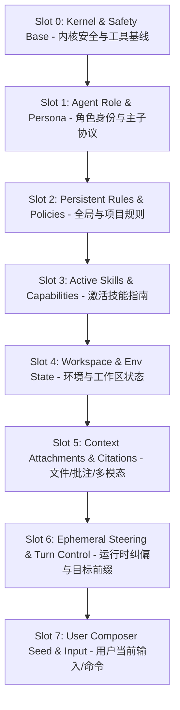
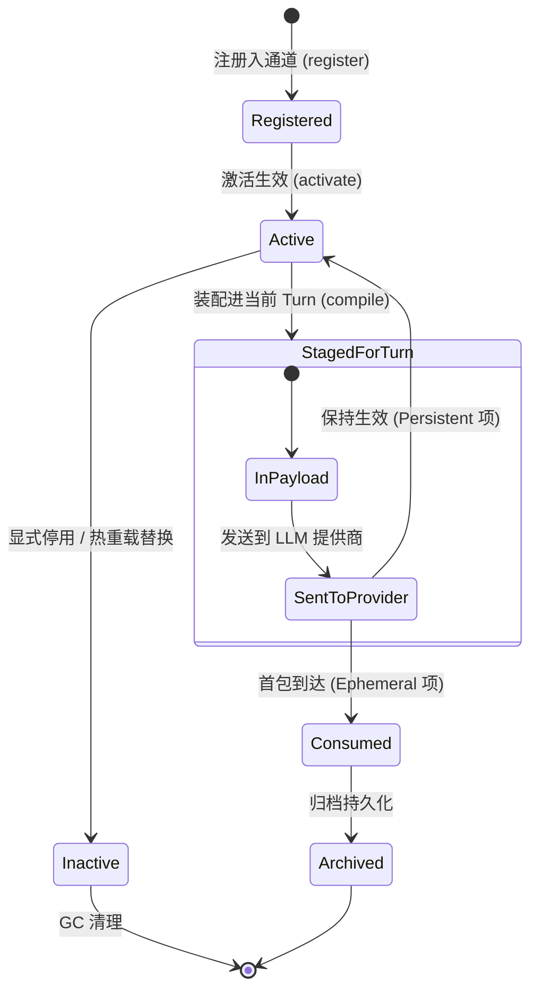
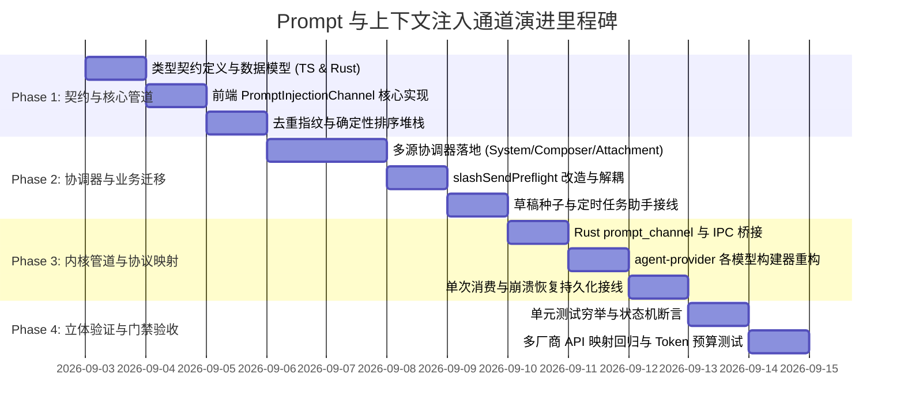

# 统一 Prompt 与上下文注入通道（PromptInjectionChannel）架构设计方案

> **文档位置**：`docs/prompt-injection-pipeline/independent-plans/02-统一注入通道设计方案.md`  
> **所属战役**：Prompt 与上下文注入流水线重构（Prompt Injection Pipeline Campaign）独立方案  
> **方案定位**：作为系统中枢的「统一 Prompt 与上下文注入通道（PromptInjectionChannel）」，彻底终结前端多源拼接散乱、生命周期时效混淆、优先级冲突、去重与持久化缺失的历史技术债，确立跨前端 UI、Tauri IPC 桥接层与 Rust 内核会话循环的单一真理路径（SSOT）注入架构。

---

## 目录

- [一、背景与架构定性（问题根因与收敛目标）](#一背景与架构定性问题根因与收敛目标)
  - [1.1 历史现状与多源分散注入痛点](#11-历史现状与多源分散注入痛点)
  - [1.2 生命周期、时效性与泄漏风险](#12-生命周期时效性与泄漏风险)
  - [1.3 优先级混乱与指令劫持风险](#13-优先级混乱与指令劫持风险)
  - [1.4 架构收敛目标与单一真理路径（SSOT）](#14-架构收敛目标与单一真理路径ssot)
- [二、总体架构设计（Global Architecture）](#二总体架构设计global-architecture)
  - [2.1 注入通道全景架构图](#21-注入通道全景架构图)
  - [2.2 核心组件与分工边界](#22-核心组件与分工边界)
  - [2.3 端到端流水线数据流向](#23-端到端流水线数据流向)
- [三、分层槽位与布局模型（Injection Slot Architecture）](#三分层槽位与布局模型injection-slot-architecture)
  - [3.1 槽位划分（Slot Ladder）与语义规范](#31-槽位划分slot-ladder与语义规范)
  - [3.2 槽位优先级矩阵与加权计算法则](#32-槽位优先级矩阵与加权计算法则)
  - [3.3 布局模板与多模型协议对齐（Anthropic / OpenAI / Gemini / DeepSeek）](#33-布局模板与多模型协议对齐anthropic--openai--gemini--deepseek)
- [四、多源注入调度协调器（Multi-Source Dispatchers）](#四多源注入调度协调器multi-source-dispatchers)
  - [4.1 System Prompt 协调器（SystemPromptCoordinator）](#41-system-prompt-协调器systempromptcoordinator)
  - [4.2 用户输入框草稿种子协调器（ComposerSeedCoordinator）](#42-用户输入框草稿种子协调器composerseedcoordinator)
  - [4.3 上下文引用与附件协调器（ContextAttachmentCoordinator）](#43-上下文引用与附件协调器contextattachmentcoordinator)
  - [4.4 Agent 规则与技能协调器（AgentRulesSkillsCoordinator）](#44-agent-规则与技能协调器agentrulesskillscoordinator)
  - [4.5 运行时纠偏与目标模式协调器（RuntimeSteeringCoordinator）](#45-运行时纠偏与目标模式协调器runtimesteeringcoordinator)
- [五、生命周期、持久化与消费策略（Lifecycle & Persistence）](#五生命周期持久化与消费策略lifecycle--persistence)
  - [5.1 注入项生命周期状态机](#51-注入项生命周期状态机)
  - [5.2 消耗模式定义（Persistent vs Ephemeral vs Reactive）](#52-消耗模式定义persistent-vs-ephemeral-vs-reactive)
  - [5.3 跨 Turn 与跨 Session 恢复/持久化策略](#53-跨-turn-与跨-session-恢复持久化策略)
  - [5.4 崩溃一致性与垃圾回收（GC）机制](#54-崩溃一致性与垃圾回收gc机制)
- [六、优先级排队、去重与 Token 预算控制（Engine Invariants）](#六优先级排队去重与-token-预算控制engine-invariants)
  - [6.1 基于内容哈希（Blake3 / SHA-256）的高性能去重引擎](#61-基于内容哈希blake3--sha-256的高性能去重引擎)
  - [6.2 确定性优先级队列（Deterministic Priority Queue）](#62-确定性优先级队列deterministic-priority-queue)
  - [6.3 动态 Token 预算分配与自适应截断（Token Budgeting & Fallback）](#63-动态-token-预算分配与自适应截断token-budgeting--fallback)
- [七、核心数据结构与契约定义（Data Structures & Contracts）](#七核心数据结构与契约定义data-structures--contracts)
  - [7.1 前端 TypeScript 契约定义](#71-前端-typescript-契约定义)
  - [7.2 Rust 内核核心模型定义](#72-rust-内核核心模型定义)
  - [7.3 Tauri IPC 通信协议定义](#73-tauri-ipc-通信协议定义)
- [八、实施阶段与文件域规划（Implementation Plan & File Scope）](#八实施阶段与文件域规划implementation-plan--file-scope)
  - [8.1 涉及新建与改造文件域清单](#81-涉及新建与改造文件域清单)
  - [8.2 阶段划分与里程碑演进](#82-阶段划分与里程碑演进)
  - [8.3 负产出评估与死代码清退](#83-负产出评估与死代码清退)
- [九、立体验证方案与防回归断言（Verification & Assertions）](#九立体验证方案与防回归断言verification--assertions)
  - [9.1 单元测试矩阵（纯逻辑与状态机穷举）](#91-单元测试矩阵纯逻辑与状态机穷举)
  - [9.2 集成与 E2E 测试断言（多源并发注入与协议映射）](#92-集成与-e2e-测试断言多源并发注入与协议映射)
  - [9.3 架构硬性约束与反退避门禁](#93-架构硬性约束与反退避门禁)

---

## 一、背景与架构定性（问题根因与收敛目标）

### 1.1 历史现状与多源分散注入痛点

在 Conex / Crish 系统的演进过程中，随着功能从单一会话逐步扩展到多 Agent 协作、技能生态（Skills）、自定义规则（Rules）、工作区批注（Annotations）、定时任务规划（Schedule Grill-Me）、目标模式（Goal Mode）以及多模态附件，系统中的 Prompt 与上下文注入通道逐渐演化出严重的散乱与碎片化现象：

1. **前端散落拼接**：
   - 在 `apps/crish-desktop/src/hooks/chat-stream/slashSendPreflight.ts`、`assembleChatPayload.ts`、`multimodal.ts`、`useChatStream.ts`、`useSlashSend.ts` 中存在多处 ad-hoc 字符串模板拼接（如 `annBlock + modelText + promptAttachBlock`、`GRILL_ME_PREFIX + slash.topic`、`buildGoalModePrefix(...)`）。
   - 注入来源相互感知、逻辑交织，缺乏统一的汇聚与调度层。
2. **种子注入（Composer Seed）通道割裂**：
   - 用户输入框草稿填充散布在快捷键、URL Scheme、定时任务助手、模板列表、历史重试等各处，直接操作 DOM 或直接调用状态 setter，没有统一的排队与冲突覆盖规则。
3. **后端内核映射不一致**：
   - 后端 `crates/agent-provider/src/request/` 下各厂商构建器（`build_anthropic.rs`、`build_chat.rs`、`build_gemini.rs`、`build_responses.rs`）对于 `system_prompt`、上下文系统消息、用户前缀、多模态 Part 的合并逻辑存在细微语义漂移。

### 1.2 生命周期、时效性与泄漏风险

由于缺乏统一的生命周期元数据标识，系统中各类注入项的存活期（TTL）与消费时机定义模糊：

- **单次消耗项泄漏**：如单次发送附带的文件批注（File Annotations）、一次性技能激活前缀（Skill Injection）、单次纠偏指令（Steering Nudge），在遭遇网络重试、多轮工具调用或会话回滚时，容易发生“要么丢失、要么在后续轮次中持续污染”的异常。
- **持久项更新滞后**：全局规则（Custom Rules）和项目规则修改后，各活跃会话无法感知或需要强制重启，缺乏统一的热重载与通知管道。
- **状态不一致**：部分临时注入保存在前端内存，部分保存在 LocalStorage，内核崩溃恢复后上下文丢失或重复消费。

### 1.3 优先级混乱与指令劫持风险

大模型对 Prompt 中不同位置的指令具有不同的注意力权重。由于历史代码采用无序字符串拼接：
- 系统核心安全准则（Safety & Tool Invariants）可能被用户输入或大段上下文附件挤出有效注意力窗口；
- 技能说明（Skills）与用户规则（Rules）位置倒置，导致用户自定义规则被外部技能覆盖（Rule Hijacking）；
- 运行时纠偏（Runtime Steering）没有最高覆写权，模型容易陷入旧状态惯性。

### 1.4 架构收敛目标与单一真理路径（SSOT）

本方案旨在建立全局统一的 **PromptInjectionChannel**，确立以下架构底线：

1. **单一汇聚通道（SSOT Channel）**：所有注入源（System Prompt、Composer Seed、Attachments、Rules、Skills、Steering）一律通过标准注入项格式（`PromptInjectionItem`）注册到通道，禁止任何业务模块绕过通道私自进行字符串拼接。
2. **强类型分层槽位（Slot Architecture）**：按权重和职责划分严格的 8 层物理槽位（Slot 0 ~ Slot 7），保证安全基线、角色规范、规则、技能、上下文与用户输入的绝对结构顺序。
3. **确定性生命周期与消费策略**：明确区分 `Persistent`（持久）、`Ephemeral`（单次消耗）、`Reactive`（响应式响应）三种生命周期，配套状态机与持久化落地。
4. **高性能去重与 Token 预算熔断**：基于内容哈希（Blake3 / SHA-256）消除重复附件与规则，实施槽位级 Token 预算分配与自适应平滑降级，杜绝超限爆窗。
5. **跨层契约无缝对齐**：前端、Tauri IPC 桥接层与 Rust 引擎底层共享同构协议与语义，各模型提供商适配器根据结构化槽位进行原生无损映射。

---

## 二、总体架构设计（Global Architecture）

### 2.1 注入通道全景架构图

```
┌─────────────────────────────────────────────────────────────────────────────────────────┐
│                                 Producers (多源生产方)                                   │
│  ┌──────────────────┐  ┌──────────────────┐  ┌──────────────────┐  ┌─────────────────┐  │
│  │ System / Agent   │  │ Rules & Skills   │  │ Context / Files  │  │ Composer / User │  │
│  │ Base / Role / WF │  │ Custom / Skills  │  │ Anns / Media / Git│ │ Seed / Input /Cmd│ │
│  └────────┬─────────┘  └────────┬─────────┘  └────────┬─────────┘  └────────┬────────┘  │
└───────────┼─────────────────────┼─────────────────────┼─────────────────────┼───────────┘
            ▼                     ▼                     ▼                     ▼
┌─────────────────────────────────────────────────────────────────────────────────────────┐
│              PromptInjectionChannel Coordinator (统一注入通道协调器)                      │
│                                                                                         │
│  ┌───────────────────────────────────────────────────────────────────────────────────┐  │
│  │ 1. 注册与校验门禁 (Registration & Validation Gate)                                 │  │
│  │    - 结构合法性校验 (Schema Validator)      - 唯一 ID / 标签规范化 (ID Normalizer) │  │
│  └─────────────────────────────────────────┬─────────────────────────────────────────┘  │
│                                            ▼                                            │
│  ┌───────────────────────────────────────────────────────────────────────────────────┐  │
│  │ 2. 去重与指纹引擎 (Deduplication Engine - Blake3 / SHA-256 Hash)                   │  │
│  │    - 内容哈希判重 (Hash Filter)              - 冲突合并策略 (Conflict Resolver)    │  │
│  └─────────────────────────────────────────┬─────────────────────────────────────────┘  │
│                                            ▼                                            │
│  ┌───────────────────────────────────────────────────────────────────────────────────┐  │
│  │ 3. 槽位分配与优先级排序 (Slot Distributor & Priority Ladder)                       │  │
│  │    Slot 0: Kernel Base  │ Slot 1: Agent Role │ Slot 2: Rules   │ Slot 3: Skills   │  │
│  │    Slot 4: Env/Context  │ Slot 5: Attachment │ Slot 6: Steering│ Slot 7: User/Seed│  │
│  └─────────────────────────────────────────┬─────────────────────────────────────────┘  │
│                                            ▼                                            │
│  ┌───────────────────────────────────────────────────────────────────────────────────┐  │
│  │ 4. Token 预算分配与截断熔断 (Token Budget Allocator & Fallback Guard)              │  │
│  │    - 槽位预算配额 (Slot Quotas)             - 优先级截断/降级 (Graceful Degradation)│  │
│  └─────────────────────────────────────────┬─────────────────────────────────────────┘  │
│                                            ▼                                            │
│  ┌───────────────────────────────────────────────────────────────────────────────────┐  │
│  │ 5. 生命周期与持久化状态机 (Lifecycle & Consumption State Machine)                   │  │
│  │    - Persistent (持久跨Turn)  - Ephemeral (单次发即销)  - Reactive (响应式感知)  │  │
│  └───────────────────────────────────────────────────────────────────────────────────┘  │
└────────────────────────────────────────────┬────────────────────────────────────────────┘
                                             │
                       IPC Channel (Tauri Transport / Store)
                                             │
                                             ▼
┌─────────────────────────────────────────────────────────────────────────────────────────┐
│                      Rust Core / Providers (内核组装与协议映射层)                         │
│                                                                                         │
│   crates/agent-provider/src/request/                                                    │
│   ┌───────────────────────┐ ┌───────────────────────┐ ┌───────────────────────────────┐ │
│   │ Anthropic Provider    │ │ OpenAI / Responses    │ │ Gemini / DeepSeek Provider    │ │
│   │ (System Block + Tools)│ │ (Developer / System)  │ │ (SystemInstruction + Parts)   │ │
│   └───────────────────────┘ └───────────────────────┘ └───────────────────────────────┘ │
└─────────────────────────────────────────────────────────────────────────────────────────┘
```

### 2.2 核心组件与分工边界

| 组件名称 | 所属层级 | 核心职责 | 依赖约束 |
| :--- | :--- | :--- | :--- |
| **`PromptInjectionChannel`** | 协调层（Frontend / Rust） | 作为全局通道入口，管理注入项注册、去重、排序、生命周期、过滤与导出。 | 纯逻辑无状态/单例容器，不依赖具体 UI 组件 |
| **`SlotDistributor`** | 编排层 | 将注入项按 `InjectionSlot` 进行归类，执行槽位权重与条目级优先级的联合排序。 | 依赖规范化注入项 |
| **`TokenBudgetAllocator`** | 预算层 | 计算各槽位 Token 开销，根据模型上下文窗口执行软/硬配额截断与降级。 | 依赖 Token 计算器（tiktoken/字符估算） |
| **`LifecycleManager`** | 状态层 | 管理 `Persistent`、`Ephemeral`、`Reactive` 状态转移，执行 Turn 消费后清理。 | 配合会话生命周期与 Store 存储 |
| **`ProviderProtocolMapper`** | 内核适配层 | 将结构化槽位输出按具体 LLM Wire Protocol（Anthropic/OpenAI/Gemini）做精准映射。 | 位于 `agent-provider`，不侵入上层业务 |

### 2.3 端到端流水线数据流向

1. **生产阶段（Produce）**：
   - 外部调用者（如用户输入、规则引擎、批注插件、定时任务助手）创建 `PromptInjectionItem` 并调用 `PromptInjectionChannel.register(item)`。
2. **预处理阶段（Pre-process）**：
   - 通道对条目计算内容指纹（Blake3 / SHA-256），校验去重规则；
   - 根据条目元数据绑定其 `InjectionSlot`，并加入内部优先级堆栈。
3. **装配与预算核算阶段（Assemble & Budget）**：
   - 在触发 `Turn`（用户点击发送或 Agent 自动流转）时，通道调用 `compile(turnContext)`；
   - `TokenBudgetAllocator` 逐槽核算 Token，若发生溢出则从低优先级槽位执行确定性截断；
   - 生成标准化 `CompiledPromptPayload`。
4. **内核映射与发送阶段（Dispatch & Wire）**：
   - Payload 经由 IPC 传入 Rust 内核（或在 Rust 内核通道直接组装）；
   - 提供商适配器将各 Slot 转换为对应的 API 字段（如 Anthropic 的 `system` 数组、OpenAI 的 `developer` 消息、Gemini 的 `system_instruction` 等）。
5. **消费收口阶段（Post-turn Consumption）**：
   - 请求正式发起并获得首包后，`LifecycleManager` 自动将所有标记为 `Ephemeral`（单次消耗）的条目安全出队并落盘持久化。

---

## 三、分层槽位与布局模型（Injection Slot Architecture）

### 3.1 槽位划分（Slot Ladder）与语义规范

为确保大模型在复杂任务中严格维持上下文依从性与安全边界，通道定义了不可颠倒的 **8 级物理槽位阶梯（Slot 0 ~ Slot 7）**：



各槽位详细语义与规范如下表所示：

| 槽位编号 | 槽位名称 | 典型内容示例 | 默认生命周期 | 截断保护级别 |
| :--- | :--- | :--- | :--- | :--- |
| **`Slot 0`** | `KernelBase` | 工具调用规范、系统拒绝指令、反越狱/安全防护基线、OS 运行环境契约 | `Persistent` | **绝对不可截断（Critical）** |
| **`Slot 1`** | `AgentRole` | 主控 Agent 职责、子 Agent 角色提示词（`sub-agent.md`）、定时任务助手提示词 | `Persistent` | **最高优先级保护（High）** |
| **`Slot 2`** | `PersistentRules` | `.agents/AGENTS.md`、`AGENT_CODING_RULES.md`、用户全局自定义规则（Custom Rules） | `Persistent` | 高优先级保护（High） |
| **`Slot 3`** | `ActiveSkills` | 激活的 Skills 指南（`git-pr`、`code-review`、`docx`、`web-research`） | `Persistent` / `Session` | 中等保护（Medium） |
| **`Slot 4`** | `EnvState` | 当前工作区根目录、Git 分支/脏文件列表、操作系统架构、当前时间戳 | `Reactive` | 允许压缩/折叠（Normal） |
| **`Slot 5`** | `ContextAttachments` | 代码选区引用、文件批注（File Annotations）、多模态图片/文档附件、URL 抓取结果 | `Ephemeral` / `Session` | 允许尾部截断/摘要（Low） |
| **`Slot 6`** | `EphemeralSteering` | `/goal` 目标迭代前缀、`/grill-me` 对齐提示、主动探查引导注入、错误自愈纠偏 | `Ephemeral` | 优先保证生效（High） |
| **`Slot 7`** | `UserInput` | 用户在 Composer 中输入的最终文本、展开后的 Slash 命令参数、草稿种子 | `Ephemeral` | **用户意图核心（Critical）** |

### 3.2 槽位优先级矩阵与加权计算法则

为了支持同槽位内的细粒度排序与全局绝对排序，系统采用 **32 位整数复合优先级键（Composite Priority Key）**：

$$\text{CompositePriority} = (\text{SlotIndex} \ll 16) + (65535 - \text{LocalPriority})$$

- **高 16 位（`SlotIndex`）**：决定大层级（0 ~ 7），数值越小层级越高，确保低层级槽位永远排在高层级槽位之前；
- **低 16 位（`LocalPriority`）**：决定槽内优先级（0 ~ 65535），数值越大表示在当前槽位内越优先呈现；
- **排队排序规则**：按 `CompositePriority` 升序排序，实现确定性、无歧义的最终组装顺序。

### 3.3 布局模板与多模型协议对齐（Anthropic / OpenAI / Gemini / DeepSeek）

不同 LLM 厂商的 API 接收不同形式的上下文输入，`ProviderProtocolMapper` 按照标准槽位进行物理字段投影：

```
                             [CompiledPromptPayload (8 Slots)]
                                             │
             ┌───────────────────────────────┼───────────────────────────────┐
             ▼                               ▼                               ▼
    [Anthropic Claude]               [OpenAI / Responses]             [Google Gemini]
  ┌───────────────────────┐       ┌───────────────────────┐       ┌───────────────────────┐
  │ system: [             │       │ messages: [           │       │ system_instruction: { │
  │   { type: "text",     │       │   { role: "developer",│       │   parts: [{ text:     │
  │     text: Slot0..3 }  │       │     content: S0..S3 } │       │     Slot0..Slot3 }]   │
  │ ]                     │       │ ]                     │       │ }                     │
  │ messages: [           │       │ messages: [           │       │ contents: [           │
  │   { role: "user",     │       │   { role: "user",     │       │   { role: "user",     │
  │     content: S4..S7 } │       │     content: S4..S7 } │       │     parts: S4..S7 }   │
  │ ]                     │       │ ]                     │       │ ]                     │
  └───────────────────────┘       └───────────────────────┘       └───────────────────────┘
```

1. **System Prompt 空间（Slot 0 ~ Slot 3）**：
   - **Anthropic**：映射为 top-level `system` 参数（支持结构化 blocks，并开启 prompt caching 断点）；
   - **OpenAI / Responses**：映射为首条 `developer`（或 `system`）角色消息；
   - **Gemini**：映射为 `system_instruction.parts`；
   - **DeepSeek / Chat 兼容层**：若后端模型不支持单独 system 字段，则自动降级作为第一条 `role: "system"` 消息前置。
2. **Context & User Input 空间（Slot 4 ~ Slot 7）**：
   - 映射为当前 Turn 的 `role: "user"` 消息实体；
   - 多模态附件（图片、文档数据流）转换为原生 Part（如 Anthropic `image`/`document` block，OpenAI `image_url`，Gemini `inline_data`）；
   - 文本型附件与环境状态用清晰的 Markdown 区块标记：
     ```markdown
     <!-- CONTEXT:ATTACHMENT id="ann-1" name="App.tsx" -->
     ...
     <!-- /CONTEXT:ATTACHMENT -->
     ```

---

## 四、多源注入调度协调器（Multi-Source Dispatchers）

### 4.1 System Prompt 协调器（SystemPromptCoordinator）

负责收敛所有系统级指令与角色设定：

```typescript
export class SystemPromptCoordinator {
  /**
   * 注册内核安全与工具基线 (Slot 0)
   */
  registerKernelBase(basePrompt: string): string;

  /**
   * 注册 Agent 角色与身份 (Slot 1)
   * 例如：主控 Agent、代码评审子 Agent、定时任务助手
   */
  registerAgentRole(roleId: string, roleTitle: string, content: string): string;

  /**
   * 获取当前活跃的合并 System Prompt 视图
   */
  getMergedSystemPrompt(sessionId: string): MergedSystemPromptResult;
}
```

- **职责界限**：严禁业务模块直接拼接 System Prompt 字符串，必须提供 `roleId`、`content` 与 `metadata`；
- **Prompt Caching 优化**：自动在 `Slot 0`（内核基线）与 `Slot 2`（静态规则）末尾插入缓存断点标记（`cache_control: { type: "ephemeral" }`），最大化利用 Anthropic / DeepSeek 的前缀缓存能力，大幅降低延迟与 Token 成本。

### 4.2 用户输入框草稿种子协调器（ComposerSeedCoordinator）

负责管理所有对前端 Composer 输入框的预填、模板带入与斜杠命令展开：

```typescript
export interface ComposerSeedOptions {
  source: 'template' | 'schedule-assistant' | 'url-scheme' | 'retry' | 'custom';
  text: string;
  command?: string;
  focusImmediately?: boolean;
  overwriteStrategy?: 'replace' | 'append' | 'prompt-confirm';
}

export class ComposerSeedCoordinator {
  /**
   * 投递草稿种子到目标会话
   */
  injectSeed(sessionId: string, seed: ComposerSeedOptions): Promise<boolean>;

  /**
   * 监听草稿变化与自动清理
   */
  consumeSeed(sessionId: string): ComposerSeedOptions | null;
}
```

- **冲突覆盖策略（Overwrite Strategy）**：
  - `replace`：若输入框为空或用户确认，直接替换；
  - `append`：在现有输入后换行追加；
  - `prompt-confirm`：若输入框存在未发送的用户草稿，弹出非阻塞式 Tooltip 询问是否替换，防止用户输入丢失。

### 4.3 上下文引用与附件协调器（ContextAttachmentCoordinator）

统一管理文件引用、代码批注、多模态媒体与工作区快照：

```typescript
export class ContextAttachmentCoordinator {
  /**
   * 注册多模态附件 (Slot 5)
   */
  addAttachment(sessionId: string, attachment: ChatAttachment): string;

  /**
   * 批量注册文件批注 (File Annotations)
   */
  addFileAnnotations(sessionId: string, annotations: FileAnnotation[]): void;

  /**
   * 提取待发送附件并完成多模态 Part 构建
   */
  drainTurnAttachments(sessionId: string): PreparedAttachmentsResult;
}
```

- **指纹去重**：对拖拽或选中的文件计算 SHA-256 哈希，若同一会话中已存在相同指纹的文件，则复用已有上下文或转为轻量引用，避免重复上传巨型数据。
- **批注聚合**：将零散的行级批注（Line Annotations）按文件路径自动聚合为紧凑的 Diff 格式，降低上下文冗余。

### 4.4 Agent 规则与技能协调器（AgentRulesSkillsCoordinator）

负责全局规则（Rules）、工作区规则（`.agents/AGENTS.md`）以及按需加载的 Skills：

```typescript
export class AgentRulesSkillsCoordinator {
  /**
   * 加载并同步规则集 (Slot 2)
   */
  syncRules(workspacePath: string, customRules: string[]): Promise<void>;

  /**
   * 激活指定技能并注入指南 (Slot 3)
   */
  activateSkill(sessionId: string, skillId: string, skillContent: string): void;

  /**
   * 停用技能
   */
  deactivateSkill(sessionId: string, skillId: string): void;
}
```

- **热重载监听**：监听 `.agents/` 及工作区规则文件变化，触发通道内 `Slot 2` 注入项的热重载，无需重启应用或丢失当前会话状态。

### 4.5 运行时纠偏与目标模式协调器（RuntimeSteeringCoordinator）

负责会话运行期的动态提示词注入（如 `/goal` 目标轮次状态、`/grill-me` 采访协议、内核主动探查提示）：

```typescript
export class RuntimeSteeringCoordinator {
  /**
   * 注入目标模式迭代状态 (Slot 6)
   */
  injectGoalProgress(sessionId: string, goal: string, iteration: number, maxIterations: number, tasks: GoalTask[]): void;

  /**
   * 注入单轮即时纠偏 (Steering Nudge)
   */
  injectNudge(sessionId: string, nudgeText: string): void;
}
```

- **确定性消费**：此类注入强制标记为 `ConsumptionMode::Ephemeral`，在当前 Turn 结束后立即由内核自动移除，杜绝历史状态残留。

---

## 五、生命周期、持久化与消费策略（Lifecycle & Persistence）

### 5.1 注入项生命周期状态机

每个注入项在通道内部维护完整的状态转移：



### 5.2 消耗模式定义（Persistent vs Ephemeral vs Reactive）

| 模式 | 枚举值 | 适用场景 | 消费与淘汰逻辑 | 跨 Turn 表现 |
| :--- | :--- | :--- | :--- | :--- |
| **持久模式** | `Persistent` | 内核基线、Agent 角色、全局规则、已启用技能 | 除非显式调用 `unregister` 或被同 ID 更新，否则一直保留 | 每轮自动包含 |
| **单次消耗模式** | `Ephemeral` | 运行时批注、当前轮附件、`/goal` 状态前缀、单轮 Nudge 纠偏 | 在模型返回首个 Chunk 或响应完成时标记 `Consumed`，自动移出活跃队列 | 仅在当前 Turn 生效一次，后续轮次自动消除 |
| **响应式模式** | `Reactive` | 工作区 Git 状态、活动编辑器标签、当前系统时间 | 注册为生成器（Generator / Factory），每次 `compile` 时实时求值并比对内容哈希 | 每轮动态计算，无变化则复用 |

### 5.3 跨 Turn 与跨 Session 恢复/持久化策略

1. **会话级持久化表设计**：
   在 SQLite / 本地存储中建立 `session_prompt_injections` 表：
   ```sql
   CREATE TABLE IF NOT EXISTS session_prompt_injections (
       injection_id TEXT PRIMARY KEY,
       session_id TEXT NOT NULL,
       slot_index INTEGER NOT NULL,
       local_priority INTEGER NOT NULL,
       consumption_mode TEXT NOT NULL, -- 'persistent', 'ephemeral', 'reactive'
       state TEXT NOT NULL,            -- 'active', 'consumed', 'inactive'
       content_hash TEXT NOT NULL,
       payload_json TEXT NOT NULL,
       created_at INTEGER NOT NULL,
       updated_at INTEGER NOT NULL
   );
   CREATE INDEX IF NOT EXISTS idx_injections_session ON session_prompt_injections(session_id, state);
   ```
2. **崩溃恢复一致性（Crash Parity）**：
   - 当系统重启或桌面端重载时，`PromptInjectionChannel` 从 SQLite 仅恢复 `state = 'active'` 且 `consumption_mode = 'persistent'` 的条目；
   - 处于 `staged` 或未决状态的 `Ephemeral` 条目，若其对应的 Turn 未完成，则根据会话恢复策略安全重放或废弃，避免重放攻击或脏注入。

### 5.4 崩溃一致性与垃圾回收（GC）机制

- **LRU 缓存与历史归档**：已消费（`Consumed`）的注入项随消息历史一起进入历史归档（`session_messages`），通道内存中仅维护最近 1000 条活跃引用的 LRU 索引。
- **无主注入项清理**：当会话被用户删除（Delete Session）时，触发级联清理，经由 `conex-fs trash` 策略安全回收所有关联的临时附件与注入元数据。

---

## 六、优先级排队、去重与 Token 预算控制（Engine Invariants）

### 6.1 基于内容哈希（Blake3 / SHA-256）的高性能去重引擎

为防止用户重复添加相同文件、规则重复加载或多插件注入冲突，通道内置 **双重判重机制**：

```rust
pub struct DeduplicationEngine {
    seen_hashes: HashMap<[u8; 32], InjectionIdentity>,
}

impl DeduplicationEngine {
    pub fn check_and_record(&mut self, item: &PromptInjectionItem) -> DedupVerdict {
        let hash = item.compute_content_hash(); // Blake3 256-bit
        if let Some(existing) = self.seen_hashes.get(&hash) {
            if existing.slot == item.slot && existing.id == item.id {
                return DedupVerdict::ExactDuplicateIgnore;
            }
            return DedupVerdict::ContentDuplicateMerge { existing_id: existing.id.clone() };
        }
        self.seen_hashes.insert(hash, InjectionIdentity::from(item));
        DedupVerdict::UniqueAccept
    }
}
```

- **精准去重（Exact Duplicate）**：完全相同的 ID 与内容直接静默忽略；
- **跨来源合并（Cross-Source Merge）**：不同 ID 但内容哈希相同的注入项（如全局规则与本地规则重复），自动合并为单一条目，并在元数据中记录来源清单（`sources: ["global", "workspace"]`）。

### 6.2 确定性优先级队列（Deterministic Priority Queue）

通道使用基于 `BTreeSet`（Rust）/ 二叉最小堆（TypeScript）构建的确定性排序容器：

1. **主排序键**：`SlotIndex`（0 ~ 7）升序；
2. **次排序键**：`LocalPriority` 降序；
3. **三级决胜键**：`CreatedAt` 升序（保证先来后到的时间因果序）；
4. **终极决胜键**：`InjectionId` 字典序（保证任何平台、任何运行环境下排序结果 100% 确定）。

### 6.3 动态 Token 预算分配与自适应截断（Token Budgeting & Fallback）

大模型上下文窗口具有物理上限，通道根据模型规格执行三层自适应 Token 预算管理：

```
Total Context Window: 200,000 Tokens (e.g. Claude 3.5 Sonnet)
├── Model Max Output Reserved: 8,192 Tokens
├── Chat History Window: 100,000 Tokens
└── Prompt Injection Budget: 91,808 Tokens
    ├── Slot 0..1 (Kernel & Role): Guaranteed 10,000 Tokens [No Truncation]
    ├── Slot 2..3 (Rules & Skills): Guaranteed 20,000 Tokens [Soft Truncation]
    └── Slot 4..7 (Context & User): Dynamic Remainder [Hard Priority Truncation]
```

#### 截断降级阶梯（Graceful Degradation Ladder）：
1. **第一阶（无损压缩）**：去除附件与代码段中的多余空行、统一空白符；
2. **第二阶（低优先级附件截断）**：若 `Slot 5`（附件）超出配额，按文件优先级从低到高截断尾部内容，并在文件尾部附加提示：`[... 上下文因超出 Token 预算已自动截断，保留前 N 行 ...]`；
3. **第三阶（环境状态折叠）**：将 `Slot 4`（Git 完整 Diff）降级为文件变更列表（`git status --short`）；
4. **第四阶（不可截断保护）**：`Slot 0`（安全基线）、`Slot 1`（角色）、`Slot 7`（用户当前直接输入）**绝对禁止截断**。若前序压缩后仍超限，直接阻断并向用户抛出明确的结构化错误提示。

---

## 七、核心数据结构与契约定义（Data Structures & Contracts）

### 7.1 前端 TypeScript 契约定义

在 `apps/crish-desktop/src/prompts/injection/types.ts` 中定义完整强类型接口：

```typescript
/**
 * 8 级物理槽位枚举
 */
export type InjectionSlot =
  | 'KernelBase'          // Slot 0: 内核与安全基线
  | 'AgentRole'           // Slot 1: 角色身份与主子契约
  | 'PersistentRules'     // Slot 2: 全局/项目持久规则
  | 'ActiveSkills'        // Slot 3: 激活技能指南
  | 'EnvState'            // Slot 4: 环境与工作区状态
  | 'ContextAttachments'  // Slot 5: 批注、多模态附件
  | 'EphemeralSteering'   // Slot 6: 运行时纠偏与目标模式前缀
  | 'UserInput';          // Slot 7: 用户输入草稿与 Slash 展开

/**
 * 注入项生命周期模式
 */
export type InjectionConsumptionMode =
  | 'persistent'  // 持久跨 Turn
  | 'ephemeral'   // 单次 Turn 消耗
  | 'reactive';   // 响应式动态生成

/**
 * 注入项内容载荷
 */
export type InjectionPayload =
  | { type: 'text'; text: string }
  | { type: 'multimodal'; text?: string; attachments: Array<{ name: string; mimeType: string; dataUrl?: string; path?: string }> }
  | { type: 'structured'; title: string; json: Record<string, unknown> };

/**
 * 标准注入项实体
 */
export interface PromptInjectionItem {
  id: string;
  slot: InjectionSlot;
  localPriority?: number; // 0 ~ 65535, 默认 1000
  consumptionMode: InjectionConsumptionMode;
  payload: InjectionPayload;
  metadata?: {
    source?: string;
    sessionId?: string;
    ephemeralTurnId?: string;
    cachable?: boolean;
    tags?: string[];
  };
  createdAt: number;
}

/**
 * 编译产物定义
 */
export interface CompiledPromptPayload {
  systemPromptText: string;
  systemPromptBlocks: Array<{ text: string; cacheBreakpoint?: boolean }>;
  userPrefixText: string;
  contextBlocks: Array<{ tag: string; title: string; content: string }>;
  multimodalParts: Array<{ type: string; [key: string]: unknown }>;
  estimatedTokens: number;
  consumedItemIds: string[];
}
```

### 7.2 Rust 内核核心模型定义

在 `crates/conex-types/src/prompt_injection.rs` 中定义与前端 100% 对齐的 Rust 结构：

```rust
use serde::{Deserialize, Serialize};

#[derive(Debug, Clone, Copy, PartialEq, Eq, PartialOrd, Ord, Serialize, Deserialize)]
#[repr(u8)]
pub enum InjectionSlot {
    KernelBase = 0,
    AgentRole = 1,
    PersistentRules = 2,
    ActiveSkills = 3,
    EnvState = 4,
    ContextAttachments = 5,
    EphemeralSteering = 6,
    UserInput = 7,
}

#[derive(Debug, Clone, Copy, PartialEq, Eq, Serialize, Deserialize)]
#[serde(rename_all = "lowercase")]
pub enum ConsumptionMode {
    Persistent,
    Ephemeral,
    Reactive,
}

#[derive(Debug, Clone, Serialize, Deserialize)]
#[serde(tag = "type", rename_all = "lowercase")]
pub enum InjectionPayload {
    Text { text: String },
    Multimodal {
        text: Option<String>,
        attachments: Vec<AttachmentData>,
    },
    Structured {
        title: String,
        json: serde_json::Value,
    },
}

#[derive(Debug, Clone, Serialize, Deserialize)]
pub struct AttachmentData {
    pub name: String,
    pub mime_type: String,
    pub path: Option<String>,
    pub data_base64: Option<String>,
}

#[derive(Debug, Clone, Serialize, Deserialize)]
pub struct PromptInjectionItem {
    pub id: String,
    pub slot: InjectionSlot,
    pub local_priority: u16,
    pub consumption_mode: ConsumptionMode,
    pub payload: InjectionPayload,
    pub metadata: Option<serde_json::Value>,
    pub created_at: u64,
}

#[derive(Debug, Clone, Default, Serialize, Deserialize)]
pub struct CompiledPromptPayload {
    pub system_prompt: Option<String>,
    pub user_prefix: Option<String>,
    pub context_blocks: Vec<String>,
    pub media_attachments: Vec<AttachmentData>,
    pub estimated_tokens: usize,
    pub ephemeral_ids_to_consume: Vec<String>,
}
```

### 7.3 Tauri IPC 通信协议定义

在 `crates/session-loop/src/prompt_channel.rs` 与 `apps/agent-workbench/src-tauri/` 中暴露结构化 IPC 命令：

```rust
// 注册或更新注入项
#[tauri::command]
pub async fn prompt_injection_register(
    session_id: String,
    item: PromptInjectionItem,
) -> Result<String, String>;

// 批量注销注入项
#[tauri::command]
pub async fn prompt_injection_unregister(
    session_id: String,
    injection_ids: Vec<String>,
) -> Result<usize, String>;

// 编译当前会话的注入流
#[tauri::command]
pub async fn prompt_injection_compile(
    session_id: String,
    turn_input: Option<String>,
    max_tokens: Option<usize>,
) -> Result<CompiledPromptPayload, String>;

// 标记单次项已消费收口
#[tauri::command]
pub async fn prompt_injection_mark_consumed(
    session_id: String,
    injection_ids: Vec<String>,
) -> Result<(), String>;
```

---

## 八、实施阶段与文件域规划（Implementation Plan & File Scope）

### 8.1 涉及新建与改造文件域清单

```
conex/
├── apps/crish-desktop/src/
│   ├── prompts/
│   │   ├── types.ts                                    [MODIFY: 引入 InjectionSlot 与新规范]
│   │   ├── injection/
│   │   │   ├── PromptInjectionChannel.ts               [NEW: 前端统一注入通道实现]
│   │   │   ├── SlotDistributor.ts                      [NEW: 槽位分发与优先级堆栈]
│   │   │   ├── TokenBudgetAllocator.ts                 [NEW: 前端 Token 计算与截断]
│   │   │   ├── DeduplicationEngine.ts                  [NEW: 内容指纹与冲突判重]
│   │   │   └── coordinators/
│   │   │       ├── SystemPromptCoordinator.ts          [NEW: 系统提示词调度器]
│   │   │       ├── ComposerSeedCoordinator.ts          [NEW: 输入框草稿种子调度器]
│   │   │       ├── ContextAttachmentCoordinator.ts     [NEW: 附件批注调度器]
│   │   │       └── AgentRulesSkillsCoordinator.ts      [NEW: 规则与技能调度器]
│   │   └── system/
│   │       └── workflowAssistantPrompt.ts              [MODIFY: 迁移为标准注入项]
│   ├── hooks/chat-stream/
│   │   ├── slashSendPreflight.ts                       [MODIFY: 解耦字符串拼接，改为向通道注单]
│   │   ├── multimodal.ts                               [MODIFY: 接入 ContextAttachmentCoordinator]
│   │   └── useChatStream.ts                            [MODIFY: 接入统一 compile 通道]
│   └── components/chat-card/
│       └── useChatSend.ts                              [MODIFY: 收口至单一通道]
│
├── crates/
│   ├── conex-types/src/
│   │   ├── lib.rs                                      [MODIFY: 导出 prompt_injection 模块]
│   │   └── prompt_injection.rs                         [NEW: Rust 核心数据结构定义]
│   ├── session-loop/src/
│   │   ├── lib.rs                                      [MODIFY: 导出 prompt_channel 模块]
│   │   ├── prompt_channel.rs                           [NEW: Rust 内核注入通道管理器]
│   │   └── loop/handlers/prepare_turn.rs               [MODIFY: 接入 CompiledPromptPayload 组装]
│   └── agent-provider/src/request/
│       ├── build.rs                                    [MODIFY: 支持多槽位 Payload 构建]
│       ├── build_anthropic.rs                          [MODIFY: 结构化 System Block + Caching 对齐]
│       ├── build_chat.rs                               [MODIFY: 8 槽位顺序合并]
│       ├── build_gemini.rs                             [MODIFY: SystemInstruction + Parts 精准映射]
│       └── build_responses.rs                          [MODIFY: Developer/System 角色与输入对齐]
```

### 8.2 阶段划分与里程碑演进



### 8.3 负产出评估与死代码清退

在实施过程中，坚持架构净收敛原则，清理历史临时代码与重复逻辑：

1. **废弃历史 ad-hoc 拼接**：
   - 彻底删除 `slashSendPreflight.ts` 中的散落拼接逻辑（第 310 ~ 349 行）；
   - 清退 `multimodal.ts` 中针对特定命令类型硬编码前缀的特殊分支；
2. **清除全局状态隐式污染**：
   - 清除通过全局事件或私有 Store 隐式修改输入框内容的旧路径，全部归口至 `ComposerSeedCoordinator`；
3. **消除模型提供商分支冗余**：
   - 清退 `crates/agent-provider` 各构建器内部针对特定前缀的二次重复正则清洗代码，由通道在入口处保证规范化输出。

---

## 九、立体验证方案与防回归断言（Verification & Assertions）

### 9.1 单元测试矩阵（纯逻辑与状态机穷举）

针对注入通道的纯逻辑部分，设计全覆盖自动化测试套件：

1. **确定性槽位与优先级排序测试 (`PromptInjectionChannel.sort.test.ts`)**：
   - 输入：随机乱序注册来自不同 Slot（0 ~ 7）及不同 `localPriority` 的 50 个条目；
   - 断言：输出必须严格满足 `Slot 0 < Slot 1 < ... < Slot 7`；同 Slot 内严格按 `localPriority` 降序排列；相同优先级严格按创建时间递增。
2. **Blake3 指纹去重测试 (`DeduplicationEngine.test.ts`)**：
   - 测试场景：并发注册 10 个相同内容不同 ID 的文件批注条目；
   - 断言：仅首个条目被完全记录，其余条目返回 `ContentDuplicateMerge`，合并后总 Token 开销严格等于单条开销。
3. **生命周期与消费状态机测试 (`LifecycleManager.test.ts`)**：
   - 测试场景：注册 1 个 `Persistent`、2 个 `Ephemeral` 条目，执行一次 `compile` 并触发 `markConsumed`；
   - 断言：首次 `compile` 返回全部 3 个条目；`markConsumed` 后再次 `compile`，仅 `Persistent` 条目保留，2 个 `Ephemeral` 条目已被移出且在数据库中标记为 `consumed`。
4. **Token 预算截断与保护测试 (`TokenBudgetAllocator.test.ts`)**：
   - 测试场景：注入超出预算 200% 的巨型附件（Slot 5）与关键安全基线（Slot 0）；
   - 断言：Slot 0 完整无损，Slot 5 被优雅截断并附加截断标记，总 Token 计数严格不超预算阈值。

### 9.2 集成与 E2E 测试断言（多源并发注入与协议映射）

在真实 Tauri 运行时与 Mock LLM Provider 环境下执行端到端验证：

1. **全源并发装配断言**：
   - 同时触发：全局规则加载 + 定时任务助手 Seed + 3 个文件批注 + 1 张图片附件 + `/goal` 目标模式命令；
   - 验证：前端生成的 `CompiledPromptPayload` 正确无误地传递至 Rust 内核，Anthropic / OpenAI / Gemini 请求体按标准映射成功，无一丢失，无一乱序。
2. **崩溃与恢复一致性断言**：
   - 会话中途强杀 Tauri 进程后重启；
   - 验证：持久规则与角色提示词无损恢复，未发出的草稿种子安全保留在输入框，已消费的单次批注不再重复注入。

### 9.3 架构硬性约束与反退避门禁

1. **零 Ad-hoc 拼接门禁**：
   - 通过 ESLint / CI 静态扫描，禁止在 `apps/crish-desktop/src/` 的业务组件与 Hook 中直接向 `messages` 插入包含 `system` 关键字或直接拼接多模态提示词的行为。
2. **零 `--no-verify` 绕过**：
   - 所有改动必须通过前端 `npm run typecheck`、`npm test` 以及 Rust `cargo test --workspace`，门禁零报警、零跳过。
3. **单一真理路径（SSOT）断言**：
   - 任何涉及 Prompt 或上下文注入的修改，必须通过 `PromptInjectionChannel` 统一契约进行，杜绝私设旁路。

---
*文档编制完成，符合 Conex / Crish 架构设计规范与反过度设计红线。*
