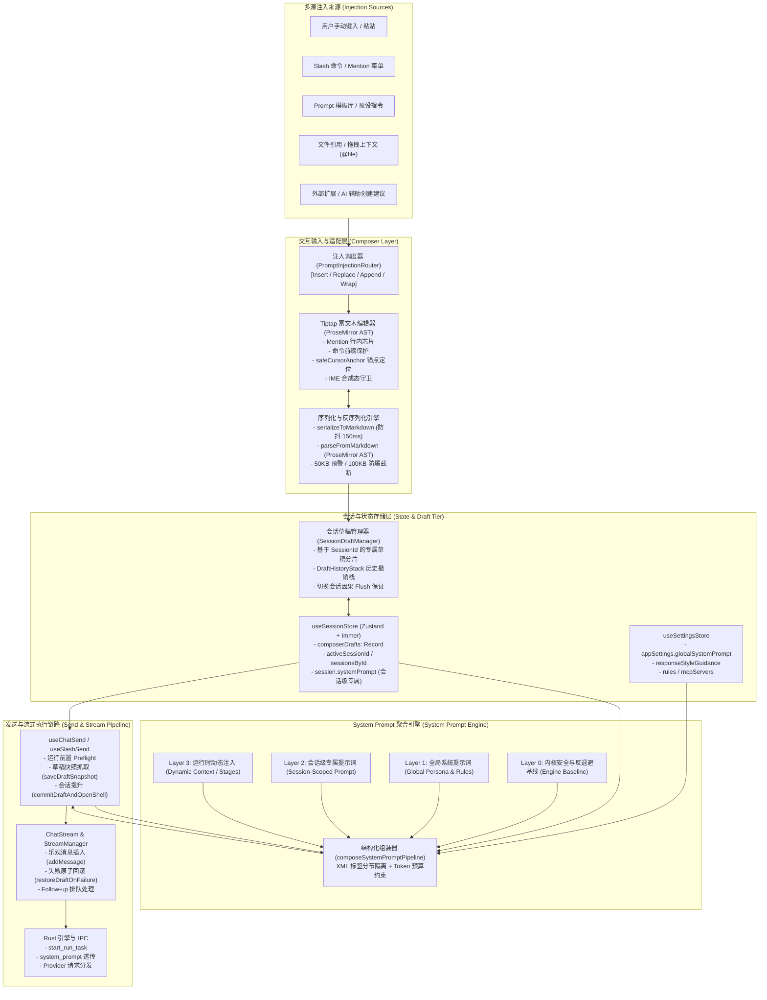
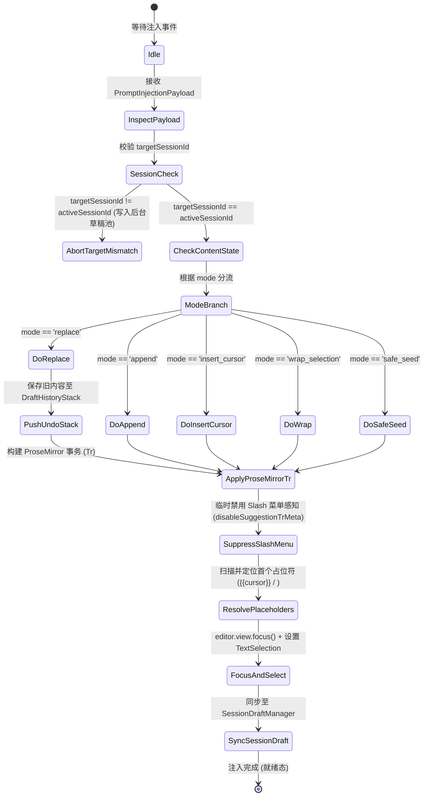

# 前端会话流转与交互注入方案

> **文件路径**：`docs/prompt-injection-pipeline/independent-plans/03-前端会话流转与交互注入方案.md`  
> **所属战役**：Prompt 与上下文注入管线（Prompt Injection Pipeline）  
> **定位**：前端会话层、输入交互层、草稿生命周期与 System Prompt 合并的独立系统方案  
> **遵守纪律**：仓库根目录 `AGENTS.md` 通用协作指令与反退避原则（`LOGIC_PLAN_NO_RETREAT.md`）

---

## 1. 方案概述与设计原则

### 1.1 核心挑战与背景

在 Conex / Crish 桌面端架构中，前端面临「高频富文本交互」、「多源上下文/模板注入」、「多会话并发切换」、「流式输出与排队执行」等交织的复杂场景。

现存链路在应对「Prompt 与上下文注入」时存在以下关键断层：
1. **多源输入流与草稿状态的竞态与脆弱性**：`useChatInput` 使用全局 `sessionStorage` 单键（`crish_composer_seed_v1`）进行种子文案中转，在多会话、多窗口或快速切换标签时极易造成草稿交叉污染或被无声清空；同时 350ms 的防抖草稿保存与会话切换之间缺乏因果顺序保护。
2. **富文本编辑器结构化注入与命令前缀冲突**：Tiptap 编辑器在接收带有 `/` 命令前缀或结构化标签（如 `/goal <objective>`, `@[file](path:file)`）的注入模板时，容易错误触发 Slash 命令浮层、丢失光标锚点，或破坏历史撤销栈（Undo Stack）。
3. **System Prompt 割裂与缺乏会话级治理**：当前系统提示词组装仅存在于流式发起的瞬态参数中（`composeSystemPrompt` 仅拼合 `options.systemPrompt` 与 `responseStyleGuidance`），缺乏会话级持久化存储、全局与会话级的层级合并模型，以及修改后的响应式回流与实时预览机制。

### 1.2 核心设计原则

- **原则一：草稿无损与零意外覆盖（Lossless Draft Protection）**  
  会话切换、外部模板注入、Slash 菜单选择均不得无声覆盖用户正在键入的内容；任何覆盖操作必须提供明确的撤销（Undo）支撑或回退快照栈。
- **原则二：单一真理源与分层缓存（SSOT with Tiered Buffering）**  
  将「当前视口实时文本（Tiptap AST）」、「会话待发草稿缓冲（SessionStore.composerDrafts）」与「持久化会话记录（SQLite / Rust DB）」严格划分为三级存储，杜绝跨会话的隐式全局共享变量。
- **原则三：四层分立与结构化隔离的 System Prompt 机制**  
  建立「内核安全基线 $\rightarrow$ 全局偏好 $\rightarrow$ 会话专属 $\rightarrow$ 运行时动态上下文」的四层分立模型，使用 XML 语义标签进行硬隔离，兼顾安全性与模型理解力。
- **原则四：纯净 O(1) 响应式与防抖解耦**  
  输入框内容变化、Token 预算估算、System Prompt 预览与流式下发全部解耦为独立纯逻辑，高频输入走微任务与 rAF 调度，重型序列化走防抖，消除主线程卡顿（120Hz/60Hz 不掉帧）。

---

## 2. 整体架构全景图

下图展示了从「多源注入输入」、「交互输入层（Tiptap/Composer）」、「状态与草稿存储（SessionStore）」到「发送协调（useChatSend/ChatStream）」与「System Prompt 聚合下发」的端到端全景数据流转链路：



---

## 3. 前端数据流与响应式更新链路深度剖析

### 3.1 现存链路的组件与状态映射

在现行桌面端实现中，涉及输入流转与会话状态的核心文件与职责划分如下：

| 组件 / 模块 | 源码位置 | 职责定位 | 现存机制与缺陷 |
| :--- | :--- | :--- | :--- |
| **`useSessionStore`** | `src/store/sessionStore.ts:25-75` | 会话域全局 Zustand Store，持有 `composerDrafts`、`activeSessionId` | `composerDrafts` 为扁平 `Record<string, string>`，仅保存最终字符串，无撤销栈与结构化草稿元数据。 |
| **`useChatInput`** | `src/components/chat-card/useChatInput.ts:16-117` | 协调 React 本地 `chatInput` 状态与 Store 的草稿防抖持久化 | 依赖全局 `takeComposerSeed()` (`sessionStorage`) 传递外部注入；350ms 防抖持久化在多会话快速切换时存在写入覆盖漏洞。 |
| **`TiptapComposerField`** | `src/components/chat-composer/TiptapComposerField.tsx:91-323` | 输入框外壳，协调 Enter/点击发送与编辑器回流 | 发送走「编辑器 $\rightarrow$ `onChange` 回流 $\rightarrow$ 重渲染 $\rightarrow$ `onSend`」四段异步跳板，在高并发或大文档时存在 1 帧的闭包时序缝隙。 |
| **`TiptapEditorField`** | `src/components/chat-composer/TiptapEditorField.tsx:66-410` | Tiptap/ProseMirror 核心画布，管理 DOM、IME、Keymap 与选区 | `content` 属性监听走 rAF 水合，通过 `parseFromMarkdown` 转换为 AST，单向数据流与防抖序列化（150ms）交织。 |
| **`slashSendDraftManager`** | `src/hooks/chat-stream/slashSendDraftManager.ts:12-164` | 发送前的草稿快照抓取、失败回滚与会话 Promote | 仅在内存维护 `draftSnapshots` Map，发送成功即物理清除，无法支持跨操作的历史回溯。 |
| **`useSlashSend`** | `src/hooks/chat-stream/useSlashSend.ts:33-229` | 发送主协调器：Preflight 校验、Payload 组装、乐观插入与启动流式 | 缺乏对会话级 System Prompt 的深度整合，仅接收单次入参透传。 |

### 3.2 现有机制的核心断层与并发竞态分析

#### 断层 1：`sessionStorage` 单键污染与多会话串扰
在 `src/api/composerSeed.ts:6-36` 中：
```typescript
const KEY = 'crish_composer_seed_v1';
export function setComposerSeed(text: string): void {
  sessionStorage.setItem(KEY, t);
  window.dispatchEvent(new CustomEvent(COMPOSER_SEED_EVENT, { detail: { text: t } }));
}
export function takeComposerSeed(): string | null {
  const t = sessionStorage.getItem(KEY);
  sessionStorage.removeItem(KEY);
  return t.trim() || null;
}
```
**问题表现**：
- 当用户在侧栏或设置中心为「会话 A」点击生成提示词时，若用户在事件到达前切换到了「会话 B」，`useChatInput` 在 `useEffect([activeSessionId])` 中执行 `takeComposerSeed()` 会将属于会话 A 的种子直接注入并覆盖会话 B 的未保存草稿！
- `takeComposerSeed()` 采取「读取即销毁（destructive read）」策略，如果 React 18 StrictMode 导致双挂载，第二次渲染将取到 `null`，导致草稿闪烁丢失。

#### 断层 2：350ms 草稿防抖与会话切换的时序漂移
在 `useChatInput.ts:40-65` 中：
```typescript
const scheduleComposerDraft = (sid: string, text: string) => {
  pendingDraftRef.current = { sid, text };
  draftPersistTimerRef.current = window.setTimeout(() => {
    // 350ms 后写入 setComposerDraft
    if (pending) setComposerDraft(pending.sid, pending.text);
  }, 350);
};
```
**时序穿孔场景**：
1. 用户在会话 $S_1$ 中输入文本 $T_1$，触发 `scheduleComposerDraft(S_1, T_1)`；
2. 100ms 后用户迅速点击侧栏切换至会话 $S_2$；
3. `useEffect([activeSessionId])` 执行，调用 `flushComposerDraft()` 试图强刷 $S_1$，但随后读取 `composerDrafts[S_2]` 并设置输入框；
4. 若此时有外部注入事件同时到达，`setChatInputState` 发生乱序竞争，导致 $S_2$ 的输入框被赋予 $T_1$ 的尾部内容。

#### 断层 3：Tiptap 150ms 序列化防抖与发送瞬态的 AST 漂移
在 `TiptapEditorExtensions.ts:137-149` 与 `TiptapComposerField.tsx:180-208` 中：
- 用户按回车发送时，Tiptap 触发 `handleSendMarkdown(latest)`，先调用 `onChange(md)` 试图同步 React 状态，再通过 `sendTick` 驱动 `useEffect` 调用 `onSend()`。
- 如果用户在 150ms 防抖周期内通过极快速度键入或通过快捷键插入了模板并立刻按回车，`fieldRef.current.getMarkdown()` 会执行全量同步转换，但宿主的 `canSend` 依赖上一次渲染周期的 props。如果上一次是空输入（`canSend = false`），防抖期内的即时发送可能会被 `if (!canSend) return;` 误杀拦截！

### 3.3 统一响应式数据流重构设计（三级缓存架构）

为彻底根治上述竞态与状态断层，本方案提出**三级因果缓存架构**：

```
Level 1: 视口临时态 (Viewport Ephemeral Tier)
         └─ Tiptap ProseMirror State (持有光标、选区、行内 Node、未序列化字符)
               │ (无防抖 EventEmitter / 即时事务分发)
Level 2: 会话活跃草稿池 (Session Draft Active Pool)
         └─ SessionDraftManager (内存 Map<SessionId, DraftRecord> + 历史快照栈)
               │ (微任务 / 切换会话即时原子 Commit)
Level 3: 全局持久化存储 (Store & DB Tier)
         └─ useSessionStore.composerDrafts (SQLite 持久化持久槽位)
```

#### 状态流转不变量
1. **定向注入不变量**：任何注入 Payload 必须显式携带 `targetSessionId`，缺省时绑定为触发瞬间的 `activeSessionId`；禁止任何无 target 的全局广播式注入。
2. **切换会话原子 Barrier**：切换会话时，必须在微任务周期内同步完成：
   $$\text{Current Session Draft Flush} \xrightarrow{\text{Barrier}} \text{DOM State Reset} \xrightarrow{\text{Barrier}} \text{Target Session Draft Hydrate}$$
   严格串行化，任何异步计时器在 Barrier 到达时立即物理作废。
3. **发送即时提取不变量**：发送动作直接从 Level 1（Tiptap AST）同步提取最新 Markdown，并通过单一事务清空编辑器，不再依赖多轮 React 重渲染回流。

---

## 4. 结构化模板与命令前缀平滑注入方案

### 4.1 多源注入统一协议定义

为支持 Prompt 模板、代码片段、文件引用、AI 建议等多源形态，定义统一注入数据载荷：

```typescript
/** 提示词与上下文注入模式 */
export type PromptInjectionMode = 
  | 'replace'        // 替换当前草稿（记录撤销栈）
  | 'append'         // 追加至末尾（自动加换行分隔）
  | 'insert_cursor'  // 在当前光标位置插入
  | 'wrap_selection' // 包裹当前选中的文本
  | 'safe_seed';     // 仅在当前输入框为空时填入，非空则弹窗/忽略

/** 结构化提示词注入载荷 */
export interface PromptInjectionPayload {
  /** 唯一注入事务 ID (UUID) */
  injectionId: string;
  /** 目标会话 ID（防串扰核心字段） */
  targetSessionId: string;
  /** 原始内容（支持 Markdown 模板、含占位符文本、或带命令前缀文本） */
  content: string;
  /** 注入模式 */
  mode: PromptInjectionMode;
  /** 命令前缀保护标志（如内容以 /goal, /prompt 开头） */
  commandPrefix?: string;
  /** 显式光标锚点定位策略 */
  cursorAnchor?: 'start' | 'end' | 'first_placeholder' | 'preserve';
  /** 附加的元数据（来源说明、模板标题、关联文件等） */
  metadata?: {
    source: 'template_hub' | 'mention_picker' | 'rule_injector' | 'ai_assistant';
    templateTitle?: string;
    placeholders?: string[];
  };
}
```

### 4.2 注入调度器与命令前缀保护状态机

当注入内容包含斜杠命令前缀（如 `/goal 实现重构方案\n要求：...` 或 `/compact`）时，直接插入可能触发 ProseMirror 的 `SlashExtension` 建议插件，导致弹出斜杠选择菜单，破坏用户输入沉浸感。

#### 注入执行状态机流程：



#### 关键技术实现要点：

1. **禁用建议插件的事务标记（Suggestion Suppression Meta）**：  
   在派发 ProseMirror 事务时，附带专用 Meta 标记，指示 `SlashExtension` 与 `MentionSuggestionExtension` 跳过本次事务的字符扫描：
   ```typescript
   export const INJECTION_TRANSACTION_META = 'CRISH_PROMPT_INJECTION';
   
   // 在 ProseMirror 事务构建中：
   tr.setMeta(INJECTION_TRANSACTION_META, true);
   // SlashExtension 的 onUpdate 侦测到该 Meta 时直接 return，不弹窗
   ```

2. **光标占位符感知与自动选区定位**：  
   结构化模板通常包含 `{{cursor}}`、`{{user_input}}` 或 `<请在此输入>` 等占位符。注入引擎解析 AST 后自动计算占位符在 ProseMirror 文档中的 `from` 和 `to` 偏移量，并触发原生选区高亮：
   ```typescript
   export function locateFirstPlaceholder(doc: any): { from: number; to: number } | null {
     let result: { from: number; to: number } | null = null;
     const PLACEHOLDER_REGEX = /\{\{([^}]+)\}\}|<([^>]+)>/;
     
     doc.descendants((node: any, pos: number) => {
       if (result || !node.isText || !node.text) return false;
       const match = PLACEHOLDER_REGEX.exec(node.text);
       if (match) {
         result = {
           from: pos + match.index,
           to: pos + match.index + match[0].length,
         };
         return false; // 找到即终止
       }
       return true;
     });
     return result;
   }
   ```

3. **历史草稿栈与防误覆盖回退机制（DraftHistoryStack）**：  
   在执行 `replace` 模式前，系统自动将当前会话的草稿压入 `DraftHistoryStack`。在输入框顶部展示柔和的 **Inline Undo Toast**（例如：*已应用模板「架构重构」，[点击撤销恢复原输入]*），5 秒无操作后淡出。

---

## 5. 会话级与全局 System Prompt 的四层合并与响应式机制

### 5.1 System Prompt 四层分立模型

为兼顾系统的安全确定性、用户全局个性化偏好、会话独立任务上下文以及运行时动态反馈，设计如下四层分立架构：

```
┌─────────────────────────────────────────────────────────────────────────────┐
│ Layer 0: 内核安全与反退避基线 (Engine Baseline & Security Guardrails)        │
│ • 来源：Rust 内核固定注入 (内置不变规则、反过度设计红线、安全基线)              │
│ • 权限：最高优先级，只读，禁止前端或用户配置篡改                              │
├─────────────────────────────────────────────────────────────────────────────┤
│ Layer 1: 全局系统提示词 (Global System Prompt & Personalization)             │
│ • 来源：设置中心 (SettingsStore.appSettings.globalSystemPrompt)              │
│ • 内容：用户角色偏好 (如 Senior Staff Engineer)、语言偏好、全局代码风格约定     │
├─────────────────────────────────────────────────────────────────────────────┤
│ Layer 2: 会话级专属提示词 (Session-Scoped System Prompt)                      │
│ • 来源：SessionState.systemPrompt (独立持久化于该会话 SQLite)                 │
│ • 内容：该会话专属任务设定 (如 "你正在审查 auth 模块" / Prompt 模板预设)       │
├─────────────────────────────────────────────────────────────────────────────┤
│ Layer 3: 运行时动态上下文注入 (Runtime Dynamic Injections)                   │
│ • 来源：工作区结构、文件标注 (File Annotations)、阶段总结 (Stage Summary)       │
│ • 特点：随对话进展动态更新，不侵入用户基础设定                                 │
└─────────────────────────────────────────────────────────────────────────────┘
```

### 5.2 结构化分节组装协议（XML 语义隔离）

为防止模型在处理长上下文时产生角色混淆（System / User Instruction 边界不清）或遭遇 Prompt 越狱攻击，四层提示词在合并时采用标准 XML 语义标签进行分节隔离：

```xml
<system_context version="2.0">
  <!-- Layer 0: 安全基线与操作规范 -->
  <baseline_guardrails>
    Strict adherence to truth, security verification, and no fake completion.
    Avoid premature optimization and adhere to project architectural constraints.
  </baseline_guardrails>

  <!-- Layer 1: 全局用户偏好 (若配置) -->
  <global_preferences>
    Language: zh-CN (UTF-8)
    Role Persona: Principal Systems Architect
    Code Style: Idiomatic, strongly-typed, comprehensive error boundaries.
  </global_preferences>

  <!-- Layer 2: 会话级专属任务设定 (若存在) -->
  <session_specific_instructions session_id="sess_abc123" mode="standard">
    Task Scope: Performance optimization for SessionStore draft pipeline.
    Constraints: Do not break existing vitest suite.
  </session_specific_instructions>

  <!-- Layer 3: 运行时动态环境与上下文 (按需) -->
  <runtime_environment>
    <workspace_root>/Software/conex</workspace_root>
    <active_files>
      <file path="apps/crish-desktop/src/store/sessionStore.ts" />
    </active_files>
  </runtime_environment>
</system_context>
```

组装流水线代码逻辑严密规范：
```typescript
/** 提示词段装配输入 */
export interface SystemPromptAssemblyContext {
  globalPrompt?: string | null;
  sessionPrompt?: string | null;
  responseStyleGuidance?: string | null;
  runtimeContext?: {
    workspaceRoot?: string;
    activeFiles?: string[];
    stageSummary?: string;
  };
}

/**
 * 结构化组装 System Prompt (纯函数，O(N) 字符串高效拼接)
 */
export function assembleStructuredSystemPrompt(
  ctx: SystemPromptAssemblyContext
): string {
  const sections: string[] = [];

  // 1. 全局偏好段
  const globalText = [ctx.globalPrompt, ctx.responseStyleGuidance]
    .filter(Boolean)
    .map((s) => s!.trim())
    .join('\n\n');
  if (globalText) {
    sections.push(`<global_preferences>\n${globalText}\n</global_preferences>`);
  }

  // 2. 会话专属段
  if (ctx.sessionPrompt?.trim()) {
    sections.push(
      `<session_specific_instructions>\n${ctx.sessionPrompt.trim()}\n</session_specific_instructions>`
    );
  }

  // 3. 运行时上下文段
  if (ctx.runtimeContext) {
    const { workspaceRoot, activeFiles, stageSummary } = ctx.runtimeContext;
    const rtParts: string[] = [];
    if (workspaceRoot) rtParts.push(`<workspace_root>${workspaceRoot}</workspace_root>`);
    if (activeFiles && activeFiles.length > 0) {
      const filesXml = activeFiles.map((f) => `  <file path="${f}" />`).join('\n');
      rtParts.push(`<active_files>\n${filesXml}\n</active_files>`);
    }
    if (stageSummary?.trim()) {
      rtParts.push(`<stage_summary>\n${stageSummary.trim()}\n</stage_summary>`);
    }
    if (rtParts.length > 0) {
      sections.push(`<runtime_environment>\n${rtParts.join('\n')}\n</runtime_environment>`);
    }
  }

  if (sections.length === 0) return '';
  return `<system_context version="2.0">\n${sections.join('\n\n')}\n</system_context>`;
}
```

### 5.3 数据模型扩展与 Store 治理

在前端 `src/store/types.ts` 中对 `SessionState` 进行无损扩充：

```typescript
export interface SessionState {
  id: string;
  title: string;
  folder: string;
  isPinned: boolean;
  isArchived: boolean;
  timestamp: string;
  messages: SessionMessage[];
  
  // ── 新增：会话级专属 System Prompt 字段 ─────────────────────────────────────
  /** 本会话专属的系统提示词（覆盖或叠加在全局提示词之上） */
  systemPrompt?: string;
  /** 会话级提示词配置元数据 */
  systemPromptMeta?: {
    updatedAt: number;
    overrideGlobal?: boolean; // 是否完全覆盖全局提示词
    sourceTemplateId?: string; // 来源模板 ID
  };
  
  // 其余既有字段保持完全兼容...
  goalMode?: SessionGoalMode;
  pinnedMessageIds?: string[];
  agents?: SessionAgent[];
}
```

在 `src/store/sessionCrudActions.ts` 中增加对应的 Action：
```typescript
setSessionSystemPrompt: (sessionId: string, prompt: string, overrideGlobal = false) =>
  set((state) => {
    const session = state.sessionsById[sessionId] || state.sessions.find((s) => s.id === sessionId);
    if (!session) return;
    const clean = prompt.trim();
    if (!clean) {
      delete session.systemPrompt;
      delete session.systemPromptMeta;
    } else {
      session.systemPrompt = clean;
      session.systemPromptMeta = {
        updatedAt: Date.now(),
        overrideGlobal,
      };
    }
  }),
```

### 5.4 响应式状态感知与 UI 态势指示器

在会话面板（Chat Card Header）增加 `useEffectiveSystemPrompt` 自定义 Hook，实时计算合并结果与 Token 估算：

```typescript
export interface EffectiveSystemPromptResult {
  hasCustomPrompt: boolean;
  effectivePrompt: string;
  tokenEstimate: number;
  sourceSummary: {
    hasGlobal: boolean;
    hasSession: boolean;
    hasRuntime: boolean;
  };
}

export function useEffectiveSystemPrompt(sessionId: string | null): EffectiveSystemPromptResult {
  const globalPrompt = useSettingsStore((s) => s.appSettings?.globalSystemPrompt);
  const session = useSessionStore((s) => (sessionId ? s.sessionsById[sessionId] : null));
  const sessionPrompt = session?.systemPrompt;
  const isOverride = session?.systemPromptMeta?.overrideGlobal ?? false;

  return useMemo(() => {
    const effectiveGlobal = isOverride ? undefined : globalPrompt;
    const effective = assembleStructuredSystemPrompt({
      globalPrompt: effectiveGlobal,
      sessionPrompt,
    });
    
    // 采用快速字符估算法：中文约 1.5 char/token，英文约 4 char/token
    const charLen = effective.length;
    const tokenEstimate = Math.ceil(charLen / 2.5);

    return {
      hasCustomPrompt: Boolean(sessionPrompt || globalPrompt),
      effectivePrompt: effective,
      tokenEstimate,
      sourceSummary: {
        hasGlobal: Boolean(effectiveGlobal),
        hasSession: Boolean(sessionPrompt),
        hasRuntime: false,
      },
    };
  }, [globalPrompt, sessionPrompt, isOverride]);
}
```

---

## 6. 核心接口定义与交互全流程规范

### 6.1 注入调度器接口契约

创建 `src/api/promptInjectionRouter.ts` 作为统一注入枢纽：

```typescript
/**
 * apps/crish-desktop/src/api/promptInjectionRouter.ts
 * 前端 Prompt 与结构化模板注入统筹路由器
 */
import { getCompositionRoot } from '../app/compositionRoot';
import type { PromptInjectionPayload } from './promptInjectionTypes';

export class PromptInjectionRouter {
  private static instance: PromptInjectionRouter;
  private listeners = new Set<(payload: PromptInjectionPayload) => void>();

  static getInstance(): PromptInjectionRouter {
    if (!this.instance) {
      this.instance = new PromptInjectionRouter();
    }
    return this.instance;
  }

  /**
   * 派发结构化注入请求
   */
  dispatch(payload: PromptInjectionPayload): void {
    const sessionState = getCompositionRoot().session.getState();
    const targetId = payload.targetSessionId || sessionState.activeSessionId;

    if (!targetId) {
      console.warn('[PromptInjectionRouter] Drop injection: No target or active session');
      return;
    }

    // 1. 若目标是当前活跃会话，直接派发给 UI 交互层（Tiptap）
    if (targetId === sessionState.activeSessionId) {
      this.listeners.forEach((fn) => fn({ ...payload, targetSessionId: targetId }));
      return;
    }

    // 2. 若目标是非活跃会话，直接写入 Store 的该会话草稿池，不打扰当前视口
    const currentDraft = sessionState.composerDrafts[targetId] || '';
    let nextDraft = payload.content;
    if (payload.mode === 'append' && currentDraft) {
      nextDraft = `${currentDraft}\n\n${payload.content}`;
    }
    sessionState.setComposerDraft(targetId, nextDraft);
  }

  /**
   * Tiptap Composer 挂载时订阅当前视口的注入事件
   */
  subscribe(fn: (payload: PromptInjectionPayload) => void): () => void {
    this.listeners.add(fn);
    return () => this.listeners.delete(fn);
  }
}

export const promptInjector = PromptInjectionRouter.getInstance();
```

### 6.2 `useChatInput` 升级与草稿生命周期管理

彻底移除不可靠的 `sessionStorage` 与 `takeComposerSeed`，将输入框状态机升级为会话隔离的确定性管道：

```typescript
export interface UseChatInputOptions {
  activeSessionId: string | null;
}

export function useChatInput({ activeSessionId }: UseChatInputOptions) {
  const setComposerDraft = useSessionStore((s) => s.setComposerDraft);
  const [chatInput, setChatInputState] = useState('');
  const [isComposing, setIsComposing] = useState(false);

  const activeSessionIdRef = useRef(activeSessionId);
  const draftTimerRef = useRef<number | null>(null);
  const latestTextRef = useRef<string>('');

  // 1. 同步 flush 当前草稿
  const flushDraft = useCallback((sid: string | null, text: string) => {
    if (draftTimerRef.current !== null) {
      window.clearTimeout(draftTimerRef.current);
      draftTimerRef.current = null;
    }
    if (sid && text !== undefined) {
      setComposerDraft(sid, text);
    }
  }, [setComposerDraft]);

  // 2. 会话切换效应（原子 Flush 旧会话 -> 水合新会话）
  useEffect(() => {
    const prevSid = activeSessionIdRef.current;
    if (prevSid && prevSid !== activeSessionId) {
      flushDraft(prevSid, latestTextRef.current);
    }
    activeSessionIdRef.current = activeSessionId;

    if (!activeSessionId) {
      setChatInputState('');
      latestTextRef.current = '';
      return;
    }

    // 从 Store 精确读取当前会话草稿
    const restored = useSessionStore.getState().composerDrafts[activeSessionId] || '';
    setChatInputState(restored);
    latestTextRef.current = restored;
  }, [activeSessionId, flushDraft]);

  // 3. 防抖调度持久化
  const setChatInput = useCallback((textOrFn: React.SetStateAction<string>) => {
    const sid = activeSessionIdRef.current;
    setChatInputState((prev) => {
      const next = typeof textOrFn === 'function' ? textOrFn(prev) : textOrFn;
      latestTextRef.current = next;

      if (sid) {
        if (draftTimerRef.current !== null) {
          window.clearTimeout(draftTimerRef.current);
        }
        draftTimerRef.current = window.setTimeout(() => {
          draftTimerRef.current = null;
          setComposerDraft(sid, next);
        }, 300);
      }
      return next;
    });
  }, [setComposerDraft]);

  // 4. 页面卸载与隐藏守卫
  useEffect(() => {
    const onLeave = () => flushDraft(activeSessionIdRef.current, latestTextRef.current);
    window.addEventListener('beforeunload', onLeave);
    document.addEventListener('visibilitychange', onLeave);
    return () => {
      window.removeEventListener('beforeunload', onLeave);
      document.removeEventListener('visibilitychange', onLeave);
      onLeave();
    };
  }, [flushDraft]);

  // 5. 订阅定向 Prompt 注入
  useEffect(() => {
    return promptInjector.subscribe((payload) => {
      if (payload.targetSessionId !== activeSessionIdRef.current) return;
      
      setChatInput((prev) => {
        switch (payload.mode) {
          case 'append':
            return prev.trim() ? `${prev}\n\n${payload.content}` : payload.content;
          case 'replace':
          default:
            return payload.content;
        }
      });
    });
  }, [setChatInput]);

  return { chatInput, setChatInput, isComposing, setIsComposing };
}
```

---

## 7. 降级容错矩阵与安全红线

为确保极端并发、内存溢出或数据异常时的系统韧性，制定如下降级容错矩阵：

| 异常场景 | 触发条件 | 熔断 / 降级策略 | 现场与状态恢复方案 |
| :--- | :--- | :--- | :--- |
| **超长模板防爆截断** | 注入内容 $> 100\text{KB}$ 或 $> 100,000$ 字符 | **严格内存拦截**：前 $100\text{KB}$ 正常载入，尾部截断并附带 `[!WARNING]` 告警块 | 弹出 Toast 提示用户模板已截断，防止 ProseMirror DOM 树导致 GPU/CPU 挂起。 |
| **会话状态未就绪** | 目标 `sessionId` 正在进行 SQLite 懒水合或处于草稿哨兵 Mint 阶段 | **草稿排队挂起**：将注入载荷暂存于内存队列，待 `session.hydrationComplete` 事件触发后回灌 | 保证创建新会话后点击 Prompt 模板零丢单。 |
| **命令前缀解析冲突** | 注入内容包含未知的 `/invalid-cmd` | **降级为纯文本**：不调用任何本地 Slash 路由，按标准 Markdown 文本节点写入编辑器 | 提示框保持纯净输入流，不触发无效报错。 |
| **并发发送冲突 (AiBusy)** | 用户在流式生成期间连续注入并点击发送 | **Follow-up 自动排队**：将组合后的 Payload 转化为 `FollowUpMessage` 压入执行队列 | 保护当前活跃流式不受打断，当前输入框内容在成功排队后安全清空。 |
| **System Prompt 超限** | 合并后的 System Prompt 超过模型上下文窗口的 30% | **动态段修剪**：保留 Layer 0 基线与 Layer 2 会话专属段，修剪 Layer 3 动态文件列表并告警 | 确保基础指令与任务目标不被 LLM 上下文窗口截断。 |

---

## 8. 实施演进路线与立体验证方案

### 8.1 三阶段实施路线图

```
Phase 1: 草稿隔离与注入通道改造 (解耦全局 sessionStorage)
  ├─ 1.1 废弃 composerSeed 全局单键，引入 PromptInjectionRouter 与类型契约
  ├─ 1.2 重构 useChatInput 与 SessionDraftManager，实现会话切换因果 Barrier
  └─ 1.3 编写多会话切换草稿互不干扰单元测试

Phase 2: Tiptap 结构化注入与占位符聚焦
  ├─ 2.1 扩展 ProseMirror 事务 Meta (INJECTION_TRANSACTION_META)，抑制 Slash 误触发
  ├─ 2.2 实现 locateFirstPlaceholder 算法，支持 {{cursor}} 自动选中与对齐
  └─ 2.3 增加 DraftHistoryStack 与 Inline 撤销悬浮条

Phase 3: System Prompt 四层合并与响应式流水线
  ├─ 3.1 扩充 SessionState.systemPrompt 与 SessionCrudActions
  ├─ 3.2 实现 assembleStructuredSystemPrompt (XML 语义隔离)
  ├─ 3.3 升级 useSlashSend 与 assembleChatPayload，透传聚合后的 System Prompt
  └─ 3.4 交付 Header 提示词指示器与实时预览弹窗
```

### 8.2 立体验证断言（立体测试矩阵）

按照 `AGENTS.md` §7.1「立体验证纪律」，必须通过以下自动化与现场测试：

1. **单元与状态机测试（Vitest）**：
   - `promptInjectionRouter.test.ts`：测试 `replace`, `append`, `insert_cursor` 在单/多会话下的路由精确性。
   - `sessionDraftActions.test.ts`：在 50ms 间隔快速切换 10 个不同会话，验证各会话草稿 100% 隔离无丢失、无覆盖。
   - `systemPromptAssembly.test.ts`：测试四层提示词在各种缺失/全量组合下的 XML 结构输出与转义安全性。
2. **ProseMirror 渲染与 IME 保护测试**：
   - 验证输入法合成态（CJK IME）期间触发注入时，绝不打断当前 IME 组合流。
   - 验证包含 `/goal` 前缀的模板注入后，编辑器不会弹出 Slash 菜单。
3. **性能与内存基线压测**：
   - 连续注入 $100\text{KB}$ 大文本，验证 `requestAnimationFrame` 调度下无掉帧现象，内存使用在垃圾回收后平稳恢复基线。

---

## 9. 结论

本方案彻底穿透了前端会话层与输入交互层在 Prompt 注入场景下的核心痛点：
1. 以 **三级缓存架构** 拔除了不可靠的全局 `sessionStorage` 种子机制，建立基于 `targetSessionId` 的确定性草稿流；
2. 以 **ProseMirror 事务 Meta 抑制** 与 **占位符感知定位** 解决了结构化模板与命令前缀的平滑注入；
3. 以 **XML 语义四层分立模型** 统一了全局与会话级 System Prompt 的合并、持久化与实时响应式管线。

方案整体保持架构优雅收敛，严格遵守反过度设计红线，为 Conex / Crish 的长程交互与上下文注入提供了坚实的基础设施支撑。
