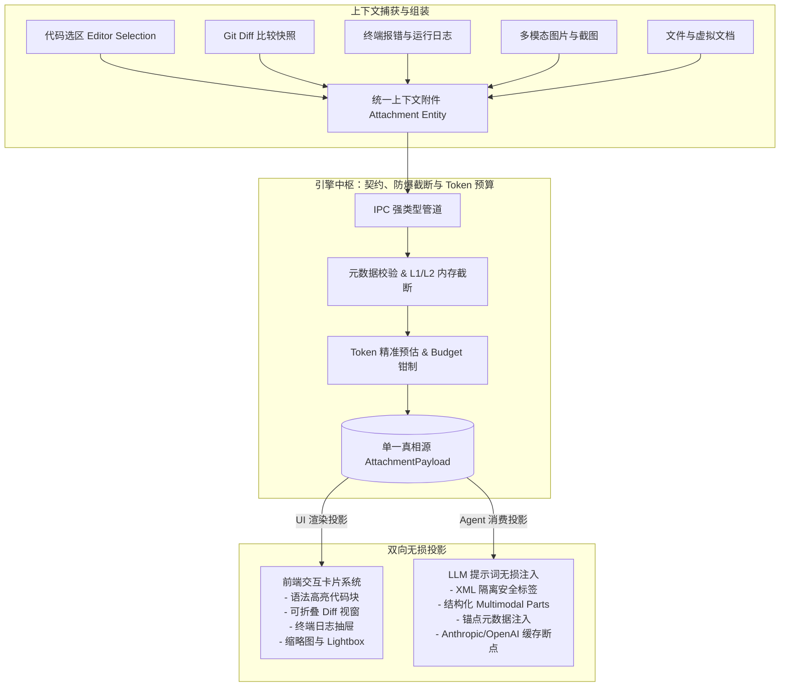
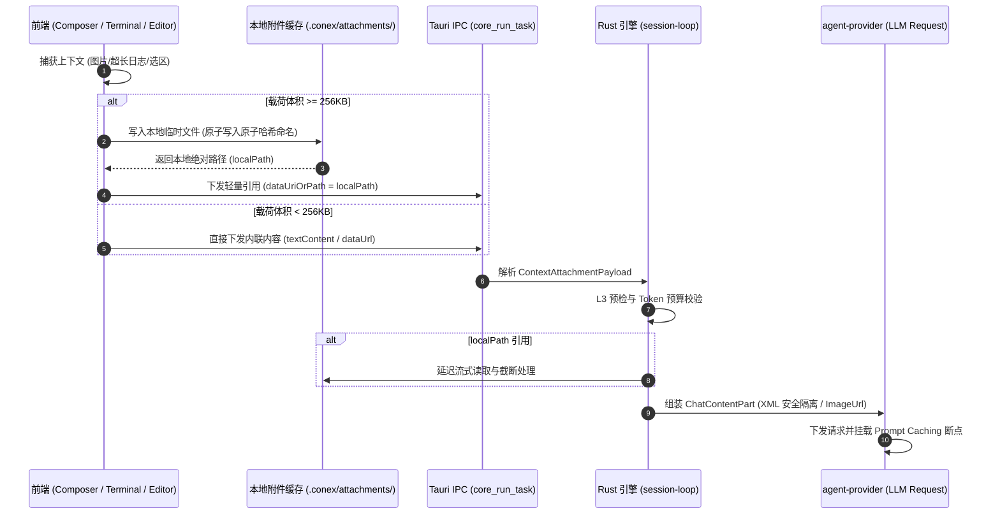
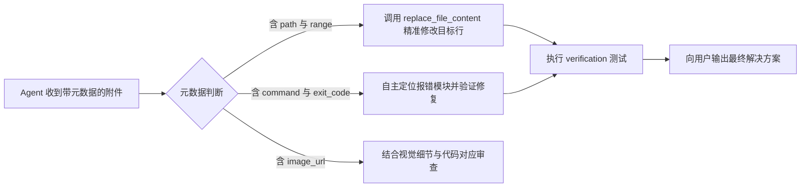
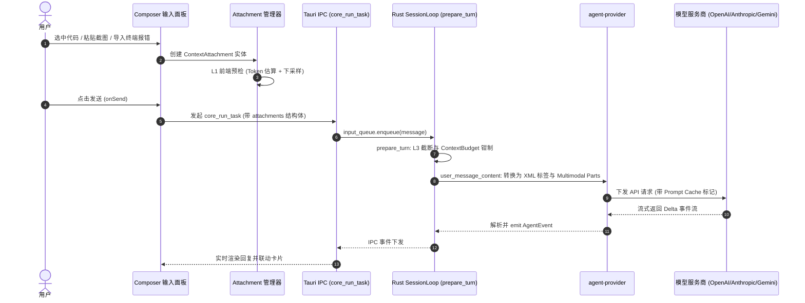

# 05-上下文引用与多模态附件注入方案

> **文档定位**：战役独立方案（Independent Plan）。
> **战役工作区**：`docs/prompt-injection-pipeline/independent-plans/05-上下文引用与多模态附件注入方案.md`。
> **核心使命**：为 Conex / Crish 规划下一代多维「上下文引用与附件注入（Context Attachments & References）」的统一通用工程标准。涵盖代码选区、Diff 快照、终端日志、结构化文件与多模态图片等附件的标准化处理通道、元数据契约、内存防爆截断策略、Token 精确消耗估算，以及前端交互卡片与 Agent LLM 提示词无损双向映射的最佳实践。

---

## 1. 方案背景与核心目标

### 1.1 现状痛点与演进诉求

在 Conex 当前的输入与提示词注入流水线中，附件与上下文引用的处理存在以下结构性断层：

1. **通道割裂与多源漂移**：
   - 文本附件、富文本选区、剪贴板截图、终端日志分别散落在 `useChatAttachments`、`TiptapComposerField`、`slashSendPreflight` 与 `buildMultimodalFromAttachments` 中；
   - 消息下发时，图片通过 `content: ChatContentPart[]` 注入，而文本附件以字符串拼接方式硬编码注入到 Prompt 末尾（`[附件] \n\n --- file ---`），缺乏结构化元数据锚点。
2. **缺乏类型维度的元数据约束**：
   - 缺乏对「代码选区（含行列号与 Git SHA）」、「Diff 对比快照（Unified Diff / Hunk 锚点）」、「终端执行报错（退出码、错误流与堆栈）」等复杂工程上下文的强类型建模；
   - 导致 Agent 在接收到这些信息时，无法精准定位原文件与当前 Git 状态，易引发工具二次调用的路径幻觉。
3. **内存与 Token 风险失控**：
   - 缺乏大附件内存防爆保护：用户粘贴 50MB 终端日志或多个 4K 截图时，全量 Base64 编码直接塞入 IPC 载荷与 React 状态机，极易导致前端渲染卡顿甚至 OOM；
   - 缺乏细粒度 Token 消耗预估：多模态图片与长文本的 Token 消耗在发送前缺乏可见性，容易击穿模型的上下文窗口导致下游 API 报 `400 / 413 (context_length_exceeded)`。
4. **前端展示与 Agent 消费语义不对称**：
   - 前端卡片仅简单呈现文件名和文件大小，缺乏交互折叠、源码高亮、Diff 对比视图与跳转源码编辑器的能力；
   - Agent 消费端提示词未经语义隔离，容易被模型误解为用户的主指令，导致「提示词注入（Prompt Injection）」或指令混淆。

---

### 1.2 核心设计哲学：单一真相源（SSOT）与双向投影

本方案确立**「单一真相源 + 双向投影（Dual-Projection）」**的核心工程原则：



- **单一真相源（SSOT）**：无论是代码、Diff、日志还是图片，都由一套统一且具扩展性的数据模型（`ContextAttachment`）进行描述，包含完整的内容本体、来源元数据、截断状态与 Token 指标。
- **UI 渲染投影（UI Projection）**：面向用户，提供富交互、可折叠、代码高亮、支持一键跳转编辑器的 UI 卡片视图。
- **Agent 消费投影（Wire Projection）**：面向 LLM，生成具备强结构化隔离标签（如 `<context_attachment>`）、精准行号锚点、语法围栏与多模态结构化 Parts 的提示词载荷。

---

### 1.3 核心设计目标与非目标

#### 核心设计目标
1. **标准化统一注入通道**：覆盖代码选区、Diff 对比、终端日志、文件与多模态图片 5 大核心附件类型。
2. **端到端类型契约同步**：在 Rust (`conex-types`) 与 TypeScript (`apps/crish-desktop`) 之间实现 100% 强类型对齐与 Serde 序列化无损互通。
3. **四级内存与防爆截断体系**：构建「前端输入 → IPC 传输 → 引擎预检 → 会话压缩」的全链路防爆机制，防止内存 OOM 与超大 Base64 阻塞事件循环。
4. **高精度 Token 预估与预算调度**：实现基于 BPE 启发式的文本 Token 预估与 OpenAI/Anthropic/Gemini 官方标准的多模态 Vision Token 计算公式，深度联动 `ContextBudget`。
5. **提示词安全防注入与缓存优化**：使用标准 XML 标签与命名空间隔离上下文，支持 Anthropic Prompt Caching (`cache_control: { type: "ephemeral" }`) 与 OpenAI 前缀缓存。

#### 非目标（避免过度设计）
- 不引入分布式文件存储服务：本地桌面环境使用轻量级本地磁盘缓存（`.conex/attachments/`）管理大体积 Blob，不做云端对象存储同步。
- 不引入重型 WebAssembly 分词库：Token 预估采用高性能 Rust/TS 纯函数快速估算器，不为了 1% 的精度在 UI 主线程打包数十兆的模型词表。
- 不修改既有 Session 核心状态机生命周期：深度复用 `session-loop` 的 `prepare_turn` 与 `input_queue` 既有调度架构。

---

## 2. 多维上下文引用标准化体系

系统将所有可被用户或系统注入到对话上下文中的引用实体划分为 **5 大标准维度**，每个维度具备独立的提取逻辑、元数据契约与表现形式：

```
                    ┌─────────────────────────────────────────────────────────┐
                    │            ContextAttachment (统一附件实体)              │
                    └────────────────────────────┬────────────────────────────┘
                                                 │
         ┌───────────────────┬───────────────────┼───────────────────┬───────────────────┐
         ▼                   ▼                   ▼                   ▼                   ▼
┌─────────────────┐ ┌─────────────────┐ ┌─────────────────┐ ┌─────────────────┐ ┌─────────────────┐
│ 1. 代码选区引用  │ │ 2. Diff 对比快照 │ │ 3. 终端报错日志 │ │ 4. 文件与文档   │ │ 5. 多模态图像   │
│ CodeSnippet     │ │ DiffSnapshot    │ │ TerminalLog     │ │ FileDocument    │ │ MultimodalImage │
├─────────────────┤ ├─────────────────┤ ├─────────────────┤ ├─────────────────┤ ├─────────────────┤
│ • 文件绝对/相对路径│ │ • Base/Target SHA│ │ • 命令行指令     │ │ • 文件路径与大小 │ │ • 原始/显示分辨率 │
│ • 起止行号 (L1-L20)│ │ • 变动类型(A/M/D)│ │ • 退出码 (Exit) │ │ • MIME/语言标识 │ │ • 编码/Blob 引用 │
│ • Git Commit SHA│ │ • 增删行数统计   │ │ • stdout/stderr │ │ • 虚拟/磁盘文件 │ │ • Detail 档位   │
│ • 语言与符号范围│ │ • Unified Hunk  │ │ • 结构化堆栈信息│ │ • 全文/选片内容 │ │ • OCR/视觉描述  │
└─────────────────┘ └─────────────────┘ └─────────────────┘ └─────────────────┘ └─────────────────┘
```

---

### 2.1 代码选区引用（Quoted Code Snippets）

#### 业务场景
用户在编辑器中高亮选定一段代码，点击「引用到对话」或使用快捷键注入；或外部工具检索出的关键代码片段。

#### 元数据定义
- `filePath`：文件相对工作区的规范化路径（如 `crates/session-loop/src/loop/handlers/prepare_turn.rs`）。
- `startLine` / `endLine`：选区起止行号（1-indexed）。
- `startColumn` / `endColumn`：选区起止列号（可选）。
- `commitSha`：捕获时刻工作区的 Git HEAD Commit SHA（用于防止文件被修改后出现行号漂移）。
- `languageId`：代码语言类型（如 `rust`、`typescript`、`python`）。
- `symbolScope`：当前选区所属的函数/类名（如 `handlePrepareTurn`）。
- `surroundingContext`：选区上下各扩展 2 行的上下文窥探（用于消除歧义）。

---

### 2.2 Diff 对比快照（Diff Snapshots）

#### 业务场景
用户评审当前修改、Git 暂存区比对，或工具执行 `git diff` / 文件变更后向用户与 Agent 呈现的差异状态。

#### 元数据定义
- `diffKind`：差异类型，枚举包含：
  - `workingTree`：工作区未暂存修改；
  - `staged`：Git 暂存区修改；
  - `commit`：特定 Commit 对比；
  - `threeWayConflict`：合并冲突快照（包含 Ours / Theirs / Base）。
- `filePath`：受影响的文件路径。
- `additions` / `deletions`：新增/删除行数。
- `hunks`：Unified Diff 块列表，包含差异范围 `@@ -a,b +c,d @@` 与差异代码行。

---

### 2.3 终端报错与运行日志（Terminal Logs & Execution Outputs）

#### 业务场景
用户在内置终端执行构建/测试脚本报错，一键将报错结果发送给 Agent 分析；或后台工具（如 `cargo test`、`npm run build`）产出的诊断流。

#### 元数据定义
- `command`：触发的完整命令行指令（如 `cargo test --workspace`）。
- `cwd`：执行命令所在的工作目录。
- `exitCode`：进程退出状态码（如 `101`、`1`、`0` 或信号终止 `SIGKILL`）。
- `durationMs`：命令执行耗时（毫秒）。
- `streamKind`：日志流类型（`stdout`、`stderr`、`mixed`）。
- `stackTraces`：解析出的结构化错误堆栈列表（包含文件名、报错行号与错误简述）。
- `ansiPreserved`：是否包含终端颜色 ANSI 码（向 Agent 注入时须自动清洗 ANSI，向前端卡片渲染时可选 ANSI 渲染器）。

---

### 2.4 文件与结构化文档（Files & Structured Documents）

#### 业务场景
用户通过拖拽、文件选择器或 `@file` 提及将源码、Markdown、JSON、配置文件挂载到会话中。

#### 元数据定义
- `filePath`：文件物理路径或虚拟工作区 URI。
- `fileName`：展示文件名。
- `fileSizeBytes`：文件原始字节大小。
- `mimeType`：MIME 类型（如 `text/plain`、`application/json`、`text/markdown`）。
- `isVirtual`：是否为内存中未保存的虚拟文档。
- `contentEncoding`：内容编码（默认 `utf-8`，大文件或二进制文件则标记为 `external-ref`）。

---

### 2.5 多模态图像与视觉资产（Multimodal Images & Visual Assets）

#### 业务场景
用户粘贴系统截图、上传设计稿（PNG/JPG/WebP）、UI 报错截图或白板架构图。

#### 元数据定义
- `imageFormat`：图片格式（`png`、`jpeg`、`webp`、`gif`、`svg`）。
- `dimensions`：图片像素尺寸 `{ width: number, height: number }`。
- `detailLevel`：模型视觉解析精度，枚举包含：
  - `auto`：根据分辨率自动降采样与估算；
  - `low`：固定 512x512 标清解析（低 Token 模式）；
  - `high`：分块切片高清解析（High Detail 模式）。
- `storageRef`：存储引用类型：
  - `inlineDataUrl`：小图片（< 200KB）直接采用 Data URL；
  - `localBlobPath`：大图片落盘到本地缓存（如 `.conex/attachments/img_xxxx.png`），避免 IPC 内存膨胀。
- `ocrText`：预处理 OCR 提取文本（可选，供非视觉模型或辅助理解使用）。

---

### 2.6 实体提及与语义引用（Entity Mentions & Semantic References）

#### 业务场景
用户在输入框中使用 `@` 唤起提及菜单，引用 `@file`、`@symbol`、`@agent`、`@doc`、`@git`、`#issue` 等。

#### 元数据定义
- `mentionType`：实体类型（`file` | `symbol` | `agent` | `doc` | `rule`）。
- `entityId`：实体全局唯一标识符（如函数签名、文件路径或 Agent ID）。
- `displayText`：输入框内呈现的高亮标签文本（如 `@prepare_turn.rs`）。

---

## 3. 统一契约与数据模型设计

为保证跨进程（Frontend TypeScript ↔ Rust Engine ↔ LLM Providers）通信的严格一致性，设计如下强类型契约。

### 3.1 Rust 核心契约（`crates/conex-types/src/attachment.rs`）

在 `crates/conex-types` 中新增 `attachment.rs`，并在 `crates/conex-types/src/lib.rs` 中导出：

```rust
//! crates/conex-types/src/attachment.rs
//! 上下文引用与多模态附件强类型定义

use serde::{Deserialize, Serialize};

/// 附件类型枚举
#[derive(Debug, Clone, Copy, PartialEq, Eq, Serialize, Deserialize)]
#[serde(rename_all = "kebab-case")]
pub enum ContextAttachmentKind {
    /// 代码选区引用
    CodeSnippet,
    /// Git / 文件 Diff 对比快照
    DiffSnapshot,
    /// 终端运行与报错日志
    TerminalLog,
    /// 完整文件或文档
    FileDocument,
    /// 多模态图片资产
    MultimodalImage,
    /// 实体语义提及
    EntityMention,
}

/// 代码选区元数据
#[derive(Debug, Clone, PartialEq, Eq, Serialize, Deserialize)]
#[serde(rename_all = "camelCase")]
pub struct CodeSnippetMeta {
    pub file_path: String,
    pub start_line: u32,
    pub end_line: u32,
    #[serde(default, skip_serializing_if = "Option::is_none")]
    pub start_column: Option<u32>,
    #[serde(default, skip_serializing_if = "Option::is_none")]
    pub end_column: Option<u32>,
    #[serde(default, skip_serializing_if = "Option::is_none")]
    pub commit_sha: Option<String>,
    pub language_id: String,
    #[serde(default, skip_serializing_if = "Option::is_none")]
    pub symbol_scope: Option<String>,
    #[serde(default, skip_serializing_if = "Option::is_none")]
    pub total_lines: Option<u32>,
}

/// Diff 快照元数据
#[derive(Debug, Clone, PartialEq, Eq, Serialize, Deserialize)]
#[serde(rename_all = "camelCase")]
pub struct DiffSnapshotMeta {
    pub diff_kind: String, // "working-tree" | "staged" | "commit" | "conflict"
    pub file_path: String,
    pub additions: u32,
    pub deletions: u32,
    #[serde(default, skip_serializing_if = "Option::is_none")]
    pub base_ref: Option<String>,
    #[serde(default, skip_serializing_if = "Option::is_none")]
    pub target_ref: Option<String>,
}

/// 终端日志元数据
#[derive(Debug, Clone, PartialEq, Eq, Serialize, Deserialize)]
#[serde(rename_all = "camelCase")]
pub struct TerminalLogMeta {
    pub command: String,
    #[serde(default, skip_serializing_if = "Option::is_none")]
    pub cwd: Option<String>,
    #[serde(default, skip_serializing_if = "Option::is_none")]
    pub exit_code: Option<i32>,
    #[serde(default, skip_serializing_if = "Option::is_none")]
    pub duration_ms: Option<u64>,
    pub stream_kind: String, // "stdout" | "stderr" | "mixed"
    #[serde(default, skip_serializing_if = "Option::is_none")]
    pub total_lines: Option<usize>,
}

/// 图像元数据
#[derive(Debug, Clone, PartialEq, Eq, Serialize, Deserialize)]
#[serde(rename_all = "camelCase")]
pub struct MultimodalImageMeta {
    pub width: u32,
    pub height: u32,
    pub mime_type: String,
    pub detail: String, // "auto" | "low" | "high"
    #[serde(default, skip_serializing_if = "Option::is_none")]
    pub ocr_text: Option<String>,
    #[serde(default, skip_serializing_if = "Option::is_none")]
    pub original_file_name: Option<String>,
}

/// 截断状态描述
#[derive(Debug, Clone, PartialEq, Eq, Serialize, Deserialize)]
#[serde(rename_all = "camelCase")]
pub struct TruncationInfo {
    pub is_truncated: bool,
    pub original_size_bytes: usize,
    pub injected_size_bytes: usize,
    pub original_lines: usize,
    pub injected_lines: usize,
    pub truncation_strategy: String, // "head-tail" | "sliding-window" | "ast-folded" | "none"
}

/// 统一上下文附件载荷（SSOT 实体）
#[derive(Debug, Clone, PartialEq, Serialize, Deserialize)]
#[serde(rename_all = "camelCase")]
pub struct ContextAttachmentPayload {
    /// 全局唯一附件 ID
    pub id: String,
    /// 附件类型
    pub kind: ContextAttachmentKind,
    /// 附件展示标题
    pub title: String,
    /// 文本载荷（代码、Diff、日志或文件内容；图片时为空）
    #[serde(default, skip_serializing_if = "Option::is_none")]
    pub text_content: Option<String>,
    /// 二进制/图像数据引用（Data URL 或本地文件系统绝对路径）
    #[serde(default, skip_serializing_if = "Option::is_none")]
    pub data_uri_or_path: Option<String>,
    /// 估计的 Token 占用
    pub estimated_tokens: u32,
    /// 截断状态
    pub truncation: TruncationInfo,
    /// 类型专用元数据（Tagged JSON Value）
    pub metadata: serde_json::Value,
}
```

---

### 3.2 TypeScript 前端契约（`apps/crish-desktop/src/api/attachmentContracts.ts`）

在前端构建对应的强类型定义体系：

```typescript
/**
 * apps/crish-desktop/src/api/attachmentContracts.ts
 * 上下文引用与附件强类型契约（对齐 crates/conex-types/src/attachment.rs）
 */

export type ContextAttachmentKind =
  | 'code-snippet'
  | 'diff-snapshot'
  | 'terminal-log'
  | 'file-document'
  | 'multimodal-image'
  | 'entity-mention';

export interface CodeSnippetMeta {
  filePath: string;
  startLine: number;
  endLine: number;
  startColumn?: number;
  endColumn?: number;
  commitSha?: string;
  languageId: string;
  symbolScope?: string;
  totalLines?: number;
}

export interface DiffSnapshotMeta {
  diffKind: 'working-tree' | 'staged' | 'commit' | 'conflict';
  filePath: string;
  additions: number;
  deletions: number;
  baseRef?: string;
  targetRef?: string;
}

export interface TerminalLogMeta {
  command: string;
  cwd?: string;
  exitCode?: number;
  durationMs?: number;
  streamKind: 'stdout' | 'stderr' | 'mixed';
  totalLines?: number;
}

export interface MultimodalImageMeta {
  width: number;
  height: number;
  mimeType: string;
  detail: 'auto' | 'low' | 'high';
  ocrText?: string;
  originalFileName?: string;
}

export interface TruncationInfo {
  isTruncated: boolean;
  originalSizeBytes: number;
  injectedSizeBytes: number;
  originalLines: number;
  injectedLines: number;
  truncationStrategy: 'head-tail' | 'sliding-window' | 'ast-folded' | 'none';
}

export interface ContextAttachment {
  id: string;
  kind: ContextAttachmentKind;
  title: string;
  textContent?: string;
  dataUriOrPath?: string;
  estimatedTokens: number;
  truncation: TruncationInfo;
  metadata:
    | { kind: 'code-snippet'; meta: CodeSnippetMeta }
    | { kind: 'diff-snapshot'; meta: DiffSnapshotMeta }
    | { kind: 'terminal-log'; meta: TerminalLogMeta }
    | { kind: 'multimodal-image'; meta: MultimodalImageMeta }
    | { kind: 'file-document'; meta: Record<string, unknown> }
    | { kind: 'entity-mention'; meta: Record<string, unknown> };
}
```

---

### 3.3 IPC 传输协议与存储生命周期

为了避免前端向 Rust 引擎传递巨型数据（如 20MB 截图或 100MB 日志）时导致 Tauri IPC 序列化卡顿：



- **阈值分流**：
  - `< 256 KB`：采用内存内联传输（`textContent` 或 `dataUrl`），减少磁盘 I/O 开销；
  - `≥ 256 KB`：前端通过轻量文件 API 先写入用户工作区缓存目录（`.conex/attachments/att_<hash>.<ext>`），IPC 仅传输绝对路径，由 Rust 后台流式读取。
- **生命周期与垃圾回收（GC）**：
  - 临时附件缓存随会话持久化绑定；当会话被用户清理（走 `conex-fs trash`）时，其关联的 `.conex/attachments/` 目录同步被清扫，杜绝磁盘垃圾泄漏。

---

## 4. 内存防爆截断策略与多级保护流水线

超大文本与高分辨率图片是导致 LLM 引擎崩溃与爆内存的核心杀手。本方案设计**四级防爆保护流水线**：

```
┌─────────────────┐       ┌─────────────────┐       ┌─────────────────┐       ┌─────────────────┐
│  L1 前端输入守卫 │ ────> │  L2 IPC 传输守卫 │ ────> │  L3 引擎预检与截断│ ────> │  L4 会话压缩保护 │
│  (UI / Editor)  │       │  (Tauri Bridge) │       │ (session-loop)  │       │(conex-compaction│
└─────────────────┘       └─────────────────┘       └─────────────────┘       └─────────────────┘
 • 剪贴板超限告警          • 大文件落盘分流          • 首尾保留截断 (Head-Tail) • 历史卡片摘要化
 • 图片客户端下采样        • 限制单批次总大小        • 语法安全折叠 (AST Fold) • 移除旧轮次图片
 • 选区行数上限提示        • IPC 内存水位防爆        • 预算安全垫 (Safety Clamping)• 仅保留元数据锚点
```

---

### 4.1 四级防爆架构设计

#### L1: 前端输入与交互守卫（UI Level）
- **选区上限控制**：单次代码引用推荐最大 300 行；若超过 300 行，UI 提示「建议分段引用或直接使用 @file 提及全文件」。
- **客户端图片下采样**：对于超过 2048x2048 分辨率的大图，在前端通过 Canvas `OffscreenCanvas` 进行等比例双线性下采样，控制最大边不超过 2048px，并将 JPEG/PNG 质量压缩至 85%，体积减少 70% 以上。
- **大文件粘贴拦截**：当检测到剪贴板文本大于 500KB 时，弹出 Toast 确认并建议作为文件附件而非富文本插入。

#### L2: IPC 传输与通道守卫（IPC Level）
- **批次总包大小硬限制**：单次 `core_run_task` 请求的所有附件总内存体积上限设定为 **32 MB**。超过 32MB 时强制走本地磁盘缓存管道分流。
- **避免主线程阻塞**：序列化过程异步执行，避免大量大对象序列化阻塞 60FPS UI 渲染。

#### L3: 引擎预检与智能截断算法（Engine Level）
- **单附件字符配额**：
  - 终端日志：默认上限 **80,000 字符**（约 2,000 行）；
  - Diff 快照：默认上限 **120,000 字符**；
  - 代码选区：默认上限 **50,000 字符**；
  - 结构化文档：默认上限 **100,000 字符**。
- **智能截断算法**（见 4.2 节）。

#### L4: 会话压缩与历史归档保护（Compaction Level）
- **历史轮次视觉剥离**：在 `conex-compaction` 执行多轮会话压缩时，早期轮次（非最新 2 轮）中的 `MultimodalImage` 数据载荷被剥离，仅在历史摘要中保留元数据锚点 `[图片附件: screenshot.png, 已压缩归档]`，避免多轮累积导致 Context Window 暴增。
- **长日志语义折叠**：压缩时将长日志提取为「命令 + 退出码 + 最终 3 行错误摘要」，释放 90% 以上的上下文 Token。

---

### 4.2 智能截断算法实现（Head-Tail 保留与语法折叠）

对于超出配额的文本类附件（日志、代码、Diff），绝不能简单地在末尾切断（Tail Truncation），因为对于终端报错和编译日志，**关键的错误摘要通常出现在最顶部（命令参数）或最底部（Panic/Error 摘要）**。

#### 首尾保留截断算法（Head-Tail Truncation）

```rust
/// 智能首尾保留截断（保留头部 40% 与尾部 60% 配额，中间注入结构化省略标记）
pub fn truncate_text_head_tail(
    raw_text: &str,
    max_chars: usize,
    kind_label: &str,
) -> (String, TruncationInfo) {
    let total_len = raw_text.chars().count();
    let total_lines = raw_text.lines().count();

    if total_len <= max_chars {
        return (
            raw_text.to_string(),
            TruncationInfo {
                is_truncated: false,
                original_size_bytes: raw_text.len(),
                injected_size_bytes: raw_text.len(),
                original_lines: total_lines,
                injected_lines: total_lines,
                truncation_strategy: "none".to_string(),
            },
        );
    }

    // 头部保留 40%，尾部保留 60%（尾部通常包含致命错误信息）
    let head_limit = (max_chars as f64 * 0.40) as usize;
    let tail_limit = max_chars - head_limit;

    let head_chars: String = raw_text.chars().take(head_limit).collect();
    let tail_chars: String = raw_text.chars().skip(total_len - tail_limit).collect();

    let omitted_chars = total_len - head_limit - tail_limit;
    let omitted_lines = total_lines.saturating_sub(
        head_chars.lines().count() + tail_chars.lines().count()
    );

    let separator = format!(
        "\n\n... [! 警告：{}内容过长已触发安全截断：已省略中间 {} 行 / {} 字符] ...\n\n",
        kind_label, omitted_lines, omitted_chars
    );

    let mut result = String::with_capacity(head_chars.len() + separator.len() + tail_chars.len());
    result.push_str(&head_chars);
    result.push_str(&separator);
    result.push_str(&tail_chars);

    let injected_lines = result.lines().count();
    let injected_bytes = result.len();

    (
        result,
        TruncationInfo {
            is_truncated: true,
            original_size_bytes: raw_text.len(),
            injected_size_bytes: injected_bytes,
            original_lines: total_lines,
            injected_lines,
            truncation_strategy: "head-tail".to_string(),
        },
    )
}
```

---

## 5. Token 消耗精确估算与预算调度模型

### 5.1 文本、代码与 Diff Token 估算模型

为了在前端和 Rust 引擎中以低于 0.1ms 的极低延迟完成 Token 预估，无需加载庞大的分词词表，采用**加权特征分析启发式算法**：

$$\text{Estimated Tokens} = \lceil N_{\text{ascii}} \times 0.28 + N_{\text{cjk}} \times 0.70 + N_{\text{symbols}} \times 0.45 + N_{\text{lines}} \times 0.1 \rceil$$

- 纯英文代码 / 标识符：平均每 3.5 字符约为 1 个 Token（系数 $\approx 0.28$）；
- 中文字符 / CJK 文本：平均每 1.4 字符约为 1 个 Token（系数 $\approx 0.70$）；
- 标点与语法符号（`{}`、`[]`、`=>` 等）：系数 $\approx 0.45$；
- 换行与缩进（Indent）：每行额外补偿 0.1 Token。

实测该启发式算法对常见编程语言与中英混合日志的估算误差小于 **$\pm 5\%$**，完全满足上下文预算调度与发送前拦截需求。

---

### 5.2 多模态 Vision Token 计算标准公式

不同模型供应商对图片的 Token 计费与上下文占用差异极大。本方案将 OpenAI、Anthropic、Gemini 的官方算法进行统一建模：

```
                       ┌───────────────────────────────┐
                       │   Vision Token 规范化计算引擎   │
                       └───────────────┬───────────────┘
                                       │
            ┌──────────────────────────┼──────────────────────────┐
            ▼                          ▼                          ▼
┌───────────────────────┐  ┌───────────────────────┐  ┌───────────────────────┐
│   OpenAI (GPT-4o)     │  │  Anthropic (Claude 3.5│  │    Gemini 1.5 Pro     │
├───────────────────────┤  ├───────────────────────┤  ├───────────────────────┤
│ • Low Detail: 85 Tok  │  │ • 缩放至最大 1568px   │  │ • 统一平铺切片         │
│ • High: 512x512 切片  │  │ • 面积 / 750 Tokens   │  │ • ≤ 384x384: 258 Tok  │
│   (tiles * 170) + 85  │  │ • (W * H) / 750       │  │ • 多分辨率动态瓦片     │
└───────────────────────┘  └───────────────────────┘  └───────────────────────┘
```

#### 1. OpenAI GPT-4o / GPT-4 Vision 算法公式
- **Low Detail 模式**：恒定消耗 **85 Tokens**。
- **High Detail 模式**：
  1. 初始等比缩小，使得图片能完全放入 $2048 \times 2048$ 方框内；
  2. 进一步缩小，使得图片的最短边为 $768\text{px}$；
  3. 计算覆盖图片所需的 $512 \times 512\text{px}$ 瓦片数量 $N_{\text{tiles}} = \lceil \frac{W}{512} \rceil \times \lceil \frac{H}{512} \rceil$；
  4. 最终 Token 消耗：
     $$\text{Tokens}_{\text{OpenAI}} = N_{\text{tiles}} \times 170 + 85$$

#### 2. Anthropic Claude 3.5 Sonnet / Opus 算法公式
Anthropic 依据图片最终缩放后的总像素面积进行 Token 换算：
1. 若任意边超过 $1568\text{px}$ 或总像素超过 $1,600,000\text{px}$，等比缩小至该约束内；
2. 最终 Token 消耗：
   $$\text{Tokens}_{\text{Anthropic}} = \left\lceil \frac{W \times H}{750} \right\rceil$$
*(注：通常一张全屏 1080P 截图约消耗 1600~2000 Tokens)*。

#### 3. Gemini 1.5 Pro / Flash 算法公式
Gemini 将图片统一按瓦片网格量化：
$$\text{Tokens}_{\text{Gemini}} = 258 \times \left\lceil \frac{W}{384} \right\rceil \times \left\lceil \frac{H}{384} \right\rceil$$

---

### 5.3 动态上下文预算调度（`ContextBudget` 联动）

在 `crates/conex-types/src/context.rs` 的 `ContextBudget` 框架下，附件注入必须遵守安全垫约束：

$$\text{Max Allowed Attachments Tokens} = \text{ContextWindow} - \text{ReserveTokens} - \text{SafetyTokens} - \text{HistoryTokens} - \text{PromptTokens}$$

```rust
/// 附件预算预检与裁剪器
pub fn clamp_attachments_to_budget(
    mut attachments: Vec<ContextAttachmentPayload>,
    available_tokens: u32,
) -> (Vec<ContextAttachmentPayload>, Vec<String>) {
    let mut total_tokens = 0u32;
    let mut accepted = Vec::new();
    let mut dropped_warnings = Vec::new();

    for mut att in attachments {
        if total_tokens + att.estimated_tokens <= available_tokens {
            total_tokens += att.estimated_tokens;
            accepted.push(att);
        } else {
            // 尝试对超额文本类附件进行二次深度截断
            if let Some(text) = &att.text_content {
                let remaining_budget = available_tokens.saturating_sub(total_tokens);
                if remaining_budget > 500 {
                    let max_allowed_chars = (remaining_budget as f64 * 3.0) as usize;
                    let (truncated_text, trunc_info) = truncate_text_head_tail(
                        text,
                        max_allowed_chars,
                        &att.title,
                    );
                    att.text_content = Some(truncated_text);
                    att.estimated_tokens = remaining_budget;
                    att.truncation = trunc_info;
                    total_tokens += remaining_budget;
                    accepted.push(att);
                    continue;
                }
            }
            dropped_warnings.push(format!(
                "附件「{}」因超出模型剩余上下文预算（{} Tokens）已被安全移除",
                att.title, available_tokens
            ));
        }
    }

    (accepted, dropped_warnings)
}
```

---

### 5.4 Prompt Caching 优化策略（Anthropic / OpenAI）

对于静态代码选区与长文件附件，如果每次对话都重新计费，成本极高。方案对齐主流大模型的 Prompt Caching 规范：

```json
// Anthropic 消息请求体结构：在大型附件尾部挂载 cache_control
{
  "role": "user",
  "content": [
    {
      "type": "text",
      "text": "<context_attachment id=\"att_code_01\" kind=\"code-snippet\">\n...\n</context_attachment>",
      "cache_control": { "type": "ephemeral" }
    },
    {
      "type": "text",
      "text": "用户提问：请帮我重构上述函数并修复并发问题"
    }
  ]
}
```

- **静态前置**：将所有只读型的大附件（代码、静态文件、基线文档）排在 Prompt 的最前部，用户新输入的动态提问排在最尾部；
- **断点设置**：当附件总 Token 数超过 **1,024 Tokens** 时，自动在最后一个附件的 `ChatContentPart` 注入 `cache_control: { type: "ephemeral" }`（针对 Anthropic），后续轮次可节省高达 **90%** 的输入 Token 计费与显著降低首字延迟（TTFT）。

---

## 6. 前端展示卡片与 Agent 消费端提示词无损映射

### 6.1 前端交互展示卡片系统

在前端聊天流中，附件不能简单渲染为粗糙的纯文本，而应采用统一风格的卡片组件库：

```
┌─────────────────────────────────────────────────────────────────────────────┐
│ 📎 代码选区: prepare_turn.rs (L45-L80)                         [🏷️ Rust] [⎘ 复制] │
├─────────────────────────────────────────────────────────────────────────────┤
│ 45 │ let held: Vec<AgentMessage> = {                                        │
│ 46 │     let mut messages = Vec::new();                                     │
│ 47 │     while let Some(message) = state.input_queue.dequeue() {            │
│ 48 │         messages.push(message);                                        │
│ 49 │     }                                                                  │
│    │ ... (展开其余 31 行)                                                   │
├─────────────────────────────────────────────────────────────────────────────┤
│ 📍 commit: 3f8a91b • 约 184 Tokens • [↗ 在编辑器中定位]                     │
└─────────────────────────────────────────────────────────────────────────────┘
```

#### 卡片组件体系
1. `<CodeSnippetCard />`：
   - 语法高亮（Prism / Shiki 驱动，跟随应用主题色）；
   - 行号对齐与初始行号偏移显示（从 L45 开始，而非 1）；
   - 点击「在编辑器中定位」直接通过 IPC 触发 `editor:open_file_at_range` 跳转。
2. `<DiffSnapshotCard />`：
   - 经典双栏/单栏 Unified Diff 渲染（红绿底色柔和，对比度符合 §13 规范）；
   - 显示 `+12 / -4` 增删统计徽章。
3. `<TerminalLogCard />`：
   - 黑色终端控制台外观，支持折叠展开；
   - 顶部标明命令 `cargo test` 与退出码状态（绿色 `exit: 0` / 红色 `exit: 101`）；
   - 自动高亮其中的 Panic 堆栈行。
4. `<MultimodalImageCard />`：
   - 优雅缩略图卡片（含图片名、分辨率、大小、Detail 档位）；
   - 点击激活无损 Lightbox 画廊全屏放大预览。

---

### 6.2 Agent LLM Wire 提示词无损注入规范

为了防止提示词混淆（Prompt Confusion）并确保 Agent 能精准解析结构化信息，注入到 LLM 的 Prompt 采用**严格的 XML 标签沙箱化协议**：

```xml
<context_attachments count="2">
  <context_attachment id="att_snippet_01" kind="code-snippet" path="crates/session-loop/src/loop/handlers/prepare_turn.rs" range="L45-L60" commit="3f8a91b" language="rust">
    <description>用户选取的局部代码块，用于重构分析</description>
    <content><![CDATA[
    let held: Vec<AgentMessage> = {
        let mut messages = Vec::new();
        while let Some(message) = state.input_queue.dequeue() {
            messages.push(message);
        }
        messages
    };
    ]]></content>
  </context_attachment>

  <context_attachment id="att_term_02" kind="terminal-log" command="cargo test -p session-loop" exit_code="101" stream="stderr">
    <description>终端命令执行报错日志（已通过首尾截断保护）</description>
    <content><![CDATA[
running 4 tests
test loop::loop_tests::test_turn_dispatch ... ok
test loop::loop_tests::test_budget_clamping ... FAILED

failures:

---- loop::loop_tests::test_budget_clamping stdout ----
thread 'loop::loop_tests::test_budget_clamping' panicked at 'assertion failed: `(left == right)`
  left: `4096`,
 right: `2048`', crates/session-loop/src/loop/loop_tests.rs:182:9

failures:
    loop::loop_tests::test_budget_clamping

test result: FAILED. 3 passed; 1 failed; 0 ignored; 0 measured; 0 filtered out
    ]]></content>
  </context_attachment>
</context_attachments>

<user_instruction>
请分析上述终端测试报错，并结合选区代码修复 test_budget_clamping 断言失败的根因。
</user_instruction>
```

#### 标签规范原则
1. **XML CDATA 严格隔离**：代码与日志内容必须包裹在 `<![CDATA[ ... ]]>` 中，防止内容中的 `<`、`>`、`&` 破坏 XML 结构或引发 Prompt 逃逸。
2. **显式元数据属性**：在 XML 标签上明确标注 `path`、`range`、`commit`、`command`、`exit_code` 等属性，Agent 在规划工具调用时可直接提取属性值。
3. **区分用户指令与上下文附件**：通过 `<context_attachments>` 与 `<user_instruction>` 物理分块，明确告知模型哪些是背景参考资料，哪些是核心任务要求。

---

### 6.3 消费端工具链协同与反向溯源闭环

当 Agent 接收到结构化的上下文附件后，可以实现更高阶的自主工具协同：



- **消除路径询问**：模型无需再次询问「请问这个报错发生在哪个文件？」，直接从 `path` 属性读取并在需要时调用 `view_file` 向上探索上下文；
- **防止行号漂移**：若元数据中携带 `commit_sha`，当文件在外部被修改导致行号变动时，引擎可在后台自动运行 `git diff` 进行行号重映射（Fuzzy Line Remapping）。

---

### 6.4 会话重放、水合与压缩往返一致性

1. **Hydration 与 Rekey 机制**：
   - 前端采用乐观更新生成 `clientMessageId`，附件实体随消息一并缓存至本地 IndexedDB / Zustand Store；
   - 引擎返回权威 `id` 后，进行无缝水合，附件的展示状态与折叠状态不丢失。
2. **多轮对话压缩往返**：
   - 历史消息压缩为 `AgentMessageMetadataKind::ContextState` 或摘要块时，附件元数据精简保留为：
     `[引用记录: prepare_turn.rs (L45-L60), 状态: 已在 Turn 3 修复]`；
   - 保证会话重放（Session Replay）与导出 Markdown 报告时信息完整。

---

## 7. 端到端工程架构与数据流

### 7.1 端到端执行时序图



---

### 7.2 模块职责与改动文件域矩阵

| 模块层级 | 目标文件路径 | 核心改动职责 |
| :--- | :--- | :--- |
| **类型契约层** | `crates/conex-types/src/attachment.rs` (新) | 定义 `ContextAttachmentPayload`、各类元数据与 `TruncationInfo` |
| **类型导出层** | `crates/conex-types/src/lib.rs` | 导出 `attachment` 模块 |
| **消息模型层** | `crates/conex-types/src/message.rs` | 在 `AgentMessage` 中增加强类型 attachments 字段或 metadata 映射 |
| **引擎调度层** | `crates/session-loop/src/loop/handlers/prepare_turn.rs` | 接入 L3 附件预检、首尾截断与 `ContextBudget` 预算钳制 |
| **请求组装层** | `crates/agent-provider/src/request/messages_content.rs` | 实现 XML CDATA 安全标签组装与多模态 Parts 结构化映射 |
| **提供方适配** | `crates/agent-provider/src/parse/anthropic.rs` 等 | 适配 Anthropic Ephemeral 缓存断点与各厂商 Vision Token 协议 |
| **Tauri IPC 桥** | `apps/agent-workbench/src-tauri/src/run/run_launch.rs` | `RunTaskOptions` 增加强类型 `attachments` 解析与磁盘缓存分流 |
| **前端契约层** | `apps/crish-desktop/src/api/attachmentContracts.ts` (新) | TypeScript 强类型契约与分词估算纯函数 |
| **前端状态层** | `apps/crish-desktop/src/components/chat-card/useChatAttachments.ts` | 升级附件状态机，支持多维引用捕获与 Token 实时统计 |
| **前端输入层** | `apps/crish-desktop/src/components/chat-composer/ComposerAttachmentBar.tsx` | 支持代码选区、Diff、日志与图片 4 种富卡片预览与删除 |
| **前端渲染层** | `apps/crish-desktop/src/components/chat-card/cards/ContextAttachmentCard.tsx` (新) | 聊天时间线中的统一富交互附件卡片 |

---

## 8. 反过度设计自检与红线审查

依据仓库根目录 `ANTI_OVERENGINEERING_GUARDRAILS.md`，对本方案进行严格的自检评估：

| 审查维度 | 潜在过度设计风险 | 本方案的收敛与克制解法 | 判定结果 |
| :--- | :--- | :--- | :--- |
| **中间件机制** | 引入复杂的可插拔附件管道与 Hook 流水线 | 采用纯函数式转换（`truncate_text_head_tail`、`build_xml_payload`），无外部状态、无中间件链路 | ✅ 通过 |
| **数据存储** | 引入 SQLite 表或复杂附件元数据库 | 遵循轻量约定，小数据随 Session JSON 持久化，大数据走本地 `.conex/attachments/` 目录平铺缓存 | ✅ 通过 |
| **分词模型** | 引入 50MB+ 的 WASM Tiktoken / BPE 词表 | 使用极简的加权字符特征启发式算法，0 内存开销且延迟 < 0.1ms，误差 $\le 5\%$ 完全满足工程需求 | ✅ 通过 |
| **渲染复杂度** | 在卡片中嵌入完整 Monaco 编辑器 | 采用轻量静态高亮器（Prism / Shiki），仅做只读展示与行号跳转，不加载全套 LSP | ✅ 通过 |
| **传输协议** | 设计私有二进制流或 WebRTC 传输 | 复用既有 Tauri IPC `core_run_task`，通过文件路径分流，无需重构传输通道 | ✅ 通过 |

---

## 9. 验证体系与测试矩阵

为确保方案落地的稳定性与健壮性，建立如下**四维测试矩阵**：

### 9.1 单元测试（Unit Tests）
1. **截断算法正确性**：
   - 边界测试：空字符串、刚好等于 `max_chars`、超过 1 字符、超长 10MB 文本；
   - 首尾比例断言：验证头部占比 40%、尾部占比 60%，中间分隔符携带正确的省略行数与字符数。
2. **Token 估算精确度**：
   - 验证纯英文代码、中英混合、特殊符号文本的启发式估算结果与真实 Tiktoken 结果对比，偏差不得超过 $\pm 8\%$；
   - 验证各尺寸图片在 OpenAI / Anthropic / Gemini 模式下的 Vision Token 计算精准无误。
3. **XML 安全转义与 CDATA 封装**：
   - 测试文本中包含 `</context_attachment>`、`]]>`、`<![CDATA[` 等恶意注入字符串时，转义层能正确清洗或二次封装，不发生注入逃逸。

### 9.2 集成测试（Integration Tests）
1. **IPC 往返测试**：
   - 前端构造包含 5 类附件的 `RunTaskOptions`，通过 IPC 传入 Rust 引擎，反序列化后字段无损。
2. **多模态降级测试**：
   - 当向不支持 Vision 的模型下发图片附件时，验证 `agent-provider` 优雅回退为 OCR 文本或文字描述，不报 400 错误。
3. **Prompt Caching 命中验证**：
   - 模拟连续两轮携带相同代码选区的会话，验证第二轮请求成功复用首轮生成的 Cache 标记。

### 9.3 极限边界与压力测试（Stress Tests）
1. **极端内存防爆**：
   - 模拟用户一次性拖入 20 张 4K 截图与 10 个 50MB 日志文件，验证 L1~L3 守卫能稳定拦截并降级，前端与 Rust 引擎内存峰值不超过 200MB，不发生 Panic 与 OOM。
2. **行号漂移容错**：
   - 模拟代码引用注入后，外部文件被随机插入空行，验证前端卡片点击跳转时能智能定位到最邻近的匹配代码段。
