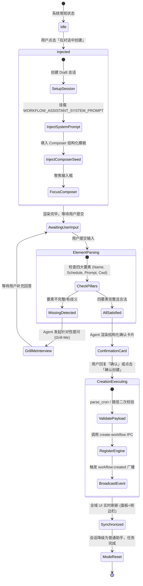
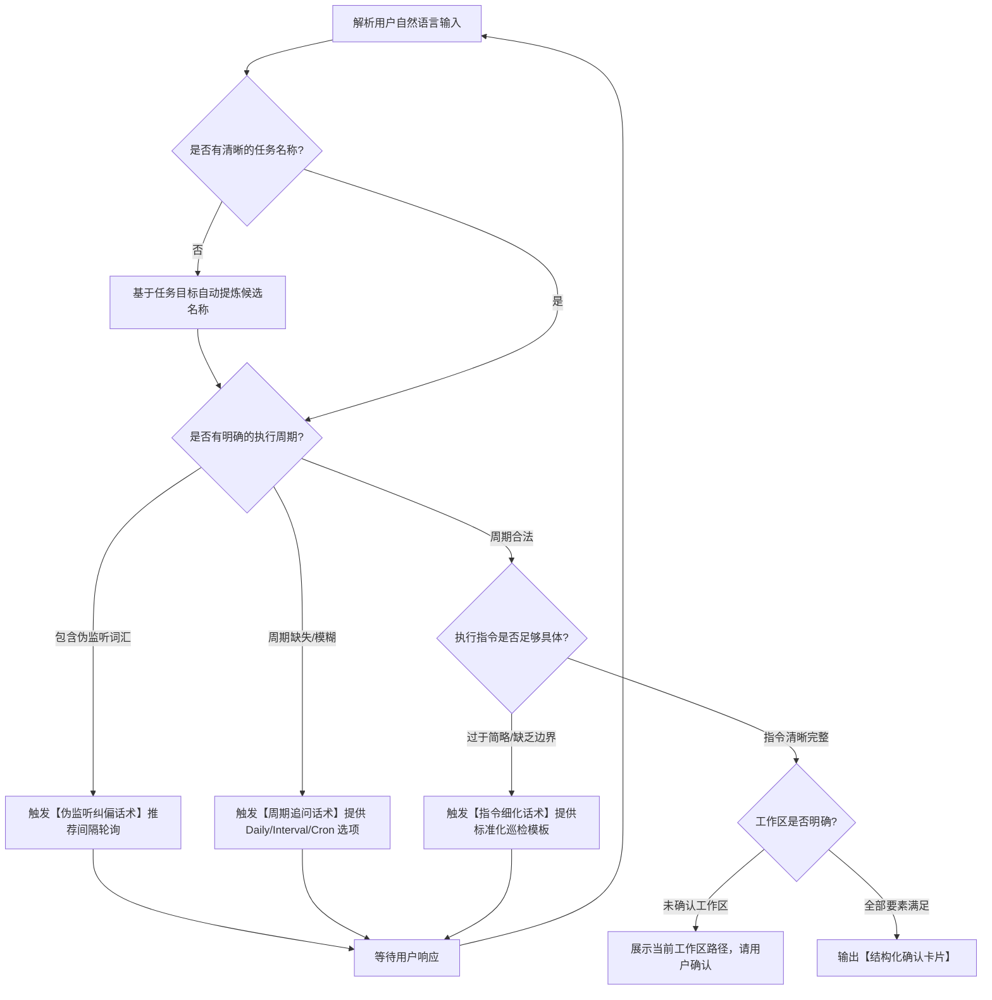

# 定时任务与助手模式落地实践方案（Workflow Grill-Me Mode）

> **文档定位**：`docs/prompt-injection-pipeline/independent-plans/06-定时任务与助手模式落地实践方案.md`
> **方案职责**：以「在对话中创建定时任务」为核心实战场景，定义从入口触发、双通道注入（System Prompt 注入 + Composer 模板注入）、Grill-Me 结构化追问对齐、到接口无缝注册与左侧/面板状态实时更新的完整端到端工程实践与交互范式。

---

## 目录

1. [背景与架构蓝图](#一背景与架构蓝图)
   - 1.1 场景切入点与痛点诊断
   - 1.2 核心设计范式：双通道注入与 Grill-Me 闭环
   - 1.3 跨层架构拓扑与数据流向
2. [双通道注入的端到端用户旅程](#二双通道注入的端到端用户旅程)
   - 2.1 用户触发入口（Entry Points）
   - 2.2 通道一：System Prompt 隐式定向注入（Steering Channel）
   - 2.3 通道二：Composer 显式模板注入（Seed Channel）
   - 2.4 双通道协同生命周期状态机
3. [Grill-Me 追问协议与结构化确认话术](#三grill-me-追问协议与结构化确认话术)
   - 3.1 任务核心要素契约矩阵（Four Core Pillars）
   - 3.2 渐进式追问决策树（Clarification Decision Tree）
   - 3.3 场景化追问与纠偏标准话术库
   - 3.4 最终要素确认卡片与契约渲染规范
4. [定时任务注册与工具接口执行链路](#四定时任务注册与工具接口执行链路)
   - 4.1 双模触发执行机制（Agent Tool 自动调用 vs 交互卡片确认）
   - 4.2 Agent 工具面契约定义（`create_workflow` Tool Specification）
   - 4.3 前端 IPC 门面与 Rust 内核委托契约
   - 4.4 数据库持久化与调度器注册（`SchedulerRegistry`）
5. [全域状态实时广播与面板无缝同步](#五全域状态实时广播与面板无缝同步)
   - 5.1 内核事件广播机制（Engine Event Bus）
   - 5.2 前端响应式状态流转与本地缓存更新
   - 5.3 跨面板/侧边栏联动更新交互细节
   - 5.4 下次触发时间与倒计时动态推导
6. [边界防御、容错与反模式治理](#六边界防御容错与反模式治理)
   - 6.1 伪监听（File Watcher）概念的引导与防御
   - 6.2 极端/非法 Cron 表达式的前后端双重拦截
   - 6.3 幂等性保障与回退清理机制
7. [测试套件与验收断言矩阵](#七测试套件与验收断言矩阵)
   - 7.1 单元测试断言（Frontend / Rust）
   - 7.2 交互流与 E2E 验收用例

---

## 一、背景与架构蓝图

### 1.1 场景切入点与痛点诊断

在 Conex / Crish 桌面应用中，定时任务（Workflow & Cron Schedule）是连接用户与 Agent 自主长效协作的关键纽带。然而在早期实现与传统交互中，存在以下割裂痛点：

1. **表单创建门槛高**：手动表单需要用户熟练掌握标准 5 字段 Cron 表达式（`* * * * *`）、工作区绝对路径绑定以及结构化 Prompt 书写规范，对非高级开发者极不友好。
2. **自然语言对话缺乏约束**：用户在普通对话中说「帮我每天早上 9 点总结 PR」时，通用 Agent 往往误解为「立即帮我总结一次 PR」，或者直接尝试修改代码，缺少将需求沉淀为系统级定时任务的意识与结构化引导能力。
3. **状态脱节与盲盒体验**：对话中生成的定时逻辑无法自动同步至左侧会话树与定时任务面板，用户无法感知任务是否真正注册至引擎调度器、何时执行下一次触发。

为了根治以上问题，本方案确立以 **「Workflow Grill-Me Mode（定时任务对话式编排模式）」** 为核心的端到端落地实践。

---

### 1.2 核心设计范式：双通道注入与 Grill-Me 闭环

```
┌─────────────────────────────────────────────────────────────────────────────┐
│                            用户触发入口 (UI Actions)                         │
│   [定时任务面板 · 在对话中创建]  /  [设置页 · 用对话创建]  /  [Slash /schedule]    │
└──────────────────────────────────────┬──────────────────────────────────────┘
                                       │
                    ┌──────────────────┴──────────────────┐
                    ▼                                     ▼
        【通道一：System Prompt 注入】         【通道二：Composer 模板注入】
        (Invisible Steering Channel)            (Visible User Channel)
        - 角色定向：Workflow Creation Architect    - 用户感知：预填结构化槽位提示
        - 行为约束：Grill-Me 追问协议             - 占位结构：目标/周期/项目/指令
        - 要素闭环：强制校验四大要素              - 快速聚焦：可直接修改或留空发送
                    │                                     │
                    └──────────────────┬──────────────────┘
                                       ▼
        ┌─────────────────────────────────────────────────────────────┐
        │                 Agent 交互闭环 (Grill-Me Loop)               │
        │  1. 意图解析与要素抽取 (Name / Schedule / Prompt / Cwd)     │
        │  2. 缺项主动追问（单轮聚焦提问，不写代码、不假执行）        │
        │  3. 输出结构化确认卡片 (Markdown Table + JSON Payload)       │
        └──────────────────────────────┬──────────────────────────────┘
                                       │ 用户确认 / 自动落盘
                                       ▼
        ┌─────────────────────────────────────────────────────────────┐
        │               无缝注册与全域状态同步 (Sync Engine)           │
        │  1. Agent 调用 `create_workflow` 工具 或 前端 IPC 下发      │
        │  2. Rust `SchedulerRegistry` 注册持久化并计算 next_fire_at │
        │  3. 事件广播 `workflow:created` 实时更新左侧列表与管理面板   │
        └─────────────────────────────────────────────────────────────┘
```

---

### 1.3 跨层架构拓扑与数据流向

整个方案贯穿前端 React UI、状态管理层、提示词注入管线、Tauri IPC 通道与 Rust 内核调度器：

```mermaid
sequenceDiagram
    autonumber
    actor User as 用户
    participant UI as 定时任务面板/设置页
    participant Seed as Composer / SessionStore
    participant Pipe as 提示词注入管线 (PromptPipeline)
    participant Loop as Agent 推理循环 (SessionLoop)
    participant IPC as Tauri IPC (workflow_commands)
    participant Engine as Rust 内核 (SchedulerRegistry)
    participant Panel as 任务列表/侧边栏 (ScheduledTasksPanel)

    User->>UI: 点击「在对话中创建」
    UI->>Seed: 1. 注入 Composer 模板 (Visible Seed)
    UI->>Seed: 2. 创建新会话并挂载 System Prompt (Steering Channel)
    UI-->>User: 激活编辑器，展示占位模版
    User->>Loop: 补充内容并发送 (或直接发送)
    Loop->>Pipe: 组装 Prompt (System Base + Workflow Assistant + User Input)
    Loop->>User: [Grill-Me] 发现缺失「执行周期与工作区」，主动结构化提问
    User->>Loop: 回复：「工作日每天 10:00，针对当前前端项目」
    Loop->>User: 校验通过，输出【定时任务确认卡片】
    Loop->>IPC: 调用 create_workflow 工具 (或用户点击卡片「确认创建」)
    IPC->>Engine: parse_cron 校验 -> SchedulerRegistry 注册落盘
    Engine-->>IPC: 返回 WorkflowDefinition (含 id, nextRunAt)
    Engine-)Panel: 广播 workflow:created / sched_changed 事件
    Panel->>Panel: useWorkflowsState 响应式更新，绿点高亮新增任务
    Loop-->>User: 提示创建成功，显示下次运行倒计时与「立即试运行」按钮
```

---

## 二、双通道注入的端到端用户旅程

双通道注入（Dual-Channel Prompt Injection）是将「隐式系统指令控制」与「显式用户界面引导」解耦并紧密协作的注入范式。

### 2.1 用户触发入口（Entry Points）

在 Conex / Crish 系统中，提供三个无缝触发「Workflow Grill-Me Mode」的入口：

1. **入口 A：主区定时任务面板（`ScheduledTasksPanel.tsx`）**
   - 触发位置：面板右上角「新建任务」下拉菜单中的「在对话中创建」项，或空态列表卡片（Empty State）的推荐动作按钮。
   - 触发动作：调用 `handleCreateInChat()`。
2. **入口 B：设置中心 · 定时任务页（`SettingsScheduleTab.tsx`）**
   - 触发位置：分段控件「用对话创建（推荐）」卡片。
   - 触发动作：调用 `handleAiCreateSchedule()`。
3. **入口 C：Chat Composer 快捷命令（`/schedule` 或 `/grill-me schedule`）**
   - 触发位置：Composer 输入 `/schedule` 后回车。
   - 触发动作：命中 `resolveSlashCommand.ts` 中的 `schedule` / `grill-me` 分支，由 `slashSendPreflight.ts` 动态激活助手模式。

---

### 2.2 通道一：System Prompt 隐式定向注入（Steering Channel）

System Prompt 注入是确保 Agent 行为严格符合编排助手规范的“隐形方向盘”，对普通用户不可见，但在 LLM 推理层拥有最高约束力。

#### 2.2.1 契约定义与注入实现

在 [`apps/crish-desktop/src/prompts/types.ts`](file:///c:/Software/conex/apps/crish-desktop/src/prompts/types.ts) 的统一注入接口约束下，定义专用的定时任务编排助手提示词：

```typescript
// apps/crish-desktop/src/prompts/system/workflowAssistantPrompt.ts
import type { SystemPromptInjection } from '../types';

export const WORKFLOW_ASSISTANT_SYSTEM_PROMPT: SystemPromptInjection = {
  id: 'system-workflow-assistant',
  kind: 'workflow-assistant',
  title: '定时任务编排助手模式 (Workflow Grill-Me Mode)',
  priority: 100, // 高优先级，覆盖通用默认行为
  content: `
# 角色与定位
你现在是系统专属的「定时任务调度编排架构师（Workflow Grill-Me Assistant）」。
你的职责是通过结构化对齐（Grill-Me）流程，协助用户设计、澄清、校验并最终创建可靠的定时自动化任务。

# 铁律约束（绝对执行）
1. 【禁止盲目执行】：在此模式下，严禁直接执行用户描述的任务逻辑代码（如不要真正去改写源码、不要发起业务构建、不要删除文件）。
2. 【严格四要素对齐】：必须确保以下四项核心参数全部完整、精确无歧义后，才允许进行注册：
   - ① 任务名称（name）：简明、语义化（如「每日代码体检与 TODO 巡检」）。
   - ② 执行周期（schedule）：明确为 daily(HH:mm)、intervalMinutes(整数)、cron(5 字段表达式) 或 manual。
   - ③ 执行指令（prompt）：每次触发时 Agent 需执行的详尽指令。
   - ④ 工作区路径（cwd）：绑定的项目物理绝对路径。
3. 【Grill-Me 提问原则】：
   - 当上述四要素中任一项缺失或模糊时，**必须主动发起提问澄清**；
   - 单轮提问不得超过 3 个核心问题，按优先级聚焦缺失项；
   - 给出推荐选项或标准示例，降低用户回答门槛；
   - 遇到用户说「监听代码变动/git push」等伪监听需求时，必须纠正并推荐「间隔轮询」机制。
4. 【结构化确认收口】：
   - 当四要素齐备时，必须先以标准 Markdown 表格输出【任务配置确认卡片】；
   - 经用户确认后，调用系统提供的 \`create_workflow\` 工具完成注册。
`.trim(),
  metadata: {
    mode: 'workflow-creation',
    requiresTool: ['create_workflow'],
  },
};
```

#### 2.2.2 注入生命周期管理

- **绑定机制**：在创建或进入该专属 Draft 会话时，会话元数据（`session_meta`）中打上标记 `assistant_mode: 'workflow-creation'`。
- **动态组装**：在 [`crates/session-loop`](file:///c:/Software/conex/crates/session-loop) 构造 LLM 请求的 System Message 时，提示词管线将 `WORKFLOW_ASSISTANT_SYSTEM_PROMPT` 动态挂载到系统提示词尾部。
- **解绑与降级**：当定时任务成功创建落盘后，Agent 输出结语，系统在元数据中标记 `assistant_mode: 'completed'`，Agent 恢复为常规代码助手状态。

---

### 2.3 通道二：Composer 显式模板注入（Seed Channel）

Composer 模板注入作用于前端输入区域，提供即时可见的格式脚手架，让用户一眼看懂需要填写哪些维度。

#### 2.3.1 模板内容与动态占位生成

```typescript
// apps/crish-desktop/src/components/settings/workflowSeedLib.ts
import { getWorkspacePath } from '../../api/projectStore';

export function generateWorkflowComposerSeed(): string {
  const currentWorkspace = getWorkspacePath() || '当前打开的项目';
  return [
    '/schedule 请帮我创建一个定时任务：',
    '- 任务目标：[描述希望定时执行的任务，例如：每日代码体检 / PR 总结 / 依赖安全审计]',
    '- 执行周期：[例如：每天 09:30 / 每 30 分钟 / 0 9 * * 1-5]',
    `- 所属项目：${currentWorkspace}`,
    '- 具体指令：[每次触发时希望 Agent 执行的具体步骤与输出要求]',
  ].join('\n');
}
```

#### 2.3.2 注入与焦点调度链路

```typescript
// 触发端调用标准流程
export function triggerWorkflowGrillMeSession(onBackToChat?: () => void) {
  const promptTemplate = generateWorkflowComposerSeed();

  // 1. 创建并切换至新草稿会话
  navigateToNewDraft();
  const activeSid = useSessionStore.getState().activeSessionId || 'draft';

  // 2. 注入 Composer 种子草稿
  setComposerSeed(promptTemplate);
  useSessionStore.getState().setComposerDraft(activeSid, promptTemplate);

  // 3. 在对话流中插入系统级引导欢迎语卡片
  useSessionStore.getState().addMessage('default', activeSid, {
    id: `system-guide-${Date.now()}`,
    sender: 'assistant',
    text: [
      '👋 **您好！我是定时任务编排助手**',
      '',
      '我已经为您准备好了定时任务配置模板。您可以直接在下方输入框中补充您的具体需求并发送。',
      '',
      '💡 *如果您不确定如何配置触发周期或指令细节，也可以直接简要描述您的目标，我会通过提问逐步帮您完善配置。*',
    ].join('\n'),
    timestamp: Date.now(),
  });

  // 4. 返回主对话流并聚焦输入框
  onBackToChat?.();
}
```

---

### 2.4 双通道协同生命周期状态机



---

## 三、Grill-Me 追问协议与结构化确认话术

### 3.1 任务核心要素契约矩阵（Four Core Pillars）

Agent 在进入 Grill-Me 模式后，内部维护一个要素抽取与状态判定状态机：

| 核心要素 | 对应字段 | 必填性 | 校验标准与合法范围 | 缺项/异常表现 | 拦截与修复策略 |
| :--- | :--- | :--- | :--- | :--- | :--- |
| **1. 任务名称** | `name` | **必填** | 字符串，长度 2~40 字符，语义明确 | 未提供、包含「未命名」或纯标点 | Agent 基于 Prompt 目标自动提炼建议名称供确认 |
| **2. 执行周期** | `schedule` | **必填** | ① `daily`: `HH:mm` (00:00~23:59)<br>② `intervalMinutes`: 整数 (1~10080)<br>③ `cron`: 5 字段标准表达式<br>④ `manual`: 手动触发 | 模糊表达（如「经常跑」、「有空跑」）或伪监听（如「代码提交后」） | 主动追问具体时刻/间隔；将伪监听引导为定时轮询 |
| **3. 执行指令** | `prompt` | **必填** | 详细操作步骤、关注重点、无异常时回复规范（建议要求「无异常简短回复正常」） | 仅一句话抽象目标（如「巡检」）而无执行动作 | 结构化拆解为步骤模板，补充执行细节与输出约束 |
| **4. 目标工作区** | `cwd` | **必填** | 本地存在的绝对路径，通常为当前激活的项目根目录 | 未指定或跨设备相对路径 | 默认带出当前工作区 `getWorkspacePath()` 供用户直接确认 |

---

### 3.2 渐进式追问决策树（Clarification Decision Tree）



---

### 3.3 场景化追问与纠偏标准话术库

#### 场景 1：缺失执行周期（用户仅给出目标）
- **用户输入**：“我想每天帮我总结一下仓库里的未解决 PR 和可疑提交。”
- **Agent Grill-Me 追问话术**：
  > 收到！这个任务目标很明确。为了能够精准为您调度，还需要确定具体的**执行时刻**：
  >
  > 1. **您希望每天几点执行？**
  >    - 选项 A (推荐)：每天下班前 **18:00**
  >    - 选项 B：每天早晨上班前 **09:00**
  >    - 选项 C：自定义时刻（例如：每天 20:30）
  > 2. **目标项目**：是否直接绑定当前工作区 `C:/Software/conex`？
  >
  > 您可以直接回复 `A` 或指定具体时间。

#### 场景 2：伪监听纠偏（用户误以为支持 Git Push / 文件变动触发）
- **用户输入**：“每当我 git push 代码或者修改文件后，自动帮我跑一遍代码体检。”
- **Agent Grill-Me 追问话术**：
  > ⚠️ **温馨提示**：当前系统定时任务基于后台时钟调度，暂不支持直接挂载 Git 钩子或实时文件监听。
  >
  > 为了达到类似效果，建议采用以下替代方案之一：
  > 1. **高频轮询模式（推荐）**：设置为 **每 30 分钟**（或每 15 分钟）巡检一次工作区未提交与新增变更。
  > 2. **每日固定时刻体检**：设置为 **每天 09:00** 汇总体检。
  > 3. **手动一键触发**：配置好任务后，在需要时点击面板上的「立即运行」按钮。
  >
  > 请问您倾向使用哪种方式？（回复数字即可）

#### 场景 3：指令过于简略（用户仅输入“帮我每小时检查系统”）
- **Agent Grill-Me 追问话术**：
  > 没问题，周期已锁定为 **每 60 分钟执行一次**。
  >
  > 为了让巡检更有价值且不产生垃圾日志，建议明确具体的检查范围：
  > 建议包含以下检查项：
  > - [x] 1. 检查是否存在失败的自动化测试或 Lint 错误
  > - [x] 2. 检查是否有未暂存的临时冲突标记
  > - [x] 3. **输出规则**：仅在发现严重风险时详细汇报；一切正常时仅简短回复「工作区状态正常」。
  >
  > 请问以上检查规则是否符合您的预期？您是否有需要补充的特定检查命令或文件路径？

---

### 3.4 最终要素确认卡片与契约渲染规范

当 Agent 收集齐全部要素并完成合法性校验后，**严禁直接静默创建**，必须渲染标准结构化确认卡片。

#### 3.4.1 标准 Markdown 确认卡片样例

```markdown
### 📋 定时任务配置就绪，请确认

已为您完成参数提取与配置编排，请核对以下任务信息：

| 配置项 | 设定值 | 说明 |
| :--- | :--- | :--- |
| **任务名称** | 每日代码健康与 PR 巡检 | 简明语义化标识 |
| **执行周期** | 每天 09:00 (`0 9 * * *`) | 本地时区 (Asia/Shanghai) |
| **目标工作区** | `C:/Software/conex` | 当前激活工程根目录 |
| **运行模式** | 定时自动触发 | 状态：默认启用 |
| **无异常策略** | 仅输出「状态正常」 | 避免无意义长文打扰 |

#### 🤖 任务执行指令预览：
> 请对当前工作区做一次全面的代码健康巡检：
> 1. 检查未合入分支与近期可疑提交；
> 2. 扫描关键模块中的语法/类型隐患及残存 TODO；
> 3. 若发现阻塞问题，列出优先级和修复建议；若一切正常，简要回复「健康巡检通过，未发现异常」。

---
👉 **确认无误请回复「确认创建」**，我将立即为您注册到系统调度器并激活。*(如需微调，请直接说明修改项)*
```

---

## 四、定时任务注册与工具接口执行链路

### 4.1 双模触发执行机制

系统支持两种无缝落盘路径，确保在不同上下文下的最高成功率与流畅度：

```
                    ┌───────────────────────────────┐
                    │     用户在卡片下回复「确认创建」  │
                    └───────────────┬───────────────┘
                                    │
                    ┌───────────────┴───────────────┐
                    ▼                               ▼
       【路径 A：Agent Tool 自动调用】     【路径 B：Generative UI 交互卡片】
       (LLM Function Calling 链路)          (前端客户端一键落盘兜底)
       - Agent 命中 `create_workflow` 工具   - 卡片内嵌操作按钮 <Button>确认创建</Button>
       - 传入校验后的标准 JSON 参数          - 点击直接走 `workflowApi.createWorkflow`
       - 工具执行结果回显至对话流            - 极速响应，零 Token 消耗
                    │                               │
                    └───────────────┬───────────────┘
                                    ▼
                    ┌───────────────────────────────┐
                    │      Tauri IPC: `create-workflow`│
                    │   (apps/agent-workbench)      │
                    └───────────────┬───────────────┘
                                    ▼
                    ┌───────────────────────────────┐
                    │    Rust 内核: SchedulerRegistry │
                    │     (conex-db / sched.rs)     │
                    └───────────────────────────────┘
```

---

### 4.2 Agent 工具面契约定义（`create_workflow` Tool Specification）

在 [`crates/agent-tools`](file:///c:/Software/conex/crates/agent-tools) 中注册专用的 `create_workflow` 工具，供 Workflow Grill-Me Mode 下的 Agent 调用：

```rust
// crates/agent-tools/src/tools/workflow/create_workflow.rs
use serde::{Deserialize, Serialize};

#[derive(Debug, Clone, Serialize, Deserialize)]
pub struct CreateWorkflowToolInput {
    /// 任务简明名称 (2~40 字符)
    pub name: String,
    /// 任务触发时执行的提示词指令
    pub prompt: String,
    /// 调度类型：manual | daily | intervalMinutes | cron
    pub schedule_type: String,
    /// daily 模式下的时刻 (HH:mm)
    pub daily_time: Option<String>,
    /// intervalMinutes 模式下的间隔分钟 (1~10080)
    pub interval_minutes: Option<u64>,
    /// cron 模式下的标准 5 字段表达式
    pub cron_expression: Option<String>,
    /// 绑定的工作区物理绝对路径
    pub cwd: String,
    /// 默认是否启用 (默认为 true)
    pub enabled: Option<bool>,
}

#[derive(Debug, Clone, Serialize, Deserialize)]
pub struct CreateWorkflowToolOutput {
    pub success: bool,
    pub workflow_id: String,
    pub name: String,
    pub next_run_at: Option<String>,
    pub human_schedule_label: String,
    pub message: String,
}
```

---

### 4.3 前端 IPC 门面与 Rust 内核委托契约

前端门面统一封装在 [`apps/crish-desktop/src/api/workflow-api/workflowRunner.ts`](file:///c:/Software/conex/apps/crish-desktop/src/api/workflow-api/workflowRunner.ts)，通过类型安全的 `invokeTyped` 发起调用：

```typescript
// 前端参数组装与调用
export async function registerWorkflowFromGrillMe(payload: {
  name: string;
  prompt: string;
  schedule: WorkflowSchedule;
  cwd: string;
  enabled?: boolean;
}) {
  return await createWorkflow({
    name: payload.name.trim(),
    prompt: payload.prompt.trim(),
    schedule: payload.schedule,
    cwd: payload.cwd,
    enabled: payload.enabled ?? true,
  });
}
```

Rust 壳层与内核命令处理函数位于 [`apps/agent-workbench/src-tauri/src/workflow_commands.rs`](file:///c:/Software/conex/apps/agent-workbench/src-tauri/src/workflow_commands.rs)：

```rust
// apps/agent-workbench/src-tauri/src/workflow_commands.rs
#[tauri::command(rename = "create-workflow")]
pub async fn create_workflow(
    input: CreateWorkflowInput,
    app_handle: tauri::AppHandle,
) -> Result<WorkflowMutationWire, CoreError> {
    // 1. 必填字段校验
    if input.name.trim().is_empty() {
        return Err(CoreError::invalid_param("任务名称不能为空"));
    }
    if input.prompt.trim().is_empty() {
        return Err(CoreError::invalid_param("执行提示词指令不能为空"));
    }

    // 2. 调度配置标准化与 parse_cron 语法校验
    let cron_task_input = build_cron_task_input(&input)?;

    // 3. 委托给 SchedulerRegistry 进行注册与持久化
    let registered_task = SchedulerRegistry::global()
        .register(cron_task_input)
        .await
        .map_err(|e| CoreError::internal(format!("调度器注册失败: {e}")))?;

    // 4. 发送全局事件广播通知前端更新
    let _ = app_handle.emit_all("workflow:created", serde_json::json!({
        "workflowId": registered_task.id,
        "name": input.name,
    }));

    Ok(WorkflowMutationWire {
        workflow: Some(to_wire_format(&registered_task, &input)),
    })
}
```

---

### 4.4 数据库持久化与调度器注册（`SchedulerRegistry`）

在 SQLite/conex-db 中，定时任务被写入 `session_meta` 持久化表，键名为 `sched_<cronId>`，并向全局注册表 `sched_index` 追加索引，确保：
1. **进程重启不丢失**：应用启动时全量重载未失效的任务并重新排程；
2. **时钟对齐高精度**：`SchedulerRegistry` 内部维护最小堆定时器，在到达触发时刻前通过 `tokio::time::sleep` 挂起，精确触发；
3. **唤醒注入解耦**：触发时不破坏当前正在运行的对话，而是通过 Steering Queue 向目标会话注入执行条目（`group_id = cron-<id>`）。

---

## 五、全域状态实时广播与面板无缝同步

### 5.1 内核事件广播机制（Engine Event Bus）

定时任务生命周期中触发的关键事件定义对齐 [`crates/conex-types/contracts/engine-events.json`](file:///c:/Software/conex/crates/conex-types/contracts/engine-events.json)：

| 事件名称 (Event Name) | 触发时机 | 广播载荷 (Payload) | 接收方响应 |
| :--- | :--- | :--- | :--- |
| `workflow:created` | 新任务成功注册落盘 | `{ workflowId, name, nextRunAt }` | 任务列表追加新项，高亮显示 |
| `workflow:updated` | 任务编辑/启停状态变更 | `{ workflowId, enabled, schedule }` | 更新对应任务行状态与下一次触发时间 |
| `workflow:deleted` | 任务被删除 | `{ workflowId }` | 从列表与缓存中移除 |
| `cron-fired` | 到达设定时间，定时任务被触发 | `{ cronId, runId, sessionId, prompt }` | 运行历史列表增加一条「正在运行」记录 |

---

### 5.2 前端响应式状态流转与本地缓存更新

前端 [`useWorkflowsState.ts`](file:///c:/Software/conex/apps/crish-desktop/src/components/settings/useWorkflowsState.ts) 建立事件监听与本地缓存双写机制，实现 **0 延迟、零闪烁、无需手动刷新** 的极速响应：

```typescript
// apps/crish-desktop/src/components/settings/useWorkflowsState.ts 中的实时监听器
useEffect(() => {
  let unlistenCreated: (() => void) | undefined;
  let unlistenFired: (() => void) | undefined;

  async function setupListeners() {
    unlistenCreated = await listen<{ workflowId: string }>('workflow:created', async () => {
      // 重新拉取最新列表并同步更新缓存
      const latest = await listWorkflows();
      setWorkflows(latest);
      saveWorkflowsCache(latest);
    });

    unlistenFired = await listen('cron-fired', async () => {
      const runs = await listWorkflowRuns();
      setRuns(runs);
      saveWorkflowRunsCache(runs);
    });
  }

  setupListeners();
  return () => {
    unlistenCreated?.();
    unlistenFired?.();
  };
}, []);
```

---

### 5.3 跨面板/侧边栏联动更新交互细节

当任务在对话中被创建后，UI 呈现立体化、多触点的即时反馈：

1. **当前对话流内反馈**：
   - 输出系统成功气泡：
     > ✅ **定时任务已成功创建并激活！**
     > - **任务名称**：`每日代码健康与 PR 巡检`
     > - **首次触发时间**：`明天 09:00 (14 小时 25 分钟后)`
     > - **操作**：[立即试运行一次] · [在管理面板中查看]
2. **左侧定时任务面板（`ScheduledTasksPanel.tsx`）**：
   - 任务计数动态从 `N 条` 变为 `N+1 条`；
   - 列表中新增卡片置顶，左侧常驻绿色脉冲光点（`status-active`）；
   - 预计算的人类可读标签（如「每天 09:00 · 0 9 * * *」）清晰展示。
3. **设置页（`SettingsScheduleTab.tsx`）**：
   - 任务列表无刷新同步，处于激活启用状态（Switch 开启）。

---

### 5.4 下次触发时间与倒计时动态推导

利用 Rust 侧 [`CronSchedule::next_fire_after`](file:///c:/Software/conex/crates/conex-types/src/cron.rs) 与前端 [`cronExpressionLabel`](file:///c:/Software/conex/apps/crish-desktop/src/api/workflow-api/workflowScheduler.ts) 提供精确的时刻预测：

```typescript
// 动态推导下次运行倒计时格式化
export function formatNextRunRelative(nextRunAtIso?: string | null): string {
  if (!nextRunAtIso) return '等待下次调度';
  const target = new Date(nextRunAtIso).getTime();
  const diffMs = target - Date.now();
  if (diffMs <= 0) return '即将触发';

  const diffMinutes = Math.floor(diffMs / 60000);
  if (diffMinutes < 60) return `${diffMinutes} 分钟后`;

  const diffHours = Math.floor(diffMinutes / 60);
  const remainMins = diffMinutes % 60;
  if (diffHours < 24) return `${diffHours} 小时 ${remainMins} 分钟后`;

  const diffDays = Math.floor(diffHours / 24);
  return `${diffDays} 天后 (${new Date(target).toLocaleDateString()})`;
}
```

---

## 六、边界防御、容错与反模式治理

### 6.1 伪监听（File Watcher）概念的引导与防御

#### 现象与风险
许多用户受其他工具影响，常提出“代码保存时自动触发”、“git commit 时触发”的需求。但定时任务调度器是时钟轮询体系，如果 Agent 随口承诺“好的已为您设置代码变动监听”，会导致用户预期落空并产生严重故障感。

#### 防御体系
1. **正则关键词过滤（静态安全网）**：
   复用 [`watchTriggerHint`](file:///c:/Software/conex/apps/crish-desktop/src/api/workflow-api/workflowDraft.ts#L88) 中的判定规则：
   ```typescript
   const WATCH_HINT_RE = /文件变更|文件监听|改动触发|on\s*file|file[\s_-]?change|file[\s_-]?watch|watch(er)?|监听|推送提醒|git\s*push|after\s*push/i;
   ```
2. **Grill-Me Prompt 强制规则**：
   在 System Prompt 中明令禁止 Agent 假装支持文件监听，必须正面引导用户选择 `intervalMinutes`（如每 15 分钟检查一次）或解释机制边界。

---

### 6.2 极端/非法 Cron 表达式的前后端双重拦截

为杜绝因脏数据导致调度器死锁或高频疯狂空转，实施刚性双重守卫：

```
 用户输入 / Agent 生成表达式
           │
           ▼
 ┌──────────────────────────────────────────────┐
 │ 【第一道守卫 · 前端 validateCronExpression】   │
 │ - 校验 5 字段分时日月周 (拒绝 6 字段秒级表达式)  │
 │ - 校验各字段范围 [0-59, 0-23, 1-31, 1-12, 0-7]│
 │ - 拒绝 @yearly 等非标宏                      │
 └──────────────────────┬───────────────────────┘
                        │ 通过
                        ▼
 ┌──────────────────────────────────────────────┐
 │ 【第二道守卫 · Rust 内核 parse_cron】          │
 │ - 确定性词法/语法解析 (conex_types::cron)      │
 │ - 校验跨日/跨月步进与越界情况                │
 │ - 拦截下发至 SchedulerRegistry               │
 └──────────────────────────────────────────────┘
```

---

### 6.3 幂等性保障与回退清理机制

1. **同名任务覆盖防范**：创建前查询现有列表，若检测到同名且同周期的任务，提示用户是否覆盖现有任务或使用新名称（如 `每日代码体检 (1)`）。
2. **草稿会话清理**：在任务创建完成后，清理临时分配给 Grill-Me 的临时草稿数据，防止在会话列表产生无用垃圾会话。
3. **创建失败自动回退**：若 Rust 内核返回注册失败（如路径不存在、权限不足），保留用户在对话中的配置卡片，提供「重试」与「修改参数」操作，不丢失已有对齐信息。

---

## 七、测试套件与验收断言矩阵

### 7.1 单元测试断言（Frontend / Rust）

#### 前端测试用例集（Vitest）
- `workflowScheduler.test.ts`：
  - 断言 `validateWorkflowSchedule` 对 `daily`、`intervalMinutes`、`cron` 各种正常/边界值的校验正确性；
  - 断言 `watchTriggerHint` 正确拦截含「文件监听」、「git push」的文案；
  - 断言 `cronExpressionLabel` 人类可读标签转换无误。
- `ScheduledTasksPanel.test.tsx`：
  - 断言点击「在对话中创建」时正确调用 `navigateToNewDraft`、`setComposerSeed` 并向 `useSessionStore` 注入 System Prompt 指令；
  - 断言接收到 `workflow:created` 事件后，列表元素正确响应并增加。

#### Rust 测试用例集（Cargo Test）
- `crates/conex-types/src/cron.rs`：
  - 断言 `parse_cron` 正确解析合法表达式，精确计算 `next_fire_after`；
  - 断言拒绝 6 字段秒级 Cron 与非法负数字段。
- `apps/agent-workbench/src-tauri/src/workflow_commands.rs`：
  - 断言 `create-workflow` 命令在名称/指令缺失时返回 `CoreError::invalid_param`；
  - 断言正常创建时持久化落库并成功派发 `workflow:created` 事件。

---

### 7.2 交互流与 E2E 验收用例

| 用例编号 | 测试场景 | 操作步骤 | 预期结果与断言 |
| :--- | :--- | :--- | :--- |
| **TC-WG-01** | 从定时任务面板发起创建 | 1. 打开定时任务面板<br>2. 点击右上角「在对话中创建」 | 1. 自动切换至 Chat 新会话<br>2. 输入框预填包含 4 要素的 `/schedule` 模板<br>3. 对话流显示助手欢迎卡片 |
| **TC-WG-02** | 缺少执行周期时的追问 | 1. 发送：“帮我每天总结 PR”<br>2. 观察 Agent 回复 | 1. Agent 不执行任何代码/文件修改<br>2. Agent 主动提问期望的每日具体时刻并提供选项 |
| **TC-WG-03** | 伪监听需求纠偏 | 1. 发送：“代码每次 push 时自动体检” | 1. Agent 识别出监听关键词<br>2. 友好解释调度机制，引导转换为「每 30 分钟轮询」 |
| **TC-WG-04** | 要素齐备后的卡片确认 | 1. 用户提供完整四要素参数 | 1. Agent 输出标准 Markdown 确认卡片<br>2. 卡片准确展示名称、调度标签、路径、指令 |
| **TC-WG-05** | 确认创建与面板实时联动 | 1. 用户回复「确认创建」 | 1. Agent 调用 `create_workflow` 成功<br>2. 定时任务面板与设置页无需刷新即刻显示新任务<br>3. 状态标为启用，计算出正确的下次执行时间 |

---

## 八、总结与落地演进价值

本方案通过构建 **「双通道注入 + Grill-Me 闭环 + 响应式全域同步」** 的完整架构，将原本死板的高门槛表单配置转化为生动、智能、容错性强的对话式协作体验：
1. **降门槛**：用户无需学习 Cron 语法与配置协议，口语化表达即可生成高可靠调度任务；
2. **强约束**：通过 System Prompt 刚性拦截与 Grill-Me 追问协议，杜绝 Agent 误操作与盲目执行；
3. **体验闭环**：结合 Rust 内核事件广播与前端响应式 Store，实现对话成果与管理界面的无缝无感同步。
