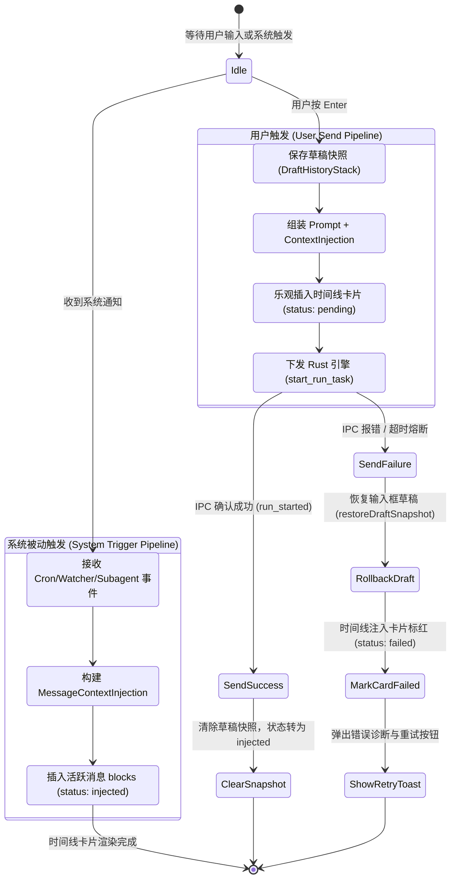
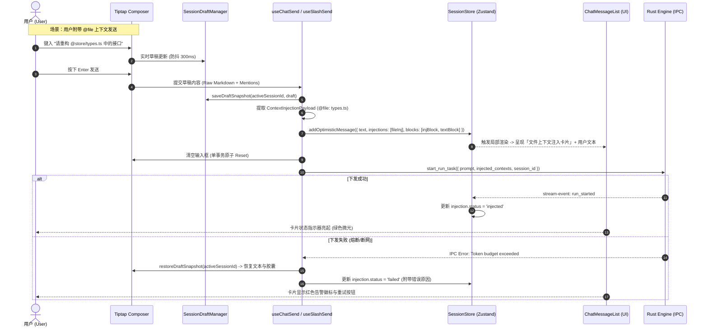

# 对话流可见注入卡片（Context Injection Card）交互与协议专项评审

> **文档路径**：`docs/prompt-injection-pipeline/plan-reviews/03-前端可见注入卡片交互评审.md`
> **所属战役**：Prompt 与上下文注入管线（Prompt Injection Pipeline）专项评审
> **评审对象**：对话流可见注入卡片（Context Injection Card）的前端呈现、数据协议、状态机与交互流转
> **遵守纪律**：仓库根目录 `AGENTS.md` 通用协作指令、反退避原则（`LOGIC_PLAN_NO_RETREAT.md`）及反过度设计红线（`ANTI_OVERENGINEERING_GUARDRAILS.md`）

---

## 目录

- [一、评审背景与业务定性（Core Motivation & Architectural Qualitative）](#一评审背景与业务定性core-motivation--architectural-qualitative)
  - [1.1 核心问题与设计动机](#11-核心问题与设计动机)
  - [1.2 三种注入呈现模式的对比与定性](#12-三种注入呈现模式的对比与定性)
  - [1.3 用户核心要求与体验目标](#13-用户核心要求与体验目标)
- [二、前端 Message Timeline 扩展与呈现架构评审](#二前端-message-timeline-扩展与呈现架构评审)
  - [2.1 现行 Timeline 架构与扩展断层分析](#21-现行-timeline-架构与扩展断层分析)
  - [2.2 数据模型扩展（SessionMessage / MessageTimelineBlock / MessageContextInjection）](#22-数据模型扩展sessionmessage--messagetimelineblock--messagecontextinjection)
  - [2.3 时间线规范化器与签名缓存（timelineNormalizer & timelineCache）](#23-时间线规范化器与签名缓存timelinenormalizer--timelinecache)
  - [2.4 注入卡片视觉规范与设计系统对齐（Design Tokens & Tone Matrix）](#24-注入卡片视觉规范与设计系统对齐design-tokens--tone-matrix)
  - [2.5 折叠策略与虚拟滚动高度估算（VirtualScrollManager 集成）](#25-折叠策略与虚拟滚动高度估算virtualscrollmanager-集成)
- [三、Composer 草稿与可见注入卡片的因果配合流程](#三composer-草稿与可见注入卡片的因果配合流程)
  - [3.1 用户主动输入与上下文注入的因果闭环](#31-用户主动输入与上下文注入的因果闭环)
  - [3.2 系统被动/响应式触发与活跃草稿的隔离防护](#32-系统被动响应式触发与活跃草稿的隔离防护)
  - [3.3 失败回滚与草稿快照的一致性状态机](#33-失败回滚与草稿快照的一致性状态机)
  - [3.4 端到端因果交互时序图（Mermaid Sequence）](#34-端到端因果交互时序图mermaid-sequence)
- [四、前端组件架构与精确契约设计](#四前端组件架构与精确契约设计)
  - [4.1 组件树结构与职责划分（Component Hierarchy）](#41-组件树结构与职责划分component-hierarchy)
  - [4.2 核心数据类型契约（TypeScript Contracts）](#42-核心数据类型契约typescript-contracts)
  - [4.3 `ContextInjectionBlock` 与 `CompactInjectionRow` 深度实现方案](#43-contextinjectionblock-与-compactinjectionrow-深度实现方案)
  - [4.4 注入卡片专用 CSS Module 规范（零硬编码、无重阴影）](#44-注入卡片专用-css-module-规范零硬编码无重阴影)
- [五、降级容错矩阵与安全边界](#五降级容错矩阵与安全边界)
  - [5.1 异常场景与熔断策略](#51-异常场景与熔断策略)
  - [5.2 内容安全与 XSS 净化断言](#52-内容安全与-xss-净化断言)
- [六、实施阶段与立体验证方案](#六实施阶段与立体验证方案)
  - [6.1 三阶段实施演进路线（Phase 1 ~ Phase 3）](#61-三阶段实施演进路线phase-1--phase-3)
  - [6.2 立体自动化测试矩阵（Vitest / Invariants / E2E）](#62-立体自动化测试矩阵vitest--invariants--e2e)
- [七、评审结论与裁决清单](#七评审结论与裁决清单)

---

## 一、评审背景与业务定性（Core Motivation & Architectural Qualitative）

### 1.1 核心问题与设计动机

在 Conex / Crish 智能工作区与多 Agent 协同体系中，AI 的每次决策与执行高度依赖多维上下文：
1. **项目与工作区规则（Project Rules）**：如 `AGENTS.md`、编码准则、架构防线；
2. **专业技能上下文（Active Skills）**：如 `antigravity-guide`、`generative_ui` 等专家指令；
3. **工作区环境与快照（Workspace Context）**：当前激活文件、Git Diff、终端最新输出；
4. **定时任务与助手模式（Cron / Scheduled Assistant）**：定时被动触发的巡检与总结任务；
5. **运行时纠偏指令（Runtime Steering Nudges）**：用户在运行中动态插入的指令调整。

在既往架构中，上述上下文注入面临两大极端断层：
- **断层 A（黑盒式隐式拼接）**：将规则、技能或文件内容作为不可见的 `System Prompt` 或私有前缀静默发送。用户在对话流中对“AI 为何知道这些事实”、“当前消耗了多少上下文 Token”、“哪些规则生效了”完全处于黑盒状态，排查 Prompt 漂移与调试极其困难。
- **断层 B（LLM 轮次浪费式工具调用）**：为了让用户看见上下文加载过程，强行要求大模型在首轮输出 `read_file`、`load_rule` 或 `inspect_git` 工具调用。这不仅引入了额外 1~3 秒的模型推理往返延迟（Round-Trip Latency），浪费大量输出 Token，更严重依赖大模型的遵从度——一旦模型漏调或格式错误，整个上下文链即刻断裂。

### 1.2 三种注入呈现模式的对比与定性

为确立技术路线的正当性，对业界三种上下文呈现模式进行深度技术评审对比：

| 评估维度 | 模式 A：隐式注入（System/Hidden） | 模式 B：LLM 主动工具调用（Tool Call） | 模式 C：系统可见注入卡片（System Context Injection Card，本方案） |
| :--- | :--- | :--- | :--- |
| **触发机制** | 系统静默注入字符串 | 大模型生成 Tool Call 指令 | **系统在动作触发时直接注入（系统确定性触发）** |
| **首字延迟（TTFT）** | 极低（零额外轮次） | 极高（需经历 1 次完整 LLM 思考与输出） | **极低（零额外 LLM 轮次，毫秒级即时落盘渲染）** |
| **用户可见性与透明度** | 完全不可见（黑盒） | 可见（作为工具卡片显示） | **完全可见（作为专用注入卡片在时间线独立呈现）** |
| **Token 消耗** | 仅输入 Token | 输入 Token + 输出 Token + 结构化返回 | **仅输入 Token（零多余 LLM 轮次生成成本）** |
| **确定性与抗幻觉** | 100% 确定注入 | 依赖模型决策（存在漏调、错调风险） | **100% 确定注入（由引擎/前端门禁硬性保障）** |
| **审计与调试能力** | 差（需翻阅原始 IPC 日志） | 良好（在工具行查看） | **极佳（卡片直接展示 Payload、Token 估算、来源与生效状态）** |

### 1.3 用户核心要求与体验目标

根据用户明确裁决：
> **“在对话流里面显示为对应的注入卡片，像工具调用的效果一样，无需 AI 主动调用，由系统在动作触发时直接注入。”**

系统核心目标：
1. **视觉表现对齐工具卡**：继承并复用 Conex 桌面端现有的 `CompactToolRow` 高质感卡片范式，具备图标槽位、语义色调（Tone）、状态指示、Token 估算胶囊、操作摘要以及默认折叠/展开的富内容预览区；
2. **纯前端与引擎协同注入**：动作触发时（如点击发送带 `@file`、定时任务触发、规则热载入、运行时纠偏），由前端或引擎直接在时间线中插入 `context_injection` 块，**无需 AI 参与生成**；
3. **零草稿污染与严格因果隔离**：注入卡片的生成与用户正在键入的 Composer Draft 严格解耦，杜绝时序竞态与无声覆盖。

---

## 二、前端 Message Timeline 扩展与呈现架构评审

### 2.1 现行 Timeline 架构与扩展断层分析

在现行 `apps/crish-desktop/src/` 中，消息时间线呈现管线如下：

```
SessionMessage (Store)
  └─ blocks?: MessageTimelineBlock[] ('thought' | 'text' | 'tool_call' | 'image' | 'step_start' | 'step_end')
  └─ toolCalls?: MessageToolCall[]
        │
        ▼ (timelineNormalizer.ts: buildAssistantTimeline)
AssistantTimelineItem[] ('thought' | 'text' | 'tools')
        │
        ▼ (MessageContent.tsx: TimelineBody)
TimelineThoughtSection | StreamingMarkdownView | MessageToolCallsSection (ChatToolCallBlock -> CompactToolRow)
```

**现存架构的关键断层**：
1. **`MessageTimelineBlockType` 缺少注入判别分支**：既有类型仅支持思考、文本和工具调用，无法表达由系统直接注入的环境上下文；
2. **`AssistantTimelineItem` 缺乏 `injection` 一等公民支持**：`timelineNormalizer.ts` 在归一化时仅将工具归并至 `kind: 'tools'`，导致系统注入项只能降级为普通文本或被迫伪装成 `MessageToolCall`（造成 `toolCall.name` 命名空间污染与审批流逻辑混乱）；
3. **时间线签名缓存（`timelineCache.ts`）未覆盖注入元数据**：增量注入卡片时若无法正确感知哈希变化，将导致 `TimelineBody` 的 memo 阻断更新或引发全局重新渲染。

### 2.2 数据模型扩展（SessionMessage / MessageTimelineBlock / MessageContextInjection）

为实现系统注入卡片的一等公民支持，在 `apps/crish-desktop/src/store/types.ts` 中进行无损扩充：

```typescript
// ── 新增：上下文注入类型枚举与生命周期状态 ────────────────────────────────────

/** 上下文注入来源分类 */
export type ContextInjectionKind =
  | 'rule'              // 项目/全局规则注入 (如 AGENTS.md, custom rules)
  | 'skill'             // 专家技能/提示词模板注入 (如 antigravity-guide)
  | 'file_context'      // 文件引用与代码快照 (@file)
  | 'git_status'        // Git 工作区状态与改动快照
  | 'terminal_output'   // 终端历史上下文与命令回执
  | 'runtime_steering'  // 运行时纠偏与目标模式指令
  | 'schedule_trigger'  // 定时任务/助手模式唤醒元数据
  | 'memory'            // 会话记忆/阶段性总结
  | 'workspace_env';    // 工作区目录树与运行环境配置

/** 注入项生命周期状态 */
export type ContextInjectionStatus =
  | 'pending'           // 准备注入 (待下发)
  | 'injected'          // 已成功注入当前 Turn 上下文
  | 'active'            // 持续生效中 (Persistent 跨轮次)
  | 'expired'           // 已过期/仅单次有效已消费
  | 'failed';           // 注入失败 (如文件读取越界/Token超限熔断)

/**
 * 结构化系统上下文注入项（Context Injection Item）
 * 对应对话流中独立呈现的注入卡片，无需 AI 主动调用
 */
export interface MessageContextInjection {
  /** 唯一标识符 (UUID 或基于内容的稳定 SHA-256) */
  id: string;
  /** 注入类别 */
  kind: ContextInjectionKind;
  /** 卡片展示标题 (如 "项目规则: Rust 架构规范", "文件上下文: sessionStore.ts") */
  title: string;
  /** 简明摘要 (展示于卡片 Header，如 "3 个文件 · 1.2k tokens") */
  summary?: string;
  /** 注入状态 */
  status: ContextInjectionStatus;
  /** 注入源标识 (如 "rule_loader", "composer_mention", "cron_daemon") */
  source: string;
  /** 注入的具体文本内容 (Markdown / XML / JSON / 纯文本) */
  content: string;
  /** 估算的 Token 消耗量 (展示 Token Badge) */
  tokenEstimate?: number;
  /** 关联的文件 Diff 快照 (若包含代码改动) */
  diffs?: FileDiff[];
  /** 关联的文件路径清单 */
  targetPaths?: string[];
  /** 注入发生的时间戳 (epoch ms) */
  timestamp: number;
  /** 是否支持展开查看详情 (默认 true) */
  isFoldable?: boolean;
  /** 初始呈现是否默认折叠 (内容 > 200 字符默认 true) */
  defaultFolded?: boolean;
  /** 扩展元数据 (如规则优先级、版本号等) */
  metadata?: Record<string, unknown>;
}

// ── 扩展：时间线块类型与 SessionMessage ──────────────────────────────────────

/** 扩充时间线块类型 */
export type MessageTimelineBlockType =
  | 'thought'
  | 'text'
  | 'tool_call'
  | 'context_injection' // 新增：系统上下文注入卡片
  | 'image'
  | 'step_start'
  | 'step_end';

/** 扩充 MessageTimelineBlock */
export interface MessageTimelineBlock {
  type: MessageTimelineBlockType;
  /** tool_call 对应 toolCall.id; context_injection 对应 injection.id; thought 对应 stepId */
  id?: string;
  /** 文本或思考内容 / 注入纯文本摘要 */
  content?: string;
  /** 关联的轮次索引 (0-based) */
  turnIndex?: number;
  durationMs?: number;
  isStreaming?: boolean;
  isHistoricalCollapsed?: boolean;
  redacted?: boolean;
  images?: MessageImageRef[];
  /** 当 type === 'context_injection' 时挂载的结构化数据（或通过 id 从 injections 查表） */
  injection?: MessageContextInjection;
}

/** SessionMessage 扩充 injections 字段 */
export interface SessionMessage extends Pick<AgentMessage, 'id' | 'clientMessageId'> {
  sender: MessageSender;
  text?: string | undefined;
  timestamp: number;
  toolCalls?: MessageToolCall[] | undefined;
  /** 新增：本条消息包含的系统上下文注入项集合 */
  injections?: MessageContextInjection[] | undefined;
  blocks?: MessageTimelineBlock[] | undefined;
  // 其余既有字段保持不变...
}
```

### 2.3 时间线规范化器与签名缓存（timelineNormalizer & timelineCache）

在 `apps/crish-desktop/src/api/tool-presentation/` 体系中扩展时间线派生模型，确保时间线构建具备严格的 O(1) 缓存命中与纯函数幂等性：

```typescript
// apps/crish-desktop/src/api/tool-presentation/toolPresentationTypes.ts

export type TimelineInjectionItem = {
  kind: 'injection';
  key: string;
  injection: MessageContextInjection;
  turnIndex?: number;
};

export type AssistantTimelineItem =
  | TimelineThoughtItem
  | TimelineTextItem
  | TimelineToolsItem
  | TimelineInjectionItem; // 新增：注入卡片时间线项
```

#### 时间线构建算法（`buildAssistantTimeline` 升级）：
```typescript
// apps/crish-desktop/src/api/tool-presentation/timelineNormalizer.ts

export function buildAssistantTimeline(msg: SessionMessage): AssistantTimelineItem[] {
  try {
    const tools = msg.toolCalls || [];
    const toolsById = new Map(tools.map((t) => [t.id, t]));
    const injections = msg.injections || [];
    const injectionsById = new Map(injections.map((inj) => [inj.id, inj]));
    const blocks = msg.blocks || [];
    const items: AssistantTimelineItem[] = [];
    let toolBuf: MessageToolCall[] = [];
    let ti = 0;
    const xi = { val: 0 };
    const thi = { val: 0 };

    const flushTools = () => {
      if (!toolBuf.length) return;
      const rendered = buildToolRenderItems(toolBuf);
      if (rendered.length) {
        items.push({ kind: 'tools', items: rendered, key: `tools-${ti++}` });
      }
      toolBuf = [];
    };

    if (blocks.length > 0) {
      const usedTools = new Set<string>();
      const usedInjections = new Set<string>();

      for (const b of blocks) {
        if (b.type === 'context_injection') {
          flushTools();
          const inj = (b.id ? injectionsById.get(b.id) : undefined) || b.injection;
          if (inj) {
            items.push({
              kind: 'injection',
              key: `injection-${inj.id}`,
              injection: inj,
              turnIndex: b.turnIndex,
            });
            usedInjections.add(inj.id);
          }
        } else if (b.type === 'thought') {
          flushTools();
          // 处理思考链...
        } else if (b.type === 'text') {
          flushTools();
          // 处理正文...
        } else if (b.type === 'tool_call' && b.id) {
          const tc = toolsById.get(b.id);
          if (tc) {
            toolBuf.push(tc);
            usedTools.add(b.id);
          }
        }
      }
      flushTools();

      // 孤儿兜底（若 injections 存在未在 blocks 中声明的项，自动置顶挂载）
      const orphanInjections = injections.filter((inj) => !usedInjections.has(inj.id));
      for (const inj of orphanInjections) {
        items.unshift({
          kind: 'injection',
          key: `injection-orphan-${inj.id}`,
          injection: inj,
        });
      }
      return items;
    }

    // 历史无 blocks 消息兼容降级：直接按 injections -> tools -> text 顺序列出
    for (const inj of injections) {
      items.push({ kind: 'injection', key: `injection-${inj.id}`, injection: inj });
    }
    // ...其余既有兼容逻辑
    return items;
  } catch (err) {
    console.error('[buildAssistantTimeline] Error parsing timeline:', err);
    return [];
  }
}
```

#### 签名缓存算法升级（`timelineSignature`）：
在 `timelineCache.ts` 中，将 `injections` 的 `id + status + tokenEstimate` 编码进签名字符串：
$$\text{sig}_{\text{inj}} = \sum_{i} \left( \text{inj}_i.\text{id} + ':' + \text{inj}_i.\text{status} + ':' + \text{inj}_i.\text{tokenEstimate} \right)$$
当注入卡片状态跃迁（如 `pending` $\rightarrow$ `injected`）或内容发生变化时，签名精确失效并驱动局部重渲染；而流式纯文本追加时，签名保持不变，保持 `TimelineBody` memo 100% 命中。

### 2.4 注入卡片视觉规范与设计系统对齐（Design Tokens & Tone Matrix）

按照 `AGENTS.md` §12~14 的 UI 铁律：
- **禁用原生 `title` 提示**：悬停一律采用自定义 `<Tooltip>`；
- **禁用重阴影与生硬粗黑边**：卡片背景与边框使用感知均匀的 HSLA / OKLCH，焦点与激活态对比度控制在 3%~10% 以内；
- **语义色调矩阵（Tone Matrix）**：不同注入类型采用低饱和度、柔和的语义色调标识：

| 注入类型（`kind`） | 语义前缀与图标推荐 | 强调色（Design Token） | 背景与边框配色（HSLA / OKLCH） | 适用场景示例 |
| :--- | :--- | :--- | :--- | :--- |
| **`rule`** | `<ShieldCheck size={14} />` | `var(--accent-green)` | `hsl(142 70% 45% / 0.08)` / 边框 `0.18` | `AGENTS.md` 规则注入、安全红线 |
| **`skill`** | `<Sparkles size={14} />` | `var(--accent-warning)` | `hsl(38 92% 50% / 0.08)` / 边框 `0.18` | 专家技能文档、自定义 Prompt 模板 |
| **`file_context`** | `<FileCode2 size={14} />` | `var(--accent-info)` | `hsl(217 91% 60% / 0.08)` / 边框 `0.18` | `@file` 选中的代码快照、类型契约 |
| **`git_status`** | `<GitBranch size={14} />` | `var(--accent-cyan)` | `hsl(187 85% 45% / 0.08)` / 边框 `0.18` | 分支改动清单、Unstaged Diffs |
| **`terminal_output`** | `<Terminal size={14} />` | `var(--accent-purple)` | `hsl(270 70% 60% / 0.08)` / 边框 `0.18` | 编译报错回执、测试失败日志 |
| **`runtime_steering`**| `<Navigation size={14} />` | `var(--accent-danger)` | `hsl(350 89% 60% / 0.08)` / 边框 `0.18` | 用户中途纠偏指令、Goal Mode 锚点 |
| **`schedule_trigger`**| `<Clock size={14} />` | `var(--accent-primary)`| `hsl(220 80% 55% / 0.08)` / 边框 `0.18` | 定时任务触发、Daily Standup 唤醒 |

### 2.5 折叠策略与虚拟滚动高度估算（VirtualScrollManager 集成）

#### 折叠展开规则：
1. **默认折叠（Default Collapsed）**：当注入内容的字符数 $> 160$、包含代码块或包含文件 Diff 时，`defaultFolded` 恒为 `true`；Header 单行呈现（高度约 $32\text{px}$），点击 Header 平滑展开查看 Markdown / 语法高亮代码；
2. **默认微展开/单行胶囊（Default Open Pill）**：当注入内容 $\le 160$ 字符（如简短的纠偏指令或环境声明），以紧凑单行徽标形式展示，不占用纵向空间；
3. **独立折叠状态源**：复用 `expandedTools` 的单源化设计，在 `SessionStore` 或本地 State 中维护 `expandedInjections: Record<string, boolean>`，保证折叠状态跨渲染持久且不污染消息原始数据。

#### 虚拟滚动高度估算更新（`VirtualScrollManager.ts`）：
```typescript
// apps/crish-desktop/src/api/VirtualScrollManager.ts

export function estimateTimelineMessageHeight(msg: SessionMessage): number {
  let h = 48; // Base Row Padding + Actions
  const blocks = msg.blocks || [];

  if (blocks.length > 0) {
    for (const b of blocks) {
      if (b.type === 'thought') {
        h += 36; // 折叠思考胶囊 36px
      } else if (b.type === 'tool_call') {
        h += 52; // 工具卡片紧凑行约 52px
      } else if (b.type === 'context_injection') {
        h += 40; // 上下文注入卡片紧凑行约 40px
      } else if (b.type === 'text') {
        const len = b.content?.length || 0;
        h += Math.max(32, Math.ceil(len / 40) * 20);
      }
    }
  } else {
    // 降级文本估算
    if ((msg.thinking || '').trim()) h += 36;
    if (msg.toolCalls?.length) h += msg.toolCalls.length * 52;
    if (msg.injections?.length) h += msg.injections.length * 40;
    const len = msg.text?.length || 0;
    h += Math.max(48, Math.ceil(len / 40) * 20);
  }

  return Math.min(Math.max(h, 100), 4000);
}
```

---

## 三、Composer 草稿与可见注入卡片的因果配合流程

### 3.1 用户主动输入与上下文注入的因果闭环

当用户在 Composer 中主动引入上下文（如输入 `@file:sessionStore.ts`、从右侧栏点击 Prompt 模板、或附带当前 Git 改动）时，前端经历从**「输入框交互态（Inline Chip）」**到**「时间线确认态（Timeline Injection Card）」**的确定性转化：

```
[步骤 1: 编辑态]
用户在 Tiptap 中键入 / 选取 -> 插入 ProseMirror Mention/Attachment Node -> 渲染为输入框内行内胶囊
               │
               ▼ 用户按下 Enter / 点击发送
[步骤 2: 发送前置校验与解构 (Preflight)]
useChatSend 提取 Markdown 与结构化 Attachments ->
分离为: (A) 用户真正提问文本 (Clean User Prompt) + (B) 上下文注入载荷 (Injection Payload)
               │
               ▼
[步骤 3: 乐观插入时间线 (Optimistic Commit)]
在 SessionStore 中生成 SessionMessage:
- sender: 'user' (或关联 assistant 首帧)
- text: 清理后的提问文本
- blocks: [
    { type: 'context_injection', id: 'inj_file_1', injection: {...} },
    { type: 'text', content: '请帮我优化上述代码中的防抖逻辑' }
  ]
- injections: [ inj_file_1 ]
               │
               ▼
[步骤 4: 草稿清空与隔离]
Tiptap 触发单事务清空，SessionDraftManager 对应 session_id 的草稿同步置空。
```

### 3.2 系统被动/响应式触发与活跃草稿的隔离防护

当注入是由系统事件被动触发（例如定时任务唤醒、后台文件监控感知、或多 Agent 协作中的子 Agent 完成回报）时，**绝不允许干扰用户正在键入的草稿内容**。

#### 隔离与防护三铁律：
1. **TargetSessionId 边界铁律**：所有注入事件必须显式携带 `targetSessionId`。若目标会话不是当前活跃视口（`targetSessionId !== activeSessionId`），注入项直接写入后台该会话的消息与状态池，当前输入框 DOM 和草稿状态零感知；
2. **编辑器 AST 零覆写（Zero DOM Mutation）**：即使注入发生在当前活跃会话（如运行时被动插入纠偏卡片），注入项直接进入 `SessionMessage.blocks` 时间线流，**严禁向 Tiptap ProseMirror 实例分发任何变更事务**；
3. **输入法合成态（IME）与选区绝对保护**：时间线追加注入卡片仅触发 React 列表项追加，通过 `MessageVirtualizer` 与 ResizeObserver 隔离，不引起 Composer 获得/失去焦点，绝对不打断用户的中文/日文 IME 输入流。

### 3.3 失败回滚与草稿快照的一致性状态机

如果发送或注入下发遭遇 IPC 中断、后端崩溃或 Token 超限熔断，系统必须实现精确的原位原子回滚：



### 3.4 端到端因果交互时序图（Mermaid Sequence）



---

## 四、前端组件架构与精确契约设计

### 4.1 组件树结构与职责划分（Component Hierarchy）

为了保证架构的单一职责与高内聚，在 `apps/crish-desktop/src/components/` 目录下新建 `chat-injection/` 模块，完全与既有 `chat-tool-call/` 保持同构对称：

```
apps/crish-desktop/src/components/chat-injection/
├── ContextInjectionBlock.tsx          # 注入卡片容器组件（负责批量分组与外层包裹）
├── ContextInjectionBlock.module.css   # 专用 CSS 样式（严格对齐 design tokens）
├── CompactInjectionRow.tsx            # 单条注入卡片行（处理折叠、Tooltip、Token 展示）
├── InjectionHeader.tsx                # 紧凑 Header 栏（图标、分类名、摘要、状态指示）
├── InjectionBody.tsx                  # 展开详情面板（语法高亮、Markdown、Diff 呈现）
├── contextInjectionUtils.ts           # 纯逻辑工具库（类型判别、色调映射、图标派发）
└── __tests__/
    ├── ContextInjectionBlock.test.tsx # 容器与渲染测试
    └── CompactInjectionRow.test.tsx   # 交互与折叠测试
```

### 4.2 核心数据类型契约（TypeScript Contracts）

```typescript
/**
 * apps/crish-desktop/src/components/chat-injection/contextInjectionTypes.ts
 */
import type { MessageContextInjection, FileDiff } from '../../store/types';

export interface ContextInjectionSharedProps {
  /** 活跃会话 ID */
  activeSessionId: string;
  /** 当前消息 ID */
  msgId: string;
  /** 注入项折叠状态映射表 (injectionId -> isOpen) */
  expandedInjections?: Record<string, boolean>;
  /** 切换折叠回调 */
  onToggleInjection?: (injectionId: string, nextOpen: boolean) => void;
  /** 打开关联路径回调 */
  onOpenPath?: (filePath: string) => void;
  /** 查看关联 Diff 回调 */
  onOpenDiff?: (diff: FileDiff) => void;
  /** 重新注入/重试回调 */
  onRetryInjection?: (injectionId: string) => void;
}

export interface ContextInjectionBlockProps extends ContextInjectionSharedProps {
  /** 本块包含的注入项集合 */
  injections: MessageContextInjection[];
  className?: string;
}

export interface CompactInjectionRowProps extends ContextInjectionSharedProps {
  /** 单个注入项 */
  injection: MessageContextInjection;
  /** 渲染索引或稳定 Key */
  rowKey: string;
}
```

### 4.3 `ContextInjectionBlock` 与 `CompactInjectionRow` 深度实现方案

#### 1. 容器组件 `ContextInjectionBlock.tsx`
```tsx
import React from 'react';
import styles from './ContextInjectionBlock.module.css';
import type { ContextInjectionBlockProps } from './contextInjectionTypes';
import { CompactInjectionRow } from './CompactInjectionRow';

export const ContextInjectionBlock: React.FC<ContextInjectionBlockProps> = React.memo(
  ({ injections, className, ...sharedProps }) => {
    if (!injections || injections.length === 0) return null;

    return (
      <div
        className={`${styles.injectionStack} ${className || ''}`}
        role="region"
        aria-label={`系统上下文注入（共 ${injections.length} 项）`}
      >
        {injections.map((inj) => (
          <CompactInjectionRow
            key={inj.id}
            rowKey={inj.id}
            injection={inj}
            {...sharedProps}
          />
        ))}
      </div>
    );
  }
);

ContextInjectionBlock.displayName = 'ContextInjectionBlock';
```

#### 2. 单行卡片组件 `CompactInjectionRow.tsx`
```tsx
import React, { useCallback, useMemo, useState } from 'react';
import { ChevronRight, RefreshCw, AlertCircle } from 'lucide-react';
import styles from './ContextInjectionBlock.module.css';
import type { CompactInjectionRowProps } from './contextInjectionTypes';
import {
  getInjectionIcon,
  getInjectionKindLabel,
  getInjectionToneClass,
  formatTokenCount,
} from './contextInjectionUtils';
import { Tooltip } from '../ui/Tooltip/Tooltip';
import { StreamingMarkdownView } from '../chat-message-row/StreamingMarkdownView';
import { Priority } from '../../workers';

export const CompactInjectionRow: React.FC<CompactInjectionRowProps> = React.memo(
  ({
    injection,
    rowKey,
    expandedInjections,
    onToggleInjection,
    onOpenPath,
    onOpenDiff,
    onRetryInjection,
  }) => {
    // 折叠状态判定：受控优先，默认由 defaultFolded 或内容长度决定
    const defaultOpen = !(injection.defaultFolded ?? (injection.content.length > 160));
    const [localOpen, setLocalOpen] = useState(defaultOpen);
    const isOpen = expandedInjections?.[injection.id] ?? localOpen;

    const handleToggle = useCallback(() => {
      const next = !isOpen;
      setLocalOpen(next);
      onToggleInjection?.(injection.id, next);
    }, [isOpen, injection.id, onToggleInjection]);

    const toneClass = useMemo(
      () => getInjectionToneClass(injection.kind, styles),
      [injection.kind]
    );
    const IconComponent = useMemo(
      () => getInjectionIcon(injection.kind),
      [injection.kind]
    );
    const kindLabel = useMemo(
      () => getInjectionKindLabel(injection.kind),
      [injection.kind]
    );

    const isFailed = injection.status === 'failed';
    const isPending = injection.status === 'pending';

    return (
      <div
        className={`${styles.injectionRow} ${toneClass} ${
          isOpen ? styles.isOpen : styles.isCollapsed
        } ${isFailed ? styles.isFailed : ''}`}
        data-injection-id={injection.id}
        data-injection-kind={injection.kind}
        data-testid={`injection-row-${injection.id}`}
      >
        {/* Header Bar */}
        <button
          type="button"
          className={styles.rowHead}
          onClick={handleToggle}
          aria-expanded={isOpen}
          aria-controls={`injection-body-${injection.id}`}
        >
          <div className={styles.rowHeadMain}>
            {/* 图标槽位 */}
            <span className={styles.iconSlot} aria-hidden>
              {isPending ? (
                <span className="loading-spinner" style={{ width: 12, height: 12 }} />
              ) : isFailed ? (
                <AlertCircle size={14} className={styles.failIcon} />
              ) : (
                <IconComponent size={14} />
              )}
            </span>

            {/* 分类 Badge */}
            <span className={styles.kindBadge}>{kindLabel}</span>

            {/* 标题 */}
            <span className={styles.titleText}>{injection.title}</span>

            {/* 简明摘要 */}
            {injection.summary && (
              <span className={styles.summaryText}>{injection.summary}</span>
            )}
          </div>

          {/* 右侧元数据与操作区 */}
          <div className={styles.rowHeadMeta} onClick={(e) => e.stopPropagation()}>
            {/* Token 消耗指示 */}
            {injection.tokenEstimate !== undefined && (
              <Tooltip content={`估算占用上下文: ~${injection.tokenEstimate} Tokens`}>
                <span className={styles.tokenBadge}>
                  {formatTokenCount(injection.tokenEstimate)}
                </span>
              </Tooltip>
            )}

            {/* 失败重试按钮 */}
            {isFailed && onRetryInjection && (
              <Tooltip content="重新注入此上下文">
                <button
                  type="button"
                  className={styles.retryBtn}
                  onClick={() => onRetryInjection(injection.id)}
                  aria-label="重试注入"
                >
                  <RefreshCw size={12} />
                </button>
              </Tooltip>
            )}

            {/* 折叠箭头 */}
            <span className={`${styles.chevronSlot} ${isOpen ? styles.open : ''}`} aria-hidden>
              <ChevronRight size={14} />
            </span>
          </div>
        </button>

        {/* 折叠展开区 */}
        {isOpen && (
          <div
            id={`injection-body-${injection.id}`}
            className={styles.rowBody}
            role="region"
            aria-label={`${injection.title} 详情`}
          >
            <div className={styles.bodyInner}>
              <StreamingMarkdownView
                text={injection.content}
                isStreaming={false}
                priority={Priority.Normal}
                messageId={`inj-${injection.id}`}
              />

              {/* 关联 Diff 快速跳转 */}
              {injection.diffs && injection.diffs.length > 0 && onOpenDiff && (
                <div className={styles.diffActionGroup}>
                  {injection.diffs.map((d) => (
                    <button
                      key={d.filePath}
                      type="button"
                      className={styles.diffChipBtn}
                      onClick={() => onOpenDiff(d)}
                    >
                      查看 Diff ({d.filePath})
                    </button>
                  ))}
                </div>
              )}
            </div>
          </div>
        )}
      </div>
    );
  }
);

CompactInjectionRow.displayName = 'CompactInjectionRow';
```

#### 3. 纯逻辑映射工具库 `contextInjectionUtils.ts`
```typescript
import React from 'react';
import {
  ShieldCheck,
  Sparkles,
  FileCode2,
  GitBranch,
  Terminal,
  Navigation,
  Clock,
  Brain,
  FolderTree,
  Box,
} from 'lucide-react';
import type { ContextInjectionKind } from '../../store/types';

export function getInjectionIcon(kind: ContextInjectionKind): React.FC<{ size?: number; className?: string }> {
  switch (kind) {
    case 'rule': return ShieldCheck;
    case 'skill': return Sparkles;
    case 'file_context': return FileCode2;
    case 'git_status': return GitBranch;
    case 'terminal_output': return Terminal;
    case 'runtime_steering': return Navigation;
    case 'schedule_trigger': return Clock;
    case 'memory': return Brain;
    case 'workspace_env': return FolderTree;
    default: return Box;
  }
}

export function getInjectionKindLabel(kind: ContextInjectionKind): string {
  switch (kind) {
    case 'rule': return '规则注入';
    case 'skill': return '技能上下文';
    case 'file_context': return '文件上下文';
    case 'git_status': return 'Git 状态';
    case 'terminal_output': return '终端上下文';
    case 'runtime_steering': return '运行时纠偏';
    case 'schedule_trigger': return '定时唤醒';
    case 'memory': return '会话记忆';
    case 'workspace_env': return '工作区环境';
    default: return '系统注入';
  }
}

export function getInjectionToneClass(
  kind: ContextInjectionKind,
  styles: Record<string, string>
): string {
  switch (kind) {
    case 'rule': return styles.toneRule || '';
    case 'skill': return styles.toneSkill || '';
    case 'file_context': return styles.toneFile || '';
    case 'git_status': return styles.toneGit || '';
    case 'terminal_output': return styles.toneTerminal || '';
    case 'runtime_steering': return styles.toneSteering || '';
    case 'schedule_trigger': return styles.toneSchedule || '';
    default: return styles.toneDefault || '';
  }
}

export function formatTokenCount(tokens: number): string {
  if (tokens < 1000) return `${tokens} t`;
  return `${(tokens / 1000).toFixed(1)}k t`;
}
```

### 4.4 注入卡片专用 CSS Module 规范（零硬编码、无重阴影）

在 `apps/crish-desktop/src/components/chat-injection/ContextInjectionBlock.module.css` 中，严格遵循 `AGENTS.md` §13~14 的现代 CSS 规范：

```css
/* apps/crish-desktop/src/components/chat-injection/ContextInjectionBlock.module.css */

.injectionStack {
  display: flex;
  flex-direction: column;
  gap: 2px;
  margin: 4px 0;
  padding: 0;
  width: 100%;
}

.injectionRow {
  position: relative;
  border-radius: var(--radius-lg, 8px);
  background: var(--bg-surface-subtle, hsl(0 0% 100% / 0.03));
  border: 1px solid var(--border-color, hsl(0 0% 50% / 0.12));
  contain: layout style;
  color: var(--text-secondary);
  box-shadow: none;
  outline: none;
  transition:
    background var(--transition-micro, 150ms ease),
    border-color var(--transition-micro, 150ms ease);
}

.injectionRow:hover {
  background: var(--tint-hover, hsl(0 0% 50% / 0.05));
  border-color: color-mix(in srgb, var(--border-color) 92%, var(--text-primary) 8%);
}

.rowHead {
  display: flex;
  align-items: center;
  justify-content: space-between;
  width: 100%;
  padding: 6px 10px;
  background: transparent;
  border: none;
  cursor: pointer;
  font-family: inherit;
  font-size: var(--font-size-xs, 12px);
  color: inherit;
  text-align: left;
  border-radius: inherit;
  box-sizing: border-box;
}

.rowHeadMain {
  display: flex;
  align-items: center;
  gap: var(--space-2, 8px);
  min-width: 0;
  flex: 1;
}

.iconSlot {
  display: inline-flex;
  align-items: center;
  justify-content: center;
  width: 16px;
  height: 16px;
  flex-shrink: 0;
}

.kindBadge {
  font-size: 10px;
  font-weight: 500;
  padding: 1px 5px;
  border-radius: var(--radius-sm, 4px);
  background: var(--tint-subtle, hsl(0 0% 50% / 0.08));
  color: var(--text-tertiary);
  flex-shrink: 0;
}

.titleText {
  font-weight: 500;
  color: var(--text-primary);
  overflow: hidden;
  text-overflow: ellipsis;
  white-space: nowrap;
}

.summaryText {
  color: var(--text-tertiary);
  font-size: 11px;
  overflow: hidden;
  text-overflow: ellipsis;
  white-space: nowrap;
}

.rowHeadMeta {
  display: flex;
  align-items: center;
  gap: 6px;
  flex-shrink: 0;
}

.tokenBadge {
  font-size: 10px;
  color: var(--text-tertiary);
  background: hsl(0 0% 50% / 0.08);
  padding: 1px 6px;
  border-radius: 10px;
  font-family: var(--font-mono, monospace);
}

.chevronSlot {
  display: inline-flex;
  align-items: center;
  justify-content: center;
  color: var(--text-tertiary);
  transition: transform var(--transition-micro, 150ms ease);
}

.chevronSlot.open {
  transform: rotate(90deg);
}

/* 详情展开区 */
.rowBody {
  border-top: 1px solid var(--border-color, hsl(0 0% 50% / 0.08));
  padding: 8px 12px;
  font-size: var(--font-size-xs, 12px);
  background: hsl(0 0% 0% / 0.02);
  border-bottom-left-radius: inherit;
  border-bottom-right-radius: inherit;
}

.bodyInner {
  max-height: 360px;
  overflow-y: auto;
}

/* 语义色调矩阵 (HSLA 柔和微光) */
.toneRule { border-left: 2.5px solid var(--accent-green, hsl(142 70% 45%)); }
.toneRule .iconSlot { color: var(--accent-green, hsl(142 70% 45%)); }

.toneSkill { border-left: 2.5px solid var(--accent-warning, hsl(38 92% 50%)); }
.toneSkill .iconSlot { color: var(--accent-warning, hsl(38 92% 50%)); }

.toneFile { border-left: 2.5px solid var(--accent-info, hsl(217 91% 60%)); }
.toneFile .iconSlot { color: var(--accent-info, hsl(217 91% 60%)); }

.toneGit { border-left: 2.5px solid var(--accent-cyan, hsl(187 85% 45%)); }
.toneGit .iconSlot { color: var(--accent-cyan, hsl(187 85% 45%)); }

.toneTerminal { border-left: 2.5px solid var(--accent-purple, hsl(270 70% 60%)); }
.toneTerminal .iconSlot { color: var(--accent-purple, hsl(270 70% 60%)); }

.toneSteering { border-left: 2.5px solid var(--accent-danger, hsl(350 89% 60%)); }
.toneSteering .iconSlot { color: var(--accent-danger, hsl(350 89% 60%)); }

.toneSchedule { border-left: 2.5px solid var(--accent-primary, hsl(220 80% 55%)); }
.toneSchedule .iconSlot { color: var(--accent-primary, hsl(220 80% 55%)); }

.isFailed {
  border-color: hsl(350 89% 60% / 0.3) !important;
  background: hsl(350 89% 60% / 0.04);
}
```

---

## 五、降级容错矩阵与安全边界

### 5.1 异常场景与熔断策略

| 异常触发场景 | 潜在威胁与系统影响 | 熔断与降级策略 | 用户呈现与恢复体验 |
| :--- | :--- | :--- | :--- |
| **超大文件上下文注入**（如用户引入 $> 100\text{KB}$ 的庞大日志） | 阻塞前端 DOM 渲染，引发 ProseMirror 或 Markdown 解析掉帧 | **前端流式切片与防爆截断**：卡片 Header 正常呈现，Body 截取前 $20\text{KB}$ 并附带 `[已截断，点击在外部查看]` 按钮 | 保持 120Hz 丝滑滚动，Token Badge 标红告警 |
| **未知或损坏的注入数据**（如 IPC 传输格式异常） | React 渲染器遭遇未捕获异常崩溃 | **安全边界（ErrorBoundary）隔离与兜底**：降级为 `toneDefault` 灰色通用卡片，展示 Raw Text | 卡片内安全呈现，不造成整屏白屏 |
| **多源并发重复注入**（如规则加载器与用户草稿同时引入相同规则） | 上下文冗余，浪费模型 Token 预算 | **基于 Blake3 / SHA-256 自动去重**：`PromptInjectionChannel` 在下发前剔除相同内容哈希的卡片 | 对话流仅保留单张生效卡片 |
| **会话急速切换与并发写入** | 注入卡片串扰至其他非目标会话 | **TargetSessionId 硬隔离**：注入严格按 `targetSessionId` 寻址写入，非目标会话直接忽略 | 绝对零串扰 |

### 5.2 内容安全与 XSS 净化断言

注入内容可能包含外部不受信的代码片段或 Markdown 语法：
1. **纯净 Markdown AST 解析**：卡片展开内容一律经由 Web Worker 异步渲染器（`markdownRenderLite.ts`）处理，严格过滤 `<script>`, `<iframe>`, `javascript:` 等恶意协议；
2. **文本复制最佳实践**：点击卡片内代码复制采用 `copyTextBestEffort`，自动剔除 ANSI 终端转义字符与注入标记，保障剪贴板数据纯净。

---

## 六、实施阶段与立体验证方案

### 6.1 三阶段实施演进路线（Phase 1 ~ Phase 3）

```
Phase 1: 数据模型与时间线管线扩展 (Contracts & Reconciler)
  ├─ 1.1 在 types.ts 中扩充 MessageContextInjection 与 MessageTimelineBlockType
  ├─ 1.2 升级 timelineNormalizer.ts 与 timelineReconciler.ts，支持 kind: 'injection'
  ├─ 1.3 扩充 timelineCache.ts 签名算法，实现注入卡片精细缓存
  └─ 1.4 更新 VirtualScrollManager.ts 高度估算模型

Phase 2: 注入卡片 UI 组件群与样式交付 (Presentation Layer)
  ├─ 2.1 创建 chat-injection/ 目录与 ContextInjectionBlock / CompactInjectionRow
  ├─ 2.2 实现 InjectionHeader、InjectionBody 与 contextInjectionUtils 纯逻辑
  ├─ 2.3 编写 ContextInjectionBlock.module.css，落实语义色调矩阵与 Design Tokens
  └─ 2.4 将 ContextInjectionBlock 挂载入 MessageContent.tsx (TimelineBody)

Phase 3: 发送管线解耦与系统被动注入集成 (Composer & Pipelines)
  ├─ 3.1 改造 useChatSend 与 assembleChatPayload，实现 @file 自动转化为注入卡片
  ├─ 3.2 接入定时任务 (Cron)、工作区监控与运行时纠偏事件的自动发卡流
  ├─ 3.3 落实 DraftHistoryStack 失败回滚与草稿隔离保护
  └─ 3.4 交付全套 Vitest 单元测试与 E2E 回归断言
```

### 6.2 立体自动化测试矩阵（Vitest / Invariants / E2E）

按照 `AGENTS.md` §7.1「立体验证纪律」，必须通过以下全层级测试验证：

```typescript
// apps/crish-desktop/src/components/chat-injection/__tests__/CompactInjectionRow.test.tsx

describe('CompactInjectionRow 渲染与交互测试', () => {
  const mockInjection: MessageContextInjection = {
    id: 'inj_test_1',
    kind: 'rule',
    title: '项目规则: Rust 规范',
    summary: '2 条规则',
    status: 'injected',
    source: 'rule_loader',
    content: '# Rust 规则\n1. 必须使用 UTF-8 无 BOM',
    tokenEstimate: 450,
    timestamp: Date.now(),
    defaultFolded: true,
  };

  it('正确渲染卡片 Header、标题、分类 Badge 与 Token 徽标', () => {
    render(<CompactInjectionRow injection={mockInjection} rowKey="test" activeSessionId="s1" msgId="m1" />);
    expect(screen.getByText('规则注入')).toBeInTheDocument();
    expect(screen.getByText('项目规则: Rust 规范')).toBeInTheDocument();
    expect(screen.getByText('450 t')).toBeInTheDocument();
  });

  it('点击 Header 触发折叠展开切换，并渲染 Markdown 内容', async () => {
    render(<CompactInjectionRow injection={mockInjection} rowKey="test" activeSessionId="s1" msgId="m1" />);
    const btn = screen.getByRole('button', { name: /项目规则: Rust 规范/i });

    // 默认折叠：内容不可见
    expect(screen.queryByText(/必须使用 UTF-8 无 BOM/i)).not.toBeInTheDocument();

    // 点击展开
    await userEvent.click(btn);
    expect(screen.getByText(/必须使用 UTF-8 无 BOM/i)).toBeInTheDocument();
  });

  it('失败状态下展示错误高亮与重试按钮', () => {
    const failedInj: MessageContextInjection = { ...mockInjection, status: 'failed' };
    const retryFn = vi.fn();
    render(<CompactInjectionRow injection={failedInj} rowKey="test" activeSessionId="s1" msgId="m1" onRetryInjection={retryFn} />);

    const retryBtn = screen.getByRole('button', { name: /重试注入/i });
    expect(retryBtn).toBeInTheDocument();
    fireEvent.click(retryBtn);
    expect(retryFn).toHaveBeenCalledWith('inj_test_1');
  });
});
```

---

## 七、评审结论与裁决清单

| 评审维度 | 现存状态 | 评审结论与裁决方案 |
| :--- | :--- | :--- |
| **呈现形式** | 隐式 System 拼接或伪装成 Tool Call | **一致裁决**：确立 `context_injection` 为时间线一等公民，采用专用 `ContextInjectionBlock` 卡片呈现，零 AI 轮次往返。 |
| **视觉质感** | 缺乏统一规范，存在生硬黑边风险 | **严格守则**：全面对齐 `CompactToolRow` 质感，采用 7 色语义色调矩阵、HSLA 柔和微光，禁用重阴影与原生 `title`。 |
| **草稿因果隔离** | 多源写入存在污染输入框风险 | **架构隔离**：建立 `TargetSessionId` 硬隔离与三级缓存因果屏障，系统被动注入绝对不打扰活跃 Tiptap 草稿。 |
| **性能与虚拟滚动** | 未估算注入项导致滚动抖动 | **平滑对齐**：更新 `estimateTimelineMessageHeight`（注入行 $40\text{px}$）与签名缓存算法，保证纯文本流式帧零重渲染。 |

本评审方案彻底理清了「对话流可见注入卡片」的数据协议、时间线扩展、Composer 因果配合与视觉呈现规范，方案结构严密收敛，完全契合 Conex / Crish 桌面端的微内核演进路线。
