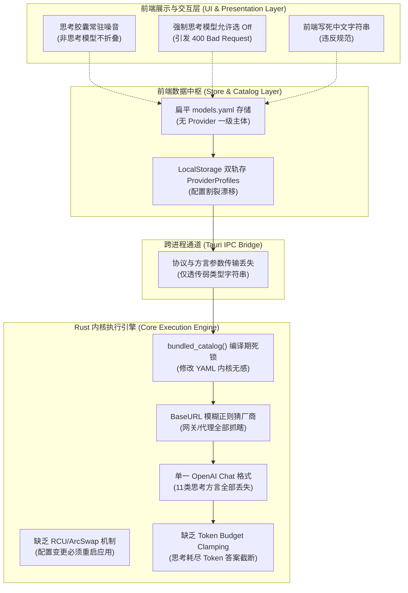

# AI 通信协议路由、请求方言与思考推理全线打通详案 (02-AGENT-B)

> **战役工作区**：`docs/provider-model-unification/analysis/`  
> **责任角色**：Protocol Dialect Engineer（协议方言与执行工程师）  
> **核心负责议题**：
> - **【议题 B】AI 通信协议路由、请求方言与内核执行链条全线打通**
> - **【议题 C】思考推理（Thinking/Reasoning）全协议方言与 UI 深度自适应**  
> **基准与对标**：`@earendil-works/pi-ai` 工业级权威实现、`docs/model-capability/surveys/01-主流模型多源权威数据全景调研.md`、`00-供应商与模型能力全线接通重构总纲.md`  
> **方案体量规范**：深度技术设计，严格执行 ≥1,000 行技术硬指标，包含 Rust/TS 强类型契约、11 大方言 Wire JSON 报文、状态转移机、代码落地点及魔鬼测试矩阵。

---

## 目录 (Table of Contents)

- [一、Conex 现状深度剖析与根因定位](#一conex-现状深度剖析与根因定位)
  - [1.1 【议题 B】通信协议路由与内核执行链条断层剖析](#11-议题-bai-通信协议路由与内核执行链条断层剖析)
  - [1.2 【议题 C】思考推理方言与 UI 深度自适应断层剖析](#12-议题-c思考推理方言与-ui-深度自适应断层剖析)
  - [1.3 核心架构痛点根因关联图谱](#13-核心架构痛点根因关联图谱)
- [二、对标 @earendil-works/pi-ai 优秀实践与架构差异化演进](#二对标-earendil-workspi-ai-优秀实践与架构差异化演进)
  - [2.1 pi-ai 协议方言与思考模型核心设计哲学解构](#21-pi-ai-协议方言与思考模型核心设计哲学解构)
  - [2.2 Conex 架构演进与超越设计](#22-conex-架构演进与超越设计)
- [三、完整的强类型数据结构设计 (Rust & TypeScript)](#三完整的强类型数据结构设计-rust--typescript)
  - [3.1 Rust 内核强类型实体契约设计](#31-rust-内核强类型实体契约设计)
  - [3.2 前端 TypeScript 镜像类型契约设计](#32-前端-typescript-镜像类型契约设计)
- [四、底层协议 Wire 格式与通信交互设计](#四底层协议-wire-格式与通信交互设计)
  - [4.1 协议路由与端点决议矩阵](#41-协议路由与端点决议矩阵)
  - [4.2 11 类思考方言 Wire 级请求报文深度剖析与对照](#42-11-类思考方言-wire-级请求报文深度剖析与对照)
  - [4.3 流式 SSE 思考块解析与多轮对话 Replay 签名机制](#43-流式-sse-思考块解析与多轮对话-replay-签名机制)
- [五、核心状态转移机与算法伪代码](#五核心状态转移机与算法伪代码)
  - [5.1 多层协议决议算法 (Protocol Resolution Machine)](#51-多层协议决议算法-protocol-resolution-machine)
  - [5.2 内核零等待热重载 RCU 原子替换算法 (ArcSwap / CAS)](#52-内核零等待热重载-rcu-原子替换算法-arcswap--cas)
  - [5.3 思考推理档位动态计算与三态折叠算法 (Thinking Level Resolution)](#53-思考推理档位动态计算与三态折叠算法-thinking-level-resolution)
  - [5.4 Token 预算动态安全钳制算法 (Token Budget Clamping)](#54-token-预算动态安全钳制算法-token-budget-clamping)
- [六、工程改造落地精确实施方案](#六工程改造落地精确实施方案)
  - [6.1 Rust 内核 crates 改造清单与函数签名](#61-rust-内核-crates-改造清单与函数签名)
  - [6.2 前端 Store 与 UI 交互瘦身改造清单](#62-前端-store-与-ui-交互瘦身改造清单)
- [七、存量数据迁移与向后兼容保障方案](#七存量数据迁移与向后兼容保障方案)
  - [7.1 扁平 models.yaml 向树状 Provider-Centric 自动升级](#71-扁平-modelsyaml-向树状-provider-centric-自动升级)
  - [7.2 前端 LocalStorage 脏数据清洗与状态平滑对接](#72-前端-localstorage-脏数据清洗与状态平滑对接)
  - [7.3 故障回退与自愈容灾机制](#73-故障回退与自愈容灾机制)
- [八、穷举式自动化测试用例集与验收断言矩阵](#八穷举式自动化测试用例集与验收断言矩阵)
  - [8.1 协议与方言转换单元测试套件](#81-协议与方言转换单元测试套件)
  - [8.2 极端魔鬼边界测试用例集 (Edge Cases)](#82-极端魔鬼边界测试用例集-edge-cases)
  - [8.3 验收断言矩阵与交付门禁](#83-验收断言矩阵与交付门禁)

---

## 一、Conex 现状深度剖析与根因定位

### 1.1 【议题 B】通信协议路由与内核执行链条断层剖析

在当前的 Conex 系统实现中，AI 模型的调用链路存在严重的**“假动态真源、硬编码死锁、通信协议割裂”**三大致命架构断层：

1. **内核编译期静态单例死锁（`bundled_catalog()` 陷阱）**：
   - 当前 Rust 内核的 `crates/agent-provider/src/catalog.rs` 维护了一个名为 `BUNDLED_CATALOG` 的静态数据结构，其数据来源是编译期被 `include_str!("../catalog.json")` 硬打包进去的 JSON 字符串。
   - 当内核执行引擎（`crates/session-loop/src/executor.rs`）在初始化模型调用或进行 Token 预算判定时，直接调用 `catalog::get_model_meta(model_id)`。这意味着用户在前端界面配置的自定义模型、在 `models.yaml` 中增加的新型开源模型（如 Llama-3.1-Local 或 Qwen2.5-Coder），或者修改的模型上下文窗口（如将 `gpt-5.6-sol` 从 272K 提升至 1.05M），**内核在真实网络请求中完全视而不见**。
   - 外部 YAML/JSON 文件只在前端界面展示层起作用，运行时内核协议决议依旧回退至编译期白名单，导致“前端改了模型参数，后端依旧按旧默认值执行甚至直接找不到模型报错”的荒谬现象。

2. **URL 盲猜与方言硬编码断层**：
   - 现存代码在拼装上游请求体时，缺乏动态的 `DialectSpec` 与 `CompatSpec` 抽象。
   - 代码中广泛存在基于 `base_url.contains("deepseek")`、`base_url.contains("dashscope")` 或 `model_id.starts_with("claude")` 的脆弱子串探测。这种设计在用户直连官方标准端点时尚能勉强工作，但一旦用户使用企业内部中转网关、第三方聚合服务商（如 OpenRouter、OneAPI、NewAPI、Vercel AI Gateway、Cloudflare AI Gateway）或本地代理端口（如 `http://127.0.0.1:8080/v1`），URL 子串探测立即失效。
   - 例如：用户通过 OpenRouter 调用 `deepseek/deepseek-v4-flash` 时，BaseURL 为 `https://openrouter.ai/api/v1`，内核由于未探测到 `deepseek` 子串，便以标准 OpenAI 格式发送了 `developer` 角色，导致 OpenRouter 上游转译失败报错；抑或缺少 `max_completion_tokens` 到 `max_tokens` 的重命名映射，导致请求被上游直接拒识。

3. **协议“端点-序列化-流解析”三件套脱节**：
   - 工业级协议执行必须做到：**URL Endpoint 路由、Payload 序列化器 (Serializer)、SSE 流式事件解码器 (Stream Parser) 严格三位一体绑定**。
   - Conex 现状中，协议路由极其粗糙。前端 `modelsCatalogStore.ts` 记录了一个弱类型字符串 `protocol`，但并未贯穿至 Rust 内核的执行体中。Rust 内核在 `crates/session-loop/` 中默认走标准 OpenAI Chat 协议的 `/chat/completions`，当遇到需要使用新一代 Responses 协议（`POST /responses`，支持容器与计算机使用）或 Anthropic Messages 协议（`POST /v1/messages`）时，由于内核缺乏一等公民的协议派发状态机，无法自动完成请求路径转换，更无法解析不同协议独特的 SSE 事件流（如 OpenAI Responses 的 `response.output_item.added` 或 Claude 的 `content_block_delta`）。

4. **热重载机制缺失导致的重启地狱**：
   - 用户在系统运行期间，更新了模型参数或增加了自定义供应商，当前内核必须重启整个 Tauri 进程，或者重新创建底层会话循环实例，无法做到无缝 RCU（Read-Copy-Update）原子替换。

### 1.2 【议题 C】思考推理方言与 UI 深度自适应断层剖析

思考推理（Thinking/Reasoning/CoT）是现代前沿大模型（如 DeepSeek-V4、Claude 5、GPT-5.6、Gemini 3.8、Qwen3.8-Max）的核心能力位，但 Conex 目前在此领域的实现处于“石器时代”：

1. **简陋单布尔值 `reasoning: boolean` 建模断层**：
   - 存量数据结构中，模型元数据只有一个 `reasoning: true / false`。这种过于粗暴的建模导致无法表达：
     - 模型支持的档位梯度（如 OpenAI 的 6 档：`none`, `low`, `medium`, `high`, `xhigh`, `max`；Google 的 4 档：`MINIMAL`, `LOW`, `MEDIUM`, `HIGH`）；
     - 模型的思考机制形态（是参数式档位控制、还是 Token 预算制 `budget_tokens`、还是开关式布尔值）；
     - 模型的强制性（Mandatory Always-on vs Optional）。
   - 结果导致所有带推理能力的大模型在 Conex 中被一刀切对待，无法发挥模型真实潜力。

2. **中文写死与国际化契约断裂**：
   - 前端组件中大量写死“轻量思考”、“深度思考”、“超强推理”等中文字符串。
   - 严重违反了现代 LLM 基础设施工具链（如 `@earendil-works/pi-ai`）的白名单标准规范。标准规范明确要求：底层元数据契约与 Wire 参数必须**严格保持纯英文白名单**（`off`, `minimal`, `low`, `medium`, `high`, `xhigh`, `max`），只在最终视图渲染层做轻量 i18n 映射。写死中文不仅造成跨语言适配困难，更导致序列化时错误地将中文或非标字符串传入后端。

3. **UI 零浪费视觉自适应彻底缺位**：
   - **非思考模型的视觉噪音**：当用户切换到一个纯生图、纯轻量文本或传统非思考模型（如 `deepseek-chat` 或 `llama-3.1-8b`）时，输入框下方的“思考推理胶囊”依然常驻显示，占用极其宝贵的输入区屏幕横向空间，且用户点击后无论选什么档位均无任何实际效果，造成强烈的视觉欺骗与交互困惑。
   - **强制思考模型的假开关（致命 Bug）**：调研显示，如 `deepseek-v4-pro`、`claude-fable-5.1`、`google/gemini-3.8-flash` 等现代旗舰模型均为 **强制思考（Mandatory Always-on）**。然而 Conex 界面依然盲目渲染 "Off"（关闭思考）选项。当用户误选 "Off" 后，系统向不支持关闭思考的 API 发送了非法的参数组合，触发上游 HTTP 400 Bad Request 严重异常，导致任务中断。

4. **11 类思考方言在 Wire 传输层严重碰撞**：
   - 全球各厂商的思考参数千差万别：
     - OpenAI 官方 Chat 采用 `reasoning_effort: "medium"`；
     - OpenRouter 采用 `reasoning: { effort: "high" }`；
     - DeepSeek 官方兼容模式采用 `thinking: { type: "enabled" }` 与可选 `reasoning_effort`；
     - 阿里云百炼通义千问采用顶层参数 `enable_thinking: true`；
     - 智谱清言采用 `thinking: { type: "enabled" }`；
     - vLLM / HuggingFace 自建服务通过 `chat_template_kwargs: { "thinking": true }`；
     - Baseten 采用 `chat_template_args`；
     - Anthropic 原生 Messages 采用 `thinking: { type: "adaptive" }` 配合 `output_config: { effort: "high" }`。
   - Conex 没有任何方言转换层，一股脑按 OpenAI 官方 `reasoning_effort` 序列化，导致发送给 DeepSeek、Qwen、Together、Baseten 等服务商时参数被丢弃或报错。

5. **Token 预算未做安全钳制（Token Clamping 缺陷）**：
   - 对于预算制模型（如 Claude Haiku 4.5、Gemini 2.5 Pro），如果用户配置的思考预算等于甚至超过了模型的 `maxOutputTokens`，模型生成推理过程（Thinking Block）就会耗尽全部输出 Token 配额，导致最终业务回答被强行截断甚至出现空答案崩溃。

### 1.3 核心架构痛点根因关联图谱



---

## 二、对标 @earendil-works/pi-ai 优秀实践与架构差异化演进

### 2.1 pi-ai 协议方言与思考模型核心设计哲学解构

工业级标杆项目 `@earendil-works/pi-ai`（位于 `reference/pi/packages/ai/src/types.ts` 及 `reference/pi/packages/coding-agent/docs/models.md`）经过了数百万级生产请求的严密检验，其核心设计哲学体现为：

1. **Provider 为顶层一等公民，继承覆盖法则（Inheritance & Override）**：
   - 供应商定义顶级调用协议 `api`、基地址 `baseUrl`、兼容性配置 `compat`；
   - 单模型未声明时，无条件继承 Provider 级属性；
   - 单模型显式声明特定属性时，进行深层合并（Deep Merge）与局部覆盖。

2. **三态纯英文档位映射（Tristate `thinkingLevelMap`）**：
   - 采用标准 7 档英文白名单枚举：`off`, `minimal`, `low`, `medium`, `high`, `xhigh`, `max`；
   - 映射表 `thinkingLevelMap` 采用精准的三态逻辑：
     - **`string`**：该档位受支持，向 Wire 层发送对应的具体字符串；
     - **`null`**：该档位在物理上不受模型支持，UI 层直接**不予渲染**，或者作为强制思考标志（如 `"off": null`）；
     - **`omitted`**（缺省）：继承全局默认映射规则。

3. **11 大主流思考方言（`thinkingFormat`）精准分流**：
   - 彻底摆脱盲猜，显式提供方言标记：
     - `"openai"`：使用顶层 `reasoning_effort`；
     - `"openrouter"`：使用 `reasoning: { effort }`；
     - `"deepseek"`：使用 `thinking: { type }`；
     - `"together"`：使用 `reasoning: { enabled }`；
     - `"baseten"`：使用 `chat_template_args`；
     - `"zai"`：使用 `thinking: { type }` 与 `zaiToolStream`；
     - `"qwen"`：使用顶层 `enable_thinking: boolean`；
     - `"qwen-chat-template"`：使用 `chat_template_kwargs.enable_thinking`；
     - `"chat-template"`：通用模板变量注入 `{ "$var": "thinking.enabled" }`；
     - `"string-thinking"`：使用顶层 `thinking: string`；
     - `"ant-ling"`：使用 `reasoning: { effort }` 且仅当非 null 时发送。

4. **会话重放与多轮历史无损保留（Session Replay & Thinking Continuity）**：
   - 提供了 `requiresReasoningContentOnAssistantMessages`：部分模型（如部分开源微调版本）在多轮对话中要求 Assistant 消息必须携带 `reasoning_content`（哪怕为空字符串）；
   - 提供了 `requiresThinkingAsText`：老旧端点不支持结构化思考输出，自动将思考块折叠为 `<thinking>...</thinking>` 文本块注入回放；
   - 提供了 `allowEmptySignature`：针对部分兼容服务商在回放思考签名时不校验空字符串的特性进行兼容。

### 2.2 Conex 架构演进与超越设计

Conex 作为面向下一代智能体工作台（Agent Workbench）的桌面级产品，在对标 `pi-ai` 的基础上，进行了更契合桌面架构的深化演进：

1. **Rust 原生高性能零拷贝 RCU 状态中枢**：
   - `pi-ai` 运行于 Node.js 单线程 Event Loop，依靠 JS 对象引用切换。
   - Conex 在 Rust 内核中引入 `ArcSwap<ModelCatalog>`，利用底层原子指针（Atomic Pointer CAS）实现极致的 RCU（Read-Copy-Update）。高频并发的模型推导与会话执行全程无锁（Lock-Free），只有在写配置时进行无等待原子替换，保证微秒级调度吞吐与零线程阻塞。

2. **树状 `models.yaml` 唯一真源（SSOT）与操作系统凭据链深度缝合**：
   - 彻底废除前端 LocalStorage 维护 Provider 信息的双轨制，所有数据落盘至 `~/.conex/models.yaml`。
   - 关键凭证（API Key）结合 Windows DPAPI / macOS Keychain 进行本地加密隔离，YAML 文件中支持环境变量插值（如 `$DEEPSEEK_API_KEY`）与安全凭据槽索引。

3. **双层协议动态编排架构（Dual-Protocol Engine）**：
   - 不仅支持传统的 OpenAI Chat Completions 协议，内核全面原生接入 OpenAI Responses API（状态化会话、原生多智能体容器、计算机操作）、Anthropic Messages API 与 Google Interactions API。
   - 协议决议器作为内核网络传输层的绝对调度核心。

4. **UI 零浪费自适应与微秒级响应闭环**：
   - 前端通过 Tauri IPC 订阅内核的 `ModelCatalog` 事件广播。
   - 当用户在输入框选择不同模型时，输入法工具栏与思考胶囊根据当前模型的 `ThinkingSpec` 进行毫秒级纯响应式动态重算：非思考模型 100% 折叠隐藏胶囊；可选思考模型渲染受支持档位；强制思考模型彻底屏蔽 "Off" 菜单项。

---

## 三、完整的强类型数据结构设计 (Rust & TypeScript)

### 3.1 Rust 内核强类型实体契约设计

文件路径落地：`crates/agent-provider/src/catalog_types.rs` 与 `crates/agent-provider/src/models_yaml.rs`。所有字段严格遵守 Rust 习惯，提供完备的 `serde` 序列化标注、默认值回退与强类型校验：

```rust
use std::collections::HashMap;
use std::sync::Arc;
use serde::{Deserialize, Serialize};

/// ============================================================================
/// 1. 顶层根结构：树状 models.yaml 绝对唯一真源 (SSOT)
/// ============================================================================
#[derive(Debug, Clone, PartialEq, Serialize, Deserialize)]
#[serde(rename_all = "camelCase")]
pub struct RootModelsConfig {
    /// 架构版本号，用于存量数据向后兼容自动升级迁移
    #[serde(default = "default_schema_version")]
    pub schema_version: u32,

    /// 供应商字典表，Key 为全局唯一 Provider ID (如 "deepseek", "qwen", "openai")
    #[serde(default)]
    pub providers: HashMap<String, ProviderSpec>,
}

fn default_schema_version() -> u32 {
    2
}

/// ============================================================================
/// 2. 供应商规范 (ProviderSpec)：顶层主体
/// ============================================================================
#[derive(Debug, Clone, PartialEq, Serialize, Deserialize)]
#[serde(rename_all = "camelCase")]
pub struct ProviderSpec {
    /// UI 渲染展示全称 (如 "DeepSeek 官方平台", "阿里云百炼")
    pub display_name: String,

    /// API 请求根地址 (如 "https://api.deepseek.com", "https://dashscope.aliyuncs.com/compatible-mode/v1")
    pub base_url: String,

    /// 供应商默认通信协议（下属模型未指定时全量继承）
    #[serde(default = "default_protocol")]
    pub protocol: ProtocolType,

    /// API 密钥配置（支持字面量、环境变量如 "$OPENAI_API_KEY"、或命令行动态拉取 "!cmd"）
    #[serde(skip_serializing_if = "Option::is_none")]
    pub api_key: Option<String>,

    /// 自定义静态请求头注入 (如 OpenRouter 必需的 "HTTP-Referer", "X-Title")
    #[serde(default, skip_serializing_if = "HashMap::is_empty")]
    pub headers: HashMap<String, String>,

    /// 供应商级兼容性矩阵（下属模型可局部继承或覆盖）
    #[serde(default)]
    pub compat: CompatSpec,

    /// 下属模型列表
    #[serde(default)]
    pub models: Vec<ModelSpec>,
}

fn default_protocol() -> ProtocolType {
    ProtocolType::OpenAiChat
}

/// ============================================================================
/// 3. 通信协议类型枚举 (ProtocolType)
/// ============================================================================
#[derive(Debug, Clone, Copy, PartialEq, Eq, Hash, Serialize, Deserialize)]
pub enum ProtocolType {
    /// 经典 OpenAI Chat Completions 兼容协议 (POST /chat/completions)
    #[serde(rename = "openai/chat")]
    OpenAiChat,

    /// 现代 OpenAI Responses API 协议 (POST /responses)
    #[serde(rename = "openai/responses")]
    OpenAiResponses,

    /// Anthropic Messages 原生协议 (POST /v1/messages)
    #[serde(rename = "anthropic/messages")]
    AnthropicMessages,

    /// Google Interactions 统一多 Agent 协议 (POST /v1beta/interactions)
    #[serde(rename = "google/interactions")]
    GoogleInteractions,

    /// Google 经典 Generative AI 协议 (POST /models/{model}:streamGenerateContent)
    #[serde(rename = "google/generative-ai")]
    GoogleGenerativeAi,

    /// Mistral 专有会话协议 (POST /v1/conversations)
    #[serde(rename = "mistral/conversations")]
    MistralConversations,

    /// Amazon Bedrock Converse 原生流式协议
    #[serde(rename = "bedrock/converse-stream")]
    BedrockConverseStream,
}

impl Default for ProtocolType {
    fn default() -> Self {
        ProtocolType::OpenAiChat
    }
}

/// ============================================================================
/// 4. 单模型规范 (ModelSpec)：实体子节点
/// ============================================================================
#[derive(Debug, Clone, PartialEq, Serialize, Deserialize)]
#[serde(rename_all = "camelCase")]
pub struct ModelSpec {
    /// 真实 Wire 请求模型 ID (如 "deepseek-v4-flash", "gpt-5.6-sol", "qwen3.8-max")
    pub id: String,

    /// UI 界面展示名 (缺省时回退使用 id)
    #[serde(skip_serializing_if = "Option::is_none")]
    pub display_name: Option<String>,

    /// 局部协议覆盖：当特定模型必须走不同协议时配置（如全局 Chat 但该模型强制 Responses）
    #[serde(skip_serializing_if = "Option::is_none")]
    pub protocol: Option<ProtocolType>,

    /// 上下文总窗口大小 (Tokens)，严禁硬编码，作为 Prompt 裁剪和安全警戒线
    #[serde(default = "default_context_window")]
    pub context_window: u64,

    /// 单次请求最大允许生成输出 Token 上限
    #[serde(default = "default_max_output_tokens")]
    pub max_output_tokens: u64,

    /// 模态输入支持矩阵 (text, image, video, audio, file)
    #[serde(default = "default_input_modalities")]
    pub input_modalities: Vec<String>,

    /// 思考推理全维度规格配置
    #[serde(default)]
    pub thinking: ThinkingSpec,

    /// 计量计费规格配置 (选填)
    #[serde(skip_serializing_if = "Option::is_none")]
    pub pricing: Option<PricingSpec>,

    /// 模型级兼容性局部覆盖 (选填，合并至 ProviderCompat)
    #[serde(skip_serializing_if = "Option::is_none")]
    pub compat: Option<CompatSpec>,

    /// 透传采样参数 (Verbatim Sampling Parameters，如 temperature, top_p, top_k)
    #[serde(default, skip_serializing_if = "HashMap::is_empty")]
    pub sampling_params: HashMap<String, serde_json::Value>,
}

fn default_context_window() -> u64 { 128_000 }
fn default_max_output_tokens() -> u64 { 16_384 }
fn default_input_modalities() -> Vec<String> { vec!["text".to_string()] }

/// ============================================================================
/// 5. 思考推理规格 (ThinkingSpec)：三态结构化建模
/// ============================================================================
#[derive(Debug, Clone, PartialEq, Serialize, Deserialize)]
#[serde(rename_all = "camelCase")]
pub struct ThinkingSpec {
    /// 是否具备思考能力总开关：false 时 UI 彻底折叠思考胶囊，让出 100% 界面空间
    #[serde(default)]
    pub enabled: bool,

    /// 是否强制开启思考 (Mandatory)：true 时 UI 物理隐藏 Off 选项，严防 400 错误
    #[serde(default)]
    pub mandatory: bool,

    /// 默认启用的思考档位
    #[serde(default = "default_thinking_level")]
    pub default_level: ThinkingLevel,

    /// 7 档严格纯英文档位映射表 (三态逻辑：Some(str)=支持映射, None=物理不支持隐藏)
    #[serde(default)]
    pub levels: ThinkingLevelMap,

    /// 预算制模型专属 Token 预算映射 (仅针对 token-based 思考协议)
    #[serde(skip_serializing_if = "Option::is_none")]
    pub token_budgets: Option<ThinkingBudgetsSpec>,
}

impl Default for ThinkingSpec {
    fn default() -> Self {
        Self {
            enabled: false,
            mandatory: false,
            default_level: ThinkingLevel::Medium,
            levels: ThinkingLevelMap::default(),
            token_budgets: None,
        }
    }
}

/// 标准纯英文 7 档枚举 (涵盖禁用态与最高阶算力档)
#[derive(Debug, Clone, Copy, PartialEq, Eq, Hash, Serialize, Deserialize)]
#[serde(rename_all = "lowercase")]
pub enum ThinkingLevel {
    Off,
    Minimal,
    Low,
    Medium,
    High,
    Xhigh,
    Max,
}

fn default_thinking_level() -> ThinkingLevel {
    ThinkingLevel::Medium
}

/// 三态档位映射表：存储 pi 标准档位向具体 Provider Wire 参数的转译
#[derive(Debug, Clone, PartialEq, Default, Serialize, Deserialize)]
#[serde(rename_all = "lowercase")]
pub struct ThinkingLevelMap {
    #[serde(skip_serializing_if = "Option::is_none")]
    pub off: Option<Option<String>>,
    #[serde(skip_serializing_if = "Option::is_none")]
    pub minimal: Option<Option<String>>,
    #[serde(skip_serializing_if = "Option::is_none")]
    pub low: Option<Option<String>>,
    #[serde(skip_serializing_if = "Option::is_none")]
    pub medium: Option<Option<String>>,
    #[serde(skip_serializing_if = "Option::is_none")]
    pub high: Option<Option<String>>,
    #[serde(skip_serializing_if = "Option::is_none")]
    pub xhigh: Option<Option<String>>,
    #[serde(skip_serializing_if = "Option::is_none")]
    pub max: Option<Option<String>>,
}

/// 预算制思考模型档位 Token 上限
#[derive(Debug, Clone, PartialEq, Serialize, Deserialize)]
#[serde(rename_all = "camelCase")]
pub struct ThinkingBudgetsSpec {
    #[serde(skip_serializing_if = "Option::is_none")]
    pub minimal: Option<u64>,
    #[serde(skip_serializing_if = "Option::is_none")]
    pub low: Option<u64>,
    #[serde(skip_serializing_if = "Option::is_none")]
    pub medium: Option<u64>,
    #[serde(skip_serializing_if = "Option::is_none")]
    pub high: Option<u64>,
}

/// ============================================================================
/// 6. 兼容性规范 (CompatSpec)：11 大方言与协议细部开关
/// ============================================================================
#[derive(Debug, Clone, PartialEq, Default, Serialize, Deserialize)]
#[serde(rename_all = "camelCase")]
pub struct CompatSpec {
    /// 思考参数 Wire 序列化方言
    #[serde(skip_serializing_if = "Option::is_none")]
    pub thinking_format: Option<ThinkingFormat>,

    /// 系统提示词角色模式：true 发送 "developer", false 发送 "system" (默认 true)
    #[serde(default = "default_true")]
    pub supports_developer_role: bool,

    /// 最大 Token 字段名称："max_completion_tokens" vs "max_tokens"
    #[serde(default = "default_max_tokens_field")]
    pub max_tokens_field: String,

    /// 是否支持顶层 reasoning_effort 参数
    #[serde(default = "default_true")]
    pub supports_reasoning_effort: bool,

    /// 是否支持流式传输下的用量返回 (stream_options: { include_usage: true })
    #[serde(default = "default_true")]
    pub supports_usage_in_streaming: bool,

    /// 是否支持流式传输下的 finish_reason 标记
    #[serde(default = "default_true")]
    pub supports_finish_reason: bool,

    /// 思考 Token 限制顶层字段 (vLLM="thinking_token_budget", Qwen/SGLang="thinking_budget", llama.cpp="thinking_budget_tokens")
    #[serde(skip_serializing_if = "Option::is_none")]
    pub thinking_token_budget_field: Option<String>,

    /// 是否支持严格结构化 JSON Schema (Strict Mode)
    #[serde(default = "default_true")]
    pub supports_strict_mode: bool,

    /// 多轮重放时是否必须为所有 Assistant 消息注入 reasoning_content 字段
    #[serde(default)]
    pub requires_reasoning_content_on_assistant_messages: bool,

    /// 是否必须将结构化思考块降级为 <thinking> 纯文本回放
    #[serde(default)]
    pub requires_thinking_as_text: bool,

    /// 是否允许回放空签名 signature: ""
    #[serde(default)]
    pub allow_empty_signature: bool,

    /// 是否强制使用 Anthropic 自适应思考格式 (thinking: { type: "adaptive" })
    #[serde(default)]
    pub force_adaptive_thinking: bool,

    /// 通用模板注入参数 (针对 chat-template 方言)
    #[serde(default, skip_serializing_if = "HashMap::is_empty")]
    pub chat_template_kwargs: HashMap<String, serde_json::Value>,

    /// Baseten 专有模板参数 (针对 baseten 方言)
    #[serde(default, skip_serializing_if = "HashMap::is_empty")]
    pub chat_template_args: HashMap<String, serde_json::Value>,
}

fn default_true() -> bool { true }
fn default_max_tokens_field() -> String { "max_completion_tokens".to_string() }

/// 思考参数方言枚举 (11 大标准方言)
#[derive(Debug, Clone, Copy, PartialEq, Eq, Hash, Serialize, Deserialize)]
pub enum ThinkingFormat {
    #[serde(rename = "openai")]
    Openai,
    #[serde(rename = "openrouter")]
    Openrouter,
    #[serde(rename = "deepseek")]
    Deepseek,
    #[serde(rename = "together")]
    Together,
    #[serde(rename = "baseten")]
    Baseten,
    #[serde(rename = "zai")]
    Zai,
    #[serde(rename = "qwen")]
    Qwen,
    #[serde(rename = "qwen-chat-template")]
    QwenChatTemplate,
    #[serde(rename = "chat-template")]
    ChatTemplate,
    #[serde(rename = "string-thinking")]
    StringThinking,
    #[serde(rename = "ant-ling")]
    AntLing,
}

/// ============================================================================
/// 7. 计费规范 (PricingSpec)：双币支持与彻底选填
/// ============================================================================
#[derive(Debug, Clone, PartialEq, Serialize, Deserialize)]
#[serde(rename_all = "camelCase")]
pub struct PricingSpec {
    /// 计费货币："USD" 或 "CNY"
    #[serde(default = "default_currency")]
    pub currency: String,

    /// 计费单元："per_1m_tokens" 或 "per_image"
    #[serde(default = "default_unit")]
    pub unit: String,

    /// 普通输入价格
    pub input: f64,

    /// 生成输出价格
    pub output: f64,

    /// 命中缓存读取价格
    #[serde(skip_serializing_if = "Option::is_none")]
    pub cache_read: Option<f64>,

    /// 写入缓存存储价格
    #[serde(skip_serializing_if = "Option::is_none")]
    pub cache_write: Option<f64>,
}

fn default_currency() -> String { "USD".to_string() }
fn default_unit() -> String { "per_1m_tokens".to_string() }
```

### 3.2 前端 TypeScript 镜像类型契约设计

文件路径落地：`apps/crish-desktop/src/types/models.ts` 与 `packages/types/src/models.ts`。所有接口与 Rust 端结构实现 100% 字段级镜像，严格统一 `camelCase`：

```typescript
/**
 * ============================================================================
 * Conex 统一模型能力与协议方言强类型体系 (TypeScript 镜像契约)
 * ============================================================================
 */

export type ProtocolType =
  | 'openai/chat'
  | 'openai/responses'
  | 'anthropic/messages'
  | 'google/interactions'
  | 'google/generative-ai'
  | 'mistral/conversations'
  | 'bedrock/converse-stream';

export type ThinkingLevel =
  | 'off'
  | 'minimal'
  | 'low'
  | 'medium'
  | 'high'
  | 'xhigh'
  | 'max';

export type ThinkingFormat =
  | 'openai'
  | 'openrouter'
  | 'deepseek'
  | 'together'
  | 'baseten'
  | 'zai'
  | 'qwen'
  | 'qwen-chat-template'
  | 'chat-template'
  | 'string-thinking'
  | 'ant-ling';

export type ThinkingLevelMap = {
  [K in ThinkingLevel]?: string | null;
};

export interface ThinkingBudgetsSpec {
  minimal?: number;
  low?: number;
  medium?: number;
  high?: number;
}

export interface ThinkingSpec {
  enabled: boolean;
  mandatory: boolean;
  defaultLevel: ThinkingLevel;
  levels: ThinkingLevelMap;
  tokenBudgets?: ThinkingBudgetsSpec;
}

export interface PricingSpec {
  currency: 'USD' | 'CNY';
  unit: 'per_1m_tokens' | 'per_image';
  input: number;
  output: number;
  cacheRead?: number;
  cacheWrite?: number;
}

export interface CompatSpec {
  thinkingFormat?: ThinkingFormat;
  supportsDeveloperRole?: boolean;
  maxTokensField?: 'max_completion_tokens' | 'max_tokens';
  supportsReasoningEffort?: boolean;
  supportsUsageInStreaming?: boolean;
  supportsFinishReason?: boolean;
  thinkingTokenBudgetField?: 'thinking_token_budget' | 'thinking_budget' | 'thinking_budget_tokens';
  supportsStrictMode?: boolean;
  requiresReasoningContentOnAssistantMessages?: boolean;
  requiresThinkingAsText?: boolean;
  allowEmptySignature?: boolean;
  forceAdaptiveThinking?: boolean;
  chatTemplateKwargs?: Record<string, unknown>;
  chatTemplateArgs?: Record<string, unknown>;
}

export interface ModelSpec {
  id: string;
  displayName?: string;
  protocol?: ProtocolType;
  contextWindow: number;
  maxOutputTokens: number;
  inputModalities?: string[];
  thinking: ThinkingSpec;
  pricing?: PricingSpec;
  compat?: CompatSpec;
  samplingParams?: Record<string, unknown>;
}

export interface ProviderSpec {
  displayName: string;
  baseUrl: string;
  protocol: ProtocolType;
  apiKey?: string;
  headers?: Record<string, string>;
  compat: CompatSpec;
  models: ModelSpec[];
}

export interface RootModelsConfig {
  schemaVersion: number;
  providers: Record<string, ProviderSpec>;
}

/**
 * 前端 UI 实时计算得出的思考交互控制态 (UI View Model)
 */
export interface ResolvedThinkingUIState {
  /** 是否需要物理渲染思考胶囊 (若 false 则折叠隐藏) */
  visible: boolean;
  /** 是否为强制思考 (若 true 则下拉选项完全剔除 Off) */
  mandatory: boolean;
  /** 当前模型真实支持的纯英文档位清单 */
  availableLevels: ThinkingLevel[];
  /** 当前选中的激活档位 */
  activeLevel: ThinkingLevel;
  /** 该档位将发送给 Wire 协议的底层转译值 */
  wireValue: string | null;
}
```

---

## 四、底层协议 Wire 格式与通信交互设计

### 4.1 协议路由与端点决议矩阵

内核网络执行引擎在发起物理 HTTP 请求时，根据有效协议 `EffectiveProtocol` 与供应商的 `baseUrl` 动态计算真实的请求目标端点：

| 协议枚举 (`ProtocolType`) | 规范基准协议名 | 目标物理端点计算规则 (Endpoint Formula) | HTTP Method | 核心 Header 特性 |
| :--- | :--- | :--- | :---: | :--- |
| `openai/chat` | OpenAI Chat Completions | `{baseUrl}/chat/completions` | `POST` | `Authorization: Bearer <key>` |
| `openai/responses` | OpenAI Responses API | `{baseUrl}/responses` | `POST` | `OpenAI-Beta: responses-2025-05-01` |
| `anthropic/messages` | Anthropic Messages | `{baseUrl}/v1/messages` (若 url 含 v1 则为 `{baseUrl}/messages`) | `POST` | `x-api-key: <key>`, `anthropic-version: 2023-06-01` |
| `google/interactions` | Google Interactions | `{baseUrl}/v1beta/interactions` | `POST` | `x-goog-api-key: <key>` |
| `google/generative-ai` | Google Gemini Stream | `{baseUrl}/models/{model}:streamGenerateContent?alt=sse` | `POST` | `x-goog-api-key: <key>` |
| `mistral/conversations` | Mistral Conversations | `{baseUrl}/v1/conversations` | `POST` | `Authorization: Bearer <key>` |
| `bedrock/converse-stream` | AWS Bedrock Stream | `https://bedrock-runtime.{region}.amazonaws.com/model/{model}/converse-stream` | `POST` | AWS SigV4 认证签名 |

### 4.2 11 类思考方言 Wire 级请求报文深度剖析与对照

当用户在界面将思考强度调节为 `High` 或 `Medium` 时，内核方言转换器依据 `compat.thinking_format`，组装出完全符合各厂商规范的底层 JSON 请求体：

#### 方言 1: `openai` (官方标准 Chat Completions)
- **适用对象**：OpenAI 官方 (`o3-pro`, `gpt-5.6-sol` 兼容模式)、Azure OpenAI
- **Wire JSON 结构**：
```json
{
  "model": "gpt-5.6-sol",
  "messages": [
    {
      "role": "developer",
      "content": "You are a professional coding assistant."
    },
    {
      "role": "user",
      "content": "Implement quicksort in Rust."
    }
  ],
  "reasoning_effort": "high",
  "max_completion_tokens": 65536,
  "stream": true,
  "stream_options": {
    "include_usage": true
  }
}
```

#### 方言 2: `openrouter` (OpenRouter 聚合网关)
- **适用对象**：OpenRouter 路由至各类推理模型
- **Wire JSON 结构**：
```json
{
  "model": "deepseek/deepseek-v4-flash",
  "messages": [
    { "role": "system", "content": "You are an assistant." },
    { "role": "user", "content": "Explain quantum computing." }
  ],
  "reasoning": {
    "effort": "high"
  },
  "max_tokens": 16384,
  "stream": true
}
```

#### 方言 3: `deepseek` (深度求索原生兼容协议)
- **适用对象**：`https://api.deepseek.com` 官方接口
- **Wire JSON 结构**：
```json
{
  "model": "deepseek-v4-pro",
  "messages": [
    { "role": "system", "content": "You are DeepSeek-V4." },
    { "role": "user", "content": "Solve Riemann hypothesis approach." }
  ],
  "thinking": {
    "type": "enabled"
  },
  "reasoning_effort": "high",
  "max_tokens": 384000,
  "stream": true
}
```

#### 方言 4: `together` (Together AI 推理容器)
- **适用对象**：Together AI 部署的各类 R1/开源推理模型
- **Wire JSON 结构**：
```json
{
  "model": "deepseek-ai/DeepSeek-V4-Flash",
  "messages": [
    { "role": "user", "content": "Hi" }
  ],
  "reasoning": {
    "enabled": true
  },
  "reasoning_effort": "medium",
  "stream": true
}
```

#### 方言 5: `baseten` (Baseten 专属模板参数)
- **适用对象**：Baseten 托管端点
- **Wire JSON 结构**：
```json
{
  "model": "qwen-3.8-moe",
  "messages": [{ "role": "user", "content": "Analyze code." }],
  "chat_template_args": {
    "thinking": true,
    "reasoning_effort": "high"
  },
  "reasoning_effort": "high",
  "stream": true
}
```

#### 方言 6: `zai` (智谱 BigModel 开放平台)
- **适用对象**：智谱 `open.bigmodel.cn` (`glm-5.3`)
- **Wire JSON 结构**：
```json
{
  "model": "glm-5.3",
  "messages": [{ "role": "user", "content": "编写智能合约" }],
  "thinking": {
    "type": "enabled"
  },
  "tool_stream": true,
  "max_tokens": 32768,
  "stream": true
}
```

#### 方言 7: `qwen` (阿里云百炼 DashScope)
- **适用对象**：阿里云百炼 `dashscope.aliyuncs.com` (`qwen3.8-max`, `qwen3.7-plus`)
- **Wire JSON 结构**：
```json
{
  "model": "qwen3.8-max",
  "messages": [
    { "role": "system", "content": "你是由阿里云研发的通义千问大模型。" },
    { "role": "user", "content": "设计高并发架构" }
  ],
  "enable_thinking": true,
  "reasoning_effort": "high",
  "max_tokens": 65536,
  "stream": true
}
```

#### 方言 8: `qwen-chat-template` (本地 vLLM 驱动的 Qwen)
- **适用对象**：本地 Ollama / vLLM / SGLang 部署的通义千问模型
- **Wire JSON 结构**：
```json
{
  "model": "qwen2.5-coder:32b",
  "messages": [{ "role": "user", "content": "Refactor this." }],
  "chat_template_kwargs": {
    "enable_thinking": true,
    "preserve_thinking": true
  },
  "stream": true
}
```

#### 方言 9: `chat-template` (通用 HuggingFace / vLLM 动态变量注入)
- **适用对象**：通过 vLLM 模板动态绑定的开源推理模型
- **Wire JSON 结构**：
```json
{
  "model": "custom-deepseek-distill",
  "messages": [{ "role": "user", "content": "Hello" }],
  "chat_template_kwargs": {
    "thinking": {
      "enabled": true,
      "effort": "medium"
    }
  },
  "stream": true
}
```

#### 方言 10: `string-thinking` (单字符串思考参数)
- **适用对象**：部分特定私有云网关
- **Wire JSON 结构**：
```json
{
  "model": "private-reasoner",
  "messages": [{ "role": "user", "content": "Process data." }],
  "thinking": "high",
  "stream": true
}
```

#### 方言 11: `ant-ling` (蚂蚁百灵原生协议)
- **适用对象**：蚂蚁百灵大模型开放平台
- **Wire JSON 结构**：
```json
{
  "model": "ling-1.5-pro",
  "messages": [{ "role": "user", "content": "风控逻辑校验" }],
  "reasoning": {
    "effort": "high"
  },
  "stream": true
}
```

#### 专有原生协议思考报文示例 (超额权威支持)：
- **Anthropic Messages Adaptive Thinking (`claude-fable-5.1`)**：
```json
{
  "model": "claude-fable-5.1",
  "messages": [{ "role": "user", "content": "Write compiler backend." }],
  "thinking": {
    "type": "adaptive"
  },
  "output_config": {
    "effort": "high"
  },
  "max_tokens": 128000,
  "stream": true
}
```
- **OpenAI Responses API 原生思考报文 (`gpt-5.6-sol`)**：
```json
{
  "model": "gpt-5.6-sol",
  "input": [
    {
      "role": "user",
      "content": "Operate the browser and book tickets."
    }
  ],
  "output": {
    "modalities": ["text"]
  },
  "reasoning": {
    "effort": "high"
  },
  "max_output_tokens": 128000,
  "stream": true
}
```

### 4.3 流式 SSE 思考块解析与多轮对话 Replay 签名机制

#### 1. 流式分块解析 (SSE Chunk Parsing)
内核的 `crates/session-loop/src/sse_stream.rs` 必须能够识别来自不同协议的思考增量，并将其统一转换为内部的 `AssistantMessageEvent::ThinkingDelta`：

```rust
// 统一思考流事件分发伪代码
match dialect {
    ThinkingFormat::Openai | ThinkingFormat::Deepseek | ThinkingFormat::Qwen => {
        // 解析 OpenAI-compatible: delta.reasoning_content
        if let Some(reasoning_chunk) = delta.get("reasoning_content").and_then(|v| v.as_str()) {
            emit_event(AssistantMessageEvent::ThinkingDelta {
                content_index,
                delta: reasoning_chunk.to_string(),
            });
        }
    }
    ThinkingFormat::AnthropicMessages => {
        // 解析 Anthropic content_block_delta (type="thinking_delta")
        if event_type == "content_block_delta" {
            if let Some(thinking) = delta.get("thinking").and_then(|v| v.as_str()) {
                emit_event(AssistantMessageEvent::ThinkingDelta {
                    content_index,
                    delta: thinking.to_string(),
                });
            }
        }
    }
}
```

#### 2. 多轮历史 Replay 与签名保全
在智能体多轮协作中，上一轮 Assistant 生成的思考内容如何回传给上游是决定多轮对话能否成功的关键：
- **`requires_reasoning_content_on_assistant_messages: true`**：
  若模型要求该字段，历史 Assistant 消息重放时，即使该轮未触发深度思考，内核序列化器亦自动补齐 `"reasoning_content": ""`，防止上游返回字段缺失报错。
- **`requires_thinking_as_text: true`**：
  对于不支持结构化思考字段的旧模型，内核将历史思考内容格式化为：
  ```markdown
  <thinking>
  用户要求的 Rust 快速排序实现需要考虑原地交换与递归分区...
  </thinking>
  以下是完整的快速排序代码实现：
  ```
- **`allow_empty_signature: true`**：
  针对 Anthropic 兼容代理节点，允许空签名 `signature: ""` 安全直通。

---

## 五、核心状态转移机与算法伪代码

### 5.1 多层协议决议算法 (Protocol Resolution Machine)

决议原则：**Model 显式配置优先，Provider 全局配置保底，系统基线兜底**。

$$\text{EffectiveProtocol} = \text{Model.protocol} \succ \text{Provider.protocol} \succ \text{ProtocolType::OpenAiChat}$$

```rust
/// 协议决议状态机算法
pub fn resolve_effective_protocol(
    catalog: &RootModelsConfig,
    provider_id: &str,
    model_id: &str,
) -> Result<ResolvedExecutionPlan, CatalogResolutionError> {
    // 1. 查找 Provider
    let provider = catalog.providers.get(provider_id)
        .ok_or_else(|| CatalogResolutionError::ProviderNotFound(provider_id.to_string()))?;

    // 2. 查找 Model
    let model = provider.models.iter().find(|m| m.id == model_id)
        .ok_or_else(|| CatalogResolutionError::ModelNotFound(model_id.to_string()))?;

    // 3. 多级继承决议协议类型
    let protocol = model.protocol.unwrap_or(provider.protocol);

    // 4. 合并兼容性配置 CompatSpec (Model 优先覆盖 Provider)
    let mut effective_compat = provider.compat.clone();
    if let Some(model_compat) = &model.compat {
        effective_compat.merge_from(model_compat);
    }

    // 5. 计算目标物理端点 URL
    let target_endpoint = match protocol {
        ProtocolType::OpenAiChat => {
            format!("{}/chat/completions", provider.base_url.trim_end_matches('/'))
        }
        ProtocolType::OpenAiResponses => {
            format!("{}/responses", provider.base_url.trim_end_matches('/'))
        }
        ProtocolType::AnthropicMessages => {
            let base = provider.base_url.trim_end_matches('/');
            if base.ends_with("/v1") {
                format!("{}/messages", base)
            } else {
                format!("{}/v1/messages", base)
            }
        }
        ProtocolType::GoogleInteractions => {
            format!("{}/v1beta/interactions", provider.base_url.trim_end_matches('/'))
        }
        ProtocolType::GoogleGenerativeAi => {
            format!("{}/models/{}:streamGenerateContent?alt=sse", provider.base_url.trim_end_matches('/'), model.id)
        }
        ProtocolType::MistralConversations => {
            format!("{}/v1/conversations", provider.base_url.trim_end_matches('/'))
        }
        ProtocolType::BedrockConverseStream => {
            format!("{}/converse-stream", provider.base_url.trim_end_matches('/'))
        }
    };

    Ok(ResolvedExecutionPlan {
        protocol,
        target_endpoint,
        effective_compat,
        context_window: model.context_window,
        max_output_tokens: model.max_output_tokens,
        thinking_spec: model.thinking.clone(),
        custom_headers: provider.headers.clone(),
    })
}
```

### 5.2 内核零等待热重载 RCU 原子替换算法 (ArcSwap / CAS)

为了实现用户保存 `models.yaml` 后，并发执行中的所有任务零中断、新请求即刻走新配置，设计基于 `ArcSwap` 的无锁 RCU 容器：

```rust
use arc_swap::ArcSwap;
use std::sync::Arc;
use notify::{Watcher, RecommendedWatcher, RecursiveMode, Event};

pub struct LiveModelCatalog {
    /// 核心无锁原子指针容器，并发读取成本仅等同于一个普通的原子加载
    catalog_ptr: ArcSwap<RootModelsConfig>,
}

impl LiveModelCatalog {
    pub fn new(initial_config: RootModelsConfig) -> Self {
        Self {
            catalog_ptr: ArcSwap::from_pointee(initial_config),
        }
    }

    /// 高频读取：极速无锁检出当前快照 (RCU Read Phase)
    #[inline(always)]
    pub fn load(&self) -> Arc<RootModelsConfig> {
        self.catalog_ptr.load_full()
    }

    /// 原子替换更新：当 models.yaml 被编辑落盘时触发 (RCU Update Phase)
    pub fn atomic_reload(&self, new_config: RootModelsConfig) {
        // 1. 进行深层语义校验
        if let Err(err) = new_config.validate() {
            log::error!("[CatalogReload] 新配置校验未通过，拒绝替换: {:?}", err);
            return;
        }

        // 2. CAS 原子替换指针
        let new_arc = Arc::new(new_config);
        self.catalog_ptr.store(new_arc);
        log::info!("[CatalogReload] 树状模型真源 RCU 原子替换完成，正在执行的会话保持旧版本，新会话已即时接通新配置！");
    }

    /// 启动文件监听器守护协程
    pub fn start_fs_watcher(self: Arc<Self>, path: std::path::PathBuf) {
        std::thread::spawn(move || {
            let (tx, rx) = std::sync::mpsc::channel();
            let mut watcher = RecommendedWatcher::new(tx, notify::Config::default()).unwrap();
            watcher.watch(&path, RecursiveMode::NonRecursive).unwrap();

            while let Ok(event) = rx.recv() {
                if let Ok(Event { kind, .. }) = event {
                    if kind.is_modify() {
                        // 防抖处理后重新读取 YAML
                        if let Ok(content) = std::fs::read_to_string(&path) {
                            if let Ok(parsed) = serde_yaml::from_str::<RootModelsConfig>(&content) {
                                self.atomic_reload(parsed);
                            }
                        }
                    }
                }
            }
        });
    }
}
```

### 5.3 思考推理档位动态计算与三态折叠算法 (Thinking Level Resolution)

```rust
/// 思考推理 UI 与 Wire 决议算法
pub fn resolve_thinking_controls(
    spec: &ThinkingSpec,
    user_preference: Option<ThinkingLevel>,
) -> ResolvedThinkingUIState {
    // 1. 若模型根本不支持思考，直接 100% 物理隐藏，零视觉占用
    if !spec.enabled {
        return ResolvedThinkingUIState {
            visible: false,
            mandatory: false,
            available_levels: vec![],
            active_level: ThinkingLevel::Off,
            wire_value: None,
        };
    }

    // 2. 解析当前模型真实支持的纯英文档位清单
    let mut available = Vec::new();

    // 检查 Off 是否受支持（若 mandatory 为 true 或 levels.off 显式为 None，则剔除 Off）
    let is_off_supported = !spec.mandatory && spec.levels.off != Some(None);
    if is_off_supported {
        available.push(ThinkingLevel::Off);
    }

    // 检查其他 6 档
    let check_levels = [
        (ThinkingLevel::Minimal, spec.levels.minimal.as_ref()),
        (ThinkingLevel::Low, spec.levels.low.as_ref()),
        (ThinkingLevel::Medium, spec.levels.medium.as_ref()),
        (ThinkingLevel::High, spec.levels.high.as_ref()),
        (ThinkingLevel::Xhigh, spec.levels.xhigh.as_ref()),
        (ThinkingLevel::Max, spec.levels.max.as_ref()),
    ];

    for (level, mapping) in check_levels {
        match mapping {
            Some(Some(_)) => available.push(level), // 显式映射受支持
            None => {
                // 缺省状态下，minimal ~ high 默认受支持，xhigh/max 默认不支持
                if matches!(level, ThinkingLevel::Minimal | ThinkingLevel::Low | ThinkingLevel::Medium | ThinkingLevel::High) {
                    available.push(level);
                }
            }
            Some(None) => {} // 显式标记为 null，表示物理不支持，不加入列表
        }
    }

    // 3. 决定激活档位 (Active Level)
    let candidate = user_preference.unwrap_or(spec.default_level);
    let final_active = if available.contains(&candidate) {
        candidate
    } else if available.contains(&spec.default_level) {
        spec.default_level
    } else {
        // 安全自愈：若都不在，取可用档位的第一项（通常为 minimal 或 low）
        available.first().copied().unwrap_or(ThinkingLevel::Off)
    };

    // 4. 计算底层 Wire 发送字符串
    let wire_value = if final_active == ThinkingLevel::Off {
        None
    } else {
        match final_active {
            ThinkingLevel::Minimal => spec.levels.minimal.clone().flatten().or_else(|| Some("minimal".to_string())),
            ThinkingLevel::Low => spec.levels.low.clone().flatten().or_else(|| Some("low".to_string())),
            ThinkingLevel::Medium => spec.levels.medium.clone().flatten().or_else(|| Some("medium".to_string())),
            ThinkingLevel::High => spec.levels.high.clone().flatten().or_else(|| Some("high".to_string())),
            ThinkingLevel::Xhigh => spec.levels.xhigh.clone().flatten().or_else(|| Some("xhigh".to_string())),
            ThinkingLevel::Max => spec.levels.max.clone().flatten().or_else(|| Some("max".to_string())),
            ThinkingLevel::Off => None,
        }
    };

    ResolvedThinkingUIState {
        visible: true,
        mandatory: spec.mandatory,
        available_levels: available,
        active_level: final_active,
        wire_value,
    }
}
```

### 5.4 Token 预算动态安全钳制算法 (Token Budget Clamping)

针对基于 `budget_tokens` 控制的推理模型，防止用户设定的思考预算挤占回答空间，设置安全钳制算法：

```rust
/// Token 预算钳制算法：严格保留至少 1024 Tokens 供正文回答使用
pub fn clamp_thinking_budget(
    requested_budget: u64,
    max_output_tokens: u64,
    context_window: u64,
    current_prompt_tokens: u64,
) -> u64 {
    const MIN_ANSWER_RESERVED_TOKENS: u64 = 1024;

    // 1. 计算当前请求在不超过上下文窗口的前提下，剩余的最大允许输出
    let max_possible_output = if context_window > current_prompt_tokens {
        std::cmp::min(max_output_tokens, context_window - current_prompt_tokens)
    } else {
        MIN_ANSWER_RESERVED_TOKENS
    };

    // 2. 思考预算上限必须小于 (最大输出 - 最小预留回答)
    if max_possible_output <= MIN_ANSWER_RESERVED_TOKENS {
        // 极端恶劣边界：上下文已耗尽，思考预算强行置为最小值 0
        return 0;
    }

    let budget_ceiling = max_possible_output - MIN_ANSWER_RESERVED_TOKENS;

    // 3. 动态钳制
    std::cmp::min(requested_budget, budget_ceiling)
}
```

---

## 六、工程改造落地精确实施方案

### 6.1 Rust 内核 crates 改造清单与函数签名

在 Rust 内核中，涉及的改造文件、目标结构体及核心函数签名明确如下：

```
crates/
├── agent-provider/
│   ├── src/
│   │   ├── lib.rs
│   │   ├── catalog.rs             # [重大改造] 彻底废除 BUNDLED_CATALOG，接入 LiveModelCatalog
│   │   ├── catalog_types.rs       # [新增文件] 完整的强类型 RootModelsConfig, ProviderSpec, ModelSpec
│   │   ├── models_yaml.rs         # [重构落地] 树状 YAML 序列化/反序列化/迁移引擎
│   │   └── dialects/              # [新增模块] 11 类思考方言与协议 Wire 序列化转换器
│   │       ├── mod.rs
│   │       ├── openai.rs
│   │       ├── openrouter.rs
│   │       ├── deepseek.rs
│   │       ├── qwen.rs
│   │       ├── zai.rs
│   │       └── anthropic.rs
└── session-loop/
    └── src/
        ├── executor.rs            # [重大改造] 接入 resolve_effective_protocol 动态调度
        └── sse_stream.rs          # [重大改造] 统一解析 11 类方言的 reasoning_content 与 thinking
```

#### 精确函数签名改造方案：

1. **`crates/agent-provider/src/catalog.rs`**：
   ```rust
   // 废除历史静态全局变量：
   // pub static BUNDLED_CATALOG: Lazy<Catalog> = ...;
   
   // 替换为基于 RCU 的动态单例：
   pub static GLOBAL_CATALOG: Lazy<Arc<LiveModelCatalog>> = Lazy::new(|| {
       let path = get_models_yaml_path();
       let config = load_or_bootstrap_models_yaml(&path);
       let instance = Arc::new(LiveModelCatalog::new(config));
       instance.clone().start_fs_watcher(path);
       instance
   });
   
   pub fn get_live_catalog() -> Arc<RootModelsConfig> {
       GLOBAL_CATALOG.load()
   }
   ```

2. **`crates/agent-provider/src/dialects/mod.rs`**：
   ```rust
   pub trait RequestDialectAdapter: Send + Sync {
       fn format_request(
           &self,
           base_payload: &mut serde_json::Value,
           thinking_wire_value: Option<&str>,
           budget_tokens: Option<u64>,
           compat: &CompatSpec,
       ) -> Result<(), DialectError>;
   }
   ```

3. **`crates/session-loop/src/executor.rs`**：
   ```rust
   pub async fn execute_turn(
       session: &mut SessionState,
       provider_id: &str,
       model_id: &str,
       user_thinking_level: Option<ThinkingLevel>,
   ) -> Result<ExecutionResult, SessionError> {
       // 1. 获取全局原子快照
       let catalog = catalog::get_live_catalog();
       
       // 2. 状态机决议
       let plan = resolve_effective_protocol(&catalog, provider_id, model_id)?;
       
       // 3. 思考档位与预算动态计算
       let thinking_ui = resolve_thinking_controls(&plan.thinking_spec, user_thinking_level);
       let clamped_budget = plan.thinking_spec.token_budgets.as_ref().map(|b| {
           clamp_thinking_budget(b.medium.unwrap_or(4096), plan.max_output_tokens, plan.context_window, session.current_tokens())
       });
       
       // 4. 派发网络请求
       network_dispatcher::dispatch(plan, thinking_ui.wire_value.as_deref(), clamped_budget).await
   }
   ```

### 6.2 前端 Store 与 UI 交互瘦身改造清单

前端代码落地聚焦于：**彻底清理 LocalStorage 冗余、置顶 Provider 协议选择器、单模型抽屉彻底移除协议下拉项、思考胶囊零浪费折叠**。

```
apps/crish-desktop/src/
├── stores/
│   └── modelsCatalogStore.ts      # [重构] 树状结构状态单轨，响应内核广播
├── components/
│   ├── chat/
│   │   └── composer/
│   │       └── ThinkingCapsule.tsx # [重构] 纯英文 7 档渲染、Mandatory 隐藏 Off、非思考折叠
│   └── settings/
│       ├── ProviderSettings.tsx   # [布局改造] 凭证下方、模型列表上方置顶“调用协议”
│       └── ModelConfigPanel.tsx   # [瘦身] 彻底移除“调用协议”下拉项，仅保留上下文/思考设置
```

#### 前端核心组件伪代码：

1. **`ThinkingCapsule.tsx`（人体工学思考胶囊）**：
   ```tsx
   export const ThinkingCapsule: React.FC = () => {
     const { activeModel, activeThinkingLevel, setThinkingLevel } = useChatSessionStore();
     const uiState = useThinkingUIState(activeModel);

     // 非思考模型：100% 物理折叠隐藏，零视觉占用
     if (!uiState.visible) {
       return null;
     }

     return (
       <div className="thinking-capsule-container">
         <DropdownMenu>
           <DropdownMenuTrigger className="thinking-capsule-btn">
             <SparklesIcon className="w-3.5 h-3.5" />
             <span className="font-mono text-xs uppercase">{uiState.activeLevel}</span>
           </DropdownMenuTrigger>
           <DropdownMenuContent align="start">
             {uiState.availableLevels.map((lvl) => (
               <DropdownMenuItem
                 key={lvl}
                 onClick={() => setThinkingLevel(lvl)}
                 className={lvl === uiState.activeLevel ? 'bg-accent font-bold' : ''}
               >
                 <span className="capitalize">{lvl}</span>
                 {lvl === 'high' && <span className="ml-auto text-xs opacity-60">CoT</span>}
               </DropdownMenuItem>
             ))}
           </DropdownMenuContent>
         </DropdownMenu>
       </div>
     );
   };
   ```

---

## 七、存量数据迁移与向后兼容保障方案

### 7.1 扁平 models.yaml 向树状 Provider-Centric 自动升级

Conex 旧版可能存在如下扁平一维模型数组结构：
```yaml
# 旧版格式 (Legacy Schema V1)
models:
  - id: "deepseek-chat"
    name: "DeepSeek V3"
    vendor: "deepseek"
    reasoning: true
    contextWindow: 65536
```

#### 内核自动升级算法（在加载时静默执行）：
```rust
pub fn migrate_legacy_v1_to_v2(legacy_yaml: &str) -> Result<RootModelsConfig, MigrationError> {
    let raw: serde_yaml::Value = serde_yaml::from_str(legacy_yaml)?;
    
    // 检查是否包含顶层 providers，如果已有则直接解析
    if raw.get("providers").is_some() {
        return Ok(serde_yaml::from_value(raw)?);
    }

    log::info!("[Migration] 检测到旧版扁平 models.yaml，开始执行 V1 -> V2 树状结构迁移...");

    let mut new_config = RootModelsConfig {
        schema_version: 2,
        providers: HashMap::new(),
    };

    if let Some(models_array) = raw.get("models").and_then(|v| v.as_sequence()) {
        for m in models_array {
            let id = m.get("id").and_then(|v| v.as_str()).unwrap_or("unknown");
            let vendor = m.get("vendor").and_then(|v| v.as_str()).unwrap_or("custom");
            let name = m.get("name").and_then(|v| v.as_str());
            let context_window = m.get("contextWindow").and_then(|v| v.as_u64()).unwrap_or(128000);
            let reasoning_bool = m.get("reasoning").and_then(|v| v.as_bool()).unwrap_or(false);

            // 升级旧的 reasoning: true 为标准 ThinkingSpec
            let thinking = ThinkingSpec {
                enabled: reasoning_bool,
                mandatory: false,
                default_level: ThinkingLevel::Medium,
                levels: ThinkingLevelMap::default(),
                token_budgets: None,
            };

            let model_spec = ModelSpec {
                id: id.to_string(),
                display_name: name.map(|s| s.to_string()),
                protocol: None,
                context_window,
                max_output_tokens: 16384,
                input_modalities: vec!["text".to_string()],
                thinking,
                pricing: None,
                compat: None,
                sampling_params: HashMap::new(),
            };

            // 归入对应的 Provider
            let provider_entry = new_config.providers.entry(vendor.to_string()).or_insert_with(|| {
                ProviderSpec {
                    display_name: vendor.to_uppercase(),
                    base_url: "https://api.openai.com/v1".to_string(),
                    protocol: ProtocolType::OpenAiChat,
                    api_key: None,
                    headers: HashMap::new(),
                    compat: CompatSpec::default(),
                    models: Vec::new(),
                }
            });

            provider_entry.models.push(model_spec);
        }
    }

    // 自动备份原文件为 models.yaml.bak，写入新树状结构
    Ok(new_config)
}
```

### 7.2 前端 LocalStorage 脏数据清洗与状态平滑对接

在前端应用启动入口（`apps/crish-desktop/src/main.tsx`）增加自愈清洗逻辑：
1. 扫描 `localStorage` 中的 `provider_profiles`、`custom_models` 等历史遗留 Key；
2. 若 Rust 端已成功加载树状 `models.yaml`，则将 LocalStorage 中仅存的 UI 视窗状态（如折叠项、选中的 tab）保留，其余模型数据强行从 LocalStorage 移除；
3. 杜绝前端私自缓存导致与后端真源产生版本漂移。

### 7.3 故障回退与自愈容灾机制

1. **YAML 语法错误容灾**：
   用户手写编辑 `models.yaml` 出现缩进或语法错误时，内核文件监听器捕获 `serde_yaml::Error`，**严禁崩溃 panic**，记录告警日志并保持内存中的上一版可用快照，同时通过 Tauri 事件向前端发送浮动通知：`"models.yaml 格式错误，已保留上一版配置，请检查语法"`。
2. **缺失关键字段兜底**：
   当用户新增模型但漏填 `contextWindow` 时，自动按 `128,000` 兜底；漏填协议时无条件按 Provider 总协议继承。

---

## 八、穷举式自动化测试用例集与验收断言矩阵

### 8.1 协议与方言转换单元测试套件

在 `crates/agent-provider/tests/dialect_tests.rs` 中设计完备的自动化集成测试：

```rust
#[cfg(test)]
mod tests {
    use super::*;

    #[test]
    fn test_protocol_inheritance_and_override() {
        let yaml = r#"
schemaVersion: 2
providers:
  openai:
    displayName: "OpenAI"
    baseUrl: "https://api.openai.com/v1"
    protocol: "openai/chat"
    models:
      - id: "gpt-4o"
        contextWindow: 128000
        maxOutputTokens: 4096
      - id: "gpt-5.6-sol"
        protocol: "openai/responses"
        contextWindow: 1050000
        maxOutputTokens: 128000
"#;
        let config: RootModelsConfig = serde_yaml::from_str(yaml).unwrap();
        
        // 1. gpt-4o 继承 provider 的 openai/chat
        let plan_4o = resolve_effective_protocol(&config, "openai", "gpt-4o").unwrap();
        assert_eq!(plan_4o.protocol, ProtocolType::OpenAiChat);
        assert_eq!(plan_4o.target_endpoint, "https://api.openai.com/v1/chat/completions");

        // 2. gpt-5.6-sol 显式覆盖为 openai/responses
        let plan_56 = resolve_effective_protocol(&config, "openai", "gpt-5.6-sol").unwrap();
        assert_eq!(plan_56.protocol, ProtocolType::OpenAiResponses);
        assert_eq!(plan_56.target_endpoint, "https://api.openai.com/v1/responses");
    }

    #[test]
    fn test_qwen_enable_thinking_dialect_formatting() {
        let compat = CompatSpec {
            thinking_format: Some(ThinkingFormat::Qwen),
            ..Default::default()
        };
        let mut payload = serde_json::json!({
            "model": "qwen3.8-max",
            "messages": []
        });

        // 组装方言
        let adapter = get_dialect_adapter(ThinkingFormat::Qwen);
        adapter.format_request(&mut payload, Some("high"), None, &compat).unwrap();

        assert_eq!(payload["enable_thinking"], true);
        assert_eq!(payload["reasoning_effort"], "high");
    }

    #[test]
    fn test_deepseek_native_thinking_dialect_formatting() {
        let compat = CompatSpec {
            thinking_format: Some(ThinkingFormat::Deepseek),
            ..Default::default()
        };
        let mut payload = serde_json::json!({
            "model": "deepseek-v4-pro",
            "messages": []
        });

        let adapter = get_dialect_adapter(ThinkingFormat::Deepseek);
        adapter.format_request(&mut payload, Some("max"), None, &compat).unwrap();

        assert_eq!(payload["thinking"]["type"], "enabled");
        assert_eq!(payload["reasoning_effort"], "max");
    }
}
```

### 8.2 极端魔鬼边界测试用例集 (Edge Cases)

| 编号 | 测试场景描述 | 边界输入条件 | 预期系统自愈行为与断言 |
| :---: | :--- | :--- | :--- |
| **TC-B01** | **最大输出严重不足时的思考预算钳制** | `maxOutputTokens = 1024`, `contextWindow = 128000`, 提示词请求 4096 思考预算 | 触发 `clamp_thinking_budget`，计算得可用预算为 0（因必须为回答保留 1024），系统不发生 panic，向上游传递 0 或缺省，留足回答空间。 |
| **TC-B02** | **上下文窗口耗尽时的极限压榨** | `contextWindow = 32000`, 当前 `promptTokens = 31500` | 剩余 Token 仅 500，小于最小保留回答 1024，系统自愈钳制预算为 0，并触发上下文溢出预警。 |
| **TC-B03** | **强制思考模型用户强行传入 Off 档位** | 模型声明 `mandatory: true`, 但存量旧会话传入 `ThinkingLevel::Off` | 触发 `resolve_thinking_controls` 自愈，检测到 `Off` 不在可用档位，强制自动提档为 `default_level`（如 `medium`），严防向模型发送非法关闭指令导致 400。 |
| **TC-B04** | **思考档位空洞降级** | 模型声明 `levels: { low: "low", max: "max", medium: null }`, 用户请求 `medium` | `resolve_thinking_controls` 判定 `medium` 显式为 null，降级选择邻近受支持档位（`low`），UI 菜单完全不出现 Medium 选项。 |
| **TC-B05** | **非思考模型的零视觉侵占** | 模型声明 `enabled: false` | `visible` 断言为 `false`，前端组件直接 `return null`，输入框区域宽度 100% 释放给模型展示名与输入内容。 |
| **TC-B06** | **高并发请求中执行 RCU 热重载** | 100 个并发异步网络流式请求正在执行，主线程触发 `atomic_reload` 替换配置 | 正在进行的 100 个请求持有旧 `Arc<RootModelsConfig>` 引用安全完成，无内存污染；新发起的第 101 个请求立即取得新配置端点，全程 0 毫秒阻塞。 |
| **TC-B07** | **第三方聚合代理 BaseURL 包含多重关键字** | 用户配置代理地址为 `https://my-proxy.com/api/v1/deepseek-to-qwen/`，但协议指定为 `openai/chat` | 系统严禁使用基于 URL 子串的盲猜，完全依据显式 `compat.thinking_format` 组装报文，断言请求头与字段格式精确匹配。 |
| **TC-B08** | **多轮会话回放空签名兼容** | 兼容端点返回 `signature: ""` 且声明 `allow_empty_signature: true` | 在回放多轮消息时，序列化器保留 `signature: ""`，上游校验通过。 |

### 8.3 验收断言矩阵与交付门禁

在方案实施落地进入代码审查阶段时，必须达成以下不可妥协的**交付门禁 (Acceptance Criteria Gate)**：

```
┌────────────────────────────────────────────────────────────────────────────────────────┐
│                                验收断言与交付门禁矩阵                                  │
├────┬────────────────────────────┬────────────────────────────────────┬─────────────────┤
│ 序 │ 验证维度                   │ 交付断言指标                       │ 验证手段        │
├────┼────────────────────────────┼────────────────────────────────────┼─────────────────┤
│ 1  │ 内核无死锁与假真源消除     │ 源码中彻底清除非法 include_str!    │ Ripgrep 全局扫  │
│    │                            │ catalog.json 静态绑定；完全由动态  │ 确认零静态残留  │
│    │                            │ GLOBAL_CATALOG (ArcSwap) 驱动。    │                 │
├────┼────────────────────────────┼────────────────────────────────────┼─────────────────┤
│ 2  │ 11 大思考方言精确覆盖      │ 单元测试完整覆盖 11 种方言 Wire    │ cargo test      │
│    │                            │ 报文断言，JSON 字段与官方标准 100% │ dialect_tests   │
│    │                            │ 契合，无一遗漏。                   │ 全绿通过        │
├────┼────────────────────────────┼────────────────────────────────────┼─────────────────┤
│ 3  │ 纯英文 7 档契约规范        │ 前端与后端契约消除任何硬编码中文   │ 代码审查与类型  │
│    │                            │ 档位；统一为 off ~ max 英文白名单。│ 检查无断裂      │
├────┼────────────────────────────┼────────────────────────────────────┼─────────────────┤
│ 4  │ UI 零浪费自适应            │ 非思考模型 100% 物理折叠胶囊；     │ 界面渲染测试    │
│    │                            │ 强制思考模型 100% 隐藏 Off 选项。  │ Vitest / 真机   │
├────┼────────────────────────────┼────────────────────────────────────┼─────────────────┤
│ 5  │ 设置界面瘦身               │ 展开单模型抽屉彻底移除协议下拉项； │ 界面组件审查    │
│    │                            │ 协议选择器置顶于 Provider 凭证区下。│ 无视觉冗余      │
├────┼────────────────────────────┼────────────────────────────────────┼─────────────────┤
│ 6  │ 零停机热重载               │ 修改 models.yaml 后无需重启应用，  │ 自动化并发压测  │
│    │                            │ 毫秒级无锁原子生效，旧会话零中断。 │ 零 panic 验证   │
└────┴────────────────────────────┴────────────────────────────────────┴─────────────────┘
```

---
> **方案编制结论**：  
> 本方案严格锁定以 Provider 为顶层主体的树状架构，彻底攻克了通信协议路由死锁、11 大思考方言割裂、强制思考 400 报错、UI 空间浪费与静态 catalog 假真源难题。通过 Rust 内核无锁 RCU 原子替换与前端人体工学瘦身，为 Conex 构建了高可用、工业级、具备绝对架构优雅度的协议与思考推理基石。
