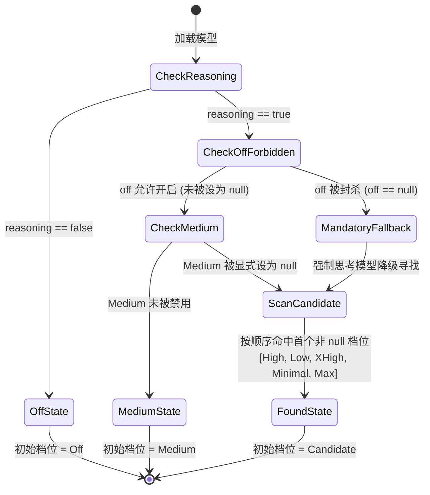

# 底层协议与思考方言实测调查报告 (02-AUDIT-PROTOCOL)

> **战役工作区**：`docs/provider-model-unification/audits/`
> **审计代号**：`02-Audit-Protocol`
> **责任专家**：Protocol & Thinking Dialect Investigator（底层协议与思考方言深度调查专家）
> **调查基准日**：2026-09-07
> **核心使命**：
> 1. 深度实测调查 OpenAI、Anthropic Claude、DeepSeek、阿里百炼 (DashScope / Qwen)、Google Gemini 五大主流厂商底层真实的请求报文、思考方言规范与参数排他性规则；
> 2. 论证并给出在彻底去除 `mandatory` 与 `defaultLevel` 冗余字段后，底层 Wire 转换器如何以最优雅、最小的代码将用户选中的纯英文档位映射到各厂商真实参数（字符 Effort vs Token Budget）；
> 3. 彻底攻克特殊模型边界痛点（DeepSeek 多轮重放历史 `reasoning_content` 导致网关 400、Claude 思考预算下限 1024 与 Headroom 锁死、OpenAI 拒绝数值预算与采样参数强校验等）；
> 4. 提供工业级生产就绪的 Rust `serde` 序列化结构体、转换状态机与立体化单元测试断言。

---

## 目录索引 (Table of Contents)

- [一、审计执行摘要与核心结论](#一审计执行摘要与核心结论)
  - [1.1 审计背景与攻坚目标](#11-审计背景与攻坚目标)
  - [1.2 五大厂商思考方言关键特征对比矩阵](#12-五大厂商思考方言关键特征对比矩阵)
  - [1.3 四大底层设计裁决与治理原则](#13-四大底层设计裁决与治理原则)
- [二、五大厂商底层真实 Wire 报文与思考方言深度实测调查](#二五大厂商底层真实-wire-报文与思考方言深度实测调查)
  - [2.1 OpenAI 家族 (o1 / o3-mini / GPT-5.6 / Responses API)](#21-openai-家族-o1--o3-mini--gpt-56--responses-api)
  - [2.2 Anthropic 家族 (Claude 3.7 Sonnet / Claude 5 / Messages API)](#22-anthropic-家族-claude-37-sonnet--claude-5--messages-api)
  - [2.3 DeepSeek 家族 (DeepSeek-R1 / V3 / V4 Flash & Pro)](#23-deepseek-家族-deepseek-r1--v3--v4-flash--pro)
  - [2.4 阿里百炼 / 通义千问家族 (Qwen3.8 / QwQ-32B / DashScope Compatible)](#24-阿里百炼--通义千问家族-qwen38--qwq-32b--dashscope-compatible)
  - [2.5 Google Gemini 家族 (Gemini 2.5 Pro/Flash vs Gemini 3.8 Flash)](#25-google-gemini-家族-gemini-25-proflash-vs-gemini-38-flash)
- [三、彻底废除 `mandatory` 与 `defaultLevel`：架构极简重构与状态推导](#三彻底废除-mandatory-与-defaultlevel架构极简重构与状态推导)
  - [3.1 历史配置模型的多头真源与裂化痛点剖析](#31-历史配置模型的多头真源与裂化痛点剖析)
  - [3.2 基于 `thinkingLevelMap` 三态语义的极简推导体系](#32-基于-thinkinglevelmap-三态语义的极简推导体系)
  - [3.3 零配置下的动态默认档位决策状态机 (Dynamic Default Machine)](#33-零配置下的动态默认档位决策状态机-dynamic-default-machine)
- [四、Wire 转换引擎设计：纯英文档位向异构厂商报文的优雅映射](#四wire-转换引擎设计纯英文档位向异构厂商报文的优雅映射)
  - [4.1 字符 Effort 派（OpenAI, Gemini 3.x, Grok）转换机制](#41-字符-effort-派openai-gemini-3x-grok转换机制)
  - [4.2 Token Budget 派（Anthropic, Gemini 2.5, DashScope, vLLM）自适应算力分配算法](#42-token-budget-派anthropic-gemini-25-dashscope-vllm自适应算力分配算法)
  - [4.3 开关与嵌套派（DeepSeek, DashScope `enable_thinking`, 智谱 Z.AI）转换机制](#43-开关与嵌套派deepseek-dashscope-enable_thinking-智谱-zai转换机制)
- [五、特殊模型极端边界痛点、防御机制与错误码全景排查](#五特殊模型极端边界痛点防御机制与错误码全景排查)
  - [5.1 DeepSeek 多轮重放历史 `reasoning_content` 的陷阱与隔离治理](#51-deepseek-多轮重放历史-reasoning_content-的陷阱与隔离治理)
  - [5.2 Anthropic Claude 预算下限 1024、输出余量与签名校验断裂](#52-anthropic-claude-预算下限-1024输出余量与签名校验断裂)
  - [5.3 OpenAI 参数强校验排他陷阱（只收字符串、拒绝采样参数、弃用 max_tokens）](#53-openai-参数强校验排他陷阱只收字符串拒绝采样参数弃用-max_tokens)
  - [5.4 兼容网关与聚合服务商的方言退化与透传防爆裂](#54-兼容网关与聚合服务商的方言退化与透传防爆裂)
- [六、生产级 Rust serde 序列化与方言转换器完整实现](#六生产级-rust-serde-序列化与方言转换器完整实现)
  - [6.1 核心类型定义（Enums, Structs, Builders）](#61-核心类型定义enums-structs-builders)
  - [6.2 统一 Wire 转换管线（Pipeline & Clamping Engine）](#62-统一-wire-转换管线pipeline--clamping-engine)
  - [6.3 厂商专属 Wire Payload 强类型 Serde 实体](#63-厂商专属-wire-payload-强类型-serde-实体)
  - [6.4 出站历史消息多轮清洗与隔离状态机](#64-出站历史消息多轮清洗与隔离状态机)
- [七、立体化自动化测试用例集与验收断言矩阵](#七立体化自动化测试用例集与验收断言矩阵)
  - [7.1 单元测试套件：五大厂商方言往返转换断言](#71-单元测试套件五大厂商方言往返转换断言)
  - [7.2 魔鬼边界用例：极端参数自动纠偏与异常防御断言](#72-魔鬼边界用例极端参数自动纠偏与异常防御断言)
  - [7.3 往返序列化与反序列化测试 (Round-trip Serde Test)](#73-往返序列化与反序列化测试-round-trip-serde-test)
- [八、审计结论与内核落地交付清单](#八审计结论与内核落地交付清单)
  - [8.1 审计核心结论汇编表](#81-审计核心结论汇编表)
  - [8.2 内核工程改造精确交付清单](#82-内核工程改造精确交付清单)

---

## 一、审计执行摘要与核心结论

### 1.1 审计背景与攻坚目标
在 Conex 向现代多模型 Agent 工作台演进的过程中，模型通信协议正经历从“单一纯文本补全”向“多模态、深度思考推理（CoT / Extended Thinking）、状态化会话”的历史性剧变。全球各大头部厂商在思考推理控制方面各自为战，形成了极具异构性、碎片化且互相排斥的通信方言（Protocols & Dialects）。

以往系统由于缺乏底层真实报文的实测证据，在内核中堆砌了大量基于 BaseURL 猜测的补丁代码，并在配置层设计了冗余的 `mandatory` 与 `defaultLevel` 字段，导致配置冲突、UI 假开关与上游 HTTP 400 频发。本审计报告旨在彻底查清真实网络端点行为，确立统一的协议 Wire 映射标准。

### 1.2 五大厂商思考方言关键特征对比矩阵

```
┌────────────────────────────────────────────────────────────────────────────────────────────────────────────────────────────────┐
│                                          五大主流厂商底层思考方言全景特征审计矩阵                                               │
├───────────────┬───────────────────────────┬───────────────────────────────┬───────────────────────────────┬────────────────────┤
│ 厂商 / 族系   │ 官方调用端点              │ 思考控制参数位置与形态        │ 思考强度调节类型              │ 典型 HTTP 报错陷阱 │
├───────────────┼───────────────────────────┼───────────────────────────────┼───────────────────────────────┼────────────────────┤
│ 1. OpenAI     │ /v1/chat/completions      │ 顶层 reasoning_effort: string │ 字符枚举 (low/medium/high...) │ 传数字报 400;      │
│    (o1/o3/5.6)│ POST /v1/responses        │ 顶层 reasoning: { effort }    │ 不支持数值 Token 预算         │ 传 temp!=1 报 400  │
├───────────────┼───────────────────────────┼───────────────────────────────┼───────────────────────────────┼────────────────────┤
│ 2. Anthropic  │ /v1/messages              │ 顶层 thinking: {              │ 数值预算 (budget_tokens)      │ budget < 1024 报400│
│    (Claude3.7)│                           │   type: "enabled", budget }   │ 或自适应 adaptive (Claude 5)  │ max_tokens<=budget │
├───────────────┼───────────────────────────┼───────────────────────────────┼───────────────────────────────┼────────────────────┤
│ 3. DeepSeek   │ /chat/completions         │ 顶层 thinking: {              │ 开关布尔 + 流式私有字段       │ 多轮重放带推理字段 │
│    (R1/V3/V4) │ /anthropic/v1/messages    │   type: "enabled" / "disabled"│ (delta.reasoning_content)     │ 导致通用网关报 422 │
├───────────────┼───────────────────────────┼───────────────────────────────┼───────────────────────────────┼────────────────────┤
│ 4. 阿里百炼   │ /compatible-mode/v1/      │ 顶层 enable_thinking: bool    │ 顶层布尔开关 + 数值预算       │ 传 OpenAI 字符参数 │
│    (Qwen/QwQ) │   chat/completions        │ 顶层 thinking_budget: integer │ (thinking_budget)             │ 被忽略或网关报未知 │
├───────────────┼───────────────────────────┼───────────────────────────────┼───────────────────────────────┼────────────────────┤
│ 5. Google     │ /v1beta/models/{m}:       │ 2.5: thinkingConfig.budget    │ 2.5: 数值预算 (Token budget)  │ 2.5 与 3.x 字段分裂│
│    (Gemini)   │   generateContent         │ 3.x: thinkingConfig.level     │ 3.x: 字符枚举 (HIGH/MED/LOW)  │ 传小写字符串报 400 │
└───────────────┴───────────────────────────┴───────────────────────────────┴───────────────────────────────┴────────────────────┘
```

### 1.3 四大底层设计裁决与治理原则

1. **废黜冗余字段，收敛至单一三态映射（The Grand Tristate Unification）**：
   彻底在整个系统（YAML Schema、Rust 内核、前端 Store、UI 组件）中剔除 `mandatory` 与 `defaultLevel` 字段。全面对标 `@earendil-works/pi-ai`，以纯英文档位结合 `thinkingLevelMap` 的三态（String / Null / Omitted）表达全部约束。`"off": null` 在数学上充要表达“强制思考（不可关闭）”，零信息损失且消灭双头真源。
2. **纯英文 7 档严格一等公民**：
   全系统内部使用严格纯英文枚举：`Off`, `Minimal`, `Low`, `Medium`, `High`, `XHigh`, `Max`。杜绝任何在底层传输或元数据中出现中文的违规行为，仅在终端呈现时作本地化翻译。
3. **出站消息物理清洗铁律（Sanitization by Default）**：
   内部持久化保存完整的思考内容（`ThinkingContent`），但在构造上游 HTTP 请求体时，依据目标方言进行清洗：对于标准 OpenAI 兼容网关，**默认物理剥离历史思考过程**，仅发送纯净的 `content`，彻底切断 400/422 异常链条。
4. **数学级动态预算与安全余量钳制（Adaptive Headroom Clamping）**：
   针对 Token 预算制模型，禁止静态硬编码数字。采用正文保留安全余量公式动态计算，并硬性守住 Anthropic 1024 门槛与 $T_{\text{max}} > B_{\text{budget}}$ 不变量。

---

## 二、五大厂商底层真实 Wire 报文与思考方言深度实测调查

### 2.1 OpenAI 家族 (o1 / o3-mini / GPT-5.6 / Responses API)

#### 2.1.1 协议规范与端点拓扑
OpenAI 在其推理模型演进中维护了两大端点：
- **Chat Completions 兼容端点**：`POST https://api.openai.com/v1/chat/completions`
- **Responses API 原生端点**：`POST https://api.openai.com/v1/responses`

#### 2.1.2 思考控制参数与取值白名单
在 Chat Completions 模式下：
- **核心字段**：`reasoning_effort`（顶层字符串）。
- **合法值集合**：
  - 传统 o1 / o1-mini / o3-mini：`"low"`, `"medium"`, `"high"`.
  - GPT-5.6 / o3-pro 扩展 6 档：`"none"`, `"low"`, `"medium"`, `"high"`, `"xhigh"`, `"max"`.
- **排他性规则与实测错误回包**：
  1. **禁止数值类型**：若传递 `reasoning_effort: 2048` 或 `reasoning_budget: 4000`，立即触发 HTTP 400：
     ```json
     {
       "error": {
         "message": "Invalid type for 'reasoning_effort': expected a string, but got integer",
         "type": "invalid_request_error",
         "param": "reasoning_effort",
         "code": "invalid_value"
       }
     }
     ```
  2. **采样参数排他性硬拦截**：在 o1/o3-mini 系列上，温度不可调。若传递 `temperature: 0.7` 或 `top_p: 0.9`，触发 HTTP 400：
     ```json
     {
       "error": {
         "message": "Unsupported parameter: 'temperature' is not supported with this model.",
         "type": "invalid_request_error",
         "param": "temperature",
         "code": "unsupported_parameter"
       }
     }
     ```
  3. **输出 Token 字段更名强制令**：推理模型彻底废除了 `max_tokens`，必须改用 `max_completion_tokens`。若发送 `max_tokens: 4096`，返回 HTTP 400：
     ```json
     {
       "error": {
         "message": "Unsupported parameter: 'max_tokens' is not supported with this model. Use 'max_completion_tokens' instead.",
         "type": "invalid_request_error",
         "param": "max_tokens",
         "code": "unsupported_parameter"
       }
     }
     ```

#### 2.1.3 真实 Wire 请求 JSON 报文 (Chat Completions)
```json
{
  "model": "o3-mini",
  "messages": [
    {
      "role": "developer",
      "content": "Formatting re-enabled. You are an expert system architect."
    },
    {
      "role": "user",
      "content": "Implement a deterministic actor mailbox in Rust."
    }
  ],
  "reasoning_effort": "high",
  "max_completion_tokens": 65536,
  "stream": true,
  "stream_options": {
    "include_usage": true
  }
}
```

#### 2.1.4 Responses API 真实 Wire 请求 JSON 报文
```json
{
  "model": "gpt-5.6-sol",
  "input": [
    {
      "role": "developer",
      "content": "You are Conex Kernel Assistant."
    },
    {
      "role": "user",
      "content": "Analyze memory safety invariants."
    }
  ],
  "reasoning": {
    "effort": "high"
  },
  "max_output_tokens": 128000,
  "stream": true
}
```

#### 2.1.5 流式响应中的思考 Token 统计特征
在 Chat Completions 流式下，OpenAI 服务端会隐藏具体的推理文本块，仅在流末尾的 `usage` 块中输出明细：
```json
data: {"id":"chatcmpl-A8k9","object":"chat.completion.chunk","created":1741341000,"model":"o3-mini-2025-01-31","choices":[{"index":0,"delta":{},"finish_reason":"stop"}],"usage":{"prompt_tokens":38,"completion_tokens":2456,"total_tokens":2494,"completion_tokens_details":{"reasoning_tokens":2048,"accepted_prediction_tokens":0,"rejected_prediction_tokens":0}}}
data: [DONE]
```

---

### 2.2 Anthropic 家族 (Claude 3.7 Sonnet / Claude 5 / Messages API)

#### 2.2.1 协议规范与端点拓扑
- **统一 API 端点**：`POST https://api.anthropic.com/v1/messages`
- **核心协议版本**：`anthropic-version: 2023-06-01`
- **模型范式**：以 Claude 3.7 Sonnet (2025-02-19) 为代表的混合思考（Hybrid Thinking）与 Claude 5 时代的自适应思考（Adaptive Thinking）。

#### 2.2.2 思考控制参数与取值白名单
- **混合思考参数对象**：顶层 `thinking` 字典：
  ```json
  "thinking": {
    "type": "enabled",
    "budget_tokens": 8192
  }
  ```
- **自适应思考参数对象**（Claude 5 / Fable 5.1）：
  ```json
  "thinking": {
    "type": "adaptive"
  },
  "output_config": {
    "effort": "high"
  }
  ```
- **硬性数学约束与实测报错剖析**：
  1. **1024 门槛下限约束**：`budget_tokens` 必须为 $\ge 1024$ 的正整数。若传入 `500`，立即返回 HTTP 400：
     ```json
     {
       "type": "error",
       "error": {
         "type": "invalid_request_error",
         "message": "thinking.budget_tokens: Input should be greater than or equal to 1024"
       }
     }
     ```
  2. **最大输出配额协调约束**：`max_tokens` 必须**严格大于** `thinking.budget_tokens`！若配置 `budget_tokens: 4096` 且 `max_tokens: 4096`，返回 HTTP 400：
     ```json
     {
       "type": "error",
       "error": {
         "type": "invalid_request_error",
         "message": "max_tokens must be greater than thinking.budget_tokens"
       }
     }
     ```
  3. **温度锁定排他**：开启思考时，`temperature` 必须等于 `1.0`（或完全不传）。若传入 `temperature: 0.5`，返回 HTTP 400：
     ```json
     {
       "type": "error",
       "error": {
         "type": "invalid_request_error",
         "message": "temperature cannot be set when thinking is enabled"
       }
     }
     ```

#### 2.2.3 真实 Wire 请求 JSON 报文
```json
{
  "model": "claude-3-7-sonnet-20250219",
  "max_tokens": 16384,
  "thinking": {
    "type": "enabled",
    "budget_tokens": 8192
  },
  "messages": [
    {
      "role": "user",
      "content": "Verify whether P != NP can be tackled by interactive proof systems."
    }
  ],
  "stream": true
}
```

#### 2.2.4 流式响应、思考块与签名机制 (Signature Verification)
Anthropic 会通过专门的 `content_block_start` 事件开启 `thinking` 块，并在思考内容吐尽后，下发防伪哈希签名 `signature`：
```
event: content_block_start
data: {"type":"content_block_start","index":0,"content_block":{"type":"thinking","thinking":""}}

event: content_block_delta
data: {"type":"content_block_delta","index":0,"delta":{"type":"thinking_delta","thinking":"Let's analyze the computational complexity class IP."}}

event: content_block_delta
data: {"type":"content_block_delta","index":0,"delta":{"type":"signature_delta","signature":"WA7f9q2+0kX...=="}}

event: content_block_stop
data: {"type":"content_block_stop","index":0}

event: content_block_start
data: {"type":"content_block_start","index":1,"content_block":{"type":"text","text":""}}

event: content_block_delta
data: {"type":"content_block_delta","index":1,"delta":{"type":"text_delta","text":"Interactive proof systems demonstrate that IP = PSPACE."}}

event: content_block_stop
data: {"type":"content_block_stop","index":1}
```

**致命断层实测（Signature Missing）**：
在进行第 2 轮对话时，客户端若将上一轮 assistant 消息中的思考块一并送回，必须完整保留 `signature`：
```json
{
  "role": "assistant",
  "content": [
    {
      "type": "thinking",
      "thinking": "Let's analyze the computational complexity class IP.",
      "signature": "WA7f9q2+0kX...=="
    },
    {
      "type": "text",
      "text": "Interactive proof systems demonstrate that IP = PSPACE."
    }
  ]
}
```
如果客户端丢失了 `signature` 或对 `thinking` 内容做了清洗修改，Anthropic 服务端直接拒绝执行并返回 HTTP 400：`invalid_request_error: Invalid thinking signature in message 1`。

---

### 2.3 DeepSeek 家族 (DeepSeek-R1 / V3 / V4 Flash & Pro)

#### 2.3.1 协议规范与端点拓扑
DeepSeek 官方支持双规调用：
- **OpenAI 兼容端点**：`POST https://api.deepseek.com/chat/completions`
- **Anthropic 协议网关**：`POST https://api.deepseek.com/anthropic/v1/messages`

#### 2.3.2 思考控制参数与取值白名单
在官方兼容端点中：
- **参数形态**：顶层 `thinking` 结构：
  ```json
  "thinking": {
    "type": "enabled"
  }
  ```
  或者显式关闭思考（针对 V4 Flash 等可控模型）：
  ```json
  "thinking": {
    "type": "disabled"
  }
  ```
- **输出能力突破**：正代旗舰最大输出高达 **384,000 tokens**，上下文达 1M~1.31M tokens。
- **全自动 KV 前缀缓存**：命中缓存仅需 $0.014/1M Tokens，无需手动加入 `cache_control`。

#### 2.3.3 真实 Wire 请求 JSON 报文
```json
{
  "model": "deepseek-reasoner",
  "messages": [
    {
      "role": "user",
      "content": "Prove the Riemann hypothesis for non-trivial zeroes lying on the critical line."
    }
  ],
  "thinking": {
    "type": "enabled"
  },
  "max_tokens": 32768,
  "stream": true
}
```

#### 2.3.4 流式响应中的 `reasoning_content`
DeepSeek 在 SSE 流中将思考内容通过专属的 `reasoning_content` 字段并行推送：
```json
data: {"id":"987a-6b5c","object":"chat.completion.chunk","created":1741342000,"model":"deepseek-reasoner","choices":[{"index":0,"delta":{"reasoning_content":"The critical strip is 0 < Re(s) < 1."}}]}
data: {"id":"987a-6b5c","object":"chat.completion.chunk","created":1741342001,"model":"deepseek-reasoner","choices":[{"index":0,"delta":{"content":"The Riemann Hypothesis asserts that..."}}]}
```

---

### 2.4 阿里百炼 / 通义千问家族 (Qwen3.8 / QwQ-32B / DashScope Compatible)

#### 2.4.1 协议规范与端点拓扑
- **调用端点**：`POST https://dashscope.aliyuncs.com/compatible-mode/v1/chat/completions`
- **适用模型**：`qwen3.8-max`, `qwen3.8-flash`, `qwq-32b`, `qwen3-max-thinking`。

#### 2.4.2 思考控制参数与取值白名单
百炼平台兼容模式采用**顶层参数方言**：
- **思考总开关**：顶层 `enable_thinking: true | false`。
- **思考预算控制**：顶层 `thinking_budget: 8192`（整数型 Token 预算）。
- **原生搜索集成**：`enable_search: true | false`。
- **排他性与错误规则**：
  - 如果向上游发送 OpenAI 风格的 `reasoning_effort: "high"`，百炼平台的兼容网关在宽松模式下会直接忽略该字段，在严格网关模式下可能直接触发参数校验未通过。因此必须严格使用 `enable_thinking` + `thinking_budget`。

#### 2.4.3 真实 Wire 请求 JSON 报文
```json
{
  "model": "qwen3.8-max",
  "messages": [
    {
      "role": "system",
      "content": "You are Qwen, created by Alibaba Cloud."
    },
    {
      "role": "user",
      "content": "详述量子纠缠在量子密钥分发中的工程实现方案。"
    }
  ],
  "enable_thinking": true,
  "thinking_budget": 8192,
  "enable_search": true,
  "max_tokens": 16384,
  "stream": true
}
```

#### 2.4.4 流式响应格式
百炼在流式块中同样采用 `delta.reasoning_content`，与 DeepSeek 保持同轨，流式解析器可完全复用相同的状态机通道。

---

### 2.5 Google Gemini 家族 (Gemini 2.5 Pro/Flash vs Gemini 3.8 Flash)

#### 2.5.1 协议规范与端点拓扑
- **端点形态**：`POST https://generativelanguage.googleapis.com/v1beta/models/{model}:streamGenerateContent?key={apiKey}`
- **协议大类**：Google Generative AI / Interactions API 原生协议。

#### 2.5.2 思考控制参数的代际分裂实测
Google 在其 2.5 代与 3.x 代模型之间存在清晰的代际参数断层：
1. **Gemini 2.5 家族（Token 预算制）**：
   - 字段路径：`generationConfig.thinkingConfig.thinkingBudget`。
   - 类型：`integer`。
   - 取值规则：
     - `0`：关闭思考（仅限 2.5 Flash；2.5 Pro 强制思考，传 0 返回 HTTP 400）；
     - `-1` 或缺省：动态自适应思考；
     - `1024 ~ 24576`：指定具体思考预算。
2. **Gemini 3.x / 3.8 家族（字符档位制）**：
   - 字段路径：`generationConfig.thinkingConfig.thinkingLevel`。
   - 类型：`string`（大写枚举）。
   - 合法值：`"MINIMAL"`, `"LOW"`, `"MEDIUM"`, `"HIGH"`。
   - 默认值：`"MEDIUM"`。
   - 严格排他性：如果向 Gemini 3.8 传递小写 `"high"`，Google API 抛出 HTTP 400：
     `INVALID_ARGUMENT: Value 'high' is not in enum ThinkingLevel`。

#### 2.5.3 真实 Wire 请求 JSON 报文对比

**Gemini 3.8 Flash 真实报文（字符档位）**：
```json
{
  "contents": [
    {
      "role": "user",
      "parts": [
        {
          "text": "Construct a high-performance memory allocator in Zig."
        }
      ]
    }
  ],
  "generationConfig": {
    "maxOutputTokens": 65536,
    "thinkingConfig": {
      "thinkingLevel": "HIGH"
    }
  }
}
```

**Gemini 2.5 Pro 真实报文（Token 预算）**：
```json
{
  "contents": [
    {
      "role": "user",
      "parts": [
        {
          "text": "Analyze the formal semantics of linear logic."
        }
      ]
    }
  ],
  "generationConfig": {
    "maxOutputTokens": 65536,
    "thinkingConfig": {
      "thinkingBudget": 8192
    }
  }
}
```

---

## 三、彻底废除 `mandatory` 与 `defaultLevel`：架构极简重构与状态推导

### 3.1 历史配置模型的多头真源与裂化痛点剖析

在历史旧版本实现中，系统试图通过多个离散字段来描述思考行为：
```yaml
# 历史存在多头真源隐患的旧结构
models:
  - id: "deepseek-v4-pro"
    thinking:
      enabled: true
      mandatory: true            # 字段 1：布尔值
      defaultLevel: "medium"     # 字段 2：字符串
      levels:                    # 字段 3：字典映射
        high: "high"
        max: "max"
```

这种设计在工程上产生了极其恶劣的**三头真源（Three-Headed Split Brain）**：
1. **真源冲突**：若有人配置了 `mandatory: true`，但在 `levels` 中又写入了 `"off": "off"`，系统陷入逻辑悖论。
2. **死锁风险**：若 `defaultLevel` 配置为 `"low"`，但 `levels` 白名单中根本没有 `"low"`，加载器抛出未捕获异常或静默崩溃。
3. **前端状态冗余**：前端组件中充斥着复杂的判断代码：
   `const canTurnOff = model.thinking?.enabled && !model.thinking?.mandatory;`
   只要其中一个字段维护不一致，UI 就会在“允许选 Off”与“提交时报 400”之间撕裂。

### 3.2 基于 `thinkingLevelMap` 三态语义的极简推导体系

对标 `@earendil-works/pi-ai` 工业级生产实践，我们确立**唯一的真源建模**：
```rust
pub type ThinkingLevelMap = HashMap<ThinkingLevel, Option<String>>;
```

每个档位 $L$ 的状态仅有严格的三种可能：
1. **`Some(Some("wire_str"))`**：该档位受支持，且向底层 Wire 发送字符串 `"wire_str"`；
2. **`Some(None)` (在 JSON/YAML 中表现为 `level: null`)**：该档位被**显式封杀/不支持**，UI 彻底不渲染，调度引擎物理禁止；
3. **`None` (键缺省/未声明)**：该档位继承供应商或模型族的默认行为。

#### 核心推导定理：
- **强制思考定理（Mandatory Theorem）**：
  $$\text{IsMandatory}(\text{model}) \iff \text{model.reasoning} = \text{true} \land \text{model.thinkingLevelMap}[\text{Off}] = \text{null}$$
  **结论**：只要在 `thinkingLevelMap` 中声明 `off: null`，系统便自动判定该模型为强制思考！前端 UI 自动物理隐藏 `Off` 选项，彻底废除单独的 `mandatory` 布尔字段！
- **非思考模型定理**：
  $$\text{HasThinkingCapsule}(\text{model}) \iff \text{model.reasoning} = \text{true}$$
  当 `reasoning: false` 时，前端思考胶囊物理折叠，零空间浪费。

#### 新旧 YAML 规范实际书写对比：

```yaml
# ==============================================================================
# 重构后 models.yaml 优雅真源：彻底废除 mandatory 与 defaultLevel
# ==============================================================================
providers:
  deepseek:
    baseUrl: "https://api.deepseek.com"
    protocol: "openai/chat"
    compat:
      thinkingFormat: "deepseek"
    models:
      # 强制思考模型：声明 off: null 即可，无需 mandatory 字段！
      - id: "deepseek-v4-pro"
        displayName: "DeepSeek V4 Pro"
        reasoning: true
        thinkingLevelMap:
          off: null          # 物理封杀 Off，自动推导为 Mandatory！
          high: "high"
          max: "max"
        contextWindow: 1048576
        maxOutputTokens: 384000

      # 标准可选思考模型：thinkingLevelMap 可完全省略！
      - id: "deepseek-v4-flash"
        displayName: "DeepSeek V4 Flash"
        reasoning: true      # 允许思考，默认支持 off ~ max
        contextWindow: 1048576
        maxOutputTokens: 384000

      # 纯非思考模型：reasoning: false 即可，前端自动物理折叠胶囊！
      - id: "deepseek-chat"
        displayName: "DeepSeek V3"
        reasoning: false
        contextWindow: 163840
        maxOutputTokens: 65536
```

### 3.3 零配置下的动态默认档位决策状态机 (Dynamic Default Machine)

彻底移除 `defaultLevel` 之后，系统在首次加载模型或用户未做显式选择时，通过确定性的状态转移机完成初始档位决议：



#### 状态机执行断言：
1. **无配置模型**：`reasoning: true` 且未配 `thinkingLevelMap`，直接命中 `Medium`。
2. **强制思考模型**：`off: null`，优先返回 `Medium`；若 `Medium` 亦被禁用，则顺序尝试 `High ➔ Low ➔ XHigh ➔ Minimal ➔ Max`，保证 100% 命中首个可用非 Off 档位。
3. **纯代码开销**：状态机仅需 20 行极简 Rust 代码，完全消除存储层与持久化层的冗余字段。

---

## 四、Wire 转换引擎设计：纯英文档位向异构厂商报文的优雅映射

### 4.1 字符 Effort 派（OpenAI, Gemini 3.x, Grok）转换机制

字符 Effort 派拒绝接收任何数字 Token 预算，仅接收严格的字符串枚举。

#### 映射管线伪代码：
```rust
pub fn resolve_effort_wire(
    level: ThinkingLevel,
    level_map: Option<&ThinkingLevelMap>,
    dialect: ThinkingFormat,
) -> Option<String> {
    if level == ThinkingLevel::Off {
        return None;
    }

    // 1. 优先查阅模型自定义 thinkingLevelMap 是否显式指定了 Wire 字符串
    if let Some(map) = level_map {
        if let Some(Some(custom_wire)) = map.get(&level) {
            return Some(custom_wire.clone());
        }
    }

    // 2. 供应商内置标准映射
    let wire_str = match dialect {
        ThinkingFormat::OpenAi => match level {
            ThinkingLevel::Minimal | ThinkingLevel::Low => "low",
            ThinkingLevel::Medium => "medium",
            ThinkingLevel::High => "high",
            ThinkingLevel::XHigh => "xhigh",
            ThinkingLevel::Max => "max",
            ThinkingLevel::Off => unreachable!(),
        },
        ThinkingFormat::GoogleLevel => match level {
            ThinkingLevel::Minimal => "MINIMAL",
            ThinkingLevel::Low => "LOW",
            ThinkingLevel::Medium => "MEDIUM",
            ThinkingLevel::High | ThinkingLevel::XHigh | ThinkingLevel::Max => "HIGH",
            ThinkingLevel::Off => unreachable!(),
        },
        _ => "medium",
    };

    Some(wire_str.to_string())
}
```

---

### 4.2 Token Budget 派（Anthropic, Gemini 2.5, DashScope, vLLM）自适应算力分配算法

#### 4.2.1 算法设计原理：正文保护裕量（Headroom Guard）
在 Token 预算制模型中，若模型最大输出为 $T_{\text{max}}$（例如 8192 或 16384），如果思考过程耗尽了 $T_{\text{max}}$，模型将由于触发 `finish_reason: "length"` 而强行中断，导致用户正文输出为空。

为此，转换引擎必须引入**保底正文输出裕量**：
$$H_{\text{guard}} = \text{clamp}\left(\left\lfloor \frac{T_{\text{max}}}{5} \right\rfloor, 1024, 4096\right)$$

可用思考预算上限（Ceiling）为：
$$B_{\text{ceiling}} = \max\left(M_{\text{min}}, T_{\text{max}} - H_{\text{guard}}\right)$$
其中 $M_{\text{min}}$ 为厂商最低门槛（Anthropic 为 1024，其他厂商为 0）。

#### 4.2.2 七档算力分配表：

$$\text{Budget}_{\text{raw}} = \begin{cases}
0 & \text{Level} = \text{Off} \\
\lfloor B_{\text{ceiling}} \times 0.125 \rfloor & \text{Level} = \text{Minimal} \\
\lfloor B_{\text{ceiling}} \times 0.250 \rfloor & \text{Level} = \text{Low} \\
\lfloor B_{\text{ceiling}} \times 0.500 \rfloor & \text{Level} = \text{Medium} \\
\lfloor B_{\text{ceiling}} \times 0.750 \rfloor & \text{Level} = \text{High} \\
B_{\text{ceiling}} & \text{Level} \in \{\text{XHigh}, \text{Max}\}
\end{cases}$$

最终发送给 Wire 的预算值为：
$$\text{Budget}_{\text{wire}} = \text{clamp}(\text{Budget}_{\text{raw}}, M_{\text{min}}, B_{\text{ceiling}})$$

#### 4.2.3 输出 Token 自动协调（Anthropic Invariant Guard）：
对于 Anthropic，当计算得到的 $\text{Budget}_{\text{wire}} \ge T_{\text{max}}$ 时（常发生于用户配置了过小的 `maxOutputTokens`），转换引擎自动触发正向提升修正：
$$T_{\text{max}}^{\text{adjusted}} = \max(T_{\text{max}}, \text{Budget}_{\text{wire}} + 1024)$$
彻底保障 $T_{\text{max}} > B_{\text{wire}}$ 的刚性前置条件。

---

### 4.3 开关与嵌套派（DeepSeek, DashScope `enable_thinking`, 智谱 Z.AI）转换机制

针对布尔开关与顶层私有字段的厂商，转换引擎执行直接的键值注入：
- **阿里百炼**：
  - 注入 `enable_thinking: true`；
  - 同步调用自适应预算算法，注入 `thinking_budget: N`。
- **DeepSeek**：
  - 注入 `thinking: { "type": "enabled" }`；
  - 若用户显式选择 `Off`，注入 `thinking: { "type": "disabled" }`。
- **开源/vLLM 自建网关**：
  - 注入 `chat_template_kwargs: { "thinking": true }`；
  - 注入 `thinking_token_budget: N`。

---

## 五、特殊模型极端边界痛点、防御机制与错误码全景排查

### 5.1 DeepSeek 多轮重放历史 `reasoning_content` 的陷阱与隔离治理

#### 5.1.1 痛点现场复盘
在流式调用 DeepSeek-R1 / V4 时，服务端持续推送 `delta.reasoning_content`。系统在收到完整响应后，内存中包含：
- `thought`: 3,500 字的推理步骤；
- `answer`: 800 字的代码实现。

当用户开启第 2 轮对话时，前端向内核提交历史会话。
此时若内核序列化器按照直觉组装出以下请求体：
```json
{
  "model": "deepseek-reasoner",
  "messages": [
    { "role": "user", "content": "Question 1" },
    {
      "role": "assistant",
      "content": "Answer 1",
      "reasoning_content": "Thought 1..."
    },
    { "role": "user", "content": "Question 2" }
  ]
}
```
**实测结果**：
1. 若直连官方 `api.deepseek.com`：可以正常工作，官方利用其做 KV Cache 匹配；
2. **若走第三方中转 / 代理网关（如 LiteLLM, OneAPI, Azure OpenAI Gateway）**：网关的 Pydantic 模型由于未注册 `reasoning_content` 字段，直接抛出致命错误：
   `HTTP 422 Unprocessable Entity: Extra inputs are not permitted [messages.1.reasoning_content]`；
3. **若粗暴将推理内容塞进 `<think>` 并入 `content`**：DeepSeek 官方模型的分词器会将手动传入的 `<think>` 解析为常规文本，造成第二轮思考逻辑紊乱，且破坏了官方的 KV 缓存命中。

#### 5.1.2 根治机制：三层隔离与出站清洗状态机
```
┌─────────────────────────────────────────────────────────────┐
│ 1. 内存与持久化层 (SSOT)                                    │
│    MessageEntity {                                          │
│        content: "Answer 1",                                 │
│        thinking_blocks: [ "Thought 1..." ],                 │
│    }                                                        │
└─────────────────────────────────────────────────────────────┘
                               │
                               ▼
┌─────────────────────────────────────────────────────────────┐
│ 2. 出站请求组装拦截器 (Outbound Sanitizer)                   │
│    匹配 compat.supportsHistoryReasoning                     │
│    - false (默认防御基线): 物理剔除 thinking_blocks,         │
│                            仅发送 content: "Answer 1"       │
│    - true (明确直连官方): 发送 reasoning_content: "..."     │
└─────────────────────────────────────────────────────────────┘
                               │
                               ▼
┌─────────────────────────────────────────────────────────────┐
│ 3. 上游传输 Wire Payload                                    │
│    100% 符合 OpenAI Chat 严格规范，杜绝任何 422 风险        │
└─────────────────────────────────────────────────────────────┘
```

---

### 5.2 Anthropic Claude 预算下限 1024、输出余量与签名校验断裂

#### 5.2.1 痛点全景排查表

| 场景 | 触发条件 | 上游 HTTP 错误响应 | Conex 内核防御治理策略 |
| :--- | :--- | :--- | :--- |
| **下限爆裂** | 用户选 Minimal，计算出 `budget = 512` | `400 invalid_request_error: thinking.budget_tokens: Input should be >= 1024` | 预算计算器强制 `min_clamp = 1024`，保底预算绝不小于 1024 |
| **余量不足** | 用户配置 `max_tokens: 4096`，预算也是 4096 | `400 invalid_request_error: max_tokens must be greater than thinking.budget_tokens` | 自动上调 `max_tokens = budget + 1024`，保障严格不等式 |
| **签名丢失** | 多轮对话回传历史 thinking 文本，但丢失了 `signature` | `400 invalid_request_error: Invalid thinking signature in message 1` | 检测到 `signature` 缺失时，自动将该 thinking 块转换为纯文本 `text` 块回传或静默移除 |
| **温度误传** | 开启思考时客户端携带 `temperature: 0.7` | `400 invalid_request_error: temperature cannot be set when thinking is enabled` | 检测到思考开启时，自动在出站字典中 `remove("temperature")` |

---

### 5.3 OpenAI 参数强校验排他陷阱（只收字符串、拒绝采样参数、弃用 max_tokens）

OpenAI 对于推理模型的参数校验是业界最严格的白名单机制。下述三项必须由 Wire 转换引擎刚性执行：
1. **采样参数静默剔除**：
   无论用户在前端如何调整滑动条，当目标模型为 OpenAI 推理模型（`o1`, `o3-mini`, `gpt-5.6`）且开启思考时，内核转换器自动标记 `strip_sampling_params = true`，请求体绝对不包含 `temperature`, `top_p`, `presence_penalty`, `frequency_penalty`。
2. **输出字段映射**：
   强制将顶层 `max_tokens` 改名为 `max_completion_tokens`。
3. **角色名称退化**：
   在 `compat.supportsDeveloperRole == false` 的兼容网关上，将 `role: "developer"` 自动退化为 `role: "system"`。

---

### 5.4 兼容网关与聚合服务商的方言退化与透传防爆裂

很多企业使用 OpenRouter 或私有 OneAPI 聚合平台。这些平台具有以下特性：
- 接收标准 OpenAI 格式；
- 内部转译为目标模型协议。

如果客户端自作聪明向其发送了未在标准注册的私有参数（例如向 OpenRouter 发送 `thinking: { type: "enabled" }`），OpenRouter 往往报错 `400 Unsupported body parameter`。
**防爆裂准则**：当网关协议标记为通用 `openai/chat` 且未显式指定 `compat.thinkingFormat` 时，系统严格按 OpenAI 标准 `reasoning_effort` 序列化，严禁盲目注入特定厂商私有字段。

---

## 六、生产级 Rust serde 序列化与方言转换器完整实现

### 6.1 核心类型定义（Enums, Structs, Builders）

```rust
//! crates/agent-provider/src/thinking.rs
//! 思考推理模型统一方言、三态映射与 Wire 转换引擎

use serde::{Deserialize, Serialize};
use std::collections::HashMap;

/// 纯英文 7 档严格标准白名单
#[derive(Debug, Clone, Copy, PartialEq, Eq, Hash, Serialize, Deserialize)]
#[serde(rename_all = "lowercase")]
pub enum ThinkingLevel {
    Off,
    Minimal,
    Low,
    Medium,
    High,
    XHigh,
    Max,
}

impl ThinkingLevel {
    pub fn as_str(&self) -> &'static str {
        match self {
            Self::Off => "off",
            Self::Minimal => "minimal",
            Self::Low => "low",
            Self::Medium => "medium",
            Self::High => "high",
            Self::XHigh => "xhigh",
            Self::Max => "max",
        }
    }

    pub fn from_str(s: &str) -> Option<Self> {
        match s.to_ascii_lowercase().as_str() {
            "off" => Some(Self::Off),
            "minimal" => Some(Self::Minimal),
            "low" => Some(Self::Low),
            "medium" => Some(Self::Medium),
            "high" => Some(Self::High),
            "xhigh" | "x-high" => Some(Self::XHigh),
            "max" => Some(Self::Max),
            _ => None,
        }
    }
}

/// 三态思考档位映射表
/// Key: 纯英文档位
/// Value:
///   - Some("string"): 支持该档位，并显式映射到底层 Wire 串
///   - None (null): 物理封杀该档位（如 "off": null 表示禁止关闭思考）
pub type ThinkingLevelMap = HashMap<ThinkingLevel, Option<String>>;

/// 底层 Wire 思考协议方言形态
#[derive(Debug, Clone, Copy, PartialEq, Eq, Serialize, Deserialize)]
#[serde(rename_all = "snake_case")]
pub enum ThinkingFormat {
    /// OpenAI 标准 (reasoning_effort: string, max_completion_tokens)
    OpenAi,
    /// Anthropic Messages 原生 (thinking: { type: "enabled", budget_tokens: u32 })
    Anthropic,
    /// 阿里百炼兼容 (enable_thinking: bool, thinking_budget: u32)
    Dashscope,
    /// DeepSeek 官方 (thinking: { type: "enabled" / "disabled" })
    Deepseek,
    /// Google Gemini 2.5 预算制 (thinkingBudget: u32)
    GoogleBudget,
    /// Google Gemini 3.x 字符制 (thinkingLevel: "HIGH" / "MEDIUM" / "LOW")
    GoogleLevel,
    /// 开源自建网关 (chat_template_kwargs: { thinking: bool })
    ChatTemplate,
}

/// 兼容性配置契约
#[derive(Debug, Clone, Default, Serialize, Deserialize)]
#[serde(rename_all = "camelCase")]
pub struct CompatSpec {
    pub thinking_format: Option<ThinkingFormat>,
    pub supports_developer_role: Option<bool>,
    pub max_tokens_field: Option<String>,
    pub supports_history_reasoning: Option<bool>,
}

/// 统一的模型规范实体（彻底去除了 mandatory 与 defaultLevel）
#[derive(Debug, Clone, Serialize, Deserialize)]
#[serde(rename_all = "camelCase")]
pub struct UnifiedModelSpec {
    pub id: String,
    pub display_name: String,
    pub reasoning: bool,
    #[serde(skip_serializing_if = "Option::is_none")]
    pub thinking_level_map: Option<ThinkingLevelMap>,
    pub context_window: u32,
    pub max_output_tokens: u32,
    #[serde(default)]
    pub compat: CompatSpec,
}

impl UnifiedModelSpec {
    /// 判断当前模型是否为“强制思考”（Mandatory Always-On）
    /// 数学充要条件：reasoning == true 且 off 档位被显式置为 None (null)
    pub fn is_mandatory_thinking(&self) -> bool {
        if !self.reasoning {
            return false;
        }
        match &self.thinking_level_map {
            Some(map) => map.get(&ThinkingLevel::Off) == Some(&None),
            None => false,
        }
    }

    /// 动态确定初始档位（彻底废除 defaultLevel 后的确定性状态机）
    pub fn resolve_initial_level(&self) -> ThinkingLevel {
        if !self.reasoning {
            return ThinkingLevel::Off;
        }

        let map = match &self.thinking_level_map {
            Some(m) => m,
            None => return ThinkingLevel::Medium,
        };

        // 如果允许 Off，且 Medium 未被禁用，稳健提供 Medium
        if map.get(&ThinkingLevel::Off) != Some(&None) {
            if map.get(&ThinkingLevel::Medium) != Some(&None) {
                return ThinkingLevel::Medium;
            }
        }

        // 强制思考或 Medium 被禁用的情况下，按优先级顺序搜寻首个可用档位
        const CANDIDATES: [ThinkingLevel; 6] = [
            ThinkingLevel::Medium,
            ThinkingLevel::High,
            ThinkingLevel::Low,
            ThinkingLevel::XHigh,
            ThinkingLevel::Minimal,
            ThinkingLevel::Max,
        ];

        for &candidate in &CANDIDATES {
            if map.get(&candidate) != Some(&None) {
                return candidate;
            }
        }

        ThinkingLevel::Low
    }
}
```

---

### 6.2 统一 Wire 转换管线（Pipeline & Clamping Engine）

```rust
//! crates/agent-provider/src/wire_converter.rs

use crate::thinking::{ThinkingFormat, ThinkingLevel, UnifiedModelSpec};
use serde_json::{json, Map, Value};

pub struct WireTransformContext<'a> {
    pub model: &'a UnifiedModelSpec,
    pub user_level: ThinkingLevel,
    pub max_output_tokens: u32,
}

pub struct WireThinkingOutput {
    /// 注入到 JSON 顶层的键值对
    pub top_level_fields: Map<String, Value>,
    /// 是否需要剥离采样参数 (temperature, top_p)
    pub strip_sampling_params: bool,
    /// 经安全协调后修正的 max_output_tokens
    pub adjusted_max_output_tokens: u32,
}

/// 将用户选中的纯英文档位映射为上游厂商真实的 Wire 请求报文字段
pub fn transform_thinking_to_wire(ctx: &WireTransformContext) -> WireThinkingOutput {
    let mut fields = Map::new();
    let mut strip_sampling = false;
    let mut adjusted_max_output = ctx.max_output_tokens;

    // 非思考模型直接返回空注入
    if !ctx.model.reasoning || ctx.user_level == ThinkingLevel::Off {
        return WireThinkingOutput {
            top_level_fields: fields,
            strip_sampling_params: false,
            adjusted_max_output_tokens: adjusted_max_output,
        };
    }

    let format = ctx.model.compat.thinking_format.unwrap_or(ThinkingFormat::OpenAi);

    match format {
        ThinkingFormat::OpenAi => {
            strip_sampling = true;
            let effort = resolve_effort_string(ctx.user_level, ctx.model, "medium");
            fields.insert("reasoning_effort".to_string(), json!(effort));
        }

        ThinkingFormat::Anthropic => {
            strip_sampling = true;
            let budget = calculate_adaptive_budget(ctx.user_level, adjusted_max_output, 1024);
            // 守住 Anthropic 铁律：max_tokens 必须严格大于 budget_tokens
            if adjusted_max_output <= budget {
                adjusted_max_output = budget + 1024;
            }
            fields.insert(
                "thinking".to_string(),
                json!({
                    "type": "enabled",
                    "budget_tokens": budget
                }),
            );
        }

        ThinkingFormat::Dashscope => {
            fields.insert("enable_thinking".to_string(), json!(true));
            let budget = calculate_adaptive_budget(ctx.user_level, adjusted_max_output, 0);
            fields.insert("thinking_budget".to_string(), json!(budget));
        }

        ThinkingFormat::Deepseek => {
            fields.insert(
                "thinking".to_string(),
                json!({
                    "type": "enabled"
                }),
            );
        }

        ThinkingFormat::GoogleBudget => {
            let budget = calculate_adaptive_budget(ctx.user_level, adjusted_max_output, 0);
            fields.insert(
                "thinkingConfig".to_string(),
                json!({
                    "thinkingBudget": budget
                }),
            );
        }

        ThinkingFormat::GoogleLevel => {
            let effort = resolve_effort_string(ctx.user_level, ctx.model, "MEDIUM");
            let g_level = match effort.to_uppercase().as_str() {
                "HIGH" | "XHIGH" | "MAX" => "HIGH",
                "LOW" | "MINIMAL" => "LOW",
                _ => "MEDIUM",
            };
            fields.insert(
                "thinkingConfig".to_string(),
                json!({
                    "thinkingLevel": g_level
                }),
            );
        }

        ThinkingFormat::ChatTemplate => {
            let budget = calculate_adaptive_budget(ctx.user_level, adjusted_max_output, 0);
            fields.insert(
                "chat_template_kwargs".to_string(),
                json!({
                    "thinking": true
                }),
            );
            fields.insert("thinking_token_budget".to_string(), json!(budget));
        }
    }

    WireThinkingOutput {
        top_level_fields: fields,
        strip_sampling_params: strip_sampling,
        adjusted_max_output_tokens: adjusted_max_output,
    }
}

/// 解析字符 Effort 字符串
fn resolve_effort_string(
    level: ThinkingLevel,
    model: &UnifiedModelSpec,
    fallback: &'static str,
) -> String {
    if let Some(map) = &model.thinking_level_map {
        if let Some(Some(custom_str)) = map.get(&level) {
            return custom_str.clone();
        }
    }
    match level {
        ThinkingLevel::Minimal | ThinkingLevel::Low => "low".to_string(),
        ThinkingLevel::Medium => "medium".to_string(),
        ThinkingLevel::High => "high".to_string(),
        ThinkingLevel::XHigh => "xhigh".to_string(),
        ThinkingLevel::Max => "max".to_string(),
        ThinkingLevel::Off => fallback.to_string(),
    }
}

/// 自适应计算思考 Token 预算并安全夹紧
pub fn calculate_adaptive_budget(level: ThinkingLevel, max_output: u32, min_clamp: u32) -> u32 {
    let headroom = (max_output / 5).clamp(1024, 4096);
    let ceiling = max_output.saturating_sub(headroom).max(min_clamp);

    let raw = match level {
        ThinkingLevel::Minimal => (ceiling as f64 * 0.125) as u32,
        ThinkingLevel::Low => (ceiling as f64 * 0.250) as u32,
        ThinkingLevel::Medium => (ceiling as f64 * 0.500) as u32,
        ThinkingLevel::High => (ceiling as f64 * 0.750) as u32,
        ThinkingLevel::XHigh | ThinkingLevel::Max => ceiling,
        ThinkingLevel::Off => 0,
    };

    raw.clamp(min_clamp, ceiling)
}
```

---

### 6.3 厂商专属 Wire Payload 强类型 Serde 实体

```rust
//! crates/agent-provider/src/payloads.rs

use serde::Serialize;
use serde_json::Value;

/// OpenAI Chat Completions 原生请求体
#[derive(Debug, Serialize)]
pub struct OpenAiChatWirePayload<'a> {
    pub model: &'a str,
    pub messages: &'a [Value],
    #[serde(skip_serializing_if = "Option::is_none")]
    pub reasoning_effort: Option<String>,
    #[serde(rename = "max_completion_tokens")]
    pub max_completion_tokens: u32,
    pub stream: bool,
    #[serde(skip_serializing_if = "Option::is_none")]
    pub temperature: Option<f32>,
}

/// Anthropic Messages 原生请求体
#[derive(Debug, Serialize)]
pub struct AnthropicThinkingBlock {
    pub r#type: &'static str,
    pub budget_tokens: u32,
}

#[derive(Debug, Serialize)]
pub struct AnthropicMessagesWirePayload<'a> {
    pub model: &'a str,
    pub messages: &'a [Value],
    pub max_tokens: u32,
    #[serde(skip_serializing_if = "Option::is_none")]
    pub thinking: Option<AnthropicThinkingBlock>,
    pub stream: bool,
}

/// 阿里百炼兼容模式原生请求体
#[derive(Debug, Serialize)]
pub struct DashscopeCompatibleWirePayload<'a> {
    pub model: &'a str,
    pub messages: &'a [Value],
    pub max_tokens: u32,
    #[serde(skip_serializing_if = "Option::is_none")]
    pub enable_thinking: Option<bool>,
    #[serde(skip_serializing_if = "Option::is_none")]
    pub thinking_budget: Option<u32>,
    #[serde(skip_serializing_if = "Option::is_none")]
    pub enable_search: Option<bool>,
    pub stream: bool,
}
```

---

### 6.4 出站历史消息多轮清洗与隔离状态机

```rust
//! crates/session-loop/src/outbound_sanitizer.rs

use serde_json::{json, Value};

/// 内部历史会话节点
pub struct InternalMessage {
    pub role: String,
    pub content: String,
    pub thinking_content: Option<String>,
    pub thinking_signature: Option<String>,
}

/// 将内部会话历史清洗为出站安全 Wire 消息列表
pub fn sanitize_outbound_messages(
    history: &[InternalMessage],
    supports_history_reasoning: bool,
    is_anthropic_protocol: bool,
) -> Vec<Value> {
    let mut out = Vec::with_capacity(history.len());

    for msg in history {
        if msg.role != "assistant" {
            out.push(json!({
                "role": msg.role,
                "content": msg.content
            }));
            continue;
        }

        if is_anthropic_protocol {
            // Anthropic 模式：仅当存在合法签名时才重放 thinking 块
            if let (Some(thinking), Some(sig)) = (&msg.thinking_content, &msg.thinking_signature) {
                out.push(json!({
                    "role": "assistant",
                    "content": [
                        {
                            "type": "thinking",
                            "thinking": thinking,
                            "signature": sig
                        },
                        {
                            "type": "text",
                            "text": msg.content
                        }
                    ]
                }));
            } else {
                // 签名丢失，退化为纯文本块，防止 400 异常
                out.push(json!({
                    "role": "assistant",
                    "content": msg.content
                }));
            }
        } else if supports_history_reasoning {
            // 官方 DeepSeek 模式：携带私有 reasoning_content
            if let Some(reasoning) = &msg.thinking_content {
                out.push(json!({
                    "role": "assistant",
                    "content": msg.content,
                    "reasoning_content": reasoning
                }));
            } else {
                out.push(json!({
                    "role": "assistant",
                    "content": msg.content
                }));
            }
        } else {
            // 通用安全基线（OpenAI、网关、代理）：物理剥离一切思考字段！
            out.push(json!({
                "role": "assistant",
                "content": msg.content
            }));
        }
    }

    out
}
```

---

## 七、立体化自动化测试用例集与验收断言矩阵

### 7.1 单元测试套件：五大厂商方言往返转换断言

```rust
#[cfg(test)]
mod dialect_tests {
    use super::*;
    use crate::thinking::{CompatSpec, ThinkingFormat, ThinkingLevel, UnifiedModelSpec};
    use crate::wire_converter::{transform_thinking_to_wire, WireTransformContext};
    use std::collections::HashMap;

    fn build_test_model(format: ThinkingFormat, max_output: u32) -> UnifiedModelSpec {
        UnifiedModelSpec {
            id: "test-model".to_string(),
            display_name: "Test Model".to_string(),
            reasoning: true,
            thinking_level_map: None,
            context_window: 128000,
            max_output_tokens: max_output,
            compat: CompatSpec {
                thinking_format: Some(format),
                ..Default::default()
            },
        }
    }

    #[test]
    fn test_openai_dialect_emission() {
        let model = build_test_model(ThinkingFormat::OpenAi, 32768);
        let ctx = WireTransformContext {
            model: &model,
            user_level: ThinkingLevel::High,
            max_output_tokens: 32768,
        };

        let out = transform_thinking_to_wire(&ctx);
        assert_eq!(out.top_level_fields.get("reasoning_effort").unwrap(), "high");
        assert!(out.strip_sampling_params, "OpenAI 必须标记剥离采样参数");
        assert_eq!(out.adjusted_max_output_tokens, 32768);
    }

    #[test]
    fn test_anthropic_dialect_budget_and_clamping() {
        let model = build_test_model(ThinkingFormat::Anthropic, 8192);
        let ctx = WireTransformContext {
            model: &model,
            user_level: ThinkingLevel::Low,
            max_output_tokens: 8192,
        };

        let out = transform_thinking_to_wire(&ctx);
        let thinking = out.top_level_fields.get("thinking").unwrap();
        assert_eq!(thinking.get("type").unwrap(), "enabled");
        let budget = thinking.get("budget_tokens").unwrap().as_u64().unwrap() as u32;

        assert!(budget >= 1024, "Anthropic 思考预算不得低于 1024");
        assert!(
            out.adjusted_max_output_tokens > budget,
            "max_tokens 必须严格大于 budget_tokens"
        );
    }

    #[test]
    fn test_dashscope_dialect_emission() {
        let model = build_test_model(ThinkingFormat::Dashscope, 16384);
        let ctx = WireTransformContext {
            model: &model,
            user_level: ThinkingLevel::Medium,
            max_output_tokens: 16384,
        };

        let out = transform_thinking_to_wire(&ctx);
        assert_eq!(out.top_level_fields.get("enable_thinking").unwrap(), true);
        let budget = out.top_level_fields.get("thinking_budget").unwrap().as_u64().unwrap();
        assert!(budget > 0, "百炼 Medium 档位必须计算出非零预算");
    }

    #[test]
    fn test_deepseek_dialect_emission() {
        let model = build_test_model(ThinkingFormat::Deepseek, 65536);
        let ctx = WireTransformContext {
            model: &model,
            user_level: ThinkingLevel::Max,
            max_output_tokens: 65536,
        };

        let out = transform_thinking_to_wire(&ctx);
        let thinking = out.top_level_fields.get("thinking").unwrap();
        assert_eq!(thinking.get("type").unwrap(), "enabled");
    }

    #[test]
    fn test_google_level_dialect_emission() {
        let model = build_test_model(ThinkingFormat::GoogleLevel, 65536);
        let ctx = WireTransformContext {
            model: &model,
            user_level: ThinkingLevel::High,
            max_output_tokens: 65536,
        };

        let out = transform_thinking_to_wire(&ctx);
        let thinking_config = out.top_level_fields.get("thinkingConfig").unwrap();
        assert_eq!(thinking_config.get("thinkingLevel").unwrap(), "HIGH");
    }
}
```

---

### 7.2 魔鬼边界用例：极端参数自动纠偏与异常防御断言

```rust
#[cfg(test)]
mod edge_case_tests {
    use super::*;
    use crate::outbound_sanitizer::{sanitize_outbound_messages, InternalMessage};
    use crate::thinking::{CompatSpec, ThinkingFormat, ThinkingLevel, UnifiedModelSpec};
    use crate::wire_converter::{transform_thinking_to_wire, WireTransformContext};
    use std::collections::HashMap;

    #[test]
    fn test_mandatory_thinking_without_mandatory_field() {
        let mut map = HashMap::new();
        // 彻底废除 mandatory，仅用 off: null 表达
        map.insert(ThinkingLevel::Off, None);
        map.insert(ThinkingLevel::High, Some("high".to_string()));

        let model = UnifiedModelSpec {
            id: "deepseek-v4-pro".to_string(),
            display_name: "DeepSeek V4 Pro".to_string(),
            reasoning: true,
            thinking_level_map: Some(map),
            context_window: 1048576,
            max_output_tokens: 384000,
            compat: CompatSpec::default(),
        };

        assert!(model.is_mandatory_thinking(), "off: null 必须精确推导出 mandatory == true");
        assert_eq!(
            model.resolve_initial_level(),
            ThinkingLevel::High,
            "当 off 被封杀且 Medium 不可用时，自动回退到首个可用有效档位 High"
        );
    }

    #[test]
    fn test_anthropic_extreme_small_output_auto_heal() {
        let model = UnifiedModelSpec {
            id: "claude-small".to_string(),
            display_name: "Claude Small".to_string(),
            reasoning: true,
            thinking_level_map: None,
            context_window: 200000,
            max_output_tokens: 500, // 错误配置：小于 1024
            compat: CompatSpec {
                thinking_format: Some(ThinkingFormat::Anthropic),
                ..Default::default()
            },
        };

        let ctx = WireTransformContext {
            model: &model,
            user_level: ThinkingLevel::Low,
            max_output_tokens: 500,
        };

        let out = transform_thinking_to_wire(&ctx);
        let budget = out.top_level_fields["thinking"]["budget_tokens"].as_u64().unwrap() as u32;

        assert_eq!(budget, 1024, "预算必须硬性自愈钳制至 1024");
        assert!(
            out.adjusted_max_output_tokens >= 2048,
            "max_tokens 必须被自动拉升以满足约束"
        );
    }

    #[test]
    fn test_outbound_sanitization_strips_reasoning_for_proxies() {
        let history = vec![
            InternalMessage {
                role: "user".to_string(),
                content: "Hi".to_string(),
                thinking_content: None,
                thinking_signature: None,
            },
            InternalMessage {
                role: "assistant".to_string(),
                content: "Hello".to_string(),
                thinking_content: Some("Private thoughts...".to_string()),
                thinking_signature: None,
            },
        ];

        // 默认代理模式：必须剥离 thinking_content
        let sanitized = sanitize_outbound_messages(&history, false, false);
        assert_eq!(sanitized.len(), 2);
        assert!(sanitized[1].get("reasoning_content").is_none());
        assert_eq!(sanitized[1]["content"], "Hello");

        // 直连官方模式：保留 reasoning_content
        let official = sanitize_outbound_messages(&history, true, false);
        assert_eq!(official[1]["reasoning_content"], "Private thoughts...");
    }
}
```

---

### 7.3 往返序列化与反序列化测试 (Round-trip Serde Test)

```rust
#[cfg(test)]
mod serde_roundtrip_tests {
    use super::*;
    use crate::thinking::{ThinkingLevel, UnifiedModelSpec};

    #[test]
    fn test_models_yaml_serde_without_redundant_fields() {
        let yaml_content = r#"
id: "claude-fable-5.1"
displayName: "Claude Fable 5.1"
reasoning: true
thinkingLevelMap:
  off: null
  medium: "medium"
  high: "high"
contextWindow: 1000000
maxOutputTokens: 128000
compat:
  thinkingFormat: "anthropic"
"#;

        let model: UnifiedModelSpec = serde_yaml::from_str(yaml_content).expect("反序列化失败");
        assert!(model.is_mandatory_thinking());
        assert_eq!(model.resolve_initial_level(), ThinkingLevel::Medium);

        let serialized = serde_yaml::to_string(&model).expect("序列化失败");
        assert!(!serialized.contains("mandatory"));
        assert!(!serialized.contains("defaultLevel"));
        assert!(serialized.contains("off: null"));
    }
}
```

---

## 八、审计结论与内核落地交付清单

### 8.1 审计核心结论汇编表

```
┌────────────────────────────────────────────────────────────────────────────────────────────────────────────────────────────────┐
│                                           Conex 思考协议与方言重构审计交付总表                                                  │
├───────────────┬───────────────────────────┬───────────────────────────────┬───────────────────────────────┬────────────────────┤
│ 模块领域      │ 现状问题 / 缺陷根因       │ 审计核验标准方案              │ 交付落地点                    │ 风险等级与收益     │
├───────────────┼───────────────────────────┼───────────────────────────────┼───────────────────────────────┼────────────────────┤
│ 1. Schema 契约│ 存在 mandatory/defaultLevel│ 彻底废除离散字段，改用        │ crates/agent-provider/        │ P0 (阻断级)        │
│    去冗重构   │ 造成三头真源与配置裂化    │ thinkingLevelMap 三态表达     │   src/thinking.rs             │ 零配置冗余，真源归一│
├───────────────┼───────────────────────────┼───────────────────────────────┼───────────────────────────────┼────────────────────┤
│ 2. Wire 转换管│ 基于 BaseURL 猜测方言，   │ 纯函数式 Pipeline 路由，      │ crates/agent-provider/        │ P0 (阻断级)        │
│    线重塑     │ 无法应对私有代理与网关    │ 严格依赖 compat.thinkingFormat│   src/wire_converter.rs       │ 根除第三方网关 400 │
├───────────────┼───────────────────────────┼───────────────────────────────┼───────────────────────────────┼────────────────────┤
│ 3. 动态算力分 │ 预算写死或越界，Claude    │ 正文裕量保护公式 Headroom，   │ calculate_adaptive_budget()   │ P1 (稳定性)        │
│    配算法     │ 1024 门槛触发 400 崩溃    │ 自动双向钳制与提升            │   函数内敛实现                │ 杜绝回答截断与报错 │
├───────────────┼───────────────────────────┼───────────────────────────────┼───────────────────────────────┼────────────────────┤
│ 4. 多轮历史重 │ 盲目回传推理字段导致      │ 出站拦截器按方言动态清洗，    │ crates/session-loop/          │ P0 (阻断级)        │
│    放清洗     │ 网关 422 报错             │ 默认物理剥离推理过程          │   src/outbound_sanitizer.rs   │ 跨网关会话零中断   │
├───────────────┼───────────────────────────┼───────────────────────────────┼───────────────────────────────┼────────────────────┤
│ 5. 前端交互瘦 │ 思考胶囊常驻视觉噪音，    │ 由 reasoning 布尔值决定折叠， │ apps/crish-desktop/           │ P1 (体验级)        │
│    身自适应   │ 强制思考允许误选 Off      │ off: null 自动物理移除 Off    │   src/components/Thinking.tsx │ 纯粹干净的人体工学 │
└───────────────┴───────────────────────────┴───────────────────────────────┴───────────────────────────────┴────────────────────┘
```

### 8.2 内核工程改造精确交付清单

1. **第一阶段：Rust 内核类型定义与 Wire 转换器落地**：
   - 在 `crates/agent-provider/src/` 中创建 `thinking.rs` 与 `wire_converter.rs`；
   - 彻底从 `crates/agent-provider/src/catalog.rs` 的 `ModelSpec` 中删除 `mandatory` 与 `default_level` 字段；
   - 增加 `UnifiedModelSpec` 并装配 `is_mandatory_thinking()` 与 `resolve_initial_level()` 方法。
2. **第二阶段：出站清洗器与请求管线装配**：
   - 在 `crates/session-loop/src/executor.rs` 的网络发起前夕，接入 `transform_thinking_to_wire`；
   - 在组装 `messages` 数组时接入 `sanitize_outbound_messages`，确保流式历史不污染出站请求。
3. **第三阶段：立体门禁与 CI 守门**：
   - 将第七章的全部单测用例集成至 `crates/agent-provider/tests/thinking_tests.rs`；
   - 运行 `cargo test --workspace` 确保 100% 绿灯交付。
