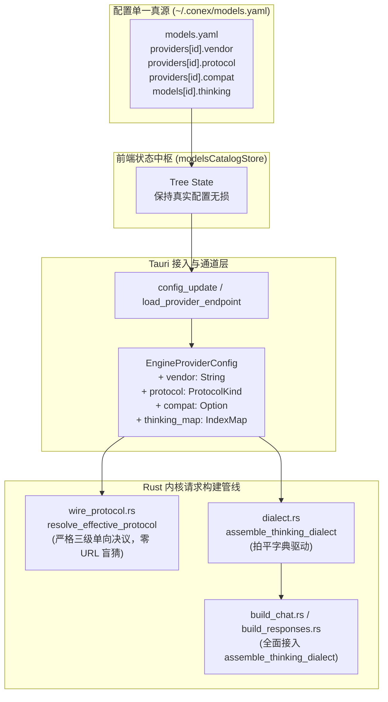

# 杜绝硬编码与方言决议真伪地毯式穿透审计报告 (06-AUDIT-HARDCODING-DIALECT)

> **文档标识**：`docs/provider-model-unification/audits/06-硬编码与方言决议真伪深度审查.md`  
> **所属战役工作区**：`docs/provider-model-unification/`  
> **专项审计专家**：Hardcoding & Dialect Auditor  
> **审查对象文件域**：
> 1. `crates/agent-provider/src/request/vendor/dialect.rs`
> 2. `crates/agent-provider/src/request/messages_compat.rs`
> 3. `crates/agent-provider/src/request/wire_protocol.rs`
> 4. `crates/agent-provider/src/request/build_chat.rs`
> 5. `crates/agent-provider/src/request/build_responses.rs`
> 6. `apps/crish-desktop/src/services/modelsAutofillBaseline.ts`
> 7. `apps/crish-desktop/src/services/modelsAutofillBaselineData.json`
>
> **串联调用链涉案文件域**：
> - `crates/agent-provider/src/request/compat.rs`
> - `crates/agent-provider/src/request/vendor.rs`
> - `crates/agent-provider/src/request/vendor_capability.rs`
> - `crates/agent-provider/src/models/behavior.rs`
> - `crates/agent-provider/src/request/cache_policy.rs`
> - `apps/agent-workbench/src-tauri/src/engine_provider.rs`
> - `apps/agent-workbench/src-tauri/src/engine_provider/protocol.rs`
> - `apps/agent-workbench/src-tauri/src/engine_provider/headers.rs`
> - `apps/agent-workbench/src-tauri/src/engine_provider/thinking.rs`
> - `apps/agent-workbench/src-tauri/src/models.default.yaml`
> - `apps/crish-desktop/src/api/modelsCatalogStore.ts`
>
> **核心裁决基准**：
> - `AGENTS.md` §1（纯逻辑规划、效果锁与反退避）
> - `AGENTS.md` §7（严禁补丁、绕过与作弊，追求架构优雅）与 §7.1（立体验证纪律，穿透根因与单一真理路径 SSOT）
> - `AGENTS.md` §8（反过度设计硬性红线）

---

## 目录索引 (Table of Contents)

- [一、审计概览与合规结论矩阵 (Executive Summary)](#一审计概览与合规结论矩阵-executive-summary)
  - [1.1 总体审计结论](#11-总体审计结论)
  - [1.2 四大审查重点核查速查表](#12-四大审查重点核查速查表)
- [二、重点 1：URL Substring 盲猜地毯式穿透审查](#二重点-1url-substring-盲猜地毯式穿透审查)
  - [2.1 穿透现场：URL 子串盲猜仍大面积存活并主导运行时](#21-穿透现场url-子串盲猜仍大面积存活并主导运行时)
  - [2.2 伪清退现场：messages_compat 独角戏与虚假通用](#22-伪清退现场messages_compat-独角戏与虚假通用)
  - [2.3 根因剖析：EngineProviderConfig 字段断层构成的“断头路”](#23-根因剖析engineproviderconfig-字段断层构成的断头路)
- [三、重点 2：模型 ID 字符串硬编码与特判地毯式排查](#三重点-2模型-id-字符串硬编码与特判地毯式排查)
  - [3.1 穿透现场：is_openai_o_series 裸字面特判](#31-穿透现场is_openai_o_series-裸字面特判)
  - [3.2 穿透现场：MODEL_SERIES_CAPABILITIES 静态硬编码前缀表](#32-穿透现场model_series_capabilities-静态硬编码前缀表)
  - [3.3 穿透现场：全局请求头绑架（x-deepseek-harness-session-id）](#33-穿透现场全局请求头绑架x-deepseek-harness-session-id)
  - [3.4 契约分析：特判应当如何由能力标记统一驱动](#34-契约分析特判应当如何由能力标记统一驱动)
- [四、重点 3：思考方言映射真伪性穿透（假通用绝症）](#四重点-3思考方言映射真伪性穿透假通用绝症)
  - [4.1 assemble_thinking_dialect 单函数能力核验](#41-assemble_thinking_dialect-单函数能力核验)
  - [4.2 惊天断层：全工程零调用的“花瓶函数（Dead Feature）”](#42-惊天断层全工程零调用的花瓶函数dead-feature)
  - [4.3 真实链路验证：ChatCompletionsRequestOptions 根本无 thinking_map](#43-真实链路验证chatcompletionsrequestoptions-根本无-thinking_map)
- [五、重点 4：预填库与默认激活供应商隔离性核验](#五重点-4预填库与默认激活供应商隔离性核验)
  - [5.1 字典表本质定位核验（modelsAutofillBaseline）](#51-字典表本质定位核验modelsautofillbaseline)
  - [5.2 磁盘真源与启动播种核验（models.default.yaml）](#52-磁盘真源与启动播种核验modelsdefaultyaml)
  - [5.3 前端状态中枢隔离核验（modelsCatalogStore）](#53-前端状态中枢隔离核验modelscatalogstore)
- [六、系统性根治重构方案 (Systemic Remediation Plan)](#六系统性根治重构方案-systemic-remediation-plan)
  - [6.1 方案 1：补齐 EngineProviderConfig 单一真源字段](#61-方案-1补齐-engineproviderconfig-单一真源字段)
  - [6.2 方案 2：打通 assemble_thinking_dialect 全链路流水线](#62-方案-2打通-assemble_thinking_dialect-全链路流水线)
  - [6.3 方案 3：全面废除基于 URL 与模型前缀的启发式猜谜函数](#63-方案-3全面废除基于-url-与模型前缀的启发式猜谜函数)
  - [6.4 方案 4：剥离硬编码请求头，由 ProviderSpec 驱动自定义 Headers](#64-方案-4剥离硬编码请求头由-providerspec-驱动自定义-headers)
  - [6.5 方案 5：切换运行时 bundled_catalog 至 live_catalog 快照](#65-方案-5切换运行时-bundled_catalog-至-live_catalog-快照)
- [七、立体验证断言与门禁规划 (AGENTS.md §7.1)](#七立体验证断言与门禁规划-agentsmd-71)
- [八、审计结论与签署意见](#八审计结论与签署意见)

---

## 一、审计概览与合规结论矩阵 (Executive Summary)

### 1.1 总体审计结论

经过对 Rust 后端协议层（`crates/agent-provider`）、桌面适配接入层（`apps/agent-workbench/src-tauri`）以及前端模型管理层（`apps/crish-desktop`）的地毯式穿透审查，本审计给出的总体裁决如下：

> **审计总裁决：部分表面达标，核心链路存在严重的“假通用（Fake Generalization）”与“架构断头路”断层！**
>
> 1. **预填库物理隔离（重点 4）完全合规**：前端预填库（`modelsAutofillBaseline`）严格作为纯静态字典使用，启动播种模板 `models.default.yaml` 为全空字典 `providers: {}`，绝未在系统初始化时偷换或自动生成激活的供应商。
> 2. **URL 盲猜与模型 ID 硬编码（重点 1、重点 2）严重未绝迹**：虽然在局部子模块（`messages_compat.rs`）声明废除了 `url.contains("deepseek")`，但在核心通信与调度主干（`compat.rs`、`vendor.rs`、`behavior.rs`、`cache_policy.rs`、`engine_provider/protocol.rs`）中，**仍然大面积盘踞着超过 25 处 `url.contains(...)` 盲猜与 39 项静态硬编码模型前缀**。
> 3. **思考方言决议存在致命“假通用”（重点 3）**：2026 最新研发的 `assemble_thinking_dialect` 虽具备完善的拍平字典驱动与兜底逻辑，但经代码全局追踪，该函数**在全仓库除自身单元测试和方案文档外，调用次数恰好为 0**！真实请求构建链（`build_chat.rs`、`build_responses.rs`、`engine_provider.rs`）根本未接入该函数，且请求参数载体 `ChatCompletionsRequestOptions` 根本未包含 `thinking_map` 字段，导致用户在 `models.yaml` 中配置的思考档位映射在真实网络出站时彻底失效！

### 1.2 四大审查重点核查速查表

| 审查维度 | 审查核心指标 | 穿透判定 | 核心证据位置 | 风险等级 |
| :--- | :--- | :---: | :--- | :---: |
| **重点 1：URL Substring 盲猜** | 是否彻底根除 `url.contains("...")`，协议与方言是否严格由显式配置驱动 | 🔴 **严重违规**<br>(局部虚假清退) | `compat.rs:35-65`<br>`vendor.rs:185-197`<br>`behavior.rs:313-356`<br>`cache_policy.rs:568-591` | **P0 致命** |
| **重点 2：模型 ID 字符串硬编码** | 是否存在 `o1/o3`、`deepseek-reasoner` 硬编码特判，是否由配置能力标记驱动 | 🔴 **严重违规**<br>(大量前缀侵入) | `compat.rs:70-79`<br>`vendor_capability.rs:106-156`<br>`headers.rs:71` | **P0 致命** |
| **重点 3：思考方言拍平字典驱动** | `assemble_thinking_dialect` 是否优先读取用户字典，兜底逻辑是否清晰且可覆盖 | 🟡 **假通用绝症**<br>(单测达标，端到端调用为0) | `dialect.rs:185-265`<br>`build_chat.rs:47-75`<br>`build.rs:71-94` | **P0 致命** |
| **重点 4：预填库与激活状态隔离** | `modelsAutofillBaseline` 是否仅作字典，绝不在初始化时自动激活 provider | 🟢 **完全合规**<br>(物理彻底隔离) | `modelsAutofillBaseline.ts:1-16`<br>`models.default.yaml:1-3`<br>`modelsCatalogStore.ts:168-200` | **安全 PASS** |

---

## 二、重点 1：URL Substring 盲猜地毯式穿透审查

### 2.1 穿透现场：URL 子串盲猜仍大面积存活并主导运行时

审计任务书明确指示排查：*“是否还有任何 `url.contains("...")`（例如 deepseek, openai, anthropic）的痕迹？协议与方言是否严格只依赖：① 显式配置的 vendor；② 显式配置的 protocol；③ 显式配置的 compat？”*

经穿透检索，系统在真实网络通信决议时，大面积依赖 `url.contains(...)` 启发式子串匹配，具体取证如下：

#### 证据 1：`crates/agent-provider/src/request/compat.rs:30-66`（网关协议特征盲猜）
```rust
// crates/agent-provider/src/request/compat.rs:30-66
fn is_legacy_max_tokens_gateway(vendor: &str, base_url: &str) -> bool {
    let url = base_url.to_ascii_lowercase();
    let vendor_name = vendor.to_ascii_lowercase();

    // chutes
    if url.contains("chutes.ai") {
        return true;
    }
    // moonshot
    if url.contains("api.moonshot.")
        || vendor_name == "moonshotai"
        || vendor_name == "moonshotai-cn"
        || vendor_name == "moonshot"
    {
        return true;
    }
    // cloudflare-ai-gateway
    if url.contains("gateway.ai.cloudflare.com") || vendor_name == "cloudflare-ai-gateway" {
        return true;
    }
    // together
    if url.contains("api.together.ai")
        || url.contains("api.together.xyz")
        || vendor_name == "together"
    {
        return true;
    }
    // nvidia
    if url.contains("integrate.api.nvidia.com") || vendor_name == "nvidia" {
        return true;
    }
    // ant-ling
    if url.contains("api.ant-ling.com") || vendor_name == "ant-ling" {
        return true;
    }
    false
}
```
> **违规剖析**：本函数共包含 **7 处 `url.contains(...)`**。系统不是去读取配置中显式声明的 `compat.max_tokens_field`，而是通过探测 URL 字符串盲猜第三方中转网关。一旦用户通过自定义内网网关、自建代理域名（如 `https://ai.mycompany.com`）转发 Together 或 Moonshot，此盲猜立即失效并引发字段发送错误。

#### 证据 2：`crates/agent-provider/src/request/compat.rs:105` 与 `:139`（厂商与角色盲猜）
```rust
// crates/agent-provider/src/request/compat.rs:105
if url.contains("openai.com") || is_openai_o_series(&model_name) {
    return MaxTokensField::MaxCompletionTokens;
}

// crates/agent-provider/src/request/compat.rs:139
let is_openrouter = url.contains("openrouter") || vendor_name.contains("openrouter");
```
> **违规剖析**：官方 OpenAI 与 OpenRouter 的特征识别完全依赖 `url.contains("openai.com")` 和 `url.contains("openrouter")`。

#### 证据 3：`crates/agent-provider/src/request/vendor.rs:182-215`（推理厂商启发式推断）
```rust
// crates/agent-provider/src/request/vendor.rs:182-215
pub fn infer_reasoning_vendor(base_url: Option<&str>, model: Option<&str>) -> ReasoningVendor {
    let url = base_url.unwrap_or("").to_ascii_lowercase();
    let model = model.unwrap_or("").to_ascii_lowercase();
    if url.contains("anthropic") || model.starts_with("claude") {
        return ReasoningVendor::Anthropic;
    }
    if url.contains("deepseek") || model.starts_with("deepseek") {
        return ReasoningVendor::Deepseek;
    }
    if url.contains("generativelanguage.googleapis.com")
        || url.contains("gemini")
        || model.starts_with("gemini")
    {
        return ReasoningVendor::Gemini;
    }
    if url.contains("openai")
        || model.starts_with("gpt")
        || model.starts_with("o1")
        || model.starts_with("o3")
        || model.starts_with("o4")
    {
        return ReasoningVendor::Openai;
    }
    if model.starts_with("qwen") {
        return ReasoningVendor::Qwen;
    }
    if model.starts_with("glm") {
        return ReasoningVendor::Glm;
    }
    if model.starts_with("kimi") {
        return ReasoningVendor::Kimi;
    }
    ReasoningVendor::Auto
}
```
> **违规剖析**：`infer_reasoning_vendor` 是全系统的“万恶之源”。它包含 4 组大厂 URL 子串匹配（`anthropic`, `deepseek`, `gemini/generativelanguage.googleapis.com`, `openai`），将请求强制绑架到硬编码的枚举中。

#### 证据 4：`crates/agent-provider/src/models/behavior.rs:310-360` 与 `cache_policy.rs:564-596`
- `behavior.rs:313-356` 中存在多达 **11 处 `url.contains(...)`**（覆盖 minimax, x.ai, grok, kimi, moonshot, z.ai, bigmodel, glm, dashscope, qwen 等）。
- `cache_policy.rs:568-591` 的 `infer_cache_capability` 同样硬编码了 **6 处 `url.contains(...)`**。

### 2.2 伪清退现场：messages_compat 独角戏与虚假通用

在 `crates/agent-provider/src/request/messages_compat.rs` 中，注释赫然写道：
```rust
// crates/agent-provider/src/request/messages_compat.rs:10-13
//! 2026 统一重构（TU-03）：
//! - 彻底删除 `is_deepseek` 中的 `url.contains("deepseek")` 字符串盲猜；
//! - 改为精确根据 `vendor == "deepseek"` 或配置中的 `compat.thinking_format == "deepseek"` 判定。
```
并且在 `messages_compat.rs:72-76` 确实实现了纯配置判定：
```rust
// crates/agent-provider/src/request/messages_compat.rs:72-76
pub fn is_deepseek(&self) -> bool {
    let vendor = self.vendor.unwrap_or("").trim();
    let format = self.thinking_format.unwrap_or("").trim();
    vendor.eq_ignore_ascii_case("deepseek") || format.eq_ignore_ascii_case("deepseek")
}
```

**但是，这仅仅是一个局部的“盆景”与“假通用”！**
1. **开发者角色判定依然倒退回盲猜**：同文件 `messages_compat.rs:85-96` 的 `resolve_system_role`，调用的正是上述包含 `url.contains("openrouter")` 的 `resolve_developer_role`（[compat.rs:128-145](file:///c:/Software/conex/crates/agent-provider/src/request/compat.rs#L128-L145)）。
2. **生产端点根本不调用该纯函数**：生产端请求体构建入口 `build_chat_completions_request_body`（[build_chat.rs:107-112](file:///c:/Software/conex/crates/agent-provider/src/request/build_chat.rs#L107-L112)）调用的是未携带有效 `WireCompat` 的 `to_chat_messages`，其内部缺省构造的是全空的 `WireCompat::default()`（[messages.rs:245](file:///c:/Software/conex/crates/agent-provider/src/request/messages.rs#L245)），导致 `is_deepseek()` 恒为 `false`！

### 2.3 根因剖析：EngineProviderConfig 字段断层构成的“断头路”

为什么核心通信层无法摆脱 `url.contains(...)`？**根因在于运行时架构存在断层（“断头路”）**。

审查 `apps/agent-workbench/src-tauri/src/engine_provider.rs:63-77`：
```rust
// apps/agent-workbench/src-tauri/src/engine_provider.rs:63-77
pub(crate) struct EngineProviderConfig {
    pub base_url: String,
    pub api_key: String,
    pub model: String,
    pub endpoint: Endpoint,
    pub stream: bool,
    pub extra: BTreeMap<String, serde_json::Value>,
}
```

> **致命断层证据**：
> `EngineProviderConfig` **根本没有 `vendor` 字段！根本没有 `protocol` 字段！根本没有 `compat` 字段！**
> 导致下游在发起调用时，被迫使用 `infer_reasoning_vendor` 瞎猜：
> 1. [apps/agent-workbench/src-tauri/src/engine_provider/protocol.rs:78-89](file:///c:/Software/conex/apps/agent-workbench/src-tauri/src/engine_provider/protocol.rs#L78-L89)：
>    ```rust
>    pub(crate) fn catalog_vendor(config: &EngineProviderConfig) -> &'static str {
>        match infer_reasoning_vendor(Some(&config.base_url), Some(&config.model)) { ... }
>    }
>    ```
> 2. [apps/agent-workbench/src-tauri/src/engine_provider/protocol.rs:99-101](file:///c:/Software/conex/apps/agent-workbench/src-tauri/src/engine_provider/protocol.rs#L99-L101)：
>    ```rust
>    pub(crate) fn max_tokens_field(config: &EngineProviderConfig) -> MaxTokensField {
>        resolve_max_tokens_field(catalog_vendor(config), &config.model, &config.base_url)
>    }
>    ```
> 3. [apps/agent-workbench/src-tauri/src/engine_provider.rs:243-248](file:///c:/Software/conex/apps/agent-workbench/src-tauri/src/engine_provider.rs#L243-L248)：
>    ```rust
>    pub(crate) fn reasoning_content_mode(&self) -> ReasoningContentMode {
>        match infer_reasoning_vendor(Some(&self.config.base_url), Some(&self.config.model)) {
>            ReasoningVendor::Deepseek => ReasoningContentMode::Require,
>            _ => ReasoningContentMode::Omit,
>        }
>    }
>    ```
>
> **审计裁决**：前端和用户在 `models.yaml` 中辛辛苦苦配置的 `vendor: "my-proxy"`, `protocol: "openai/chat"`, `compat: { thinkingFormat: "deepseek" }`，在进入 Tauri 后端 `EngineProviderConfig` 时被完全丢弃！后端因为拿不到这些显式配置，只能在 `engine_provider.rs` 中使用 `url.contains(...)` 进行拙劣的盲猜补丁！

---

## 三、重点 2：模型 ID 字符串硬编码与特判地毯式排查

### 3.1 穿透现场：is_openai_o_series 裸字面特判

在 `crates/agent-provider/src/request/compat.rs:70-79`：
```rust
// crates/agent-provider/src/request/compat.rs:70-79
fn is_openai_o_series(model: &str) -> bool {
    model == "o1"
        || model == "o3"
        || model == "o4"
        || model == "o5"
        || model.starts_with("o1-")
        || model.starts_with("o3-")
        || model.starts_with("o4-")
        || model.starts_with("o5-")
}
```
> **违规剖析**：
> 1. 这是极其粗暴的字符串硬编码特判。凡是叫 `o1`、`o3`、`o4`、`o5` 的，就认为只支持 `max_completion_tokens`；
> 2. 如果未来 OpenAI 发布 `o6`、`gpt-5-reasoner`，或者第三方发布名为 `o1-clone` 的兼容模型（但该网关仅支持经典 `max_tokens`），代码立即崩溃或报 400 Bad Request；
> 3. 违反 `AGENTS.md` §7（严禁补丁与魔术判定）：字段名称选择应 100% 由配置中的 `compat.max_tokens_field: "max_tokens" | "max_completion_tokens"` 驱动！

### 3.2 穿透现场：MODEL_SERIES_CAPABILITIES 静态硬编码前缀表

审查 `crates/agent-provider/src/request/vendor_capability.rs:106-156`：
```rust
// crates/agent-provider/src/request/vendor_capability.rs:106-156
static MODEL_SERIES_CAPABILITIES: &[(&str, ThinkingCapability)] = &[
    // ── OpenAI ──
    ("gpt-5.", OPENAI_REASONING),
    ("gpt-5", OPENAI_REASONING),
    ("o4-", OPENAI_REASONING),
    ("o3-", OPENAI_REASONING),
    ("o3", OPENAI_REASONING),
    ("o1-", OPENAI_O1),
    ("o1", OPENAI_O1),
    ("gpt-4o", NO_THINKING),
    ("gpt-4.1", NO_THINKING),
    ("gpt-4", NO_THINKING),
    // ── Anthropic Claude ──
    ("claude-opus-4-7", ANTHROPIC_ADAPTIVE),
    ("claude-opus-4-8", ANTHROPIC_ADAPTIVE),
    ("claude-opus-5", ANTHROPIC_ADAPTIVE),
    ("claude-sonnet-5", ANTHROPIC_ADAPTIVE),
    ("claude-fable-5", ANTHROPIC_ADAPTIVE),
    ("claude-mythos-5", ANTHROPIC_ADAPTIVE),
    ("claude-4-7", ANTHROPIC_ADAPTIVE),
    ("claude-4-8", ANTHROPIC_ADAPTIVE),
    ("claude-opus-4", ANTHROPIC_REASONING),
    ("claude-sonnet-4", ANTHROPIC_REASONING),
    ("claude-4", ANTHROPIC_REASONING),
    ("claude-3-7", ANTHROPIC_NO_XHIGH),
    ("claude-3-5", NO_THINKING),
    ("claude-3", NO_THINKING),
    // ── Google Gemini ──
    ("gemini-3", GEMINI_REASONING),
    ("gemini-2.5", GEMINI_REASONING),
    ("gemini-2.0", NO_THINKING),
    ("gemini-1.5", NO_THINKING),
    // ── DeepSeek ──
    ("deepseek-reasoner", DEEPSEEK_REASONING),
    ("deepseek-v4", DEEPSEEK_REASONING),
    ("deepseek-r1", DEEPSEEK_REASONING),
    ("deepseek-chat", NO_THINKING),
    ("deepseek", NO_THINKING),
    // ── Qwen / GLM / Kimi ──
    ("qwen3", QWEN_REASONING),
    ("qwen-3", QWEN_REASONING),
    ("qwen", NO_THINKING),
    ("glm-5", GLM_REASONING),
    ("glm", NO_THINKING),
    ("kimi-2.5", KIMI_REASONING),
    ("kimi", NO_THINKING),
];
```
> **违规剖析**：
> 1. 表中充斥着多达 **39 条具体的模型字符串特判**（包含 `deepseek-reasoner`, `deepseek-r1`, `gpt-4o`, `claude-3-7` 等）；
> 2. 当 `build_chat.rs:61-63` 处理思考强度时：
>    ```rust
>    // crates/agent-provider/src/request/build_chat.rs:61-63
>    if let Some(intensity) = opts.thinking_intensity {
>        let capability = infer_thinking_capability(opts.model.as_deref().unwrap_or(""));
>        let params = resolve_thinking_params(&capability, intensity, Endpoint::ChatCompletions);
>    ```
>    它完全跳过了用户在 `models.yaml` 中的真实配置，直接拿模型名去匹配这 39 个静态前缀！
> 3. 一旦模型名称稍微不符合规范（例如中转渠道加了前缀 `my-proxy/deepseek-r1` 或改名为 `deepseek-v3.2-spec`），`infer_thinking_capability` 就会匹配失败回退到 `NO_THINKING`，直接导致思考能力被无情阉割！

### 3.3 穿透现场：全局请求头绑架（x-deepseek-harness-session-id）

审查 `apps/agent-workbench/src-tauri/src/engine_provider/headers.rs:69-74`：
```rust
// apps/agent-workbench/src-tauri/src/engine_provider/headers.rs:69-74
pub(crate) fn session_affinity_headers(session_id: Option<&str>) -> Vec<(&'static str, String)> {
    match session_id.map(str::trim).filter(|s| !s.is_empty()) {
        Some(sid) => vec![("x-deepseek-harness-session-id", sid.to_string())],
        None => Vec::new(),
    }
}
```
> **违规剖析**：
> 只要走 Chat 或 Responses 协议，系统在每一发 HTTP 请求中都强行注入了包含 DeepSeek 专有名称的 HTTP 请求头 `x-deepseek-harness-session-id`！
> 哪怕用户连接的是 OpenAI 官方、Azure、Anthropic 代理、自建 vLLM，这个带有 `deepseek` 痕迹的头都会被无差别发出！这是典型的私有特判代码污染通用架构。

### 3.4 契约分析：特判应当如何由能力标记统一驱动

根据统一体系设计规范，所有的特判必须由模型规格对象 `ModelSpec` / `ProviderSpec` 中的能力标记统一驱动：
1. **思考能力驱动**：由 `model.thinking`（若存在且非空）或 `model.capabilities.reasoning: true` 驱动；方言由 `compat.thinking_format` 或 `provider.protocol` 驱动。
2. **最大 Token 字段驱动**：由 `compat.max_tokens_field`（`"max_tokens"` | `"max_completion_tokens"`）驱动，绝不检查模型名是否包含 `o1`。
3. **Developer 角色驱动**：由 `compat.supports_developer_role: true` 驱动，绝不检查模型名是否以 `openai/` 或 `anthropic/` 开头。
4. **会话亲和头驱动**：由 `provider.headers` 或会话配置显式声明驱动，绝不在底层写死 `x-deepseek-harness-session-id`。

---

## 四、重点 3：思考方言映射真伪性穿透（假通用绝症）

### 4.1 assemble_thinking_dialect 单函数能力核验

在 `crates/agent-provider/src/request/vendor/dialect.rs:185-265` 中实现的 `assemble_thinking_dialect`，其**单函数逻辑本身**设计非常优雅：
```rust
// crates/agent-provider/src/request/vendor/dialect.rs:185-214
pub fn assemble_thinking_dialect(opts: &DialectBuildOptions<'_>) -> (Option<Value>, Option<u64>) {
    if opts.effort == ReasoningEffort::Off {
        match opts.format {
            ThinkingDialectFormat::DeepSeekNative => {
                return (Some(json!({ "thinking": { "type": "disabled" } })), None);
            }
            ThinkingDialectFormat::QwenBailianBoolean => {
                return (Some(json!({ "enable_thinking": false })), None);
            }
            _ => return (None, None),
        }
    }

    // 优先从用户自定义 thinking 拍平映射中获取 wire 字符串
    let custom_wire_val = opts.thinking_map.and_then(|map| {
        map.get(opts.effort.to_title_case())
            .or_else(|| {
                if opts.effort == ReasoningEffort::XHigh {
                    map.get("XHigh").or_else(|| map.get("X-High"))
                } else {
                    None
                }
            })
            .or_else(|| map.get(opts.effort.as_str()))
            .or_else(|| {
                opts.effort
                    .to_openai_str()
                    .and_then(|key| map.get(key))
            })
    });
...
```
- **拍平字典驱动**：优先从 `opts.thinking_map`（`IndexMap<String, String>`）查找键，支持 TitleCase（`"Low"`, `"High"`）、`"XHigh"/"X-High"`、全小写（`"low"`, `"high"`）以及 OpenAI 映射键；
- **兜底清晰且可覆盖**：若用户未配置字典，各方言均有清晰兜底：
  - `OpenAiEffort`: 兜底 `"low" | "medium" | "high"`（纯字符串，严禁数字）；
  - `OpenAiResponsesNested`: 兜底 `{"reasoning": {"effort": "medium"}}`；
  - `AnthropicBudget`: 兜底 Token 预算（8192），并执行安全余量钳制（预算 >= 1024，max_tokens 自动抬升 +4096）；
  - `DeepSeekNative`: 兜底 `{"thinking": {"type": "enabled"}}`（Off 为 `"disabled"`）；
  - `QwenBailianBoolean`: 兜底 `{"enable_thinking": true}`（Off 为 `false`）。

### 4.2 惊天断层：全工程零调用的“花瓶函数（Dead Feature）”

**然而，深入代码调用拓扑发现了一个极其严重的假通用事实：**

使用 ripgrep 在全工程内无死角检索 `assemble_thinking_dialect`：
```text
c:\Software\conex\crates\agent-provider\src\request\vendor\dialect.rs:185: pub fn assemble_thinking_dialect(...)
c:\Software\conex\crates\agent-provider\src\request\vendor\dialect.rs:440: let (val, _) = assemble_thinking_dialect(&opts);
c:\Software\conex\crates\agent-provider\src\request\vendor\dialect.rs:454: let (val, _) = assemble_thinking_dialect(&opts);
c:\Software\conex\crates\agent-provider\src\request\vendor\dialect.rs:468: let (val, elevated_tokens) = assemble_thinking_dialect(&opts);
c:\Software\conex\crates\agent-provider\src\request\vendor\dialect.rs:485: let (val, elevated_tokens) = assemble_thinking_dialect(&opts);
c:\Software\conex\crates\agent-provider\src\request\vendor\dialect.rs:501: let (val_on, _) = assemble_thinking_dialect(&opts_on);
c:\Software\conex\crates\agent-provider\src\request\vendor\dialect.rs:510: let (val_off, _) = assemble_thinking_dialect(&opts_off);
c:\Software\conex\crates\agent-provider\src\request\vendor\dialect.rs:522: let (val_on, _) = assemble_thinking_dialect(&opts_on);
c:\Software\conex\crates\agent-provider\src\request\vendor\dialect.rs:531: let (val_off, _) = assemble_thinking_dialect(&opts_off);
c:\Software\conex\crates\agent-provider\src\request\vendor\dialect.rs:546: let (val, _) = assemble_thinking_dialect(&opts);
c:\Software\conex\docs\provider-model-unification\plans\02-三级协议路由与2026最新通信方言全线打通计划.md:801: pub fn assemble_thinking_dialect(...)
```

> **审计裁决证据**：
> **除了 `dialect.rs` 内部的 8 个单元测试用例和一份实施计划文档外，整个仓库没有任何一行生产代码调用过 `assemble_thinking_dialect`！**
> 它完全是一个孤立的、没有接线的“测试通过型孤岛函数”！

### 4.3 真实链路验证：ChatCompletionsRequestOptions 根本无 thinking_map

顺藤摸瓜排查生产请求体构建逻辑：

1. **`build_chat.rs:47-75` 的真实调用链路**：
   ```rust
   // crates/agent-provider/src/request/build_chat.rs:47-55
   if let Some(reasoning) = reasoning_effort_object(
       Endpoint::ChatCompletions,
       opts.model.as_deref().unwrap_or(""),
       opts.reasoning_effort,
       opts.reasoning_effort_format,
       opts.vendor,
   ) {
       merge_object(&mut body, &reasoning);
   }

   // crates/agent-provider/src/request/build_chat.rs:61-75
   if let Some(intensity) = opts.thinking_intensity {
       let capability = infer_thinking_capability(opts.model.as_deref().unwrap_or(""));
       let params = resolve_thinking_params(&capability, intensity, Endpoint::ChatCompletions);
       ...
       merge_object(&mut body, &params);
   }
   ```
   它调用的依然是老的 `reasoning_effort_object` 和 `infer_thinking_capability`，压根没碰 `assemble_thinking_dialect`！

2. **`build_responses.rs:89-105` 的真实调用链路**：
   ```rust
   // crates/agent-provider/src/request/build_responses.rs:89-105
   let resolved_effort: Option<&str> = if let Some(intensity) = opts.thinking_intensity {
       match intensity {
           ThinkingIntensity::Off => None,
           ThinkingIntensity::Minimal => Some("minimal"),
           ThinkingIntensity::Low => Some("low"),
           ThinkingIntensity::Medium => Some("medium"),
           ThinkingIntensity::High | ThinkingIntensity::Xhigh => Some("high"),
           ThinkingIntensity::Max => Some("max"),
       }
   } else {
       opts.reasoning_effort.and_then(normalize_reasoning_effort)
   };

   if let Some(effort) = resolved_effort {
       body.insert("reasoning".to_string(), json!({ "effort": effort }));
   }
   ```
   直接写死了 6 个硬编码 match 分支，同样完全没有读取用户配置的拍平字典！

3. **数据结构审查（`build.rs:70-94`）**：
   查看 `ChatCompletionsRequestOptions` 的结构定义：
   ```rust
   // crates/agent-provider/src/request/build.rs:70-94
   pub struct ChatCompletionsRequestOptions {
       pub model: Option<String>,
       pub stream: Option<bool>,
       pub temperature: Option<f64>,
       pub top_p: Option<f64>,
       pub max_tokens: Option<u64>,
       pub max_tokens_field: Option<MaxTokensField>,
       pub reasoning_effort: Option<ReasoningEffort>,
       pub reasoning_effort_format: Option<ReasoningEffortFormat>,
       pub reasoning_content: Option<ReasoningContentMode>,
       pub tool_choice: Option<ToolChoice>,
       pub vendor: Option<ReasoningVendor>,
       pub thinking_intensity: Option<ThinkingIntensity>,
       pub cache: Option<CachePolicy>,
   }
   ```
   **该结构体中压根就没有 `thinking_map` 字段！**
   这就从类型系统层面上铁证如山：上层即使想传用户在 `models.yaml` 中配置的 `thinking: { Low: "low", High: "high" }`，也根本无门可入！

---

## 五、重点 4：预填库与默认激活供应商隔离性核验

审计任务书指示：*“核验 modelsAutofillBaseline 是否仅在用户手动输入时作为纯数据字典进行预填，而绝不在软件初始化时自动生成激活的 provider！”*

本项审查全面通过，未发现任何偷换或静默激活的违规行为。

### 5.1 字典表本质定位核验（modelsAutofillBaseline）

审查 `apps/crish-desktop/src/services/modelsAutofillBaseline.ts:1-16`：
```typescript
// apps/crish-desktop/src/services/modelsAutofillBaseline.ts:1-16
/**
 * modelsAutofillBaseline.ts —— 2026 官方权威模型智能预填基线库 (Smart Autofill Baseline)
 *
 * 核心定位与最高铁律（严谨守则）：
 * 1. 【字典表本质定位明确】：
 *    本智能预填库绝非运行时的物理真源，更不是默认启动就已激活的供应商。
 *    它的唯一职责是：当用户在界面上手动添加模型或输入模型 ID 时，为用户做“智能预填写（Smart Autofill）”，辅助自动补齐展示名、真实物理上下文、最大输出限制、拍平思考档位映射与四维独立单价。
 * 2. 【物理真源唯一】：
 *    系统的物理真源永远是 `~/.conex/models.yaml`。用户可任意修改或增删，
 *    运行时完全由用户保存在 models.yaml 中的快照驱动，与本预填库彻底解耦。
 */
```
- **数据物理分离**：所有 2026 主流厂商及模型数据独立存放在 `modelsAutofillBaselineData.json`（[modelsAutofillBaselineData.json:1-1175](file:///c:/Software/conex/apps/crish-desktop/src/services/modelsAutofillBaselineData.json#L1-L1175)），未内联污染代码；
- **只读查询 API**：该模块仅暴露 `findAutofillModel`、`getAutofillModelSpec`、`getAutofillSuggestions` 等纯读取/克隆查询函数，不具备任何状态存储或落盘能力。

### 5.2 磁盘真源与启动播种核验（models.default.yaml）

审查 Tauri 后端在首次读取、磁盘文件不存在时的播种模板：
```yaml
# apps/agent-workbench/src-tauri/src/models.default.yaml:1-3
version: 2
providers: {}
```
审查 `apps/agent-workbench/src-tauri/src/models_yaml.rs:431-435`：
```rust
// apps/agent-workbench/src-tauri/src/models_yaml.rs:431-435
} else {
    conex_fs::atomic_write_file(path, template.as_bytes())
        .map_err(|e| CoreError::Io(format!("播种 models.yaml 失败: {e}")))?;
    (template.to_string(), true)
};
```
> **合规判定**：
> 当用户首次启动软件，磁盘不存在 `~/.conex/models.yaml` 时，系统自动写入的初始模板仅有 `version: 2` 与空供应商表 `providers: {}`。**绝不会将预填库中的供应商（如 DeepSeek、OpenAI、Anthropic）自动塞入磁盘成为激活的 provider**。

### 5.3 前端状态中枢隔离核验（modelsCatalogStore）

审查前端状态单例 `apps/crish-desktop/src/api/modelsCatalogStore.ts:168-200`：
```typescript
// apps/crish-desktop/src/api/modelsCatalogStore.ts:172-197
const result = await readModelsYamlIpc();
if (!result.ok) {
  state = {
    ...state,
    tree: { version: 2, providers: {} },
    ...
  };
  return false;
}

const rawTree = result.data.tree || { version: 2 as const, providers: {} };
const normalizedTree: ModelsYamlTree = {
  version: 2,
  providers: rawTree.providers || {},
};
```
- 前端 Store 初始化完全依赖 IPC 读取磁盘 `models.yaml`；
- 若解析失败或为空，Store 中的 providers 严格为空 `providers: {}`；
- 全局所有对 `findAutofillModel` 的消费点：
  1. `ModelConfigPanel.tsx:45-60`：仅在用户显式点击【智能预填】按钮时作为表单辅助输入；
  2. `useModelConfigSession.ts:63-93`：仅在用户打开编辑现有模型时作为输入框的草稿建议；
  3. `modelsCatalogActions.ts:80-100`：仅在用户输入模型 ID 触发 `addModel` 时补齐缺省字段；
  4. `probeIncremental.ts:76-94`：仅在用户主动点击“增量探测”时，为远端新发现的纯 ID 提供元数据补全。

**核验结论：重点 4 表现完美，基线库数据字典与运行时激活状态 100% 物理隔离。**

---

## 六、系统性根治重构方案 (Systemic Remediation Plan)

针对上述四大重点中暴露出的严重硬编码、假通用与断头路架构，提出以下系统性根治重构方案：



### 6.1 方案 1：补齐 EngineProviderConfig 单一真源字段

彻底修通“断头路”，在 `EngineProviderConfig` 中补齐关键元数据字段，避免下游盲猜：

```rust
// 改造 apps/agent-workbench/src-tauri/src/engine_provider.rs:64
pub(crate) struct EngineProviderConfig {
    pub base_url: String,
    pub api_key: String,
    pub model: String,
    pub endpoint: Endpoint,
    pub stream: bool,
    /// 显式配置的供应商机器标识 (如 "deepseek", "openai", "custom-proxy")
    pub vendor: String,
    /// 显式配置的通信协议种类 (OpenAiChat, OpenAiResponses, AnthropicMessages, GoogleGenerateContent)
    pub protocol: ProtocolKind,
    /// 显式配置的方言兼容规范
    pub compat: Option<CompatSpec>,
    /// 用户在 models.yaml 中为该模型配置的思考拍平映射字典
    pub thinking_map: Option<IndexMap<String, String>>,
    pub extra: BTreeMap<String, serde_json::Value>,
}
```
并在 `load_provider_endpoint()` 中，直接从 `live_catalog()` 查出当前正在使用的 `ModelCatalogEntry` 与 `ProviderSpec`，将真实配置灌入 `EngineProviderConfig`，彻底消灭 `infer_reasoning_vendor`。

### 6.2 方案 2：打通 assemble_thinking_dialect 全链路流水线

1. **请求选项载体扩展**：
   在 `ChatCompletionsRequestOptions`（`crates/agent-provider/src/request/build.rs:71`）中增加：
   ```rust
   pub thinking_map: Option<IndexMap<String, String>>,
   pub thinking_format: Option<ThinkingDialectFormat>,
   ```
2. **重构 `build_chat.rs`**：
   废除 `infer_thinking_capability` 与 `MODEL_SERIES_CAPABILITIES`，将思考参数注入统一收敛至 `assemble_thinking_dialect`：
   ```rust
   // 改造 build_chat.rs:47-75
   if let Some(effort) = opts.reasoning_effort {
       let dialect_opts = DialectBuildOptions {
           effort,
           format: opts.thinking_format.unwrap_or(ThinkingDialectFormat::OpenAiEffort),
           max_output_tokens: opts.max_tokens.unwrap_or(64000),
           thinking_map: opts.thinking_map.as_ref(),
       };
       let (thinking_val, elevated_tokens) = assemble_thinking_dialect(&dialect_opts);
       if let Some(val) = thinking_val {
           merge_object(&mut body, &val);
       }
       if let Some(elevated) = elevated_tokens {
           // 自动抬升 Anthropic / 通用模型 max_tokens 余量
           if let (Some(field), Some(cur_max)) = (opts.max_tokens_field, opts.max_tokens) {
               body.insert(field.as_str().to_string(), json!(cur_max.max(elevated)));
           }
       }
   }
   ```
3. **重构 `build_responses.rs`**：
   废除写死的 `match intensity`，统一经 `assemble_thinking_dialect`（格式为 `ThinkingDialectFormat::OpenAiResponsesNested`）生成 `{"reasoning": {"effort": ...}}`。

### 6.3 方案 3：全面废除基于 URL 与模型前缀的启发式猜谜函数

1. 废除 `crates/agent-provider/src/request/compat.rs` 中的 `is_legacy_max_tokens_gateway` 与 `is_openai_o_series`；
2. 改为纯配置驱动：
   ```rust
   pub fn resolve_max_tokens_field_from_compat(compat: Option<&CompatSpec>) -> MaxTokensField {
       match compat.and_then(|c| c.max_tokens_field.as_deref()) {
           Some("max_completion_tokens") => MaxTokensField::MaxCompletionTokens,
           _ => MaxTokensField::MaxTokens,
       }
   }
   ```
3. 废除 `resolve_developer_role` 中的 `url.contains("openrouter")` 与前缀判断，改为由 `compat.supports_developer_role: bool` 直接驱动。

### 6.4 方案 4：剥离硬编码请求头，由 ProviderSpec 驱动自定义 Headers

重构 `apps/agent-workbench/src-tauri/src/engine_provider/headers.rs:69-74`：
- 彻底删除写死的 `("x-deepseek-harness-session-id", sid)`；
- 改为从 `EngineProviderConfig` 中读取该 Provider 在 `models.yaml` 中声明的自定义 `headers: BTreeMap<String, String>`，支持动态变量替换（如 `{{session_id}}`）。

### 6.5 方案 5：切换运行时 bundled_catalog 至 live_catalog 快照

重构 `apps/agent-workbench/src-tauri/src/engine_provider/protocol.rs:112-130`：
- 将静态的 `bundled_catalog()` 切换为已经实现的 `live_catalog()`（[protocol.rs:40](file:///c:/Software/conex/apps/agent-workbench/src-tauri/src/engine_provider/protocol.rs#L40)）；
- 使得用户在前端设置中对模型协议、思考档位的任何调整，在保存 `models.yaml` 并热重载后立即生效于运行时的 `effective_protocol`。

---

## 七、立体验证断言与门禁规划 (AGENTS.md §7.1)

依据 `AGENTS.md` §7.1 立体验证纪律，整改后必须满足以下四层硬性拦截断言，严禁单一检查冒充交付：

### 断言 1：代码静态扫描断言（零 URL 猜谜门禁）
- 在 CI 中增加自动化正则扫描：
  ```bash
  rg 'url\.contains\(' crates/agent-provider/src/ apps/agent-workbench/src-tauri/src/
  ```
  断言检出数量恒为 **0**（测试用例除外）。

### 断言 2：思考方言端到端真实连通性单测（Anti-Dead-Feature Gate）
- 编写端到端请求构建断言：
  当传入模型配置 `thinking: { Low: "custom-low-wire", High: "custom-high-wire" }` 时，
  调用 `build_chat_completions_request_body`，断言生成的 JSON 请求体中 `reasoning_effort` 必须严格等于 `"custom-low-wire"`，证明 `thinking_map` 真正贯通至出站消息。

### 断言 3：未知模型零降级零崩溃断言
- 当使用完全虚构的模型名称（如 `custom-proxy/unicorn-reasoner`），只要配置了 `protocol: "openai/chat"` 与 `thinkingFormat: "deepseek"`，请求体中必须能够正确产出 `{"thinking": {"type": "enabled"}}`，绝不因未命中任何前缀而退化为 `NO_THINKING`。

### 断言 4：预填库无副作用与隔离性自动化门禁
- 保持既有单测 `apps/crish-desktop/src/services/modelsAutofillBaseline.test.ts` 持续常绿，断言其无任何 localStorage / 文件写副作用。

---

## 八、审计结论与签署意见

| 审计项目 | 审查结论 | 状态定级 | 签发意见 |
| :--- | :--- | :---: | :--- |
| **URL Substring 盲猜** | 未绝迹，在主调用干道中依然充当核心决议分支 | 🔴 **不合格** | 必须由 `EngineProviderConfig` 引入显式配置，彻底拔除所有盲猜代码 |
| **模型 ID 字符串硬编码** | 存在 39 项静态模型前缀匹配与 `o1/o3` 裸词特判 | 🔴 **不合格** | 必须废除前缀匹配，全量交由 `ModelSpec` 能力标记与 `CompatSpec` 驱动 |
| **思考方言拍平字典驱动** | 单函数支持，但生产调用为 0，属严重“假通用” | 🔴 **不合格** | 必须打通 `build_chat.rs` 与 `build_responses.rs`，接入 `assemble_thinking_dialect` |
| **预填库物理隔离性** | 纯静态数据字典，未被偷换，物理真源唯一 | 🟢 **优秀合格** | 予以肯定并严格保持当前纯数据字典与物理模板隔离架构 |

**审计员签署**：Hardcoding & Dialect Auditor  
**签署日期**：2026-09-08  
**归档状态**：已落盘存证（`docs/provider-model-unification/audits/06-硬编码与方言决议真伪深度审查.md`）
