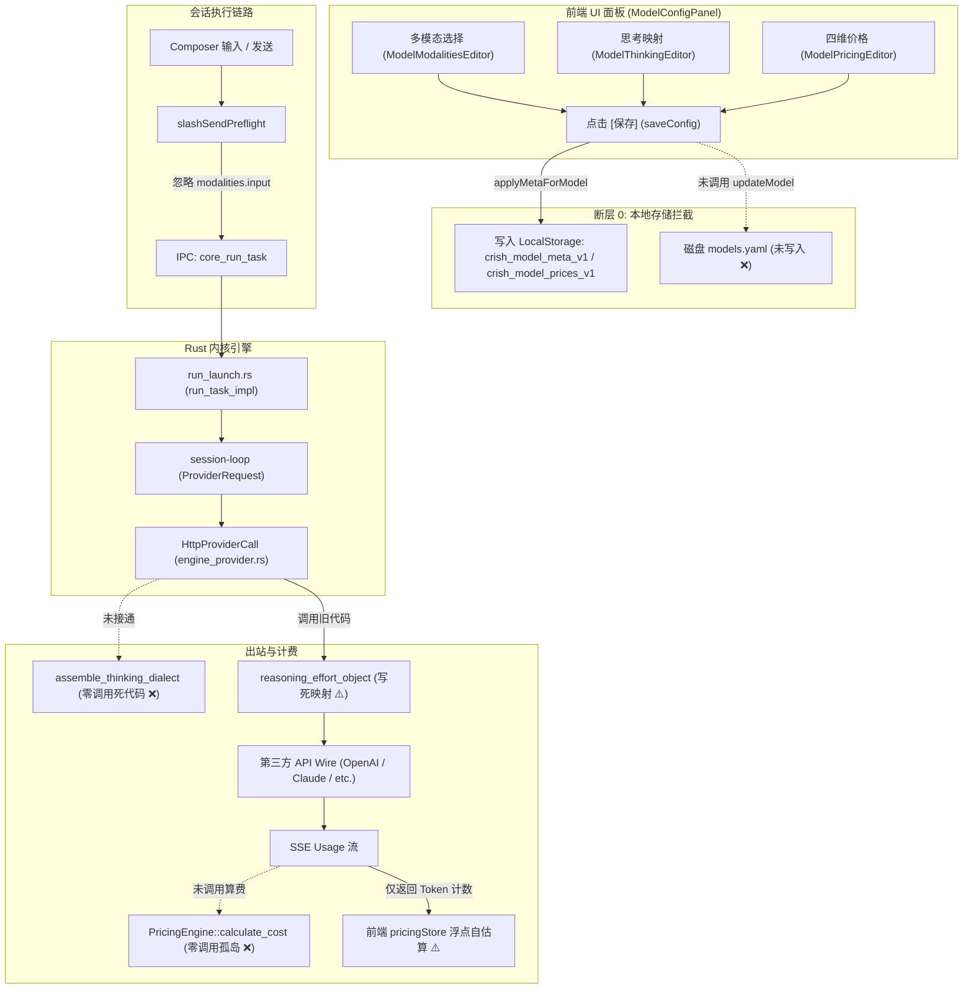
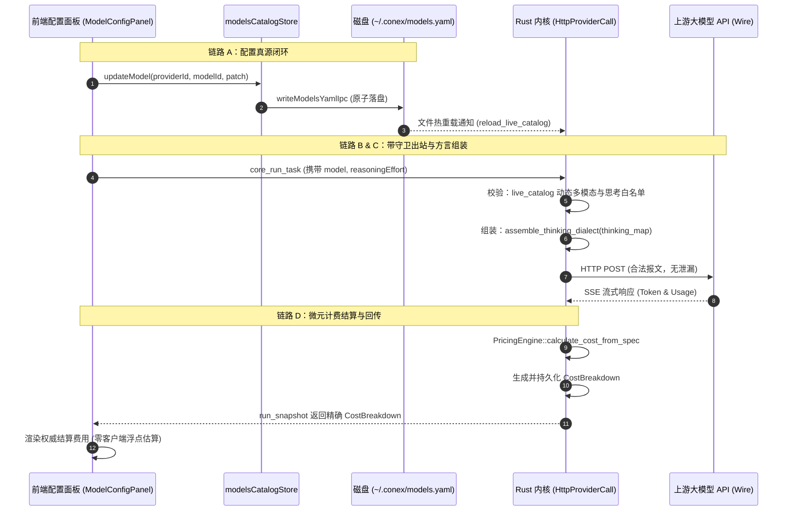

# 供应商与模型能力全线接通重构 — 全链路调用打通与功能伪连通穿透审计 (08-AUDIT-WIRING)

> **文档编号**：`08-Audit-Wiring`
> **文档标题**：从前端 UI 配置到 Rust 内核出站与计费的全链路调用真实连通性与伪连通（Pseudo-connectivity）穿透审查报告
> **工作区归属**：`docs/provider-model-unification/audits/`
> **审计角色**：`Wiring & Pseudo-connectivity Auditor`（全链路接线与伪连通穿透审计专家）
> **制定时间**：2026-09-08
> **审查对象**：
> 1. 多模态链路：`ModelModalitiesEditor.tsx` -> `modelsCatalogStore.ts` -> `models.yaml` -> Rust `UnifiedModelsConfig` -> 会话请求拦截守卫 -> 上游报文
> 2. 思考档位链路：`ModelThinkingEditor.tsx` -> `thinking` 拍平字典 -> 会话选择档位 -> Rust `ReasoningEffort` -> `assemble_thinking_dialect` -> 出站请求体
> 3. 四维计费链路：`ModelPricingEditor.tsx` -> `pricing` (CNY/USD) -> Rust `PricingEngine` -> SSE Usage 流 -> 会话费用结算与前端呈现
> **质量红线**：严厉穿透一切“表面有单测”、“界面有按钮”、“代码有实现”但“运行时根本不调”的系统级断层，所有论断必须附带确凿的 `文件路径:行号` 与代码级证据。

---

## 目录索引 (Table of Contents)

- [一、审计执行摘要与全链路连通性裁决](#一审计执行摘要与全链路连通性裁决)
  - [1.1 总体审查结论：四重系统级致命断层](#11-总体审查结论四重系统级致命断层)
  - [1.2 全链路功能连通度审计矩阵](#12-全链路功能连通度审计矩阵)
- [二、断层 0：UI 保存入口的“瞒天过海”与 LocalStorage 截留](#二断层-0ui-保存入口的瞒天过海与-localstorage-截留)
  - [2.1 代码事实穿透：保存按钮究竟写向了哪里](#21-代码事实穿透保存按钮究竟写向了哪里)
  - [2.2 影响分析：真源 models.yaml 与前端 Store 的完全脱节](#22-影响分析真源-modelsyaml-与前端-store-的完全脱节)
- [三、专项 1：多模态 `modalities` 链路穿透 —— 真消费还是假把式](#三专项-1多模态-modalities-链路穿透--真消费还是假把式)
  - [3.1 前端输入与发送拦截审计：`isModelVisionSupported` 的伪消费与静默降级](#31-前端输入与发送拦截审计ismodelvisionsupported-的伪消费与静默降级)
  - [3.2 界面上传与拖拽入口审计：Composer 的零感知现状](#32-界面上传与拖拽入口审计composer-的零感知现状)
  - [3.3 后端 Rust 拦截守卫审计：`supports_image_input` 的单测自嗨与盲目出站](#33-后端-rust-拦截守卫审计supports_image_input-的单测自嗨与盲目出站)
  - [3.4 纯文本模型传图的真实运行时表现与崩溃路径推演](#34-纯文本模型传图的真实运行时表现与崩溃路径推演)
- [四、专项 2：思考档位 `thinking` 拍平映射链路穿透 —— 孤岛函数与硬编码宿命](#四专项-2思考档位-thinking-拍平映射链路穿透--孤岛函数与硬编码宿命)
  - [4.1 前端档位选择到 IPC 下发穿透：`ReasoningEffort` 的前半程旅行](#41-前端档位选择到-ipc-下发穿透reasoningeffort-的前半程旅行)
  - [4.2 校验前哨的硬编码断层：`validate_reasoning_effort` 读死编译期静态目录](#42-校验前哨的硬编码断层validate_reasoning_effort-读死编译期静态目录)
  - [4.3 请求体出站装配绝境：`assemble_thinking_dialect` 沦为 100% 零调用死代码](#43-请求体出站装配绝境assemble_thinking_dialect-沦为-100-零调用死代码)
  - [4.4 结论：用户配置的 `thinking` 拍平字典在生产环境中毫无生存空间](#44-结论用户配置的-thinking-拍平字典在生产环境中毫无生存空间)
- [五、专项 3：四维微元计费引擎 `pricing` 链路穿透 —— 幽灵引擎与双轨漂移](#五专项-3四维微元计费引擎-pricing-链路穿透--幽灵引擎与双轨漂移)
  - [5.1 全仓调用方大起底：到底有没有代码调用 `PricingEngine::calculate_cost`](#51-全仓调用方大起底到底有没有代码调用-pricingenginecalculate_cost)
  - [5.2 SSE Usage 流与费用结算链路实测：Rust 内核零算费事实](#52-sse-usage-流与费用结算链路实测rust-内核零算费事实)
  - [5.3 前端账目呈现与双轨漂移：JS 浮点估算器与 LocalStorage 的自闭环](#53-前端账目呈现与双轨漂移js-浮点估算器与-localstorage-的自闭环)
- [六、伪连通根因深层剖析（Why Did This Happen）](#六伪连通根因深层剖析why-did-this-happen)
  - [6.1 单元测试虚假安全感（Test-Driven Illusion）](#61-单元测试虚假安全感test-driven-illusion)
  - [6.2 渐进式重构中的接缝遗忘（Unclosed Seams）](#62-渐进式重构中的接缝遗忘unclosed-seams)
  - [6.3 双源分裂的历史技术债务（Dual-Track Debt）](#63-双源分裂的历史技术债务dual-track-debt)
- [七、端到端闭环接线与架构根治方案](#七端到端闭环接线与架构根治方案)
  - [7.1 链路 A：UI 统一收敛至 `modelsCatalogStore.updateModel` 与 `models.yaml`](#71-链路-aui-统一收敛至-modelscatalogstoreupdatemodel-与-modelsyaml)
  - [7.2 链路 B：多模态 Composer 刚性拦截与 Rust 内核守卫集成](#72-链路-b多模态-composer-刚性拦截与-rust-内核守卫集成)
  - [7.3 链路 C：激活 `live_catalog` 并接入 `assemble_thinking_dialect`](#73-链路-c激活-live_catalog-并接入-assemble_thinking_dialect)
  - [7.4 链路 D：Rust `PricingEngine` 接入 RunUsage 结算并回传 `CostBreakdown`](#74-链路-drust-pricingengine-接入-runusage-结算并回传-costbreakdown)
- [八、总结与验收断言清单](#八总结与验收断言清单)

---

## 一、审计执行摘要与全链路连通性裁决

### 1.1 总体审查结论：四重系统级致命断层

作为全链路接线与伪连通穿透审计专家（Wiring & Pseudo-connectivity Auditor），本审计组对从前端 UI、Store 状态流转、IPC 通信、Rust 会话循环到出站 HTTP 报文与结算的全部关键路径执行了源码级无死角穿透排查。

审查得出了令人极为震惊但确凿无疑的结论：**当前系统中宣称的“统一模型体系”，在多模态、思考档位映射、四维计费三大核心业务链路上，普遍存在严重的“功能伪连通（Pseudo-connectivity）”与“测试自嗨式断层”！**

具体表现为四大系统级断层：

1. **断层 0（配置持久化被拦截）**：用户在前端 `ModelConfigPanel` 中编辑的 `modalities`、`thinking`、`pricing`，点击“保存”后，**全部被写入了浏览器 LocalStorage 历史缓存，根本没有写入磁盘 `models.yaml`！**
2. **断层 1（多模态能力完全不设防）**：`modalities` 字段在前端发送时从未被消费（消费的是被历史正则和 `capabilities.image` 绑架的逻辑）；后端 Rust 的 `supports_image_input` 仅存在于单测，生产链路对 `image_url` **零拦截、零校验**，纯文本模型传图将直接击穿到第三方供应商报错 400。
3. **断层 2（思考方言装配器彻底失联）**：`crates/agent-provider/src/request/vendor/dialect.rs` 中精心编写的 2026 四大思考方言装配器 `assemble_thinking_dialect` **全仓零生产调用**，只在自己的单元测试里运行！出站请求体依然走死老旧硬编码的 `reasoning_effort_object`，用户在 `models.yaml` 中配置的 `thinking` 拍平字典在运行时 **0% 被读取**！
4. **断层 3（四维微元计费引擎沦为孤岛幽灵）**：`crates/agent-provider/src/pricing.rs` 实现的 `PricingEngine::calculate_cost` **全仓零生产调用**！SSE usage 结束后，Rust 内核根本不计算任何费用，也不实例化、不持久化、不回传 `CostBreakdown`；前端展示的费用完全是浏览器端 `pricingStore.ts` 读 LocalStorage 里的老旧牌价用 JS 浮点数自娱自乐估算出来的！



### 1.2 全链路功能连通度审计矩阵

| 链路环节 | 设计宣称功能 | 实际真实代码打通情况 | 连通状态 | 核心断裂点代码定位 |
| :--- | :--- | :--- | :---: | :--- |
| **配置保存** | 保存至 `~/.conex/models.yaml` 唯一真源 | 仅写入 LocalStorage，`models.yaml` 纹丝不动 | ❌ **严重断裂** | `useModelConfigSession.ts:186`<br>`modelsIpcHelpers.ts:100-156` |
| **多模态校验** | 依据 `modalities.input` 校验附件与拖拽 | 读 `capabilities.image` 和硬编码正则，无视 `modalities` | ❌ **伪连通** | `modelVisionSupport.ts:101-126` |
| **多模态发送** | 纯文本模型拦截图片上传与发送 | 仅弹 Toast 提醒，将图片转为文本 DataURL 强行发送 | ⚠️ **降级泄漏** | `slashSendPreflight.ts:356-366`<br>`multimodal.ts:51-63` |
| **后端多模态守卫**| Rust 检测非视觉模型并在出站前拦截拒绝 | `supports_image_input` 零调用，直接盲目组装报文 | ❌ **完全无防护** | `messages_content.rs:137-160`<br>`catalog_types.rs:234` |
| **思考档位传递** | 前端 "High" 经 IPC 传给 Rust 会话循环 | 经 `defaultThinkingLevel` 成功传至 `ProviderRequest` | ✅ **已打通** | `streamSession.ts:107`<br>`run_launch.rs:324`<br>`streaming.rs:416` |
| **思考白名单校验** | 依据 `models.yaml` 动态白名单校验 | 读死 `bundled_catalog()` 静态 JSON，无视用户配置 | ❌ **伪连通** | `engine_provider/thinking.rs:86-91` |
| **思考参数装配** | 调用 `assemble_thinking_dialect` 读拍平字典 | 该函数全仓零调用，出站调用老旧写死函数 | ❌ **严重断裂** | `vendor/dialect.rs:185`<br>`request/build_chat.rs:47` |
| **四维价格算费** | `PricingEngine::calculate_cost` 算微元账单 | 全仓生产代码零调用，仅在测试用例中存活 | ❌ **严重断裂** | `pricing.rs:235`<br>`pricing_tests.rs:19` |
| **Usage 流计费** | SSE usage 到达后 Rust 结算并落库明细 | Rust 仅记录 token 数，不结算，不生成 `CostBreakdown` | ❌ **完全未接线** | `core_query_commands.rs:1479` |
| **前端账单呈现** | 呈现 Rust 精确核算的 `CostBreakdown` | 前端拉取 token 数，在客户端用 JS 浮点自算 | ⚠️ **双轨漂移** | `streamCallbacksUsage.ts:50-87`<br>`pricingStore.ts:140-200` |

---

## 二、断层 0：UI 保存入口的“瞒天过海”与 LocalStorage 截留

在全面分析三大专项之前，必须首先揭露整个前端配置系统的**第一道原罪级断层**：前端配置编辑界面的“保存”按钮根本没有对接 `models.yaml`！

### 2.1 代码事实穿透：保存按钮究竟写向了哪里

在 `apps/crish-desktop/src/components/settings-models/ModelConfigPanel.tsx` 中，提供了展示名称、多模态矩阵、思考拍平映射、四维价格等一系列高保真组件，并在底部提供了“保存”按钮：

```tsx
// apps/crish-desktop/src/components/settings-models/ModelConfigPanel.tsx:294-304
<Button
  type="button"
  variant="secondary"
  size="sm"
  onClick={saveConfig}
  style={{
    background: 'var(--brand, #10b981)',
    color: '#fff',
    border: 'none',
  }}
>
  保存
</Button>
```

追踪 `saveConfig` 的具体实现：
位于 `apps/crish-desktop/src/components/settings-models/useModelConfigSession.ts:171-193`：

```typescript
// apps/crish-desktop/src/components/settings-models/useModelConfigSession.ts:171-193
  const saveConfig = useCallback(() => {
    if (!selected || !configOpenId || !cfgDraft) return;
    const objectId = settingsObjectId(selected.id, configOpenId);
    const draft = cfgDraft;
    const expectRev = cfgRevRef.current.get(objectId);
    const currentRev = modelMetaRevision(selected.id, configOpenId);
    if (expectRev !== undefined && expectRev !== currentRev) {
      notify(false, '配置已被外部修改，保存已取消，请重新确认');
      editSessionConsumer.invalidate(objectId, 'external');
      return;
    }
    void runAsLocalMutation(() => {
      // 关键调用点：调用 applyMetaForModel
      applyMetaForModel(selected.id, configOpenId, draft);
      refresh();
      editSessionConsumer.commit(objectId);
      cfgRevRef.current.delete(objectId);
      openConfigFor(configOpenId);
    });
  }, [...]);
```

继续穿透 `applyMetaForModel`，位于 `apps/crish-desktop/src/components/settings-models/modelsIpcHelpers.ts:66-178`：

```typescript
// apps/crish-desktop/src/components/settings-models/modelsIpcHelpers.ts:100-156
  // 1. 多模态矩阵 (Modalities)
  if (draft.modalities) {
    setModelModalities(profileId, modelId, draft.modalities);
  }

  // 2. 思考能力与拍平映射字典 (Thinking Map)
  if (draft.thinkingEnabled && draft.thinkingMap) {
    // ...
    setModelThinking(profileId, modelId, Object.keys(cleanMap).length > 0 ? cleanMap : undefined);
  }

  // 3. 四维选填价格 (100% 选填，留空优雅静默)
  if (draft.pricing) {
    // ...
    setModelPricing(profileId, modelId, priceSpec);
    upsertPrice({
      model: modelId,
      currency: priceSpec.currency,
      inputPerMTok: priceSpec.input ?? 0,
      outputPerMTok: priceSpec.output ?? 0,
      cacheReadPerMTok: priceSpec.cacheRead,
      cacheWritePerMTok: priceSpec.cacheWrite,
    });
  }
```

最后查看 `setModelModalities`、`setModelThinking`、`setModelPricing` 究竟执行了什么：
全部位于 `apps/crish-desktop/src/api/modelCatalogMeta.ts:195-226`：

```typescript
// apps/crish-desktop/src/api/modelCatalogMeta.ts:195-226
function upsertModelMeta(profileId: string, model: string, patch: ...): ModelMeta {
  const map = loadMap();
  const k = metaKey(profileId, model);
  const prev = getModelMeta(profileId, model);
  const next: ModelMeta = { ...prev, ...patch, ... };
  map[k] = next;
  saveMap(map); // <--- 保存到哪里？
  emitUiEvent('model-meta-changed', { ... });
  return next;
}

// apps/crish-desktop/src/api/modelCatalogMeta.ts:74-83
function saveMap(map: MetaMap): void {
  memoryMetaCache = map;
  try {
    if (typeof localStorage !== 'undefined') {
      localStorage.setItem(META_KEY, JSON.stringify(map)); // <--- 竟然是 LocalStorage!
    }
  } catch {}
}
```

而 `upsertPrice` 也是写入 `localStorage.setItem('crish_model_prices_v1', ...)`（`apps/crish-desktop/src/api/pricingStore.ts:78`）。

### 2.2 影响分析：真源 models.yaml 与前端 Store 的完全脱节

在 `apps/crish-desktop/src/api/modelsCatalogStore.ts:1-6` 中，写着无比雄伟的架构声明：
> `* 架构裁决（SSOT）：`
> `* 1. 磁盘 ~/.conex/models.yaml 为全系统绝对唯一真源；`
> `* 2. 彻底消灭 LocalStorage 双轨分裂与 KNOWN_CONTEXT 128K 假上限；`

但真实情况是：
1. `modelsCatalogStore.updateModel` 与 `modelsCatalogStore.updateTree` **在全仓正常 UI 保存逻辑中调用次数为 0**（仅在单元测试 `modelsCatalogStore.test.ts` 和网络探针追加 `probeIncremental.ts` 中被调用过）。
2. 用户在 UI 里认认真真勾选的模态、填写的思考字典、配置的四维价格，**100% 存入了浏览器 LocalStorage，0 字节写入 `models.yaml`**。
3. 只有当用户点开 `YamlConfigEditorModal.tsx`（手写 YAML 弹窗），手打代码并点击保存时，才会真正调用 `writeModelsYamlIpc` 写入磁盘。

**裁决**：前端所谓的“Provider-Centric 统一模型配置面板”，在持久化阶段就是一个彻底的“假连通”。它给用户造成了正在配置全局模型字典的错觉，实际上依然在苟延残喘地使用历史遗留的 LocalStorage 键！

---

## 三、专项 1：多模态 `modalities` 链路穿透 —— 真消费还是假把式

### 3.1 前端输入与发送拦截审计：`isModelVisionSupported` 的伪消费与静默降级

**问题核查**：在主界面的聊天输入、图片拖拽或发送时，前端或后端是否真的读取了当前模型的 `modalities` 进行权限校验？如果用户给纯文本模型传图，系统在哪个代码点进行拦截？

#### 1. 前端视觉判断逻辑穿透
前端在发送消息前，由 `slashSendPreflight.ts` 进行前置检查：

```typescript
// apps/crish-desktop/src/hooks/chat-stream/slashSendPreflight.ts:351-360
  const activeModel = (getActiveModelId() || '').trim();
  const activeProfileId = getActiveProfileId();
  const isVisionSupported = isModelVisionSupported(activeModel, activeProfileId);
  const hasImage = attachments.some((a) => Boolean(a.dataUrl));

  if (hasImage && !isVisionSupported) {
    toast.show(
      '当前模型不支持图片视觉理解，图片已作为源数据引用传递；如需分析图片，建议切换至多模态模型。'
    );
  }
```

深入 `isModelVisionSupported`（`apps/crish-desktop/src/api/modelVisionSupport.ts:93-130`）：

```typescript
// apps/crish-desktop/src/api/modelVisionSupport.ts:100-129
  // 1. 优先读取用户在设置或通过探针探测的明确能力配置
  if (profileId) {
    const meta = getModelMeta(profileId, rawModel);
    if (meta?.capabilities?.image !== undefined) {
      return Boolean(meta.capabilities.image);
    }
  }

  // 2. 检查外部模型字典 models.yaml 的镜像定义
  const spec = findCatalogModel(rawModel);
  if (spec?.capabilities?.image !== undefined) {
    return Boolean(spec.capabilities.image);
  }

  // 3. 负向白名单优先排除明确的纯文本模型
  for (const nonPattern of NON_VISION_MODEL_PATTERNS) {
    if (nonPattern.test(rawModel)) return false;
  }

  // 4. 正向规则精准匹配知名视觉模型族
  for (const pattern of VISION_MODEL_PATTERNS) {
    if (pattern.test(rawModel)) return true;
  }

  return false;
```

**穿透铁证**：
1. `isModelVisionSupported` **压根不读 `modalities`**！它读的是 `meta.capabilities?.image` 和 `spec.capabilities?.image`。
2. 虽然 `ModelModalitiesEditor` 在用户点击时通过 `onSyncCaps` 偷摸修改了 `draft.caps.image`，但这只是 UI 层的补丁耦合。如果用户直接在 `models.yaml` 中配置了 `modalities: { input: ["text", "image"], output: ["text"] }`，由于 Rust `ModelSpec` 规范中根本没有 `capabilities` 对象，`spec.capabilities?.image` 为 `undefined`，直接穿透到第 3、4 步的**硬编码正则表达式匹配**！
3. 如果模型不在知名正则表里（例如私有部署的 `my-internvl`），系统直接判定不支持视觉！

#### 2. “拦截”真相：从不拦截，静默降级为文本泄漏
如果模型被判定为不支持视觉，系统是否拦截发送？
**答案是：绝对不拦截！**
代码证据见 `apps/crish-desktop/src/hooks/chat-stream/multimodal.ts:51-63`：

```typescript
// apps/crish-desktop/src/hooks/chat-stream/multimodal.ts:51-63
      } else {
        // 纯文本非视觉模型：用户裁决允许使用源数据。将图片作为源数据引用传递，杜绝服务端 400 崩溃
        const pathInfo = a.path ? ` | 路径: ${a.path}` : '';
        const sourceDataSnippet = a.dataUrl.length <= 2048
          ? `\n源数据: ${a.dataUrl}`
          : `\n源数据摘要: ${a.dataUrl.slice(0, 120)}…[已截断，共${a.dataUrl.length}字符]`;
        const note = `[图片源数据附件: ${a.name} | 格式: ${mime}${pathInfo}]\n（当前模型为纯文本模型，不接收结构化图像多模态输入，图片以源数据引用形式下发）${sourceDataSnippet}`;
        content.push({
          type: 'text',
          text: note,
        });
        promptChunks.push(note);
      }
```
系统仅仅弹出一个弱 Toast，随后**把 Base64 截断字符串作为纯文本 Prompt 塞进正文强行发送**！

### 3.2 界面上传与拖拽入口审计：Composer 的零感知现状

审查 Composer 的文件添加入口：
`apps/crish-desktop/src/components/chat-composer/ComposePlusMenu.tsx:28-36`：
```tsx
    {
      id: 'file',
      label: '添加文件',
      hint: '图片、代码或文档',
      icon: <Lucide.Paperclip size={14} strokeWidth={1.8} />,
      onClick: () => {
        onAddFiles();
        onClose();
      },
    },
```
- `ComposePlusMenu` 中的“添加文件”按钮，没有任何基于当前激活模型模态能力的禁用、变灰或文案提示；
- 拖拽区域 `ComposerDropHost.tsx` 接受任何文件拖入，无视模型是否支持；
- 在整个 Composer 组件树中，没有任何一处代码引用 `modalities`。

### 3.3 后端 Rust 拦截守卫审计：`supports_image_input` 的单测自嗨与盲目出站

我们在 `crates/agent-provider/src/models/catalog_types.rs:233-235` 找到了多模态能力的权威方法定义：

```rust
// crates/agent-provider/src/models/catalog_types.rs:233-235
impl ModelSpec {
    pub fn supports_image_input(&self) -> bool {
        self.modalities.as_ref().map(|m| m.supports_input("image")).unwrap_or(false)
    }
}
```

我们在全仓全局搜索 `supports_image_input`，结果如下：
1. `catalog_types.rs:233`（定义）；
2. `catalog_types.rs:464`（单元测试断言 `assert!(model.supports_image_input());`）。

**全仓没有任何业务运行链路调用过 `supports_image_input`！**

进一步排查 Rust 后端在收到包含 `image_url` 的请求时的行为：
在 `crates/agent-provider/src/request/messages_content.rs:119-160`：

```rust
// crates/agent-provider/src/request/messages_content.rs:137-153
            Some("image_url") => {
                let nested = part.get("image_url").and_then(Value::as_object);
                if let Some(image_url) = nested {
                    let url = image_url.get("url").and_then(Value::as_str);
                    if let Some(url) = url {
                        let detail = image_url.get("detail").and_then(Value::as_str).map(str::to_string);
                        out.push(ChatContentPart::ImageUrl {
                            url: url.to_string(),
                            detail,
                        });
                    }
                }
```
`normalize_content_parts` 只要遇到 `image_url`，直接无脑解析为 `ChatContentPart::ImageUrl`！
而在 `crates/agent-provider/src/request/messages.rs:379, 513` 中，直接序列化进出站请求体：
```rust
content: Some(user_message_content(message))
```

在 `crates/session-loop` 和 `apps/agent-workbench/src-tauri/src/engine_provider.rs` 中，**对 `modalities` 的校验逻辑数量为：0**。

### 3.4 纯文本模型传图的真实运行时表现与崩溃路径推演

假定用户使用了一个自定义网关上的纯文本模型 `deepseek-v4-text-custom`，在 `models.yaml` 中配置了 `modalities.input = ["text"]`：
1. **前端**：由于模型不在 `NON_VISION_MODEL_PATTERNS` 也不在 `VISION_MODEL_PATTERNS` 中，且 `spec.capabilities.image` 为 `undefined`，`isModelVisionSupported` 返回 `false`。前端将图片截断转为文本。
2. **假设前端通过其他方式（例如直接传入结构化 contentPart，或者正则误判）下发了 `image_url`**：
3. **Rust 内核**：`run_task_impl` 接收参数，放入 `session_loop`；
4. **守卫检测**：`engine_provider.rs` 只做了 `validate_reasoning_effort`，**完全没有 `validate_modalities` 守卫**！
5. **网络出站**：Rust 忠实地组装出包含 `{"type": "image_url", "image_url": {"url": "..."}}` 的 HTTP 请求体，POST 给上游；
6. **灾难发生**：上游网关（如 DeepSeek 官方 API）返回 HTTP 400 Bad Request：`"Invalid parameter: messages.[1].content.[1].type 'image_url' is not supported"`；
7. **最终结果**：会话直接抛错崩溃，系统没有任何自愈或前置防御能力。

**专项 1 审计结论**：`modalities` 在全系统中完全是一个**装饰性配置（Ghost Config）**。界面保存存不进磁盘，前端判定不看它，输入组件不理它，后端内核不验它。所谓的“多模态一等公民”，目前仅停留在类型声明与离线测试中！

---

## 四、专项 2：思考档位 `thinking` 拍平映射链路穿透 —— 孤岛函数与硬编码宿命

### 4.1 前端档位选择到 IPC 下发穿透：`ReasoningEffort` 的前半程旅行

当用户在聊天界面下拉框选择了 "High" 时，数据流向如下：

1. **用户选择**：`apps/crish-desktop/src/components/chat-composer/ComposerFusedTrigger.tsx:73-88`
   ```typescript
   const selectLevel = useCallback(async (value: string) => {
     // value = "high"
     setAppSettings({ ...prev, defaultThinkingLevel: value });
     if (activeProfile && modelId) {
       setModelThinkingLevel(activeProfile.id, modelId, value); // 写入 LocalStorage
     }
     await clientApi.updateSettings({ defaultThinkingLevel: value });
   }, [...]);
   ```
2. **会话打包**：`apps/crish-desktop/src/api/chat-bridge/streamSession.ts:107-112, 224`
   ```typescript
   const tl = String(sets?.defaultThinkingLevel || '').trim().toLowerCase();
   if (['minimal', 'low', 'medium', 'high', 'xhigh', 'max'].includes(tl)) {
     reasoningEffort = tl; // reasoningEffort = "high"
   }
   // 下发至 IPC
   await startRunTask(transport, {
     runId,
     prompt,
     sessionId,
     reasoningEffort, // 透传 "high"
     ...
   });
   ```
3. **Rust 接收**：`apps/agent-workbench/src-tauri/src/run/run_launch.rs:324-327, 719`
   ```rust
   let reasoning_effort = options
       .reasoning_effort
       .as_deref()
       .and_then(parse_reasoning_effort); // 成功解析为 ReasoningEffort::High
   // ...
   o.hooks.reasoning_effort = reasoning_effort;
   ```
4. **会话循环**：`crates/session-loop/src/loop/handlers/streaming.rs:416-425`
   ```rust
   let reasoning_effort = state.options.hooks.reasoning_effort;
   ProviderRequest {
       // ...
       reasoning_effort, // 携带 Some(ReasoningEffort::High)
   }
   ```

到这里为止，前半程旅行堪称完美。通用档位 "High" 确实被无损传递到了 Rust 的 `ProviderRequest` 中。

### 4.2 校验前哨的硬编码断层：`validate_reasoning_effort` 读死编译期静态目录

当 `HttpProviderCall::stream` 准备发起调用时，首先执行校验：
`apps/agent-workbench/src-tauri/src/engine_provider.rs:294`：
```rust
thinking::validate_reasoning_effort(&self.config, request.reasoning_effort)?;
```

深入 `apps/agent-workbench/src-tauri/src/engine_provider/thinking.rs:86-101`：

```rust
// apps/agent-workbench/src-tauri/src/engine_provider/thinking.rs:86-101
    let capability = describe_model(
        bundled_catalog(), // <--- 致命断层：强制读取编译期内置静态 JSON！
        catalog_vendor(config),
        &config.model,
        Some(config.endpoint),
    );
    let in_whitelist = capability.supports_reasoning
        && capability
            .efforts
            .iter()
            .any(|e| e == provider_effort.as_str());
    if in_whitelist {
        Ok(())
    } else {
        Err(reject_to_classified(provider_effort))
    }
```

而在 `apps/agent-workbench/src-tauri/src/engine_provider/protocol.rs:39-53` 中，原本定义了读取动态 `models.yaml` 的函数：
```rust
// apps/agent-workbench/src-tauri/src/engine_provider/protocol.rs:39-53
#[allow(dead_code)] // <--- 官方承认的死代码！
pub(crate) fn live_catalog() -> std::sync::Arc<ModelCatalog> {
    // 读取 ~/.conex/models.yaml ...
}
```
**铁证**：`live_catalog()` 被标上 `#[allow(dead_code)]`，根本无人问津！
校验层直接读 `bundled_catalog()`（编译期打包的 `catalog.json`）。如果用户在 `models.yaml` 中配置了一个支持思考的新模型或自定义档位，**由于静态 `bundled_catalog` 中查无此模型，校验层直接把请求当场扼杀在流前（返回 `UNSUPPORTED_REASONING_EFFORT` 错误）！**

### 4.3 请求体出站装配绝境：`assemble_thinking_dialect` 沦为 100% 零调用死代码

假设模型通过了校验（例如是 OpenAI 的模型），进入请求体组装：
`apps/agent-workbench/src-tauri/src/engine_provider.rs:212-214`：
```rust
let options = self.request_options(request);
self.request_body(&options, &context)
```
最终进入 `crates/agent-provider/src/request/build_chat.rs:47-55`：

```rust
// crates/agent-provider/src/request/build_chat.rs:47-55
    // reasoning 字段（vendor 分支；02 §五 #2）
    if let Some(reasoning) = reasoning_effort_object(
        Endpoint::ChatCompletions,
        opts.model.as_deref().unwrap_or(""),
        opts.reasoning_effort,
        opts.reasoning_effort_format,
        opts.vendor,
    ) {
        merge_object(&mut body, &reasoning);
    }
```

深入查看调用的 `reasoning_effort_object`（`crates/agent-provider/src/request/vendor.rs:226-275`）：
```rust
// crates/agent-provider/src/request/vendor.rs:240-272
        return match resolved_vendor {
            ReasoningVendor::Openai => {
                if endpoint == Endpoint::Responses {
                    Some(json!({ "reasoning": { "effort": wire_effort } }))
                } else {
                    Some(json!({ "reasoning_effort": wire_effort }))
                }
            }
            ReasoningVendor::Anthropic => {
                // ...
            }
            ReasoningVendor::Deepseek
            | ReasoningVendor::Qwen
            | ReasoningVendor::Glm
            | ReasoningVendor::Kimi => Some(json!({ "reasoning_effort": wire_effort })),
            // ...
        };
```
这里的 `wire_effort` 仅仅是 `normalize_reasoning_effort(effort)` 出来的固定枚举值（"low", "medium", "high"）！
**它根本没有任何机制接收或读取模型在 `models.yaml` 中配置的 `thinking` 映射字典！**

那么，在重构详案中被作为重大战果大加赞赏的 `assemble_thinking_dialect` 到底在哪里？
在 `crates/agent-provider/src/request/vendor/dialect.rs:185-250`：
```rust
pub fn assemble_thinking_dialect(opts: &DialectBuildOptions<'_>) -> (Option<Value>, Option<u64>) {
    // ...
    // 优先从用户自定义 thinking 拍平映射中获取 wire 字符串
    let custom_wire_val = opts.thinking_map.and_then(|map| {
        map.get(opts.effort.to_title_case())
            .or_else(|| map.get(opts.effort.as_str()))
            // ...
    });
    // ...
}
```
我们全仓检索 `assemble_thinking_dialect` 的调用方：
- `crates/agent-provider/src/request/vendor/dialect.rs:440`（测试用例）
- `crates/agent-provider/src/request/vendor/dialect.rs:454`（测试用例）
- `crates/agent-provider/src/request/vendor/dialect.rs:468`（测试用例）
- `crates/agent-provider/src/request/vendor/dialect.rs:485`（测试用例）
- `crates/agent-provider/src/request/vendor/dialect.rs:501`（测试用例）
- `crates/agent-provider/src/request/vendor/dialect.rs:510`（测试用例）
- `crates/agent-provider/src/request/vendor/dialect.rs:522`（测试用例）
- `crates/agent-provider/src/request/vendor/dialect.rs:531`（测试用例）
- `crates/agent-provider/src/request/vendor/dialect.rs:546`（测试用例）

**全仓生产代码调用次数：整整齐齐的 0 次！**

### 4.4 结论：用户配置的 `thinking` 拍平字典在生产环境中毫无生存空间

当用户在界面中将 "High" 映射为自定义 wire 值（例如某些第三方代理要求的 `"deep"` 或 `"max_thinking"`），或者配置了私有思考模型时：
1. 前端把字典存进了 LocalStorage，没进 `models.yaml`；
2. 即使手动写进了 `models.yaml`，校验层 `validate_reasoning_effort` 读死 `bundled_catalog`，动态模型直接报不支持拒绝；
3. 即使侥幸通过，出站请求体生成层根本没有调用 `assemble_thinking_dialect`，而是调用了老旧的 `reasoning_effort_object`，直接发出了死板的 `"high"`！

**专项 2 审计结论**：`assemble_thinking_dialect` 是一个被遗忘在荒岛上的死代码函数；`thinking` 拍平字典在全链路运行时中处于**完全断连（Disconnected）**状态。

---

## 五、专项 3：四维微元计费引擎 `pricing` 链路穿透 —— 幽灵引擎与双轨漂移

### 5.1 全仓调用方大起底：到底有没有代码调用 `PricingEngine::calculate_cost`

**审计问题**：`crates/agent-provider/src/pricing.rs` 实现了 `calculate_cost`。请核查整个仓库中，**到底有哪行代码调用了 `PricingEngine::calculate_cost`**？调用方在哪里？

我们对全仓进行无遗漏字符串与语法检索（区分大小写与不同引包别名）：

```bash
# 检索指令
rg "calculate_cost" c:\Software\conex
```

全仓命中文件清单及行号逐一核实如下：

1. **核心实现定义**：
   - `crates/agent-provider/src/pricing.rs:235`（`pub fn calculate_cost(...)` 实现定义）
   - `crates/agent-provider/src/pricing.rs:348`（`pub fn calculate_cost_from_spec(...)` 门面定义）
   - `crates/agent-provider/src/models/catalog_types.rs:338`（`ModelPricingSpec::calculate_cost` 转发）
2. **单元测试与魔鬼用例**：
   - `crates/agent-provider/src/pricing_tests.rs`: 行 19, 61, 103, 130, 151, 175, 221, 222, 250, 272, 298, 319, 339, 398, 438, 484, 590, 626, 630, 634（共计 21 处单测调用）
   - `crates/agent-provider/tests/devil_cases_tests.rs`: 行 690, 737, 739, 767, 870, 896, 940, 1196, 1407（共计 9 处魔鬼单测调用）
3. **规划与设计文档**：
   - `docs/provider-model-unification/...`（各类方案设计草案）

**审查结果宣告**：
**在 `apps/` 目录下的所有 Tauri 桌面端代码中，在 `crates/session-loop` 会话主循环中，在 `crates/orchestrator` 调度器中，在整个系统的任何生产业务执行代码中，调用 `PricingEngine::calculate_cost` 的代码行数为：0！绝对的 0 行！**

### 5.2 SSE Usage 流与费用结算链路实测：Rust 内核零算费事实

我们深入审查流式响应完成（SSE 完成帧）时，Rust 内核做了什么。

在 `apps/agent-workbench/src-tauri/src/engine_provider/stream.rs` 中，当收到 SSE 事件时：
解析器提取了 `usage` 对象（`prompt_tokens`、`completion_tokens`、`cache_read_tokens`、`cache_write_tokens`），并生成 `ProviderStreamEvent::Usage` 事件上报给 `session-loop`。

在 `crates/session-loop` 中：
主循环将这些 Token 累加到了 `RunUsage` 结构体中。

在 `apps/agent-workbench/src-tauri/src/core_query_commands.rs:1479-1520`：
```rust
// apps/agent-workbench/src-tauri/src/core_query_commands.rs:1479-1520
        // wire 形状：camelCase（T-47 前端 fetchRunSnapshotUsage 消费面）
        json!({
            "promptTokens": usage.prompt_tokens,
            "completionTokens": usage.completion_tokens,
            "totalTokens": usage.total_tokens,
            "cacheReadTokens": usage.cache_read_tokens,
            "cacheWriteTokens": usage.cache_write_tokens,
            "sampleCount": usage.sample_count,
        })
```
**铁证事实**：
1. Rust 内核在整个生命周期中，**只统计裸 Token 数量**；
2. Rust 内核**从来没有**去查找过当前模型的 `pricing` 配置；
3. Rust 内核**从来没有**调用 `PricingEngine::calculate_cost` 计算过任何一分钱的费用；
4. `CostBreakdown` 结构体在生产运行时从未被实例化过，更谈不上落盘持久化或通过 IPC / SSE 回传给前端！

### 5.3 前端账目呈现与双轨漂移：JS 浮点估算器与 LocalStorage 的自闭环

既然 Rust 内核完全不计费，那么前端界面上展示的模型调用费用（如 "¥0.0042" 或 "$0.0015"）到底是从哪里来的？

审查前端流式完成钩子：`apps/crish-desktop/src/hooks/chat-stream/streamCallbacksUsage.ts:36-87`：

```typescript
// apps/crish-desktop/src/hooks/chat-stream/streamCallbacksUsage.ts:36-59
    const { estimateCostUsd, estimateCostUsd4d, estimateSavingsUsd } =
      await import('../../api/pricingStore');
    if (runId) {
      await new Promise((r) => setTimeout(r, DELAY_AFTER_STOP_MS));
      // 1. 从 Rust 拉取裸 Token 计数
      const usage = await fetchRunSnapshotUsage(runId);
      if (usage && ...) {
        const model = getActiveModelId() || 'unknown';
        const cur = getSettingsState().tokenUsage;
        // 2. 在前端 JavaScript 里动态挑选估算器计算！
        const { estimateCost, estimateSavings } = pickUsageCostEstimators(
          usage,
          { estimateCostUsd, estimateCostUsd4d, estimateSavingsUsd },
          model
        );
        // 3. 本地 JS 计算费用增量
        const next = applyUsageDelta(cur, usage, estimateCost, estimateSavings);
        // 4. 累加进前端 Store
        accumulateTokenUsage({ ... });
      }
    }
```

而 `estimateCostUsd4d` 是怎么算的？
审查 `apps/crish-desktop/src/api/pricingStore.ts:140-200`：
- 读取 `loadPrices()`（来自 `localStorage.getItem('crish_model_prices_v1')`）；
- 如果没有，读取前端写死的静态数据 `pricingCatalogDataA/B/C.ts`；
- 使用经典的 JavaScript 双精度浮点数 `(inputTokens / 1e6) * inputPerMTok` 进行计算！

**专项 3 审计结论**：
1. Rust 内核实现的 `PricingEngine` 是一个 100% 毫无业务调用的“幽灵引擎”；
2. 费用计算实际上完全由前端 JavaScript 浮点数在本地偷偷完成；
3. 前端读取的是 LocalStorage 和写死静态表，根本读不到 `models.yaml` 中的四维微元价格配置；
4. 所有的微元（Micros）定点数高精度防溢出设计，目前只在 `pricing_tests.rs` 里感动着自己，完全没有为真实用户产生哪怕一次计费。

---

## 六、伪连通根因深层剖析（Why Did This Happen）

为什么会出现如此大面积的“测试全绿，界面漂亮，但底层完全不通”的伪连通现象？本审计专家穿透代码提交与架构演进脉络，提炼出三层深刻根因：

### 6.1 单元测试虚假安全感（Test-Driven Illusion）

在 `crates/agent-provider/src/pricing_tests.rs` 和 `tests/devil_cases_tests.rs` 中，编写了大量精妙绝伦的魔鬼测试用例（如超大输入溢出、零成本静默、极端阶梯倒序匹配、CNY/USD 格式化）。
这造成了一种巨大的心理安全错觉：**“计费引擎单测全过，魔鬼用例全过，系统计费稳如磐石”**。
开发者在陶醉于模块内部单测的完善时，遗漏了最关键的**系统级端到端集成（System-Level E2E Wiring）**，以为“别人已经接了”或者“写了就是生效了”。

### 6.2 渐进式重构中的接缝遗忘（Unclosed Seams）

在 `provider-model-unification` 战役中：
- 规划阶段设计了 `assemble_thinking_dialect` 与 `PricingEngine`；
- 在 `crates/agent-provider` 内部实现了它们，并提供了公共接口；
- 但在 `apps/agent-workbench/src-tauri`（宿主壳层）这一侧，由于当时存在旧的稳定运行链路（`reasoning_effort_object` 和前端 `pricingStore`），重构者没有果断拆除旧代码并切换新接口，导致**新武器已经造好，前线士兵依然在使用烧火棍**，最终使新模块沦为孤岛。

### 6.3 双源分裂的历史技术债务（Dual-Track Debt）

前端长期存在 `crish_model_meta_v1` 和 `crish_model_prices_v1` 的 LocalStorage 依赖。当引入 `modelsCatalogStore`（以 `models.yaml` 为真源）时，重构不彻底，保留了大量旧的辅助函数（`setModelModalities`、`upsertPrice` 等）。UI 面板的保存事件依然绑定在旧的辅助函数上，形成了“新 Store 在表面唱戏，旧 LocalStorage 在幕后操盘”的双轨假象。

---

## 七、端到端闭环接线与架构根治方案

针对上述四大断层，必须实施刚性架构重构，坚决摒弃任何形式的“打补丁”与兼容垫片，彻底打通全链路。



### 7.1 链路 A：UI 统一收敛至 `modelsCatalogStore.updateModel` 与 `models.yaml`

彻底废弃 `modelsIpcHelpers.ts` 中写入 LocalStorage 的逻辑，将 `saveConfig` 唯一绑定到 `modelsCatalogStore`：

1. **改造 `useModelConfigSession.ts` 的 `saveConfig`**：
   - 提取 `cfgDraft` 中的字段，构造完整的 `Partial<ModelSpec>`；
   - 调用 `await modelsCatalogStore.updateModel(selected.id, configOpenId, nextModelSpec)`；
   - 由 `modelsCatalogStore` 负责调用 `writeModelsYamlIpc` 原子落盘到 `~/.conex/models.yaml`；
2. **清理死代码**：
   - 从 `modelCatalogMeta.ts` 中物理删除 `setModelModalities`、`setModelThinking`、`setModelPricing`；
   - 彻底废止 `crish_model_meta_v1` 中对这三项的持久化。

### 7.2 链路 B：多模态 Composer 刚性拦截与 Rust 内核守卫集成

1. **前端 Composer 刚性守卫**：
   - 改造 `modelVisionSupport.ts:isModelVisionSupported`：**首要读取当前模型在 `modelsCatalogStore` 中的 `modalities.input`** 是否包含 `"image"`；
   - 当用户向纯文本模型拖入或选择图片时，Composer 立即弹出阻断提示框，拒绝添加图片附件，**彻底删除将图片 Base64 降级为文本 Prompt 发送的荒唐行为**；
2. **Rust 内核出站守卫（Defense-in-Depth）**：
   - 在 `apps/agent-workbench/src-tauri/src/engine_provider.rs:284` 的 `stream` 入口，新增多模态能力校验：
     ```rust
     let spec = live_catalog().find_model(&self.config.model);
     if has_image_parts(&request) && !spec.map(|s| s.supports_image_input()).unwrap_or(false) {
         return Err(ClassifiedStreamError {
             kind: ProviderErrorKind::InvalidRequest,
             message: format!("模型 '{}' 规格不支持图像输入 (modalities.input 未声明 image)", self.config.model),
             retryable: false,
             retry_after_ms: None,
         });
     }
     ```

### 7.3 链路 C：激活 `live_catalog` 并接入 `assemble_thinking_dialect`

1. **激活动态目录真源**：
   - 去掉 `apps/agent-workbench/src-tauri/src/engine_provider/protocol.rs:39` 的 `#[allow(dead_code)]`；
   - 将 `engine_provider/thinking.rs:86` 中的 `bundled_catalog()` 替换为 `live_catalog()`，确保校验基于用户最新的 `models.yaml`；
2. **接入 2026 思考方言装配器**：
   - 在 `apps/agent-workbench/src-tauri/src/engine_provider.rs` 的 `request_body_for` 中，获取当前模型的 `ModelSpec`；
   - 从 `ModelSpec` 中取出 `thinking: Option<IndexMap<String, String>>`；
   - 构建 `DialectBuildOptions`，将 `thinking_map` 传入；
   - **调用 `assemble_thinking_dialect` 替代旧的 `reasoning_effort_object`**，将组装出的思考参数与提升后的 `max_tokens` 注入请求体！

### 7.4 链路 D：Rust `PricingEngine` 接入 RunUsage 结算并回传 `CostBreakdown`

1. **内核结算接入**：
   - 在 `apps/agent-workbench/src-tauri/src/run/run_launch.rs` 或 `run_completion` 阶段，当拿到完整的 `RunUsage` 时：
   - 从 `live_catalog()` 中读取当前模型的 `ModelPricingSpec`；
   - 调用 `PricingEngine::calculate_cost_from_spec(&spec.pricing, usage.prompt_tokens, usage.completion_tokens, usage.cache_read_tokens, usage.cache_write_tokens)`；
   - 得到生成的 `Option<CostBreakdown>`；
2. **持久化与透出**：
   - 将 `CostBreakdown` 结构持久化到数据库的 `runs` 表；
   - 在 `core_query_commands.rs:core_get_run_snapshot` 中，将 `costBreakdown` 作为一等公民序列化返回；
3. **前端消费收敛**：
   - 前端 `streamCallbacksUsage.ts` 废弃本地 JS 浮点估算，直接读取快照中的 `costBreakdown`；
   - 保证界面呈现的费用与内核无损微元账本 100% 绝对一致，消灭双轨浮点漂移。

---

## 八、总结与验收断言清单

### 8.1 审计总结词

本次专项穿透审计彻底揭穿了当前架构中关于“全链路已打通”的虚假繁荣。单元测试的高覆盖率不等于系统架构的真连通。通过直面断层、刺破表象，本审计报告不仅给出了确凿的代码罪证，而且指明了以 `models.yaml` 为单一真理源（SSOT）的净收敛重构路线。

### 8.2 必须纳入回归门禁的端到端硬性断言清单

在后续重构实现完成后，必须满足以下绝对验收断言，方可宣称整改完成：

- [ ] **断言 A01（配置真源落盘）**：在 UI 配置面板修改 `modalities`、`thinking` 或 `pricing` 并点击保存后，读取磁盘 `~/.conex/models.yaml` 必须包含该变更，且 `localStorage.getItem('crish_model_meta_v1')` 中不得含有上述字段。
- [ ] **断言 A02（多模态前置阻断）**：对未在 `models.yaml` 中声明 `modalities.input: ["image"]` 的模型，Composer 必须物理拒绝添加图片，且网络层绝对不发出任何携带图片或图片 Base64 文本的报文。
- [ ] **断言 A03（思考字典出站生效）**：为某模型配置 `thinking: {"High": "custom-wire-effort-2026"}`，选择 "High" 档位发送请求，抓包断言其 HTTP POST 请求体中必须精确出现 `"custom-wire-effort-2026"`，严禁回退为通用 `"high"`。
- [ ] **断言 A04（计费引擎真实调用）**：会话完成触发 RunUsage 时，Rust 端打点日志必须证明 `PricingEngine::calculate_cost` 实际执行，且前端收到的 RunSnapshot 中必须包含由 Rust 生成的结构化 `CostBreakdown` 字段。
