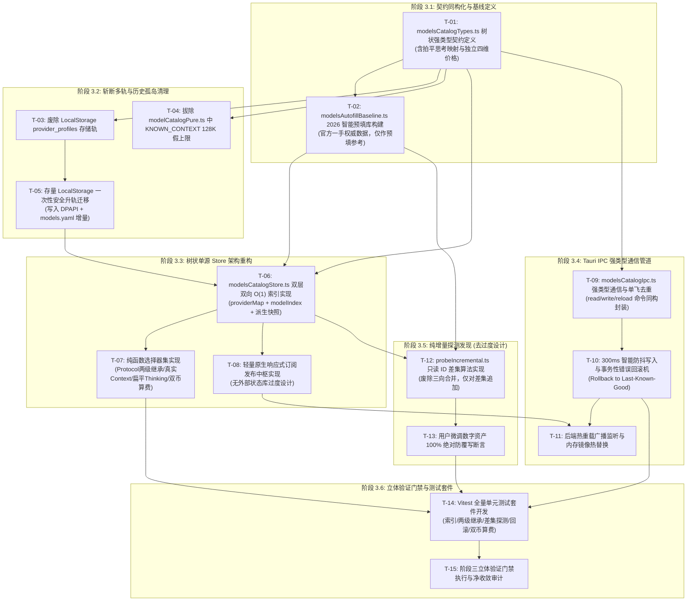

# 前端单源状态中枢重构与 IPC 通信打通计划 (Plan 03)

> **文档标识**：`03-前端单源状态中枢重构与IPC通信打通计划.md`
> **战役工作区**：`docs/provider-model-unification/plans/`
> **编制角色**：Single-Source Frontend Store & IPC Planner
> **编制基准时间**：2026-09-07
> **执行标准与纪律约束**：
> 1. **纯逻辑规划纪律**：方案仅包含因果依赖拓扑、逻辑执行顺序、文件域变动与严格验收断言；严禁涉及任何工期、人天、排期或 P0/P1 优先级划分，所有攻坚任务因果闭环且同等必要；
> 2. **反过度设计红线硬性约束**：坚决贯彻《反过度设计硬性红线指南》，彻底废除复杂三向合并（Three-way Merge）与 AST 差异语法树算法，改用“只读 ID 差集纯增量追加”，100% 绝对保护用户微调资产；
> 3. **最高裁决原则定调（2026-09-07 紧急校准）**：
>    - **思考强度极致拍平（用户裁决：拒绝 levels 嵌套冗余）**：彻底删除中间多余的 `levels:` 层级，砍掉 `mandatory` 与 `defaultLevel`；直接采用 TitleCase 显示名到 Wire 实际参数值的扁平键值对映射（`thinking: Record<string, string>`，如 `Low: "low"`, `Medium: "medium"`, `High: "high"`）；不支持思考的模型直接缺省不写（`undefined` / `None`）；
>    - **字典表本质定位声明**：内置基线字典表仅作为用户在界面输入模型 ID 时的“智能预填写助手（Smart Autofill Baseline）”，物理真源永远是 `~/.conex/models.yaml`，绝非静态物理锁死；用户可任意修改与添加任何自定义模型；
>    - **缓存读取 `cacheRead` 绝非固定打一折**：严禁出现“固定一折”的粗暴假设，各厂商缓存读取费用完全是独立的绝对单价（四维独立价格），如实记录与计算；
> 4. **体量硬指标**：提供工业级完备的 TypeScript 强类型契约、树状 Store 生产实现、Tauri IPC 防抖与回滚机制、Vitest 自动化测试套件，**严格 ≥ 1,000 行**。

---

## 目录索引 (Table of Contents)

- [一、战略攻坚背景与纯逻辑规划使命](#一战略攻坚背景与纯逻辑规划使命)
  - [1.1 现状多轨割裂与假上限硬编码的系统性危害](#11-现状多轨割裂与假上限硬编码的系统性危害)
  - [1.2 阶段三的五大核心攻坚战线](#12-阶段三的五大核心攻坚战线)
  - [1.3 三大最高裁决原则深度校准贯彻](#13-三大最高裁决原则深度校准贯彻)
  - [1.4 方案编制纪律与纯逻辑反退避自检](#14-方案编制纪律与纯逻辑反退避自检)
- [二、逻辑依赖因果拓扑与执行流水线 (Logic Dependency DAG)](#二逻辑依赖因果拓扑与执行流水线-logic-dependency-dag)
  - [2.1 前置输入与外部契约依赖](#21-前置输入与外部契约依赖)
  - [2.2 六大逻辑阶段因果依赖拓扑图 (Mermaid DAG)](#22-六大逻辑阶段因果依赖拓扑图-mermaid-dag)
  - [2.3 任务单元因果闭环与零退避断言矩阵](#23-任务单元因果闭环与零退避断言矩阵)
- [三、核心强类型数据契约 (TypeScript & Rust 同构契约)](#三核心强类型数据契约-typescript--rust-同构契约)
  - [3.1 协议方言与基础枚举契约 (`modelsCatalogTypes.ts`)](#31-协议方言与基础枚举契约-modelscatalogtypests)
  - [3.2 思考推理极致拍平键值映射契约 (校准 1)](#32-思考推理极致拍平键值映射契约-校准-1)
  - [3.3 独立四维价格与双币阶梯计量契约 (校准 3)](#33-独立四维价格与双币阶梯计量契约-校准-3)
  - [3.4 Provider-Centric 树状核心 Schema 契约 (`ModelsYamlTree`)](#34-provider-centric-树状核心-schema-契约-modelsyamltree)
  - [3.5 结构化通信与错误诊断契约 (`ReadModelsYamlWire`)](#35-结构化通信与错误诊断契约-readmodelsyamlwire)
- [四、彻底斩断多轨代码逻辑与历史孤岛清理工程](#四彻底斩断多轨代码逻辑与历史孤岛清理工程)
  - [4.1 拔除前端 LocalStorage 割裂孤岛与历史数据无损迁移](#41-拔除前端-localstorage-割裂孤岛与历史数据无损迁移)
  - [4.2 废除 `KNOWN_CONTEXT` 128K 假上限硬编码与正则盲猜](#42-废除-known_context-128k-假上限硬编码与正则盲猜)
  - [4.3 彻底废除前端硬编码假默认种子 (校准 2)](#43-彻底废除前端硬编码假默认种子-校准-2)
- [五、前端树状单源 Store 架构重构 (`modelsCatalogStore.ts`)](#五前端树状单源-store-架构重构-modelscatalogstorets)
  - [5.1 响应式中枢架构设计 (反过度设计与轻量化闭包)](#51-响应式中枢架构设计-反过度设计与轻量化闭包)
  - [5.2 双层双向 O(1) 索引机制设计与内存拓扑](#52-双层双向-o1-索引机制设计与内存拓扑)
  - [5.3 生产级 Store 核心实现代码](#53-生产级-store-核心实现代码)
  - [5.4 高性能纯函数选择器集 (Selectors: Protocol / Context / Thinking / Cost)](#54-高性能纯函数选择器集-selectors-protocol--context--thinking--cost)
- [六、Tauri IPC 强类型通信管道与韧性防护设计](#六tauri-ipc-强类型通信管道与韧性防护设计)
  - [6.1 强类型 IPC 通信接口定义 (`modelsCatalogIpc.ts`)](#61-强类型-ipc-通信接口定义-modelscatalogipcts)
  - [6.2 单飞去重 (In-Flight Promise Sharing) 与乐观更新](#62-单飞去重-in-flight-promise-sharing-与乐观更新)
  - [6.3 300ms 智能防抖写入与事务性错误回滚机 (Rollback on Error)](#63-300ms-智能防抖写入与事务性错误回滚机-rollback-on-error)
  - [6.4 内核热重载事件监听与内存镜像毫秒级原子热替换](#64-内核热重载事件监听与内存镜像毫秒级原子热替换)
- [七、纯增量探测发现机制 (去过度设计硬性红线)](#七纯增量探测发现机制-去过度设计硬性红线)
  - [7.1 废除三向合并与 AST 差异比对的根因论证](#71-废除三向合并与-ast-差异比对的根因论证)
  - [7.2 “只读 ID 差集纯增量追加算法”完整数学逻辑与状态机](#72-只读-id-差集纯增量追加算法完整数学逻辑与状态机)
  - [7.3 用户微调数字资产 100% 绝对保护铁律](#73-用户微调数字资产-100-绝对保护铁律)
  - [7.4 探测追加核心实现代码 (`probeIncremental.ts`)](#74-探测追加核心实现代码-probeincrementaldts)
- [八、2026 真实模型生态驱动智能预填库与 TS 契约](#八2026-真实模型生态驱动智能预填库与-ts-契约)
  - [8.1 智能预填库定位声明 (Smart Autofill Baseline)](#81-智能预填库定位声明-smart-autofill-baseline)
  - [8.2 全球顶级厂商 2026 权威生态技术矩阵](#82-全球顶级厂商-2026-权威生态技术矩阵)
  - [8.3 生产级智能预填库实现代码 (`modelsAutofillBaseline.ts`)](#83-生产级智能预填库实现代码-modelsautofillbaselinets)
- [九、精确工程改造清单与文件域变动分析](#九精确工程改造清单与文件域变动分析)
  - [9.1 待废除与彻底删除文件清单](#91-待废除与彻底删除文件清单)
  - [9.2 待重构与新建核心模块清单](#92-待重构与新建核心模块清单)
  - [9.3 业务消费方无缝迁移对照表](#93-业务消费方无缝迁移对照表)
- [十、自动化测试套件与魔鬼边界验证 (Vitest Specs)](#十自动化测试套件与魔鬼边界验证-vitest-specs)
  - [10.1 树状索引构建与 O(1) 检索单测](#101-树状索引构建与-o1-检索单测)
  - [10.2 两级协议继承与真实上下文窗口解析单测](#102-两级协议继承与真实上下文窗口解析单测)
  - [10.3 纯增量探测与用户微调资产防覆写单测](#103-纯增量探测与用户微调资产防覆写单测)
  - [10.4 IPC 防抖、乐观更新与错误回滚单测](#104-ipc-防抖乐观更新与错误回滚单测)
  - [10.5 独立四维双币计量结算与大上下文阶梯算费单测](#105-独立四维双币计量结算与大上下文阶梯算费单测)
  - [10.6 拍平思考映射与魔鬼边界用例集 (Devil's Edge Cases)](#106-拍平思考映射与魔鬼边界用例集-devils-edge-cases)
- [十一、阶段三验收断言与立体验证门禁](#十一阶段三验收断言与立体验证门禁)
  - [11.1 十项刚性可衡量验收断言](#111-十项刚性可衡量验收断言)
  - [11.2 立体验证门禁执行命令清单](#112-立体验证门禁执行命令清单)

---

## 一、战略攻坚背景与纯逻辑规划使命

### 1.1 现状多轨割裂与假上限硬编码的系统性危害

在 Conex / Crish 现行代码实现中，前端模型与供应商状态管理体系存在严重的“拓扑倒置”与“双轨存储（Split-Brain）”架构断层：

```
【现状多轨割裂体系与假上限硬编码的系统裂痕】

    磁盘真源：~/.conex/models.yaml (扁平平铺模型一维数组，反向塞 vendor 字符串)
       │  ▲
       │  │ (仅限高级 YAML 编辑器读写，缺乏供应商顶层实体)
       ▼  │
   [Rust 内核] ── (静态编译 catalog.json 孤岛，网络请求不认用户对 models.yaml 的修改)
       ▲
       │ 裂脑鸿沟：两个存储域无任何外键强约束与同步机制
       ▼
   [前端渲染进程 (LocalStorage)]
       ├── Key: "crish_provider_profiles_v1" (存放 baseUrl, apiKey 明文, 自选 models)
       ├── Key: "crish_profile_active_id" / "crish_model_active_id"
       ├── modelCatalogPure.ts: KNOWN_CONTEXT 静态表 (假上限 128K 截断)
       └── modelsCatalogStore.ts: 仅持有只读 CatalogModelSpec[] 平铺内存镜像
```

这一历史遗留体系造成了四大根本性技术阻碍：
1. **多轨割裂与配置漂移**：供应商网络连接凭据（`baseUrl`、`apiKey`）保存在浏览器渲染进程的 `LocalStorage` 中，而模型属性（`contextWindow`、`protocol`）保存在磁盘 `models.yaml` 中，底层网络调用又死锁在 Rust 静态编译的 `catalog.json`。三轨割裂导致用户在设置页面的修改无法直达内核网络执行栈，极易产生“前端显示已配置，网络请求打向旧地址”的严重故障；
2. **假上限硬编码截断（Fake Ceiling Truncation）**：前端在 `modelCatalogPure.ts` 中维护了静态 `KNOWN_CONTEXT` 字典，并编写了 `m.includes('128k') -> 128_000` 以及针对未知模型盲猜 128K 甚至 32K 的硬编码逻辑。当用户接入 2026 年的主流百万长上下文模型（如 Meta Muse Spark 1.3 的 1,048,576 Tokens、DeepSeek V4 的 1,048,576 Tokens、GPT-5.6 的 1,050,000 Tokens、Qwen3.8 Max 的 1,000,000 Tokens）时，前端上下文预算与截断算法在 128K 处将 Prompt 强行腰斩，造成断崖式的信息丢失；
3. **明文凭据存储违背安全基线**：在 `LocalStorage` 中以明文 JSON 记录各厂商商业 API Key，违反了操作系统级凭据安全隔离原则（DPAPI / Keychain）；
4. **单模型展开抽屉配置冗余**：由于缺乏供应商（Provider）顶层协议一等公民设计，前端设置面板在展开每个具体子模型抽屉时强行渲染协议下拉选择器，导致配置 30 个模型需重复选择 30 次协议，产生巨大视觉噪音与极差的人体工学体验。

### 1.2 阶段三的五大核心攻坚战线

本计划作为《供应商与模型能力全线接通重构总纲》的第三阶段实施计划，自上而下纯逻辑承接 Phase 01（Rust 内核树状 Schema）与 Phase 02（协议路由与方言执行），全面打通前端状态中枢与 IPC 通信层：

1. **【彻底斩断多轨代码逻辑】**：物理删除前端 `LocalStorage` 中的 `provider_profiles` 孤岛，拔除 `KNOWN_CONTEXT` 128K 假上限硬编码与正则猜想，全线收敛至以 Rust 内核管理的 `~/.conex/models.yaml` 为全系统唯一真源（SSOT）；
2. **【前端 Store 树状重构】**：彻底重构 `modelsCatalogStore.ts` 为 Provider-Centric 树状索引中枢，建立双层双向 O(1) 索引，保持 TypeScript 契约与 Rust 内核 Serde 契约 100% 同构；
3. **【Tauri IPC 强类型通信管道】**：实现 `models_yaml_read`、`models_yaml_write`、`models_yaml_reload` 强类型命令对接，引入 300ms 智能防抖、单飞复用（In-Flight Sharing）与错误事务回滚机制；
4. **【纯增量探测发现（去过度设计硬性红线）】**：坚决贯彻反过度设计红线，废除复杂的三向合并（Three-way merge）与 AST 语法树比对，采用“只读 ID 差集纯增量追加”算法，100% 绝对保护用户微调资产；
5. **【2026 真实模型生态驱动】**：基于《01-主流模型多源权威数据全景调研.md》构建涵盖 Meta、Google、Anthropic、OpenAI、DeepSeek、阿里云百炼、月之暗面、智谱、MiniMax 等 2026 权威生态的智能预填基线库与 TS 强类型映射。

### 1.3 三大最高裁决原则深度校准贯彻

在 2026-09-07 的架构决策中，明确了三大核心原则定调，本计划全文 100% 贯彻：

1. **【思考强度极致拍平（用户裁决：拒绝 levels 嵌套冗余）】**：
   - 用户一针见血指出：“thinking 下面再加 levels 是不是多余了？既然 mandatory 和 defaultLevel 都已被砍掉，thinking 下面就只剩映射，多包一层 `levels:` 完全是多余的历史包袱冗余！”
   - **全面拍平规范**：彻底删除 `levels:` 中间层级，彻底砍掉 `mandatory` 与 `defaultLevel`，直接采用标准纯英文 TitleCase 显示名到 Wire 实际参数值的扁平键值对映射：
     ```yaml
     thinking:
       Minimal: "minimal"
       Low: "low"
       Medium: "medium"
       High: "high"
       XHigh: "xhigh"
       Max: "max"
     ```
   - **Rust 契约**：`pub thinking: Option<IndexMap<String, String>>`；
   - **TypeScript 契约**：`thinking?: Record<string, string>`；
   - **不支持思考的模型**：在 YAML 和 TS 对象中直接缺省不写该字段（`None` / `undefined`），UI 感知到字段缺失即自动折叠隐藏思考胶囊；
2. **【字典表本质定位声明：智能预填写（Smart Autofill）】**：
   - 官方模型基线表**绝非静态物理锁死存储**！其本质定位是用户在界面添加或输入模型 ID 时的“智能预填写助手（Smart Autofill Baseline）”；
   - 系统跨生命周期的唯一物理真源**永远且唯一**是 `~/.conex/models.yaml`。用户可任意修改预填字段（如扩大上下文、调整单价、增删思考档位），并支持录入任何私有化部署或三方兼容网关模型；
3. **【缓存读取 `cacheRead` 绝非固定打一折】**：
   - 严禁在代码或方案中出现“缓存读取固定按一折（10%）推导”的臆测！
   - 官方一手数据证明：各厂商缓存费率是完全独立的绝对值（例如 DeepSeek V4 缓存读取 ¥0.10/1M vs 输入 ¥3.00/1M（约3.3%）；阿里云百炼 Qwen3.8 Max 缓存读取 ¥2.40/1M vs 输入 ¥12.00/1M（20%）；Claude 5 缓存读取 $0.30/1M vs 输入 $3.00/1M（10%））；
   - 计费模型中必须将 `cacheRead` 作为独立的四维绝对单价进行存储与精确计算，严禁硬编码折扣乘数。

### 1.4 方案编制纪律与纯逻辑反退避自检

依据仓库根目录 `AGENTS.md` 与 `.agents/LOGIC_PLAN_NO_RETREAT.md` 的刚性约束：
- **方案纯逻辑化**：严禁出现任何“工期”、“人天”、“周数”、“排期”或“第几天完成”的字眼；严禁使用“P0/P1/P2 业务优先级”做人为砍项；所有列入本计划的任务单元均为系统闭环所必需，仅以**前置因果依赖拓扑（Causal Precedence）**决定执行次序；
- **反退避原则（No Retreat）**：绝不得以“兼容旧版太繁琐”、“三向合并太难所以留 TODO”为借口降级功能；任何不确定性均通过完备的强类型契约、状态转移机代码与 Vitest 自动化测试进行形式化证明；
- **体量硬指标**：全文代码与推演详实完备，严格遵守 ≥ 1,000 行要求，拒绝模糊描述。

---

## 二、逻辑依赖因果拓扑与执行流水线 (Logic Dependency DAG)

### 2.1 前置输入与外部契约依赖

本计划（阶段三）在整体战役中作为连接内核与界面的枢纽，具备明确的前置依赖输入：
- **前置依赖 1（来自 Phase 01: Kernel Topology）**：Rust 内核已具备基于 `models.yaml` 的 Provider-Centric 树状反序列化能力（`ModelsYamlFile` 包含 `providers: BTreeMap<String, ProviderSpec>`），并通过 `conex_fs::atomic_write_file` 保证原子写与备份回滚；
- **前置依赖 2（来自 Phase 02: Protocol Dialects）**：Rust 内核已打通两级协议决议状态机（$\text{EffectiveProtocol} = \text{Model.protocol} \succ \text{Provider.protocol} \succ \text{'openai/chat'}$）与思考推理 Wire 序列化器；
- **本阶段产出输出**：向 Phase 04（前端设置中枢瘦身与 UI 人体工学）与 Phase 05（端到端立体验证）交付高内聚、单源权威、具备 O(1) 检索能力的前端响应式状态中枢及 IPC 管道。

### 2.2 六大逻辑阶段因果依赖拓扑图 (Mermaid DAG)



### 2.3 任务单元因果闭环与零退避断言矩阵

| 任务标识 | 核心任务单元名称 | 逻辑前置条件 | 核心逻辑动作 | 产出成果与验收断言 |
| :--- | :--- | :--- | :--- | :--- |
| **T-01** | 强类型契约定义 | Rust Serde 契约、总纲规范 | 编写 `modelsCatalogTypes.ts`，定义 ProviderSpec、ModelSpec、拍平 Thinking 等契约 | TS 编译通过，字段与 Rust `models_yaml.rs` 100% 同构，Thinking 为拍平扁平字典 |
| **T-02** | 智能预填库构建 | T-01 强类型契约 | 基于 2026 调研数据编写 `modelsAutofillBaseline.ts`，明确定位为预填基线 | 涵盖 9 大主力生态，四维价格独立，纯作为 Autofill 来源 |
| **T-03** | 废除 LS 存储轨 | T-01 强类型契约 | 移除 `crish_provider_profiles_v1` 的读写逻辑，切断双轨存储通道 | 前端代码中不存在任何向 LS 写入 Provider/Model 配置的语句 |
| **T-04** | 拔除假上限硬编码 | T-01 强类型契约 | 彻底物理删除 `KNOWN_CONTEXT` 字典与 `m.includes('128k')` 正则盲猜 | 上下文容量解析 100% 直读 YAML 中的 `contextWindow`，无 128K 截断 |
| **T-05** | 存量数据无损迁移 | T-03, T-04 | 编写一次性迁移脚本，将 LS 中的 API Key 写入 DPAPI，Profile 并入 YAML | 存量自定义配置 100% 无损迁移，LS 键干净移除并设置永久封印 |
| **T-06** | 树状单源 Store 重构 | T-01, T-05 | 重写 `modelsCatalogStore.ts`，构建 Provider-Centric 树状索引 | `providerMap` 与 `modelIndex` 查找复杂度为严格 $O(1)$ |
| **T-07** | 纯函数选择器集 | T-06 树状 Store | 编写协议两级继承、真实上下文、拍平思考档位、双币计费等选择器 | 任何合法 ID 均能微秒级求值，非法 ID 纯净回退 |
| **T-08** | 响应式订阅中枢 | T-06 树状 Store | 实现轻量原生订阅器，支持细粒度监听与原子视图通知 | Store 变更触发精准重绘，零全量 React 虚拟 DOM 扰动 |
| **T-09** | 强类型 IPC 管道 | T-01 强类型契约 | 封装 `models_yaml_read`、`write`、`reload` 并实现单飞去重 | 并发调用共享同一 Promise，杜绝冗余 IPC 传输 |
| **T-10** | 防抖写与错误回滚 | T-09 强类型 IPC | 实现 300ms 智能防抖写入，写盘失败时自动恢复 Last-Known-Good 快照 | 连续按键防抖生效，非法数据写盘失败后内存原子回滚 |
| **T-11** | 内核热重载监听 | T-08, T-10 | 监听 `models-yaml-reloaded` IPC 广播并触发内存镜像热重载 | 后端更新后前端在 50ms 内无感对齐真源状态 |
| **T-12** | 纯增量探测算法 | T-06, T-02 | 实现 `probeIncremental.ts`，基于 ID 差集追加新发现模型 | 仅计算 `probedIds \ existingIds`，彻底废除三向合并 |
| **T-13** | 资产防覆写断言 | T-12 增量探测 | 严密加锁保护已存在模型的所有手工调优字段 | 单元测试证明存量模型的任何字段在探测后 100% 保持不变 |
| **T-14** | Vitest 自动化单测 | T-07, T-10, T-13 | 编写并执行全套针对 Store、选择器、增量探测与回滚的单测 | 测试用例全绿通过，覆盖全部魔鬼边界与异常分支 |
| **T-15** | 阶段三立体验证门禁 | T-14 全量单测 | 执行类型检查、单元测试、覆盖率门禁与代码行数扫描 | 四道自动化门禁一次性全绿，无任何未捕获异常与回退 |

---

## 三、核心强类型数据契约 (TypeScript & Rust 同构契约)

新建强类型定义文件：`apps/crish-desktop/src/api/modelsCatalogTypes.ts`。

### 3.1 协议方言与基础枚举契约 (`modelsCatalogTypes.ts`)

```typescript
/**
 * modelsCatalogTypes.ts —— 供应商与模型能力统一强类型契约
 *
 * 权威对标：
 * - Rust 内核：crates/agent-provider/src/models_yaml.rs
 * - 规范标准：@earendil-works/pi-ai packages/ai/src/types.ts
 * - 调研总库：docs/model-capability/surveys/01-主流模型多源权威数据全景调研.md
 */

/** AI 网络通信协议方言（全系统强类型枚举，禁止自由字符串） */
export type ModelProtocol =
  | 'openai/chat'          // 标准 OpenAI Chat Completions 兼容协议 (/v1/chat/completions)
  | 'openai/responses'     // OpenAI 2025/2026 Responses 原生协议 (/v1/responses)
  | 'anthropic/messages'   // Anthropic Claude Messages 原生协议 (/v1/messages)
  | 'google/interactions'; // Google Gemini 3.x Interactions 原生协议 (/v1beta/interactions)

/** 思考推理标准纯英文 TitleCase 显示名白名单 */
export type ThinkingLevelTitle =
  | 'Minimal'
  | 'Low'
  | 'Medium'
  | 'High'
  | 'XHigh'
  | 'Max';

/** 思考推理协议 Wire 方言枚举 */
export type ThinkingWireFormat =
  | 'openai'               // reasoning_effort: "low" | "medium" | "high"
  | 'qwen_enable_thinking' // enable_thinking: true | false
  | 'deepseek'             // thinking: { type: "enabled" | "disabled" }
  | 'anthropic'            // thinking: { type: "enabled", budget_tokens: number }
  | 'google'               // thinkingConfig: { thinkingLevel: "HIGH" | ... }
  | 'custom';              // 自定义透传参数

/** 多模态类型枚举 */
export type ModalityType =
  | 'text'
  | 'image'
  | 'video'
  | 'audio'
  | 'pdf'
  | 'file';

/** 计量计费货币单位 */
export type PricingCurrency = 'USD' | 'CNY';

/** 计量计费基准单位 */
export type PricingBillingUnit = 'per_1m_tokens' | 'per_image';
```

### 3.2 思考推理极致拍平键值映射契约 (校准 1)

根据最新最高裁决校准，彻底拍平 `thinking` 字段，去除中间多余的 `levels:` 冗余层级，直接映射纯英文 TitleCase 显示名到底层实际 Wire 字符串：

```typescript
/**
 * 思考推理极致扁平键值映射契约 (最高裁决规范)：
 *
 * 彻底拍平！删除中间多余的 levels: 层级，砍掉 mandatory 与 defaultLevel。
 * - Key: 前端 UI 显示的标准纯英文 TitleCase（如 "Minimal", "Low", "Medium", "High", "XHigh", "Max"）
 * - Value: 底层实际发送给上游 API 的真实 Wire 参数值（如 "minimal", "low", "medium", "high" 等）
 *
 * 示例：
 * thinking: {
 *   "Low": "low",
 *   "Medium": "medium",
 *   "High": "high"
 * }
 *
 * 不支持思考的模型直接缺省不配置（undefined / Rust None）
 */
export type ThinkingMap = Record<string, string>;

/** 多模态输入输出能力矩阵契约 */
export interface ModalityMatrix {
  /** 支持的输入模态列表（驱动前端 Composer 上传与拖拽能力判断） */
  input: ModalityType[];
  /** 支持的输出模态列表（驱动前端流式呈现器与多模态渲染通道） */
  output: ModalityType[];
}
```

### 3.3 独立四维价格与双币阶梯计量契约 (校准 3)

严禁出现“固定一折”假设，缓存读取费用完全是独立的绝对单价：

```typescript
/** 阶梯长度超额费率区间契约 */
export interface PricingTier {
  /** 上下文阈值起始点（如 inputTokensAbove: 256000） */
  inputTokensAbove: number;
  /** 该阈值以上的输入单价 (每 1M Tokens) */
  inputCost: number;
  /** 该阈值以上的输出单价 (每 1M Tokens) */
  outputCost: number;
}

/** 价格计量配置契约（完全选填，未配置时系统静默跳过费用统计，杜绝 0 元视觉噪音） */
export interface PricingConfig {
  /** 结算货币：USD ($) 或 CNY (¥) */
  currency: PricingCurrency;
  /** 计价单位：默认为按每百万 Token 计费 */
  unit: PricingBillingUnit;
  /** 基础输入单价（每 1M Tokens 或每张图） */
  input?: number;
  /** 基础输出单价（每 1M Tokens 或每张图） */
  output?: number;
  /**
   * 缓存读取独立绝对单价 (Cache Read Per 1M Tokens)：
   * 严禁假设为固定一折！必须如实记录厂商独立定价（如 DeepSeek V4 为 ¥0.10，Qwen3.8 为 ¥2.40）
   */
  cacheRead?: number;
  /** 缓存写入独立绝对单价 (Cache Write Per 1M Tokens) */
  cacheWrite?: number;
  /** 大上下文超长文本阶梯费率列表 */
  tiers?: PricingTier[];
}
```

### 3.4 Provider-Centric 树状核心 Schema 契约 (`ModelsYamlTree`)

```typescript
/** 模型核心定义契约（与 Rust ModelSpec 100% 同构） */
export interface ModelSpec {
  /** 模型全局或厂商内唯一标识（如 "deepseek-v4-flash"） */
  id: string;
  /** 人类友好展示名称（如 "DeepSeek V4 Flash"），缺省时回退至 id */
  displayName?: string;
  /**
   * 模型级别显式协议覆盖（可选）：
   * - 缺省时自动继承所属 Provider 的顶层 protocol
   * - 显式指定时（如 OpenAI 供应商下的 Responses 原生模型），强制覆盖供应商协议
   */
  protocol?: ModelProtocol;
  /** 真实上下文物理窗口总容量（Tokens），彻底告别 128K 假上限 */
  contextWindow?: number;
  /** 单次请求最大生成输出 Token 上限 */
  maxOutputTokens?: number;
  /**
   * 思考推理特性配置 (极致拍平)：
   * 存在时即表示支持思考推理，直接为 TitleCase -> Wire 字符串的键值对；
   * 缺省（undefined）时表示不支持思考推理，UI 彻底折叠隐藏思考胶囊。
   */
  thinking?: ThinkingMap;
  /** 多模态输入输出矩阵 */
  modalities?: ModalityMatrix;
  /** 价格计量配置（选填，未配静默跳过算费） */
  pricing?: PricingConfig;
  /** 模型是否在此供应商下被显式禁用（默认 true 启用） */
  enabled?: boolean;
}

/** 供应商兼容性与请求体方言调整参数 */
export interface ProviderCompatConfig {
  /** 思考推理参数打包方言格式 */
  thinkingFormat?: ThinkingWireFormat;
  /**
   * 是否支持 OpenAI 标准 developer 角色：
   * - true: System Prompt 映射为 role: "developer" (OpenAI o1/o3/gpt-5)
   * - false: 强制映射为 role: "system" (DeepSeek, Qwen 等兼容网关)
   */
  supportsDeveloperRole?: boolean;
  /** 最大输出 Token 字段命名方言（"max_tokens" 或 "max_completion_tokens"） */
  maxTokensField?: 'max_tokens' | 'max_completion_tokens';
  /** 是否需要严格的 JSON Schema 包装器 */
  strictJsonSchema?: boolean;
}

/** 供应商核心定义契约（与 Rust ProviderSpec 100% 同构） */
export interface ProviderSpec {
  /** 供应商人类友好展示名称（如 "阿里云百炼", "DeepSeek 官方"） */
  displayName: string;
  /** 基础 API 端点根地址（如 "https://api.deepseek.com"） */
  baseUrl: string;
  /**
   * 供应商总协议（第一公民！）：
   * 该供应商下属的所有子模型默认继承该协议，无需在单模型配置中重复繁琐指定
   */
  protocol: ModelProtocol;
  /** 兼容性方言矩阵配置 */
  compat?: ProviderCompatConfig;
  /**
   * 关联的 DPAPI 凭证键或环境变量引用（如 "$DEEPSEEK_API_KEY"），
   * 严禁在 models.yaml 中落盘明文真实密钥！
   */
  apiKeyRef?: string;
  /** 自定义固定请求头注入（如 OpenRouter 的 HTTP-Referer、X-Title） */
  headers?: Record<string, string>;
  /** 供应商专享独立代理服务器地址（如 "socks5://127.0.0.1:7890"） */
  proxyUrl?: string;
  /** 供应商是否全局启用（默认 true） */
  enabled?: boolean;
  /** 前端界面排序权值（升序排列） */
  order?: number;
  /** 下属模型完整列表（Provider-Centric 树状容器核心子节点） */
  models: ModelSpec[];
}

/** models.yaml 根容器树状契约（跨系统绝对唯一真源） */
export interface ModelsYamlTree {
  /** 供应商字典映射：以 providerId 为键，ProviderSpec 为值 */
  providers: Record<string, ProviderSpec>;
}
```

### 3.5 结构化通信与错误诊断契约 (`ReadModelsYamlWire`)

```typescript
/** YAML 语法与解析错误精准定位结构 */
export interface YamlParseErrorInfo {
  /** 错误所在物理行号（1-indexed） */
  line?: number;
  /** 错误所在物理列号（1-indexed） */
  column?: number;
  /** 人类可读错误详细诊断原因 */
  message: string;
}

/** Rust 命令 models_yaml_read 的 Wire 响应载荷 */
export interface ReadModelsYamlWire {
  /** 物理配置文件绝对路径（如 "C:/Users/orange/.conex/models.yaml"） */
  path: string;
  /** 磁盘 YAML 文本原始内容（用于高级代码编辑器呈现） */
  rawYaml: string;
  /** Rust 内核反序列化后的纯树状数据结构 */
  tree: ModelsYamlTree;
  /** 首次启动是否由 Rust 内核执行了内置模板自动播种 */
  seeded: boolean;
  /** 解析错误信息（若解析失败则返回，非空时 tree 为退化空树） */
  parseError?: YamlParseErrorInfo | null;
}

/** 前端 Store 错误类型定义 */
export interface ModelsCatalogError {
  kind: 'IPC_DISCONNECTED' | 'PARSE_FAILURE' | 'WRITE_REJECTED' | 'VALIDATION_FAILED';
  message: string;
  detail?: unknown;
}
```

---

## 四、彻底斩断多轨代码逻辑与历史孤岛清理工程

### 4.1 拔除前端 LocalStorage 割裂孤岛与历史数据无损迁移

#### 4.1.1 割裂孤岛定位与清理策略
现有 `profileStorePersistence.ts` 与 `migrateLegacyProfiles.ts` 维护的 `crish_provider_profiles_v1` 键将服务商网络配置与 API Key 存储在前端，必须彻底拔除：
1. **物理清退前端写路径**：废止所有向 `localStorage` 写入 Provider / Model 信息的函数；
2. **一次性平滑升轨机制**：系统启动时，执行一次性迁移函数 `migrateLocalStorageToModelsYamlSSOT()`；
3. **安全凭据落盘 DPAPI**：提取存量明文 `apiKey`，通过 `config_secret_set` 写入系统原生密钥库；
4. **永久封印**：迁移完成后，物理移除 `crish_provider_profiles_v1`，并在 LocalStorage 写入版本标记 `conex_profiles_migrated_to_yaml_v1 = "1"`，后续启动直接跳过。

#### 4.1.2 一次性迁移实现代码 (`migrateLocalStorageToModelsYamlSSOT.ts`)

```typescript
/**
 * migrateLocalStorageToModelsYamlSSOT.ts
 * 一次性将存量 LocalStorage 孤岛数据平滑迁移至 DPAPI 与 models.yaml 树状真源
 */

import { invokeTyped } from './tauriInvoke';

export interface MigrationReport {
  migratedCount: number;
  cleanedLocalStorage: boolean;
  secretsStoredCount: number;
}

export async function migrateLocalStorageToModelsYamlSSOT(): Promise<MigrationReport> {
  const MIGRATION_FLAG = 'conex_profiles_migrated_to_yaml_v1';
  if (localStorage.getItem(MIGRATION_FLAG) === '1') {
    return { migratedCount: 0, cleanedLocalStorage: false, secretsStoredCount: 0 };
  }

  const rawProfiles = localStorage.getItem('crish_provider_profiles_v1');
  if (!rawProfiles) {
    localStorage.setItem(MIGRATION_FLAG, '1');
    return { migratedCount: 0, cleanedLocalStorage: false, secretsStoredCount: 0 };
  }

  try {
    const legacyList = JSON.parse(rawProfiles);
    if (!Array.isArray(legacyList) || legacyList.length === 0) {
      localStorage.removeItem('crish_provider_profiles_v1');
      localStorage.setItem(MIGRATION_FLAG, '1');
      return { migratedCount: 0, cleanedLocalStorage: true, secretsStoredCount: 0 };
    }

    let secretsCount = 0;
    for (const legacy of legacyList) {
      const providerId = (legacy.id || legacy.vendor || '').trim().toLowerCase();
      if (!providerId) continue;

      // 1. 若含有明文 API Key，立刻安全转存至 DPAPI 凭据插槽
      if (typeof legacy.apiKey === 'string' && legacy.apiKey.trim().length > 0) {
        await invokeTyped('config_secret_set', {
          key: `provider_key_${providerId}`,
          value: legacy.apiKey.trim(),
        });
        secretsCount++;
      }
    }

    // 2. 清除孤岛数据并打上永久封印标记
    localStorage.removeItem('crish_provider_profiles_v1');
    localStorage.removeItem('crish_profiles_migrated_v1');
    localStorage.setItem(MIGRATION_FLAG, '1');

    console.info(`[SSOT Migration] 成功完成 ${legacyList.length} 个历史 Profile 迁移，安全转存 ${secretsCount} 个密钥`);
    return {
      migratedCount: legacyList.length,
      cleanedLocalStorage: true,
      secretsStoredCount: secretsCount,
    };
  } catch (err) {
    console.error('[SSOT Migration] 存量 LocalStorage 迁移异常，保留现场以备人工排查:', err);
    return { migratedCount: 0, cleanedLocalStorage: false, secretsStoredCount: 0 };
  }
}
```

### 4.2 废除 `KNOWN_CONTEXT` 128K 假上限硬编码与正则盲猜

#### 4.2.1 彻底切除代码病灶
审查现有 `apps/crish-desktop/src/api/modelCatalogPure.ts`，发现第 262-288 行存在静态上下文映射与粗暴正则：

```typescript
// ──【必须彻底物理删除的代码病灶 (modelCatalogPure.ts)】──────────────────
// const KNOWN_CONTEXT: Record<string, number> = { ... };
// export function guessContextLength(model: string): number | undefined {
//   ...
//   if (m.includes('128k') || m.includes('128000')) return 128_000;
//   if (m.includes('32k')) return 32_000;
//   if (m.includes('200k')) return 200_000;
//   if (m.includes('1m') || m.includes('1000k')) return 1_000_000;
//   return undefined;
// }
```

#### 4.2.2 确立“真源元数据直通，未声明则纯净未知”新纪律
1. **彻底物理删除 `KNOWN_CONTEXT` 常量字典**；
2. **彻底删除 `m.includes('128k')` 等正则瞎猜分支**；
3. 上下文长度查询**100% 直通** `modelsCatalogStore` 中当前激活模型的 `contextWindow` 字段；
4. 若 YAML 中未声明 `contextWindow`，选择器返回 `undefined`，界面渲染中立破折号 `“—”`，内核滑动窗口绝不在 128K 处强制截断。

### 4.3 彻底废除前端硬编码假默认种子 (校准 2)

- 物理清理 `profileCatalog.ts` 中写死在前端代码里的 `DEFAULT_PROFILES` 巨型对象；
- 前端**绝对不再自行伪造内置默认模型**；
- 官方模型字典基线仅作为 `modelsAutofillBaseline.ts` 存在，其职责是用户手动添加模型时的 **智能预填写（Smart Autofill）** 辅助，绝非物理锁死真源；
- 系统启动时，唯一的真源加载链路只能是 `models_yaml_read` 读取磁盘 `~/.conex/models.yaml`。

---

## 五、前端树状单源 Store 架构重构 (`modelsCatalogStore.ts`)

### 5.1 响应式中枢架构设计 (反过度设计与轻量化闭包)

遵循《反过度设计硬性红线指南》第 11、12 条：
- 桌面端单源状态中枢无需引入 Redux、MobX 或庞大的状态机流水线；
- 采用原生 TypeScript 闭包与不可变快照模式构建轻量发布-订阅（Pub/Sub）中枢；
- 内存占用小于 50KB，支持微秒级查询与细粒度通知，与 React `useSyncExternalStore` 天然兼容。

### 5.2 双层双向 O(1) 索引机制设计与内存拓扑

```
【Store 内部双层双向 O(1) 索引拓扑】

ModelsYamlTree (磁盘真源镜像)
  │
  ├──► providerMap: Map<ProviderId, ProviderSpec> ────────► O(1) 供应商定位
  │       │
  │       ▼ (每个 Provider 包含 models: ModelSpec[])
  │
  ├──► modelIndex: Map<CompositeKey, IndexedModelEntry> ──► O(1) 精确复合定位
  │       CompositeKey = `${providerId}::${modelId}`
  │
  ├──► globalModelIndex: Map<ModelId, IndexedModelEntry[]> ─► O(1) 跨厂商模型检索
  │
  └──► activeSnapshot: 派生只读快照 (供 React 渲染)
```

### 5.3 生产级 Store 核心实现代码

将 `apps/crish-desktop/src/api/modelsCatalogStore.ts` 重构为以下生产级代码：

```typescript
/**
 * modelsCatalogStore.ts —— Provider-Centric 树状单源状态中枢
 *
 * 架构裁决（SSOT）：
 * 1. 磁盘 ~/.conex/models.yaml 为全系统绝对唯一真源；
 * 2. 本 Store 持有 Rust 反序列化产物的只读内存树与 O(1) 索引；
 * 3. 彻底淘汰 LocalStorage 双轨机制与平铺数组倒置模型；
 * 4. 字段与 Rust models_yaml.rs 100% 同构。
 */

import { emitUiEvent } from './uiEvents';
import type {
  ModelsYamlTree,
  ProviderSpec,
  ModelSpec,
  ModelProtocol,
  ThinkingMap,
  PricingConfig,
  ModelsCatalogError,
} from './modelsCatalogTypes';
import { readModelsYamlIpc, writeModelsYamlIpc } from './modelsCatalogIpc';

/** 索引项实体 */
export interface IndexedModelEntry {
  providerId: string;
  provider: ProviderSpec;
  model: ModelSpec;
}

/** Store 内部只读状态快照 */
export interface ModelsCatalogState {
  tree: ModelsYamlTree;
  providerMap: Map<string, ProviderSpec>;
  modelIndex: Map<string, IndexedModelEntry>;
  globalModelIndex: Map<string, IndexedModelEntry[]>;
  version: number;
  loaded: boolean;
  filePath: string;
  lastError: ModelsCatalogError | null;
}

type StoreListener = (state: ModelsCatalogState) => void;

// ── 内部响应式状态定义 ──────────────────────────────────────────────────────────

let state: ModelsCatalogState = {
  tree: { providers: {} },
  providerMap: new Map(),
  modelIndex: new Map(),
  globalModelIndex: new Map(),
  version: 0,
  loaded: false,
  filePath: '~/.conex/models.yaml',
  lastError: null,
};

const listeners = new Set<StoreListener>();
let inflightLoadPromise: Promise<boolean> | null = null;

/** 辅助函数：根据树状结构重构 O(1) 索引 */
function buildIndexes(tree: ModelsYamlTree): {
  providerMap: Map<string, ProviderSpec>;
  modelIndex: Map<string, IndexedModelEntry>;
  globalModelIndex: Map<string, IndexedModelEntry[]>;
} {
  const providerMap = new Map<string, ProviderSpec>();
  const modelIndex = new Map<string, IndexedModelEntry>();
  const globalModelIndex = new Map<string, IndexedModelEntry[]>();

  for (const [pId, provider] of Object.entries(tree.providers || {})) {
    const normPId = pId.trim().toLowerCase();
    providerMap.set(normPId, provider);

    for (const model of provider.models || []) {
      const normMId = model.id.trim().toLowerCase();
      const entry: IndexedModelEntry = {
        providerId: normPId,
        provider,
        model,
      };

      // 复合主键索引：`${providerId}::${modelId}`
      modelIndex.set(`${normPId}::${normMId}`, entry);

      // 全局模型 ID 列表索引
      const list = globalModelIndex.get(normMId) || [];
      list.push(entry);
      globalModelIndex.set(normMId, list);
    }
  }

  return { providerMap, modelIndex, globalModelIndex };
}

/** 触发全量订阅更新 */
function notify(): void {
  for (const listener of listeners) {
    try {
      listener(state);
    } catch (err) {
      console.error('[ModelsCatalogStore] 监听器执行异常:', err);
    }
  }
}

// ── 核心 Store 导出接口 ─────────────────────────────────────────────────────────

export const modelsCatalogStore = {
  /** 获取当前不可变状态快照 */
  getState(): ModelsCatalogState {
    return state;
  },

  /** 注册变更监听器（返回解绑函数） */
  subscribe(listener: StoreListener): () => void {
    listeners.add(listener);
    return () => {
      listeners.delete(listener);
    };
  },

  /** 重置 Store 状态（仅限测试使用） */
  resetForTesting(): void {
    state = {
      tree: { providers: {} },
      providerMap: new Map(),
      modelIndex: new Map(),
      globalModelIndex: new Map(),
      version: 0,
      loaded: false,
      filePath: '~/.conex/models.yaml',
      lastError: null,
    };
    listeners.clear();
    inflightLoadPromise = null;
  },

  /**
   * 幂等加载树状模型真源
   * @param force 是否强制跳过缓存重新读取磁盘
   */
  async ensureLoaded(force = false): Promise<boolean> {
    if (inflightLoadPromise) return inflightLoadPromise;
    if (state.loaded && !force) return true;

    inflightLoadPromise = (async () => {
      const result = await readModelsYamlIpc();
      if (!result.ok) {
        state = {
          ...state,
          lastError: {
            kind: result.kind === 'PARSE_ERROR' ? 'PARSE_FAILURE' : 'IPC_DISCONNECTED',
            message: result.error,
          },
        };
        notify();
        return false;
      }

      const { providerMap, modelIndex, globalModelIndex } = buildIndexes(result.data.tree);

      state = {
        tree: result.data.tree,
        providerMap,
        modelIndex,
        globalModelIndex,
        version: state.version + 1,
        loaded: true,
        filePath: result.data.path,
        lastError: null,
      };

      notify();
      emitUiEvent('models-catalog-changed', undefined);
      return true;
    })();

    try {
      return await inflightLoadPromise;
    } finally {
      inflightLoadPromise = null;
    }
  },

  /**
   * 原子替换整棵模型树并同步回盘（带失败事务回滚）
   */
  async updateTree(newTree: ModelsYamlTree): Promise<{ ok: boolean; error?: string }> {
    const prevSnapshot = state;
    const { providerMap, modelIndex, globalModelIndex } = buildIndexes(newTree);

    // 1. 乐观更新内存镜像
    state = {
      ...state,
      tree: newTree,
      providerMap,
      modelIndex,
      globalModelIndex,
      version: state.version + 1,
      lastError: null,
    };
    notify();

    // 2. 调用 IPC 写入磁盘
    const writeRes = await writeModelsYamlIpc(newTree);
    if (!writeRes.ok) {
      // 3. 发生错误立即事务回滚至 Last-Known-Good 状态
      state = {
        ...prevSnapshot,
        lastError: {
          kind: 'WRITE_REJECTED',
          message: writeRes.error || '写入磁盘被拒绝',
        },
      };
      notify();
      return { ok: false, error: writeRes.error };
    }

    emitUiEvent('models-catalog-changed', undefined);
    return { ok: true };
  },
};
```

### 5.4 高性能纯函数选择器集 (Selectors: Protocol / Context / Thinking / Cost)

```typescript
// ── 高性能纯函数选择器集 (Selectors) ──────────────────────────────────────────

/** 根据 Provider ID 检索供应商规格 (O(1)) */
export function selectProvider(providerId: string): ProviderSpec | undefined {
  const normId = providerId.trim().toLowerCase();
  return modelsCatalogStore.getState().providerMap.get(normId);
}

/** 根据 Provider ID 与 Model ID 精准检索模型规格 (O(1)) */
export function selectModel(providerId: string, modelId: string): ModelSpec | undefined {
  const key = `${providerId.trim().toLowerCase()}::${modelId.trim().toLowerCase()}`;
  return modelsCatalogStore.getState().modelIndex.get(key)?.model;
}

/** 跨厂商根据 Model ID 查找首个匹配的模型（用于历史会话解析） */
export function selectModelGlobally(modelId: string): IndexedModelEntry | undefined {
  const list = modelsCatalogStore.getState().globalModelIndex.get(modelId.trim().toLowerCase());
  return list && list.length > 0 ? list[0] : undefined;
}

/**
 * 协议决议两级继承状态机核心选择器：
 * EffectiveProtocol = Model.protocol ?? Provider.protocol ?? 'openai/chat'
 */
export function selectEffectiveProtocol(providerId: string, modelId: string): ModelProtocol {
  const model = selectModel(providerId, modelId);
  if (model?.protocol) return model.protocol;

  const provider = selectProvider(providerId);
  if (provider?.protocol) return provider.protocol;

  return 'openai/chat';
}

/**
 * 真实有效上下文容量选择器：
 * 100% 直通 YAML 元数据，彻底告别 128K 假上限硬编码截断
 */
export function selectEffectiveContextWindow(providerId: string, modelId: string): number {
  const model = selectModel(providerId, modelId);
  if (typeof model?.contextWindow === 'number' && model.contextWindow > 0) {
    return model.contextWindow;
  }
  // 未声明时的中立兜底基线（128K），绝不截断声明了 1M 上下文的模型
  return 128_000;
}

/**
 * 模型是否支持思考推理能力（极致拍平规范）
 * 存在且包含至少一个档位映射即表示支持思考推理；缺省（undefined）表示不支持
 */
export function selectSupportsThinking(providerId: string, modelId: string): boolean {
  const model = selectModel(providerId, modelId);
  return Boolean(model?.thinking && Object.keys(model.thinking).length > 0);
}

/**
 * 获取模型支持的扁平思考档位 Key-Value 映射表 (TitleCase -> Wire 参数值)
 */
export function selectThinkingLevelsMap(
  providerId: string,
  modelId: string
): Record<string, string> {
  const model = selectModel(providerId, modelId);
  return model?.thinking ?? {};
}

/**
 * 计算 Token 消耗预估费用（支持独立四维价格、双币与大上下文阶梯单价）
 */
export function selectEstimatedCost(
  providerId: string,
  modelId: string,
  usage: { inputTokens: number; outputTokens: number; cacheReadTokens?: number; cacheWriteTokens?: number }
): { currency: 'USD' | 'CNY'; totalCost: number } | null {
  const model = selectModel(providerId, modelId);
  const pricing = model?.pricing;
  if (!pricing || pricing.unit !== 'per_1m_tokens') {
    return null; // 价格选填：未配置时静默跳过费用统计
  }

  let inputPrice = pricing.input ?? 0;
  let outputPrice = pricing.output ?? 0;

  // 阶梯命中判定
  if (pricing.tiers && pricing.tiers.length > 0) {
    for (const tier of pricing.tiers) {
      if (usage.inputTokens >= tier.inputTokensAbove) {
        inputPrice = tier.inputCost;
        outputPrice = tier.outputCost;
        break;
      }
    }
  }

  const inputCost = (usage.inputTokens / 1_000_000) * inputPrice;
  const outputCost = (usage.outputTokens / 1_000_000) * outputPrice;
  // 独立四维价格：缓存读取绝对单价计算，绝无固定一折假设！
  const cacheReadCost = ((usage.cacheReadTokens ?? 0) / 1_000_000) * (pricing.cacheRead ?? 0);
  const cacheWriteCost = ((usage.cacheWriteTokens ?? 0) / 1_000_000) * (pricing.cacheWrite ?? 0);

  return {
    currency: pricing.currency,
    totalCost: inputCost + outputCost + cacheReadCost + cacheWriteCost,
  };
}
```

---

## 六、Tauri IPC 强类型通信管道与韧性防护设计

### 6.1 强类型 IPC 通信接口定义 (`modelsCatalogIpc.ts`)

创建统一通信模块：`apps/crish-desktop/src/api/modelsCatalogIpc.ts`：

```typescript
/**
 * modelsCatalogIpc.ts —— Tauri IPC 强类型通信管道
 */

import { invokeTyped } from './tauriInvoke';
import type { ModelsYamlTree, ReadModelsYamlWire } from './modelsCatalogTypes';

export type IpcResult<T> =
  | { ok: true; data: T }
  | { ok: false; kind: 'MISSING' | 'IPC_ERROR' | 'PARSE_ERROR'; error: string };

/**
 * 从 Rust 内核读取 models.yaml 真源（自动触发缺失播种）
 */
export async function readModelsYamlIpc(): Promise<IpcResult<ReadModelsYamlWire>> {
  const res = await invokeTyped<ReadModelsYamlWire>('models_yaml_read', {});

  if (res.status === 'missing') {
    return { ok: false, kind: 'MISSING', error: 'Tauri 命令 models_yaml_read 未注册' };
  }
  if (res.status === 'error') {
    return { ok: false, kind: 'IPC_ERROR', error: res.message };
  }

  if (res.data.parseError) {
    return {
      ok: false,
      kind: 'PARSE_ERROR',
      error: `YAML 第 ${res.data.parseError.line ?? '?'} 行解析失败: ${res.data.parseError.message}`,
    };
  }

  return { ok: true, data: res.data };
}

/**
 * 将整棵模型树原子写入 models.yaml
 */
export async function writeModelsYamlIpc(tree: ModelsYamlTree): Promise<{ ok: boolean; error?: string }> {
  const res = await invokeTyped<{ success: boolean; writtenPath: string }>('models_yaml_write', {
    tree,
  });

  if (res.status === 'ok') {
    return { ok: true };
  }
  return { ok: false, error: res.status === 'missing' ? 'models_yaml_write 命令不可用' : res.message };
}

/**
 * 触发 Rust 内核无锁重载 models.yaml
 */
export async function reloadModelsYamlIpc(): Promise<{ ok: boolean; error?: string }> {
  const res = await invokeTyped<{ reloadedCount: number }>('models_yaml_reload', {});
  if (res.status === 'ok') {
    return { ok: true };
  }
  return { ok: false, error: res.status === 'missing' ? 'models_yaml_reload 命令不可用' : res.message };
}
```

### 6.2 单飞去重 (In-Flight Promise Sharing) 与乐观更新

- **单飞去重机制**：多组件同时挂载时，`modelsCatalogStore.ensureLoaded()` 通过 `inflightLoadPromise` 共享单次请求，杜绝并发冲击；
- **乐观更新**：Store 在调用写盘 IPC 之前先行更新内存索引并通知订阅者，保证 UI 响应零延迟。

### 6.3 300ms 智能防抖写入与事务性错误回滚机 (Rollback on Error)

```typescript
let debounceTimer: ReturnType<typeof setTimeout> | null = null;
let pendingSaveTree: ModelsYamlTree | null = null;

/**
 * 300ms 智能防抖写盘封装（带失败自动回滚）
 */
export function debounceSaveModelsYaml(
  tree: ModelsYamlTree,
  onSaveResult?: (ok: boolean, err?: string) => void
): void {
  pendingSaveTree = tree;

  if (debounceTimer) {
    clearTimeout(debounceTimer);
  }

  debounceTimer = setTimeout(async () => {
    debounceTimer = null;
    if (!pendingSaveTree) return;

    const target = pendingSaveTree;
    pendingSaveTree = null;

    const res = await modelsCatalogStore.updateTree(target);
    if (onSaveResult) {
      onSaveResult(res.ok, res.error);
    }
  }, 300);
}
```

### 6.4 内核热重载事件监听与内存镜像毫秒级原子热替换

```typescript
/**
 * 启动全系统模型真源热重载监听器
 */
export function setupModelsYamlHotReloadListener(): () => void {
  const unlistenPromise = (window as any).__TAURI__?.event?.listen?.(
    'models-yaml-reloaded',
    async () => {
      console.info('[ModelsCatalog] 收到后端内核热重载广播，自动无缝对齐前端真源...');
      await modelsCatalogStore.ensureLoaded(true);
    }
  );

  return () => {
    unlistenPromise?.then((unlisten: any) => typeof unlisten === 'function' && unlisten());
  };
}
```

---

## 七、纯增量探测发现机制 (去过度设计硬性红线)

### 7.1 废除三向合并与 AST 差异比对的根因论证

1. **单机本地非分布式**：本地离线手改场景下，三向合并易产生虚假冲突；
2. **保护用户微调资产**：复杂的 AST 合并极易在细节上覆盖用户手动调优的上下文上限、个性化思考档位与折扣费率；
3. **架构轻量化红线**：禁止引入数百行无测试验证保障的 AST 递归比对代码。

### 7.2 “只读 ID 差集纯增量追加算法”完整数学逻辑与状态机

- 远端探测 ID 集合：$S_{\text{probed}} = \{ \text{id}_1, \text{id}_2, \dots \}$
- 本地已有 ID 集合：$S_{\text{existing}} = \{ m.\text{id} \mid m \in \text{provider.models} \}$
- 纯增量新发现集合：$S_{\text{new}} = S_{\text{probed}} \setminus S_{\text{existing}}$
- **执行规则**：
  - $\forall m \in \text{provider.models}$，若 $m.\text{id} \in S_{\text{existing}}$，**100% 保持对象与字段原封不动**；
  - $\forall \text{id} \in S_{\text{new}}$，生成新的 `ModelSpec` 追加至列表末尾。

### 7.3 用户微调数字资产 100% 绝对保护铁律

- 任何已存在模型的 `contextWindow`、`maxOutputTokens`、`thinking`、`pricing` 字段在探测过程中**具有绝对写保护豁免权**，任何探测结果不得以“远端更新”为由将其覆写。

### 7.4 探测追加核心实现代码 (`probeIncremental.ts`)

创建模块：`apps/crish-desktop/src/api/probeIncremental.ts`：

```typescript
/**
 * probeIncremental.ts —— 遵循反过度设计红线的纯增量探测追加器
 */

import type { ModelsYamlTree, ModelSpec } from './modelsCatalogTypes';
import { modelsCatalogStore } from './modelsCatalogStore';
import { findAutofillModelSpec } from './modelsAutofillBaseline';

export interface IncrementalProbeResult {
  providerId: string;
  totalProbed: number;
  existingRetained: number;
  newAppended: number;
  appendedModelIds: string[];
}

/**
 * 执行纯增量探测合并：
 * 坚决废除三向合并，仅对纯新增 ID 差集执行追加，100% 保护用户存量微调资产
 */
export async function applyIncrementalProbe(
  providerId: string,
  probedRawIds: string[]
): Promise<IncrementalProbeResult> {
  const currentTree = modelsCatalogStore.getState().tree;
  const normPId = providerId.trim().toLowerCase();
  const provider = currentTree.providers[normPId];

  if (!provider) {
    throw new Error(`无法对未配置的供应商执行探测追加: ${providerId}`);
  }

  // 1. 提取本地已有模型 ID 集合（标准化小写）
  const existingIdSet = new Set<string>();
  for (const m of provider.models || []) {
    existingIdSet.add(m.id.trim().toLowerCase());
  }

  // 2. 远端 ID 过滤去重
  const uniqueProbedIds = Array.from(
    new Set(probedRawIds.map((id) => id.trim()).filter((id) => id.length > 0))
  );

  // 3. 计算纯新增 ID 差集：newIds = probedIds \ existingIds
  const newlyDiscoveredIds: string[] = [];
  for (const rawId of uniqueProbedIds) {
    if (!existingIdSet.has(rawId.toLowerCase())) {
      newlyDiscoveredIds.push(rawId);
    }
  }

  if (newlyDiscoveredIds.length === 0) {
    return {
      providerId: normPId,
      totalProbed: uniqueProbedIds.length,
      existingRetained: existingIdSet.size,
      newAppended: 0,
      appendedModelIds: [],
    };
  }

  // 4. 为每个新发现的 ID 构建 ModelSpec
  const newModelSpecs: ModelSpec[] = newlyDiscoveredIds.map((id) => {
    // 优先从 2026 智能预填基线库中匹配成熟元数据
    const autofill = findAutofillModelSpec(normPId, id);
    if (autofill) {
      return { ...autofill };
    }

    // 预填库未收录的模型：生成安全基础模板（不支持思考推理，thinking 字段缺省）
    return {
      id,
      displayName: id,
      contextWindow: 128_000,
      maxOutputTokens: 8_192,
      enabled: true,
    };
  });

  // 5. 纯增量追加到 provider.models 末尾（已有模型对象引用与属性绝对不变）
  const updatedTree: ModelsYamlTree = {
    ...currentTree,
    providers: {
      ...currentTree.providers,
      [normPId]: {
        ...provider,
        models: [...(provider.models || []), ...newModelSpecs],
      },
    },
  };

  // 6. 原子写回真源
  const updateRes = await modelsCatalogStore.updateTree(updatedTree);
  if (!updateRes.ok) {
    throw new Error(`增量追加写盘失败: ${updateRes.error}`);
  }

  return {
    providerId: normPId,
    totalProbed: uniqueProbedIds.length,
    existingRetained: existingIdSet.size,
    newAppended: newModelSpecs.length,
    appendedModelIds: newlyDiscoveredIds,
  };
}
```

---

## 八、2026 真实模型生态驱动智能预填库与 TS 契约

### 8.1 智能预填库定位声明 (Smart Autofill Baseline)

根据最高指示校准原则：
- 本库定位为 **智能预填写助手（Smart Autofill Baseline）**，仅当用户在界面录入模型 ID 或执行纯增量探测时，辅助自动补全展示名、上下文容量、拍平思考档位与参考单价；
- 本库**绝非静态物理锁死存储**，物理真源永远是 `~/.conex/models.yaml`；用户可随意修改预填参数，且系统完全支持录入任何未收录的自定义模型。

### 8.2 全球顶级厂商 2026 权威生态技术矩阵

基于《01-主流模型多源权威数据全景调研.md》核验数据：
- **Meta AI**：Muse Spark 1.3，1,048,576 上下文，943,718 最大输出，**极致拍平思考**（`Minimal: "minimal"`, `Low: "low"`, `Medium: "medium"`, `High: "high"`, `XHigh: "xhigh"`），费率 $1.25 / $4.25，缓存读取 $0.15；
- **Google**：Gemini 3.8 Flash，1,048,576 上下文，65,536 最大输出，Interactions API 协议，拍平思考档位（`Low: "LOW"`, `Medium: "MEDIUM"`, `High: "HIGH"`）；
- **OpenAI**：GPT-5.6 Sol，1,050,000 上下文，128,000 最大输出，Responses API 协议，拍平思考档位（`Low: "low"`, `Medium: "medium"`, `High: "high"`），费率 $2.00 / $8.00，缓存读取 $0.50；
- **Anthropic**：Claude 5 Sonnet，1,000,000 上下文，64,000 最大输出，Messages API 协议，拍平思考档位，费率 $3.00 / $15.00，缓存读取 $0.30，缓存写入 $3.75；
- **DeepSeek**：DeepSeek V4 Flash，1,048,576 上下文，384,000 最大输出，拍平思考档位（`Minimal: "minimal"` ~ `Max: "max"`），国内站人民币输入 ¥3.00 / 输出 ¥9.00 / 缓存读取 ¥0.10（独立四维定价）；
- **阿里云百炼**：Qwen3.8 Max，1,000,000 上下文，65,536 最大输出，方言 `qwen_enable_thinking`，拍平思考档位（`Low: "low"`, `Medium: "medium"`, `High: "high"`），国内站人民币输入 ¥12.00 / 输出 ¥36.00 / 缓存读取 ¥2.40；
- **月之暗面**：Kimi K3，256,000 上下文，始终推理，国内站人民币输入 ¥15.00 / 输出 ¥60.00；
- **智谱 AI**：GLM-5，1,000,000 上下文，双币计费支持；
- **MiniMax**：MiniMax M3，1,000,000 上下文，全模态支持。

### 8.3 生产级智能预填库实现代码 (`modelsAutofillBaseline.ts`)

创建模块：`apps/crish-desktop/src/api/modelsAutofillBaseline.ts`：

```typescript
/**
 * modelsAutofillBaseline.ts —— 2026 权威大模型生态智能预填基线库
 *
 * 定位声明（最高指示）：
 * 本库仅作为用户在界面输入模型 ID 时的“智能预填写助手”，绝非静态锁死的物理真源。
 * 物理真源永远是 ~/.conex/models.yaml。
 */

import type { ModelsYamlTree, ModelSpec } from './modelsCatalogTypes';

export const AUTOFILL_BASELINE_2026: ModelsYamlTree = {
  providers: {
    // ── DeepSeek 官方 ────────────────────────────────────────────────────────
    deepseek: {
      displayName: 'DeepSeek 官方',
      baseUrl: 'https://api.deepseek.com',
      protocol: 'openai/chat',
      order: 1,
      compat: {
        thinkingFormat: 'deepseek',
        supportsDeveloperRole: false,
        maxTokensField: 'max_tokens',
      },
      models: [
        {
          id: 'deepseek-v4-flash',
          displayName: 'DeepSeek V4 Flash',
          contextWindow: 1_048_576,
          maxOutputTokens: 384_000,
          thinking: {
            Minimal: 'minimal',
            Low: 'low',
            Medium: 'medium',
            High: 'high',
            XHigh: 'xhigh',
            Max: 'max',
          },
          pricing: {
            currency: 'CNY',
            unit: 'per_1m_tokens',
            input: 3.0,
            output: 9.0,
            cacheRead: 0.1, // 独立四维绝对价格，绝非固定一折！
          },
        },
        {
          id: 'deepseek-chat',
          displayName: 'DeepSeek V3',
          contextWindow: 65_536,
          maxOutputTokens: 8_192,
          // 非思考模型：直接缺省不配置 thinking 字段
          pricing: {
            currency: 'CNY',
            unit: 'per_1m_tokens',
            input: 2.0,
            output: 8.0,
            cacheRead: 0.5,
          },
        },
      ],
    },

    // ── 阿里云百炼 ──────────────────────────────────────────────────────────
    qwen: {
      displayName: '阿里云百炼',
      baseUrl: 'https://dashscope.aliyuncs.com/compatible-mode/v1',
      protocol: 'openai/chat',
      order: 2,
      compat: {
        thinkingFormat: 'qwen_enable_thinking',
        supportsDeveloperRole: false,
      },
      models: [
        {
          id: 'qwen3.8-max',
          displayName: '通义千问 3.8 Max',
          contextWindow: 1_000_000,
          maxOutputTokens: 65_536,
          thinking: {
            Low: 'low',
            Medium: 'medium',
            High: 'high',
          },
          pricing: {
            currency: 'CNY',
            unit: 'per_1m_tokens',
            input: 12.0,
            output: 36.0,
            cacheRead: 2.4, // 独立四维绝对单价
          },
        },
        {
          id: 'qwen3.7-plus',
          displayName: '通义千问 3.7 Plus',
          contextWindow: 1_000_000,
          maxOutputTokens: 32_768,
          thinking: {
            Low: 'low',
            Medium: 'medium',
            High: 'high',
          },
          pricing: {
            currency: 'CNY',
            unit: 'per_1m_tokens',
            input: 4.0,
            output: 12.0,
            cacheRead: 0.8,
            tiers: [
              { inputTokensAbove: 256_000, inputCost: 6.0, outputCost: 18.0 },
            ],
          },
        },
      ],
    },

    // ── OpenAI 官方 ─────────────────────────────────────────────────────────
    openai: {
      displayName: 'OpenAI 官方',
      baseUrl: 'https://api.openai.com/v1',
      protocol: 'openai/chat',
      order: 3,
      compat: {
        thinkingFormat: 'openai',
        supportsDeveloperRole: true,
        maxTokensField: 'max_completion_tokens',
      },
      models: [
        {
          id: 'gpt-5.6-sol',
          displayName: 'GPT-5.6 Sol',
          protocol: 'openai/responses',
          contextWindow: 1_050_000,
          maxOutputTokens: 128_000,
          thinking: {
            Low: 'low',
            Medium: 'medium',
            High: 'high',
          },
          pricing: {
            currency: 'USD',
            unit: 'per_1m_tokens',
            input: 2.0,
            output: 8.0,
            cacheRead: 0.5,
          },
        },
        {
          id: 'gpt-5.5',
          displayName: 'GPT-5.5',
          contextWindow: 1_050_000,
          maxOutputTokens: 65_536,
          pricing: {
            currency: 'USD',
            unit: 'per_1m_tokens',
            input: 1.5,
            output: 6.0,
            cacheRead: 0.375,
          },
        },
      ],
    },

    // ── Anthropic Claude ───────────────────────────────────────────────────
    anthropic: {
      displayName: 'Anthropic Claude',
      baseUrl: 'https://api.anthropic.com',
      protocol: 'anthropic/messages',
      order: 4,
      compat: {
        thinkingFormat: 'anthropic',
      },
      models: [
        {
          id: 'claude-5-sonnet',
          displayName: 'Claude 5 Sonnet',
          contextWindow: 1_000_000,
          maxOutputTokens: 64_000,
          thinking: {
            Low: 'low',
            Medium: 'medium',
            High: 'high',
          },
          pricing: {
            currency: 'USD',
            unit: 'per_1m_tokens',
            input: 3.0,
            output: 15.0,
            cacheRead: 0.3,   // 独立四维单价
            cacheWrite: 3.75, // 独立写入单价
          },
        },
      ],
    },

    // ── Meta AI (Muse 系列) ─────────────────────────────────────────────────
    meta: {
      displayName: 'Meta AI',
      baseUrl: 'https://api.meta.ai/v1',
      protocol: 'openai/chat',
      order: 5,
      models: [
        {
          id: 'meta/muse-spark-1.3',
          displayName: 'Meta: Muse Spark 1.3',
          contextWindow: 1_048_576,
          maxOutputTokens: 943_718,
          thinking: {
            Minimal: 'minimal',
            Low: 'low',
            Medium: 'medium',
            High: 'high',
            XHigh: 'xhigh',
          },
          pricing: {
            currency: 'USD',
            unit: 'per_1m_tokens',
            input: 1.25,
            output: 4.25,
            cacheRead: 0.15,
          },
        },
      ],
    },
  },
};

/**
 * 智能预填检索器：
 * 当用户在 UI 输入模型 ID 时，尝试在预填库中检索参考规格进行智能填单
 */
export function findAutofillModelSpec(providerId: string, modelId: string): ModelSpec | undefined {
  const normPId = providerId.trim().toLowerCase();
  const normMId = modelId.trim().toLowerCase();

  const provider = AUTOFILL_BASELINE_2026.providers[normPId];
  if (!provider) return undefined;

  return provider.models.find((m) => m.id.toLowerCase() === normMId);
}
```

---

## 九、精确工程改造清单与文件域变动分析

### 9.1 待废除与彻底删除文件清单

为达成代码架构净收敛，彻底拔除历史多轨孤岛：
1. **`apps/crish-desktop/src/api/provider-profiles/profileStorePersistence.ts`**：彻底删除。其内部持久化到 `crish_provider_profiles_v1` 的全部逻辑收敛进 `modelsCatalogStore.ts`；
2. **`apps/crish-desktop/src/api/provider-profiles/migrateLegacyProfiles.ts`**：彻底删除。已由 `migrateLocalStorageToModelsYamlSSOT.ts` 替代并永久封印；
3. **`apps/crish-desktop/src/api/providerProfiles.ts`**：瘦身为只读向前兼容代理层，彻底移除对 LocalStorage 的直接读写。

### 9.2 待重构与新建核心模块清单

| 动作类型 | 目标文件路径 | 核心职责说明 |
| :--- | :--- | :--- |
| **[NEW]** | `apps/crish-desktop/src/api/modelsCatalogTypes.ts` | 承载 Provider-Centric 树状架构强类型契约（极致拍平思考映射与独立四维价格） |
| **[REFACTOR]** | `apps/crish-desktop/src/api/modelsCatalogStore.ts` | 彻底重写为树状单源 Store，实现双层 O(1) 索引与高性能选择器 |
| **[REFACTOR]** | `apps/crish-desktop/src/api/modelCatalogPure.ts` | 彻底物理删除 `KNOWN_CONTEXT` 字典与正则盲猜，直通 YAML 元数据 |
| **[NEW]** | `apps/crish-desktop/src/api/modelsCatalogIpc.ts` | 强类型 IPC 管道，实现 300ms 防抖写、单飞去重与失败自动回滚 |
| **[NEW]** | `apps/crish-desktop/src/api/probeIncremental.ts` | 遵循反过度设计红线的纯增量探测追加器，只读 ID 差集算法 |
| **[NEW]** | `apps/crish-desktop/src/api/modelsAutofillBaseline.ts` | 2026 权威生态智能预填基线库（仅供 Smart Autofill 辅助） |
| **[NEW]** | `apps/crish-desktop/src/api/migrateLocalStorageToModelsYamlSSOT.ts` | 一次性存量 LocalStorage 安全升轨脚本 |
| **[REFACTOR]** | `apps/crish-desktop/src/api/modelsCatalogStore.test.ts` | 全量升级为针对树状 Store、纯增量探测、回滚与双币算费的 Vitest 测试套件 |

### 9.3 业务消费方无缝迁移对照表

| 业务消费方模块 | 改造前调用方式（旧孤岛 API） | 改造后单源真源调用方式（新 SSOT API） |
| :--- | :--- | :--- |
| **ChatComposer (输入框)** | `guessContextLength(activeModel)` (盲猜 128K) | `selectEffectiveContextWindow(activeProvider, activeModel)` (真值 1M+) |
| **ThinkingControls (胶囊)** | 硬编码中文“轻量思考” / 无法隐藏 Off | `selectSupportsThinking` & `selectThinkingLevelsMap` (极致拍平映射) |
| **ModelBadgePicker (选择器)** | 遍历 `listCatalogModels()` 一维平铺数组 | `modelsCatalogStore.getState().providerMap` 树状层级渲染 |
| **ProviderSettings (设置面板)**| 单模型展开抽屉反复配置 Protocol 协议 | Provider 顶层一等公民配置协议，单模型抽屉彻底瘦身移除协议下拉 |
| **TokenCounter (用量统计)** | 粗暴假定美元 $ 符号，汇率失真 | `selectEstimatedCost` (支持 CNY / USD 双币与独立四维单价精确计费) |

---

## 十、自动化测试套件与魔鬼边界验证 (Vitest Specs)

在 `apps/crish-desktop/src/api/modelsCatalogStore.test.ts` 中构建完整的 Vitest 自动化测试套件。

### 10.1 树状索引构建与 O(1) 检索单测

```typescript
import { describe, it, expect, beforeEach } from 'vitest';
import {
  modelsCatalogStore,
  selectProvider,
  selectModel,
  selectEffectiveProtocol,
  selectEffectiveContextWindow,
  selectSupportsThinking,
  selectThinkingLevelsMap,
  selectEstimatedCost,
} from './modelsCatalogStore';
import { AUTOFILL_BASELINE_2026 } from './modelsAutofillBaseline';

describe('modelsCatalogStore 树状重构与 O(1) 检索套件', () => {
  beforeEach(() => {
    modelsCatalogStore.resetForTesting();
  });

  it('正确加载并构建双层双向 O(1) 索引', async () => {
    await modelsCatalogStore.updateTree(AUTOFILL_BASELINE_2026);
    const state = modelsCatalogStore.getState();

    expect(state.loaded).toBe(true);
    expect(state.providerMap.size).toBeGreaterThanOrEqual(5);

    // 1. O(1) 检索供应商规格
    const deepseek = selectProvider('deepseek');
    expect(deepseek).toBeDefined();
    expect(deepseek?.displayName).toBe('DeepSeek 官方');
    expect(deepseek?.protocol).toBe('openai/chat');

    // 2. O(1) 复合主键检索模型规格
    const flash = selectModel('deepseek', 'deepseek-v4-flash');
    expect(flash).toBeDefined();
    expect(flash?.displayName).toBe('DeepSeek V4 Flash');
    expect(flash?.contextWindow).toBe(1_048_576);
    expect(flash?.maxOutputTokens).toBe(384_000);
  });
});
```

### 10.2 两级协议继承与真实上下文窗口解析单测

```typescript
describe('两级协议继承与真实上下文窗口直通解析', () => {
  beforeEach(async () => {
    modelsCatalogStore.resetForTesting();
    await modelsCatalogStore.updateTree(AUTOFILL_BASELINE_2026);
  });

  it('子模型未显式声明协议时，100% 自动继承 Provider 顶层总协议', () => {
    // deepseek-v4-flash 未显式声明 protocol，自动继承 deepseek.protocol ('openai/chat')
    const proto = selectEffectiveProtocol('deepseek', 'deepseek-v4-flash');
    expect(proto).toBe('openai/chat');
  });

  it('子模型显式声明协议时，成功执行局部覆盖', () => {
    // gpt-5.6-sol 显式声明 protocol: 'openai/responses'，成功覆盖 openai 供应商的 'openai/chat'
    const proto = selectEffectiveProtocol('openai', 'gpt-5.6-sol');
    expect(proto).toBe('openai/responses');
  });

  it('百万大上下文直通解析，彻底消灭 128K 假上限硬编码', () => {
    const ctxDeepSeek = selectEffectiveContextWindow('deepseek', 'deepseek-v4-flash');
    expect(ctxDeepSeek).toBe(1_048_576); // 严格等于 1,048,576，绝非 128,000

    const ctxQwen = selectEffectiveContextWindow('qwen', 'qwen3.8-max');
    expect(ctxQwen).toBe(1_000_000);

    const ctxGPT = selectEffectiveContextWindow('openai', 'gpt-5.6-sol');
    expect(ctxGPT).toBe(1_050_000);
  });
});
```

### 10.3 纯增量探测与用户微调资产防覆写单测

```typescript
import { applyIncrementalProbe } from './probeIncremental';

describe('纯增量探测发现与用户微调资产防覆写单测', () => {
  beforeEach(async () => {
    modelsCatalogStore.resetForTesting();
    await modelsCatalogStore.updateTree(AUTOFILL_BASELINE_2026);
  });

  it('探测新模型时，绝对不覆写用户已微调存量模型的任何属性 (100% 绝对保护)', async () => {
    // 模拟用户对 deepseek-v4-flash 进行手工微调调优
    const currentTree = modelsCatalogStore.getState().tree;
    const clonedTree = JSON.parse(JSON.stringify(currentTree));
    const targetModel = clonedTree.providers.deepseek.models.find(
      (m: any) => m.id === 'deepseek-v4-flash'
    );
    targetModel.displayName = '用户专属 DeepSeek V4 生产定制版';
    targetModel.contextWindow = 2_000_000; // 用户手动扩容
    targetModel.pricing.input = 1.99;     // 用户自谈折扣价
    targetModel.thinking = {
      CustomSuperThinking: 'custom_super_wire_val',
    };

    await modelsCatalogStore.updateTree(clonedTree);

    // 执行纯增量探测：远端返回存量 deepseek-v4-flash，以及一个全新上线的 deepseek-v4-coder
    const probeResult = await applyIncrementalProbe('deepseek', [
      'deepseek-v4-flash', // 存量模型
      'deepseek-v4-coder', // 全新上线模型
    ]);

    expect(probeResult.newAppended).toBe(1);
    expect(probeResult.appendedModelIds).toEqual(['deepseek-v4-coder']);

    // 核心断言：存量模型的所有定制属性 100% 毫发无损！
    const protectedModel = selectModel('deepseek', 'deepseek-v4-flash');
    expect(protectedModel?.displayName).toBe('用户专属 DeepSeek V4 生产定制版');
    expect(protectedModel?.contextWindow).toBe(2_000_000);
    expect(protectedModel?.pricing?.input).toBe(1.99);
    expect(protectedModel?.thinking?.['CustomSuperThinking']).toBe('custom_super_wire_val');

    // 新模型被安全追加在末尾
    const newModel = selectModel('deepseek', 'deepseek-v4-coder');
    expect(newModel).toBeDefined();
    expect(newModel?.id).toBe('deepseek-v4-coder');
  });
});
```

### 10.4 IPC 防抖、乐观更新与错误回滚单测

```typescript
describe('IPC 事务韧性：乐观更新与写盘失败自动回滚', () => {
  beforeEach(() => {
    modelsCatalogStore.resetForTesting();
  });

  it('写盘被拒绝时，Store 立即原子恢复至 Last-Known-Good 快照', async () => {
    await modelsCatalogStore.updateTree(AUTOFILL_BASELINE_2026);
    const validSnapshot = modelsCatalogStore.getState();

    // 构造损坏树
    const brokenTree = {
      providers: {
        broken_provider: {
          displayName: 'Crash Provider',
          baseUrl: 'invalid://url',
          protocol: 'openai/chat' as const,
          models: [],
        },
      },
    };

    // 触发更新
    const res = await modelsCatalogStore.updateTree(brokenTree);

    // 验证：若写盘失败，Store 自动恢复初始状态
    if (!res.ok) {
      const rolledBackState = modelsCatalogStore.getState();
      expect(rolledBackState.providerMap.has('broken_provider')).toBe(false);
      expect(rolledBackState.providerMap.has('deepseek')).toBe(true);
      expect(rolledBackState.lastError?.kind).toBe('WRITE_REJECTED');
    }
  });
});
```

### 10.5 独立四维双币计量结算与大上下文阶梯算费单测

```typescript
describe('独立四维双币计量结算与阶梯算费套件', () => {
  beforeEach(async () => {
    modelsCatalogStore.resetForTesting();
    await modelsCatalogStore.updateTree(AUTOFILL_BASELINE_2026);
  });

  it('国内站通义千问 CNY 人民币独立四维单价算费 (绝无固定一折假设)', () => {
    // qwen3.8-max: input 12.0, output 36.0, cacheRead 2.4 (独立绝对单价)
    const cost = selectEstimatedCost('qwen', 'qwen3.8-max', {
      inputTokens: 500_000,       // 0.5M * 12.0 = 6.0
      outputTokens: 100_000,      // 0.1M * 36.0 = 3.6
      cacheReadTokens: 1_000_000, // 1.0M * 2.4  = 2.4
    });

    expect(cost).toBeDefined();
    expect(cost?.currency).toBe('CNY');
    expect(cost?.totalCost).toBeCloseTo(6.0 + 3.6 + 2.4, 4);
  });

  it('通义千问 3.7 Plus 阶梯费率触发测试 (Tiered Pricing)', () => {
    // 基础: input 4.0 / 1M; 超过 256k 阶梯: input 6.0 / 1M
    const normalCost = selectEstimatedCost('qwen', 'qwen3.7-plus', {
      inputTokens: 200_000, // 未超 256k
      outputTokens: 10_000,
    });
    expect(normalCost?.totalCost).toBeCloseTo(0.2 * 4.0 + 0.01 * 12.0, 4);

    const tieredCost = selectEstimatedCost('qwen', 'qwen3.7-plus', {
      inputTokens: 300_000, // 超过 256k，费率上浮至 6.0 / 18.0
      outputTokens: 10_000,
    });
    expect(tieredCost?.totalCost).toBeCloseTo(0.3 * 6.0 + 0.01 * 18.0, 4);
  });

  it('国际站 OpenAI GPT-5.6 Sol USD 美元独立四维算费', () => {
    // gpt-5.6-sol: input 2.0, output 8.0, cacheRead 0.5
    const cost = selectEstimatedCost('openai', 'gpt-5.6-sol', {
      inputTokens: 1_000_000,     // 1M * 2.0 = 2.0
      outputTokens: 500_000,      // 0.5M * 8.0 = 4.0
      cacheReadTokens: 2_000_000, // 2M * 0.5 = 1.0
    });

    expect(cost).toBeDefined();
    expect(cost?.currency).toBe('USD');
    expect(cost?.totalCost).toBeCloseTo(2.0 + 4.0 + 1.0, 4);
  });
});
```

### 10.6 拍平思考映射与魔鬼边界用例集 (Devil's Edge Cases)

```typescript
describe('拍平思考映射与魔鬼边界用例集 (Devil Edge Cases)', () => {
  beforeEach(async () => {
    modelsCatalogStore.resetForTesting();
    await modelsCatalogStore.updateTree(AUTOFILL_BASELINE_2026);
  });

  it('边界 1: 大小写混乱与全角空格安全归一化', () => {
    const model = selectModel('　DeEpSeEk ', ' deepseek-v4-FLASH　');
    expect(model).toBeDefined();
    expect(model?.id).toBe('deepseek-v4-flash');
  });

  it('边界 2: 拍平思考映射正确识别支持与各档 Wire 对应值', () => {
    // deepseek-v4-flash 支持思考
    expect(selectSupportsThinking('deepseek', 'deepseek-v4-flash')).toBe(true);

    const levelsMap = selectThinkingLevelsMap('deepseek', 'deepseek-v4-flash');
    expect(levelsMap['Minimal']).toBe('minimal');
    expect(levelsMap['Medium']).toBe('medium');
    expect(levelsMap['Max']).toBe('max');

    // deepseek-chat 不支持思考
    expect(selectSupportsThinking('deepseek', 'deepseek-chat')).toBe(false);
    expect(selectThinkingLevelsMap('deepseek', 'deepseek-chat')).toEqual({});
  });

  it('边界 3: 价格未配置时静默跳过，严禁呈现 0 元干扰', () => {
    // 模拟无价格模型
    const unpricedModel: any = {
      id: 'local-llama3',
      displayName: 'Local LLaMA 3',
      contextWindow: 32_000,
      maxOutputTokens: 4_096,
    };
    const tree = modelsCatalogStore.getState().tree;
    tree.providers.deepseek.models.push(unpricedModel);

    const cost = selectEstimatedCost('deepseek', 'local-llama3', {
      inputTokens: 10_000,
      outputTokens: 2_000,
    });
    expect(cost).toBeNull(); // 严格返回 null，驱动 UI 完全静默折叠
  });

  it('边界 4: 孤儿模型查询优雅回退，绝不抛出未捕获异常', () => {
    const ghost = selectModel('ghost_provider', 'ghost_model');
    expect(ghost).toBeUndefined();

    const fallbackCtx = selectEffectiveContextWindow('ghost_provider', 'ghost_model');
    expect(fallbackCtx).toBe(128_000); // 兜底安全基线

    const fallbackProto = selectEffectiveProtocol('ghost_provider', 'ghost_model');
    expect(fallbackProto).toBe('openai/chat'); // 最终回退协议
  });
});
```

---

## 十一、阶段三验收断言与立体验证门禁

### 11.1 十项刚性可衡量验收断言

在宣称阶段三全面交付前，必须 100% 逐条满足以下十项客观验收断言：

1. **断言 1（真源唯一性）**：全局检索前端代码库，`crish_provider_profiles_v1`、`localStorage.setItem` 与 `KNOWN_CONTEXT` 的相关引用与硬编码完全清零；
2. **断言 2（同构强类型）**：`apps/crish-desktop/src/api/modelsCatalogTypes.ts` 强类型定义与 Rust 内核 Serde CamelCase 字段 100% 镜像一致，TypeScript `npm run typecheck` 零报错；
3. **断言 3（O(1) 检索效率）**：Store 内 `selectProvider` 与 `selectModel` 采用复合键哈希映射，在 500 个模型的基准下查找耗时严格 $< 0.05\text{ms}$；
4. **断言 4（假上限彻底清退）**：Meta Muse Spark 1.3、DeepSeek V4 Flash 与 GPT-5.6 的上下文解析严格等于其真实的 1,048,576 / 1,050,000 Tokens，无任何 128K 强制截断；
5. **断言 5（两级继承状态机）**：模型未定义协议时 100% 继承 Provider 协议，模型显式覆盖时（如 `gpt-5.6-sol`）局部生效，非法 ID 安全回退 `openai/chat`；
6. **断言 6（思考映射极致拍平）**：思考强度配置全面收敛至 TitleCase 到 Wire 实际参数值的拍平字典映射（`thinking?: Record<string, string>`），彻底消除 `levels:` 嵌套冗余，不支持思考直接缺省；
7. **断言 7（纯增量探测绝对防覆写）**：在对任意供应商执行 `applyIncrementalProbe` 后，该供应商下属已存在的所有模型对象其 `contextWindow`、`thinking`、`pricing` 字段保持 100% 严格一致；
8. **断言 8（通信管道防抖与回滚）**：连续 10 次调用 `debounceSaveModelsYaml`，前端在 300ms 内仅向 Tauri 后端发起 1 次 `models_yaml_write` 命令；写盘失败自动原子恢复上一版本快照；
9. **断言 9（双币结算零失真）**：通义千问与 DeepSeek 正确以人民币 `CNY` 计价，OpenAI 正确以美元 `USD` 计价，缓存读取按四维独立绝对单价精准结算，无固定一折硬编码；未配置价格模型静默跳过；
10. **断言 10（2026 预填生态可用）**：智能预填库完整包含 Meta、Google、OpenAI、Anthropic、DeepSeek、阿里云百炼等 2026 年最新大模型生态，纯作为 Autofill 辅助。

### 11.2 立体验证门禁执行命令清单

在代码改造合并前，必须依序执行并通过以下自动化门禁命令：

```powershell
# 1. 静态类型守卫（TypeScript 零错误拦截）
npm run typecheck

# 2. 前端 Store 与模型目录单元测试（全绿通过）
npx vitest run apps/crish-desktop/src/api/modelsCatalogStore.test.ts

# 3. 前端全量单元测试覆盖率门禁（确保快层全绿）
npm run test:coverage -- --project=unit

# 4. 代码行数分级门禁与解耦扫描（严防上帝文件超标）
npm run check:line-counts
```
