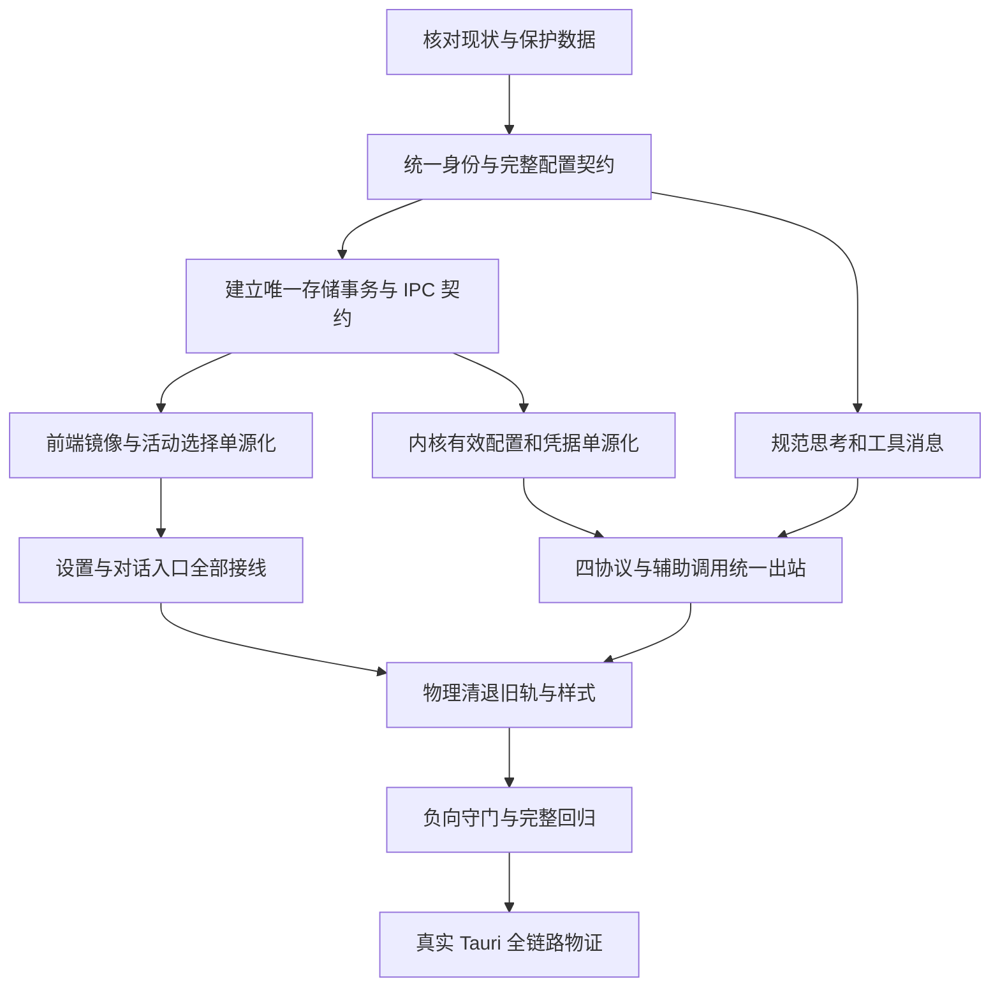

# 供应商配置与请求链单轨收敛 · 总修复方案

> 本次修复的执行入口。承接 `docs/model-config-ssot-convergence/` 的问题证据与已锁定裁决，以当前工作区代码、自动化复现和真实宿主物证判定完成。
> 范围：供应商及模型配置、活动选择、凭据边界、模型能力、请求组装、工具历史、价格与缓存消费，以及这些能力对应的设置界面和防回归门禁。
> 所有问题同权。本文只规定逻辑顺序、依赖、文件域和验收断言，不规定时间、人员或业务优先级。

## 1. 目标与不可变条件

用户在设置中保存的配置，必须是对话选择器显示、持久介质保存和内核实际出站使用的同一份配置。完成定义是完整产品链存活，不能以独立函数、组件测试、类型检查或文档勾选替代。

1. 模型身份是完整的 `(providerId, modelId)`。两段仅在入口去除首尾空白，保留大小写；索引编码必须无分隔符碰撞。禁止裸模型名、网址或厂商前缀补配身份。
2. `models.yaml` 是模型配置与活动选择的唯一持久源；前端 Store 是它的只读已提交镜像，表单草稿不是第二配置源。
3. 活动选择采用同一配置树的 `activeModel: { providerId, modelId } | null`。禁用、删除或失效均置空；不得选择其它供应商、同名模型或列表首项。
4. 凭据由现有系统凭据库保管。模型树只引用凭据，前端只拿存在状态与脱敏摘要；禁止向 LocalStorage、日志或审查物证写明文密钥。
5. 字典只在用户新增模型、明确请求预填时生成可编辑草稿；窗口、费用、思考、缓存和请求协议只能来自用户保存的配置。
6. 内核每次启动请求取得一份不可变的有效配置快照；协议、地址、头、思考、模态、限额、缓存及计价均从同一快照派生。未找到配置就是错误，不以 `Default`、空对象或 `None` 拼装一条降级请求。
7. 不支持、未配置、用户明确关闭是不同状态。允许省略协议定义的可选参数；不允许把配置丢失伪装成用户未选择。
8. 失败保留最后成功数据和用户草稿，同时明确阻止错误配置继续写盘或出站。禁止吞错、把加载失败安装为空树、失败后乐观宣称保存成功。
9. 新路径接通后物理删除旧代码、旧字段、旧类名、旧存储读写与旧样式；不保留永久代理层、隐藏组件或注释版实现。
10. UI 只复用真实存在的 Design Tokens。协议常量、枚举和算法边界可以集中定义；厂商型号表、伪容量、推测价格、裸色、虚构 CSS 变量和坐标补偿不能进入运行链。

上述活动选择设计据本次“零旧孤岛”要求取代旧分案 `plans/02` 把两个 LocalStorage 键作为权威源的设计。既有文档保留为历史证据，本次不沿用该存储决策。

## 2. 当前问题与因果链

下表是执行起点；后续发现必须附源码或可运行复现追加，不能仅凭文档宣称存在。

| 编号 | 已观察的断层 | 当前证据入口 | 根本修复 |
| --- | --- | --- | --- |
| C01 | 索引保存大小写而查询、复合键转小写；`Acme` 可见但查询为空，`Acme/acme` 同名模型互相覆盖 | `modelsCatalogStore.ts:257`、`modelsCatalogTypes.ts:32`、`modelsCatalogSelectors.ts:22` | 跨语言统一身份边界、无碰撞复合索引、入口重复身份校验 |
| C02 | 只改显示名也删掉 `pricing.tiers/perImage`，修订签名看不到这些变化 | `modelsDraftMap.ts:133`、`:187`、`:223`、`useModelConfigSession.ts:243` | 全字段无损草稿往返及语义修订比较，禁止全量替换不完整子对象 |
| C03 | 前端存在的启用状态等字段未进入 Rust 树或 IPC 投影 | `models_yaml.rs:255`、`:267`、`catalog_types.rs` | 共用完整核心契约；删除手写有损 DTO 投影 |
| C04 | 供应商增删启停仍写 LS，选择器读 YAML；表单改名与地址双写且忽略写失败 | `ProfileHeader.tsx:103`、`:147`、`ProviderProfileForm.tsx:83`、`:109` | 所有业务动作提交同一原子配置事务，回执后发布镜像 |
| C05 | 活动选择在 LS、AppSettings 和 profile 配置文件重复存在 | `profileActiveSelection.ts`、`profileStoreActivation.ts:99`、`:179`、`config/profile.rs` | 活动 ModelRef 存在配置树；删除分散 set/clear 和反馈回写 |
| C06 | 指定供应商查找失败后仍按 URL 或全局唯一模型补配，初始化只检查三件套 | `engine_provider/protocol.rs:81`、`engine_provider.rs:110`、`engine_build.rs:408` | 精确解析必须返回有效快照或结构化错误，未知配置零网络请求 |
| C07 | 模型只改一个 compat 字段就覆盖供应商整块配置 | `engine_provider/protocol.rs:205`，而同文件 `:63` 又按字段继承 | 一个字段级有效能力解析函数供全部协议和消费方使用 |
| C08 | `X-High` 通过读取和能力校验，却在出站时因只查规范键而消失 | `catalog_types.rs:256`、`engine_provider/thinking.rs:74`、`request/vendor/dialect.rs:228` | 读边界唯一归一，UI、校验和出站消费同一规范档位 |
| C09 | Anthropic 缓存和输出限额仍有独立默认轨；摘要等辅助请求可能另选 Chat 路径 | `request/build_anthropic.rs`、`engine_provider/protocol.rs:378`、`engine_build.rs` | 四协议与摘要、探测、子调用共用有效配置，必填参数缺失明确拒绝 |
| C10 | 工具结果在领域历史中成对，wire 投影却插入 continuation 或丢掉结果；守卫只数集合可能误放行 | `request/messages.rs`、`context-pipeline/hydrate.rs`、协议 pairing 代码 | 先规范化工具轮次，再投影四协议；按顺序、身份及次数验证 |
| C11 | Gemini 非流端点与统一 SSE 消费链不一致 | `engine_provider/protocol.rs:400`、`engine_provider.rs:549` | URL、请求流式标志和响应解码器由同一协议描述决定 |
| C12 | 保存重载能力目录但未必重建端点、凭据和运行器；跨窗口及外部修改缺少共同写入版本约束 | `models_yaml.rs:384`、`engine_provider/protocol.rs`、`config/provider.rs` | 原子落盘、快照发布、失效通知与下一请求消费构成一个提交契约 |
| C13 | 门禁文件和预填 JSON 在磁盘存在但未被 Git 跟踪，干净检出无法复现本地结果 | `scripts/check-model-config-ssot.mjs`、`.gitignore`、`modelsAutofillBaselineData.json` | 门禁及依赖资产完整入库；检查实际注册、导入和可执行路径 |
| C14 | Windows 将大小写不同供应商映射到同一个凭据文件；合法 Unicode 身份又无法通过旧文件名校验 | `config/persistence.rs:87` | 凭据采用独立不透明槽 ID，通过 apiKeyRef 明确引用，不以供应商 ID 拼路径 |
| C15 | 历史运行用当前活动供应商和当前价格重算；同次运行结束时也可能取得另一份价格修订 | `run/run_core.rs:639`、`engine_build.rs:1685` | 请求开始绑定 ModelRef、配置修订及价格快照，计价结果随运行落盘，历史只读当次结果 |
| C16 | 扫描和启动仍维护 bundled ModelCatalog，并向旧 profile 文件写回 | `probe.rs:540`、`main.rs:993`、`catalog_commands.rs` | 扫描只返回待确认候选，确认后写唯一配置树；删除第二托管目录与 catalog_get/refresh 旧入口 |

界面 Token、祖先盒模型和层叠上下文在独立审查后逐项加入证据，不凭名称或局部截图判定。

## 3. 唯一权威源与退出清单

| 概念 | 唯一权威 | 允许的派生物 | 必须退出的业务路径 |
| --- | --- | --- | --- |
| 配置树 | `UnifiedModelsConfig` 与 `models.yaml` | 一份 Rust 不可变快照；一份前端镜像；未提交表单草稿 | LS profiles、模型 meta 孤岛、第二持久 provider 配置树 |
| 活动选择 | 配置树 `activeModel` | 只读 `getActiveModelRef()`；界面选中态 | LS 两键、AppSettings 默认模型、独立 profile 活动指针、自动替换模型 |
| 身份 | 规范 ModelRef | 有界 O(1) 索引 | lowercase 身份、字符串分隔碰撞、URL 猜供应商、裸模型查唯一项 |
| 凭据 | 已有 DPAPI/系统凭据库，按供应商隔离 | 凭据引用、`hasKey`、脱敏末位 | WebView 明文缓存、单供应商环境变量串用、旧 direct-key 回退 |
| 能力与方言 | 配置树字段经唯一解析器生成的有效能力 | 请求快照、展示描述 | 多处 compat 合并、厂商型号判断、字典和旧 meta 兜底 |
| 思考 | 内核规范词表及每模型保存的 wire 映射 | 生成或校验的前端词表镜像、用户偏好 | 大小写多实现、标题和 wire 分别猜测、Off/省略混用 |
| 价格与缓存 | 有效模型配置 | 本次请求计价结果和缓存事件 | 内置价格/TTL 表、固定折扣、独立 Anthropic 缓存开关 |
| 协议 | 显式协议及有效请求能力 | 同轨 URL、头、body、解码器 | 私拼 Chat 端点、URL 子串推测、分协议漏用配置 |
| 工具轮次 | 规范领域消息中的调用及结果关系 | 各协议 wire 投影 | 每层独立补 continuation、按全局集合误抵孤儿 |
| 界面样式 | 项目 Design Tokens 与既有 UI 原子 | 组件私有布局组合 | 裸 Hex、伪变量、重复外观、坐标和延时补偿 |

旧数据处理必须先保证可恢复：保留原始文件备份，明确检测旧格式，执行一次可验证转换后只写新介质。转换失败不覆盖原件。旧格式处理不能成为请求期回退；既有测试资产保留并迁移为新边界的断言，不删除用户专项测试。

## 4. 依赖拓扑

防御断言随对应修复一起建立，并在 J 汇总验证；不能等所有代码变更后才补一组只检查符号存在的脚本。

## 5. 逻辑执行步骤

### A. 核对现状并保护数据

- 固定本次起始提交和未提交文件清单，区分既有改动与本次增量；不回撤共享工作区。
- 读取实现、生产调用和测试三类证据；记录 UI、注册表、介质及出站断点。
- 通过 Tauri MCP 确认真实宿主及真实数据水合状态。不得注入沙箱 Store、用浏览器前端或演示会话代替。
- 仅在需要迁移或做真实写入验收时保护对应原始配置；证据中不出现密钥和用户对话正文。

### B. 统一身份与完整配置契约

- 核心 `UnifiedModelsConfig` 承载 `activeModel`、完整 Provider/Model 字段。明确 enabled、排序、代理、凭据引用、协议、headers、窗口、输出上限、模态、思考、完整价格、缓存的类型和缺省语义。
- Rust 是配置解析与语义校验入口；IPC 直接序列化核心树，不再手写另一套有损模型 DTO。前端对应类型不残留旧键与第二套 capability 真源。
- 精确且有碰撞检测的 ModelRef；拒绝空身份、规范化后的重复身份、重复模型；保留大小写不同的合法身份。
- 把旧拼写归一、字段校验、规范档位映射集中在读取边界；进入运行树以后只有规范形态。未知字段/无效数值明确诊断，不能静默丢失。
- 对全部公开字段建立跨语言往返夹具。`false`、`0`、空集合、显式清空与字段未提供分别验证。

### C. 建立唯一存储事务与 IPC 契约

- 复用现有原子文件写能力。一次事务依次完成：读取修订号、校验预期修订号、构造完整候选树、验证活动选择、无损序列化、原子替换、发布新快照和配置变更事件。
- 修订依据覆盖完整配置语义及外部文件变化；同一进程共享写入口串行，跨窗口过期草稿拒绝写入。错误带明确冲突类别，保留草稿，不静默覆盖。
- 配置文档保存、表单提交和活动选择变更委派同一事务实现；不建立另一层字符串路由或多级 service 转发。
- 每个新增/改变/删除的命令同步修改 Tauri 主注册表、前端 commandMap、类型和权限；用双向集合断言验证 1:1。
- 配置变更通过现有事件设施传播，外部文件变化由同一加载入口校验后发布；不得额外建立轮询真源或只刷新显示而不刷新运行器。
- 凭据命令只操作供应商隔离的系统凭据槽；引用采用 `dpapi:<不透明槽ID>` 或 `env:<显式变量名>`，不把供应商身份作为 Windows 文件名。配置引用失效明确未就绪。保存失败不能改变活动运行器。

### D. 前端镜像与活动选择单源化

- `modelsCatalogStore` 只保存成功回执或成功读取的规范快照，完整携带配置修订号及 `activeModel`。
- 供应商档案展示从树派生；业务新增、改名、地址、启停、删项和模型修改都调用统一事务，删掉 `saveProfiles` 等 LS 写路径。
- 活动选择由完整 ModelRef 一次提交和一次清空；删除所有单独写 provider/model 的 API，以及 AppSettings 的 defaultModel/defaultProvider 回写。
- 停用/删除当前项在同一事务中清空活动选择；不允许事件监听器再猜一个替代模型写回。
- 加载失败、冲突、凭据不可用的状态显式呈现；保留已提交镜像用于用户辨认，但禁止把该镜像当新配置继续出站。
- 近期模型、偏好等只可引用有效 ModelRef；不能经这些展示数据复活已删除配置。

### E. 内核有效配置与凭据单源化

- 删除 `provider-config.json`/`profile-config.json` 对业务配置的权威读取、旧单模型 env 回退和 `slots_for_unique_model` 等补配路径。
- 有效配置解析接受当前规范树和明确 ModelRef，返回完整 `Result<ResolvedProviderConfig, ConfigError>`；禁用、缺失、无凭据或损坏均拒绝。
- 字段级合并供应商声明和模型覆盖，`false`、`0`、显式关闭不能被 `or`/truthy 判断吞掉；同一实现供显示、请求和计费使用。
- 更新配置后，下一个请求取得新修订快照；已经开始的请求维持自己的快照，禁止同一请求混用两个修订的 URL、头和 body。
- 清退只为旧测试存在的 `EngineProviderConfig` 重复槽位、`#[allow(dead_code)]` 和无真实调用导出。测试改为从法定配置入口构造请求。

### F. 设置、对话与草稿的完整接线

- 新增供应商、改名、地址、启停、删除、凭据、模型列表与当前选中展示全部消费同一树。
- 模型编辑保留所有非当前编辑字段，包括 tiers、perImage、缓存、compat 和模态；修订比较覆盖全部语义，外部修改不能被旧草稿覆盖。
- 高级 YAML 编辑器保存后按同一回执刷新设置和对话选择器；失败保持编辑内容和错误定位。
- 字典仅用于显式新增/预填动作。已有模型普通编辑和运行期查询不能偷偷把缺省字段填成字典值。
- 上传入口、思考档位、输出上限等界面控制取有效能力；界面宣称可用的能力必须进入同次请求。
- 界面只保留帮助配置和判断结果的信息，删除重复说明与实现术语。输入、Tooltip、颜色、间距、字体、焦点和圆角遵守现有原子和 Token。
- 对滚动、粘性、浮层分别检查完整祖先的 overflow、定位、transform 和层叠上下文，在真实窗口验证裁剪及交互。

### G. 规范思考与工具消息

- 规范思考词表集中在内核，前端镜像受自动化一致性检查；同一模型可配置的键集和 wire 值必须原样抵达有效能力。
- 明确省略、Off、自动和各强度的出站语义；映射缺失/格式不支持返回错误，不伪造另一档，不静默省略用户明确选择。
- 多参数思考方言由一个组装入口返回完整参数集合，禁止不同协议再各自猜预算和强度。
- 工具调用/结果在领域边界规范成有序轮次；水合、压缩、恢复后保持配对关系，再投影 Chat、Responses、Anthropic、Gemini。
- 守卫按轮次检查调用身份、结果次数和先后关系。不得让旧轮的同名结果抵消新轮孤儿；合法结果之间不插入用户 continuation。
- Debug 与 Release 均须返回可处理错误，避免孤儿历史导致桌面宿主 panic；是否需要补全历史只在有事实依据的恢复边界裁决，出站层不伪造结果。

### H. 四协议与辅助调用统一出站

- 协议描述一次决定 URL、请求头、body、流式标志及响应解析；Gemini SSE 必须与流端点及 `alt=sse` 对齐，非流返回走对应非流解析。
- 所有协议消费同一配置快照的输出上限、模态、思考、缓存和工具能力。协议必填但未配置的字段前置拒绝，禁止补 64000/128000 等假规格。
- 缓存有声明才生效，明确关闭零缓存字段；计价包含完整四价、阶梯、图片价和单位，不以默认倍率补值。价格未配置与价格为零严格区分，按图片计价的模型无需虚构 token 输入输出价。
- 运行开始绑定模型身份、配置修订及价格快照；结束时按该快照计算并持久化结果。历史查看不能按当前活动模型或后来修改的价格重算旧账。
- 摘要、探测、子代理及其它辅助调用不得另拼 Chat 地址或读取 bundled catalog；采用同一解析及构建入口，保留各自业务输入。
- 取消、重试和错误分类沿已有事件链传播，不能用新 fallback 掩盖不受支持的协议或配置。

### I. 物理清退与净收敛

- 按已迁移调用图删除旧存储模块、旧 metadata 读写、旧 profile DTO、全局裸模型索引、旧配置转换热路径和旧兼容工具。
- 删除 `Default/None` 假接线、只存在于导出的死实现、静态 provider 型号/TTL/价格表的运行期调用以及重复样式。
- 先逐项确认没有生产调用再删除；测试资产改写为正确入口和拒绝旧轨的证明，不为通过门禁删测试。
- 每个删除项记录旧符号、旧路径、替代入口及扫描结果；文件改名不算删除，删除后加同义实现不算单轨。

### J. 从缺陷生长的防御脚本与回归

- 身份防线：大小写、空白、分隔符、同名跨供应商、禁用和删除组合；禁止裸模型/URL 补配。
- 数据防线：全字段 TS→IPC→Rust→磁盘→重启→UI 往返，单字段编辑保持其它字段；错误 YAML、读写异常、并发冲突不丢数据。
- 连通防线：命令双向注册检查；真实调用入口消费非空配置；旧配置文件和 LS 键在生产写链零引用。
- 方言防线：用任意供应商 ID 配置四协议，覆盖字段继承、每一思考档位、Off/省略、缓存开关、输出上限与多模态拒绝。
- 工具防线：完整/缺失/重复/乱序/跨轮同名/退化空轮，分别经过水合、压缩和最终 wire。
- 样式防线：解析实际 CSS Token 定义、引用和 CSS Modules 使用关系；拒绝裸色、未定义 token、原生 title 和废弃类名。不能用“存在 var()”充当正确。
- 资产防线：门禁及其 import/委派脚本、JSON 和夹具均被 Git 跟踪；干净检出可运行。
- 每个脚本报出规则、文件行号、真实合法入口和修复指引；用故意注入缺陷的隔离测试证明脚本能失败，不允许只扫自身期望字符串。
- 执行并维护 `FULL_CHECK_COMMANDS.md`，区分本轮回归和原有失败；不绕过 hooks，不调低阈值。既有浏览器测试只能证明其测试层，真实产品验收只走 4000 Tauri MCP。

### K. 真实 Tauri 闭环验收

经 4000 Tauri MCP 操作真实宿主，先确认不是 mock/seed Store。每条链保留五类物证：UI 触发、IPC 注册及回执、法定介质内容、内核消费/出站、旧轨负断言。

| 用户动作 | 必须共同成立的结果 |
| --- | --- |
| 配置两个同名模型供应商并选择其中一个 | UI、活动 ModelRef、文件和实际出站全部指向所选供应商 |
| 关闭/删除当前供应商或当前模型 | 活动选择为 null；不跳到另一个模型；重新启动后仍为空 |
| 只改显示名 | 显示名三处一致，tiers/perImage/compat/模态/缓存原样保留 |
| 改协议、地址、思考、限额或缓存 | 下一请求 URL、头、body 和解码器使用新配置修订；无旧快照夹带 |
| 两窗口编辑同一配置 | 后提交的过期草稿收到冲突；原始数据和草稿均保留 |
| 提交错误配置或制造写失败 | UI 给出可操作错误；法定文件不被清空；内核不降级发请求 |
| 工具执行后续聊及重启续聊 | 领域历史和四协议投影均无孤儿、重复或插入顺序错误 |
| 打开设置、下拉、编辑器并滚动 | 真实 Token 生效，焦点柔和，浮层不裁剪、不被错误层叠遮挡 |

协议测试服务的 wire 记录可以证明发包结构，不能冒称上游供应商可用；真实 API 探测与结构测试的结果分开记录。不得把密钥或对话原文写入证据。

## 6. 完成判定与交付记录

每个 C 编号必须有修复文件、测试、负向断言及真实链路状态。执行记录单独维护实际进展，不用计划中的预期替代结果。

只有以下条件同时满足，才可以宣称本次单轨修复完成：

- 声明的旧配置和选择源在生产读写中均不存在，文件和符号物理清退可复核。
- 所有公开字段都能保存、重载并被对应业务真实消费，没有有损投影和幽灵配置。
- 相关测试、门禁和真实宿主链路已有实际结果，失败有准确归因且本轮缺陷已修复。
- 用户数据、密钥隔离和既有测试资产完整；提交限定本轮核验过的路径，不吞并无关工作。
