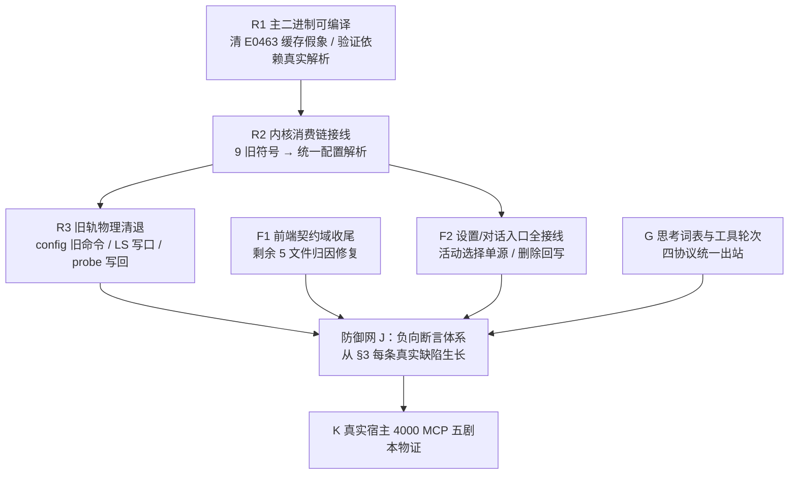

# 端到端修复执行拓扑与防御网方案

> 本文是 `00-总方案.md` 的执行级细化：只规定**纯逻辑执行顺序与依赖拓扑**，不涉及时间、人员、优先级（所有问题逻辑同权）。
> 立论基础：本会话实测基线（2026-09-14）。每个执行域的完成定义是 `00-总方案.md` §6 与本文 §5 的五端物证，不以测试绿灯或类型检查替代。

## §0 实测基线（2026-09-14 01:57）

| 检查 | 实际结果 | 归因 |
| --- | --- | --- |
| `cargo check -p agent-provider` | 通过 | 核心契约层存活 |
| `crish-agent-workbench` 主二进制构建 | **21 错**：4×E0463（找不到 conex-computer / conex-computer-tools / tauri-plugin-dialog / tauri-plugin-mcp crate）+ 17×E0425（`crate::config::effective_*` 等 9 个旧符号不存在） | E0463：依赖在 Cargo.toml 均已声明且非 optional，上次构建因 Windows 页面文件不足被杀，增量产物疑损坏；E0425：上一轮物理删除 `config/{provider,profile,env_filter}.rs` 后**消费链未迁接**（engine_provider.rs、run/run_commands.rs、core_query_commands.rs、server/core_backend.rs） |
| `agent-provider` Rust 测试 | 919 通过（上轮基线） | — |
| 前端模型目录域 12 文件 | 232 通过 / 1 失败（`modelCatalog.test.ts` 退役别名，已修字典待复验） | 本会话已修 39 TS 错误 + LS 导入契约 + 20 个测试文件 mock 迁移 |
| 前端剩余失败 | permAndModelExclusive ×3、ModelProfileList ×1、PhysicalGeometryGuards ×1、modelThinkingPersistence ×2、ConnectionLifecycle S7 ×2 | 待逐个归因（见 R4） |

## §1 依赖拓扑（逻辑依赖，非排期）

约束：
- R1 → R2 是硬依赖：主二进制不可编译时，任何「内核已接线」的声明都不可验证。
- F1（前端测试收尾）与 R1/R2 **文件域互斥**，可并行执行（见 §4）。
- G 的思考词表镜像受 `scripts/check-thinking-vocabulary-ssot.mjs` 守护；改动词表必须先改内核枚举。

## §2 分域执行步骤

### R1 主二进制可编译（恢复构建事实基线）

1. 低并发重建验证缓存假象：`cargo check -p crish-agent-workbench -j 1`。E0463 若消失，登记「上次 OOM 中断遗留增量产物损坏」为已处置；若仍在，进入 2。
2. E0463 仍在时：`cargo tree -p crish-agent-workbench -i` 逐个验证 4 个依赖的真实解析（git 依赖 tauri-plugin-mcp 需网络/锁文件一致性；path 依赖需 crates/ 目录存在），按证据修复 Cargo.toml 或锁文件，禁止注释掉依赖「绕过编译」。
3. R1 完成定义：`cargo check -p crish-agent-workbench -j 1` 零错误（E0425 允许在 R2 完成前共存，但 R1 只裁 E0463；若 E0425 阻塞 check 则 R1/R2 合并执行，先恢复符号再清退）。

### R2 内核消费链接线（17×E0425 → 唯一权威源）

旧符号 → 新权威映射（唯一权威 = `config/mod.rs` 已交付的统一解析）：

| 旧符号（已删） | 语义 | 新权威 | 迁接规则 |
| --- | --- | --- | --- |
| `effective_model()` | 全局单模型 | `resolve_active_model()` | 返回 `None`（用户未选择）不是错误也不是默认值：调用方按「未就绪」显式暴露，禁止挑选列表首项 |
| `effective_api_key()` | 明文 key | resolved 凭据边界（DPAPI 槽 / env: 引用） | 凭据缺失 = 未就绪状态，禁止空串拼接请求 |
| `effective_api_base_url()` | 端点 | `resolve_model(&ModelRef)` 投影 | 未配置 = 结构化错误 |
| `effective_provider_endpoint/stream/id()` | 端点/流式/身份 | 同一 ResolvedModelConfig 字段 | 一个请求一份快照，禁止跨符号分别取值造成修订混用 |
| `effective_credential_mode()` | 凭据模式 | resolved 凭据引用形态派生 | — |
| `config_get()` / `with_store_mut()` | 供应商设置存储 | `models_store()` / 统一事务 | 只迁移业务配置；非供应商偏好保留原独立存储 |

1. 逐文件迁接（engine_provider.rs → run/run_commands.rs → core_query_commands.rs → server/core_backend.rs），每个调用点必须先取得 `ModelRef`（活动模型或显式指定），再取一份不可变快照；同一请求链内不得两次解析。
2. 红线：任何调用点不得以 `unwrap_or_default()`、空串、固定模型名补配置；解析失败沿已有错误分类上抛。
3. R2 完成定义：主二进制零 E0425；`cargo test -p agent-provider --lib --tests -j 1` 与 workbench 相关测试通过；grep 证实 `effective_api_key|effective_model|effective_api_base_url|effective_provider_|effective_credential_mode|with_store_mut` 在 src/ 零残留（负向断言入 J）。

### R3 旧轨物理清退（不新建 Shim）

1. `config_get/config_update` 旧供应商命令退役：REST 路由、运行查询、前端 commandMap 三处同步摘除，双向注册断言 1:1（已有 `tauri-command-registry.test.ts` 扩展覆盖新集合）。
2. LS 写口清退：`saveProfiles`/`saveProfileKey`/`setActiveModelId` 等对业务配置的写路径改为统一事务；LS 原始文件按兼容清册保留只读（导入已单飞完成），禁止任何新增写。
3. `probe.rs` 扫描写回与 `main.rs:993` bundled catalog 维护路径：扫描只返回候选，确认后写唯一配置树。
4. 清退每项登记旧符号、替代入口、grep 零引用证据（入执行记录，不做文件改名式假删除）。

### F1 前端契约域收尾（与 R 域文件互斥，可并行）

逐个归因并修复：permAndModelExclusive ×3、ModelProfileList ×1、PhysicalGeometryGuards GEO-VP-02 ×1、modelThinkingPersistence ×2、ConnectionLifecycle S7 ×2（执行记录预存，需确认与本域因果）。修复约束：改产品代码前先证明缺陷（失败断言或可运行复现）；禁止为绿灯放宽断言。

### F2 设置/对话入口全接线（总方案 D/F）

活动选择 `activeModel` 一次提交/一次清空；删除供应商/模型同事务置空；`ProfileHeader`/`ProviderProfileForm` 双写口摘除；AppSettings defaultModel/defaultProvider 回写退役。完成定义：设置页每个动作的事件回执、镜像发布、文件内容三方一致。

### G 思考与工具轮次、四协议出站（总方案 G/H）

- 词表镜像一致性检查脚本跑通；每模型 thinking map 原样抵达有效能力。
- 工具轮次领域规范化 → 四协议投影；守卫按轮次身份/次数/顺序。
- 四协议 URL/头/body/解码器由同一协议描述决定；缓存与计价从同一快照派生；价格未配置 ≠ 0。

### J 防御网（每条从真实缺陷生长，禁止只扫期望字符串）

见 §3。每个脚本交付时必须附「缺陷注入自检」：故意引入该缺陷证明脚本能红。

### K 真实宿主闭环（4000 Tauri MCP）

`00-总方案.md` §5.K 八条用户动作剧本 × 五端物证。构建采用单任务低并发本地配置（保留 debug assertions），不终止用户其它应用、不改全局页面文件。

## §3 防御网设计（问题 → 防线映射）

每条防线的产出 = 规则说明 + 文件行号 + 修复指引 + 注入自检。登记于 `scripts/` 并注册进 `FULL_CHECK_COMMANDS.md`。

| # | 真实缺陷（本战役实证） | 防线 | 断言要点 |
| --- | --- | --- | --- |
| D1 | E0425：删旧符号留消费调用 | 连通防线 | grep 生产 src 零引用已退役符号清单（`effective_*`、`config_get(`、`with_store_mut`）；清单由兼容清册生成 |
| D2 | E0463：OOM 中断遗留产物损坏假象 | 构建防线 | CI/本地全量构建单任务档位；失败即 fail，禁止静默跳过主二进制检查 |
| D3 | 测试 mock 旧回执形状（20 文件陈旧仍绿跑假象） | 契约防线 | read 回执形状断言 helper（唯一 mock 工厂：完整树+revision+credentialStates）；负向：缺 tree / 缺 revision / 缺 credentialStates 必须被 isSnapshot 拒绝 |
| D4 | fixture 携带旧字段 `capabilities` / `apiKey` / `contextLength` | 数据防线 | 测试 fixture 扫描：ModelSpec/ProviderSpec 字面量含未知字段即红；JSON 载荷断言含 `"contextLength"`、`"capabilities"`、`"apiKey"` 即红 |
| D5 | 身份键 `::` 拼接残留（settingsObjectId 双轨） | 身份防线 | 禁止 `::` 拼接身份键：扫描 `src/**` 中 `::${` / `\${.*}::\${` 模式；editSession/open/commit/invalidate 键必须来自 `modelRefKey` |
| D6 | 字典退役别名经模糊匹配复活（deepseek-chat→reasoner 128000） | 字典防线 | 退役别名清单负向断言：`guessContextLength(alias) === undefined`；单厂商 token 重合不允许建立匹配（评分器门控测试） |
| D7 | 协议旧名 `google/interactions` 写出风险 | 协议防线 | 规范协议集合外写出即红；别名映射只允许存在于显式升级边界（modelsLsImport） |
| D8 | LS 业务写口复活 | 孤岛防线 | 扫描 `saveProfiles|saveProfileKey|setActiveModelId` 生产写调用 = 零（读侧导入除外）；localStorage.setItem 白名单键清单 |
| D9 | 未声明档位静默降级/渲染崩溃 | 思考防线 | resolveThinkingHandoff 未声明档位 → 引导态（不 throw 到渲染层、不降级、不出站）；词表外键 → 显式诊断 |
| D10 | 样式裸值/伪 token | 样式防线 | `check-design-tokens.mjs` 扩展：新 CSS 禁裸 Hex/未定义 var()；组件 module.css 与 token 表交叉校验 |
| D11 | 命令注册漂移 | 注册防线 | 双向集合断言：Rust 主注册表 ↔ 前端 commandMap 1:1（每新增/退役命令强制跑） |
| D12 | 兼容清册失真 | 资产防线 | 门禁脚本、JSON 基线、防御脚本本身必须被 Git 跟踪；干净检出可执行 |

## §4 文件域互斥表（agent 派发约束）

| 执行域 | 独占文件域 | 禁触 |
| --- | --- | --- |
| R-域（Rust 消费链） | `apps/agent-workbench/src-tauri/src/**`、`crates/**`、`apps/agent-workbench/src-tauri/Cargo.toml` | `apps/crish-desktop/**` |
| F-域（前端契约） | `apps/crish-desktop/src/**`、`scripts/check-*.mjs` | `apps/agent-workbench/**`、`crates/**` |
| 共享只读 | `docs/provider-single-track-convergence/**`（追加执行记录除外） | — |

串行约束沿用 `00-索引.md` §关键文件串行约束。两域各自完成后交叉跑全量检查。

## §5 五端物证（每个用户能力交付时逐项登记）

1. **触发端**：真实 Tauri 宿主 UI 操作截图/事件流（禁 mock Store）。
2. **传输端**：命令在主注册表与 commandMap 的双向断言输出 + IPC 回执原文（脱敏）。
3. **介质端**：`~/.conex/models.yaml` 落盘前后内容 diff；LS 孤岛键零写入证据。
4. **消费端**：内核日志/出站 wire 记录显示新配置真实生效（URL/头/body/计价）。
5. **负向**：对应 D 线脚本红→绿记录（注入缺陷被捕获的输出）。

## §6 执行记录登记

每完成一域，在 `00-执行记录.md` 追加：实际改动文件、实际执行命令与出口、未验证项显式标注。禁止以预期替代实测。
