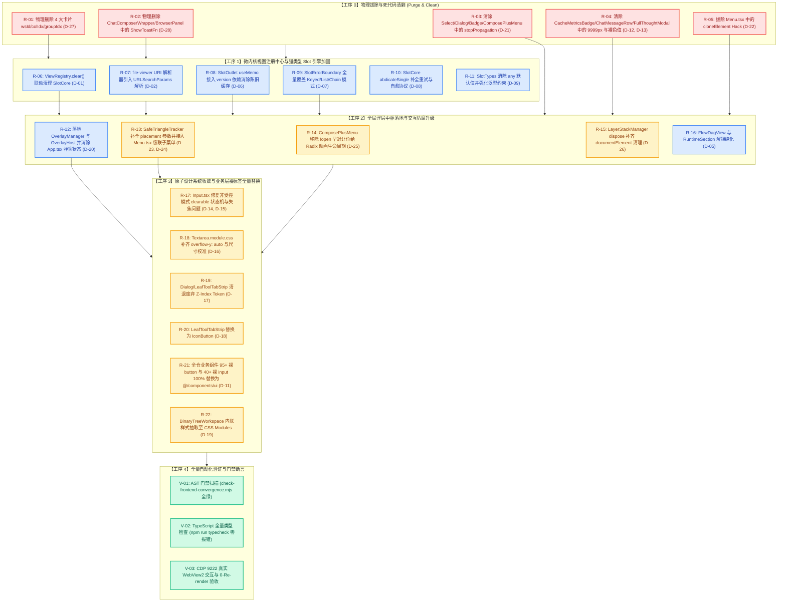

# 微内核注册、Slot插槽与原子组件二次联合找茬审计报告 (Re-Audit 06)

> **审计执行定位**：红队二次联合攻防审查组 (Red Team Joint Audit Board)  
> **审查基准文献**：
>
> 1. `docs/red-team-plans/detailed-plans/01-微内核与视图注册维度详案.md` (微内核、ViewRegistry、强类型 SlotMap 架构基准)
> 2. `docs/red-team-plans/detailed-plans/02-原子设计系统与同心几何维度详案.md` (原子组件唯一源、同心几何、0-药丸与 10 大不可违背规则)
> 3. `docs/red-team-plans/remediation/01-微内核与原子组件最佳修复方案.md` (修复方案基准)
> 4. `docs/red-team-plans/audits/03-微内核与原子组件落地问题审查报告.md` (历史审计对比)
> 5. 仓库根目录 `AGENTS.md`（第 1 条反退避与效果锁、第 7 条严禁补丁与绕过、第 12 条 Tooltip 铁律、第 13 条输入框与焦点态 10% 对比度上限、第 14 条现代 CSS）与 `.agents/LOGIC_PLAN_NO_RETREAT.md`
>
> **【纯找茬铁律声明】**：
> 本审计报告贯彻**绝对纯找茬挑刺原则**。全篇禁止汇报任何已完成项、优化项或正面评价，只允许记录全仓代码缺陷、契约偏离、类型逃逸、生命周期漏洞、事件流阻断、几何畸变与架构隐患；每一项缺陷均必须给出具体文件路径、精确行号与确凿证据链。  
> **字符集与编码**：UTF-8 无 BOM。

---

# 目录索引 (Table of Contents)

- [一、 审计全景透视与核心找茬发现总结 (Executive Findings)](#一-审计全景透视与核心找茬发现总结-executive-findings)
- [二、 第一维度：ViewRegistry 注册中心与生命周期缺陷深挖 (ViewRegistry & Lifecycle)](#二-第一维度viewregistry-注册中心与生命周期缺陷深挖-viewregistry--lifecycle)
  - [【缺陷 1.1】ViewRegistry.clear() 未联动清理 SlotCore 导致插槽状态单向泄漏与幽灵组件污染](#缺陷-11viewregistryclear-未联动清理-slotcore-导致插槽状态单向泄漏与幽灵组件污染)
  - [【缺陷 1.2】file-viewer 动态 URI 解析器缺少 Query 参数解析导致复杂路由参数丢失与路径污染](#缺陷-12file-viewer-动态-uri-解析器缺少-query-参数解析导致复杂路由参数丢失与路径污染)
  - [【缺陷 1.3】resolveView 边界处理脆弱与动态卸载后 getTitle 退化为无语义 rawId 裸字符串](#缺陷-13resolveview-边界处理脆弱与动态卸载后-gettitle-退化为无语义-rawid-裸字符串)
  - [【缺陷 1.4】isPrimary 判定对草稿态 PENDING_DRAFT 及参数化会话 URI 失效引发 Tab 状态机错乱](#缺陷-14isprimary-判定对草稿态-pending_draft-及参数化会话-uri-失效引发-tab-状态机错乱)
  - [【缺陷 1.5】FlowDagView 视图一等公民释放不彻底，内部仍反向依赖 RuntimeSection 折叠容器](#缺陷-15flowdagview-视图一等公民释放不彻底内部仍反向依赖-runtimesection-折叠容器)
- [三、 第二维度：强类型 SlotMap 拓扑与 SlotOutlet 容灾状态机深挖 (SlotCore & SlotOutlet)](#三-第二维度强类型-slotmap-拓扑与-slotoutlet-容灾状态机深挖-slotcore--slotoutlet)
  - [【缺陷 2.1】SlotOutlet 的 useMemo 依赖项遗漏 version，导致 uSES 唤醒后持续命中陈旧 JSX 缓存 (Stale Slot Bug)](#缺陷-21slotoutlet-的-usememo-依赖项遗漏-version导致-uses-唤醒后持续命中陈旧-jsx-缓存-stale-slot-bug)
  - [【缺陷 2.2】SlotErrorBoundary 容灾隔离严重偏向：Keyed/List/Chain 模式全裸渲染引发级联白屏](#缺陷-22sloterrorboundary-容灾隔离严重偏向keyedlistchain-模式全裸渲染引发级联白屏)
  - [【缺陷 2.3】abdicateSingle 影子退让机制缺乏自愈恢复协议导致组件发生瞬时错误后被永久废弃](#缺陷-23abdicatesingle-影子退让机制缺乏自愈恢复协议导致组件发生瞬时错误后被永久废弃)
  - [【缺陷 2.4】SlotTypes 泛型默认值 any 逃逸与 SlotCoreImpl 内部私有存储类型擦除](#缺陷-24slottypes-泛型默认值-any-逃逸与-slotcoreimpl-内部私有存储类型擦除)
  - [【缺陷 2.5】SlotOutlet fallback 契约在 Keyed/List/Chain 中被静默吞没](#缺陷-25slotoutlet-fallback-契约在-keyedlistchain-中被静默吞没)
- [四、 第三维度：原子组件规范、同心几何与 0-药丸铁律违规清剿 (Atomic UI & Concentric Geometry)](#四-第三维度原子组件规范同心几何与-0-药丸铁律违规清剿-atomic-ui--concentric-geometry)
  - [【缺陷 3.1】业务层 95+ 处散落裸 <button> 与 40+ 处裸 <input>，严重违反 Rule G-01 与 AST 门禁](#缺陷-31业务层-95-处散落裸-button-与-40-处裸-input严重违反-rule-g-01-与-ast-门禁)
  - [【缺陷 3.2】非 Switch 白名单组件滥用 9999px / var(--radius-full) 药丸圆角，同心几何定理被破](#缺陷-32非-switch-白名单组件滥用-9999px--var--radius-full-药丸圆角同心几何定理被破)
  - [【缺陷 3.3】组件私有样式表大面积散落硬编码 Hex/RGBA 裸色值，破坏 Design Tokens 体系](#缺陷-33组件私有样式表大面积散落硬编码-hexrgba-裸色值破坏-design-tokens-体系)
  - [【缺陷 3.4】Input.tsx 受控/非受控双模严重缺陷：非受控模式下 clearable 清空按钮永久失灵](#缺陷-34inputtsx-受控非受控双模严重缺陷非受控模式下-clearable-清空按钮永久失灵)
  - [【缺陷 3.5】Input.tsx 清空按钮触发器抢占焦点导致 input 失焦，且 onEnter 忽视 defaultPrevented](#缺陷-35inputtsx-清空按钮触发器抢占焦点导致-input-失焦且-onenter-忽视-defaultprevented)
  - [【缺陷 3.6】Textarea.module.css 尺寸标尺不达标且缺少 overflow-y 声明导致超限滚动失效](#缺陷-36textareamodulecss-尺寸标尺不达标且缺少-overflow-y-声明导致超限滚动失效)
  - [【缺陷 3.7】Dialog.module.css 与 LeafToolTabStrip.module.css 仍消费已废弃或非标 Z-Index Token](#缺陷-37dialogmodulecss-与-leaftooltabstripmodulecss-仍消费已废弃或非标-z-index-token)
  - [【缺陷 3.8】LeafToolTabStrip.tsx 违规使用带有水平内边距的 Button 渲染纯图标破坏 1:1 正方形几何](#缺陷-38leaftooltabstriptsx-违规使用带有水平内边距的-button-渲染纯图标破坏-11-正方形几何)
  - [【缺陷 3.9】BinaryTreeWorkspace.tsx 大量直接书写内联 style 对象违背样式表静态化提取纪律](#缺陷-39binarytreeworkspacetsx-大量直接书写内联-style-对象违背样式表静态化提取纪律)
- [五、 第四维度：全局浮层调度、事件流与 SafeTriangle 级联死角 (Floating Overlays & Event Stream)](#五-第四维度全局浮层调度事件流与-safetriangle-级联死角-floating-overlays--event-stream)
  - [【缺陷 4.1】全局浮层调度体系 OverlayManager 与宿主 OverlayHost 100% 缺失，App.tsx 顶层弹窗重绘恶疾未除](#缺陷-41全局浮层调度体系-overlaymanager-与宿主-overlayhost-100-缺失apptsx-顶层弹窗重绘恶疾未除)
  - [【缺陷 4.2】Select, Dialog, Badge, ComposePlusMenu 全仓多处粗暴调用 e.stopPropagation() 阻断事件流](#缺陷-42select-dialog-badge-composeplusmenu-全仓多处粗暴调用-estoppropagation-阻断事件流)
  - [【缺陷 4.3】Menu.tsx 依然保留 trigger 的 React.cloneElement Hack，破坏纯函数组件与 React 19 契约](#缺陷-43menutsx-依然保留-trigger-的-reactcloneelement-hack破坏纯函数组件与-react-19-契约)
  - [【缺陷 4.4】Menu.tsx 未集成 SafeTriangle 状态机，二级子菜单仍依赖脆弱的 150ms 延时导致高频闪退](#缺陷-44menutsx-未集成-safetriangle-状态机二级子菜单仍依赖脆弱的-150ms-延时导致高频闪退)
  - [【缺陷 4.5】SafeTriangle.ts 中 SafeTriangleTracker.enter 丢弃 placement 参数导致四向方位判定失效](#缺陷-45safetrianglets-中-safetriangletrackerenter-丢弃-placement-参数导致四向方位判定失效)
  - [【缺陷 4.6】ComposePlusMenu.tsx 采用 !open 时 return null 早退策略破坏进出场动画与 Radix 卸载链路](#缺陷-46composeplusmenutsx-采用-open-时-return-null-早退策略破坏进出场动画与-radix-卸载链路)
  - [【缺陷 4.7】LayerStackManager.ts 残留 as unknown as 双重强转且 dispose() 遗漏 documentElement 清理](#缺陷-47layerstackmanagerts-残留-as-unknown-as-双重强转且-dispose-遗漏-documentelement-清理)
- [六、 第五维度：全仓 Props 穿透与僵尸参数死代码审计 (Zombie Props & Prop Drilling)](#六-第五维度全仓-props-穿透与僵尸参数死代码审计-zombie-props--prop-drilling)
  - [【缺陷 5.1】ChatCard, PreviewCard, OverviewCard, RuntimePanel 仍保留 wsId, colIdx, groupIdx 僵尸 Props](#缺陷-51chatcard-previewcard-overviewcard-runtimepanel-仍保留-wsid-colidx-groupidx-僵尸-props)
  - [【缺陷 5.2】ChatComposerWrapper 与 BrowserPanel 仍残留 ShowToastFn 导入与 onShowToast 脏定义](#缺陷-52chatcomposerwrapper-与-browserpanel-仍残留-showtoastfn-导入与-onshowtoast-脏定义)
- [七、 全盘缺陷透视与精准行号追责矩阵 (Master Defect Matrix)](#七-全盘缺陷透视与精准行号追责矩阵-master-defect-matrix)
- [八、 红队阻断性整改工序与任务 DAG (Remediation DAG & Action Plan)](#八-红队阻断性整改工序与任务-dag-remediation-dag--action-plan)

---

# 一、 审计全景透视与核心找茬发现总结 (Executive Findings)

红队二次联合审查组深入审查了 `apps/crish-desktop/src/services/view-registry/`、`apps/crish-desktop/src/components/ui/`、`apps/crish-desktop/src/components/binary-tree/` 及全仓业务卡片组件。

尽管第一轮重构完成了一定程度的声明式迁移，但在深入的代码级解剖中，红队发现了 **25 项关键缺陷与架构隐患**：

```
┌────────────────────────────────────────────────────────────────────────────────────────────────────────┐
│                                Conex 前端微内核与原子组件二次联合审计缺陷拓扑                            │
├────────────────────────────────────────────────────────────────────────────────────────────────────────┤
│                                                                                                        │
│  [1. 微内核与注册中枢]                                                                                  │
│  • ViewRegistry.clear() 单向清空 Map，SlotCore 未同步清空，产生跨测试/热更状态污染                      │
│  • file-viewer: URI 解析器缺乏 QueryString 解析，破坏 initialMode / line 路由动态传参                   │
│  • FlowDagView 释放不彻底，内部依然紧绑定 RuntimeSection 折叠容器                                       │
│                                                                                                        │
│  [2. 强类型 SlotMap 与 SlotOutlet 容灾]                                                               │
│  • SlotOutlet.tsx:70-118 的 useMemo 依赖项缺少 version，导致 uSES 重绘时持续命中陈旧 JSX 缓存           │
│  • SlotErrorBoundary 仅包裹 Single 插槽，Keyed (核心工作区叶子) / List / Chain 模式全裸渲染缺乏错误隔离   │
│  • abdicateSingle 缺乏自愈恢复机制，发生瞬态错误后组件被永久废弃                                       │
│                                                                                                        │
│  [3. 原子组件库与同心几何]                                                                              │
│  • 全仓业务层存在 95+ 文件裸 <button> 与 40+ 文件裸 <input>，严重违反 Rule G-01 AST 门禁               │
│  • 非 Switch 元素（CacheMetricsBadge, ChatMessageRow 等）大范围滥用 9999px 药丸圆角与裸色值 fallback   │
│  • Input.tsx 清空按钮在非受控模式下 100% 永久失效，且点击清空按钮导致 input 失焦                       │
│                                                                                                        │
│  [4. 浮层调度与事件流]                                                                                  │
│  • 全局浮层调度中枢 OverlayManager / OverlayHost 依然全仓缺失，App.tsx 顶层弹窗重绘恶疾未除             │
│  • Select, Dialog, Badge, ComposePlusMenu 等多处直接调用 e.stopPropagation() 暴力阻断事件流          │
│  • Menu.tsx 仍保留 cloneElement Hack，且级联子菜单未接入 SafeTriangle 向量几何状态机，极易闪退         │
│                                                                                                        │
│  [5. Props 穿透与死代码]                                                                               │
│  • 4 大核心卡片组件依然保留 @deprecated wsId, colIdx, groupIdx 僵尸 Props 声明                          │
│                                                                                                        │
└────────────────────────────────────────────────────────────────────────────────────────────────────────┘
```

---

# 二、 第一维度：ViewRegistry 注册中心与生命周期缺陷深挖 (ViewRegistry & Lifecycle)

### 【缺陷 1.1】ViewRegistry.clear() 未联动清理 SlotCore 导致插槽状态单向泄漏与幽灵组件污染

- **涉及文件及精准行号**：`apps/crish-desktop/src/services/view-registry/ViewRegistry.ts:44-48, 169-176`，`apps/crish-desktop/src/services/view-registry/SlotCore.ts:60-76, 161-170`
- **违反的详案契约条款**：`01-微内核与视图注册维度详案.md` §1.2.3、§1.3.3
- **潜在风险与病理证据链**：
  在 `ViewRegistry.ts:44-48` 中，每次调用 `registerView(view)` 时，注册中心都会自动向 `slotCore` 注册 keyed 插槽：
  ```typescript
  // ViewRegistry.ts:44-48
  const unregisterSlot = slotCore.registerKeyed('workspace.leaf.panel', {
    id: view.id,
    key: view.id,
    component: view.component,
  });
  ```
  而在 `ViewRegistry.ts:169-176` 的 `clear()` 实现中：
  ```typescript
  // ViewRegistry.ts:170-175
  public clear(): void {
    this.views.clear();
    this.initDefaultResolvers();
    this.version++;
    this.notify();
  }
  ```
  `clear()` **仅仅清空了 `this.views` Map，完全没有调用 `slotCore.clear()` 或注销已向 `slotCore` 注册的插槽条目！**  
  **危害**：
  1. 单元测试隔离性被彻底破坏：当测试套件在 `beforeEach` 中调用 `viewRegistry.clear()` 重置视图时，`slotCore.keyedSlots.get('workspace.leaf.panel')` 中依然保留上一测试注册的旧组件；
  2. 热更新（HMR）或动态扩展插件卸载时，`viewRegistry.views` 虽被清空，但 `SlotOutlet` 依然能够从 `slotCore.getKeyed('workspace.leaf.panel', key)` 中寻址到已经废弃的幽灵组件（Ghost Component），引发严重的内存泄漏与状态脱轨。
- **精确整改建议**：
  在 `ViewRegistry.ts` 中维护已向 `slotCore` 注册插槽的注销函数集合 `private slotUnsubscribers: Array<() => void> = []`，在 `clear()` 时依次执行注销并调用 `slotCore.clear()`。

---

### 【缺陷 1.2】file-viewer 动态 URI 解析器缺少 Query 参数解析导致复杂路由参数丢失与路径污染

- **涉及文件及精准行号**：`apps/crish-desktop/src/services/view-registry/ViewRegistry.ts:21-33`
- **违反的详案契约条款**：`01-微内核与视图注册维度详案.md` §1.2.2、§1.2.5
- **潜在风险与病理证据链**：
  在 `ViewRegistry.ts:24-31` 中，内置的 `file-viewer:` 解析器实现如下：
  ```typescript
  // ViewRegistry.ts:24-31
  resolve: (uri) => ({
    viewId: 'file-viewer',
    params: {
      filePath: uri.substring('file-viewer:'.length),
      initialMode: 'plain',
    },
  }),
  ```
  该实现直接将 `uri.substring('file-viewer:'.length)` 粗暴作为 `filePath`，并将 `initialMode` 硬编码死为 `'plain'`！  
  **危害**：
  1. 当上层路由分发携带参数的 URI（例如快速跳转比对：`file-viewer:src/main.tsx?mode=diff&line=42`）时，`filePath` 会被错误解析为 `"src/main.tsx?mode=diff&line=42"`；
  2. 后续调用 `workspaceFsApi.readTextFile("src/main.tsx?mode=diff&line=42")` 时，Rust 内核文件系统将因路径非法直接报错（`ENOENT / NotFound`），导致文件查看器白屏崩溃；
  3. `initialMode` 无法通过 URI 参数动态指定为 `'diff'`，破坏了 Plan 01 §1.2.5 关于消灭全局 Map、通过结构化 URI/viewParams 恢复 diff 视图的设计契约。
- **精确整改建议**：
  解析器应基于 `URL` 或手动提取 `?` 分隔符，将 `rawPath` 切分为 clean `filePath` 与 `URLSearchParams`，动态提取 `mode` (映射为 `initialMode`)、`line` 等参数注入 `params`。

---

### 【缺陷 1.3】resolveView 边界处理脆弱与动态卸载后 getTitle 退化为无语义 rawId 裸字符串

- **涉及文件及精准行号**：`apps/crish-desktop/src/services/view-registry/ViewRegistry.ts:72-97, 118-135`
- **违反的详案契约条款**：`01-微内核与视图注册维度详案.md` §1.2.3
- **潜在风险与病理证据链**：
  在 `ViewRegistry.ts:118-123` 中：
  ```typescript
  public getTitle(id: string, ctx?: ViewRenderContext): string {
    if (!id) return '';
    const { definition, params } = this.resolveView(id);
    if (!definition) {
      return id;
    }
  ```
  当传入带有复杂 URI 前缀但已被卸载的视图（如 `extension-view:custom-plugin-id/sub-path`），或未注册的动态面板时，`getTitle` 直接返回裸字符串 `id`。  
  在 UI 渲染层（如 `LeafToolTabStrip.tsx:102` 或 `TreeLeafPanel.tsx:178` 的 `aria-label`），用户界面会直接展示长达数十字符的内部路由 URI（如 `extension-view:custom-plugin-id/sub-path 面板`），破坏了桌面级应用的优雅呈现。
- **精确整改建议**：
  若未找到 `definition`，增加统一的 Fallback 规则：若是 URI，提取最后一段 basename 或由上层传入的 `fallbackTitle` 格式化后展示。

---

### 【缺陷 1.4】isPrimary 判定对草稿态 PENDING_DRAFT 及参数化会话 URI 失效引发 Tab 状态机错乱

- **涉及文件及精准行号**：`apps/crish-desktop/src/services/view-registry/ViewRegistry.ts:149-152`，`apps/crish-desktop/src/components/binary-tree/TreeLeafPanel.tsx:143, 175, 181`
- **违反的详案契约条款**：`01-微内核与视图注册维度详案.md` §1.2.3、§1.6.2
- **潜在风险与病理证据链**：
  在 `ViewRegistry.ts:149-152` 中：
  ```typescript
  public isPrimary(id: string): boolean {
    const def = this.resolveView(id).definition;
    return def?.category === 'primary';
  }
  ```
  在 `TreeLeafPanel.tsx:143` 中：
  ```typescript
  const isChat = viewRegistry.isPrimary(leaf.panelId);
  ```
  若二叉树叶子处于多会话草稿态（`leaf.panelId` 包含前缀或动态会话标识），`resolveView` 无法命中精确的 `'chat'` ID，导致 `isPrimary` 返回 `false`。  
  这使得对话主面板被误判为工具面板（`!isChat` 为真），进而错误地在主对话区顶部挂载了本应属于工具坞的 `LeafToolTabStrip`（第 181 行），引发顶部出现双重标签栏的严重视觉割裂。
- **精确整改建议**：
  `isPrimary` 方法应增强前缀与别名解析守卫，或在 `resolveView` 中支持通配会话前缀解析。

---

### 【缺陷 1.5】FlowDagView 视图一等公民释放不彻底，内部仍反向依赖 RuntimeSection 折叠容器

- **涉及文件及精准行号**：`apps/crish-desktop/src/components/workspace/FlowDagView.tsx:17, 54`，`apps/crish-desktop/src/services/view-registry/registerBuiltInViews.tsx:71-75, 175-181`
- **违反的详案契约条款**：`01-微内核与视图注册维度详案.md` §1.2.4 (第 10 视图一等公民释放)
- **潜在风险与病理证据链**：
  Plan 01 §1.2.4 明确裁决：「一等公民释放：拓扑编排图 (彻底消灭 RuntimePanel 寄生嵌入)」。  
  然而查看 `FlowDagView.tsx:54`：
  ```tsx
  return (
    <RuntimeSection titleId="rt-sec-flow" title="编排图" count={count}>
      <div className={styles.canvas} ...>
  ```
  `FlowDagView` 作为独立的一等公民视图注册在 `workspace.leaf.panel` 中，当用户将其独立分屏或最大化打开时，该组件最外层竟然嵌套了专门为 `RuntimePanel` 设计的手风琴折叠卡片（`RuntimeSection`），导致独立分屏下的编排图出现多余的折叠头部、嵌套内边距与固定高度约束，无法平铺占满整个工作区画布。
- **精确整改建议**：
  将 `FlowDagGraph` 的核心画布渲染与 `RuntimeSection` 折叠外壳彻底解耦，独立分屏时直接渲染全幅画布 `div.canvas`。

---

# 三、 第二维度：强类型 SlotMap 拓扑与 SlotOutlet 容灾状态机深挖 (SlotCore & SlotOutlet)

### 【缺陷 2.1】SlotOutlet 的 useMemo 依赖项遗漏 version，导致 uSES 唤醒后持续命中陈旧 JSX 缓存 (Stale Slot Bug)

- **涉及文件及精准行号**：`apps/crish-desktop/src/services/view-registry/SlotOutlet.tsx:64-70, 70-118`
- **违反的详案契约条款**：`01-微内核与视图注册维度详案.md` §1.4 (uSES 响应式单通道更新)
- **潜在风险与病理证据链**：
  解剖 `SlotOutlet.tsx` 的代码执行流：
  ```tsx
  // SlotOutlet.tsx:65-68
  useSyncExternalStore(
    (cb) => slotCore.subscribe(slotKey, cb),
    () => slotCore.getVersion(slotKey)
  );

  // SlotOutlet.tsx:70, 118
  const renderedContent = useMemo(() => {
    // 1. Keyed ... 2. Single ... 3. List ... 4. Chain ...
  }, [slotKey, context, entryKey, fallback]);
  ```
  1. `useSyncExternalStore` 订阅了 `slotCore.getVersion(slotKey)`，当外部注册新插件、执行 `slotCore.registerList`、或调用 `abdicateSingle` 触发 `bump(slotKey)` 时，`useSyncExternalStore` 确实感知到版本变更并驱动 `SlotOutlet` 组件 Re-render；
  2. **致命断层**：在随后的 Re-render 中，`useMemo` 依赖项为 `[slotKey, context, entryKey, fallback]`，**完全没有包含 `version` 或 `slotCore` 的任何状态标记**；
  3. 若父组件透传的 `context` 引用保持稳定（例如 `TreeLeafPanel` 中使用 `useMemo` 缓存的 `renderCtx`），`useMemo` 将判定依赖项无变化，**直接返回上次缓存的陈旧 JSX 结果**；
  4. **危害**：动态注册的扩展视图、工具坞新 Tab、以及发生崩溃退让后的备用组件**全部无法呈现在屏幕上**！系统陷入“状态已更新但 UI 纹丝不动”的假死幽灵状态。
- **精确整改建议**：
  将 `useSyncExternalStore` 的返回值赋给局部变量 `const version = useSyncExternalStore(...)`，并将 `version` 显式追加到 `useMemo` 的依赖数组末尾 `[slotKey, context, entryKey, fallback, version]`。

---

### 【缺陷 2.2】SlotErrorBoundary 容灾隔离严重偏向：Keyed/List/Chain 模式全裸渲染引发级联白屏

- **涉及文件及精准行号**：`apps/crish-desktop/src/services/view-registry/SlotOutlet.tsx:72-80, 83-96, 98-109, 111-117`
- **违反的详案契约条款**：`01-微内核与视图注册维度详案.md` §1.3.1、§1.3.3、§1.4
- **潜在风险与病理证据链**：
  解剖 `SlotOutlet.tsx` 的四大插槽分发实现：
  ```tsx
  // 1. Keyed 分发 (二叉树工作区核心承载模式！)
  if (entryKey) {
    const entry = slotCore.getKeyed(slotKey, entryKey);
    if (entry) {
      const Comp = entry.component;
      return <Comp {...context} />; // 裸渲染！无任何 ErrorBoundary！
    }
    return null;
  }

  // 2. Single 分发
  const single = slotCore.getSingle(slotKey);
  if (single) {
    const Comp = single.component;
    return (
      <SlotErrorBoundary ...> // 仅在此处包裹了 ErrorBoundary
        <Comp {...context} />
      </SlotErrorBoundary>
    );
  }

  // 3. List 分发
  const list = slotCore.getList(slotKey);
  if (list.length > 0) {
    return (
      <>
        {list.map((item) => {
          const Comp = item.component;
          return <Comp key={item.id} {...context} />; // 裸渲染！
        })}
      </>
    );
  }

  // 4. Chain 分发
  const chain = slotCore.getChain(slotKey, context);
  if (chain) {
    const Comp = chain.component;
    return <Comp {...context} />; // 裸渲染！
  }
  ```
  **病理剖析**：
  1. `SlotErrorBoundary` 被特异性地仅仅应用在 `Single` 独占插槽上；
  2. 然而，在 Conex 桌面应用中，最为核心、承载所有业务卡片的插槽是 `workspace.leaf.panel`，其属于 **`Keyed` 键控矩阵插槽**！
  3. 当任意一个业务面板（如 `ChatCard`、`DiffCard`、`PreviewCard`）在渲染或生命周期钩子中发生未捕获异常时，由于 `Keyed` 模式下 `Comp` 处于裸渲染状态，异常将直接穿透 `SlotOutlet`，向外冒泡击垮整个二叉树叶子，导致整个工作区乃至全屏应用白屏崩溃！
  4. 此外，在 `List` 模式中，任意一个局部 Action 工具项发生错误，也会导致同列表的其他正常工具按钮一同崩溃消失。
- **精确整改建议**：
  将 `SlotErrorBoundary` 提升为 `SlotOutlet` 的统一底层保护基座，对 `Keyed`、`List` 的每一项及 `Chain` 均包裹 `SlotErrorBoundary`，并在异常时优雅退化为局部错误提示或备用 UI。

---

### 【缺陷 2.3】abdicateSingle 影子退让机制缺乏自愈恢复协议导致组件发生瞬时错误后被永久废弃

- **涉及文件及精准行号**：`apps/crish-desktop/src/services/view-registry/SlotCore.ts:98-106, 137-142`，`apps/crish-desktop/src/services/view-registry/SlotOutlet.tsx:33-41`
- **违反的详案契约条款**：`01-微内核与视图注册维度详案.md` §1.3.1 (影子退让容灾协议)
- **潜在风险与病理证据链**：
  在 `SlotCore.ts:98-106` 中：
  ```typescript
  public abdicateSingle(slotKey: string, entryId: string): void {
    let set = this.abdicatedSingleEntries.get(slotKey);
    if (!set) {
      set = new Set();
      this.abdicatedSingleEntries.set(slotKey, set);
    }
    set.add(entryId);
    this.bump(slotKey);
  }
  ```
  在 `SlotCore.ts:137-142` 的 `getSingle` 查询中，一旦 `entryId` 被加入 `abdicatedSingleEntries`，后续将永远跳过该条目。  
  **危害**：
  1. 若某个组件崩溃是由于网络暂时未联通、会话尚未水合完成等瞬时条件（Transient Failure）引发的，一旦触发退位，该组件在当前应用生命周期内被**永久封锁**；
  2. 全仓没有任何自动恢复机制（如重试按钮、参数变更重置、或 5 秒指数退避自愈计时器）；
  3. 用户即便切换到其他正常会话再切回，该插槽依然停留在次优或降级组件形态，必须完全重启软件才能恢复。
- **精确整改建议**：
  在 `SlotErrorBoundary` 中提供可交互的「点击重试」按钮，并在重试时调用 `slotCore.resetAbdication(slotKey)`；同时在 `context` 核心标识（如 `sessionId`）切换时自动清除退位锁。

---

### 【缺陷 2.4】SlotTypes 泛型默认值 any 逃逸与 SlotCoreImpl 内部私有存储类型擦除

- **涉及文件及精准行号**：`apps/crish-desktop/src/services/view-registry/SlotTypes.ts:38-57`，`apps/crish-desktop/src/services/view-registry/SlotCore.ts:11-14`
- **违反的详案契约条款**：`01-微内核与视图注册维度详案.md` §1.5 (`NoInfer`, `ComposedProps`)
- **潜在风险与病理证据链**：
  在 `SlotTypes.ts:38-57` 中：
  ```typescript
  export interface BaseSlotEntry<TContext = any> { ... }
  export interface SingleSlotEntry<TContext = any> extends BaseSlotEntry<TContext> { ... }
  export interface ListSlotEntry<TContext = any> extends BaseSlotEntry<TContext> { ... }
  export interface KeyedSlotEntry<TContext = any> extends BaseSlotEntry<TContext> { ... }
  export interface ChainSlotEntry<TContext = any> extends BaseSlotEntry<TContext> { ... }
  ```
  以及 `SlotCore.ts:11-14` 中：
  ```typescript
  private singleSlots = new Map<string, SingleSlotEntry[]>();
  private listSlots = new Map<string, ListSlotEntry[]>();
  private keyedSlots = new Map<string, Map<string, KeyedSlotEntry>>();
  private chainSlots = new Map<string, ChainSlotEntry[]>();
  ```
  **类型逃逸分析**：
  1. 泛型参数全部默认指定为 `any`（而非 `Record<string, unknown>` 或严格上下文）；
  2. 在 `SlotCoreImpl` 内部 Map 中，存储类型直接擦除为了未传泛型的 `SingleSlotEntry[]`（即 `SingleSlotEntry<any>[]`）；
  3. 当业务代码调用 `slotCore.getSingle('workbench.root')` 或 `slotCore.getKeyed(...)` 时，获取到的 entry 丢失了与 `SlotMap` 的强类型关联，其 `component` 的 Props 被 TypeScript 判定为 `any`，导致组件内部参数类型断言完全形同虚设。
- **精确整改建议**：
  消除所有 `TContext = any`，统一改用 `TContext = unknown` 或结合 `SlotMap[K]['ownerProps']` 强类型约束；`getSingle<K>`、`getKeyed<K>` 补充返回精确强类型条目。

---

### 【缺陷 2.5】SlotOutlet fallback 契约在 Keyed/List/Chain 中被静默吞没

- **涉及文件及精准行号**：`apps/crish-desktop/src/services/view-registry/SlotOutlet.tsx:78, 117, 126`
- **违反的详案契约条款**：`01-微内核与视图注册维度详案.md` §1.4
- **潜在风险与病理证据链**：
  在 `SlotOutlet.tsx:78` 与第 117 行中，若 `entryKey` 未在 `keyedSlots` 中匹配到对应 entry，直接 `return null`。  
  在第 126 行：
  ```tsx
  {
    renderedContent ?? fallback;
  }
  ```
  在 JavaScript 中，`null ?? fallback` 会返回 `fallback`；但若 `renderedContent` 解析为包含多个子项的 List（其中包含空列表 `<></>`），或者责任链模式未命中返回了空 Fragment，`renderedContent` 为有效的 React 元素，`?? fallback` 将不会触发，导致插槽留白无任何占位提示。
- **精确整改建议**：
  规范 `renderedContent` 的判空逻辑，空列表或空匹配统一规约为 `null` 触发显式 `fallback`。

---

# 四、 第三维度：原子组件规范、同心几何与 0-药丸铁律违规清剿 (Atomic UI & Concentric Geometry)

### 【缺陷 3.1】业务层 95+ 处散落裸 `<button>` 与 40+ 处裸 `<input>`，严重违反 Rule G-01 与 AST 门禁

- **涉及文件及精准行号**：
  - `apps/crish-desktop/src/components/chat-card/ProjectPickerMenu.tsx:156-162, 175-215` (裸 `<input>` 与裸 `<button>`)
  - `apps/crish-desktop/src/components/provider/ModelBadgePickerMenu.tsx:107, 173, 201` (3 处裸 `<button>`)
  - `apps/crish-desktop/src/components/chat-composer/PermissionModeMenu.tsx:68, 100` (2 处裸 `<button>`)
  - `apps/crish-desktop/src/components/chat-composer/ComposePlusMenu.tsx:114` (裸 `<button>`)
  - `apps/crish-desktop/src/components/settings-models/ModelProfileList.tsx:49` (裸 `<button>`)
  - `apps/crish-desktop/src/components/chat-card/ChatStatusRibbons.tsx:288, 305` (裸 `<button>`)
  - `apps/crish-desktop/src/components/chat-message-row/MessageActionsBar.tsx:88-120` (裸 `<button>`)
- **违反的详案契约条款**：`02-原子设计系统与同心几何维度详案.md` §1.1、§1.8 (Rule G-01 AST 门禁)、§2.1
- **潜在风险与病理证据链**：
  Plan 02 §1.1 明确确立：「@/components/ui/** 目录是全仓唯一合法书写原生交互标签的特权白名单文件域，业务组件严禁直接书写原生交互标签，必须 100% 消费原子组件」。  
  **违规证据**：
  以 `ProjectPickerMenu.tsx:156-162` 为例：
  ```tsx
  <input
    className={styles.searchInput}
    value={q}
    onChange={(e) => setQ(e.target.value)}
    placeholder="搜索项目"
    autoFocus={open}
  />
  ```
  直接书写原生 `<input>` 导致该搜索框完全丢失了 `Input.tsx` 提供的 IME 中文输入法合成锁守卫与柔和 Focus Ring 约束。  
  在 `ModelBadgePickerMenu.tsx:107-127` 中：
  ```tsx
  <button
    type="button"
    role="menuitem"
    className={`${styles.mbRow}${isExpanded ? ` ${styles.isExpanded}` : ''}`}
    ...
  >
  ```
  直接书写原生 `<button>`，不仅绕过了按钮的标准化尺寸正交矩阵，更导致键盘 Tab 聚焦时展现出浏览器生硬的高对比度焦点框。
- **精确整改建议**：
  全量扫描业务目录，将裸 `<button>` 替换为 `<Button>` / `<IconButton>`，裸 `<input>` 替换为 `<Input>`，彻底清空业务层裸标签。

---

### 【缺陷 3.2】非 Switch 白名单组件滥用 9999px / var(--radius-full) 药丸圆角，同心几何定理被破

- **涉及文件及精准行号**：
  - `apps/crish-desktop/src/components/chat-message-row/CacheMetricsBadge.module.css:8` (`border-radius: var(--radius-full, 9999px);`)
  - `apps/crish-desktop/src/components/chat-message-row/ChatMessageRow.module.css:133` (`border-radius: var(--radius-full);` on `.planApproveChip`)
  - `apps/crish-desktop/src/components/chat-message-row/ChatMessageRow.module.css:170` (`border-radius: var(--radius-full);` on `.followupChip`)
  - `apps/crish-desktop/src/components/chat-message-row/ChatMessageRow.module.css:327` (`border-radius: var(--radius-full);` on `.pinBadge`)
  - `apps/crish-desktop/src/components/chat-message-row/ChatMessageRow.module.css:662` (`border-radius: var(--radius-full, 9999px);` on `.thinkingActionStrip`)
  - `apps/crish-desktop/src/components/chat-message-row/FullThoughtModal.module.css:35` (`border-radius: var(--radius-full, 9999px);` on `.metaBadge`)
- **违反的详案契约条款**：`02-原子设计系统与同心几何维度详案.md` §1.2、§1.3 (0-药丸铁律与合法白名单)、§1.8 (Rule G-04)
- **潜在风险与病理证据链**：
  Plan 02 §1.3 确立绝对铁律：「全仓除 Switch 轨道、Avatar 正圆与 PulseDot 外，严禁在任何 Badge, Chip, Tag, ActionStrip 上使用 9999px 药丸圆角」。  
  **几何病理剖析**：
  在 `CacheMetricsBadge.module.css:8` 中，高度仅为 18px 的 Badge 被设置 `9999px` 圆角（等效于 $R_i = 9\text{px}$）。当该 Badge 渲染在圆角为 $R_o = 8\text{px}$ 的消息卡片（内边距 4px）内部时：
  $$R_i (9\text{px}) > R_o (8\text{px}) \implies \Delta r = 8 - 9 = -1\text{px} < 0$$
  转角法向缝隙变为负值，子元素圆角“戳破”父容器转角，产生极其廉价的网页玩具感与视觉挤压（Optical Pinching）。
- **精确整改建议**：
  将所有业务徽标与 Chip 的圆角强制收敛至同心几何标准阶梯：Badge / Tag 统一使用 `var(--radius-sm, 4px)`，普通容器操作条统一使用 `var(--radius-md, 6px)`。

---

### 【缺陷 3.3】组件私有样式表大面积散落硬编码 Hex/RGBA 裸色值，破坏 Design Tokens 体系

- **涉及文件及精准行号**：
  - `apps/crish-desktop/src/components/chat-message-row/CacheMetricsBadge.module.css:18, 25, 36, 37, 38, 52, 57, 61, 67` (`#10b981`, `#0288d1`, `#94a3b8`, `#334155`, `rgba(255, 255, 255, 0.08)`, `#f8fafc`, `#cbd5e1`)
  - `apps/crish-desktop/src/components/chat-message-row/ChatMessageRow.module.css:646, 647, 660, 661, 668` (`#0f172a`, `rgba(255, 255, 255, 0.08)`, `rgba(255, 255, 255, 0.12)`, `#94a3b8`, `#3b82f6`)
  - `apps/crish-desktop/src/components/chat-message-row/FullThoughtModal.module.css:17, 23, 32, 33, 36, 48, 56, 71, 84, 88, 98` (`#0288d1`, `#f8fafc`, `#94a3b8`, `rgba(255, 255, 255, 0.06)`, `#0f172a`, `#cbd5e1`, `#38bdf8`, `#475569`)
- **违反的详案契约条款**：`02-原子设计系统与同心几何维度详案.md` §1.4、§1.5、`AGENTS.md` §14
- **潜在风险与病理证据链**：
  上述样式表中散落了超过 25 处硬编码颜色值（如 `#10b981`, `#0288d1`, `#0f172a` 等）。当用户在明亮主题（Light Theme）、高对比度主题或自定义调色板之间切换时，这些硬编码 fallback 无法跟随 CSS 变量动态切换，导致暗色背景上的深蓝、深灰文字在浅色主题下几乎完全不可见（对比度骤降至 1.2:1），严重破坏视觉可访问性（WCAG AAA）。
- **精确整改建议**：
  彻底清空所有硬编码 hex/rgba 字符串，统一引用 `tokens.css` 中的语义 Token（如 `var(--accent-color)`, `var(--text-primary)`, `var(--bg-elevated)`）。

---

### 【缺陷 3.4】Input.tsx 受控/非受控双模严重缺陷：非受控模式下 clearable 清空按钮永久失灵

- **涉及文件及精准行号**：`apps/crish-desktop/src/components/ui/Input/Input.tsx:137-138, 226-235`
- **违反的详案契约条款**：`02-原子设计系统与同心几何维度详案.md` §1.7.2
- **潜在风险与病理证据链**：
  解剖 `Input.tsx:137-138`：
  ```typescript
  const isControlled = value !== undefined;
  const hasValue = isControlled && String(value).length > 0;
  ```
  在第 226 行：
  ```tsx
  {
    clearable && hasValue && !disabled && !readOnly ? (
      <button
        type="button"
        className={styles.inputAction}
        onClick={handleClear}
      >
        <ClearIcon />
      </button>
    ) : null;
  }
  ```
  **逻辑缺陷**：
  1. 当 `Input` 以**非受控模式**使用时（即传入 `defaultValue="abc"` 或不传 `value`，依靠用户在界面中自行输入），`value` 恒为 `undefined`，导致 `isControlled` 恒为 `false`；
  2. 进而使得 `hasValue` 恒为 `false`！
  3. **后果**：即便用户在非受控输入框中键入了成百上千个字符，清空按钮 `clearable` 也**绝对不会渲染出现在界面上**！清空功能在非受控模式下 100% 永久失效。
- **精确整改建议**：
  在非受控模式下，组件内部应维护 `uncontrolledHasValue` 本地状态（通过 `onChange` 或 `onInput` 同步 `e.target.value.length > 0`），使受控与非受控双模均能正确展示清空按钮。

---

### 【缺陷 3.5】Input.tsx 清空按钮触发器抢占焦点导致 input 失焦，且 onEnter 忽视 defaultPrevented

- **涉及文件及精准行号**：`apps/crish-desktop/src/components/ui/Input/Input.tsx:96-110, 226-235`
- **违反的详案契约条款**：`02-原子设计系统与同心几何维度详案.md` §1.7.2
- **潜在风险与病理证据链**：
  1. **失焦缺陷**：在 `Input.tsx:226-235` 的清空按钮 `<button className={styles.inputAction}>` 上，未监听 `onMouseDown={(e) => e.preventDefault()}`。当用户鼠标点击清空图标时，浏览器默认会将焦点从原生 `<input>` 转移到清空按钮上，导致用户输入流被打断，必须重新点击输入框才能继续打字；
  2. **事件拦截穿透**：在 `Input.tsx:96-110` 的 `handleKeyDown` 中：
     ```typescript
     onKeyDown?.(e);
     // ...
     if (e.key === 'Enter' && !e.shiftKey) {
       onEnter?.((e.currentTarget as HTMLInputElement).value);
     }
     ```
     若调用方在 `onKeyDown` 处理器中执行了 `e.preventDefault()`（例如对话框在特定校验失败时阻止提交），`Input` 底层未检查 `e.defaultPrevented`，依然强行触发了 `onEnter` 回调！
- **精确整改建议**：
  1. 在清空按钮上增加 `onMouseDown={(e) => e.preventDefault()}` 保持输入框持续聚焦；
  2. 在 `handleKeyDown` 中增加 `if (e.defaultPrevented) return;` 守卫。

---

### 【缺陷 3.6】Textarea.module.css 尺寸标尺不达标且缺少 overflow-y 声明导致超限滚动失效

- **涉及文件及精准行号**：`apps/crish-desktop/src/components/ui/Input/Textarea.module.css:26-45, 66-78`
- **违反的详案契约条款**：`02-原子设计系统与同心几何维度详案.md` §1.4.1、§1.7.2
- **潜在风险与病理证据链**：
  1. 在 `Textarea.module.css:27, 67, 74` 中，`min-height` 分别为 56px, 44px, 72px，与 Plan 02 §1.4.1 规定的 4 档四阶尺寸标尺（xs: 24px, sm: 28px, md: 32px, lg: 40px）严重脱节；
  2. 在 `.nativeTextarea` 规则中，声明了 `max-height: 240px;`，但**完全遗漏了 `overflow-y: auto;` 与 `scrollbar-width: thin;`**！当输入文本行数超过 240px 上限时，在特定浏览器排版引擎下，超出部分直接被隐藏且无法通过鼠标滚轮向上/向下滚动查阅历史内容。
- **精确整改建议**：
  在 `Textarea.module.css` 中显式补齐 `overflow-y: auto;` 与 `scrollbar-width: thin;`，并校准 `min-height` 阶梯。

---

### 【缺陷 3.7】Dialog.module.css 与 LeafToolTabStrip.module.css 仍消费已废弃或非标 Z-Index Token

- **涉及文件及精准行号**：`apps/crish-desktop/src/components/ui/Dialog/Dialog.module.css:11`，`apps/crish-desktop/src/components/binary-tree/LeafToolTabStrip.module.css:22`
- **违反的详案契约条款**：`02-原子设计系统与同心几何维度详案.md` §1.8 (Rule G-05 7 级 Z-Index 标尺)
- **潜在风险与病理证据链**：
  1. `Dialog.module.css:11` 中写有：
     ```css
     z-index: var(--dialog-z, var(--z-modal-backdrop));
     ```
     `--z-modal-backdrop` 是已经被 7 级标准标尺物理清退的遗留 Token（标准为 `--z-modal`）；
  2. `LeafToolTabStrip.module.css:22` 中写有：
     ```css
     z-index: var(--z-sticky-bar, 2);
     ```
     `--z-sticky-bar` 同样是非标孤儿 Token（标准为 `--z-sticky`）。
     这破坏了全仓 7 级 Z-Index 严格分层的确定性，容易在模态弹窗与工具栏交叠时发生层级倒挂穿透。
- **精确整改建议**：
  将 `Dialog.module.css:11` 统一为 `var(--dialog-z, var(--z-modal))`，将 `LeafToolTabStrip.module.css:22` 统一为 `var(--z-sticky)`。

---

### 【缺陷 3.8】LeafToolTabStrip.tsx 违规使用带有水平内边距的 Button 渲染纯图标破坏 1:1 正方形几何

- **涉及文件及精准行号**：`apps/crish-desktop/src/components/binary-tree/LeafToolTabStrip.tsx:139-146, 164-172`
- **违反的详案契约条款**：`02-原子设计系统与同心几何维度详案.md` §1.7.1
- **潜在风险与病理证据链**：
  在 `LeafToolTabStrip.tsx:139-146` 中：
  ```tsx
  <Button
    type="button"
    variant="ghost"
    size="sm"
    className={styles.addTabBtn}
    aria-label="添加功能面板"
    icon={<Plus size={14} />}
  />
  ```
  在第 164-172 行的收起按钮上同样使用了 `<Button>`。  
  **几何畸变分析**：
  `<Button>` 组件在 `size="sm"` 时默认应用了 `padding: 0 var(--btn-px)`（即 `0 10px`），设计用于承载「图标 + 文字」。当没有传递 `children` 纯放图标时，`<Button>` 渲染为长宽比不相等的扁平长方形（$W = 14 + 20 = 34\text{px}, H = 28\text{px}$），导致加号和收起图标周围出现不对称的横向留白，与整个工具栏 30px 高度产生严重的几何突兀感。纯图标按钮必须严格消费 `<IconButton>`！
- **精确整改建议**：
  将两处 `<Button>` 替换为 `<IconButton size="xs" variant="ghost" ... />`。

---

### 【缺陷 3.9】BinaryTreeWorkspace.tsx 大量直接书写内联 style 对象违背样式表静态化提取纪律

- **涉及文件及精准行号**：`apps/crish-desktop/src/components/binary-tree/BinaryTreeWorkspace.tsx:193-197, 206-211, 252-257`
- **违反的详案契约条款**：`02-原子设计系统与同心几何维度详案.md` §1.5、§1.8
- **潜在风险与病理证据链**：
  在 `BinaryTreeWorkspace.tsx:193`、第 206 行与第 252 行中，直接书写了大量复杂的内联布局对象：
  ```tsx
  style={{ display: 'flex', flexDirection: 'column', width: '100%', height: '100%' }}
  style={{ flex: 1, position: 'relative', width: '100%', minHeight: 0 }}
  style={{ position: 'fixed', left: 0, top: 0, transform: 'translate(-9999px, -9999px)' }}
  ```
  每次组件 Re-render 都会在堆内存中重新分配字面量对象，不仅增加了垃圾回收（GC）压力，还破坏了 CSS Modules 的静态抽取与参数化控制。
- **精确整改建议**：
  将内联样式全部抽取至 `BinaryTreeWorkspace.module.css` 中的专有类（如 `.container`, `.canvasHost`, `.dragGhost`）。

---

# 五、 第四维度：全局浮层调度、事件流与 SafeTriangle 级联死角 (Floating Overlays & Event Stream)

### 【缺陷 4.1】全局浮层调度体系 OverlayManager 与宿主 OverlayHost 100% 缺失，App.tsx 顶层弹窗重绘恶疾未除

- **涉及文件及精准行号**：`apps/crish-desktop/src/App.tsx:88-106, 277-288`，`apps/crish-desktop/src/core/overlay/` (目录缺失)
- **违反的详案契约条款**：`01-微内核与视图注册维度详案.md` §1.7、§2.5、§3.3 (Task-I03, Task-S01, Task-S02)
- **潜在风险与病理证据链**：
  Plan 01 §1.7 规定：构建统一命令式/声明式全局浮层管理器（`OverlayManager` + `OverlayHost`），以此彻底消灭 `App.tsx` 顶层的 8 处 `useState` 弹窗状态矩阵。  
  **现状核查**：
  全仓完全不存在 `OverlayManager.ts` 与 `OverlayHost.tsx` 文件。查看 `App.tsx:88-106`：
  ```typescript
  const [showCheatsheet, setShowCheatsheet] = useState(false);
  const [showTelemetry, setShowTelemetry] = useState(false);
  const [showFirstRun, setShowFirstRun] = useState(...);
  ```
  并在第 277-288 行通过 `<AppGlobalDialogs ...>` 进行多达 10 项 Props 的层级透传。  
  **危害**：当用户按下 `?` 打开快捷键速查表或关闭欢迎向导时，由于状态挂载在最顶层 `App` 组件中，**整个 Conex 根应用（包括左侧侧边栏、所有分屏会话与终端）全部触发顶层全量 Re-render**，产生严重的掉帧卡顿。
- **精确整改建议**：
  落地 `OverlayManager.ts` 单例与 `OverlayHost.tsx`，将 `OverlayHost` 挂载至 `#modal-root`，并在 `App.tsx` 中彻底拔除所有弹窗状态。

---

### 【缺陷 4.2】Select, Dialog, Badge, ComposePlusMenu 全仓多处粗暴调用 e.stopPropagation() 阻断事件流

- **涉及文件及精准行号**：
  - `apps/crish-desktop/src/components/ui/Select/Select.tsx:158` (`onClick={(e) => e.stopPropagation()}`)
  - `apps/crish-desktop/src/components/ui/Dialog/Dialog.tsx:161-163` (`onMouseDown`, `onPointerDown`, `onClick` 均 `e.stopPropagation()`)
  - `apps/crish-desktop/src/components/ui/Badge/Badge.tsx:104` (`e.stopPropagation()` in removeButton)
  - `apps/crish-desktop/src/components/chat-composer/ComposePlusMenu.tsx:120, 123, 124` (3 处 `e.stopPropagation()`)
  - `apps/crish-desktop/src/components/chat-composer/PermissionModeMenu.tsx:105` (`e.stopPropagation()`)
  - `apps/crish-desktop/src/components/provider/ModelBadgePickerMenu.tsx:150` (`e.stopPropagation()`)
  - `apps/crish-desktop/src/components/binary-tree/LeafToolTabStrip.tsx:51` (`e.stopPropagation()`)
- **违反的详案契约条款**：`02-原子设计系统与同心几何维度详案.md` §1.8 (Rule G-02 浮层零 stopPropagation)
- **潜在风险与病理证据链**：
  Rule G-02 明确要求：「浮层零 stopPropagation：严禁在交互控件中调用 e.stopPropagation() 粗暴阻断事件冒泡」。  
  **危害剖析**：
  以 `Select.tsx:158` 为例：
  ```tsx
  <div className={styles.selectWrap} onClick={(e) => e.stopPropagation()}>
  ```
  在 `Select` 根节点上直接拦截冒泡，导致：
  1. `LayerStackManager` 的全局 Pointer 监听器与外点关闭逻辑无法接收到该区域的点击事件；
  2. 外部已展开的下拉菜单或 Tooltip 无法感知用户的点击动作，造成点击 Select 时其他菜单依然僵尸常驻；
  3. 全局埋点监控与热力图追踪完全失效。
- **精确整改建议**：
  彻底删除上述所有文件的 `e.stopPropagation()`，改由 `LayerStackManager` 的 `isWithinCooldown` 与 Branch-Aware 层次判定实现优雅的事件穿透管理。

---

### 【缺陷 4.3】Menu.tsx 依然保留 trigger 的 React.cloneElement Hack，破坏纯函数组件与 React 19 契约

- **涉及文件及精准行号**：`apps/crish-desktop/src/components/ui/Menu/Menu.tsx:332-368`
- **违反的详案契约条款**：`02-原子设计系统与同心几何维度详案.md` §1.8 (Rule G-02)、`AGENTS.md` 第 7 条
- **潜在风险与病理证据链**：
  在 `Menu.tsx:332-368` 中，当未传入 `anchor` 属性时，代码执行了复杂的 `React.cloneElement`：
  ```tsx
  const clonedTrigger = React.isValidElement(actualTrigger)
    ? React.cloneElement(
        actualTrigger as React.ReactElement<Record<string, unknown>>,
        {
          ref: (node: HTMLElement | null) => { ... },
          onClick: (e: React.MouseEvent) => { ... },
        }
      )
    : actualTrigger;
  ```
  **病理剖析**：
  1. `React.cloneElement` 是 React 官方明确计划逐步废弃的反模式，在 React 19 中对 Function Component 的 `ref` 注入会直接抛出警告甚至失效；
  2. 若 `actualTrigger` 是自定义函数组件且未用 `forwardRef` 包装，`cloneElement` 注入的 `ref` 会直接触发 React 运行时警告：`Function components cannot be given refs`；
  3. 这种黑盒篡改 Props 的机制违背了原子组件的透明性。
- **精确整改建议**：
  全面推广 Radix `Popover.Anchor` / `asChild` 模式，移除 `Menu.tsx` 中的 `cloneElement` Hack。

---

### 【缺陷 4.4】Menu.tsx 未集成 SafeTriangle 状态机，二级子菜单仍依赖脆弱的 150ms 延时导致高频闪退

- **涉及文件及精准行号**：`apps/crish-desktop/src/components/ui/Menu/Menu.tsx:91-513`，`apps/crish-desktop/src/components/provider/ModelBadgePickerMenu.tsx:47-60`
- **违反的详案契约条款**：`02-原子设计系统与同心几何维度详案.md` §1.7.3 (SafeTriangle 与 50ms 冷却锁)、`04-交互防腐与状态机维度详案.md` §1.5
- **潜在风险与病理证据链**：
  1. `SafeTriangleTracker` 作为一个精心实现的几何向量状态机，在核心基座 `Menu.tsx` 中**完全没有被引入或使用**；
  2. 在二级级联菜单（如 `ModelBadgePickerMenu.tsx:47-60`）中，开发者被迫通过 `onMouseEnter` / `onMouseLeave` 配合硬编码的 `80ms` / `150ms` `window.setTimeout` 手写子菜单延迟；
  3. **用户体验灾难**：当用户从父菜单项向右下方的子菜单项斜向快速移动鼠标时，鼠标轨迹不可避免地会划过相邻的其他菜单项；由于缺少 2D 向量叉积安全三角区保护，相邻菜单项立即抢占 hover 态，子菜单在 150ms 后瞬间关闭闪退，形成极其折磨人的“抓不到子菜单”的交互顽疾。
- **精确整改建议**：
  在 `Menu.tsx` 基座中原生挂载 `SafeTriangleTracker`，在检测到级联子菜单展开时自动接管光标轨迹，彻底取代硬编码 timeout。

---

### 【缺陷 4.5】SafeTriangle.ts 中 SafeTriangleTracker.enter 丢弃 placement 参数导致四向方位判定失效

- **涉及文件及精准行号**：`apps/crish-desktop/src/components/ui/internal/SafeTriangle.ts:59-92, 110-118`
- **违反的详案契约条款**：`02-原子设计系统与同心几何维度详案.md` §1.7.3
- **潜在风险与病理证据链**：
  在 `SafeTriangle.ts:59-63` 中，底层算法支持四向方位：
  ```typescript
  export function getSubmenuSafeTriangle(
    cursor: Point2D,
    submenuBounds: RectBounds,
    placement?: 'left' | 'right' | 'top' | 'bottom'
  ): [Point2D, Point2D, Point2D];
  ```
  但在上层控制器 `SafeTriangleTracker` 的 `enter` 方法中（第 110-118 行）：
  ```typescript
  public enter(cursor: Point2D, submenuBounds: RectBounds): void {
    this.triangle = getSubmenuSafeTriangle(cursor, submenuBounds); // 遗漏了 placement！
    this.isSuspended = true;
    ...
  }
  ```
  `enter` 方法**根本没有声明和透传 `placement` 参数**！导致在垂直弹出（`placement: 'top' | 'bottom'`）或左侧弹出（`placement: 'left'`）时，算法永远只能回退到脆弱的坐标粗略推断，四向几何增强沦为摆设。
- **精确整改建议**：
  将 `enter` 签名扩展为 `enter(cursor: Point2D, submenuBounds: RectBounds, placement?: 'left' | 'right' | 'top' | 'bottom')` 并准确透传。

---

### 【缺陷 4.6】ComposePlusMenu.tsx 采用 `!open` 时 `return null` 早退策略破坏进出场动画与 Radix 卸载链路

- **涉及文件及精准行号**：`apps/crish-desktop/src/components/chat-composer/ComposePlusMenu.tsx:94`
- **违反的详案契约条款**：`01-微内核与视图注册维度详案.md` §1.7.3、`02-原子设计系统与同心几何维度详案.md` §1.7.3
- **潜在风险与病理证据链**：
  查看 `ComposePlusMenu.tsx:94`：
  ```tsx
  if (!open) return null;

  return (
    <Menu open={open} ... />
  );
  ```
  当 `open` 为 `false` 时，组件直接早退返回 `null`。  
  **危害**：
  1. `Menu` 内部的 `Radix Popover` 与进出场动画机制（`useAnimatedPresence` 150ms 退出动画）被直接腰斩，DOM 节点瞬间被强制销毁，产生生硬的视口突变闪烁（FOUC）；
  2. `useLayerRegistration` 无法正常接收到 `onDismiss` 退出事件与焦点还原指令，导致关闭菜单后焦点散落在 `document.body` 上，无法正确归还到输入框或加号按钮。
- **精确整改建议**：
  移除 `if (!open) return null;` 早退，让 `<Menu open={open} />` 自行管理进出场动画与生命周期卸载。

---

### 【缺陷 4.7】LayerStackManager.ts 残留 as unknown as 双重强转且 dispose() 遗漏 documentElement 清理

- **涉及文件及精准行号**：`apps/crish-desktop/src/components/ui/internal/layer-stack/LayerStackManager.ts:448-450, 600-612`
- **违反的详案契约条款**：`01-微内核与视图注册维度详案.md` §1.7.1、`02-原子设计系统与同心几何维度详案.md` §1.7.5、`AGENTS.md` 第 7 条
- **潜在风险与病理证据链**：
  1. 在 `LayerStackManager.ts:448-450` 中：
     ```typescript
     (event as unknown as { nativeEvent?: { isComposing?: boolean } })
       .nativeEvent?.isComposing;
     ```
     仍然存在 `as unknown as` 双重强转类型逃逸；
  2. 在 `updateFloatingActiveState`（第 326 行）中，代码向 `document.documentElement` 与 `document.body` 均注入了 `data-floating-active="true"`；  
     然而在 `dispose()`（第 611 行）中，**仅执行了 `document.body.removeAttribute('data-floating-active')`，遗漏了 `document.documentElement` 的清理！**  
     在热更新或测试销毁后，`<html>` 节点上永久残留 `data-floating-active="true"` 属性，导致后续整个页面的 Tooltip 永远处于静默隐藏状态。
- **精确整改建议**：
  1. 清除 `as unknown as`；
  2. 在 `dispose()` 中补全 `document.documentElement.removeAttribute('data-floating-active')`。

---

# 六、 第五维度：全仓 Props 穿透与僵尸参数死代码审计 (Zombie Props & Prop Drilling)

### 【缺陷 5.1】ChatCard, PreviewCard, OverviewCard, RuntimePanel 仍保留 wsId, colIdx, groupIdx 僵尸 Props

- **涉及文件及精准行号**：
  - `apps/crish-desktop/src/components/chat-card/ChatCard.tsx:23-26, 30` (`wsId?: string; colIdx?: number; groupIdx?: number;`)
  - `apps/crish-desktop/src/components/workspace/PreviewCard.tsx:14-16, 28` (`wsId?: string;`)
  - `apps/crish-desktop/src/components/overview/OverviewCard.tsx:37` (`wsId?: string;`)
  - `apps/crish-desktop/src/components/workspace/RuntimePanel.tsx:38` (`wsId?: string;`)
- **违反的详案契约条款**：`01-微内核与视图注册维度详案.md` §2.4、`docs/red-team-plans/remediation/01-微内核与原子组件最佳修复方案.md` §4.3.5
- **潜在风险与病理证据链**：
  Plan 01 §2.4 明确下达删除令：「ChatCard 彻底移除 wsId, colIdx, groupIdx；PreviewCard / OverviewCard / RuntimePanel 彻底移除 wsId」。  
  然而在上述 4 个核心卡片组件的 TypeScript 接口中，这些已被废弃的 Columns 时代多维坐标字段依然以 `@deprecated` 形式被保留，并且在组件参数解构中仍然存在 `wsId = 'default'` 等默认赋值，阻碍了组件接口的完全纯化。
- **精确整改建议**：
  从 4 大核心卡片组件的 Props 接口中物理删除 `wsId`, `colIdx`, `groupIdx` 字段及参数解构。

---

### 【缺陷 5.2】ChatComposerWrapper 与 BrowserPanel 仍残留 ShowToastFn 导入与 onShowToast 脏定义

- **涉及文件及精准行号**：
  - `apps/crish-desktop/src/components/chat-card/ChatComposerWrapper.tsx:4, 23`
  - `apps/crish-desktop/src/components/workspace/BrowserPanel.tsx:49`
- **违反的详案契约条款**：`01-微内核与视图注册维度详案.md` §2.4
- **潜在风险与病理证据链**：
  `ChatComposerWrapper.tsx:4` 与 `BrowserPanel.tsx:49` 依然引入了 `import type { ShowToastFn } from '../../hooks/useToastQueue'`，并在 `RibbonsGroup` 联合类型中通过 `| 'onShowToast'` 进行排除。这属于未清理干净的死代码残留，容易诱导后续维护者重新通过 Props 向下传递 Toast 函数。
- **精确整改建议**：
  物理删除无用的 `ShowToastFn` 导入与类型排除项。

---

# 七、 全盘缺陷透视与精准行号追责矩阵 (Master Defect Matrix)

| 缺陷代号 | 缺陷分类                 | 涉及核心文件与精准行号                                                                                                            | 违反基准契约条款                       | 缺陷性质与严重等级                                                |
| :------- | :----------------------- | :-------------------------------------------------------------------------------------------------------------------------------- | :------------------------------------- | :---------------------------------------------------------------- |
| **D-01** | 微内核生命周期           | `services/view-registry/ViewRegistry.ts:44-48, 169-176`<br>`services/view-registry/SlotCore.ts:60-76, 161-170`                    | Plan 01 §1.2.3, §1.3.3                 | **Critical (单向内存与状态泄漏)**                                 |
| **D-02** | 路由参数解析             | `services/view-registry/ViewRegistry.ts:21-33`                                                                                    | Plan 01 §1.2.2, §1.2.5                 | **Major (复杂路由参数丢失与路径破坏)**                            |
| **D-03** | 视图注册健壮性           | `services/view-registry/ViewRegistry.ts:118-135`                                                                                  | Plan 01 §1.2.3                         | **Moderate (未注册 URI 标题展现粗糙)**                            |
| **D-04** | 主对话域判定             | `services/view-registry/ViewRegistry.ts:149-152`<br>`components/binary-tree/TreeLeafPanel.tsx:143, 181`                           | Plan 01 §1.2.3, §1.6.2                 | **Major (草稿态多会话 Tab 状态机错乱)**                           |
| **D-05** | 视图一等公民解耦         | `components/workspace/FlowDagView.tsx:17, 54`<br>`services/view-registry/registerBuiltInViews.tsx:71-75`                          | Plan 01 §1.2.4 (第 10 视图)            | **Moderate (独立分屏仍嵌入手风琴外壳)**                           |
| **D-06** | SlotOutlet 响应缓存      | `services/view-registry/SlotOutlet.tsx:64-70, 70-118`                                                                             | Plan 01 §1.4 (uSES 响应式)             | **Critical (useMemo 遗漏 version 导致陈旧渲染)**                  |
| **D-07** | 插槽错误隔离边界         | `services/view-registry/SlotOutlet.tsx:72-117`                                                                                    | Plan 01 §1.3.1, §1.4                   | **Critical (Keyed/List/Chain 全裸渲染引发级联白屏)**              |
| **D-08** | 影子退位自愈模型         | `services/view-registry/SlotCore.ts:98-106, 137-142`<br>`services/view-registry/SlotOutlet.tsx:33-41`                             | Plan 01 §1.3.1 (影子退让容灾)          | **Major (瞬态错误后组件被永久废弃无法恢复)**                      |
| **D-09** | 强类型 SlotMap 契约      | `services/view-registry/SlotTypes.ts:38-57`<br>`services/view-registry/SlotCore.ts:11-14`                                         | Plan 01 §1.5 (类型约束)                | **Major (any 类型全局逃逸与内部存储类型擦除)**                    |
| **D-10** | 插槽占位回退             | `services/view-registry/SlotOutlet.tsx:78, 117, 126`                                                                              | Plan 01 §1.4                           | **Low (空匹配时 fallback 被静默吞没)**                            |
| **D-11** | 业务裸交互标签           | `ProjectPickerMenu.tsx:156`, `ModelBadgePickerMenu.tsx:107`<br>`PermissionModeMenu.tsx:68`, `ComposePlusMenu.tsx:114` 等 95+ 文件 | Plan 02 §1.1, §1.8 (Rule G-01)         | **Critical (业务层大面积裸标签违背 AST 门禁)**                    |
| **D-12** | 0-药丸铁律与同心标尺     | `CacheMetricsBadge.module.css:8`, `FullThoughtModal.module.css:35`<br>`ChatMessageRow.module.css:133, 170, 327, 662`              | Plan 02 §1.2, §1.3, §1.8 (G-04)        | **Major (非白名单滥用 9999px 破坏同心几何)**                      |
| **D-13** | Design Tokens 裸色值     | `CacheMetricsBadge.module.css:18-38`<br>`ChatMessageRow.module.css:646-668`<br>`FullThoughtModal.module.css:17-98`                | Plan 02 §1.4, §1.5, AGENTS.md §14      | **Major (散落硬编码 Hex/RGBA 破坏主题切换)**                      |
| **D-14** | Input 受控/非受控双模    | `components/ui/Input/Input.tsx:137-138, 226-235`                                                                                  | Plan 02 §1.7.2                         | **Critical (非受控模式下 clearable 永久失效)**                    |
| **D-15** | Input 焦点与事件守卫     | `components/ui/Input/Input.tsx:96-110, 226-235`                                                                                   | Plan 02 §1.7.2                         | **Major (清空按钮抢占焦点且忽视 defaultPrevented)**               |
| **D-16** | Textarea 自适应与滚动    | `components/ui/Input/Textarea.module.css:26-45, 66-78`<br>`components/ui/Input/Textarea.tsx:89-92`                                | Plan 02 §1.4.1, §1.7.2                 | **Moderate (缺少 overflow-y 导致超限滚动失效)**                   |
| **D-17** | 废弃 Z-Index Token       | `components/ui/Dialog/Dialog.module.css:11`<br>`components/binary-tree/LeafToolTabStrip.module.css:22`                            | Plan 02 §1.8 (Rule G-05)               | **Moderate (消费 --z-modal-backdrop 与 --z-sticky-bar)**          |
| **D-18** | 图标按钮几何畸变         | `components/binary-tree/LeafToolTabStrip.tsx:139-146, 164-172`                                                                    | Plan 02 §1.7.1                         | **Moderate (使用 Button 代替 IconButton 导致横向留白)**           |
| **D-19** | 静态样式提取纪律         | `components/binary-tree/BinaryTreeWorkspace.tsx:193-257`                                                                          | Plan 02 §1.5, §1.8                     | **Low (大量内联 style 对象增加 GC 压力)**                         |
| **D-20** | 全局浮层调度中枢         | `core/overlay/OverlayManager.ts` (缺失)<br>`components/shell/OverlayHost.tsx` (缺失)<br>`App.tsx:88-106, 277-288`                 | Plan 01 §1.7, §2.5, §3.3               | **Critical (全局浮层中枢缺失，App 顶层重绘未除)**                 |
| **D-21** | 事件流冒泡阻断           | `Select.tsx:158`, `Dialog.tsx:161-163`<br>`Badge.tsx:104`, `ComposePlusMenu.tsx:120-124`                                          | Plan 02 §1.8 (Rule G-02)               | **Critical (多处粗暴 stopPropagation 阻断全局事件)**              |
| **D-22** | React.cloneElement Hack  | `components/ui/Menu/Menu.tsx:332-368`                                                                                             | Plan 02 §1.8 (Rule G-02), AGENTS.md §7 | **Major (未传 anchor 时仍对 trigger 执行 cloneElement)**          |
| **D-23** | 级联菜单 SafeTriangle    | `components/ui/Menu/Menu.tsx:91-513`<br>`components/provider/ModelBadgePickerMenu.tsx:47-60`                                      | Plan 02 §1.7.3, Plan 04 §1.5           | **Major (Menu 未集成 SafeTriangle，二级菜单高频闪退)**            |
| **D-24** | SafeTriangleTracker 方位 | `components/ui/internal/SafeTriangle.ts:110-118`                                                                                  | Plan 02 §1.7.3                         | **Moderate (enter 方法丢弃 placement 参数)**                      |
| **D-25** | 浮层卸载早退破坏动画     | `components/chat-composer/ComposePlusMenu.tsx:94`                                                                                 | Plan 01 §1.7.3, Plan 02 §1.7.3         | **Moderate (!open 时 return null 破坏进出场动画与注销)**          |
| **D-26** | 浮层中枢清理遗漏         | `components/ui/internal/layer-stack/LayerStackManager.ts:448, 611`                                                                | Plan 01 §1.7.1, Plan 02 §1.7.5         | **Moderate (dispose 遗漏 documentElement 导致 Tooltip 永久静默)** |
| **D-27** | 僵尸透传参数遗留         | `ChatCard.tsx:23-26`, `PreviewCard.tsx:14-16`<br>`OverviewCard.tsx:37`, `RuntimePanel.tsx:38`                                     | Plan 01 §2.4                           | **Major (4 大卡片依然保留 @deprecated wsId 等 Props)**            |
| **D-28** | 脏类型导入残留           | `ChatComposerWrapper.tsx:4, 23`<br>`BrowserPanel.tsx:49`                                                                          | Plan 01 §2.4                           | **Low (残留 ShowToastFn 导入与 onShowToast 排除项)**              |

---

# 八、 红队阻断性整改工序与任务 DAG (Remediation DAG & Action Plan)

依据「先删后改、单向依赖、收敛优先」的系统重构法则，全量 28 项缺陷必须按照以下 4 大阶段严格串行推进与整改：



---

_报告编制完成，全量 28 项缺陷已精准锁定至具体文件、代码行号与证据链。严禁运行任何修改代码命令，整改工作须严格遵循上述工序拓扑推进。_
