# 状态拓扑分域、Diff审查与会话隔离二次联合找茬审计报告 (Re-Audit 03)

> **审计代号**：`RED-TEAM-RE-AUDIT-03` (Domain 06 / 07 / 08 Joint Re-Audit)  
> **审计性质**：红队极端严苛二次联合找茬审查（纯缺陷与隐患记录，零完成度汇报，绝对禁止歌功颂德）。  
> **审查基准文档**：
>
> - 详案基准：[`06-总览文件树与Diff审查维度详案.md`](file:///c:/Software/conex/docs/red-team-plans/detailed-plans/06-总览文件树与Diff审查维度详案.md)、[`07-状态拓扑分域与空态白板门闩维度详案.md`](file:///c:/Software/conex/docs/red-team-plans/detailed-plans/07-状态拓扑分域与空态白板门闩维度详案.md)、[`08-死代码物理清剿与CSS纯净化维度详案.md`](file:///c:/Software/conex/docs/red-team-plans/detailed-plans/08-死代码物理清剿与CSS纯净化维度详案.md)；
> - 修复方案基准：[`03-状态分域与死代码清剿最佳修复方案.md`](file:///c:/Software/conex/docs/red-team-plans/remediation/03-状态分域与死代码清剿最佳修复方案.md)；
> - 历史审计报告：[`05-状态分域与死代码清剿落地问题审查报告.md`](file:///c:/Software/conex/docs/red-team-plans/audits/05-状态分域与死代码清剿落地问题审查报告.md)；
>   **审计代码域**：
> - `apps/crish-desktop/src/store/`（`sessionStore.ts`、`workspaceStore.ts`、`settingsUiStore.ts`、`layoutStore.ts`、`storeAccess.ts`、`bootstrapStores.ts`、`sessionCrudActions.ts`、`sessionMessageActions.ts`、`sessionIndex.ts`、`layout-helpers/store-persistence.ts` 等）；
> - `apps/crish-desktop/src/api/`（`sessionDiffDerivation.ts`、`intralineDiff.ts`、`gitTreeHelpers.ts`、`diffPanelHelpers.ts`、`VirtualScrollManager.ts`、`codeHighlight.ts`、`backgroundTasksApi.ts` 等）；
> - `apps/crish-desktop/src/components/diff/`（`DiffCard.tsx`、`DiffCardFileList.tsx`、`DiffCardSplitView.tsx`、`DiffCardUnifiedView.tsx`、`useDiffData.ts`、`useDiffGitActions.ts` 等）；
> - `apps/crish-desktop/src/components/overview/`（`OverviewCard.tsx`、`OverviewGitTree.tsx`、`ChangesSection.tsx`、`useOverviewState.ts` 等）；
> - `apps/crish-desktop/src/components/chat-card/useBackgroundTaskPolling.ts`；
> - `apps/crish-desktop/src/services/toast/`（`ToastContext.tsx`、`useToastQueue.ts` 等）；
>   **最高纪律要求**：纯找茬铁律，深入源码底层逻辑与运行时病理，给出精准行号、证据链、复现条件与根治建议；严禁运行任何修改业务代码命令。  
>   **编码格式**：UTF-8 无 BOM。

---

# 一、 问题清单全景总览矩阵 (Defect Ledger & Risk Matrix)

经过对四级状态拓扑分域、会话 Diff 纯函数派生、Diff 视图虚拟化与高亮算法、后台任务门闩、全局 Toast 消费等关键路径的穿透式代码审计，共捕获 **16 项重大架构缺陷、逻辑漏洞与性能隐患**（包含 **8 项 CRITICAL 级**、**6 项 MAJOR 级**、**2 项 MINOR 级**）：

| 问题编号      | 严重级别     | 缺陷领域分类            | 涉及核心文件及精准行号                                                                                                                                                                                                                                       | 违反详案契约与设计规范                    | 核心缺陷与架构危害摘要                                                                                                                                                                    |
| :------------ | :----------- | :---------------------- | :----------------------------------------------------------------------------------------------------------------------------------------------------------------------------------------------------------------------------------------------------------- | :---------------------------------------- | :---------------------------------------------------------------------------------------------------------------------------------------------------------------------------------------- |
| **RE-AUD-01** | **CRITICAL** | 状态分域/猴子补丁       | [`layoutStore.ts:183-276`](file:///c:/Software/conex/apps/crish-desktop/src/store/layoutStore.ts#L183-L276)                                                                                                                                                  | Plan 07 §1.1, §1.2<br>Remediation 03 §4.1 | **恶性 Proxy 猴子补丁篡改 `getState` / `setState`**：通过 Proxy 伪装同体，所有 `layoutStore.setState` 均无条件唤醒 `useSessionStore.setState`，触发双重 Immer Draft 与跨 Store 级联重绘。 |
| **RE-AUD-02** | **CRITICAL** | Diff派生/数据断层       | [`useDiffData.ts:113-122`](file:///c:/Software/conex/apps/crish-desktop/src/components/diff/useDiffData.ts#L113-L122)                                                                                                                                        | Plan 06 §1.4, §1.5<br>Plan 07 §1.4        | **构造 `msg` 严重丢弃 `toolCalls` 导致 AI Diff 100% 瘫痪**：在计算 `aiTurns` 时浅拷贝削顶了 `toolCalls`/`blocks`，导致 `collectMessageDiffs` 恒返回空数组，会话 Diff 面板功能彻底失效。   |
| **RE-AUD-03** | **CRITICAL** | 虚拟滚动/Key颠簸        | [`DiffCardSplitView.tsx:166`](file:///c:/Software/conex/apps/crish-desktop/src/components/diff/DiffCardSplitView.tsx#L166)<br>[`DiffCardUnifiedView.tsx:136`](file:///c:/Software/conex/apps/crish-desktop/src/components/diff/DiffCardUnifiedView.tsx#L136) | Plan 06 §1.5<br>Remediation 03 §4.5.1     | **虚拟列表 Key 绑定视口相对切片下标 `localIdx`**：滚动单行即导致可视区全部 DOM 节点的 React Key 整体移位突变，引发 100% DOM 节点销毁与重建风暴，破坏文本选中与滚动帧率。                  |
| **RE-AUD-04** | **CRITICAL** | 词法Diff/算法退避       | [`DiffCardUnifiedView.tsx:115-132`](file:///c:/Software/conex/apps/crish-desktop/src/components/diff/DiffCardUnifiedView.tsx#L115-L132)<br>[`intralineDiff.ts:224-229`](file:///c:/Software/conex/apps/crish-desktop/src/api/intralineDiff.ts#L224-L229)     | Plan 06 §1.5<br>Remediation 03 §4.5.2     | **连续 Hunk 块级对齐算法缺失与渲染期低效探测**：Unified 视图仍走单行前后探测，多行连续删改仅 1 行生效；`computeContinuousHunkDiff` 仅做暴力截断配对，无语义 LCS 配对。                    |
| **RE-AUD-05** | **CRITICAL** | 会话隔离/心跳泄漏       | [`useBackgroundTaskPolling.ts:56-59`](file:///c:/Software/conex/apps/crish-desktop/src/components/chat-card/useBackgroundTaskPolling.ts#L56-L59)                                                                                                             | Plan 07 §1.5.3<br>Remediation 03 §4.3     | **`!taskSessionId` 逻辑漏洞导致全局守护任务无差别渗透**：未带 `sessionId` 的系统守护任务、Cron 任务被判定为 `true`，穿透隔离屏障渗入所有普通会话卡片。                                    |
| **RE-AUD-06** | **CRITICAL** | 纯函数健壮性/参数丢失   | [`sessionDiffDerivation.ts:46-51`](file:///c:/Software/conex/apps/crish-desktop/src/api/sessionDiffDerivation.ts#L46-L51)                                                                                                                                    | Plan 07 §1.4<br>Plan 06 §1.1              | **未适配 `tc.function.arguments` 导致标准 ToolCall 解析静默丢弃**：仅读取 `tc.arguments`，在标准 OpenAI/Anthropic 工具调用格式下入参恒为 `undefined`，修改记录被静默吞没。                |
| **RE-AUD-07** | **CRITICAL** | 统计失真/虚假增删       | [`sessionDiffDerivation.ts:72-74`](file:///c:/Software/conex/apps/crish-desktop/src/api/sessionDiffDerivation.ts#L72-L74)                                                                                                                                    | Plan 07 §1.4<br>Plan 06 §1.2              | **编辑工具增删行数无中生有（虚构 `+1 / -0`）**：`write_to_file`、`replace_file_content` 等入参无 `additions`/`deletions` 字段，硬编码回退 `1/0` 导致统计微条严重失真。                    |
| **RE-AUD-08** | **CRITICAL** | 全局通知/参数丢弃与吞没 | [`ToastContext.tsx:105-110`](file:///c:/Software/conex/apps/crish-desktop/src/services/toast/ToastContext.tsx#L105-L110)<br>[`useToastQueue.ts:75-100`](file:///c:/Software/conex/apps/crish-desktop/src/hooks/useToastQueue.ts#L75-L100)                    | Plan 08 §1.4<br>Remediation 03 §4.7       | **`ToastProvider` 暴力丢弃 `options` 配合策略正则静默吞杀通知**：`options` 被下划线忽略，`toast.success("已复制")` 等显式调用被 `FORBIDDEN_SUCCESS_TOAST_PATTERNS` 误杀吞灭。             |
| **RE-AUD-09** | **MAJOR**    | 状态分域/反向依赖       | [`workspaceStore.ts:26-30`](file:///c:/Software/conex/apps/crish-desktop/src/store/workspaceStore.ts#L26-L30)                                                                                                                                                | Plan 07 §1.1, §4.2                        | **`workspaceStore` 反向依赖导入 `layoutStore` 形成拓扑倒错**：从被解耦的 `layoutStore` 反向导入默认配置与辅助函数，破坏了领域自治性与物理单向依赖。                                       |
| **RE-AUD-10** | **MAJOR**    | 性能监控/监控盲区       | [`bootstrapStores.ts:109-134`](file:///c:/Software/conex/apps/crish-desktop/src/store/bootstrapStores.ts#L109-L134)                                                                                                                                          | Plan 07 §1.2<br>Plan 08 §6.4              | **`bootstrapStores` 遗留 Facade 假设导致核心 Store 订阅统计盲区**：`useSessionStore`、`useWorkspaceStore` 等独立实例未被接入 `_wrapSubscriberCounting` 监控。                             |
| **RE-AUD-11** | **MAJOR**    | 路径归一/绝对路径分裂   | [`sessionDiffDerivation.ts:64`](file:///c:/Software/conex/apps/crish-desktop/src/api/sessionDiffDerivation.ts#L64)                                                                                                                                           | Plan 06 §1.1                              | **未剥离工作区前缀导致绝对路径与相对路径分裂为双重条目**：ToolCall 输出绝对路径（`C:/repo/src/App.tsx`）与相对路径（`src/App.tsx`）时在 `fileMap` 中被作为两文件分裂。                    |
| **RE-AUD-12** | **MAJOR**    | 词法高亮/主线程阻塞     | [`intralineDiff.ts:150-163, 224-229`](file:///c:/Software/conex/apps/crish-desktop/src/api/intralineDiff.ts#L150-L163)                                                                                                                                       | Plan 06 §1.5                              | **巨大 Diff 块（>500 行）同步执行 LCS DP 矩阵造成主线程卡死**：缺少行数/块级熔断上限与分片调度，在巨型生成代码下产生数十万次循环与密集二维数组分配。                                      |
| **RE-AUD-13** | **MAJOR**    | 容器容灾/空上下文崩溃   | [`ToastContext.tsx:137-143`](file:///c:/Software/conex/apps/crish-desktop/src/services/toast/ToastContext.tsx#L137-L143)                                                                                                                                     | Plan 08 §1.4                              | **`useToast()` 零容灾硬抛异常导致子窗口/测试脱轨崩溃**：在未挂载 `ToastProvider` 的孤立组件、测试沙箱或微前端视口中调用 `useToast` 直接 Crash，未降级至单例。                             |
| **RE-AUD-14** | **MAJOR**    | 规范违背/行数预算超标   | [`DiffCard.tsx:1-460`](file:///c:/Software/conex/apps/crish-desktop/src/components/diff/DiffCard.tsx#L1-L460)                                                                                                                                                | Plan 06 §0.1, §1.4<br>CI 治理红线 §11     | **`DiffCard.tsx` 体量达 460 行虚假宣称 ≤300 行**：组件头部文档宣称“瘦身为 ≤300 行的组装层”，实际已达 460 行，迫近 500 行 CI 阻断红线，未做深度抽离。                                      |
| **RE-AUD-15** | **MINOR**    | 文档漂移/虚假陈述       | [`workspaceStore.ts:1-18`](file:///c:/Software/conex/apps/crish-desktop/src/store/workspaceStore.ts#L1-L18)<br>[`settingsUiStore.ts:1-15`](file:///c:/Software/conex/apps/crish-desktop/src/store/settingsUiStore.ts#L1-L15)                                 | 仓库通用协作纪律 §10                      | **代码注释陈旧严重滞后于物理独立事实**：文件头部仍白纸黑字写着“与 useLayoutStore 同一 zustand 实例”，散播错误架构认知，误导后续 Agent。                                                   |
| **RE-AUD-16** | **MINOR**    | 测试盲区/断言保护漏洞   | [`useBackgroundTaskPolling.test.ts:56-90`](file:///c:/Software/conex/apps/crish-desktop/src/components/chat-card/useBackgroundTaskPolling.test.ts#L56-L90)                                                                                                   | 仓库通用协作纪律 §1, §9                   | **单元测试故意规避 `taskSessionId === undefined` 边界**：单测仅构造了显式 Session ID 的任务，放过了 `!taskSessionId` 导致的全局心跳泄漏，形成虚假绿灯。                                   |

---

# 二、 状态物理分域彻底性与 Store 架构隐患深度审查

### 2.1 【致命缺陷 RE-AUD-01】：`layoutStore.ts` 恶意 Proxy 猴子补丁篡改 `getState` / `setState` 维持同体假象

- **涉及文件及精准行号**：
  - [`apps/crish-desktop/src/store/layoutStore.ts:183-276`](file:///c:/Software/conex/apps/crish-desktop/src/store/layoutStore.ts#L183-L276)
- **违反详案契约条款**：
  - `docs/red-team-plans/detailed-plans/07-状态拓扑分域与空态白板门闩维度详案.md` §1.1（四级状态拓扑物理分域模型）、§1.2（独立 Zustand 实例构建，彻底切断事件总线共享）；
  - `docs/red-team-plans/remediation/03-状态分域与死代码清剿最佳修复方案.md` §4.1.3（LayoutStore 纯净化与全局调试污染清理）。
- **缺陷病理与代码证据链**：
  在 `layoutStore.ts` 的末尾（L183-276），赫然存在一段极其骇人听闻的 **Monkey-Patching 猴子补丁代码**。它强行重写了 `useLayoutStore.getState` 与 `useLayoutStore.setState`：

  ```typescript
  // apps/crish-desktop/src/store/layoutStore.ts:185-276
  const originalGetState = useLayoutStore.getState;
  useLayoutStore.getState = (() => {
    const state = originalGetState();
    const sessionState = useSessionStore.getState();
    return new Proxy(state, {
      get(target, prop, receiver) {
        if (prop in target) {
          return Reflect.get(target, prop, receiver);
        }
        if (typeof prop === 'string' && prop in sessionState) {
          const val = (useSessionStore.getState() as any)[prop];
          if (typeof val === 'function') {
            return val.bind(useSessionStore.getState()); // ⚠️ 每次属性读取都产生全新的闭包绑定！
          }
          return val;
        }
        return Reflect.get(target, prop, receiver);
      },
    });
  }) as any;

  const originalSetState = useLayoutStore.setState;
  useLayoutStore.setState = ((updater: any, shouldReplace?: boolean) => {
    if (typeof updater === 'function') {
      useSessionStore.setState((sessionDraft: any) => {
        originalSetState((layoutDraft: any) => {
          const compositeDraft = new Proxy(layoutDraft, { ... });
          const result = updater(compositeDraft);
          // ⚠️ 无论是否修改 session 字段，均强行触发 useSessionStore.setState！
        }, shouldReplace as any);
      });
    } else if (updater && typeof updater === 'object') {
      // 拆分键值双写
    }
  }) as any;
  ```

- **潜在灾难性后果与架构危害**：
  1. **状态物理隔离沦为彻头彻尾的谎言**：表面上 `useSessionStore` 与 `useLayoutStore` 是两个独立 `create()` 出来的 Store 实例，但通过对 `useLayoutStore.setState` 的 Proxy 劫持，**任何组件只要调用 `useLayoutStore.setState(...)`（例如调整侧边栏宽度、修改 UI 缩放、切换 Tab），都会无条件唤醒 `useSessionStore.setState`**！
  2. **双重 Immer Draft 颠簸与级联重绘风暴**：在 AI 流式 Token 接收或布局拖拽的高频场景下，每次状态微调都会同时在 `layoutStore` 与 `sessionStore` 两个独立实例上创建 Immer Proxy Draft 并广播全站所有 Selector，导致重绘次数与 CPU 开销翻倍！
  3. **破坏引用同一性（Referential Identity Destruction）与 GC 压力**：`getState()` 拦截中的 `val.bind(useSessionStore.getState())`，使得每一次访问 action 函数（如 `const fn = useLayoutStore.getState().someAction`）都会在堆上动态分配一个全新的 Bound Function，直接破坏了 React `useCallback` / `useEffect` 的依赖比对，引发无法排查的死循环重绘；
  4. **静态闭包陈旧风险**：`const sessionState = useSessionStore.getState()` 在模块加载时执行一次，后续 `prop in sessionState` 永远基于模块初始化时的键集合进行判断，动态扩充的键将被直接漏掉。
- **精确根治方案**：
  - 彻底连根拔除 `layoutStore.ts` 中第 183 至 276 行的全部 Proxy Monkey-Patching 补丁；
  - 凡需要读写 Session 状态的地方，严格且唯一通过 `useSessionStore` / `sessionActions` 进行；凡需要读写布局的地方，严格通过纯净的 `useLayoutStore` 进行；严禁在底层搞任何“跨 Store 隐式双写与代理转发”。

---

### 2.2 【重大缺陷 RE-AUD-09】：`workspaceStore.ts` 反向依赖导入 `layoutStore` 形成拓扑倒错

- **涉及文件及精准行号**：
  - [`apps/crish-desktop/src/store/workspaceStore.ts:26-30`](file:///c:/Software/conex/apps/crish-desktop/src/store/workspaceStore.ts#L26-L30)
- **违反详案契约条款**：
  - `docs/red-team-plans/detailed-plans/07-状态拓扑分域与空态白板门闩维度详案.md` §1.1（分层硬性解耦与禁逆向依赖）；
  - `AGENTS.md` 通用协作纪律第 11 条（“底层工具包不得反向引入上层业务包；严格单向依赖”）。
- **缺陷病理与代码证据链**：
  在 `workspaceStore.ts` 的依赖导入中：
  ```typescript
  // apps/crish-desktop/src/store/workspaceStore.ts:26-30
  import {
    DEFAULT_WORKSPACE_ID,
    seedInitialWorkspaces,
    clampActiveWorkspaceIndex,
  } from './layoutStore';
  ```
  `workspaceStore` 作为已切分为独立实体的工作区数据层，竟然反向依赖了上层视口几何 Store `layoutStore.ts`。而 `layoutStore.ts` 内部又导出并重新包装了这些初值。
- **潜在风险**：
  模块加载时产生隐式环形引用风险（`layoutStore` -> `workspaceActions` -> `workspaceStore` -> `layoutStore`），破坏了 Webpack/Vite 的模块静态拓扑分析，一旦发生热更新（HMR），极易引发 `Cannot access '__initialWorkspaces' before initialization` 的 TDZ 崩溃。
- **精确根治建议**：
  修改导入源，统一直接从基础设施辅助层 [`store-initializers.ts`](file:///c:/Software/conex/apps/crish-desktop/src/store/layout-helpers/store-initializers.ts) 或 [`store-types.ts`](file:///c:/Software/conex/apps/crish-desktop/src/store/layout-helpers/store-types.ts) 导入：
  ```typescript
  import { DEFAULT_WORKSPACE_ID } from './layout-helpers/store-types';
  import {
    seedInitialWorkspaces,
    clampActiveWorkspaceIndex,
  } from './layout-helpers/store-initializers';
  ```

---

### 2.3 【重大缺陷 RE-AUD-10】：`bootstrapStores.ts` 遗留 Facade 假设导致核心 Store 订阅统计盲区

- **涉及文件及精准行号**：
  - [`apps/crish-desktop/src/store/bootstrapStores.ts:109-134`](file:///c:/Software/conex/apps/crish-desktop/src/store/bootstrapStores.ts#L109-L134)
- **违反详案契约条款**：
  - `docs/red-team-plans/detailed-plans/07-状态拓扑分域与空态白板门闩维度详案.md` §1.2；
  - `docs/red-team-plans/detailed-plans/08-死代码物理清剿与CSS纯净化维度详案.md` §6.4（重渲染范围与订阅者统计）。
- **缺陷病理与代码证据链**：
  在 `bootstrapStores.ts` 中：
  ```typescript
  // apps/crish-desktop/src/store/bootstrapStores.ts:109-116
  // Note: Facade stores share the same underlying LayoutStore instance in Phase 0/1,
  // so no inter-store subscribe sync is required. Single listener for frequency metrics:
  unsubs.push(
    useLayoutStore.subscribe(() => {
      _counters.set('layoutStore', (_counters.get('layoutStore') ?? 0) + 1);
    })
  );
  // R-13（T5.4）：订阅者计数 + 重渲染范围统计（dev overlay 消费面）
  _wrapSubscriberCounting(useLayoutStore, 'layoutStore');
  ```
  代码依然基于历史“所有 Store 都是 LayoutStore 门面”的废弃假设，**仅对 `useLayoutStore` 以及 4 个 T11 扩展 Store 进行了 `_wrapSubscriberCounting` 包装，完全漏掉了 `useSessionStore`、`useWorkspaceStore` 与 `useSettingsUiStore`**！
- **潜在风险**：
  作为高频发生消息流推送和工作区变动的心脏 Store，`sessionStore` 与 `workspaceStore` 在开发调试与性能诊断面板中处于“零订阅者、零更新”的完全失明状态，使性能瓶颈排查机制沦为空设。
- **精确根治建议**：
  删除陈旧注释，将 `useSessionStore`、`useWorkspaceStore`、`useSettingsUiStore` 全量加入 `_wrapSubscriberCounting` 监控列表。

---

# 三、 后台任务会话隔离与空态白板门闩漏洞审查

### 3.1 【致命缺陷 RE-AUD-05】：`useBackgroundTaskPolling.ts` 中 `!taskSessionId` 逻辑漏洞导致全局后台任务无差别渗透

- **涉及文件及精准行号**：
  - [`apps/crish-desktop/src/components/chat-card/useBackgroundTaskPolling.ts:56-59`](file:///c:/Software/conex/apps/crish-desktop/src/components/chat-card/useBackgroundTaskPolling.ts#L56-L59)
- **违反详案契约条款**：
  - `docs/red-team-plans/detailed-plans/07-状态拓扑分域与空态白板门闩维度详案.md` §1.5.3（后台任务会话级轮询过滤契约与心跳休眠门闩）；
  - `docs/red-team-plans/remediation/03-状态分域与死代码清剿最佳修复方案.md` §4.3（AUDIT-C-05 修复规范）。
- **缺陷病理与代码证据链**：
  审查 `useBackgroundTaskPolling.ts` 的过滤实现：
  ```typescript
  // apps/crish-desktop/src/components/chat-card/useBackgroundTaskPolling.ts:51-60
  const fetchTasks = async () => {
    try {
      const tasks = await listBackgroundTasks();
      if (!cancelled) {
        // 严格会话过滤：阻断全局后台任务渗透进入当前会话
        const list = (tasks || []).filter((t) => {
          const taskSessionId = (t as unknown as { sessionId?: string })
            .sessionId;
          return !taskSessionId || taskSessionId === sessionId; // ⚠️ 致命缺陷：!taskSessionId 为真！
        });
        setBgTasks(list);
        onTasksUpdate?.(list);
      }
    } catch {
      /* ignore */
    }
  };
  ```
  在 Rust 引擎与底层 Daemon 中，系统级常驻任务、Cron 定时工作流、文件索引器等后台任务在创建时**并没有 `sessionId` 字段**（即 `taskSessionId === undefined` 或 `taskSessionId === ''`）。
  当 `taskSessionId` 为空时，表达式 `!taskSessionId` 恒为 `true`！
- **潜在灾难性后果**：
  1. **会话边界全面击穿**：任何一个会话（包括刚从草稿态转正的空白会话）在打开时，动态 Chip 区都会错误显示“后台任务 (N)”，展示全局守护任务的执行状态；
  2. **跨会话操作越权与状态污染**：用户在会话 A 中点击终端查看后台任务，看到的却是全局任务或会话 B 触发的守护进程，违背了 Tier 2 会话专属隔离纪律。
- **精确根治建议**：
  严格锁定会话归属判定：只有任务的 `sessionId` 明确且严格全等于当前 `sessionId` 时才予以放行；若要展示全局任务，必须由 Tier 1 全局状态栏显式承载，严禁在此处暗度陈仓：
  ```typescript
  const list = (tasks || []).filter((t) => {
    const taskSessionId = (t as unknown as { sessionId?: string }).sessionId;
    return Boolean(taskSessionId && taskSessionId === sessionId);
  });
  ```

---

### 3.2 【重大缺陷 RE-AUD-16】：`useBackgroundTaskPolling.test.ts` 单测设计故意规避边界情况，形成虚假安全感

- **涉及文件及精准行号**：
  - [`apps/crish-desktop/src/components/chat-card/useBackgroundTaskPolling.test.ts:56-90`](file:///c:/Software/conex/apps/crish-desktop/src/components/chat-card/useBackgroundTaskPolling.test.ts#L56-L90)
- **违反详案契约条款**：
  - `AGENTS.md` 协作指令第 1 条（反退避）、第 7 条（“严禁补丁、绕过与作弊”）、第 9 条（“测试是资产不是杂物”）。
- **缺陷病理与代码证据链**：
  查看单元测试用例：
  ```typescript
  // apps/crish-desktop/src/components/chat-card/useBackgroundTaskPolling.test.ts:57-74
  const listSpy = vi.spyOn(bgApi, 'listBackgroundTasks').mockResolvedValue([
    {
      id: 'task-1',
      title: 'test task',
      sessionId: 'session-123',
    } as any,
    {
      id: 'task-2',
      title: 'other session task',
      sessionId: 'session-999',
    } as any,
  ]);
  ```
  测试中只构造了携带显式 `sessionId: 'session-123'` 与 `sessionId: 'session-999'` 的两个 mock 任务，**故意漏掉了未携带 `sessionId`（`sessionId: undefined`）的全局任务用例**。
- **潜在风险**：
  这种“只测正确路径、规避真实脏数据”的护航单测掩盖了 RE-AUD-05 的逻辑漏洞，在 CI 流水线中制造了虚假绿灯。
- **精确根治建议**：
  在单测中加入未绑定会话的任务 `task-3`（`sessionId: undefined`），断言其被严格过滤淘汰：
  ```typescript
  { id: 'task-3', title: 'global daemon task', state: 'running' } as any
  // 断言结果中绝对不包含 task-3
  expect(hookResult.result.current.some((t: any) => t.id === 'task-3')).toBe(false);
  ```

---

# 四、 会话 Diff 纯函数派生、参数兼容与跨平台归一化缺陷审查

### 4.1 【致命缺陷 RE-AUD-06】：`sessionDiffDerivation.ts` 未适配 `tc.function.arguments` 导致标准 ToolCall 解析静默丢弃

- **涉及文件及精准行号**：
  - [`apps/crish-desktop/src/api/sessionDiffDerivation.ts:40-52`](file:///c:/Software/conex/apps/crish-desktop/src/api/sessionDiffDerivation.ts#L40-L52)
- **违反详案契约条款**：
  - `docs/red-team-plans/detailed-plans/07-状态拓扑分域与空态白板门闩维度详案.md` §1.4（会话专属 Diff 纯函数即时派生算法）；
  - `docs/red-team-plans/detailed-plans/06-总览文件树与Diff审查维度详案.md` §1.1。
- **缺陷病理与代码证据链**：
  在 `selectSessionDiffFiles` 实现中：
  ```typescript
  // apps/crish-desktop/src/api/sessionDiffDerivation.ts:40-52
  // 2. 结构化名称提取
  const fnName = tc.name || (tc as unknown as { function?: { name?: string } }).function?.name || '';

  // 仅拦截产生文件写入/变更的合法工具名称
  if (FILE_MUTATING_TOOLS.has(fnName)) {
    try {
      const rawArgs = tc.arguments; // ⚠️ 致命漏洞：只读了 tc.arguments！
      const args = (
        typeof rawArgs === 'string'
          ? JSON.parse(rawArgs)
          : rawArgs || {}
      ) as Record<string, unknown>;
  ```
  在第 41 行，代码虽然考虑了 `tc.function?.name`（标准 OpenAI / Anthropic 结构化工具调用协议），但在第 46 行提取参数时，**却只读取了 `tc.arguments`，完全没有回退读取 `(tc as any).function?.arguments`**！
- **潜在灾难性后果**：
  当后端模型（如 GPT-4o、Claude 3.5 Sonnet、Gemini 1.5 Pro）以标准 OpenAI Wire 协议返回 `{ type: 'function', function: { name: 'write_to_file', arguments: '{"TargetFile":"..."}' } }` 时，`tc.arguments` 为 `undefined`。
  代码解析出的 `args` 恒等于 `{}`，`rawFilePath` 为 `undefined`，导致模型实际写入的文件修改**被 100% 静默丢弃，会话专属 Diff 列表全空**！
- **精确根治建议**：
  补全入参安全链提取：
  ```typescript
  const rawArgs =
    tc.arguments ??
    (tc as unknown as { function?: { arguments?: unknown } }).function
      ?.arguments;
  ```

---

### 4.2 【致命缺陷 RE-AUD-07】：`sessionDiffDerivation.ts` 编辑工具增删行数无中生有（虚构 `+1 / -0`）

- **涉及文件及精准行号**：
  - [`apps/crish-desktop/src/api/sessionDiffDerivation.ts:68-76`](file:///c:/Software/conex/apps/crish-desktop/src/api/sessionDiffDerivation.ts#L68-L76)
- **违反详案契约条款**：
  - `docs/red-team-plans/detailed-plans/06-总览文件树与Diff审查维度详案.md` §1.2（3 色增删比例微条规范设计与真实验收）；
  - `docs/red-team-plans/detailed-plans/07-状态拓扑分域与空态白板门闩维度详案.md` §1.4。
- **缺陷病理与代码证据链**：
  查看统计计算逻辑：
  ```typescript
  // apps/crish-desktop/src/api/sessionDiffDerivation.ts:71-74
  additions:
    (existing?.additions || 0) + (Number(args.additions) || 1),
  deletions:
    (existing?.deletions || 0) + (Number(args.deletions) || 0),
  ```
  在标准工具调用规范中：
  - `write_to_file` / `write_file` 的参数包含 `CodeContent`、`TargetFile`，**根本不存在 `args.additions` 字段**；
  - `replace_file_content` 的参数包含 `TargetContent`、`ReplacementContent`，**根本不存在 `args.additions` 字段**；
  - `multi_replace_file_content` 的参数包含 `ReplacementChunks`，**同样没有 `args.additions` 字段**。
- **潜在风险**：
  由于 `args.additions` 恒为 `undefined`，`Number(args.additions) || 1` 使得哪怕写出了一个 10,000 行的大文件，增删行数也会被错误记录为 `+1 / −0`；若连续调用 5 次替换，行数显示为 `+5 / −0`。
  这使得总览树上的 `DiffStatBar` 增删比例条与统计数字完全沦为不可信的虚假数字。
- **精确根治建议**：
  从实际内容中动态估算有效行数：
  - 对于 `write_to_file`：`additions = (args.CodeContent ? String(args.CodeContent).split('\n').length : 1)`；
  - 对于 `replace_file_content`：`deletions = (args.TargetContent ? String(args.TargetContent).split('\n').length : 0)`，`additions = (args.ReplacementContent ? String(args.ReplacementContent).split('\n').length : 0)`；
  - 对于 `multi_replace_file_content`：遍历 `ReplacementChunks` 累加各 chunk 的 `TargetContent` 与 `ReplacementContent` 行数。

---

### 4.3 【重大缺陷 RE-AUD-11】：`sessionDiffDerivation.ts` 未剥离工作区前缀导致绝对路径与相对路径分裂为双重条目

- **涉及文件及精准行号**：
  - [`apps/crish-desktop/src/api/sessionDiffDerivation.ts:63-65`](file:///c:/Software/conex/apps/crish-desktop/src/api/sessionDiffDerivation.ts#L63-L65)
- **违反详案契约条款**：
  - `docs/red-team-plans/detailed-plans/06-总览文件树与Diff审查维度详案.md` §1.1（Posix 相对路径全局唯一标识契约）。
- **缺陷病理与代码证据链**：
  ```typescript
  // apps/crish-desktop/src/api/sessionDiffDerivation.ts:64
  const normalizedPath = rawFilePath.replace(/\\/g, '/').replace(/^\/+/, '');
  ```
  在 Windows 或混合环境下：
  - Agent A 调用 `write_to_file` 时传入的是工作区绝对路径 `C:/Software/conex/apps/crish-desktop/src/App.tsx`；
  - Agent B 或后续 ToolCall 传入的是相对路径 `apps/crish-desktop/src/App.tsx`。
    `normalizedPath` 处理后分别为 `C:/Software/conex/apps/crish-desktop/src/App.tsx` 与 `apps/crish-desktop/src/App.tsx`。
- **潜在风险**：
  `fileMap` 将同一物理文件识别为两个独立的 Map Key，导致在总览树与 Diff 文件列表中出现两条相同文件的不同条目，计数虚增，且点击时发生定位错乱。
- **精确根治建议**：
  引入统一的相对路径归一化工具函数，剔除工作区根路径（`workspaceRoot`）前缀，统一输出相对于工作区根目录的 Posix 相对路径。

---

# 五、 Diff 视图性能、虚拟列表 Key 漂移与 Intraline 差异算法缺陷审查

### 5.1 【致命缺陷 RE-AUD-02】：`useDiffData.ts` 构造 `msg` 严重丢弃 `toolCalls` 导致 AI Diff 100% 瘫痪

- **涉及文件及精准行号**：
  - [`apps/crish-desktop/src/components/diff/useDiffData.ts:113-122`](file:///c:/Software/conex/apps/crish-desktop/src/components/diff/useDiffData.ts#L113-L122)
  - [`apps/crish-desktop/src/api/diffPanelHelpers.ts:46-63`](file:///c:/Software/conex/apps/crish-desktop/src/api/diffPanelHelpers.ts#L46-L63)
- **违反详案契约条款**：
  - `docs/red-team-plans/detailed-plans/06-总览文件树与Diff审查维度详案.md` §1.4（Diff 面板 AI 回合与文件变更聚合契约）。
- **缺陷病理与代码证据链**：
  在 `useDiffData.ts` 计算 `aiTurns` 的核心逻辑中：
  ```typescript
  // apps/crish-desktop/src/components/diff/useDiffData.ts:112-123
  const aiTurns = useMemo(() => {
    const msgs = (session?.messages || []).filter(
      (m) => m.sender === 'assistant' && m.status !== 'processing'
    );
    return msgs
      .map((m, i) => {
        const msg: SessionMessage = {
          id: m.id,
          sender: m.sender as MessageSender,
          status: m.status as SessionMessageStatus,
          timestamp: m.timestamp ?? 0,
          // ⚠️ 致命灾难：toolCalls、blocks、text 全被丢弃了！
        };
        return { msg, index: i, files: collectMessageDiffs(msg) };
      })
      .filter((t) => t.files.length > 0)
      .reverse();
  }, [session?.messages]);
  ```
  而查看 `collectMessageDiffs(msg)` 的实现（`diffPanelHelpers.ts:48`）：
  ```typescript
  // apps/crish-desktop/src/api/diffPanelHelpers.ts:46-49
  export function collectMessageDiffs(message: SessionMessage): FileDiff[] {
    const map = new Map<string, FileDiff>();
    for (const tc of message.toolCalls || []) { // ⚠️ 传入的 msg.toolCalls 恒为 undefined！
      for (const d of tc.diffs || []) mergeDiff(map, d);
  ```
- **潜在灾难性后果**：
  1. `collectMessageDiffs(msg)` 在执行循环时，由于 `message.toolCalls` 为 `undefined`，**永远返回空数组 `[]`**；
  2. 后续 `.filter((t) => t.files.length > 0)` 将所有消息全部过滤抛弃，导致 `aiTurns` 恒等于 `[]`，`hasAiTurns` 恒等于 `false`，`mergedSessionFiles` 恒等于 `[]`；
  3. 用户在右侧 Diff 面板切换“AI 改动”或查看任何会话回合时，**永远显示“暂无变更”，整个 AI Diff 审查系统在运行时 100% 彻底瘫痪**！
- **精确根治建议**：
  保留完整消息实体或完整传递 `toolCalls` 与 `blocks`：
  ```typescript
  return msgs
    .map((m, i) => {
      const msg: SessionMessage = {
        ...m,
        toolCalls: m.toolCalls,
        blocks: m.blocks,
      } as SessionMessage;
      return { msg, index: i, files: collectMessageDiffs(msg) };
    })
    .filter((t) => t.files.length > 0)
    .reverse();
  ```

---

### 5.2 【致命缺陷 RE-AUD-03】：虚拟列表 Key 绑定视口相对切片下标 `localIdx` 引发 100% DOM 重建与重绘雪崩

- **涉及文件及精准行号**：
  - [`apps/crish-desktop/src/components/diff/DiffCardSplitView.tsx:166`](file:///c:/Software/conex/apps/crish-desktop/src/components/diff/DiffCardSplitView.tsx#L166)
  - [`apps/crish-desktop/src/components/diff/DiffCardUnifiedView.tsx:136`](file:///c:/Software/conex/apps/crish-desktop/src/components/diff/DiffCardUnifiedView.tsx#L136)
- **违反详案契约条款**：
  - `docs/red-team-plans/detailed-plans/06-总览文件树与Diff审查维度详案.md` §1.5（虚拟滚动列表渲染契约与性能预算）；
  - `docs/red-team-plans/remediation/03-状态分域与死代码清剿最佳修复方案.md` §4.5.1。
- **缺陷病理与代码证据链**：
  在 `DiffCardSplitView.tsx` 与 `DiffCardUnifiedView.tsx` 中：
  ```typescript
  // apps/crish-desktop/src/components/diff/DiffCardSplitView.tsx:99, 166
  {visibleItems.map((item, localIdx) => {
    ...
    // 构造具备绝对业务唯一性的稳定 Key：文件名 + 行号 + 局部偏移
    const stableKey = `${f.filePath}-${left?.oldLine ?? 'x'}-${right?.newLine ?? 'y'}-${localIdx}`;
    return <div key={stableKey} className={styles.splitLine}>...</div>
  })}
  ```
  `visibleItems` 是通过 `renderItems.slice(startIndex, endIndex)` 切片出来的视口可见子数组，`localIdx` 是当前子数组的局部索引（`0 ~ 30`）。
- **潜在灾难性后果**：
  当用户滚动 Diff 视口时，`startIndex` 发生单行位移（例如 `0 -> 1`）：
  - 原来处于第 1 行的元素，其 `localIdx` 从 `1` 变成了 `0`；
  - 它的 React `key` 瞬间从 `...-1` 变成了 `...-0`；
  - **当前可视区域内的所有 30 个 DOM 节点全部因 Key 变更而被 React 判定为新节点，触发全量卸载与重新创建**！
    这不仅彻底摧毁了 React 的 DOM 复用与 Diffing 优化，导致滚动时出现严重的掉帧、卡顿与白屏，还会导致用户在 Diff 代码区进行的任何鼠标划选文字、焦点状态在滚动瞬间被强制清空。
- **精确根治建议**：
  彻底剔除 `localIdx`，使用数据全局稳定索引 `globalIdx` 或严格唯一的行号三元组：
  ```typescript
  const globalIdx = startIndex + localIdx;
  const stableKey = `${f.filePath}:${left?.oldLine ?? 'x'}:${right?.newLine ?? 'y'}#${globalIdx}`;
  ```

---

### 5.3 【致命缺陷 RE-AUD-04】：`DiffCardUnifiedView.tsx` 与 `intralineDiff.ts` 连续 Hunk 块级对齐算法缺失与退避

- **涉及文件及精准行号**：
  - [`apps/crish-desktop/src/components/diff/DiffCardUnifiedView.tsx:115-132`](file:///c:/Software/conex/apps/crish-desktop/src/components/diff/DiffCardUnifiedView.tsx#L115-L132)
  - [`apps/crish-desktop/src/api/intralineDiff.ts:224-229`](file:///c:/Software/conex/apps/crish-desktop/src/api/intralineDiff.ts#L224-L229)
- **违反详案契约条款**：
  - `docs/red-team-plans/detailed-plans/06-总览文件树与Diff审查维度详案.md` §1.5（词法级 IntralineDiff 比对引擎与行块对齐契约）；
  - `docs/red-team-plans/remediation/03-状态分域与死代码清剿最佳修复方案.md` §4.5.2。
- **缺陷病理与代码证据链**：
  1. `DiffCardUnifiedView.tsx` 根本没有调用声明好的 `computeContinuousHunkDiff`，而是依然在 `map` 渲染循环中通过极其粗暴的 `prevItem` / `nextItem` 单行探测（L115-132）；
  2. 当出现连续 3 行删除紧跟 3 行新增时：
     - 删除第 0 行：`nextItem` 是删除第 1 行（非 addition）-> 无高亮；
     - 删除第 1 行：`nextItem` 是删除第 2 行（非 addition）-> 无高亮；
     - 删除第 2 行：`nextItem` 是新增第 0 行 -> 触发比对；
     - 新增第 0 行：`prevItem` 是删除第 2 行 -> 触发比对；
     - 新增第 1 行：`prevItem` 是新增第 0 行（非 deletion）-> 无高亮；
     - 新增第 2 行：`prevItem` 是新增第 1 行（非 deletion）-> 无高亮；
  3. `intralineDiff.ts:224-229` 中的 `computeContinuousHunkDiff` 也是伪实现，仅简单执行了 `minLen = Math.min(n, m)` 顺序配对，完全没有进行任何 LCS 语义配对计算。
- **潜在风险**：
  多行代码重构时，90% 的变更行丢失词法级增删高亮，仅有交界处的两行发生错误错位比对，高亮效果破碎不可用。
- **精确根治建议**：
  在 `useDiffData.ts` 预处理阶段，将连续的 Deletions 集合与 Additions 集合通过 Levenshtein 距离或 LCS 动态规划完成块级语义匹配，将分词结果预先挂载到 `RenderItem` 上，渲染期直接读取 `item.tokens`，严禁在渲染热路径中动态探测。

---

### 5.4 【重大缺陷 RE-AUD-12】：`intralineDiff.ts` 在巨大 Diff 块（>500 行）下同步执行 LCS DP 矩阵造成主线程卡死

- **涉及文件及精准行号**：
  - [`apps/crish-desktop/src/api/intralineDiff.ts:150-163, 224-229`](file:///c:/Software/conex/apps/crish-desktop/src/api/intralineDiff.ts#L150-L163)
- **违反详案契约条款**：
  - `docs/red-team-plans/detailed-plans/06-总览文件树与Diff审查维度详案.md` §1.5（性能预算与防 DoS 熔断机制）。
- **缺陷病理与代码证据链**：
  在 `computeIntralinePair` 中：
  ```typescript
  // apps/crish-desktop/src/api/intralineDiff.ts:151-163
  const dp: number[][] = Array.from({ length: m + 1 }, () =>
    new Array(n + 1).fill(0)
  );
  for (let i = 0; i < m; i++) {
    for (let j = 0; j < n; j++) { ... }
  }
  ```
  尽管对单行 Token 设置了 `MAX_INTRALINE_TOKENS = 120`，但在处理一个包含 500+ 行的大 Diff 块时，系统在单个微任务事件循环内连续执行 500 次 $O(M \times N)$ 矩阵构建与回溯，分配 500 个二维数组。
- **潜在风险**：
  在遇到包含大型 Lockfile（`package-lock.json`）、压缩 Bundle 或巨型 SQL 迁移文件的 Diff 时，主线程 JS 事件循环被完全占满长达 500ms~2000ms，界面彻底卡死，触发浏览器/WebView2 的“页面无响应”弹窗。
- **精确根治建议**：
  - 增加 Hunk 级行数熔断阈值：当连续变更行数超过 100 行时，自动关闭行内词法 Diff，降级为行级块高亮；
  - 复用一维扁平 `Int32Array` 代替嵌套 `number[][]`，彻底消除大量小对象的 GC 压力。

---

# 六、 全局 Toast 单例消费、参数丢弃与多实例容灾缺陷审查

### 6.1 【致命缺陷 RE-AUD-08】：`ToastContext.tsx` 暴力丢弃 `options` 配合策略正则静默吞杀通知

- **涉及文件及精准行号**：
  - [`apps/crish-desktop/src/services/toast/ToastContext.tsx:105-110`](file:///c:/Software/conex/apps/crish-desktop/src/services/toast/ToastContext.tsx#L105-L110)
  - [`apps/crish-desktop/src/hooks/useToastQueue.ts:75-100`](file:///c:/Software/conex/apps/crish-desktop/src/hooks/useToastQueue.ts#L75-L100)
- **违反详案契约条款**：
  - `docs/red-team-plans/detailed-plans/08-死代码物理清剿与CSS纯净化维度详案.md` §1.4（Toast 全局单例与 Provider 契约）；
  - `docs/red-team-plans/remediation/03-状态分域与死代码清剿最佳修复方案.md` §4.7。
- **缺陷病理与代码证据链**：
  在 `ToastContext.tsx` 中：
  ```typescript
  // apps/crish-desktop/src/services/toast/ToastContext.tsx:105-110
  const handleShowToast = useCallback(
    (message: string, onUndo?: () => void, _options?: ShowToastOptions) => {
      queueShowToast(message, onUndo); // ⚠️ _options 被无情丢弃！
    },
    [queueShowToast]
  );
  ```
  而在 `useToastQueue.ts` 中：
  ```typescript
  // apps/crish-desktop/src/hooks/useToastQueue.ts:75-80
  const FORBIDDEN_SUCCESS_TOAST_PATTERNS: readonly RegExp[] = [
    /^已打开/,
    /^已导出/,
    /^已复制/,
    /^已保存/,
    ...
  ];
  ```
- **潜在灾难性后果**：
  当业务组件明确调用 `toast.success("已复制到剪贴板")` 或 `showToast("已保存配置", undefined, { type: 'success' })` 时：
  1. `_options` 被 `handleShowToast` 丢弃，导致类型信息丢失；
  2. `queueShowToast` 接收到裸字符串 `"已复制到剪贴板"`；
  3. `useToastQueue` 内部的 `FORBIDDEN_SUCCESS_TOAST_PATTERNS` 匹配到 `/^已复制/`，判定为违规成功提示，**直接丢弃（`drop-success`）**！
  4. 用户在界面上点击复制、保存或导出后，**没有任何视觉反馈发生，误以为操作失败**！
- **精确根治建议**：
  - 在 `ToastProvider` 与 `useToastQueue` 之间打通完整的 `options` 管道；
  - 仅对未显式声明类型的隐式调用执行正则策略拦截；若调用方显式使用 `toast.success(...)` 或传入 `{ type: 'success' }`，必须无条件放行渲染。

---

### 6.2 【重大缺陷 RE-AUD-13】：`ToastContext.tsx` 零容灾硬抛异常导致子窗口与测试沙箱脱轨崩溃

- **涉及文件及精准行号**：
  - [`apps/crish-desktop/src/services/toast/ToastContext.tsx:137-143`](file:///c:/Software/conex/apps/crish-desktop/src/services/toast/ToastContext.tsx#L137-L143)
- **违反详案契约条款**：
  - `docs/red-team-plans/detailed-plans/08-死代码物理清剿与CSS纯净化维度详案.md` §1.4。
- **缺陷病理与代码证据链**：
  ```typescript
  // apps/crish-desktop/src/services/toast/ToastContext.tsx:137-143
  export function useToast(): ToastContextValue {
    const context = useContext(ToastContext);
    if (!context) {
      throw new Error('useToast must be used within a ToastProvider');
    }
    return context;
  }
  ```
  在多窗口架构、独立弹窗 Portal、或者独立的单元测试环境中，如果某个通用子组件（如 `ApprovalDock`、`MessageActions`）被独立挂载且外层未包裹 `<ToastProvider>`，`useToast()` 会直接抛出未捕获异常。
- **潜在风险**：
  引发全屏白屏崩溃（Crash），违背了基础服务的高可用与多实例容灾原则。
- **精确根治建议**：
  提供安全的默认回退单例（Fallback Singleton），当 `context === null` 时，平滑降级为 `toast` 命令式发射器与全局空队列，并输出开发期警告，严禁直接 Crash 整个渲染树。

---

# 七、 门禁治理、虚假注释与代码卫生红线审查

### 7.1 【重大缺陷 RE-AUD-14】：`DiffCard.tsx` 体量达 460 行，虚假宣称 ≤300 行且迫近 CI 阻断红线

- **涉及文件及精准行号**：
  - [`apps/crish-desktop/src/components/diff/DiffCard.tsx:1-460`](file:///c:/Software/conex/apps/crish-desktop/src/components/diff/DiffCard.tsx#L1-L460)
- **违反详案契约条款**：
  - `docs/red-team-plans/detailed-plans/06-总览文件树与Diff审查维度详案.md` §0.1（收敛性指标）；
  - `AGENTS.md` 通用协作纪律第 11 条（UI 组件限约 500 行分级门禁）。
- **缺陷病理与代码证据链**：
  在 `DiffCard.tsx` 的顶部注释中声称：
  ```typescript
  // apps/crish-desktop/src/components/diff/DiffCard.tsx:1-4
  /**
   * 右侧变更面板：Git 工作区变更 + 本会话 AI 回合汇总（下拉）。
   * 瘦身为 ≤300 行的组装层。
   */
  ```
  但实测该文件代码行数高达 **460 行**，其中仍然杂糅了大量的空态渲染（L393-435）、提交面板折叠逻辑（L437-451）、提示气泡管理（L94-114）等非组装逻辑。
- **潜在风险**：
  距离 500 行 CI 硬性阻断门禁仅剩 40 行余量，后续任何功能维护极易直接触碰门禁报警。
- **精确根治建议**：
  将 `DiffCardEmptyState.tsx` 与通知处理逻辑进一步剥离至私有子组件，将 `DiffCard.tsx` 真实压缩至 250 行以内。

---

### 7.2 【轻微缺陷 RE-AUD-15】：`workspaceStore.ts` 与 `settingsUiStore.ts` 注释陈旧严重滞后于物理独立事实

- **涉及文件及精准行号**：
  - [`apps/crish-desktop/src/store/workspaceStore.ts:1-18`](file:///c:/Software/conex/apps/crish-desktop/src/store/workspaceStore.ts#L1-L18)
  - [`apps/crish-desktop/src/store/settingsUiStore.ts:1-15`](file:///c:/Software/conex/apps/crish-desktop/src/store/settingsUiStore.ts#L1-L15)
- **违反详案契约条款**：
  - `AGENTS.md` 通用协作纪律第 10 条（代码约定与文档一致性）。
- **缺陷病理与代码证据链**：
  在这两个已经成功切分为物理独立 `create<...>()` 实例的文件头部，依然赫然保留着：
  - `workspaceStore.ts:2`: `* 工作区域 facade — 与 useLayoutStore **同一 zustand 实例**（非独立 create）。`
  - `settingsUiStore.ts:4`: `* 三域 facade 之一：useSettingsUiStore 与 useLayoutStore **同一实例**。`
- **潜在风险**：
  严重的文档-代码漂移，严重误导后续参与协作的代码审计者与 AI 子 Agent。
- **精确根治建议**：
  全面更新头部 JSDoc，明确标注其为 Tier 2 / Tier 3 物理独立 Zustand 实例。

---

# 八、 整改 DAG 与优先级修复因果拓扑矩阵 (Actionable Remediation DAG)

为彻底清除上述 16 项缺陷，必须严格按照以下因果拓扑关系进行无环递进整改，严禁倒序带病施工：

```mermaid
graph TD
    classDef critical fill:#fee2e2,stroke:#ef4444,stroke-width:2px;
    classDef major fill:#fef3c7,stroke:#f59e0b,stroke-width:2px;
    classDef minor fill:#e0e7ff,stroke:#6366f1,stroke-width:2px;

    subgraph Block1 ["阶段一：底座纯净化与 Store 猴子补丁拔除"]
        R01["RE-AUD-01: 物理拔除 layoutStore Proxy 补丁"]:::critical
        R09["RE-AUD-09: 修正 workspaceStore 逆向依赖"]:::major
        R10["RE-AUD-10: 补齐 bootstrapStores 订阅监控"]:::major
        R15["RE-AUD-15: 修复 Store 头部陈旧注释"]:::minor
    end

    subgraph Block2 ["阶段二：Diff 派生纯函数与后台任务隔离加固"]
        R02["RE-AUD-02: 修复 useDiffData 消息丢弃导致 AI Diff 瘫痪"]:::critical
        R05["RE-AUD-05: 拔除 useBackgroundTaskPolling !taskSessionId 漏洞"]:::critical
        R06["RE-AUD-06: 适配 sessionDiffDerivation tc.function.arguments"]:::critical
        R07["RE-AUD-07: 纠正 sessionDiffDerivation 虚假增删行数"]:::critical
        R11["RE-AUD-11: 归一化工作区绝对/相对路径为统一 Key"]:::major
        R16["RE-AUD-16: 补充 taskSessionId 边界单测"]:::minor
    end

    subgraph Block3 ["阶段三：Diff 视图虚拟化稳定 Key 与分词算法重构"]
        R03["RE-AUD-03: 拔除 localIdx，绑定 globalIdx 绝对稳定 Key"]:::critical
        R04["RE-AUD-04: UnifiedView 引入预计算 tokens 消除单行探测"]:::critical
        R12["RE-AUD-12: intralineDiff 引入大文件 Hunk 熔断与一维数组"]:::major
        R14["RE-AUD-14: DiffCard.tsx 拆解空态下沉，压缩至 250 行"]:::major
    end

    subgraph Block4 ["阶段四：全局 Toast 管道打通与多实例容灾"]
        R08["RE-AUD-08: ToastProvider 打通 options，豁免显式 success"]:::critical
        R13["RE-AUD-13: useToast 引入 Fallback Singleton 消除空崩溃"]:::major
    end

    Block1 --> Block2
    Block2 --> Block3
    Block3 --> Block4
```



---

# 九、 审计结论与红队终审判决

本次红队二次联合审查（Re-Audit 3）对代码仓库进行了彻底的穿透式白盒剖析，**共确认 16 项代码缺陷与架构隐患**。

### 核心病理宣判：

1. **伪隔离掩耳盗铃**：`layoutStore.ts` 内部通过极其危险的 `Proxy` 猴子补丁将 `getState` 与 `setState` 强行绑定至 `useSessionStore`，表面上代码切分成了独立文件，运行时却依然在上演双向级联广播的丑剧；
2. **审查功能离线瘫痪**：`useDiffData.ts` 浅拷贝时粗暴剔除 `toolCalls`，导致会话专属 AI 改动聚合 100% 恒为空列表，Diff 审查核心功能处于实质性瘫痪；
3. **虚拟列表渲染劣化**：`DiffCardSplitView` 与 `DiffCardUnifiedView` 将 React Key 错绑在局部切片索引 `localIdx` 上，滚动时每帧触发全量 DOM 销毁重建，完全丧失了虚拟滚动的性能意义；
4. **会话屏障名存实亡**：`useBackgroundTaskPolling` 中的 `!taskSessionId` 漏洞使得全局守护任务堂而皇之渗入所有新建会话，白板门闩防线失守；
5. **用户通知暗中吞没**：`ToastContext` 丢弃 `options` 配合脆弱的正向过滤正则，使得所有显式调用的成功反馈被静默灭活。

红队郑重提请主控 Agent：**立即依据上述 16 项精准整改方案与 DAG 因果拓扑展开无退避的专项攻坚战役，彻底根治底层架构断层，恢复 Conex 前端工业级的纯净度与可靠性！**
