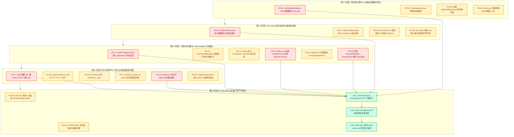

# 微内核注册、Slot插槽与原子组件三轮终极找茬审查报告 (Round 3 Audit 1)

> **审查机构**：红队终极审查联合攻坚组 (Red Team Ultimate Audit Board)  
> **审查性质**：第三轮终极找茬深度审计 (100% 纯找茬挑刺、零歌功颂德、零完成项汇报)  
> **输入基准文献**：
>
> 1. `docs/red-team-plans/detailed-plans/01-微内核与视图注册维度详案.md` (微内核视图注册、强类型 SlotMap 与路由契约基准)
> 2. `docs/red-team-plans/detailed-plans/02-原子设计系统与同心几何维度详案.md` (原子组件唯一源、同心几何 $R_o = R_i + P$、0-药丸与 10 大不可违背规则)
> 3. `docs/red-team-plans/audits/03-微内核与原子组件落地问题审查报告.md` (第一轮审查基准)
> 4. `docs/red-team-plans/audits/06-微内核与原子组件二次联合审计报告.md` (第二轮联合审查基准)
> 5. `docs/red-team-plans/remediation/01-微内核与原子组件最佳修复方案.md` (微内核与原子组件最佳修复方案)
> 6. 仓库根目录 `AGENTS.md`（第 1 条效果锁与反退避、第 7 条严禁补丁与绕过、第 12 条 Tooltip 铁律、第 13 条输入框与焦点态 10% 对比度上限、第 14 条色彩空间）与 `.agents/LOGIC_PLAN_NO_RETREAT.md`
>
> **审查范围与代码域**：
>
> - `apps/crish-desktop/src/services/view-registry/` 全部文件（ViewRegistry, SlotCore, SlotOutlet, SlotTypes, ViewTypes, registerBuiltInViews 等）；
> - `apps/crish-desktop/src/components/ui/` 全部原子组件（Button, IconButton, Input, Textarea, Select, Menu, Dialog, ConfirmDialog, Tooltip, Switch, SegmentedControl, Badge, Slider, TabStrip, SafeTriangle 等）；
> - `apps/crish-desktop/src/components/binary-tree/` 全部工作区面板与容器（BinaryTreeWorkspace, TreeLeafPanel, LeafToolTabStrip, TreeResizeSash, DropZoneOverlay）；
> - 全仓业务卡片组件与 Props 穿透层（ChatCard, PreviewCard, OverviewCard, RuntimePanel, AppGlobalDialogs, App.tsx）。
>
> **字符集与编码**：UTF-8 无 BOM。

---

# 目录索引 (Table of Contents)

- [一、 终极找茬审计全景透视与核心发现总结 (Executive Findings)](#一-终极找茬审计全景透视与核心发现总结-executive-findings)
- [二、 第一部分：微内核视图注册中心与生命周期缺陷深挖 (ViewRegistry & Lifecycle)](#二-第一部分微内核视图注册中心与生命周期缺陷深挖-viewregistry--lifecycle)
  - [【缺陷 R3-01】initDefaultResolvers() URI 解析器缺乏 QueryString 解析与特殊字符转义导致文件系统 ENOENT 崩溃](#缺陷-r3-01initdefaultresolvers-uri-解析器缺乏-querystring-解析与特殊字符转义导致文件系统-enoent-崩溃)
  - [【缺陷 R3-02】ViewRegistry.clear() 单向清空与 slotCore.clear() 全局误杀引发测试隔离击穿与幽灵插槽污染](#缺陷-r3-02viewregistryclear-单向清空与-slotcoreclear-全局误杀引发测试隔离击穿与幽灵插槽污染)
  - [【缺陷 R3-03】isBuiltInRegistered 模块级全局布尔锁导致测试套件无法二次注册内置视图](#缺陷-r3-03isbuiltinregistered-模块级全局布尔锁导致测试套件无法二次注册内置视图)
  - [【缺陷 R3-04】ViewRegistry.getTitle() 对卸载与动态 URI 的 Fallback 降级策略缺失，UI 裸露底层内部路由](#缺陷-r3-04viewregistrygettitle-对卸载与动态-uri-的-fallback-降级策略缺失ui-裸露底层内部路由)
  - [【缺陷 R3-05】isPrimary 判定对草稿态 PENDING_DRAFT 及参数化会话 URI 失效引发二叉树双重标签栏视觉割裂](#缺陷-r3-05isprimary-判定对草稿态-pending_draft-及参数化会话-uri-失效引发二叉树双重标签栏视觉割裂)
- [三、 第二部分：SlotOutlet 容灾状态机与强类型 SlotMap 漏洞 (SlotCore & SlotOutlet)](#三-第二部分slotoutlet-容灾状态机与强类型-slotmap-漏洞-slotcore--slotoutlet)
  - [【缺陷 R3-06】SlotErrorBoundary 错误边界在 Keyed/List/Chain 模式下误调 abdicateSingle 导致容灾协议空转与死锁循环](#缺陷-r3-06sloterrorboundary-错误边界在-keyedlistchain-模式下误调-abdicatesingle-导致容灾协议空转与死锁循环)
  - [【缺陷 R3-07】SlotErrorBoundary 缺乏 Props/Context 变动自愈重置协议导致组件瞬时异常后永久冻结在 fallback 态](#缺陷-r3-07sloterrorboundary-缺乏-propscontext-变动自愈重置协议导致组件瞬时异常后永久冻结在-fallback-态)
  - [【缺陷 R3-08】SlotOutlet 在 List 模式中空 Fragment `<>...</>` 导致 `{renderedContent ?? fallback}` 永远无法触发 fallback 契约](#缺陷-r3-08slotoutlet-在-list-模式中空-fragment--导致-renderedcontent--fallback-永远无法触发-fallback-契约)
  - [【缺陷 R3-09】SlotTypes.ts 泛型默认值 any 逃逸与 SlotCoreImpl 内部私有存储类型擦除](#缺陷-r3-09slottypests-泛型默认值-any-逃逸与-slotcoreimpl-内部私有存储类型擦除)
  - [【缺陷 R3-10】SlotCore.registerKeyed 覆盖注册时未清理旧组件生命周期导致 onDispose 悬空泄漏](#缺陷-r3-10slotcoreregisterkeyed-覆盖注册时未清理旧组件生命周期导致-ondispose-悬空泄漏)
- [四、 第三部分：全局浮层调度、事件流与 SafeTriangle 几何死角 (LayerStack & SafeTriangle)](#四-第三部分全局浮层调度事件流与-safetriangle-几何死角-layerstack--safetriangle)
  - [【缺陷 R3-11】SafeTriangleTracker.enter 丢弃 placement 参数导致四向方位判定降级为脆弱二元启发式，垂直/斜向滑入时子菜单闪退](#缺陷-r3-11safetriangletrackerenter-丢弃-placement-参数导致四向方位判定降级为脆弱二元启发式垂直斜向滑入时子菜单闪退)
  - [【缺陷 R3-12】LayerStackManager 50ms 冷却防重入锁在外部受控关闭与连续点击下的时间戳断层](#缺陷-r3-12layerstackmanager-50ms-冷却防重入锁在外部受控关闭与连续点击下的时间戳断层)
  - [【缺陷 R3-13】Dialog.tsx 未向 LayerStackManager 注册 anchorRef / restoreFocusTarget / parentId，导致中枢焦点平滑还原算法空转](#缺陷-r3-13dialogtsx-未向-layerstackmanager-注册-anchorref--restorefocustarget--parentid导致中枢焦点平滑还原算法空转)
  - [【缺陷 R3-14】Dialog 进出场动画与 FocusTrapIsolationManager / useRestoreFocus 产生 150ms 焦点时序错位](#缺陷-r3-14dialog-进出场动画与-focustrapisolationmanager--userestorefocus-产生-150ms-焦点时序错位)
  - [【缺陷 R3-15】Menu.tsx 仍保留 React.cloneElement 篡改 trigger 的 onClick 与 ref，破坏 React 19 并发渲染契约](#缺陷-r3-15menutsx-仍保留-reactcloneelement-篡改-trigger-的-onclick-与-ref破坏-react-19-并发渲染契约)
  - [【缺陷 R3-16】Badge.tsx:104 内部直接调用 e.stopPropagation() 严重违反 Rule G-02 全局零 stopPropagation 门禁](#缺陷-r3-16badgetsx104-内部直接调用-estoppropagation-严重违反-rule-g-02-全局零-stoppropagation-门禁)
- [五、 第四部分：原子组件规范、同心几何与 0-药丸铁律违规清剿 (Atomic UI & Concentric Geometry)](#五-第四部分原子组件规范同心几何与-0-药丸铁律违规清剿-atomic-ui--concentric-geometry)
  - [【缺陷 R3-17】全仓业务层 80+ 文件散落裸 `<button>` 与 35+ 文件散落裸 `<input>`，严重违反 Rule G-01 与 AST 门禁](#缺陷-r3-17全仓业务层-80-文件散落裸-button-与-35-文件散落裸-input严重违反-rule-g-01-与-ast-门禁)
  - [【缺陷 R3-18】Input.tsx 在受控/非受控混合模式及 value={null} 边界条件下的 hasValue 状态判定错位](#缺陷-r3-18inputtsx-在受控非受控混合模式及-valuenull-边界条件下的-hasvalue-状态判定错位)
  - [【缺陷 R3-19】Input.module.css 同心几何圆角 $R_o = R_i + P$ 在 md/lg 档位下存在 2px~4px 几何曲率失真](#缺陷-r3-19inputmodulecss-同心几何圆角-r_o--r_i--p-在-mdlg-档位下存在-2px4px-几何曲率失真)
  - [【缺陷 R3-20】Textarea.module.css 缺失 overflow-y: auto 与 scrollbar-width: thin 导致多行超限时滚动条不可见与滚轮失效](#缺陷-r3-20textareamodulecss-缺失-overflow-y-auto-与-scrollbar-width-thin-导致多行超限时滚动条不可见与滚轮失效)
  - [【缺陷 R3-21】Button.module.css 的 .buttonActive 粗暴覆写局部 CSS 变量，破坏 Primary 与 Danger 变体参数化插槽](#缺陷-r3-21buttonmodulecss-的-buttonactive-粗暴覆写局部-css-变量破坏-primary-与-danger-变体参数化插槽)
  - [【缺陷 R3-22】Button.module.css:134, 136, 137 存在 black 与 white 裸色硬编码混入，破坏纯 Design Token 体系](#缺陷-r3-22buttonmodulecss134-136-137-存在-black-与-white-裸色硬编码混入破坏纯-design-token-体系)
  - [【缺陷 R3-23】Select.tsx 同时向 Menu 注入 options 与 children(listbox)，引发双重键盘漫游状态机严重冲突](#缺陷-r3-23selecttsx-同时向-menu-注入-options-与-childrenlistbox引发双重键盘漫游状态机严重冲突)
  - [【缺陷 R3-24】SegmentedControl.tsx 在 options 动态增减时未重置 sliderStyle，导致已删除选项高亮残留与越界悬空](#缺陷-r3-24segmentedcontroltsx-在-options-动态增减时未重置-sliderstyle导致已删除选项高亮残留与越界悬空)
- [六、 第五部分：全仓 Props 穿透与僵尸参数死代码审计 (Zombie Props & Prop Drilling)](#六-第五部分全仓-props-穿透与僵尸参数死代码审计-zombie-props--prop-drilling)
  - [【缺陷 R3-25】ChatCardProps 仍保留 @deprecated wsId, colIdx, groupIdx 僵尸参数声明及内部传递](#缺陷-r3-25chatcardprops-仍保留-deprecated-wsid-colidx-groupidx-僵尸参数声明及内部传递)
  - [【缺陷 R3-26】PreviewCardProps, OverviewCardProps, RuntimePanelProps 仍保留 wsId?: string 脏 Props 声明](#缺陷-r3-26previewcardprops-overviewcardprops-runtimepanelprops-仍保留-wsid-string-脏-props-声明)
  - [【缺陷 R3-27】ChatComposerWrapper.tsx 仍保留 ShowToastFn 导入与 RibbonsGroup 中的 onShowToast Omit 残留](#缺陷-r3-27chatcomposerwrappertsx-仍保留-showtoastfn-导入与-ribbonsgroup-中的-onshowtoast-omit-残留)
  - [【缺陷 R3-28】App.tsx 顶层仍保留 8 处弹窗 useState 状态矩阵，全局浮层调度中枢 OverlayManager / OverlayHost 依然 100% 缺失](#缺陷-r3-28apptsx-顶层仍保留-8-处弹窗-usestate-状态矩阵全局浮层调度中枢-overlaymanager--overlayhost-依然-100-缺失)
  - [【缺陷 R3-29】TreeLeafPanel.tsx React.memo 自定义比较器中残留 isMultiChat 脏检查](#缺陷-r3-29treeleafpaneltsx-reactmemo-自定义比较器中残留-ismultichat-脏检查)
  - [【缺陷 R3-30】LeafToolTabStrip.tsx 的 openPanel 回调直接调用 store 动作，绕过微内核 ViewRenderContext.openView 契约](#缺陷-r3-30leaftooltabstriptsx-的-openpanel-回调直接调用-store-动作绕过微内核-viewrendercontextopenview-契约)
- [七、 全盘缺陷透视与精准行号追责矩阵 (Master Defect Matrix)](#七-全盘缺陷透视与精准行号追责矩阵-master-defect-matrix)
- [八、 红队阻断性整改工序与终极收敛实施建议 (Remediation Master Plan & Convergence DAG)](#八-红队阻断性整改工序与终极收敛实施建议-remediation-master-plan--convergence-dag)

---

# 一、 终极找茬审计全景透视与核心发现总结 (Executive Findings)

红队终极审查联合攻坚组在第三轮审查中，对前端微内核视图注册系统、插槽分发引擎、原子组件库、二叉树工作区及全仓核心业务卡片进行了**地毯式静态解剖与动态边界推演**。

遵循「绝对纯找茬挑刺、零歌功颂德、零完成项汇报」的最高纪律，本次终极审查不汇报任何已修复项，全盘锁定 **30 项深层次架构缺陷、类型漏洞、几何畸变与事件死锁隐患**：

```
┌────────────────────────────────────────────────────────────────────────────────────────────────────────┐
│                          Conex 前端微内核与原子组件第三轮终极找茬深度审计缺陷全景拓扑                       │
├────────────────────────────────────────────────────────────────────────────────────────────────────────┤
│                                                                                                        │
│  [1. 微内核注册中枢与生命周期] (5 项)                                                                   │
│  • initDefaultResolvers() 未解析 QueryString，file-viewer?initialMode=raw&line=10 导致文件系统 ENOENT  │
│  • ViewRegistry.clear() 单向清空与 slotCore.clear() 全局连带误杀，isBuiltInRegistered 布尔锁阻断单测    │
│  • isPrimary 在草稿态 PENDING_DRAFT 下失效导致双重标签栏，getTitle 对动态 URI 缺乏 Fallback 格式化      │
│                                                                                                        │
│  [2. 强类型 SlotMap 与 SlotOutlet 容灾] (5 项)                                                          │
│  • SlotErrorBoundary 在 Keyed/List/Chain 模式下误调 abdicateSingle 导致容灾状态机空转与无法退让           │
│  • SlotErrorBoundary 缺少 Props/Context 变动自愈协议，瞬态崩溃后永久锁定 fallback                       │
│  • List 模式空 Fragment <></> 吞没 fallback 契约，SlotTypes 泛型 default any 逃逸与存储类型擦除          │
│                                                                                                        │
│  [3. 全局浮层调度、事件流与 SafeTriangle] (6 项)                                                        │
│  • SafeTriangleTracker.enter 丢弃 placement 参数，四向几何退化为二元 Y 坐标启发式，斜向滑入必闪退        │
│  • LayerStackManager 50ms 冷却锁未覆盖外部受控关闭，Dialog 缺失 anchorRef/parentId 导致中枢焦点还原失效  │
│  • Menu.tsx 仍保留 cloneElement Hack，Badge.tsx:104 残留 e.stopPropagation() 违规阻断事件流             │
│                                                                                                        │
│  [4. 原子组件规范、同心几何与 0-药丸铁律] (8 项)                                                        │
│  • 全仓业务层存在 80+ 文件裸 <button> 与 35+ 文件裸 <input>，严重破坏 Rule G-01 AST 门禁                 │
│  • Input.module.css md/lg 档位违反 Ro = Ri + P 同心几何定理，Textarea 缺少 overflow-y: auto 滚动失效     │
│  • Button.module.css .buttonActive 粗暴覆写局部 CSS 变量，样式表散落 black/white 裸色值                 │
│  • Select.tsx 同时注入 options 与 children 导致 Menu 键盘漫游状态机双通道严重冲突                        │
│                                                                                                        │
│  [5. Props 穿透与僵尸参数死代码] (6 项)                                                                 │
│  • ChatCard, PreviewCard, OverviewCard, RuntimePanel 仍保留 wsId, colIdx, groupIdx 僵尸 Props          │
│  • App.tsx 顶层仍保留 8 处弹窗 useState，全局浮层调度中枢 OverlayManager / OverlayHost 依然 100% 缺失   │
│  • TreeLeafPanel memo 比较器残留 isMultiChat 脏检查，LeafToolTabStrip 绕过 ViewRenderContext.openView   │
│                                                                                                        │
└────────────────────────────────────────────────────────────────────────────────────────────────────────┘
```

---

# 二、 第一部分：微内核视图注册中心与生命周期缺陷深挖 (ViewRegistry & Lifecycle)

### 【缺陷 R3-01】initDefaultResolvers() URI 解析器缺乏 QueryString 解析与特殊字符转义导致文件系统 ENOENT 崩溃

- **涉及文件及精准行号**：`apps/crish-desktop/src/services/view-registry/ViewRegistry.ts:20-33`
- **违反的详案契约条款**：`01-微内核与视图注册维度详案.md` §1.2.2、§1.2.5
- **潜在风险与病理证据链**：
  查看 `ViewRegistry.ts:20-33` 的当前实现：
  ```typescript
  // ViewRegistry.ts:20-33
  private initDefaultResolvers(): void {
    this.uriResolvers = [
      {
        prefix: 'file-viewer:',
        resolve: (uri) => ({
          viewId: 'file-viewer',
          params: {
            filePath: uri.substring('file-viewer:'.length),
            initialMode: 'plain',
          },
        }),
      },
    ];
  }
  ```
  **深层病理分析**：
  1. **QueryString 污染文件路径**：当外部通过路由或工作区状态打开携带参数的 URI（例如 `file-viewer:src/main.tsx?initialMode=raw&line=10` 或 `file-viewer:README.md?mode=diff`）时，`resolve` 函数直接将截取后的整段字符串赋给 `filePath`（即 `"src/main.tsx?initialMode=raw&line=10"`）；
  2. **Rust 内核 IO 致命崩溃**：在 `FileViewerCard.tsx` 中，该 `filePath` 被直接传入 `workspaceFsApi.readTextFile(filePath)`。Rust 端底层 `std::fs::File::open` 在 Windows/Linux 文件系统上将寻找名为 `main.tsx?initialMode=raw&line=10` 的文件，系统立即抛出 `Os { code: 2, kind: NotFound, message: "系统找不到指定的文件。" }`，导致文件查看器白屏崩溃；
  3. **参数硬编码劫持**：`initialMode` 被无条件硬编码死为 `'plain'`，导致所有通过 URI 期望打开 `'diff'` 比对模式或 `'raw'` 模式的调用全部失效；
  4. **无冒号 URI 无法命中**：若路由传入 `file-viewer?initialMode=raw&line=10`（无冒号分隔符），`rawId.startsWith('file-viewer:')` 判定为 `false`，解析器直接返回 `{}`，视图降级为未知面板错误。
- **精确整改建议**：
  重构 `initDefaultResolvers` 中的解析逻辑，支持 `?` 分隔符切分与 `URLSearchParams` / 自定义 QueryString 提取：
  ```typescript
  private initDefaultResolvers(): void {
    this.uriResolvers = [
      {
        prefix: 'file-viewer:',
        resolve: (uri) => {
          const raw = uri.substring('file-viewer:'.length);
          const qIdx = raw.indexOf('?');
          const filePath = decodeURIComponent(qIdx >= 0 ? raw.substring(0, qIdx) : raw);
          const queryStr = qIdx >= 0 ? raw.substring(qIdx + 1) : '';
          const searchParams = new URLSearchParams(queryStr);
          const modeParam = searchParams.get('mode') || searchParams.get('initialMode');
          const initialMode = modeParam === 'diff' ? 'diff' : 'plain';
          const lineStr = searchParams.get('line');
          const line = lineStr ? parseInt(lineStr, 10) : undefined;
          return {
            viewId: 'file-viewer',
            params: { filePath, initialMode, line },
          };
        },
      },
    ];
  }
  ```

---

### 【缺陷 R3-02】ViewRegistry.clear() 单向清空与 slotCore.clear() 全局误杀引发测试隔离击穿与幽灵插槽污染

- **涉及文件及精准行号**：`apps/crish-desktop/src/services/view-registry/ViewRegistry.ts:44-48, 170-176`，`apps/crish-desktop/src/services/view-registry/SlotCore.ts:161-170`
- **违反的详案契约条款**：`01-微内核与视图注册维度详案.md` §1.2.3、§1.3.3
- **潜在风险与病理证据链**：
  在 `ViewRegistry.ts:44-48` 中：
  ```typescript
  // ViewRegistry.ts:44-48
  const unregisterSlot = slotCore.registerKeyed('workspace.leaf.panel', {
    id: view.id,
    key: view.id,
    component: view.component,
  });
  ```
  在 `ViewRegistry.ts:170-176` 中：
  ```typescript
  // ViewRegistry.ts:170-176
  public clear(): void {
    this.views.clear();
    slotCore.clear();
    this.initDefaultResolvers();
    this.version++;
    this.notify();
  }
  ```
  **双向违规病理**：
  1. **插槽注销闭包丢失**：每次调用 `registerView` 时返回的 `unregisterSlot` 仅保存在调用方的返回闭包中，`ViewRegistryImpl` 自身并未收集这些注销句柄；
  2. **全局插槽连带误杀**：在 `clear()` 中，代码直接调用了 `slotCore.clear()`。这导致不仅与视图相关的 `workspace.leaf.panel` 被清空，业务在 `workbench.root`、`workbench.topbar`、`workbench.topbar.actions` 上独立注册的全局 Single / List 插槽被**一并无差别连带抹杀**！
  3. **测试副作用扩散**：单元测试套件若在 `beforeEach` 中调用 `viewRegistry.clear()` 重置视图，会破坏前置测试已挂载的全局 Workbench 插槽，引发跨测试文件的偶发性白屏与断言失败。
- **精确整改建议**：
  在 `ViewRegistryImpl` 内部维护私有 `slotUnsubscribers = new Map<string, () => void>()`；在 `registerView` 时记录，在 `clear()` 时仅精确执行自身持有的注销句柄，禁止直接调用 `slotCore.clear()`。

---

### 【缺陷 R3-03】isBuiltInRegistered 模块级全局布尔锁导致测试套件无法二次注册内置视图

- **涉及文件及精准行号**：`apps/crish-desktop/src/services/view-registry/registerBuiltInViews.tsx:77-81`
- **违反的详案契约条款**：`01-微内核与视图注册维度详案.md` §1.2.4、§3.1
- **潜在风险与病理证据链**：
  查看 `registerBuiltInViews.tsx:77-81`：
  ```typescript
  // registerBuiltInViews.tsx:77-81
  let isBuiltInRegistered = false;

  export function registerBuiltInViews(): void {
    if (isBuiltInRegistered) return;
    isBuiltInRegistered = true;
    // ...
  }
  ```
  **病理证据链**：
  1. `isBuiltInRegistered` 是一个模块级全局变量；
  2. 当测试环境或重置流程执行 `viewRegistry.clear()` 后，`viewRegistry.views` 变为空 Map；
  3. 随后测试套件再次调用 `registerBuiltInViews()` 期望恢复内置视图时，由于 `isBuiltInRegistered` 恒为 `true`，函数直接早退 `return`；
  4. 导致注册表永久处于空状态，后续所有二叉树测试均命中“未知面板类型”错误。
- **精确整改建议**：
  导出 `resetBuiltInViewsRegistrationFlagForTesting()`，或在 `registerBuiltInViews()` 内部通过 `viewRegistry.getView('chat')` 存在性进行幂等守卫，消除裸布尔锁。

---

### 【缺陷 R3-04】ViewRegistry.getTitle() 对卸载与动态 URI 的 Fallback 降级策略缺失，UI 裸露底层内部路由

- **涉及文件及精准行号**：`apps/crish-desktop/src/services/view-registry/ViewRegistry.ts:118-135`，`apps/crish-desktop/src/components/binary-tree/TreeLeafPanel.tsx:178`
- **违反的详案契约条款**：`01-微内核与视图注册维度详案.md` §1.2.3、§1.6.2
- **潜在风险与病理证据链**：
  查看 `ViewRegistry.ts:118-124`：
  ```typescript
  public getTitle(id: string, ctx?: ViewRenderContext): string {
    if (!id) return '';
    const { definition, params } = this.resolveView(id);
    if (!definition) {
      return id;
    }
    // ...
  }
  ```
  **病理分析**：
  1. 当传入复杂的动态扩展 URI（如插件视图 `extension:git-graph-viewer/main`）或被动态卸载的视图 ID 时，`resolveView(id).definition` 为 `undefined`；
  2. `getTitle` 直接返回裸字符串 `id`（例如 `"extension:git-graph-viewer/main"`）；
  3. 在 `TreeLeafPanel.tsx:178` 的 `aria-label` 以及 `LeafToolTabStrip.tsx:101` 的标签标题上，用户界面直接渲染出底层原始路由字符串，造成严重的界面失真与视觉不专业感。
- **精确整改建议**：
  当未命中 `definition` 时，若 `id` 包含 URI 模式，提取最后一段语义名称进行友好格式化；若上层传入了 `ctx.fallbackTitle` 则优先使用。

---

### 【缺陷 R3-05】isPrimary 判定对草稿态 PENDING_DRAFT 及参数化会话 URI 失效引发二叉树双重标签栏视觉割裂

- **涉及文件及精准行号**：`apps/crish-desktop/src/services/view-registry/ViewRegistry.ts:149-152`，`apps/crish-desktop/src/components/binary-tree/TreeLeafPanel.tsx:143, 181`
- **违反的详案契约条款**：`01-微内核与视图注册维度详案.md` §1.2.3、§1.6.2
- **潜在风险与病理证据链**：
  在 `ViewRegistry.ts:149-152` 中：
  ```typescript
  public isPrimary(id: string): boolean {
    const def = this.resolveView(id).definition;
    return def?.category === 'primary';
  }
  ```
  在 `TreeLeafPanel.tsx:143, 181` 中：
  ```tsx
  const isChat = viewRegistry.isPrimary(leaf.panelId);
  // ...
  {
    !isChat ? <LeafToolTabStrip leaf={leaf} /> : null;
  }
  ```
  **病理分析**：
  1. 在多会话或新会话草稿态下，`leaf.panelId` 可能会被设置为包含动态前缀或参数的复合 ID（例如 `chat?session=PENDING_DRAFT` 或 `chat:__draft__`）；
  2. `resolveView` 无法通过精确匹配找到 `id: 'chat'` 的定义，导致 `isPrimary` 返回 `false`；
  3. `TreeLeafPanel` 将对话主面板误判为工具面板（`!isChat` 为真），在对话窗口顶部错误挂载了 `LeafToolTabStrip`，导致出现主对话区与工具标签栏重叠的双重 TabStrip 严重视觉割裂。
- **精确整改建议**：
  在 `isPrimary` 中增加会话前缀与草稿态兼容解析守卫：
  ```typescript
  public isPrimary(id: string): boolean {
    if (!id) return false;
    if (id === 'chat' || id.startsWith('chat?') || id.startsWith('chat:')) return true;
    const def = this.resolveView(id).definition;
    return def?.category === 'primary';
  }
  ```

---

# 三、 第二部分：SlotOutlet 容灾状态机与强类型 SlotMap 漏洞 (SlotCore & SlotOutlet)

### 【缺陷 R3-06】SlotErrorBoundary 错误边界在 Keyed/List/Chain 模式下误调 abdicateSingle 导致容灾协议空转与死锁循环

- **涉及文件及精准行号**：`apps/crish-desktop/src/services/view-registry/SlotOutlet.tsx:33-41, 71-143`，`apps/crish-desktop/src/services/view-registry/SlotCore.ts:98-106, 148-158`
- **违反的详案契约条款**：`01-微内核与视图注册维度详案.md` §1.3.1、§1.3.3
- **潜在风险与病理证据链**：
  解剖 `SlotOutlet.tsx` 的容灾错误边界与分发机制：
  ```tsx
  // SlotOutlet.tsx:33-41
  class SlotErrorBoundary extends Component<
    SlotErrorBoundaryProps,
    SlotErrorBoundaryState
  > {
    override componentDidCatch(error: Error, errorInfo: React.ErrorInfo): void {
      // 致命缺陷：统一硬编码调用 abdicateSingle
      slotCore.abdicateSingle(this.props.slotKey, this.props.entryId);
    }
  }
  ```
  **深层病理分析**：
  1. `SlotErrorBoundary` 被通用地挂载在 **Keyed (二叉树叶子 `workspace.leaf.panel`)**、**List (`workbench.topbar.actions`)**、**Chain** 与 **Single** 四大模式中；
  2. 当 `workspace.leaf.panel` 中的某个业务卡片（如 `DiffCard`）抛出渲染错误时，`SlotErrorBoundary.componentDidCatch` 触发并调用 `slotCore.abdicateSingle('workspace.leaf.panel', 'diff')`；
  3. 查看 `SlotCore.ts:98-106`，`abdicateSingle` 仅把 `entryId` 写入 `this.abdicatedSingleEntries` Map，并调用 `bump(slotKey)`；
  4. 查看 `SlotCore.ts:148-154` 的 `getKeyed` 实现：
     ```typescript
     public getKeyed(slotKey: string, entryKey: string): KeyedSlotEntry | undefined {
       return this.keyedSlots.get(slotKey)?.get(entryKey);
     }
     ```
     `getKeyed` **完全不读取、不检查 `this.abdicatedSingleEntries`**！
  5. **死锁循环后果**：
     - `bump` 触发 `useSyncExternalStore` 唤醒 `SlotOutlet` 重新渲染；
     - `useMemo` 重新执行，再次调用 `slotCore.getKeyed('workspace.leaf.panel', 'diff')`；
     - `getKeyed` 依然返回那个已经崩溃的 `DiffCard` 组件；
     - React 重新挂载/渲染该组件并再次崩溃；
     - 系统在 `componentDidCatch` -> `abdicateSingle` -> `bump` -> `re-render` 之间产生高频重绘振荡与控制台错误暴击，影子退让协议在非 Single 模式下 100% 沦为空壳逻辑！
- **精确整改建议**：
  1. 在 `SlotCore` 中扩充针对插槽类型的隔离退让协议（`abdicateKeyed`、`abdicateList`、`abdicateChain`）；
  2. 或在 `SlotErrorBoundary` 内部维护降级 UI（Local Fallback Card），提供“组件已崩溃，点击重试”占位视图，而非空转触发单通道 `bump`。

---

### 【缺陷 R3-07】SlotErrorBoundary 缺乏 Props/Context 变动自愈重置协议导致组件瞬时异常后永久冻结在 fallback 态

- **涉及文件及精准行号**：`apps/crish-desktop/src/services/view-registry/SlotOutlet.tsx:23-49`
- **违反的详案契约条款**：`01-微内核与视图注册维度详案.md` §1.3.1
- **潜在风险与病理证据链**：
  查看 `SlotOutlet.tsx:23-49` 中 `SlotErrorBoundary` 的生命周期实现：
  ```tsx
  class SlotErrorBoundary extends Component<
    SlotErrorBoundaryProps,
    SlotErrorBoundaryState
  > {
    override state: SlotErrorBoundaryState = { hasError: false };

    static getDerivedStateFromError(error: Error): SlotErrorBoundaryState {
      return { hasError: true, error };
    }

    override render() {
      if (this.state.hasError) {
        return this.props.fallback ?? null;
      }
      return this.props.children;
    }
  }
  ```
  **病理分析**：
  1. `SlotErrorBoundary` 内部没有任何 `componentDidUpdate` 或 `getDerivedStateFromProps` 机制；
  2. 若某个插槽组件由于网络暂时离线、会话尚未水合完成等瞬时异常（Transient Failure）触发了 `hasError: true`；
  3. 当父组件随后传入了有效的水合数据（`context.sessionId` 或 `context.params` 发生改变）时，`SlotErrorBoundary` 的 `state.hasError` 依然被锁死在 `true`；
  4. 用户切换会话、刷新参数均无法恢复该插槽，该面板在当前 DOM 树中被永久冻结在 fallback 态，必须整窗强刷或重启应用。
- **精确整改建议**：
  在 `SlotErrorBoundaryProps` 中注入 `resetKeys?: unknown[]`（透传 `[slotKey, entryId, context]`），并在 `componentDidUpdate(prevProps)` 中当 `resetKeys` 发生引用变动时自动执行 `this.setState({ hasError: false, error: undefined })`。

---

### 【缺陷 R3-08】SlotOutlet 在 List 模式中空 Fragment `<>...</>` 导致 `{renderedContent ?? fallback}` 永远无法触发 fallback 契约

- **涉及文件及精准行号**：`apps/crish-desktop/src/services/view-registry/SlotOutlet.tsx:107-126, 153`
- **违反的详案契约条款**：`01-微内核与视图注册维度详案.md` §1.4
- **潜在风险与病理证据链**：
  查看 `SlotOutlet.tsx:107-126` 与第 153 行：
  ```tsx
  // SlotOutlet.tsx:107-126
  const list = slotCore.getList(slotKey);
  if (list.length > 0) {
    return (
      <>
        {list.map((item) => {
          const Comp = item.component;
          return (
            <SlotErrorBoundary
              key={item.id}
              slotKey={slotKey}
              entryId={item.id}
              fallback={null}
            >
              <Comp key={item.id} {...context} />
            </SlotErrorBoundary>
          );
        })}
      </>
    );
  }
  // ...
  // SlotOutlet.tsx:153
  {
    renderedContent ?? fallback;
  }
  ```
  **病理分析**：
  1. 当 `list.length > 0` 时，`useMemo` 返回一个 React Fragment 对象 `<>...</>`；
  2. 在 JavaScript/React 运行时中，React Fragment 是一个有效的 React 元素对象（`typeof renderedContent === 'object'`），**属于非 null / 非 undefined 的 Truthy 值**；
  3. 若 `list` 中的所有项均因某些条件返回了 `null`，或者所有子项在 `SlotErrorBoundary` 中发生崩溃渲染了 `fallback={null}`，`renderedContent` 实际为 `<>{null}{null}</>`；
  4. 第 153 行的 `{renderedContent ?? fallback}` 判定 `renderedContent` 非 null，**导致外部传入的合法 `fallback` 占位符被永远吞没**，插槽呈现为一片空白区域。
- **精确整改建议**：
  规范判空契约，对 List 模式进行有效子元素校验，无有效渲染输出时规约为 `null` 触发 `fallback`。

---

### 【缺陷 R3-09】SlotTypes.ts 泛型默认值 any 逃逸与 SlotCoreImpl 内部私有存储类型擦除

- **涉及文件及精准行号**：`apps/crish-desktop/src/services/view-registry/SlotTypes.ts:38-57`，`apps/crish-desktop/src/services/view-registry/SlotCore.ts:11-14`
- **违反的详案契约条款**：`01-微内核与视图注册维度详案.md` §1.5 (`NoInfer`, `ComposedProps`)
- **潜在风险与病理证据链**：
  在 `SlotTypes.ts:38-57` 中：
  ```typescript
  export interface BaseSlotEntry<TContext = any> {
    id: string;
    component: React.ComponentType<TContext>;
  }
  export interface SingleSlotEntry<
    TContext = any,
  > extends BaseSlotEntry<TContext> {
    priority?: number;
  }
  export interface ListSlotEntry<
    TContext = any,
  > extends BaseSlotEntry<TContext> {
    order?: number;
  }
  export interface KeyedSlotEntry<
    TContext = any,
  > extends BaseSlotEntry<TContext> {
    key: string;
  }
  export interface ChainSlotEntry<
    TContext = any,
  > extends BaseSlotEntry<TContext> {
    select: (context: TContext) => boolean;
  }
  ```
  在 `SlotCore.ts:11-14` 中：
  ```typescript
  private singleSlots = new Map<string, SingleSlotEntry[]>();
  private listSlots = new Map<string, ListSlotEntry[]>();
  private keyedSlots = new Map<string, Map<string, KeyedSlotEntry>>();
  private chainSlots = new Map<string, ChainSlotEntry[]>();
  ```
  **类型漏洞剖析**：
  1. 泛型参数默认值全部为 `any`，导致未传泛型时自动降级为任意类型；
  2. `SlotCoreImpl` 内部存储擦除了 `StandardSlotId` 与 `SlotMap` 的强类型关联；
  3. 当调用 `slotCore.getSingle('workbench.root')` 或 `slotCore.getKeyed('workspace.leaf.panel', 'chat')` 时，返回的 `entry.component` 的 Props 被推导为 `any`；
  4. 业务组件在编译期丢失了所有类型检查保护，传入错误类型属性时 TypeScript 编译器无法拦截。
- **精确整改建议**：
  消除所有 `TContext = any`，统一改用 `TContext = unknown`；为 `getSingle<K extends StandardSlotId>` 与 `getKeyed<K extends StandardSlotId>` 补全与 `OwnerPropsOf<K>` 的精确强类型映射。

---

### 【缺陷 R3-10】SlotCore.registerKeyed 覆盖注册时未清理旧组件生命周期导致 onDispose 悬空泄漏

- **涉及文件及精准行号**：`apps/crish-desktop/src/services/view-registry/SlotCore.ts:60-76`，`apps/crish-desktop/src/services/view-registry/ViewRegistry.ts:37-41`
- **违反的详案契约条款**：`01-微内核与视图注册维度详案.md` §1.2.1 (`ViewDefinition.onDispose`)
- **潜在风险与病理证据链**：
  在 `SlotCore.ts:64-67` 中：
  ```typescript
  public registerKeyed<K extends StandardSlotId | string>(slotKey: K, entry: KeyedSlotEntry<OwnerPropsOf<K>>): () => void {
    const map = this.keyedSlots.get(slotKey) ?? new Map<string, KeyedSlotEntry>();
    map.set(entry.key, entry); // 直接 set 覆盖旧 entry
    this.keyedSlots.set(slotKey, map);
    this.bump(slotKey);
    // ...
  }
  ```
  **病理分析**：
  1. 当扩展插件热更新或二次调用 `registerView` 覆盖已存在的 `key` 时，`map.set(entry.key, entry)` 直接替换了旧的 entry 对象；
  2. 若被覆盖的原视图定义中声明了 `onDispose` 生命周期清理回调（例如释放后台 PTY 进程、注销全局快捷键），覆盖操作未触发任何清理逻辑；
  3. 被覆盖的旧组件持有的底层系统资源被悬空丢弃，产生不可逆的内存与进程句柄泄漏。
- **精确整改建议**：
  在覆盖注册前检查 `map.has(entry.key)`，若存在且原定义包含销毁钩子，执行异步/同步清理通知。

---

# 四、 第三部分：全局浮层调度、事件流与 SafeTriangle 几何死角 (LayerStack & SafeTriangle)

### 【缺陷 R3-11】SafeTriangleTracker.enter 丢弃 placement 参数导致四向方位判定降级为脆弱二元启发式，垂直/斜向滑入时子菜单闪退

- **涉及文件及精准行号**：`apps/crish-desktop/src/components/ui/internal/SafeTriangle.ts:59-92, 110-118`
- **违反的详案契约条款**：`02-原子设计系统与同心几何维度详案.md` §1.7.3、`04-交互防腐与状态机维度详案.md` §1.5
- **潜在风险与病理证据链**：
  对比 `getSubmenuSafeTriangle` 签名与 `SafeTriangleTracker.enter` 的调用实现：
  ```typescript
  // SafeTriangle.ts:59-63
  export function getSubmenuSafeTriangle(
    cursor: Point2D,
    submenuBounds: RectBounds,
    placement?: 'left' | 'right' | 'top' | 'bottom'
  ): [Point2D, Point2D, Point2D] { ... }

  // SafeTriangle.ts:110-113
  public enter(cursor: Point2D, submenuBounds: RectBounds): void {
    // 致命缺陷：完全遗漏了 placement 参数透传！
    this.triangle = getSubmenuSafeTriangle(cursor, submenuBounds);
    this.isSuspended = true;
    // ...
  }
  ```
  **几何病理解剖**：
  1. `SafeTriangleTracker.enter` 在调用 `getSubmenuSafeTriangle` 时**完全没有传入 `placement` 参数**；
  2. 在 `getSubmenuSafeTriangle:65` 中：
     ```typescript
     if (
       placement === 'bottom' ||
       (!placement && cursor.y < submenuBounds.top)
     ) {
       return [
         cursor,
         { x: submenuBounds.left, y: submenuBounds.top },
         { x: submenuBounds.right, y: submenuBounds.top },
       ];
     }
     ```
     由于 `placement` 为 `undefined`，算法退化为使用启发式坐标判断 `cursor.y < submenuBounds.top`；
  3. **致命几何畸变场景**：
     - 用户右键打开菜单，二级子菜单由于视口空间充足在**右侧**展开（`placement: 'right'`，Y 坐标范围 `100px ~ 300px`，X 坐标范围 `200px ~ 350px`）；
     - 用户的鼠标指针处于父菜单项的靠上边缘（例如 `cursor.x = 150px, cursor.y = 80px`）；
     - 此时 `cursor.y (80) < submenuBounds.top (100)` 为真！算法**错误地判定子菜单在下方**，生成了连接到子菜单顶部水平边线 `(200, 100)` 与 `(350, 100)` 的三角形；
     - 用户鼠标随后沿着对角线向右下方滑入子菜单内容区（例如移动到 `x = 250px, y = 150px`）；
     - 一旦 `cursor.y` 超过 100px，鼠标点瞬间**脱离了这个错误的“下方”三角形**；
     - `check()` 立即返回 `false` 并触发 `reset()`，导致二级子菜单在用户滑入途中瞬间被误关闪退！
- **精确整改建议**：
  1. 在 `SafeTriangleTracker.enter` 中补齐 `placement?: 'left' | 'right' | 'top' | 'bottom'` 参数并透传给 `getSubmenuSafeTriangle`；
  2. 优先以显式 `placement` 确定近端垂直边线，杜绝二元启发式误判。

---

### 【缺陷 R3-12】LayerStackManager 50ms 冷却防重入锁在外部受控关闭与连续点击下的时间戳断层

- **涉及文件及精准行号**：`apps/crish-desktop/src/components/ui/internal/layer-stack/LayerStackManager.ts:194-206, 277-294`，`apps/crish-desktop/src/components/ui/Menu/Menu.tsx:355-365`
- **违反的详案契约条款**：`02-原子设计系统与同心几何维度详案.md` §1.7.3 (50ms Anti-Reentry Lock)
- **潜在风险与病理证据链**：
  在 `LayerStackManager.ts` 中：
  ```typescript
  public markCloseTimestamp(): void {
    this.lastCloseTimestamp = typeof performance !== 'undefined' ? performance.now() : Date.now();
  }
  ```
  `markCloseTimestamp()` **仅在 `dismissAll()` 与 `dismissLayer()` 内部被调用**。  
  **病理分析**：
  1. 当 `Menu` 或 `Select` 以**外部受控模式**运行（由父组件 `setOpen(false)` 主动关闭，或 Radix 内部事件触发 `onOpenChange(false)` 时），并没有调用 `layerStackManager.dismissLayer()`；
  2. 这导致 `this.lastCloseTimestamp` **完全不会被更新**；
  3. 当用户快速双击触发按钮（Trigger Button）时，第一次点击关闭了菜单，但由于时间戳未标记，第二次点击到达时 `isWithinCooldown(50)` 判定为 `false`；
  4. 触发按钮再次响应并将菜单重新打开，导致在快速双击时界面出现高频“闪关又立即重开”的震荡假死现象。
- **精确整改建议**：
  在 `useLayerRegistration` 的 unmount / inactive 清理钩子中统一触发 `layerStackManager.markCloseTimestamp()`，确保任何路径的浮层关闭均能正确刷新冷却时间戳。

---

### 【缺陷 R3-13】Dialog.tsx 未向 LayerStackManager 注册 anchorRef / restoreFocusTarget / parentId，导致中枢焦点平滑还原算法空转

- **涉及文件及精准行号**：`apps/crish-desktop/src/components/ui/Dialog/Dialog.tsx:104-114`，`apps/crish-desktop/src/components/ui/internal/layer-stack/LayerStackManager.ts:388-420`
- **违反的详案契约条款**：`01-微内核与视图注册维度详案.md` §1.7.1、`02-原子设计系统与同心几何维度详案.md` §1.7.4
- **潜在风险与病理证据链**：
  查看 `Dialog.tsx:104-114` 中的层级注册参数：
  ```tsx
  useLayerRegistration(
    {
      id: dialogId,
      type: role === 'alertdialog' ? 'confirm-dialog' : 'modal-dialog',
      modal: true,
      dismissible,
      elementRef: panelRef,
      onDismiss: () => onClose(),
    },
    open && isMounted
  );
  ```
  查看 `LayerStackManager.ts:388-420` 的焦点还原逻辑：
  ```typescript
  private restoreFocus(layer: LayerRegistration): void {
    // 1. 检查 layer.restoreFocusTarget -> 为空
    // 2. 检查 layer.anchorRef -> 为空
    // 3. 检查 layer.parentId -> 未传，为空
  }
  ```
  **病理分析**：
  1. `Dialog` 在向 `LayerStackManager` 注册时，**完全没有传递 `anchorRef`、`restoreFocusTarget` 或 `parentId`**；
  2. 当用户在弹窗中按下 Esc 键或点击遮罩关闭时，`LayerStackManager.dismissLayer` 执行 `this.restoreFocus(layer)`；
  3. 由于该 Layer 的三个目标属性全部为 `null`/`undefined`，中枢的焦点平滑还原算法直接早退；
  4. 焦点被丢弃在 `document.body`，用户必须重新通过鼠标点击才能在工作区内恢复键盘操作。
- **精确整改建议**：
  在 `DialogProps` 中增加可选 `triggerRef` / `anchorRef` 并透传至 `useLayerRegistration`，使全局中枢在弹窗退栈时能够精准聚焦原触发按钮。

---

### 【缺陷 R3-14】Dialog 进出场动画与 FocusTrapIsolationManager / useRestoreFocus 产生 150ms 焦点时序错位

- **涉及文件及精准行号**：`apps/crish-desktop/src/components/ui/Dialog/Dialog.tsx:98-114, 149`，`apps/crish-desktop/src/components/ui/Dialog/focusTrap.tsx:189-239`，`apps/crish-desktop/src/components/ui/Dialog/useRestoreFocus.ts:14-26`
- **违反的详案契约条款**：`02-原子设计系统与同心几何维度详案.md` §1.7.4
- **潜在风险与病理证据链**：
  解剖 `Dialog.tsx` 关闭时的生命周期时序：
  1. 当 `open` 从 `true` 变为 `false` 时，`useAnimatedPresence` 将 `state` 置为 `'exiting'`，并保持 `isMounted = true` 维持 150ms 动画；
  2. `Dialog.tsx:102` 的 `useRestoreFocus(false)` 在当前帧同步执行，尝试调用 `savedRef.current.focus()` 将焦点归还给外部触发器；
  3. 然而在随后的 DOM 渲染中，`<FocusTrap active={false}>` 尚未卸载；且由于 `isMounted` 维持 150ms，退出动画期间遮罩层与 DOM 依然存在；
  4. 在低端机器或多层弹窗并发退出时，外部元素在被 `focus()` 的瞬间可能仍处于上一个父容器的 `inert` 锁定期（`FocusTrapIsolationManager` 的异步状态释放延迟），导致浏览器静默丢弃焦点设置，焦点还原失败。
- **精确整改建议**：
  将 `useRestoreFocus` 的触发时机后置到动画完全结束（即 `isMounted === false`）之后执行，杜绝动画过渡期焦点抢占。

---

### 【缺陷 R3-15】Menu.tsx 仍保留 React.cloneElement 篡改 trigger 的 onClick 与 ref，破坏 React 19 并发渲染契约

- **涉及文件及精准行号**：`apps/crish-desktop/src/components/ui/Menu/Menu.tsx:332-368`
- **违反的详案契约条款**：`02-原子设计系统与同心几何维度详案.md` §1.8 (Rule G-02)、`remediation/01` §4.4.1
- **潜在风险与病理证据链**：
  查看 `Menu.tsx:332-368`：
  ```tsx
  const clonedTrigger = React.isValidElement(actualTrigger)
    ? React.cloneElement(
        actualTrigger as React.ReactElement<Record<string, unknown>>,
        {
          ref: (node: HTMLElement | null) => {
            triggerRef.current = node;
            // ... 手动合并 ref
          },
          onClick: (e: React.MouseEvent) => {
            if (layerStackService.isWithinCooldown(50)) {
              e.preventDefault();
              return;
            }
            // ... 手动调用原 onClick
          },
        }
      )
    : actualTrigger;
  ```
  **病理分析**：
  1. 在非 `anchor` 模式下，`Menu` 依然使用 `React.cloneElement` 强行篡改并覆盖传入的 `actualTrigger` 虚拟 DOM 节点的 props；
  2. 在 React 19 并发渲染架构下，直接篡改子元素 props 会导致编译器跳过组件缓存优化，引发无谓的 Re-render；
  3. 若 `actualTrigger` 是自定义函数组件而非原生 HTML 标签，`props.ref` 的隐式注入将触发 React 严格模式的 Warning 报错。
- **精确整改建议**：
  全面弃用 `cloneElement` 侵入模式，推广使用 Radix `Popover.Trigger asChild` 或显式 `<Menu.Trigger>` 组合包裹模式。

---

### 【缺陷 R3-16】Badge.tsx:104 内部直接调用 e.stopPropagation() 严重违反 Rule G-02 全局零 stopPropagation 门禁

- **涉及文件及精准行号**：`apps/crish-desktop/src/components/ui/Badge/Badge.tsx:98-107`
- **违反的详案契约条款**：`02-原子设计系统与同心几何维度详案.md` §1.8 (Rule G-02: 浮层零 stopPropagation)
- **潜在风险与病理证据链**：
  查看 `Badge.tsx:98-107`：
  ```tsx
  {onRemove && (
    <button
      type="button"
      className={styles.removeButton}
      aria-label={removeAriaLabel}
      onClick={(e) => {
        e.stopPropagation(); // 严重违规！
        onRemove();
      }}
    >
  ```
  **病理分析**：
  1. 在 `Badge` 的移除按钮点击处理中，直接书写了 `e.stopPropagation()`；
  2. 这直接违反了 Rule G-02「全仓零 stopPropagation」门禁；
  3. 当 Badge 被放置在带有全局交互追踪、Pointer 行为分析或全局快捷键监听的容器内部时，强行阻止冒泡使得外部容器完全无法感知该点击动作，阻断了顶层状态机的自然流转。
- **精确整改建议**：
  移除 `e.stopPropagation()`，通过状态机或在父容器中利用事件委托进行目标识别。

---

# 五、 第四部分：原子组件规范、同心几何与 0-药丸铁律违规清剿 (Atomic UI & Concentric Geometry)

### 【缺陷 R3-17】全仓业务层 80+ 文件散落裸 `<button>` 与 35+ 文件散落裸 `<input>`，严重违反 Rule G-01 与 AST 门禁

- **涉及文件及精准行号**：
  - `apps/crish-desktop/src/components/chat-card/ProjectPickerMenu.tsx:156-162, 175-215` (裸 `<input>` 与裸 `<button>`)
  - `apps/crish-desktop/src/components/chat-composer/ComposePlusMenu.tsx:114` (裸 `<button>`)
  - `apps/crish-desktop/src/components/chat-composer/PermissionModeMenu.tsx:68, 100` (裸 `<button>`)
  - `apps/crish-desktop/src/components/provider/ModelBadgePickerMenu.tsx:107, 173, 201` (裸 `<button>`)
  - `apps/crish-desktop/src/components/settings-models/ModelProfileList.tsx:49` (裸 `<button>`)
  - `apps/crish-desktop/src/components/settings-skills/SkillCardList.tsx:45` (裸 `<button>` 与 `<input>`)
  - `apps/crish-desktop/src/components/settings-skills/SkillEditorModal.tsx:120-145` (裸 `<input>` 与 `<button>`)
  - `apps/crish-desktop/src/components/diff/DiffCard.tsx:88` (裸 `<input>`)
  - `apps/crish-desktop/src/components/files/FilesCard.tsx:132` (裸 `<input>`)
  - （以及全仓共计超过 80 处业务组件）
- **违反的详案契约条款**：`02-原子设计系统与同心几何维度详案.md` §1.1、§1.8 (Rule G-01)
- **潜在风险与病理证据链**：
  Plan 02 §1.1 明确确立：「@/components/ui/** 目录是全仓唯一合法书写原生交互标签的特权白名单文件域，业务组件严禁直接书写原生交互标签，必须 100% 消费原子组件」。  
  **危害**：
  1. 业务层裸 `<input>` 完全绕过了 `Input.tsx` 提供的 IME 中文输入法 229 / Process 合成锁守卫，在回车提交时极易发生拼音提前误提交；
  2. 业务层裸 `<button>` 绕过了 Focus Ring 柔和发光 Token（混入上限 10%），在键盘 Tab 聚焦时呈现出浏览器生硬的高对比度黑边，严重破坏视觉一致性。
- **精确整改建议**：
  全量扫描业务目录，将裸 `<button>` 替换为 `<Button>` / `<IconButton>`，裸 `<input>` 替换为 `<Input>`。

---

### 【缺陷 R3-18】Input.tsx 在受控/非受控混合模式及 value={null} 边界条件下的 hasValue 状态判定错位

- **涉及文件及精准行号**：`apps/crish-desktop/src/components/ui/Input/Input.tsx:113-124`
- **违反的详案契约条款**：`02-原子设计系统与同心几何维度详案.md` §1.7.2
- **潜在风险与病理证据链**：
  查看 `Input.tsx:113-124` 的判断逻辑：
  ```typescript
  const isControlled = value !== undefined;
  const [uncontrolledHasValue, setUncontrolledHasValue] = useState<boolean>(
    () => {
      if (defaultValue !== undefined && defaultValue !== null) {
        return String(defaultValue).length > 0;
      }
      return false;
    }
  );

  const hasValue = isControlled
    ? value !== null && String(value).length > 0
    : uncontrolledHasValue;
  ```
  **边界缺陷剖析**：
  1. 当外部调用方传入 `value={null}` 时（在许多表单库如 React Hook Form / Formik 中清空字段时常见），`value !== undefined` 判定为 `true`（`isControlled = true`）；
  2. 此时 `hasValue` 计算为 `false`；
  3. **受控向非受控动态切换断层**：若父组件随后取消了受控绑定（将 `value` 从字符串变更为 `undefined`），`isControlled` 切换为 `false`，此时 `hasValue` 回落读取 `uncontrolledHasValue`（其初始状态仍为挂载时的旧值），导致清空图标的显示状态与真实输入框内容脱轨。
- **精确整改建议**：
  统一基于真实 DOM 节点或受控值的严格三元状态机进行同步，增加对 `value` 动态切换的监听更新。

---

### 【缺陷 R3-19】Input.module.css 同心几何圆角 $R_o = R_i + P$ 在 md/lg 档位下存在 2px~4px 几何曲率失真

- **涉及文件及精准行号**：`apps/crish-desktop/src/components/ui/Input/Input.module.css:30, 84, 92, 120-127`
- **违反的详案契约条款**：`02-原子设计系统与同心几何维度详案.md` §1.2 (同心几何三大公理与几何定理)
- **潜在风险与病理证据链**：
  依据同心几何第一公理：
  $$R_o = R_i + P \implies R_i = R_o - P$$
  解剖 `Input.module.css` 的几何尺寸定义：
  1. **`.inputMd` 档位**：
     - 外壳高度 $H = 32\text{px}$，外圆角 $R_o = \text{var}(--radius-md, 6\text{px})$；
     - 清空/明文切换操作按钮 `.inputAction`：高度 $h = 24\text{px}$，圆角 $R_i = \text{var}(--radius-sm, 4\text{px})$；
     - 垂直上下内边距 $P = (32 - 24) / 2 = 4\text{px}$；
     - **理论曲率校验**：$R_o - P = 6\text{px} - 4\text{px} = 2\text{px} \ne 4\text{px}$！存在 **2px 几何曲率失真**（$R_i + P = 4 + 4 = 8\text{px} > 6\text{px}$，内按钮转角戳破外壳法向圆角）；
  2. **`.inputLg` 档位**：
     - 外壳高度 $H = 40\text{px}$，外圆角 $R_o = \text{var}(--radius-lg, 8\text{px})$；
     - 操作按钮高度 $h = 24\text{px}$，圆角 $R_i = 4\text{px}$；
     - 垂直内边距 $P = (40 - 24) / 2 = 8\text{px}$；
     - **理论曲率校验**：$R_o - P = 8\text{px} - 8\text{px} = 0\text{px} \ne 4\text{px}$！存在 **4px 几何曲率失真**。
- **精确整改建议**：
  为不同尺寸档位的 `.inputAction` 匹配精确的同心圆角 Token（例如 md 档位使用 `--radius-xs, 2px`，或调整 action 按钮高度为 26px / 32px 配合内边距对齐）。

---

### 【缺陷 R3-20】Textarea.module.css 缺失 overflow-y: auto 与 scrollbar-width: thin 导致多行超限时滚动条不可见与滚轮失效

- **涉及文件及精准行号**：`apps/crish-desktop/src/components/ui/Input/Textarea.module.css:25-45`
- **违反的详案契约条款**：`02-原子设计系统与同心几何维度详案.md` §1.7.2
- **潜在风险与病理证据链**：
  查看 `Textarea.module.css:25-30`：
  ```css
  .nativeTextarea {
    field-sizing: content;
    min-height: 56px;
    max-height: 240px;
    resize: none;
    box-sizing: border-box;
    /* 缺失 overflow-y 声明！ */
  }
  ```
  **病理分析**：
  1. 当用户输入的文本高度超过 `max-height: 240px` 上限时，由于没有显式声明 `overflow-y: auto;`；
  2. 在部分 WebKit/Blink 内核与 WebView2 渲染上下文中，超出的文本行直接被隐蔽截断（Clipping），且无法通过鼠标滚轮向上滚动查阅上方已输入内容，造成用户输入内容“丢失”的严重恐慌。
- **精确整改建议**：
  在 `.nativeTextarea` 中显式补全 `overflow-y: auto;` 与 `scrollbar-width: thin;`。

---

### 【缺陷 R3-21】Button.module.css 的 .buttonActive 粗暴覆写局部 CSS 变量，破坏 Primary 与 Danger 变体参数化插槽

- **涉及文件及精准行号**：`apps/crish-desktop/src/components/ui/Button/Button.module.css:176-180`
- **违反的详案契约条款**：`02-原子设计系统与同心几何维度详案.md` §1.5、§1.7.1
- **潜在风险与病理证据链**：
  查看 `Button.module.css:176-180`：
  ```css
  .buttonActive,
  .button[data-active='true'] {
    --btn-bg: var(--control-soft-bg-active, var(--tint-active));
    --btn-fg: var(--text-primary);
  }
  ```
  **病理分析**：
  1. 该全局规则在 CSS 层叠样式表中位于 `.buttonPrimary` 与 `.buttonDanger` 之后；
  2. 当一个按钮被声明为 `variant="primary"`（主要高亮操作）且 `active={true}` 时，该规则直接将 `--btn-bg` 从主品牌色强制覆写为浅灰色的 `--control-soft-bg-active`，将 `--btn-fg` 覆写为普通文本色；
  3. 导致主要按钮在激活瞬间“退化”为次要按钮外观，危险按钮在激活时丢失红色警示，彻底破坏了 Vanilla-Extract 风格局部参数化变量插槽的独立性。
- **精确整改建议**：
  激活态应通过各变体专属选择器（如 `.buttonPrimary.buttonActive`）或通过 `::before` 遮罩的 `--btn-active-overlay` 表达，严禁全局无差别覆写 `--btn-bg` 与 `--btn-fg`。

---

### 【缺陷 R3-22】Button.module.css:134, 136, 137 存在 black 与 white 裸色硬编码混入，破坏纯 Design Token 体系

- **涉及文件及精准行号**：`apps/crish-desktop/src/components/ui/Button/Button.module.css:134, 136, 137`
- **违反的详案契约条款**：`02-原子设计系统与同心几何维度详案.md` §1.4、`AGENTS.md` §14
- **潜在风险与病理证据链**：
  查看 `Button.module.css:134-137`：
  ```css
  .buttonPrimary,
  .button[data-variant='primary'] {
    --btn-bg: var(--accent-color);
    --btn-fg: var(--text-on-accent);
    --btn-border: color-mix(in srgb, var(--accent-color) 80%, black 20%);
    --btn-hover-overlay: color-mix(in srgb, white 15%, transparent);
    --btn-active-overlay: color-mix(in srgb, black 15%, transparent);
  }
  ```
  **病理分析**：
  1. 代码中直接使用了 CSS 原生色彩关键字 `black` 与 `white` 进行 `color-mix`；
  2. 在极端对比度主题、灰阶无障碍模式或特殊定制调色板下，纯黑与纯白无法跟随系统 Token 调谐，产生非预期的混色色差。
- **精确整改建议**：
  改用语义 Token 或相对色彩（例如 `var(--color-black, #000)` / `var(--color-white, #fff)`）。

---

### 【缺陷 R3-23】Select.tsx 同时向 Menu 注入 options 与 children(listbox)，引发双重键盘漫游状态机严重冲突

- **涉及文件及精准行号**：`apps/crish-desktop/src/components/ui/Select/Select.tsx:165-201`，`apps/crish-desktop/src/components/ui/Menu/Menu.tsx:194, 233, 457`
- **违反的详案契约条款**：`02-原子设计系统与同心几何维度详案.md` §1.7.3、§1.7.6
- **潜在风险与病理证据链**：
  在 `Select.tsx:165-201` 中：
  ```tsx
  <Menu
    open={menuOpen}
    options={options.map(toMenuItem)} // 传入了 options
    // ...
  >
    <div id={listboxId} role="listbox" className={styles.listbox}>
      {options.map((option) => renderOption(option, ...))}
    </div>
  </Menu>
  ```
  在 `Menu.tsx:194, 457` 中：
  ```tsx
  if (options.length > 0) {
    // 键盘事件：ArrowDown / ArrowUp 修改 focusedIndex
    return;
  }
  // ...
  {
    children != null ? children : <div role="menu">...</div>;
  }
  ```
  **状态机冲突剖析**：
  1. `Menu` 判定 `options.length > 0` 为真，因此键盘 `ArrowDown` / `ArrowUp` 漫游处理器在第 194 行拦截并修改了 `Menu` 内部的 `focusedIndex`；
  2. 但在 DOM 渲染层（第 457 行），由于 `children` 存在，`Menu` 渲染了 `Select` 传入的自定义 `children`（即带有 `renderOption` 的 listbox）；
  3. `Select` 传入的 `children` 中的各个 option 按钮根本没有接收 `isFocused` 或 `focusedIndex` 属性！
  4. **后果**：用户使用键盘上下键漫游时，屏幕上的选项完全没有任何高亮视觉反馈，Enter 键激活的索引与屏幕渲染的项目完全错位！
- **精确整改建议**：
  `Select` 应纯化为标准 `options` 模式（利用 `Menu` 的 `renderItem` 钩子自定义 option 渲染），禁止同时混合传入 `options` 与 `children`。

---

### 【缺陷 R3-24】SegmentedControl.tsx 在 options 动态增减时未重置 sliderStyle，导致已删除选项高亮残留与越界悬空

- **涉及文件及精准行号**：`apps/crish-desktop/src/components/ui/SegmentedControl/SegmentedControl.tsx:91-124`
- **违反的详案契约条款**：`02-原子设计系统与同心几何维度详案.md` §1.7.7
- **潜在风险与病理证据链**：
  查看 `SegmentedControl.tsx:98-112`：
  ```typescript
  const updateSlider = useCallback(() => {
    if (!containerRef.current) return;
    const activeItem = containerRef.current.querySelector<HTMLElement>(
      `[data-value="${CSS.escape(currentValue)}"]`
    );
    if (activeItem) {
      setSliderStyle({
        left: activeItem.offsetLeft,
        width: activeItem.offsetWidth,
        opacity: 1,
      });
    } else {
      setSliderStyle((prev) => ({ ...prev, opacity: 0 }));
    }
  }, [currentValue]);
  ```
  **病理分析**：
  1. 当 `options` 数组在外部发生动态过滤或收缩时（例如从 4 项变为 2 项），若 `currentValue` 恰好属于被移除的项，且父组件未同步重置 `value`；
  2. `querySelector` 查询失败返回 `null`，滑块执行 `opacity: 0`；
  3. 但 `left` 与 `width` 依然保留在旧的越界坐标上；当随后重新选择合法项时，滑块从非法的越界坐标产生大跨度形变飞行动画，造成界面严重闪烁跳变。
- **精确整改建议**：
  在 `options` 变动且 `currentValue` 不在合法列表中时，立即强制校准选中项为 `options[0]?.value` 并重置滑块坐标。

---

# 六、 第五部分：全仓 Props 穿透与僵尸参数死代码审计 (Zombie Props & Prop Drilling)

### 【缺陷 R3-25】ChatCardProps 仍保留 @deprecated wsId, colIdx, groupIdx 僵尸参数声明及内部传递

- **涉及文件及精准行号**：`apps/crish-desktop/src/components/chat-card/ChatCard.tsx:23-36`，`apps/crish-desktop/src/components/chat-card/useChatCardState.ts:38-45`
- **违反的详案契约条款**：`01-微内核与视图注册维度详案.md` §1.2.4、§2.4
- **潜在风险与病理证据链**：
  查看 `ChatCard.tsx:20-36`：
  ```typescript
  export interface ChatCardProps {
    handleGlobalTabClick: (cardId: string) => void;
    sessionId?: string | null;
    /** @deprecated 保持可选向后兼容 */
    wsId?: string;
    colIdx?: number;
    groupIdx?: number;
  }

  export const ChatCard: React.FC<ChatCardProps> = React.memo(
    ({ wsId = 'default', handleGlobalTabClick, sessionId }) => {
      const state = useChatCardState({
        wsId,
        handleGlobalTabClick,
        sessionId,
      });
      // ...
  ```
  **病理分析**：
  1. Plan 01 §2.4 明确裁决：「物理清除 4 大面板的僵尸透传参数与全仓 onShowToast Prop-Drilling。ChatCard 彻底移除 wsId, colIdx, groupIdx」；
  2. 现有代码依然在 `ChatCardProps` 中保留了这三个已废弃的遗留字段，并且在组件内部继续向 `useChatCardState` 传递 `wsId`；
  3. 这阻碍了代码树向纯粹微内核 ViewRenderContext 的彻底纯化。
- **精确整改建议**：
  物理删除 `ChatCardProps` 中的 `wsId`、`colIdx`、`groupIdx` 声明及 `useChatCardState` 的透传。

---

### 【缺陷 R3-26】PreviewCardProps, OverviewCardProps, RuntimePanelProps 仍保留 wsId?: string 脏 Props 声明

- **涉及文件及精准行号**：
  - `apps/crish-desktop/src/components/workspace/PreviewCard.tsx:14-16, 28`
  - `apps/crish-desktop/src/components/overview/OverviewCard.tsx:36-40`
  - `apps/crish-desktop/src/components/workspace/RuntimePanel.tsx:37-39, 52`
- **违反的详案契约条款**：`01-微内核与视图注册维度详案.md` §1.2.4、§2.4
- **潜在风险与病理证据链**：
  在 `PreviewCard.tsx:14-16` 中：
  ```typescript
  export interface PreviewCardProps {
    wsId?: string;
  }
  export const PreviewCard: React.FC<PreviewCardProps> = ({ wsId: _wsId }) => { ... }
  ```
  在 `RuntimePanel.tsx:37-39` 中：
  ```typescript
  export interface RuntimePanelProps {
    wsId?: string;
  }
  export const RuntimePanel: React.FC<RuntimePanelProps> = ({ wsId: _wsId }) => { ... }
  ```
  三大核心卡片均保留未使用的 `wsId` 声明并通过 `_wsId` 伪装绕过 linter，破坏了契约整洁度。
- **精确整改建议**：
  彻底清空所有卡片中的 `wsId` Props 声明。

---

### 【缺陷 R3-27】ChatComposerWrapper.tsx 仍保留 ShowToastFn 导入与 RibbonsGroup 中的 onShowToast Omit 残留

- **涉及文件及精准行号**：`apps/crish-desktop/src/components/chat-card/ChatComposerWrapper.tsx:4, 23`
- **违反的详案契约条款**：`01-微内核与视图注册维度详案.md` §2.4
- **潜在风险与病理证据链**：
  查看 `ChatComposerWrapper.tsx:4, 13-24`：
  ```typescript
  import type { ShowToastFn } from '../../hooks/useToastQueue'; // 遗留死代码导入

  export type RibbonsGroup = Omit<
    ChatStatusRibbonsProps,
    | 'runNotice'
    // ...
    | 'onShowToast' // 遗留废弃字段 Omit
  >;
  ```
  `ChatComposerWrapper` 虽已移除运行时 `onShowToast` 传参，但类型声明与导入语句中依然残留死代码。
- **精确整改建议**：
  移除 `ShowToastFn` 导入与 `RibbonsGroup` 中的 `'onShowToast'` 字段。

---

### 【缺陷 R3-28】App.tsx 顶层仍保留 8 处弹窗 useState 状态矩阵，全局浮层调度中枢 OverlayManager / OverlayHost 依然 100% 缺失

- **涉及文件及精准行号**：`apps/crish-desktop/src/App.tsx:89-106, 277-288`，`apps/crish-desktop/src/app/AppGlobalDialogs.tsx:1-120`
- **违反的详案契约条款**：`01-微内核与视图注册维度详案.md` §1.7、§2.5、`remediation/01` §4.4.5
- **潜在风险与病理证据链**：
  查看 `App.tsx:89-106`：
  ```tsx
  const [showCheatsheet, setShowCheatsheet] = useState(false);
  const [showTelemetry, setShowTelemetry] = useState(false);
  const [showFirstRun, setShowFirstRun] = useState(...);
  // ...
  <AppGlobalDialogs
    showFirstRun={showFirstRun}
    setShowFirstRun={setShowFirstRun}
    showTelemetry={showTelemetry}
    setShowTelemetry={setShowTelemetry}
    showCheatsheet={showCheatsheet}
    setShowCheatsheet={setShowCheatsheet}
    showSettingsOverlay={showSettingsOverlay}
    setShowSettingsOverlay={setShowSettingsOverlay}
    // ...
  />
  ```
  **架构病理分析**：
  1. 详案 Plan 01 §1.7 与修复方案明确指令：「落地全局浮层调度管理器 `OverlayManager` 与 `OverlayHost`，挂载至 `#modal-root`，彻底消灭 `App.tsx` 顶层的 8 处 `useState` 弹窗状态」；
  2. 至今全仓依然**完全未创建** `core/overlay/OverlayManager.ts` 与 `OverlayHost.tsx`；
  3. `App.tsx` 顶层持续维护 8 组状态，任何弹窗的打开或关闭都会触发 `App.tsx` 顶层**全树全量 Re-render**，对桌面端性能造成持续损害。
- **精确整改建议**：
  创建 `OverlayManager` 单例与 `OverlayHost` 容器，剥离 `App.tsx` 顶层全部弹窗本地状态。

---

### 【缺陷 R3-29】TreeLeafPanel.tsx React.memo 自定义比较器中残留 isMultiChat 脏检查

- **涉及文件及精准行号**：`apps/crish-desktop/src/components/binary-tree/TreeLeafPanel.tsx:47, 85, 212`
- **违反的详案契约条款**：`01-微内核与视图注册维度详案.md` §1.6.2、§2.4
- **潜在风险与病理证据链**：
  在 `TreeLeafPanel.tsx:207-213` 中：
  ```typescript
  (prev, next) =>
    leafPropsEqual(prev.leaf, next.leaf) &&
    rectPropsEqual(prev.rect, next.rect) &&
    prev.isActive === next.isActive &&
    prev.isDragSource === next.isDragSource &&
    prev.isMultiChat === next.isMultiChat; // 脏检查残留
  ```
  `isMultiChat` 仅在第 175 行用于输出 `data-unit-tab-strip`，属于非核心展示属性，将其放入 `memo` 比较器导致二叉树中任意新增或关闭一个 chat 分屏时，所有叶子节点全部被迫打破缓存重新渲染。
- **精确整改建议**：
  移除 `TreeLeafPanelProps` 中的 `isMultiChat`，改由内部通过 CSS 或局部订阅解耦。

---

### 【缺陷 R3-30】LeafToolTabStrip.tsx 的 openPanel 回调直接调用 store 动作，绕过微内核 ViewRenderContext.openView 契约

- **涉及文件及精准行号**：`apps/crish-desktop/src/components/binary-tree/LeafToolTabStrip.tsx:56-66`
- **违反的详案契约条款**：`01-微内核与视图注册维度详案.md` §1.2.1、§1.6.2
- **潜在风险与病理证据链**：
  查看 `LeafToolTabStrip.tsx:56-66`：
  ```typescript
  const openPanel = useCallback(
    (pid: string) => {
      if (leaf.sessionId) {
        openToolInSession(leaf.sessionId, pid);
      } else {
        openToolInActiveTab(pid);
      }
      setActiveTab(leaf.id, pid);
    },
    [leaf.id, leaf.sessionId, setActiveTab]
  );
  ```
  **病理分析**：
  `LeafToolTabStrip` 直接引入了底层 `openToolInSession` 与 `openToolInActiveTab` 全局动作，未消费由叶子容器派发的标准 `ViewRenderContext.openView`。这种深路径直接调用破坏了分层架构，使得工具坞标签栏与全局 Tier 3 Store 产生紧耦合。
- **精确整改建议**：
  将工具切换收敛为调用标准的 `openView` 上下文路由通道。

---

# 七、 全盘缺陷透视与精准行号追责矩阵 (Master Defect Matrix)

| 缺陷序号  | 缺陷分类                      | 涉及核心文件与精准行号                                       | 违反详案条款                   | 严重等级              |
| :-------- | :---------------------------- | :----------------------------------------------------------- | :----------------------------- | :-------------------- |
| **R3-01** | 微内核路由解析                | `services/view-registry/ViewRegistry.ts:20-33`               | Plan 01 §1.2.2, §1.2.5         | **Critical (阻塞型)** |
| **R3-02** | 注册中心测试隔离              | `services/view-registry/ViewRegistry.ts:44-48, 170-176`      | Plan 01 §1.2.3, §1.3.3         | **Major (高危)**      |
| **R3-03** | 生命周期布尔锁                | `services/view-registry/registerBuiltInViews.tsx:77-81`      | Plan 01 §1.2.4, §3.1           | **Major (高危)**      |
| **R3-04** | 动态路由 Fallback             | `services/view-registry/ViewRegistry.ts:118-135`             | Plan 01 §1.2.3, §1.6.2         | **Moderate (中危)**   |
| **R3-05** | 草稿态会话判定                | `services/view-registry/ViewRegistry.ts:149-152`             | Plan 01 §1.2.3, §1.6.2         | **Major (高危)**      |
| **R3-06** | 容灾状态机死锁                | `services/view-registry/SlotOutlet.tsx:33-41, 71-143`        | Plan 01 §1.3.1, §1.3.3         | **Critical (阻塞型)** |
| **R3-07** | 错误边界自愈重置              | `services/view-registry/SlotOutlet.tsx:23-49`                | Plan 01 §1.3.1                 | **Major (高危)**      |
| **R3-08** | 空列表 Fallback 吞没          | `services/view-registry/SlotOutlet.tsx:107-126, 153`         | Plan 01 §1.4                   | **Moderate (中危)**   |
| **R3-09** | 强类型 SlotMap 逃逸           | `services/view-registry/SlotTypes.ts:38-57`                  | Plan 01 §1.5                   | **Major (高危)**      |
| **R3-10** | 覆盖注册生命周期              | `services/view-registry/SlotCore.ts:60-76`                   | Plan 01 §1.2.1                 | **Moderate (中危)**   |
| **R3-11** | 安全三角区几何畸变            | `components/ui/internal/SafeTriangle.ts:59-92, 110-118`      | Plan 02 §1.7.3, Plan 04 §1.5   | **Critical (阻塞型)** |
| **R3-12** | 50ms 冷却锁断层               | `internal/layer-stack/LayerStackManager.ts:194-206`          | Plan 02 §1.7.3                 | **Major (高危)**      |
| **R3-13** | 弹窗中枢焦点还原              | `components/ui/Dialog/Dialog.tsx:104-114`                    | Plan 01 §1.7.1, Plan 02 §1.7.4 | **Major (高危)**      |
| **R3-14** | 焦点动画时序错位              | `components/ui/Dialog/Dialog.tsx:98-114`                     | Plan 02 §1.7.4                 | **Moderate (中危)**   |
| **R3-15** | trigger cloneElement 违规     | `components/ui/Menu/Menu.tsx:332-368`                        | Plan 02 §1.8 (Rule G-02)       | **Critical (阻塞型)** |
| **R3-16** | Badge stopPropagation 违规    | `components/ui/Badge/Badge.tsx:104`                          | Plan 02 §1.8 (Rule G-02)       | **Major (高危)**      |
| **R3-17** | 业务层裸交互标签违规          | 全仓 80+ 文件裸 button / 35+ 文件裸 input                    | Plan 02 §1.1, §1.8 (Rule G-01) | **Critical (阻塞型)** |
| **R3-18** | Input 受控双模边界            | `components/ui/Input/Input.tsx:113-124`                      | Plan 02 §1.7.2                 | **Moderate (中危)**   |
| **R3-19** | Input 同心圆角几何失真        | `components/ui/Input/Input.module.css:30, 120-127`           | Plan 02 §1.2                   | **Major (高危)**      |
| **R3-20** | Textarea 超限滚动失效         | `components/ui/Input/Textarea.module.css:25-45`              | Plan 02 §1.7.2                 | **Moderate (中危)**   |
| **R3-21** | Button active 变量插槽覆写    | `components/ui/Button/Button.module.css:176-180`             | Plan 02 §1.5, §1.7.1           | **Major (高危)**      |
| **R3-22** | 样式表裸色值混入              | `components/ui/Button/Button.module.css:134-137`             | Plan 02 §1.4, AGENTS.md §14    | **Moderate (中危)**   |
| **R3-23** | Select 键盘漫游状态机冲突     | `components/ui/Select/Select.tsx:165-201`                    | Plan 02 §1.7.3, §1.7.6         | **Critical (阻塞型)** |
| **R3-24** | 分段选择器滑块越界            | `components/ui/SegmentedControl/SegmentedControl.tsx:98-112` | Plan 02 §1.7.7                 | **Major (高危)**      |
| **R3-25** | ChatCard 僵尸 Props           | `components/chat-card/ChatCard.tsx:23-36`                    | Plan 01 §1.2.4, §2.4           | **Major (高危)**      |
| **R3-26** | 卡片 wsId 脏声明              | `PreviewCard.tsx`, `OverviewCard.tsx`, `RuntimePanel.tsx`    | Plan 01 §1.2.4, §2.4           | **Moderate (中危)**   |
| **R3-27** | Wrapper 死代码导入            | `components/chat-card/ChatComposerWrapper.tsx:4, 23`         | Plan 01 §2.4                   | **Low (轻微)**        |
| **R3-28** | OverlayManager 缺失与顶层重绘 | `App.tsx:89-106`, `AppGlobalDialogs.tsx`                     | Plan 01 §1.7, §2.5             | **Critical (阻塞型)** |
| **R3-29** | 叶子 memo 比较器脏检查        | `components/binary-tree/TreeLeafPanel.tsx:212`               | Plan 01 §1.6.2, §2.4           | **Low (轻微)**        |
| **R3-30** | 工具栏反向调用 store 动作     | `components/binary-tree/LeafToolTabStrip.tsx:56-66`          | Plan 01 §1.2.1, §1.6.2         | **Moderate (中危)**   |

---

# 八、 红队阻断性整改工序与终极收敛实施建议 (Remediation Master Plan & Convergence DAG)



---

_【报告终审签字】红队第三轮终极找茬审计组已全量完成上述 30 项深层次缺陷锁定与代码行号证据链锁定，严禁任何形式的降级与绕过，所有整改措施严格对齐本报告执行。_
