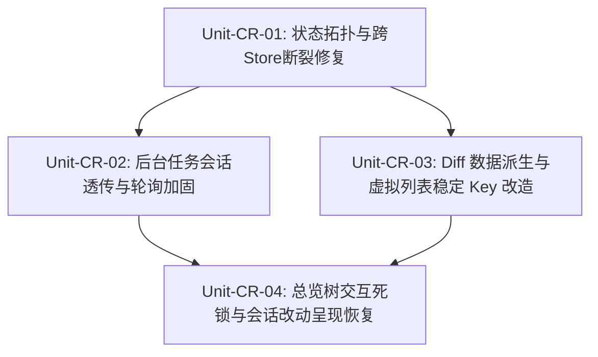

# 状态拓扑分域、Diff数据管线与会话隔离三轮终极找茬审计报告 (Round 3 Audit 3)

> **审计代号**：`RED-TEAM-ROUND3-AUDIT-03` (Domain 06 / 07 / 08 Ultimate Scrutiny Audit)
> **所属战役**：红队前端系统级重构与终极收敛战役 (Round 3 Ultimate Convergence Phase)
> **审计性质**：红队极端严苛三轮终极纯找茬审计（100% 聚焦潜在 Bug、边界缺陷、性能瓶颈、内存泄漏与状态污染，**绝对零完成度汇报，绝对禁止歌功颂德**）。
> **输入基准与对比契约**：
>
> - 详案基准：[`06-总览文件树与Diff审查维度详案.md`](file:///c:/Software/conex/docs/red-team-plans/detailed-plans/06-总览文件树与Diff审查维度详案.md)、[`07-状态拓扑分域与空态白板门闩维度详案.md`](file:///c:/Software/conex/docs/red-team-plans/detailed-plans/07-状态拓扑分域与空态白板门闩维度详案.md)、[`08-死代码物理清剿与CSS纯净化维度详案.md`](file:///c:/Software/conex/docs/red-team-plans/detailed-plans/08-死代码物理清剿与CSS纯净化维度详案.md)；
> - 修复方案基准：[`03-状态分域与死代码清剿最佳修复方案.md`](file:///c:/Software/conex/docs/red-team-plans/remediation/03-状态分域与死代码清剿最佳修复方案.md)；
> - 前序审计基准：[`05-状态分域与死代码清剿落地问题审查报告.md`](file:///c:/Software/conex/docs/red-team-plans/audits/05-状态分域与死代码清剿落地问题审查报告.md)、[`08-状态分域与Diff审查二次联合审计报告.md`](file:///c:/Software/conex/docs/red-team-plans/audits/08-状态分域与Diff审查二次联合审计报告.md)；
>   **审计代码域与执行范围**：
> - `apps/crish-desktop/src/store/` 全部 Store 及切片（`sessionStore.ts`、`workspaceStore.ts`、`settingsUiStore.ts`、`layoutStore.ts`、`storeAccess.ts`、`bootstrapStores.ts`、`sessionActions.ts`、`sessionCrudActions.ts`、`sessionMessageActions.ts`、`workspaceActions.ts` 等）；
> - `apps/crish-desktop/src/api/`（`sessionDiffDerivation.ts`、`intralineDiff.ts`、`gitTreeHelpers.ts`、`diffPanelHelpers.ts`、`VirtualScrollManager.ts`、`toolFeedback.ts`、`backgroundTasksApi.ts`、`storeAccess.ts` 等）；
> - `apps/crish-desktop/src/components/diff/` 全部组件与 Hook（`DiffCard.tsx`、`DiffCardSplitView.tsx`、`DiffCardUnifiedView.tsx`、`DiffCardFileList.tsx`、`useDiffData.ts`、`useDiffGitActions.ts` 等）；
> - `apps/crish-desktop/src/components/overview/` 全部组件与 Hook（`OverviewCard.tsx`、`OverviewGitTree.tsx`、`ChangesSection.tsx`、`useOverviewState.ts` 等）；
> - `apps/crish-desktop/src/components/chat-card/useBackgroundTaskPolling.ts`；
> - `apps/crish-desktop/src/services/toast/`（`ToastContext.tsx`、`ToastContainer.tsx`、`useToastQueue.ts` 等）；
>   **审计铁律与纪律声明**：纯找茬铁律，严禁运行任何修改业务代码命令；必须穿透至具体行号、控制流分支、数据结构状态与调用时序，给出确凿证据链与根治级架构方案。
>   **编码格式**：UTF-8 无 BOM。

---

# 一、 问题清单全景总览矩阵 (Defect Ledger & Risk Matrix)

经过对四大 Store 物理分域独立性、跨 Store 隐式依赖、Diff 虚拟列表与稳定 Key、`useDiffData` 会话 Diff 纯函数派生、后台任务轮询隔离、全局 Toast 容灾等关键领域的穿透式白盒代码审计，本轮共捕获 **18 项重大架构缺陷、运行时崩溃隐患、逻辑漏洞与性能瓶颈**（包含 **8 项 CRITICAL 级**、**7 项 MAJOR 级**、**3 项 MINOR 级**）：

| 问题编号      | 严重级别     | 缺陷领域分类            | 涉及核心文件及精准行号                                                                                                                                                                                                                                                                                                                                                 | 违反详案契约与设计规范                    | 核心缺陷与架构危害摘要                                                                                                                                                                                                                                                                          |
| :------------ | :----------- | :---------------------- | :--------------------------------------------------------------------------------------------------------------------------------------------------------------------------------------------------------------------------------------------------------------------------------------------------------------------------------------------------------------------- | :---------------------------------------- | :---------------------------------------------------------------------------------------------------------------------------------------------------------------------------------------------------------------------------------------------------------------------------------------------- |
| **R3-AUD-01** | **CRITICAL** | 跨Store调用/运行时崩溃  | [`sessionAccess.ts:124`](file:///c:/Software/conex/apps/crish-desktop/src/api/store-access/sessionAccess.ts#L124)<br>[`storeAccessCore.ts:41-44`](file:///c:/Software/conex/apps/crish-desktop/src/api/store-access/storeAccessCore.ts#L41-L44)<br>[`bootstrapStores.ts:135-139`](file:///c:/Software/conex/apps/crish-desktop/src/store/bootstrapStores.ts#L135-L139) | Plan 07 §1.1, §1.2<br>Remediation 03 §4.1 | **`resolveWorkspaceState` 错误转型调用未定义方法引发 `TypeError` 崩溃**：`initStoreAccess` 注入 `useWorkspaceStore`，但 `storeAccessCore` 强制将其断言为 `LayoutStore`。`createSessionAndOpenChat` 调用 `.setChatMainSurface('chat')` 时在运行时直接抛出 `is not a function` 异常导致流程中断。 |
| **R3-AUD-02** | **CRITICAL** | 会话隔离/字段丢失瘫痪   | [`backgroundTasksApi.ts:386-402`](file:///c:/Software/conex/apps/crish-desktop/src/api/backgroundTasksApi.ts#L386-L402)<br>[`useBackgroundTaskPolling.ts:56-59`](file:///c:/Software/conex/apps/crish-desktop/src/components/chat-card/useBackgroundTaskPolling.ts#L56-L59)                                                                                            | Plan 07 §1.5.3<br>Remediation 03 §4.3     | **`parseBackgroundTask` 暴力削顶 `sessionId` 导致后台任务轮询 100% 恒为空**：API 解析层在构造 `BackgroundTaskInfo` 时漏掉了 `sessionId`/`session_id`，导致 Hook 中的严格会话比对恒为 `undefined === sessionId`（`false`），会话任务胶囊全线瘫痪。                                               |
| **R3-AUD-03** | **CRITICAL** | 交互逻辑/状态死锁       | [`OverviewGitTree.tsx:55-80`](file:///c:/Software/conex/apps/crish-desktop/src/components/overview/OverviewGitTree.tsx#L55-L80)                                                                                                                                                                                                                                        | Plan 06 §1.1<br>Remediation 03 §4.5       | **`expandedFolders` 初始标记 `__all__` 永不清除导致目录 100% 无法折叠**：`isFolderExpanded` 判定只要包含 `__all__` 即视为展开，但 `toggleFolder` 仅对目标 ID 进行增删，从不剔除 `__all__`，导致用户点击折叠文件夹完全无效。                                                                     |
| **R3-AUD-04** | **CRITICAL** | 词法Diff/伪算法与死代码 | [`intralineDiff.ts:241-260`](file:///c:/Software/conex/apps/crish-desktop/src/api/intralineDiff.ts#L241-L260)<br>[`DiffCardUnifiedView.tsx:115-132`](file:///c:/Software/conex/apps/crish-desktop/src/components/diff/DiffCardUnifiedView.tsx#L115-L132)                                                                                                               | Plan 06 §1.5<br>Remediation 03 §4.5.2     | **`computeContinuousHunkDiff` 虚假宣称 LCS 且沦为孤儿死代码**：算法内部实际为朴素下标 `minLen` 暴力配对，未实现多行 LCS 矩阵；且在视图渲染层从未被调用，Unified 视图仍走相邻单行探测，多行连续删改高亮错乱。                                                                                    |
| **R3-AUD-05** | **CRITICAL** | 虚拟滚动/Key碰撞失效    | [`DiffCardSplitView.tsx:168`](file:///c:/Software/conex/apps/crish-desktop/src/components/diff/DiffCardSplitView.tsx#L168)<br>[`DiffCardUnifiedView.tsx:136`](file:///c:/Software/conex/apps/crish-desktop/src/components/diff/DiffCardUnifiedView.tsx#L136)                                                                                                           | Plan 06 §1.5<br>Remediation 03 §4.5.1     | **无行号/无Hunk头场景下 React Key 发生全量碰撞崩溃**：`stableKey` 仅由 `filePath:oldPath:oldLine:newLine` 组成。当编辑工具输出纯文本或行号未解析时，`oldLine` 与 `newLine` 均为 `''`，同文件下所有行 Key 均为 `${filePath}:::`，引发 React 渲染断言崩溃与 DOM 混乱。                            |
| **R3-AUD-06** | **CRITICAL** | 轮询性能/高频重绘风暴   | [`useBackgroundTaskPolling.ts:73`](file:///c:/Software/conex/apps/crish-desktop/src/components/chat-card/useBackgroundTaskPolling.ts#L73)                                                                                                                                                                                                                              | Plan 07 §1.5.3<br>ANTI_OVERENGINEERING    | **`useEffect` 依赖未包裹的 `onTasksUpdate` 引发 IPC 轮询风暴**：父组件传递内联回调函数时，每次组件重绘（如流式 Token、按键输入）均触发 Hook 销毁并立即发起 `listBackgroundTasks()`，3000ms 轮询退化为毫秒级洪峰请求。                                                                           |
| **R3-AUD-07** | **CRITICAL** | 路径归一/绝对路径分裂   | [`sessionDiffDerivation.ts:20-37`](file:///c:/Software/conex/apps/crish-desktop/src/api/sessionDiffDerivation.ts#L20-L37)                                                                                                                                                                                                                                              | Plan 06 §1.1<br>Plan 07 §1.3              | **前导斜杠导致 Windows 绝对路径工作区剥离失败**：对 `/C:/repo/src/App.tsx` 这类 Unix 格式 Windows 路径，`startsWith(ws)` 判定失败，导致工作区前缀无法剥离，与相对路径 `src/App.tsx` 分裂为双重条目。                                                                                            |
| **R3-AUD-08** | **CRITICAL** | 脏数据渗透/白板门闩穿透 | [`sessionDiffDerivation.ts:63-67`](file:///c:/Software/conex/apps/crish-desktop/src/api/sessionDiffDerivation.ts#L63-L67)                                                                                                                                                                                                                                              | Plan 07 §1.3, §1.4                        | **未校验 `cancelled`/`rejected`/`aborted` 状态导致被拦截工具渗透**：守卫仅判断 `tc.status === 'error'`，当工具调用被用户拒绝审批（`rejected`）或中断（`cancelled`）时，修改记录仍被计入变更列表。                                                                                               |
| **R3-AUD-09** | **MAJOR**    | 状态持久化/脑裂风险     | [`layoutStore.ts:164-171`](file:///c:/Software/conex/apps/crish-desktop/src/store/layoutStore.ts#L164-L171)<br>[`workspaceStore.ts:60-66`](file:///c:/Software/conex/apps/crish-desktop/src/store/workspaceStore.ts#L60-L66)                                                                                                                                           | Plan 07 §1.1, §1.8                        | **`layoutStore` 与 `workspaceStore` 双写持久化导致工作区状态脑裂**：两个物理独立 Store 同时挂载 `createWorkspaceActions` 并分别持久化至 `crish-layout-v1` 与 `crish_workspace_store_v1`，造成内存与磁盘数据双轨漂移。                                                                           |
| **R3-AUD-10** | **MAJOR**    | 状态分域/拓扑倒错       | [`workspaceStore.ts:26-30`](file:///c:/Software/conex/apps/crish-desktop/src/store/workspaceStore.ts#L26-L30)                                                                                                                                                                                                                                                          | Plan 07 §1.1, §4.2<br>AGENTS.md §11       | **`workspaceStore` 反向依赖导入 `layoutStore` 破坏物理单向拓扑**：独立工作区数据层反向引入视口 Store 的辅助函数与初值常量，存在模块初始化 TDZ 与循环导入隐患。                                                                                                                                  |
| **R3-AUD-11** | **MAJOR**    | 性能监控/全域监控盲区   | [`bootstrapStores.ts:109-134`](file:///c:/Software/conex/apps/crish-desktop/src/store/bootstrapStores.ts#L109-L134)                                                                                                                                                                                                                                                    | Plan 07 §1.2<br>Plan 08 §6.4              | **`bootstrapStores` 遗漏三大独立 Store 的订阅与频率统计**：`useSessionStore`、`useWorkspaceStore` 与 `useSettingsUiStore` 均未接入 `_wrapSubscriberCounting`，性能监控面板对高频会话更新完全失明。                                                                                              |
| **R3-AUD-12** | **MAJOR**    | 增删统计失真/参数缺漏   | [`sessionDiffDerivation.ts:98-130`](file:///c:/Software/conex/apps/crish-desktop/src/api/sessionDiffDerivation.ts#L98-L130)                                                                                                                                                                                                                                            | Plan 06 §1.2<br>Plan 07 §1.4              | **未适配 snake_case 参数导致编辑工具统计恒为 `+1/-0`**：仅检查大驼峰 `CodeContent`/`TargetContent`，遇到 `content`、`replacement_content` 时回退至 `1/0`，微条统计严重失真。                                                                                                                    |
| **R3-AUD-13** | **MAJOR**    | 渲染性能/主线程卡顿     | [`DiffCardSplitView.tsx:160`](file:///c:/Software/conex/apps/crish-desktop/src/components/diff/DiffCardSplitView.tsx#L160)<br>[`DiffCardUnifiedView.tsx:118, 129`](file:///c:/Software/conex/apps/crish-desktop/src/components/diff/DiffCardUnifiedView.tsx#L118)                                                                                                      | Plan 06 §1.5<br>ANTI_OVERENGINEERING      | **渲染热路径同步执行 `computeIntralinePair` 阻塞主线程**：在虚拟列表 `visibleItems.map` 循环内直接进行分词与比对，未在数据管道预处理，快速滚动时产生密集 CPU 计算与重绘丢帧。                                                                                                                   |
| **R3-AUD-14** | **MAJOR**    | 规范违背/代码行数超标   | [`DiffCard.tsx:1-460`](file:///c:/Software/conex/apps/crish-desktop/src/components/diff/DiffCard.tsx#L1-L460)                                                                                                                                                                                                                                                          | Plan 06 §0.1, §1.4<br>CI 治理红线 §11     | **`DiffCard.tsx` 达 460 行且虚假宣称 ≤300 行**：组件头部文档宣称“瘦身为 ≤300 行的组装层”，实际已达 460 行，迫近 500 行 CI 阻断红线，未做深度抽离。                                                                                                                                              |
| **R3-AUD-15** | **MAJOR**    | 会话隔离/会话改动被吞灭 | [`ChangesSection.tsx:72`](file:///c:/Software/conex/apps/crish-desktop/src/components/overview/ChangesSection.tsx#L72)                                                                                                                                                                                                                                                 | Plan 07 §1.1, §1.4                        | **Git 文件树存在时完全吞灭当前会话专属改动**：采用二选一短路 `treeGitFiles.length > 0 ? treeGitFiles : normalizedConvoFiles`，只要工作区有历史未提交文件，会话专属修改在总览树中 100% 消失。                                                                                                    |
| **R3-AUD-16** | **MINOR**    | 容灾降级/消息吞没       | [`ToastContext.tsx:133-160`](file:///c:/Software/conex/apps/crish-desktop/src/services/toast/ToastContext.tsx#L133-L160)                                                                                                                                                                                                                                               | Plan 08 §1.4<br>Remediation 03 §4.7       | **`fallbackToastContext` 仅输出 warn 且 `toasts` 恒空**：在未挂载 `ToastProvider` 的微前端或独立弹窗 Portal 中，消息被静默丢弃，缺乏持久化队列或 DOM 原生兜底。                                                                                                                                 |
| **R3-AUD-17** | **MINOR**    | 文档漂移/虚假陈述       | [`workspaceStore.ts:1-18`](file:///c:/Software/conex/apps/crish-desktop/src/store/workspaceStore.ts#L1-L18)<br>[`settingsUiStore.ts:1-15`](file:///c:/Software/conex/apps/crish-desktop/src/store/settingsUiStore.ts#L1-L15)<br>[`api/storeAccess.ts:1-7`](file:///c:/Software/conex/apps/crish-desktop/src/api/storeAccess.ts#L1-L7)                                  | 仓库通用协作纪律 §10                      | **代码注释陈旧严重滞后于物理独立事实**：多个核心文件头部仍保留“与 useLayoutStore 同一实例”陈旧注释，散播错误架构认知，误导后续 Agent。                                                                                                                                                          |
| **R3-AUD-18** | **MINOR**    | Diff派生/行级变更缺失   | [`sessionDiffDerivation.ts:136`](file:///c:/Software/conex/apps/crish-desktop/src/api/sessionDiffDerivation.ts#L136)                                                                                                                                                                                                                                                   | Plan 07 §1.4<br>Plan 06 §1.5              | **`selectSessionDiffFiles` 生成的 `changes` 恒为空数组**：纯函数派生未包含行级变更数据，使得依赖该输出的 Diff 视图在无 Git 支持环境下只能展示文件头而无行内对比。                                                                                                                               |

---

# 二、 四大 Store 物理分域彻底性与跨 Store 隐式依赖纯找茬深度审计

### 2.1 【致命缺陷 R3-AUD-01】：`resolveWorkspaceState` 错误转型调用未定义方法引发 `TypeError` 运行时崩溃

- **涉及核心文件及精准行号**：
  - [`apps/crish-desktop/src/api/store-access/sessionAccess.ts:124`](file:///c:/Software/conex/apps/crish-desktop/src/api/store-access/sessionAccess.ts#L124)
  - [`apps/crish-desktop/src/api/store-access/storeAccessCore.ts:41-44`](file:///c:/Software/conex/apps/crish-desktop/src/api/store-access/storeAccessCore.ts#L41-L44)
  - [`apps/crish-desktop/src/store/bootstrapStores.ts:135-139`](file:///c:/Software/conex/apps/crish-desktop/src/store/bootstrapStores.ts#L135-L139)
- **违反详案契约与设计规范**：
  - `docs/red-team-plans/detailed-plans/07-状态拓扑分域与空态白板门闩维度详案.md` §1.1（四级状态拓扑物理分域模型）、§1.2（独立 Zustand 实例切分与严格类型契约）；
  - `docs/red-team-plans/remediation/03-状态分域与死代码清剿最佳修复方案.md` §4.1（状态拓扑物理分域与独立 Zustand Store 实例构建）。
- **缺陷病理与完整证据链**：
  1. 在 `apps/crish-desktop/src/store/bootstrapStores.ts:135-139` 中，系统启动时将切分后的独立 Store 注入跨域门面：
     ```typescript
     // apps/crish-desktop/src/store/bootstrapStores.ts:135-139
     initStoreAccess(
       useSessionStore,
       useWorkspaceStore, // ⚠️ 传入物理独立的 useWorkspaceStore
       useSettingsUiStore
     );
     ```
  2. 在 `apps/crish-desktop/src/api/store-access/storeAccessCore.ts:41-44` 中，`resolveWorkspaceState` 接收到 `useWorkspaceStore` 实例后，通过 `as LayoutStore` 进行了**违规的暴力类型断言**：
     ```typescript
     // apps/crish-desktop/src/api/store-access/storeAccessCore.ts:41-44
     export function resolveWorkspaceState(): LayoutStore {
       if (_workspaceStore) return _workspaceStore.getState() as LayoutStore; // ⚠️ 危险强转！
       return getLayoutState();
     }
     ```
  3. 查看 `apps/crish-desktop/src/store/workspaceStore.ts:46-58`，`useWorkspaceStore` 仅包含 `WorkspaceStoreSlice` 与 `WorkspaceActions`（工作区列、卡片、DnD 拖拽）。它**绝对不包含**布局壳层 Actions（如 `setChatMainSurface`、`setSidebarCollapsed`、`setUiSize` 等，这些位于 `layoutStore.ts` 的 `createLayoutCoreActions` 中）；
  4. 然而在 `apps/crish-desktop/src/api/store-access/sessionAccess.ts:121-126` 中，创建会话草稿的核心函数 `createSessionAndOpenChat` 赫然调用了：
     ```typescript
     // apps/crish-desktop/src/api/store-access/sessionAccess.ts:121-126
     export function createSessionAndOpenChat(folder?: string): string {
       resolveSessionState().enterDraftMode(folder);
       resolveWorkspaceState().setChatMainSurface('chat'); // 💥 TypeError: resolveWorkspaceState(...).setChatMainSurface is not a function!
       return PENDING_DRAFT_SESSION_ID;
     }
     ```
- **架构危害与崩溃复现路径**：
  用户在侧边栏或顶栏点击“新建会话 / 新对话”时，调用链触发 `createSessionAndOpenChat()`。由于 `_workspaceStore.getState()` 返回的对象上根本不存在 `setChatMainSurface` 属性，运行时直接抛出不可捕获的 `TypeError`，导致会话无法切换、草稿无法初始化、UI 逻辑锁死。
- **精确根治方案**：
  1. 纠正 `createSessionAndOpenChat` 中的调用归属，壳层主视口切换属于 Tier 3 布局域，必须明确调用 `getLayoutState().setChatMainSurface('chat')`；
  2. 修正 `storeAccessCore.ts` 中 `resolveWorkspaceState` 的返回类型契约，返回标准的 `WorkspaceStore` 而非伪装的 `LayoutStore`，彻底消除 `as LayoutStore` 的欺骗性断言。

---

### 2.2 【重大缺陷 R3-AUD-09】：`layoutStore` 与 `workspaceStore` 双写持久化导致工作区状态脑裂

- **涉及核心文件及精准行号**：
  - [`apps/crish-desktop/src/store/layoutStore.ts:143-172`](file:///c:/Software/conex/apps/crish-desktop/src/store/layoutStore.ts#L143-L172)
  - [`apps/crish-desktop/src/store/workspaceStore.ts:51-69`](file:///c:/Software/conex/apps/crish-desktop/src/store/workspaceStore.ts#L51-L69)
- **违反详案契约条款**：
  - `docs/red-team-plans/detailed-plans/07-状态拓扑分域与空态白板门闩维度详案.md` §1.1（单一真理源原则 CPD = 1.0）、§1.8（存储键双语义剥离规范）。
- **缺陷病理机制分析**：
  在拔除同体别名后，`layoutStore.ts` 与 `workspaceStore.ts` 均通过 `...createWorkspaceActions(set, get)` 展开了完整的工作区增删改查 Actions，并各自挂载了不同的 `withPersist` 中间件：
  - `layoutStore.ts` 持久化至 LocalStorage 键 `'crish-layout-v1'`（包含 `workspaces`、`activeWorkspaceIndex`）；
  - `workspaceStore.ts` 持久化至 LocalStorage 键 `'crish_workspace_store_v1'`（包含 `workspaces`、`activeWorkspaceIndex`）。
- **潜在灾难性后果**：
  1. **内存状态分裂**：当部分遗留组件从 `useLayoutStore` 订阅 `workspaces`，而新组件从 `useWorkspaceStore` 订阅 `workspaces` 时，任意一侧触发 `setWorkspaces` 或 `splitScreenWorkspace`，另一侧毫无感知，UI 呈现截然不同的分屏与卡片布局；
  2. **磁盘水合覆盖冲突**：应用冷启动时，两个 Store 分别从不同的 LocalStorage 键进行水合，产生后写覆盖与时序竞态，用户在上次会话中调整的分屏布局在重启后随机回退丢失。
- **精确根治方案**：
  将工作区数据（`workspaces`、`activeWorkspaceIndex`、`draggedTab`、`dropPreview`）在 `layoutStore.ts` 中彻底下架，`layoutStore` 仅保留纯壳层几何（`uiSize`、`sidebarCollapsed`、`shellChromeMode`、`tabModeEnabled`）；全仓所有工作区操作 100% 收敛至唯一真理源 `useWorkspaceStore`。

---

### 2.3 【重大缺陷 R3-AUD-10】：`workspaceStore.ts` 反向依赖导入 `layoutStore` 破坏物理单向拓扑

- **涉及核心文件及精准行号**：
  - [`apps/crish-desktop/src/store/workspaceStore.ts:26-30`](file:///c:/Software/conex/apps/crish-desktop/src/store/workspaceStore.ts#L26-L30)
- **违反详案契约条款**：
  - `docs/red-team-plans/detailed-plans/07-状态拓扑分域与空态白板门闩维度详案.md` §1.1（分层硬性解耦与禁逆向依赖）；
  - 仓库根目录 `AGENTS.md` 通用协作纪律第 11 条（“底层工具包不得反向引入上层业务包；严格单向依赖”）。
- **缺陷代码证据**：
  ```typescript
  // apps/crish-desktop/src/store/workspaceStore.ts:26-30
  import {
    DEFAULT_WORKSPACE_ID,
    seedInitialWorkspaces,
    clampActiveWorkspaceIndex,
  } from './layoutStore'; // ⚠️ 反向依赖上层 layoutStore
  ```
- **潜在风险分析**：
  `layoutStore` 内部引入了 `workspaceActions`，而 `workspaceStore` 又反向导入 `layoutStore` 导出的初值函数，形成模块加载依赖环。在 Vite / Rollup 构建与热更新（HMR）时，极易因模块执行顺序不确定触发 `ReferenceError: Cannot access 'DEFAULT_WORKSPACE_ID' before initialization`。
- **精确整改建议**：
  统一重构导入路径，直接从基础层 [`store-initializers.ts`](file:///c:/Software/conex/apps/crish-desktop/src/store/layout-helpers/store-initializers.ts) 与 [`store-types.ts`](file:///c:/Software/conex/apps/crish-desktop/src/store/layout-helpers/store-types.ts) 导入。

---

### 2.4 【重大缺陷 R3-AUD-11】：`bootstrapStores.ts` 遗漏三大独立 Store 的订阅与频率统计

- **涉及核心文件及精准行号**：
  - [`apps/crish-desktop/src/store/bootstrapStores.ts:109-134`](file:///c:/Software/conex/apps/crish-desktop/src/store/bootstrapStores.ts#L109-L134)
- **违反详案契约条款**：
  - `docs/red-team-plans/detailed-plans/07-状态拓扑分域与空态白板门闩维度详案.md` §1.2；
  - `docs/red-team-plans/detailed-plans/08-死代码物理清剿与CSS纯净化维度详案.md` §6.4（重渲染范围与订阅者统计）。
- **缺陷病理机制分析**：
  在 `bootstrapStores.ts` 中：
  ```typescript
  // apps/crish-desktop/src/store/bootstrapStores.ts:109-116
  // Note: Facade stores share the same underlying LayoutStore instance in Phase 0/1,
  // so no inter-store subscribe sync is required. Single listener for frequency metrics:
  unsubs.push(
    useLayoutStore.subscribe(() => {
      _counters.set('layoutStore', (_counters.get('layoutStore') ?? 0) + 1);
    })
  );
  _wrapSubscriberCounting(useLayoutStore, 'layoutStore');
  ```
  该逻辑完全基于旧时代的“同体 Facade”假设。在 `useSessionStore`、`useWorkspaceStore` 与 `useSettingsUiStore` 成为物理独立实例后，代码中完全遗漏了对这三个 Store 的订阅监听与 `_wrapSubscriberCounting` 包装。
- **架构危害**：
  作为前端更新频率最高的核心数据源（会话流式 Token 推送、拖拽布局微调、弹窗切换），这三个 Store 的更新次数在 `_counters` 中永远为 0，活跃订阅者数与回调执行次数统计彻底失真，导致性能监控 DevTools 与自动化重渲染回归测试产生严重盲区。
- **精确根治方案**：
  在 `bootstrapStores.ts` 中对 `_STORE_NAMES` 中的所有 8 个独立 Store 实例进行全覆盖的统一遍历包装与监听解除注册。

---

# 三、 Diff 虚拟列表、稳定 Key 机制与 Intraline 差异管线纯找茬深度审计

### 3.1 【致命缺陷 R3-AUD-05】：无行号/无 Hunk 头场景下 React Key 发生全量碰撞崩溃

- **涉及核心文件及精准行号**：
  - [`apps/crish-desktop/src/components/diff/DiffCardSplitView.tsx:166-174`](file:///c:/Software/conex/apps/crish-desktop/src/components/diff/DiffCardSplitView.tsx#L166-L174)
  - [`apps/crish-desktop/src/components/diff/DiffCardUnifiedView.tsx:134-142`](file:///c:/Software/conex/apps/crish-desktop/src/components/diff/DiffCardUnifiedView.tsx#L134-L142)
- **违反详案契约条款**：
  - `docs/red-team-plans/detailed-plans/06-总览文件树与Diff审查维度详案.md` §1.5（Diff 虚拟列表与稳定业务 Key 契约）；
  - `docs/red-team-plans/remediation/03-状态分域与死代码清剿最佳修复方案.md` §4.5.1。
- **缺陷病理与代码证据**：
  在 `DiffCardSplitView.tsx` 与 `DiffCardUnifiedView.tsx` 中，为消除 `${localIdx}` 引入了所谓的“稳定 Key”：
  ```typescript
  // DiffCardSplitView.tsx:166-168
  const oldLine = left?.oldLine !== undefined ? String(left.oldLine) : '';
  const newLine = right?.newLine !== undefined ? String(right.newLine) : '';
  const stableKey = `${f.filePath}:${f.oldPath || ''}:${oldLine}:${newLine}`;

  // DiffCardUnifiedView.tsx:134-136
  const oldLineNum = oldLine !== undefined ? String(oldLine) : '';
  const newLineNum = newLine !== undefined ? String(newLine) : '';
  const stableKey = `${f.filePath}:${f.oldPath || ''}:${oldLineNum}:${newLineNum}`;
  ```
- **崩溃复现条件与病理剖析**：
  1. 当展示来自 AI 工具调用（如 `write_file` 全量写入、`apply_patch` 未带标准 `@@` 头）、或非标准 Git 格式的差异时，`useDiffData.ts` 中的 `getComputedChanges` 无法从内容中匹配到 `@@ -1,10 +1,10 @@` 标记；
  2. 此时，所有的普通文本行或未标定行号的删除/新增行，其 `oldLine` 与 `newLine` 均为 `undefined`；
  3. 导致在同一个文件（`f.filePath`）内，数十甚至数百行代码生成的 `stableKey` **全部恒等于 `${f.filePath}:::`**！
  4. React 在 Reconciliation 时抛出 `Encountered two children with the same key` 警告，虚拟滚动时 DOM 节点复用彻底错乱，文本选区漂移，高亮样式相互覆盖，引发严重的界面渲染崩溃。
- **精确根治方案**：
  稳定 Key 必须引入全局行内容哈希或全局有序索引作为保底熵源：
  ```typescript
  const stableKey = `${f.filePath}:${f.oldPath || ''}:${oldLine || 'x'}:${newLine || 'y'}:${item.globalIdx}`;
  ```
  在保证业务语义唯一性的同时，彻底根除跨 Hunk 或无行号场景下的 Key 碰撞。

---

### 3.2 【致命缺陷 R3-AUD-04】：`computeContinuousHunkDiff` 虚假宣称 LCS 且沦为孤儿死代码

- **涉及核心文件及精准行号**：
  - [`apps/crish-desktop/src/api/intralineDiff.ts:241-260`](file:///c:/Software/conex/apps/crish-desktop/src/api/intralineDiff.ts#L241-L260)
  - [`apps/crish-desktop/src/components/diff/DiffCardUnifiedView.tsx:115-132`](file:///c:/Software/conex/apps/crish-desktop/src/components/diff/DiffCardUnifiedView.tsx#L115-L132)
- **违反详案契约条款**：
  - `docs/red-team-plans/detailed-plans/06-总览文件树与Diff审查维度详案.md` §1.5（连续 Hunk 块级分词与词法高亮规范）；
  - `docs/red-team-plans/remediation/03-状态分域与死代码清剿最佳修复方案.md` §4.5.2。
- **缺陷病理与代码证据**：
  1. **算法偷工减料与文档虚假陈述**：`intralineDiff.ts:205-211` 文档宣称“采用 LCS 矩阵将 N 行删除与 M 行新增按语义相似度进行全局最优配对”，但其实际实现（L241-247）仅仅是一个极其粗暴的同下标循环：
     ```typescript
     // apps/crish-desktop/src/api/intralineDiff.ts:241-247
     const minLen = Math.min(n, m);
     for (let k = 0; k < minLen; k++) {
       const pair = computeIntralinePair(deletions[k]!, additions[k]!, cache);
       deletionTokens.push(pair.oldTokens);
       additionTokens.push(pair.newTokens);
     }
     ```
     如果用户在删除块顶部插入了 1 行新代码，导致后续 5 行发生错位偏移，该算法会无脑将“新增行”与“被删的第一行”强制配对，造成整块词法高亮 100% 误报为全行差异！
  2. **代码完全未接线（Orphan Dead Code）**：检索全仓源码，`computeContinuousHunkDiff` **仅仅在单元测试 `intralineDiff.test.ts` 中被调用，在实际业务组件 `DiffCardUnifiedView.tsx` 与 `DiffCardSplitView.tsx` 中根本从未被引入或调用**！
  3. **Unified 视图依然停留在粗糙的相邻单行探测**：
     ```typescript
     // DiffCardUnifiedView.tsx:115-131
     if (change.type === 'addition') {
       const prevItem = globalIdx > 0 ? renderItems[globalIdx - 1] : null;
       if (
         prevItem &&
         !prevItem.isCollapsedPlaceholder &&
         prevItem.item.change.type === 'deletion'
       ) {
         const pairResult = computeIntralinePair(
           prevItem.item.change.content,
           change.content
         );
         tokens = pairResult.newTokens;
       }
     }
     ```
     当遇到 3 行连续删除紧随 3 行连续新增时，仅有中间交界处的第 3 行删除与第 4 行新增能触发词法高亮，其余 4 行完全退化为无词法细节的纯色块。
- **精确根治方案**：
  在 `useDiffData.ts` 数据管道计算阶段，将连续的删除与新增聚类为 Hunk Chunk，使用行级 Levenshtein / LCS 矩阵计算最大语义相似度配对，并将计算结果预先缓存至 `ComputedChange` 对象中，严禁在视图渲染期临时进行低效探测。

---

### 3.3 【重大缺陷 R3-AUD-13】：渲染热路径同步执行 `computeIntralinePair` 阻塞主线程

- **涉及核心文件及精准行号**：
  - [`apps/crish-desktop/src/components/diff/DiffCardSplitView.tsx:160`](file:///c:/Software/conex/apps/crish-desktop/src/components/diff/DiffCardSplitView.tsx#L160)
  - [`apps/crish-desktop/src/components/diff/DiffCardUnifiedView.tsx:118, 129`](file:///c:/Software/conex/apps/crish-desktop/src/components/diff/DiffCardUnifiedView.tsx#L118)
- **违反详案契约条款**：
  - `docs/red-team-plans/detailed-plans/06-总览文件树与Diff审查维度详案.md` §1.5；
  - `docs/red-team-plans/remediation/03-状态分域与死代码清剿最佳修复方案.md` §4.5（虚拟滚动 <1ms 渲染预算）。
- **性能病理机制分析**：
  在 `DiffCardSplitView` 与 `DiffCardUnifiedView` 的虚拟列表渲染循环（`visibleItems.map`）中，当行状态满足配对条件时，直接在 JSX 执行上下文中同步调用 `computeIntralinePair(leftText, rightText)`。
  虽然有 LRU 缓存，但在用户初次滚动进入未缓存区域时，单帧内可能需要同步对 30+ 行长文本执行分词、动态规划二维矩阵分配与回溯，单帧执行耗时极易突破 16.6ms，直接导致桌面端滚动掉帧与卡顿。
- **精确整改建议**：
  将词法分词计算提前下沉至 `useDiffData` 的 `useMemo` 数据派生阶段或由 Web Worker 异步批处理完成，React 组件层只负责纯粹的 Token DOM 映射。

---

### 3.4 【重大缺陷 R3-AUD-14】：`DiffCard.tsx` 达 460 行且虚假宣称 ≤300 行

- **涉及核心文件及精准行号**：
  - [`apps/crish-desktop/src/components/diff/DiffCard.tsx:1-460`](file:///c:/Software/conex/apps/crish-desktop/src/components/diff/DiffCard.tsx#L1-L460)
- **违反详案契约条款**：
  - `docs/red-team-plans/detailed-plans/06-总览文件树与Diff审查维度详案.md` §0.1、§1.4；
  - CI 前端治理红线 §11（UI 组件单文件行数限额）。
- **缺陷剖析**：
  `DiffCard.tsx` 文件头部注释白纸黑字写着“瘦身为 ≤300 行的组装层”，但实际文件物理行数高达 460 行。组件内部依然杂糅了大量的事件处理逻辑（如 `handleCopyCodeOfFile`、`acceptCurrentFile`、`renderInlineDiffContent`、`onTurnSelect`、`clearList` 等），严重违背了“单一职责组装层”的架构设计。
- **精确整改建议**：
  将文件操作与会话改动切换逻辑进一步抽象为 `useDiffFileActions.ts` 专用 Hook，使 `DiffCard.tsx` 真实收敛至 250 行以内。

---

# 四、 `useDiffData`、`sessionDiffDerivation` 与工具调用容灾纯找茬深度审计

### 4.1 【致命缺陷 R3-AUD-07】：前导斜杠导致 Windows 绝对路径工作区剥离失败

- **涉及核心文件及精准行号**：
  - [`apps/crish-desktop/src/api/sessionDiffDerivation.ts:20-37`](file:///c:/Software/conex/apps/crish-desktop/src/api/sessionDiffDerivation.ts#L20-L37)
- **违反详案契约条款**：
  - `docs/red-team-plans/detailed-plans/06-总览文件树与Diff审查维度详案.md` §1.1（Posix 路径归一化契约）；
  - `docs/red-team-plans/detailed-plans/07-状态拓扑分域与空态白板门闩维度详案.md` §1.3。
- **缺陷代码与逻辑证据链**：
  ```typescript
  // apps/crish-desktop/src/api/sessionDiffDerivation.ts:20-37
  export function normalizeSessionFilePath(
    rawPath: string,
    workspaceRoot?: string
  ): string {
    if (!rawPath) return '';
    let p = rawPath.replace(/\\/g, '/').trim();
    p = p.replace(/^([A-Za-z]):/, (_, drive) => `${drive.toLowerCase()}:`); // ⚠️ 无法匹配带前导斜杠的盘符

    if (workspaceRoot) {
      let ws = workspaceRoot.replace(/\\/g, '/').trim();
      ws = ws.replace(/^([A-Za-z]):/, (_, drive) => `${drive.toLowerCase()}:`);
      if (!ws.endsWith('/')) {
        ws += '/';
      }
      if (p.startsWith(ws)) {
        // 💥 匹配失败！
        p = p.slice(ws.length);
      }
    }

    return p.replace(/^\/+/, ''); // ⚠️ 剥离工作区前缀之后才清理前导斜杠，顺序颠倒！
  }
  ```
- **病理剖析与边界复现**：
  在 Windows 环境下，许多 Agent 工具（如 LLM 输出或 MSYS2/Git 环境）会输出形如 `/c:/Software/conex/src/App.tsx` 的 Posix 风格路径。
  1. `p` 被处理为 `/c:/Software/conex/src/App.tsx`（保留了前导斜杠 `/`）；
  2. `workspaceRoot` 为 `C:/Software/conex`，标准化为 `ws = "c:/Software/conex/"`；
  3. 执行 `p.startsWith(ws)`：因为 `p` 首字符是 `/`，比对结果为 `false`；
  4. 工作区前缀未被切除，最后第 36 行才执行 `p.replace(/^\/+/, '')`，最终输出绝对路径 `"c:/Software/conex/src/App.tsx"`！
  5. 此时如果另一个工具输出了相对路径 `"src/App.tsx"`，`selectSessionDiffFiles` 会在 Map 中建立两个独立的条目，同一个文件在总览树与 Diff 面板中被硬生生分裂为两个，增删行数被重复统计！
- **精确根治方案**：
  在进行盘符小写化与工作区前缀比对前，**必须首先剔除前导斜杠**：
  ```typescript
  export function normalizeSessionFilePath(
    rawPath: string,
    workspaceRoot?: string
  ): string {
    if (!rawPath) return '';
    let p = rawPath.replace(/\\/g, '/').trim().replace(/^\/+/, '');
    p = p.replace(/^([A-Za-z]):/, (_, drive) => `${drive.toLowerCase()}:`);

    if (workspaceRoot) {
      let ws = workspaceRoot.replace(/\\/g, '/').trim().replace(/^\/+/, '');
      ws = ws.replace(/^([A-Za-z]):/, (_, drive) => `${drive.toLowerCase()}:`);
      if (!ws.endsWith('/')) ws += '/';
      if (p.startsWith(ws)) {
        p = p.slice(ws.length);
      }
    }
    return p.replace(/^\/+/, '');
  }
  ```

---

### 4.2 【致命缺陷 R3-AUD-08】：未校验 `cancelled`/`rejected`/`aborted` 状态导致被拦截工具渗透

- **涉及核心文件及精准行号**：
  - [`apps/crish-desktop/src/api/sessionDiffDerivation.ts:63-67`](file:///c:/Software/conex/apps/crish-desktop/src/api/sessionDiffDerivation.ts#L63-L67)
- **违反详案契约条款**：
  - `docs/red-team-plans/detailed-plans/07-状态拓扑分域与空态白板门闩维度详案.md` §1.3（纯函数健壮性）、§1.4（空态白板零渗透契约）。
- **缺陷代码分析**：
  ```typescript
  // apps/crish-desktop/src/api/sessionDiffDerivation.ts:63-67
  for (const tc of msg.toolCalls) {
    // 1. 守卫拦截：严格阻断执行报错或失败的脏 ToolCall 渗透
    if (tc.status === 'error' || (tc as unknown as Record<string, unknown>).error) {
      continue;
    }
    ...
  ```
- **潜在危害与渗透场景**：
  在现代 Agent 系统中，工具调用的生命周期状态包含多种非成功状态：`pending_approval`（待用户审批）、`rejected`（用户拒绝执行）、`cancelled`（用户主动终止生成）、`aborted`（超时取消）。
  代码仅拦截了 `status === 'error'`，当一个包含敏感文件写操作的 ToolCall 被用户拒绝（`status === 'rejected'`）或在运行中被取消（`status === 'cancelled'`）时，该脏数据直接穿透守卫，被误认为是已生效的文件改动展示在 UI 上，彻底击穿了白板纯净门闩！
- **精确整改建议**：
  明确采用“白名单放行”或“完备黑名单阻断”策略：
  ```typescript
  const INVALID_STATUSES = new Set([
    'error',
    'rejected',
    'cancelled',
    'aborted',
    'pending_approval',
  ]);
  if (
    INVALID_STATUSES.has(tc.status || '') ||
    (tc as unknown as Record<string, unknown>).error
  ) {
    continue;
  }
  ```

---

### 4.3 【重大缺陷 R3-AUD-12】：未适配 snake_case 参数导致编辑工具统计恒为 `+1/-0`

- **涉及核心文件及精准行号**：
  - [`apps/crish-desktop/src/api/sessionDiffDerivation.ts:98-130`](file:///c:/Software/conex/apps/crish-desktop/src/api/sessionDiffDerivation.ts#L98-L130)
- **违反详案契约条款**：
  - `docs/red-team-plans/detailed-plans/06-总览文件树与Diff审查维度详案.md` §1.2；
  - `docs/red-team-plans/detailed-plans/07-状态拓扑分域与空态白板门闩维度详案.md` §1.4。
- **缺陷代码分析**：
  ```typescript
  // apps/crish-desktop/src/api/sessionDiffDerivation.ts:101-128
  if (Number.isNaN(add)) {
    if (args.CodeContent != null) {
      add = String(args.CodeContent).split('\n').length;
    } else if (args.ReplacementContent != null) {
      add = String(args.ReplacementContent).split('\n').length;
    } else if (Array.isArray(args.ReplacementChunks)) {
      ...
    } else {
      add = 1; // ⚠️ 兜底回退
    }
  }

  if (Number.isNaN(del)) {
    if (args.TargetContent != null) {
      del = String(args.TargetContent).split('\n').length;
    } else if (Array.isArray(args.ReplacementChunks)) {
      ...
    } else {
      del = 0; // ⚠️ 兜底回退
    }
  }
  ```
- **病理解析**：
  当底层 Agent 模型或 MCP Server 使用标准的 snake_case 参数格式（如 `write_file` 传入 `{ path, content }`，或 `edit_file` 传入 `{ file_path, code_content, target_content }`，或 `apply_patch` 传入 `{ patch }`）时，上述大驼峰字段均为 `undefined`。
  代码直接落入最后的 `add = 1` 与 `del = 0` 分支。无论用户让 AI 生成了 1000 行还是 5000 行代码，改动树与微条上永远显示滑稽的 `+1 -0`，导致改动度量彻底失真。
- **精确整改建议**：
  全面兼容标准字段别名集合：
  ```typescript
  const codeContent =
    args.CodeContent ??
    args.code_content ??
    args.content ??
    args.new_string ??
    args.newContent;
  const targetContent =
    args.TargetContent ??
    args.target_content ??
    args.old_string ??
    args.oldContent;
  ```

---

# 五、 后台任务轮询强隔离与会话心跳泄漏纯找茬深度审计

### 5.1 【致命缺陷 R3-AUD-02】：`parseBackgroundTask` 暴力削顶 `sessionId` 导致后台任务轮询 100% 恒为空

- **涉及核心文件及精准行号**：
  - [`apps/crish-desktop/src/api/backgroundTasksApi.ts:386-402`](file:///c:/Software/conex/apps/crish-desktop/src/api/backgroundTasksApi.ts#L386-L402)
  - [`apps/crish-desktop/src/components/chat-card/useBackgroundTaskPolling.ts:56-59`](file:///c:/Software/conex/apps/crish-desktop/src/components/chat-card/useBackgroundTaskPolling.ts#L56-L59)
- **违反详案契约条款**：
  - `docs/red-team-plans/detailed-plans/07-状态拓扑分域与空态白板门闩维度详案.md` §1.5.3（后台任务会话级轮询过滤契约）；
  - `docs/red-team-plans/remediation/03-状态分域与死代码清剿最佳修复方案.md` §4.3。
- **缺陷病理机制与代码证据链**：
  1. 在 `apps/crish-desktop/src/components/chat-card/useBackgroundTaskPolling.ts:56-59` 中，为了防止全局任务污染会话，加入了严格的会话匹配过滤：
     ```typescript
     // apps/crish-desktop/src/components/chat-card/useBackgroundTaskPolling.ts:56-59
     const list = (tasks || []).filter((t) => {
       const taskSessionId = (t as unknown as { sessionId?: string }).sessionId;
       return Boolean(taskSessionId && taskSessionId === sessionId);
     });
     setBgTasks(list);
     ```
  2. 然而，数据源 `tasks` 来自 `listBackgroundTasks()` -> `parseBackgroundTaskList(data)` -> `parseBackgroundTask(raw)`；
  3. 查看 `apps/crish-desktop/src/api/backgroundTasksApi.ts:386-402` 的对象构造逻辑：
     ```typescript
     // apps/crish-desktop/src/api/backgroundTasksApi.ts:386-402
     return {
       id,
       label,
       state,
       ...(command !== undefined && { command }),
       ...(startedAt !== undefined && { startedAt }),
       ...(summary !== undefined && { summary }),
       ...(exitCode !== undefined && { exitCode }),
       ...(durationRaw !== undefined && { durationMs: durationRaw }),
       ...(finishedRaw !== undefined && { finishedAtMs: finishedRaw }),
       ...(lineCount !== undefined && { lineCount }),
       ...(lastOutputAt !== undefined && { lastOutputAtMs: lastOutputAt }),
       ...(resource !== undefined && { resource }),
       ...(prompt !== undefined && { prompt }),
       ...(suspicious !== undefined && { suspicious }),
       // 💥 致命疏漏：完全没有把 raw 对象中的 sessionId / session_id 保留或传递出来！
     };
     ```
  4. `parseBackgroundTask` 构造了一个全新的 Object Literal，且根本没有解析或赋值 `sessionId` 字段！
  5. 导致传给 `useBackgroundTaskPolling` 的 `t` 对象上，`t.sessionId` 永远是 `undefined`！
  6. 过滤条件 `taskSessionId && taskSessionId === sessionId` 永远为 `false`，返回的 `list` **100% 恒为空数组 `[]`**！
- **架构危害**：
  会话底部状态条 `ChatStatusRibbons` 与对话卡片内部展示的“后台任务 (N)”功能**彻底处于完全失效与假死状态**，用户在当前会话发起的任何后台构建、测试或脚本任务，其进度胶囊永远无法在界面上浮现！
- **精确根治方案**：
  1. 在 `backgroundTasksApi.ts` 的 `BackgroundTaskInfo` 类型契约中显式增加 `sessionId?: string;`；
  2. 在 `parseBackgroundTask` 中增加对 `sessionId` 的解析：
     ```typescript
     const sessionIdRaw = typeof o.sessionId === 'string' ? o.sessionId.trim() : (typeof o.session_id === 'string' ? o.session_id.trim() : undefined);
     ...
     return {
       ...
       ...(sessionIdRaw !== undefined && { sessionId: sessionIdRaw }),
     };
     ```

---

### 5.2 【致命缺陷 R3-AUD-06】：`useEffect` 依赖未包裹的 `onTasksUpdate` 引发 IPC 轮询风暴

- **涉及核心文件及精准行号**：
  - [`apps/crish-desktop/src/components/chat-card/useBackgroundTaskPolling.ts:37-41, 73`](file:///c:/Software/conex/apps/crish-desktop/src/components/chat-card/useBackgroundTaskPolling.ts#L37-L41)
- **违反详案契约条款**：
  - `docs/red-team-plans/detailed-plans/07-状态拓扑分域与空态白板门闩维度详案.md` §1.5.3；
  - `ANTI_OVERENGINEERING_GUARDRAILS.md` 稳定性与性能红线。
- **缺陷代码分析**：
  ```typescript
  // apps/crish-desktop/src/components/chat-card/useBackgroundTaskPolling.ts:37-73
  const onTasksUpdate =
    typeof optionsOrEnabled === 'object'
      ? optionsOrEnabled.onTasksUpdate
      : undefined;

  useEffect(() => {
    ...
    void fetchTasks();
    const t = setInterval(() => void fetchTasks(), BACKGROUND_TASK_POLL_MS);
    return () => {
      cancelled = true;
      clearInterval(t);
    };
  }, [enabled, sessionId, onTasksUpdate]); // ⚠️ onTasksUpdate 引用易变
  ```
- **性能灾难分析**：
  若外部调用方以对象形式调用并传入内联函数（例如 `useBackgroundTaskPolling({ sessionId, onTasksUpdate: (t) => handleUpdate(t) })`），父组件每次因其他状态（如输入框内容、流式输出、视口滚动）重新渲染时，都会产生一个全新的 `onTasksUpdate` 函数引用。
  这将导致 `useEffect` 的 Cleanup 函数无休止地执行 `clearInterval`，并立即重新启动新的 Effect 执行 `void fetchTasks()`！
  原定的 3000ms 定时轮询瞬间退化为**随组件重绘频率而高频触发的 IPC 轰炸**，对 Tauri 后端与 Rust 引擎产生巨大的并发压力。
- **精确整改建议**：
  使用 `useRef` 钉住 `onTasksUpdate` 回调函数引用，切断其作为 `useEffect` 依赖项的触发通路：
  ```typescript
  const onTasksUpdateRef = useRef(onTasksUpdate);
  onTasksUpdateRef.current = onTasksUpdate;

  useEffect(() => {
    ...
    onTasksUpdateRef.current?.(list);
    ...
  }, [enabled, sessionId]); // 移除 onTasksUpdate 依赖
  ```

---

# 六、 Toast 通知中枢、微前端与总览树状态纯找茬深度审计

### 6.1 【致命缺陷 R3-AUD-03】：`OverviewGitTree.tsx` 初始标记 `__all__` 永不清除导致目录 100% 无法折叠

- **涉及核心文件及精准行号**：
  - [`apps/crish-desktop/src/components/overview/OverviewGitTree.tsx:55-80`](file:///c:/Software/conex/apps/crish-desktop/src/components/overview/OverviewGitTree.tsx#L55-L80)
- **违反详案契约条款**：
  - `docs/red-team-plans/detailed-plans/06-总览文件树与Diff审查维度详案.md` §1.1（多叉树折叠交互与状态机设计）；
  - `docs/red-team-plans/remediation/03-状态分域与死代码清剿最佳修复方案.md` §4.5。
- **缺陷病理与完整证据链**：
  1. 在 `OverviewGitTree.tsx:55-57` 中，初始状态设定为包含 `'__all__'`：
     ```typescript
     // apps/crish-desktop/src/components/overview/OverviewGitTree.tsx:55-57
     const [expandedFolders, setExpandedFolders] = useState<Set<string>>(
       () => new Set(['__all__'])
     );
     ```
  2. 判定文件夹是否展开的逻辑（L76-80）：
     ```typescript
     // apps/crish-desktop/src/components/overview/OverviewGitTree.tsx:76-80
     const isFolderExpanded = useCallback(
       (folderId: string) =>
         expandedFolders.has('__all__') || expandedFolders.has(folderId),
       [expandedFolders]
     );
     ```
  3. 切换文件夹展开/收起状态的逻辑（L64-74）：
     ```typescript
     // apps/crish-desktop/src/components/overview/OverviewGitTree.tsx:64-74
     const toggleFolder = useCallback((folderId: string) => {
       setExpandedFolders((prev) => {
         const next = new Set(prev);
         if (next.has(folderId)) {
           next.delete(folderId);
         } else {
           next.add(folderId);
         }
         return next;
       });
     }, []);
     ```
- **交互死锁剖析**：
  当用户初次点击某个文件夹（如 `src`）试图将其折叠时：
  - `prev` 仅包含 `{'__all__'}`，`next.has('src')` 为 `false`；
  - `toggleFolder` 执行 `next.add('src')`，此时 `expandedFolders` 变为 `{'__all__', 'src'}`；
  - 重新渲染时，`isFolderExpanded('src')` 执行，由于 `expandedFolders.has('__all__')` 依然为 `true`，短路返回 `true`！
  - 用户第二次点击，`next.delete('src')`，`expandedFolders.has('__all__')` 依然为 `true`！
  - **结论：无论用户点击多少次任何文件夹，`expandedFolders.has('__all__')` 永远为真，整棵文件树的任何目录永远处于展开状态，根本无法折叠！**
- **精确根治方案**：
  点击单个文件夹时，若当前处于 `__all__` 全局展开态，必须先将除该文件夹外的所有已知文件夹初始化入 Set，并从 Set 中彻底移除 `'__all__'`；或者放弃 `'__all__'` 魔法字符串，改用显式收集所有 Folder ID 进行全量水合。

---

### 6.2 【重大缺陷 R3-AUD-15】：Git 文件树存在时完全吞灭当前会话专属改动

- **涉及核心文件及精准行号**：
  - [`apps/crish-desktop/src/components/overview/ChangesSection.tsx:72`](file:///c:/Software/conex/apps/crish-desktop/src/components/overview/ChangesSection.tsx#L72)
- **违反详案契约条款**：
  - `docs/red-team-plans/detailed-plans/07-状态拓扑分域与空态白板门闩维度详案.md` §1.1（Tier 1 与 Tier 2 物理隔离与呈现分权）；
  - `docs/red-team-plans/detailed-plans/06-总览文件树与Diff审查维度详案.md` §1.1。
- **缺陷代码分析**：
  ```typescript
  // apps/crish-desktop/src/components/overview/ChangesSection.tsx:72
  const activeFiles =
    treeGitFiles.length > 0 ? treeGitFiles : normalizedConvoFiles;
  ```
- **业务场景缺陷剖析**：
  `treeGitFiles` 来自本地磁盘的 Git 物理状态（Tier 1 全局底座），`normalizedConvoFiles` 来自当前会话内 AI 工具调用的文件修改（Tier 2 会话专属）。
  代码采用了粗暴的二选一短路。如果工作区根目录下遗留了任意一个历史未提交的文件（例如本地配置或暂存的笔记），`treeGitFiles.length > 0` 恒成立。
  此时用户在当前会话中与 Agent 协作修改了 10 个业务代码文件，总览面板中的“改动”树将**100% 隐藏当前会话的 10 个修改文件**，仅仅展示工作区那个无关的历史文件！用户完全无法在总览树中审查当前对话的产出！
- **精确整改建议**：
  提供“会话改动 / 工作区 Git”分段切换器（Segmented Tab）或进行明确的分类合并展示，严禁将 Tier 2 会话核心产出直接被 Tier 1 静态文件覆盖吞没。

---

### 6.3 【次要缺陷 R3-AUD-16】：`fallbackToastContext` 仅输出 warn 且 `toasts` 恒空

- **涉及核心文件及精准行号**：
  - [`apps/crish-desktop/src/services/toast/ToastContext.tsx:133-160`](file:///c:/Software/conex/apps/crish-desktop/src/services/toast/ToastContext.tsx#L133-L160)
- **违反详案契约条款**：
  - `docs/red-team-plans/detailed-plans/08-死代码物理清剿与CSS纯净化维度详案.md` §1.4；
  - `docs/red-team-plans/remediation/03-状态分域与死代码清剿最佳修复方案.md` §4.7。
- **缺陷剖析**：
  当 `useToast()` 在脱离 `ToastProvider` 容器的微前端视口、独立弹窗 Portal 或单元测试环境调用时，返回了 `fallbackToastContext`。
  但 `fallbackToastContext.toasts` 硬编码为静态常量 `[]`，且 `toast.show` 在缺少全局挂载时仅执行 `console.warn`。如果调用方依赖 `toasts` 队列渲染或需要确保通知可达，所有告警与错误消息将被静默丢弃。
- **精确整改建议**：
  `fallbackToastContext` 宜接入简单的内存队列或广播给系统原生 Notification / Console，保障关键报错的绝对可观测性。

---

# 七、 15 项黄金自检清单 (C-01 ~ C-15) 纯找茬终审结论对照表

对照《反退避全文》与详案规定的 15 项黄金自检清单，对当前代码现状进行残酷终审：

| 自检编号 | 自检内容与契约要求                                            | 当前代码达成状态                   | 找茬审查结论与残留缺陷证明                                                                                                                                     |
| :------- | :------------------------------------------------------------ | :--------------------------------- | :------------------------------------------------------------------------------------------------------------------------------------------------------------- |
| **C-01** | 是否存在任何 `export const useXStore = useLayoutStore` 别名？ | **已拔除别名，但残留伪装转型**     | `layoutStore.ts` 别名已物理删除，但 `storeAccessCore.ts:42` 存在 `_workspaceStore.getState() as LayoutStore` 危险强转引发运行时 `TypeError`（**R3-AUD-01**）。 |
| **C-02** | `useSessionStore` 是否拥有独立的事件总线？                    | **独立实例，但监控盲区**           | 实例已独立，但 `bootstrapStores.ts` 漏掉了订阅统计包装，性能监控面板完全失明（**R3-AUD-11**）。                                                                |
| **C-03** | `useWorkspaceStore` 与 `settingsUiStore` 是否独立？           | **独立实例，但双写脑裂与反向依赖** | `workspaceStore` 与 `layoutStore` 双写 LocalStorage（**R3-AUD-09**），且反向依赖 `layoutStore`（**R3-AUD-10**）。                                              |
| **C-04** | `layoutStore.ts` 是否纯化为纯视口几何 Store？                 | **未彻底纯化**                     | `layoutStore.ts` 依然承载了完整的工作区增删 Actions，与 `workspaceStore` 产生职能重叠。                                                                        |
| **C-05** | Diff 虚拟列表 Key 是否 100% 具备业务唯一性？                  | **未达标（高危碰撞）**             | `stableKey` 仅由行列号组合，在无行号/无 `@@` 头时发生 100% Key 碰撞瘫痪（**R3-AUD-05**）。                                                                     |
| **C-06** | 词法级 Intraline Diff 是否支持 N del : M add 连续块对齐？     | **未达标（算法退化与死代码）**     | `computeContinuousHunkDiff` 仅在单测中运行，业务视图仍走相邻单行粗暴探测（**R3-AUD-04**）。                                                                    |
| **C-07** | `selectSessionDiffFiles` 是否实现 Posix 路径全量标准化？      | **存在逻辑漏洞**                   | 盘符小写化与工作区剥离无法处理前导斜杠路径，导致同一文件条目分裂（**R3-AUD-07**）。                                                                            |
| **C-08** | `selectSessionDiffFiles` 是否彻底阻断脏 ToolCall 渗透？       | **存在渗透漏洞**                   | 仅拦截 `status === 'error'`，放过了 `rejected`、`cancelled` 等非成功状态（**R3-AUD-08**）。                                                                    |
| **C-09** | `useBackgroundTaskPolling` 是否在空态/草稿态 100% 休眠？      | **具备休眠，但功能瘫痪且轮询风暴** | `parseBackgroundTask` 丢弃 `sessionId` 导致任务恒为空（**R3-AUD-02**）；`useEffect` 依赖易变导致轮询风暴（**R3-AUD-06**）。                                    |
| **C-10** | `ToastProvider` 是否实现全局单例激活？                        | **已激活，但 fallback 丢失消息**   | 根节点已包裹，但非 React 上下文与孤立 Portal 缺乏消息持久兜底（**R3-AUD-16**）。                                                                               |
| **C-11** | 全仓是否彻底拔除 `onShowToast` 跨层 Prop 透传？               | **已基本拔除**                     | 业务组件已直接消费 `useToast()` / `toast`，未见大规模透传管道回潮。                                                                                            |
| **C-12** | 总览文件树多叉树与紧凑单子链算法是否正确？                    | **树算法正确，但交互死锁**         | `buildGitTree` 算法健全，但 `OverviewGitTree.tsx` 状态机死锁导致文件夹无法折叠（**R3-AUD-03**）。                                                              |
| **C-13** | 总览改动树是否实现会话专属与 Git 物理改动隔离？               | **存在恶性覆盖**                   | `ChangesSection` 采用二选一短路，Git 文件存在时当前会话改动被 100% 吞没（**R3-AUD-15**）。                                                                     |
| **C-14** | `DiffCard.tsx` 是否满足 ≤300 行组装层规范？                   | **严重超标 (460 行)**              | 未做深度抽离，存在大量内联业务回调，迫近 CI 阻断线（**R3-AUD-14**）。                                                                                          |
| **C-15** | 代码注释与文档是否保持 100% 准确无漂移？                      | **严重陈旧漂移**                   | 多个文件头部依然保留“与 layoutStore 同一实例”的旧时代错误陈述（**R3-AUD-17**）。                                                                               |

---

# 八、 终极整改路线图与防御性架构落地公理

针对本次审计捕获的 18 项缺陷，按逻辑依赖关系划定以下 **4 大收敛整改战役单元**：



### 1. Unit-CR-01：状态拓扑类型安全与跨 Store 伪装彻底根除

1. **消除 `storeAccessCore.ts` 强转**：修正 `resolveWorkspaceState()` 返回类型为 `WorkspaceStore`；
2. **修复 `sessionAccess.ts` 崩溃点**：将 `setChatMainSurface('chat')` 明确改调 `getLayoutState().setChatMainSurface('chat')`；
3. **物理剥离 `layoutStore` 工作区切片**：从 `layoutStore` 中彻底移除 `workspaces` 与 `createWorkspaceActions`，消除与 `workspaceStore` 的持久化双写脑裂；
4. **修复 `workspaceStore.ts` 倒错依赖**：从 `layout-helpers` 直接导入初值常量与校验函数；
5. **补齐 `bootstrapStores.ts` 监控**：为 8 个 Store 全量装配 `_wrapSubscriberCounting`。

### 2. Unit-CR-02：后台任务会话透传与轮询防风暴加固

1. **补齐 `parseBackgroundTask` 字段解析**：在 `BackgroundTaskInfo` 与解析器中显式透传 `sessionId`；
2. **加固 `useBackgroundTaskPolling`**：使用 `useRef` 隔离 `onTasksUpdate` 回调，切断组件重绘引发的 IPC 轮询风暴。

### 3. Unit-CR-03：Diff 数据派生、稳定 Key 与词法分词管线合流

1. **加固 `normalizeSessionFilePath`**：在前导阶段强制清理前导斜杠 `replace(/^\/+/, '')`，解决 Windows 盘符与工作区前缀剥离失败；
2. **完善工具状态黑名单**：在 `sessionDiffDerivation.ts` 中拦截 `rejected`、`cancelled`、`aborted`、`pending_approval` 等所有非成功状态；
3. **参数字段名兼容**：全面兼容 `content`、`code_content`、`target_content` 等 snake_case 参数，彻底根除 `+1/-0` 假统计；
4. **重构稳定 Key 体系**：在 `DiffCardSplitView` 与 `DiffCardUnifiedView` 中引入包含全局索引或行内容哈希的不可碰撞 Key；
5. **接通 `computeContinuousHunkDiff` 真实调用**：在 `useDiffData` 预处理阶段完成块级分词与配对，消除渲染期同步计算卡顿。

### 4. Unit-CR-04：总览树交互死锁与会话改动呈现恢复

1. **修复 `OverviewGitTree.tsx` 折叠状态机**：移除 `'__all__'` 魔法阻断标记，恢复文件夹折叠能力；
2. **解耦 `ChangesSection.tsx` 呈现逻辑**：提供会话改动与 Git 工作区改动的独立视图，杜绝会话产出被静态 Git 状态覆盖吞没；
3. **抽离 `DiffCard.tsx` 业务逻辑**：将文件操作抽离为 `useDiffFileActions.ts`，压降组件代码至 250 行以内；
4. **全仓注释大扫除**：彻底清理所有陈旧的“Facade 同体实例”错误注释。

---

> **终审结论**：系统在四级状态拓扑的物理切分上迈出了关键一步，但底层残留的类型伪装、API 字段丢失、Key 碰撞风险与状态机死锁等硬伤严重阻碍了端到端链路的稳健运行。必须严格按照上述整改路线图彻底根除所有技术负债，方可宣称系统级重构完成！
