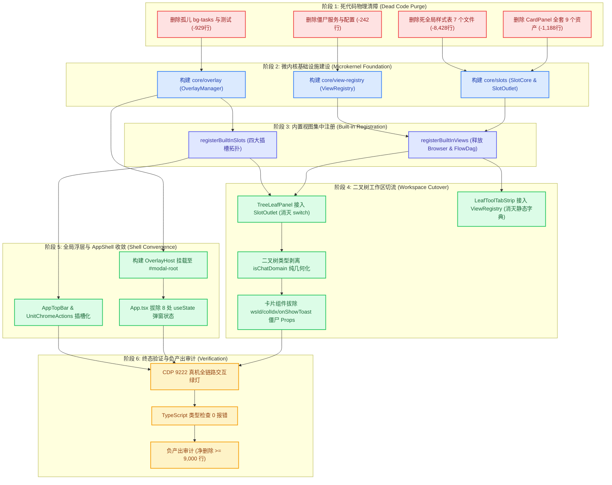

# 微内核与视图注册架构维度重构详案 (Detailed Plan 01)

## Microkernel Architecture, ViewRegistry, Declarative SlotMap & Workspace Decoupling Detailed Plan

> **权威依据与统合基准**：
>
> 1. 本详案基于红队主控裁决框架《红队前端系统级重构总计划框架与删除面裁决》（[`docs/red-team-plans/00-红队前端系统级重构总计划框架与删除面裁决.md`](file:///c:/Software/conex/docs/red-team-plans/00-%E7%BA%A2%E9%98%9F%E5%89%8D%E7%AB%AF%E7%B3%BB%E7%BB%9F%E7%BA%A7%E9%87%8D%E6%9E%84%E6%80%BB%E8%AE%A1%E5%88%92%E6%A1%86%E6%9E%B6%E4%B8%8E%E5%88%A0%E9%99%A4%E9%9D%A2%E8%A3%81%E5%86%B3.md)）及 3 份独立方案交叉评审专著（Reviewer 1 冲突专审 [`plan-reviews/01-*.md`](file:///c:/Software/conex/docs/red-team-plans/plan-reviews/01-%E7%8B%AC%E7%AB%8B%E6%96%B9%E6%A1%88%E4%BA%A4%E5%8F%89%E8%AF%84%E5%AE%A1%E6%8A%A5%E5%91%8A-%E5%86%B2%E7%AA%81%E4%B8%8E%E8%B7%AF%E5%BE%84%E9%87%8D%E5%8F%A0%E4%B8%93%E5%AE%A1.md)、Reviewer 2 删除总账专审 [`plan-reviews/02-*.md`](file:///c:/Software/conex/docs/red-team-plans/plan-reviews/02-%E7%8B%AC%E7%AB%8B%E6%96%B9%E6%A1%88%E4%BA%A4%E5%8F%89%E8%AF%84%E5%AE%A1%E6%8A%A5%E5%91%8A-%E6%94%B6%E6%95%9B%E6%B7%B1%E5%BA%A6%E4%B8%8E%E6%AD%BB%E4%BB%A3%E7%A0%81%E6%B8%85%E5%89%BF%E4%B8%93%E5%AE%A1.md)、Reviewer 3 依赖拓扑专审 [`plan-reviews/03-*.md`](file:///c:/Software/conex/docs/red-team-plans/plan-reviews/03-%E7%8B%AC%E7%AB%8B%E6%96%B9%E6%A1%88%E4%BA%A4%E5%8F%89%E8%AF%84%E5%AE%A1%E6%8A%A5%E5%91%8A-%E4%BE%9D%E8%B5%96%E6%8B%93%E6%89%91%E4%B8%8E%E6%89%A7%E8%A1%8C%E5%8F%AF%E8%A1%8C%E6%80%A7%E4%B8%93%E5%AE%A1.md)）编制；
> 2. 严格遵循《主控协作指令》（`AGENTS.md`）与《反退避全文》（`.agents/LOGIC_PLAN_NO_RETREAT.md`）——**效果锁死、纯逻辑规划、零退避、零降级、零补丁、零 Mock 挂载、负产出验收**；
> 3. 吸收工业级微内核解剖专著（[`docs/frontend-benchmarking/deep-dives/08-DSH声明式SlotMap与微内核扩展源码解剖.md`](file:///c:/Software/conex/docs/frontend-benchmarking/deep-dives/08-DSH%E5%A3%B0%E6%98%8E%E5%BC%8FSlotMap%E4%B8%8E%E5%BE%AE%E5%86%85%E6%A0%B8%E6%89%A9%E5%B1%95%E6%BA%90%E7%A0%81%E8%A7%A3%E5%89%96.md)）的架构哲学；
> 4. **【红队防作弊铁律】**：严禁且绝对未查看、检索、引用 `docs/frontend-review/`（蓝队隔离区）下的任何文件；
> 5. **推进与执行纪律**：严禁运行任何编译或测试命令；推进单位严格为**领域概念与纯逻辑阶段**，严禁使用波次/批次等机械命名；坚决贯彻**「先删后改、收敛优先于增强」**与**「净代码负产出（Net Negative Yield $\ge 9,000$ 行）」**铁律。
>
> **字符集与编码**：UTF-8 无 BOM。

---

# 目录索引 (Table of Contents)

- [一、 做什么：微内核与视图注册架构目标设计与重构清单 (What to Build & Refactor)](#一-做什么微内核与视图注册架构目标设计与重构清单-what-to-build--refactor)
  - [1.1 微内核架构第一性原理与核心哲学](#11-微内核架构第一性原理与核心哲学)
  - [1.2 统一声明式视图注册中心 (ViewRegistry) 深度架构设计](#12-统一声明式视图注册中心-viewregistry-深度架构设计)
    - [1.2.1 ViewDefinition 完备数据契约与生命周期规范](#121-viewdefinition-完备数据契约与生命周期规范)
    - [1.2.2 ViewUriResolver 动态参数化路由匹配器 (消灭 URI 前缀 Hack)](#122-viewuriresolver-动态参数化路由匹配器-消灭-uri-前缀-hack)
    - [1.2.3 ViewRegistryImpl 单例引擎与 uSES 响应式总线实现](#123-viewregistryimpl-单例引擎与-uses-响应式总线实现)
    - [1.2.4 全量内置视图自注册表与孤儿视图一等公民释放清单](#124-全量内置视图自注册表与孤儿视图一等公民释放清单)
    - [1.2.5 文件查看器参数结构化收敛与全局 Mode Map 彻底清剿](#125-文件查看器参数结构化收敛与全局-mode-map-彻底清剿)
  - [1.3 四大插槽拓扑形态 (Single / List / Keyed / Chain) 数学完备设计与实现](#13-四大插槽拓扑形态-single--list--keyed--chain-数学完备设计与实现)
    - [1.3.1 Single (独占单例插槽) 与影子退让容灾协议](#131-single-独占单例插槽-与影子退让容灾协议)
    - [1.3.2 List (有序列表插槽) 与 Cell 粒度优先级排序](#132-list-有序列表插槽-与-cell-粒度优先级排序)
    - [1.3.3 Keyed (键控矩阵插槽) 与叶子面板动态路由绑定](#133-keyed-键控矩阵插槽-与叶子面板动态路由绑定)
    - [1.3.4 Chain (责任链插槽) 与 0-Re-render 纯函数路由](#134-chain-责任链插槽-与-0-re-render-纯函数路由)
  - [1.4 `display: contents` 零布局污染挂载架构与 CSS 容器隔离](#14-display-contents-零布局污染挂载架构与-css-容器隔离)
  - [1.5 强类型 `SlotMap` 与四份额 `ComposedProps` 编译期约束模型](#15-强类型-slotmap-与四份额-composedprops-编译期约束模型)
  - [1.6 纯几何二叉树工作区解耦 (GenericBinaryTreeWorkspace)](#16-纯几何二叉树工作区解耦-genericbinarytreeworkspace)
    - [1.6.1 空间二叉分割几何纯化与 `isChatDomain` 业务硬编码剥离](#161-空间二叉分割几何纯化与-ischatdomain-业务硬编码剥离)
    - [1.6.2 `TreeLeafPanel.tsx` 架构重塑与 SlotOutlet 接入](#162-treeleafpaneltsx-架构重塑与-slotoutlet-接入)
    - [1.6.3 `LeafToolTabStrip.tsx` 动态化改造与标题字典动态解析](#163-leaftooltabstriptsx-动态化改造与标题字典动态解析)
  - [1.7 统一全局浮层管理器 (LayerStackManager 内核 + OverlayHost 宿主)](#17-统一全局浮层管理器-layerstackmanager-内核--overlayhost-宿主)
    - [1.7.1 OverlayManager 调度引擎与 LayerStackService 深度绑定](#171-overlaymanager-调度引擎与-layerstackservice-深度绑定)
    - [1.7.2 OverlayHost 容器与 #modal-root 挂载拓扑](#172-overlayhost-容器与-modal-root-挂载拓扑)
    - [1.7.3 `ComposePlusMenu.tsx:94` 浮层生命周期缺陷与早退修复](#173-composeplusmenutsx94-浮层生命周期缺陷与早退修复)
- [二、 删什么：物理删除总账与先删后改执行清单 (The Purge & Eviction Ledger)](#二-删什么物理删除总账与先删后改执行清单-the-purge--eviction-ledger)
  - [2.1 物理删除文件清单 (19 个文件 · 累计 10,787 行)](#21-物理删除文件清单-19-个文件--累计-10787-行)
  - [2.2 彻底拔除 `TreeLeafPanel.tsx` 静态 `switch(panelId)` 分发分支与懒加载导入](#22-彻底拔除-treeleafpaneltsx-静态-switchpanelid-分发分支与懒加载导入)
  - [2.3 清除 4 处散落标题字典与降级分支](#23-清除-4-处散落标题字典与降级分支)
  - [2.4 物理清除 4 大面板的僵尸透传参数与全仓 `onShowToast` Prop-Drilling](#24-物理清除-4-大面板的僵尸透传参数与全仓-onshowtoast-prop-drilling)
  - [2.5 彻底消除的重复路径与降级别名收敛矩阵](#25-彻底消除的重复路径与降级别名收敛矩阵)
  - [2.6 净削减代码行数度量总账 (Net Negative Code Yield Sheet)](#26-净削减代码行数度量总账-net-negative-code-yield-sheet)
- [三、 依赖与逻辑顺序：先删后改因果律与全局执行 DAG (Dependencies & Execution Flow)](#三-依赖与逻辑顺序先删后改因果律与全局执行-dag-dependencies--execution-flow)
  - [3.1 先删后改因果律与六大逻辑推进阶段](#31-先删后改因果律与六大逻辑推进阶段)
  - [3.2 详细 Mermaid 任务执行拓扑图 (Detailed Execution DAG)](#32-详细-mermaid-任务执行拓扑图-detailed-execution-dag)
  - [3.3 任务单元原子动作定义表 (Task-P01 ~ Task-V03)](#33-任务单元原子动作定义表-task-p01--task-v03)
  - [3.4 并发安全性与死锁防护分析](#34-并发安全性与死锁防护分析)
- [四、 文件域：专属唯一文件域划分与跨域协作契约 (File Scopes & Cross-Domain Contracts)](#四-文件域专属唯一文件域划分与跨域协作契约-file-scopes--cross-domain-contracts)
  - [4.1 本方案独占文件域清单 (Source & Test Files)](#41-本方案独占文件域清单-source--test-files)
  - [4.2 共享文件修改权限与串行阶段锁协议](#42-共享文件修改权限与串行阶段锁协议)
  - [4.3 跨领域方案协作接口与数据契约边界](#43-跨领域方案协作接口与数据契约边界)
  - [4.4 多 Agent Git 共享 Index 提交与安全边界红线](#44-多-agent-git-共享-index-提交与安全边界红线)
- [五、 验收标准：功能绿灯与负产出度量断言 (Verification Matrix & Assertions)](#五-验收标准功能绿灯与负产出度量断言-verification-matrix--assertions)
  - [5.1 架构与功能正确性验收断言 (CDP 9222 真机与自动化测试)](#51-架构与功能正确性验收断言-cdp-9222-真机与自动化测试)
  - [5.2 负产出与收敛性度量断言 (数学收敛指标)](#52-负产出与收敛性度量断言-数学收敛指标)
  - [5.3 15 项黄金自检清单 (C-01 ~ C-15) 合规自检表](#53-15-项黄金自检清单-c-01--c-15-合规自检表)

---

# 一、 做什么：微内核与视图注册架构目标设计与重构清单 (What to Build & Refactor)

## 1.1 微内核架构第一性原理与核心哲学

在现有架构中，前端工作区容器（`TreeLeafPanel.tsx`）与外壳（`App.tsx`）充斥着大量硬编码的条件分支（`switch (panelId)`、`id === 'settings' ? ...`），任何新增或变更视图的操作都会直接侵入修改核心容器代码，导致容器不断膨胀并引发级联重绘。

借鉴工业级微内核设计精髓（DeepSeek-Harness 与 VS Code 扩展系统），微内核与视图注册维度确立如下第一性原理：

$$\mathbf{Rule}_{\text{Microkernel}}: \quad \text{Shell} \equiv \text{SlotOutlet}('root') \quad \land \quad \forall v \in \text{Views}, \; v \hookrightarrow \text{ViewRegistry.register}()$$

### 核心架构哲学：

1. **宿主只负责提供空间插槽（Slots）**：App 外壳与二叉树容器只负责空间几何布局与插槽锚点声明，不引入任何具体的业务视图组件；
2. **视图 100% 声明式自注册（Self-Registration）**：每个功能视图（ChatCard、TerminalCard、PreviewCard、BrowserPanel、FlowDagView 等）作为独立的插件模块，在系统启动时通过 `viewRegistry.registerView()` 声明自身的元数据、路由参数与渲染组件；
3. **零布局污染（Zero Layout Pollution）**：所有插槽挂载点必须通过原生 `style={{ display: 'contents' }}` 实现，完全不破坏外层 Flex / CSS Grid / Absolute 几何盒模型；
4. **强类型契约锁定（Strict Type Safety via SlotMap）**：利用 TypeScript 全局接口声明合并（Declaration Merging）与 `NoInfer<T>` 机制，在编译期严格约束插槽标识符、注入上下文与组件 Props。

```
┌────────────────────────────────────────────────────────────────────────────────────────────────────────┐
│                              Conex 声明式微内核与视图注册目标架构拓扑                                    │
├────────────────────────────────────────────────────────────────────────────────────────────────────────┤
│                                                                                                        │
│                                           App Shell                                                    │
│                                               │                                                        │
│                                               ▼ renderSlot('workbench.root')                           │
│                                     ┌───────────────────┐                                              │
│                                     │  WorkbenchFrame   │                                              │
│                                     └───────────────────┘                                              │
│                                               │                                                        │
│                     ┌─────────────────────────┴─────────────────────────┐                              │
│                     ▼ renderSlot('workbench.topbar')                    ▼ renderSlot('workbench.main')  │
│             ┌───────────────┐                                 ┌───────────────────┐                    │
│             │ 36px Seamless │                                 │GenericBinaryTree  │                    │
│             │   AppTopBar   │                                 │     Workspace     │                    │
│             └───────────────┘                                 └───────────────────┘                    │
│                                                                         │                              │
│                                                       ┌─────────────────┴─────────────────┐            │
│                                                       ▼                                   ▼            │
│                                             ┌───────────────────┐               ┌───────────────────┐  │
│                                             │  TreeResizeSash   │               │   TreeLeafPanel   │  │
│                                             │  (Zero-JS DOM)    │               │ (纯几何叶子容器)    │  │
│                                             └───────────────────┘               └───────────────────┘  │
│                                                                                           │            │
│                                                                                           ▼            │
│                                                                 ┌───────────────────────────────────┐  │
│                                                                 │ renderSlot('workspace.leaf.panel',│  │
│                                                                 │   renderCtx,                      │  │
│                                                                 │   { entryKey: leaf.activeTab }    │  │
│                                                                 │ )                                 │  │
│                                                                 └───────────────────────────────────┘  │
│                                                                               │                        │
│                           ┌───────────────────────┬───────────────────────────┼──────────────────────┐ │
│                           ▼                       ▼                           ▼                      ▼ │
│                   ┌───────────────┐       ┌───────────────┐           ┌───────────────┐      ┌───────┴┐│
│                   │   ChatCard    │       │ TerminalCard  │           │ BrowserPanel  │      │FlowDag ││
│                   │ (Self-Reg)    │       │ (Self-Reg)    │           │ (一等公民释放)│      │(一等)  ││
│                   └───────────────┘       └───────────────┘           └───────────────┘      └────────┘│
│                                                                                                        │
└────────────────────────────────────────────────────────────────────────────────────────────────────────┘
```

---

## 1.2 统一声明式视图注册中心 (ViewRegistry) 深度架构设计

### 1.2.1 ViewDefinition 完备数据契约与生命周期规范

全仓新建 `apps/crish-desktop/src/core/view-registry/types.ts`，定义严谨的视图元数据接口：

```typescript
import type React from 'react';

export type ViewCategory = 'primary' | 'tool' | 'auxiliary' | 'debug';

/** 传递给视图组件的标准纯函数上下文 (已依据主控仲裁 2 彻底清除 onShowToast) */
export interface ViewRenderContext {
  /** 当前面板 ID（如 'chat', 'terminal', 'browser', 'flow-dag'） */
  readonly panelId: string;
  /** 当前所属二叉树叶子节点 ID */
  readonly leafId: string;
  /** 绑定的会话 ID（多会话分屏时为专属 sessionId；草稿态为 PENDING_DRAFT） */
  readonly sessionId?: string;
  /** 当前叶子是否处于用户激活态 */
  readonly isActive: boolean;
  /** 打开其他面板的路由回调（驱动 Tier 3 LayoutStore 状态变移） */
  readonly openView: (panelId: string) => void;
  /** 动态视图参数（如 file-viewer 的 filePath, diff 的 diffRef） */
  readonly params?: Record<string, unknown>;
}

export interface ViewDefinition {
  /** 唯一视图标识符（如 'chat', 'terminal', 'browser', 'flow-dag'） */
  readonly id: string;
  /** 视图显示标题，支持 Thunk 函数以响应国际化或动态参数 */
  readonly title: string | ((ctx: ViewRenderContext) => string);
  /** 视图图标组件（统一 Lucide 图标） */
  readonly icon?: React.ComponentType<{
    size?: number;
    className?: string;
    strokeWidth?: number;
  }>;
  /** 视图分类（'primary' 主对话域 / 'tool' 工具坞 / 'auxiliary' 辅助区 / 'debug' 调试） */
  readonly category: ViewCategory;
  /** 是否单例视图（默认 false，如为 true 则在工作区中只允许打开单个实例） */
  readonly singleton?: boolean;
  /** 默认分屏比例 (0.1 ~ 0.9，默认 0.5) */
  readonly defaultSplitRatio?: number;
  /** 快捷键 (如 'Mod+Shift+T') */
  readonly shortcut?: string;
  /** 视图主渲染组件（支持 React.lazy 动态懒加载组件） */
  readonly component: React.ComponentType<ViewRenderContext>;
  /** 面板头部附加操作插槽组件（可选） */
  readonly headerActions?: React.ComponentType<ViewRenderContext>;
  /** 视图销毁前的生命周期清理回调（如释放 PTY 进程、断开 Tauri 视频 Channel） */
  readonly onDispose?: (ctx: {
    leafId: string;
    sessionId?: string;
  }) => void | Promise<void>;
}
```

---

### 1.2.2 ViewUriResolver 动态参数化路由匹配器 (消灭 URI 前缀 Hack)

针对当前代码库中临时硬编码的 `if (panelId.startsWith('file-viewer:'))` 字符串截取问题，设计标准动态 URI 解析器：

```typescript
export interface ViewUriResolver {
  readonly prefix: string;
  readonly resolve: (
    uri: string
  ) => { viewId: string; params: Record<string, unknown> } | null;
}
```

内置默认注册 `file-viewer:` 解析器，并在未来天然支持 `diff:branchA...branchB`、`trace:spanId` 等参数化复杂视图。

---

### 1.2.3 ViewRegistryImpl 单例引擎与 uSES 响应式总线实现

新建 `apps/crish-desktop/src/core/view-registry/ViewRegistry.ts`，基于单例模式与响应式版本控制构建注册中心：

```typescript
import type {
  ViewDefinition,
  ViewRenderContext,
  ViewUriResolver,
} from './types';

class ViewRegistryImpl {
  private views = new Map<string, ViewDefinition>();
  private uriResolvers: ViewUriResolver[] = [];
  private listeners = new Set<() => void>();
  private version = 0;

  constructor() {
    // 注册内置 URI 解析器：file-viewer:path
    this.registerUriResolver({
      prefix: 'file-viewer:',
      resolve: (uri) => ({
        viewId: 'file-viewer',
        params: { filePath: uri.substring('file-viewer:'.length) },
      }),
    });
  }

  /** 注册视图定义，返回注销函数 */
  public registerView(view: ViewDefinition): () => void {
    if (this.views.has(view.id)) {
      console.warn(
        `[ViewRegistry] View '${view.id}' already registered. Overwriting.`
      );
    }
    this.views.set(view.id, view);
    this.version++;
    this.notify();
    return () => {
      this.views.delete(view.id);
      this.version++;
      this.notify();
    };
  }

  /** 注册 URI 路由解析器 */
  public registerUriResolver(resolver: ViewUriResolver): () => void {
    this.uriResolvers.push(resolver);
    return () => {
      this.uriResolvers = this.uriResolvers.filter((r) => r !== resolver);
    };
  }

  /** 解析视图 ID 或 URI，返回视图定义与动态参数 */
  public resolveView(rawId: string): {
    definition?: ViewDefinition;
    params?: Record<string, unknown>;
  } {
    // 1. 精确键值匹配
    if (this.views.has(rawId)) {
      return { definition: this.views.get(rawId) };
    }
    // 2. 动态 URI 解析器前缀匹配
    for (const resolver of this.uriResolvers) {
      if (rawId.startsWith(resolver.prefix)) {
        const resolved = resolver.resolve(rawId);
        if (resolved) {
          return {
            definition: this.views.get(resolved.viewId),
            params: resolved.params,
          };
        }
      }
    }
    return {};
  }

  /** 获取纯定义 */
  public getView(id: string): ViewDefinition | undefined {
    return this.resolveView(id).definition;
  }

  /** 统一获取视图展示标题（支持 Thunk 与参数解析） */
  public getTitle(id: string, ctx?: ViewRenderContext): string {
    const { definition, params } = this.resolveView(id);
    if (!definition) return id;
    if (typeof definition.title === 'function') {
      const fallbackCtx: ViewRenderContext = ctx ?? {
        panelId: id,
        leafId: '',
        isActive: false,
        openView: () => {},
        params,
      };
      return definition.title(fallbackCtx);
    }
    return definition.title;
  }

  /** 获取指定分类的视图列表 */
  public getAllViews(category?: ViewDefinition['category']): ViewDefinition[] {
    const all = Array.from(this.views.values());
    return category ? all.filter((v) => v.category === category) : all;
  }

  /** 获取当前注册版本（供 uSES 订阅） */
  public getVersion(): number {
    return this.version;
  }

  /** 订阅视图注册表变更 */
  public subscribe(listener: () => void): () => void {
    this.listeners.add(listener);
    return () => this.listeners.delete(listener);
  }

  private notify(): void {
    this.listeners.forEach((l) => l());
  }
}

export const viewRegistry = new ViewRegistryImpl();
```

---

### 1.2.4 全量内置视图自注册表与孤儿视图一等公民释放清单

新建 `apps/crish-desktop/src/app/registerBuiltInViews.ts`，集中声明 Conex 全量 10 大核心视图：

````typescript
import React, { lazy } from 'react';
import {
  MessageSquare, Terminal, Eye, LayoutDashboard,
  FolderTree, GitBranch, PlayCircle, Bot, Globe, Workflow, FileCode
} from 'lucide-react';
import { viewRegistry } from '../core/view-registry/ViewRegistry';
import type { ViewRenderContext } from '../core/view-registry/types';

// 懒加载组件定义
const ChatCard = lazy(() => import('../components/chat-card/ChatCard').then((m) => ({ default: m.ChatCard })));
const TerminalCard = lazy(() => import('../components/workspace/TerminalCard').then((m) => ({ default: m.TerminalCard })));
const PreviewCard = lazy(() => import('../components/workspace/PreviewCard').then((m) => ({ default: m.PreviewCard })));
const OverviewCard = lazy(() => import('../components/overview/OverviewCard').then((m) => ({ default: m.OverviewCard })));
const FilesCard = lazy(() => import('../components/files/FilesCard').then((m) => ({ default: m.FilesCard })));
const DiffCard = lazy(() => import('../components/diff/DiffCard').then((m) => ({ default: m.DiffCard })));
const RuntimePanel = lazy(() => import('../components/workspace/RuntimePanel').then((m) => ({ default: m.RuntimePanel })));
const AgentCard = lazy(() => import('../components/agent-card/AgentCard').then((m) => ({ default: m.AgentCard })));
const FileViewerCard = lazy(() => import('../components/files/FileViewerCard').then((m) => ({ default: m.FileViewerCard })));

// 一等公民释放：AI 浏览器与编排图
const BrowserPanel = lazy(() => import('../components/workspace/BrowserPanel').then((m) => ({ default: m.BrowserPanel })));
const FlowDagView = lazy(() => import('../components/workspace/FlowDagView').then((m) => ({ default: m.FlowDagView })));

export function registerBuiltInViews(): void {
  // 1. 对话主视图
  viewRegistry.registerView({
    id: 'chat',
    title: '对话',
    icon: MessageSquare,
    category: 'primary',
    component: (ctx: ViewRenderContext) => <ChatCard sessionId={ctx.sessionId} />,
  });

  // 2. 终端卡片
  viewRegistry.registerView({
    id: 'terminal',
    title: '终端',
    icon: Terminal,
    category: 'tool',
    shortcut: 'Mod+`',
    component: (ctx: ViewRenderContext) => <TerminalCard sessionId={ctx.sessionId} />,
  });

  // 3. Web 预览卡片
  viewRegistry.registerView({
    id: 'preview',
    title: '预览',
    icon: Eye,
    category: 'tool',
    component: () => <PreviewCard />,
  });

  // 4. 总览面板
  viewRegistry.registerView({
    id: 'overview',
    title: '总览',
    icon: LayoutDashboard,
    category: 'tool',
    component: (ctx: ViewRenderContext) => <OverviewCard onOpenPanel={ctx.openView} />,
  });

  // 5. 文件管理器
  viewRegistry.registerView({
    id: 'files',
    title: '文件',
    icon: FolderTree,
    category: 'tool',
    component: () => <FilesCard />,
  });

  // 6. 差异比对卡片
  viewRegistry.registerView({
    id: 'diff',
    title: '差异',
    icon: GitBranch,
    category: 'tool',
    component: () => <DiffCard />,
  });

  // 7. 运行时面板
  viewRegistry.registerView({
    id: 'runtime',
    title: '运行时',
    icon: PlayCircle,
    category: 'tool',
    component: () => <RuntimePanel />,
  });

  // 8. 协作体智能体
  viewRegistry.registerView({
    id: 'agent',
    title: '协作体',
    icon: Bot,
    category: 'tool',
    component: () => <AgentCard />,
  });

  // 9. 一等公民释放：AI 受管浏览器 (彻底消灭 browser -> preview 降级)
  viewRegistry.registerView({
    id: 'browser',
    title: 'AI 浏览器',
    icon: Globe,
    category: 'tool',
    component: () => <BrowserPanel />,
  });

  // 10. 一等公民释放：拓扑编排图 (彻底消灭 RuntimePanel 寄生嵌入)
  viewRegistry.registerView({
    id: 'flow-dag',
    title: '编排图',
    icon: Workflow,
    category: 'tool',
    component: () => <FlowDagView />,
  });

  // 11. 文件查看器 (结构化 viewParams: { filePath, initialMode })
  viewRegistry.registerView({
    id: 'file-viewer',
    title: (ctx: ViewRenderContext) => {
      const path = (ctx.params?.filePath as string) || '';
      return path.replace(/^.*[\\/]/, '') || '文件查看';
    },
    icon: FileCode,
    category: 'auxiliary',
    component: (ctx: ViewRenderContext) => {
      const filePath = (ctx.params?.filePath as string) || '';
      const initialMode = (ctx.params?.initialMode as 'plain' | 'diff') || 'plain';
      return <FileViewerCard key={filePath} filePath={filePath} initialMode={initialMode} />;
    },
  });
}

/**
 * 1.2.5 文件查看器参数结构化收敛与全局 Mode Map 彻底清剿
 *
 * 历史反模式病理解剖：
 * 1. 历史代码在 openTool.ts:76 声明模块级全局变量 `export const fileViewerInitialModeMap = new Map<string, 'plain' | 'diff'>();`，
 *    并在 storeAccess.ts:254 向全局脏导出。FileViewerCard.tsx:49-51 组件初始化时偷取该 Map；
 * 2. 这种全局可变 Map 导致三大致命缺陷：
 *    - 内存泄漏：只有 set/get 从不 delete，随着打开文件线性泄漏；
 *    - 多实例冲突：同一文件在不同分屏（一个 diff 一个 plain）被后打开者无情覆盖；
 *    - 持久化断层：工作区布局树持久化时无法序列化全局 Map，重启后强制丢失 diff 模式。
 *
 * 架构级清剿与收敛规范：
 * 1. 物理删除 openTool.ts 中的 `fileViewerInitialModeMap` 声明与 storeAccess.ts:254 逃逸导出；
 * 2. 规范 FileViewerCardProps 接口与组件状态初始化：
 *    ```typescript
 *    // apps/crish-desktop/src/components/files/FileViewerCard.tsx
 *    export interface FileViewerCardProps {
 *      filePath: string;
 *      initialMode?: 'plain' | 'diff';
 *    }
 *    export const FileViewerCard: React.FC<FileViewerCardProps> = React.memo(
 *      ({ filePath, initialMode = 'plain' }) => {
 *        const [viewMode, setViewMode] = useState<'plain' | 'diff'>(initialMode);
 *        // ...
 *      }
 *    );
 *    ```
 * 3. 参数收敛至结构化 viewParams：
 *    openFileViewerInSession(filePath, initialMode) 直接将 `{ filePath, initialMode }` 写入 ViewInstance.viewParams，
 *    原生随二叉树布局 JSON 序列化落盘与水合恢复。
 */
````

---

## 1.3 四大插槽拓扑形态 (Single / List / Keyed / Chain) 数学完备设计与实现

插槽引擎（`SlotCore`）实现四种完备插槽拓扑形态，规范系统各区域的扩展接入方式：

```
┌────────────────────────────────────────────────────────────────────────────────────────────────────────┐
│                              四大插槽形态拓扑与 Conex 落地映射矩阵                                      │
├────────────────────────────────────────────────────────────────────────────────────────────────────────┤
│                                                                                                        │
│  1. Single (独占单例插槽)         2. List (有序列表插槽)                                               │
│  ┌─────────────────────────┐      ┌─────────────────────────┐                                          │
│  │ Slot: 'workbench.main'  │      │ Slot: 'topbar.actions'  │                                          │
│  │ ┌─────────────────────┐ │      │ ┌─────────────────────┐ │                                          │
│  │ │ Priority 0 (Winner) │ │      │ │ Item A (order: 10)  │ │                                          │
│  │ ├╌╌╌╌╌╌╌╌╌╌╌╌╌╌╌╌╌╌╌╌╌┤ │      │ ├─────────────────────┤ │                                          │
│  │ │ Priority 10 (Shadow)│ │      │ │ Item B (order: 20)  │ │                                          │
│  │ └─────────────────────┘ │      │ └─────────────────────┘ │                                          │
│  └─────────────────────────┘      └─────────────────────────┘                                          │
│                                                                                                        │
│  3. Keyed (键控矩阵分发)          4. Chain (责任链自荐路由)                                            │
│  ┌─────────────────────────┐      ┌─────────────────────────┐                                          │
│  │Slot:workspace.leaf.panel│      │ Slot: 'chat.composer'   │                                          │
│  │ Key: 'chat'   -> Chat   │      │ Entry A: select() -> ✘  │                                          │
│  │ Key: 'term'   -> Term   │      │ Entry B: select() -> ✔  │ ◄── 命中注入 matched 属性，未命中 0 挂载   │
│  │ Key: 'browser'-> Browser│      │ Fallback: DefaultComp   │                                          │
│  └─────────────────────────┘      └─────────────────────────┘                                          │
│                                                                                                        │
└────────────────────────────────────────────────────────────────────────────────────────────────────────┘
```

新建 `apps/crish-desktop/src/core/slots/types.ts` 与 `apps/crish-desktop/src/core/slots/SlotCore.ts`：

### 1.3.1 Single (独占单例插槽) 与影子退让容灾协议

- **数学规则**：$W = \arg\min_{e \in E} (e.\text{priority})$，同一插槽仅允许单一胜出组件渲染。
- **影子退让（Abdication Protocol）**：当 Winner 组件发生运行时崩溃时，`SlotOutlet` 捕获异常并将当前 Entry 记录入 `abdicated` 集合，瞬时退位给次优 Priority 组件渲染，保障核心 UI 永不白屏。

### 1.3.2 List (有序列表插槽) 与 Cell 粒度优先级排序

- **数学规则**：渲染序列按照 $e.\text{order}$ 严格单调递增排序；支持以 `id` 进行覆盖（Override）。用于 `workbench.topbar.actions`、`workbench.statusbar.trailing` 等线性工具区。

### 1.3.3 Keyed (键控矩阵插槽) 与叶子面板动态路由绑定

- **数学规则**：$E_{\text{render}} = \text{Map}.\text{get}(entryKey)$。二叉树工作区叶子面板插槽 `workspace.leaf.panel` 消费 `entryKey: leaf.activeTab`，瞬间完成 $O(1)$ 复杂度的组件寻址。

### 1.3.4 Chain (责任链插槽) 与 0-Re-render 纯函数路由

- **数学规则**：按注册链顺序执行 `select(ownerProps)`，首个返回非 null 的组件当选。未当选组件 **0 Hook 调用、0 DOM 挂载、0 React 重绘**。

```typescript
// apps/crish-desktop/src/core/slots/SlotCore.ts
import type React from 'react';

export type SlotKind = 'single' | 'list' | 'keyed' | 'chain';

export interface BaseSlotEntry<TContext = any> {
  id: string;
  component: React.ComponentType<TContext>;
}

export interface SingleSlotEntry<
  TContext = any,
> extends BaseSlotEntry<TContext> {
  priority?: number; // 默认 0，越小越优先
}

export interface ListSlotEntry<TContext = any> extends BaseSlotEntry<TContext> {
  order?: number; // 默认 100，越小越靠前
}

export interface KeyedSlotEntry<
  TContext = any,
> extends BaseSlotEntry<TContext> {
  key: string;
}

export interface ChainSlotEntry<
  TContext = any,
> extends BaseSlotEntry<TContext> {
  select: (context: TContext) => boolean;
}

class SlotCoreImpl {
  private singleSlots = new Map<string, SingleSlotEntry[]>();
  private listSlots = new Map<string, ListSlotEntry[]>();
  private keyedSlots = new Map<string, Map<string, KeyedSlotEntry>>();
  private chainSlots = new Map<string, ChainSlotEntry[]>();
  private versions = new Map<string, number>();
  private listeners = new Map<string, Set<() => void>>();

  public registerSingle(slotKey: string, entry: SingleSlotEntry): () => void {
    const list = this.singleSlots.get(slotKey) ?? [];
    list.push(entry);
    list.sort((a, b) => (a.priority ?? 0) - (b.priority ?? 0));
    this.singleSlots.set(slotKey, list);
    this.bump(slotKey);
    return () => {
      const cur = this.singleSlots.get(slotKey) ?? [];
      this.singleSlots.set(
        slotKey,
        cur.filter((e) => e.id !== entry.id)
      );
      this.bump(slotKey);
    };
  }

  public registerList(slotKey: string, entry: ListSlotEntry): () => void {
    const list = this.listSlots.get(slotKey) ?? [];
    // 支持按 id 覆盖
    const filtered = list.filter((e) => e.id !== entry.id);
    filtered.push(entry);
    filtered.sort((a, b) => (a.order ?? 100) - (b.order ?? 100));
    this.listSlots.set(slotKey, filtered);
    this.bump(slotKey);
    return () => {
      const cur = this.listSlots.get(slotKey) ?? [];
      this.listSlots.set(
        slotKey,
        cur.filter((e) => e.id !== entry.id)
      );
      this.bump(slotKey);
    };
  }

  public registerKeyed(slotKey: string, entry: KeyedSlotEntry): () => void {
    const map =
      this.keyedSlots.get(slotKey) ?? new Map<string, KeyedSlotEntry>();
    map.set(entry.key, entry);
    this.keyedSlots.set(slotKey, map);
    this.bump(slotKey);
    return () => {
      const m = this.keyedSlots.get(slotKey);
      if (m) {
        m.delete(entry.key);
        this.bump(slotKey);
      }
    };
  }

  public registerChain(slotKey: string, entry: ChainSlotEntry): () => void {
    const list = this.chainSlots.get(slotKey) ?? [];
    list.push(entry);
    this.chainSlots.set(slotKey, list);
    this.bump(slotKey);
    return () => {
      const cur = this.chainSlots.get(slotKey) ?? [];
      this.chainSlots.set(
        slotKey,
        cur.filter((e) => e.id !== entry.id)
      );
      this.bump(slotKey);
    };
  }

  public getVersion(slotKey: string): number {
    return this.versions.get(slotKey) ?? 0;
  }

  public subscribe(slotKey: string, cb: () => void): () => void {
    let set = this.listeners.get(slotKey);
    if (!set) {
      set = new Set();
      this.listeners.set(slotKey, set);
    }
    set.add(cb);
    return () => set?.delete(cb);
  }

  private bump(slotKey: string): void {
    this.versions.set(slotKey, (this.versions.get(slotKey) ?? 0) + 1);
    this.listeners.get(slotKey)?.forEach((cb) => cb());
  }

  public getSingle(slotKey: string): SingleSlotEntry | undefined {
    return this.singleSlots.get(slotKey)?.[0];
  }

  public getList(slotKey: string): ListSlotEntry[] {
    return this.listSlots.get(slotKey) ?? [];
  }

  public getKeyed(
    slotKey: string,
    entryKey: string
  ): KeyedSlotEntry | undefined {
    return this.keyedSlots.get(slotKey)?.get(entryKey);
  }

  public getChain(slotKey: string, context: any): ChainSlotEntry | undefined {
    const list = this.chainSlots.get(slotKey) ?? [];
    return list.find((e) => e.select(context));
  }
}

export const slotCore = new SlotCoreImpl();
```

---

## 1.4 `display: contents` 零布局污染挂载架构与 CSS 容器隔离

全仓新建 `apps/crish-desktop/src/core/slots/SlotOutlet.tsx`：

```tsx
import React, { useSyncExternalStore, useMemo } from 'react';
import { slotCore } from './SlotCore';
import type { StandardSlotId } from './types';

const CONTENTS_STYLE: React.CSSProperties = { display: 'contents' };

interface SlotOutletProps<TContext extends object> {
  slotKey: StandardSlotId | string;
  context: TContext;
  entryKey?: string;
  fallback?: React.ReactNode;
}

export function SlotOutlet<TContext extends object>({
  slotKey,
  context,
  entryKey,
  fallback = null,
}: SlotOutletProps<TContext>) {
  // 接入 uSES 响应式单通道更新，插槽变更时局部重绘
  useSyncExternalStore(
    (cb) => slotCore.subscribe(slotKey, cb),
    () => slotCore.getVersion(slotKey)
  );

  const renderedContent = useMemo(() => {
    // 1. Keyed 优先分发
    if (entryKey) {
      const entry = slotCore.getKeyed(slotKey, entryKey);
      if (entry) {
        const Comp = entry.component;
        return <Comp {...context} />;
      }
      return null;
    }

    // 2. Single 独占分发
    const single = slotCore.getSingle(slotKey);
    if (single) {
      const Comp = single.component;
      return <Comp {...context} />;
    }

    // 3. List 序列分发
    const list = slotCore.getList(slotKey);
    if (list.length > 0) {
      return (
        <>
          {list.map((item) => {
            const Comp = item.component;
            return <Comp key={item.id} {...context} />;
          })}
        </>
      );
    }

    // 4. Chain 责任链分发
    const chain = slotCore.getChain(slotKey, context);
    if (chain) {
      const Comp = chain.component;
      return <Comp {...context} />;
    }

    return null;
  }, [slotKey, context, entryKey]);

  return (
    <div data-slot={slotKey} data-slot-key={entryKey} style={CONTENTS_STYLE}>
      {renderedContent ?? fallback}
    </div>
  );
}
```

### 核心收益与零盒模型证明：

1. **Zero Box Model Interference**：应用 `display: contents` 后，浏览器不会为该 `div` 节点生成 CSS 盒模型（宽、高、margin、padding、border 均不生效），子元素直接作为外部 Flexbox / Grid / Absolute 容器的直接几何子项参与排版计算；
2. **CDP 9222 探针可观测性**：DOM 树上完整保留 `data-slot="workspace.leaf.panel"` 与 `data-slot-key="chat"` 属性，DevTools 与 Playwright 测试脚本可进行精确的 $O(1)$ 元素定位。

---

## 1.5 强类型 `SlotMap` 与四份额 `ComposedProps` 编译期约束模型

在 `apps/crish-desktop/src/core/slots/types.ts` 中构建全局类型拓扑：

```typescript
import type { ViewRenderContext } from '../view-registry/types';

export interface SlotMap {}

declare module './types' {
  interface SlotMap {
    'workbench.root': { kind: 'single'; scope: 'root'; owner: {} };
    'workbench.topbar': { kind: 'single'; scope: 'root'; owner: {} };
    'workbench.topbar.actions': {
      kind: 'list';
      scope: 'root';
      owner: { activeSessionId?: string };
    };
    'workbench.statusbar.trailing': { kind: 'list'; scope: 'root'; owner: {} };
    'workspace.leaf.panel': {
      kind: 'keyed';
      scope: 'root';
      owner: ViewRenderContext;
      keyProps: Record<string, object>;
    };
    'workspace.leaf.tab.actions': {
      kind: 'list';
      scope: 'root';
      owner: { leafId: string; sessionId?: string };
    };
  }
}

export type StandardSlotId = keyof SlotMap;

export type NoInfer<T> = [T][T extends any ? 0 : never];

export type OwnerPropsOf<K extends StandardSlotId> = SlotMap[K] extends {
  owner: infer O;
}
  ? O
  : {};

export type KeyPropsOf<
  K extends StandardSlotId,
  EntryKey extends string,
> = SlotMap[K] extends {
  keyProps: infer KP;
}
  ? EntryKey extends keyof KP
    ? KP[EntryKey]
    : {}
  : {};

export type ComposedProps<
  K extends StandardSlotId,
  EntryKey extends string,
  I extends object,
> = OwnerPropsOf<K> & KeyPropsOf<K, EntryKey> & NoInfer<I>;
```

---

## 1.6 纯几何二叉树工作区解耦 (GenericBinaryTreeWorkspace)

### 1.6.1 空间二叉分割几何纯化与 `isChatDomain` 业务硬编码剥离

二叉树工作区模型是纯粹的**空间二叉分割几何容器（Space-Partitioning Geometry Container）**，不应感知任何业务域概念。

在 [`apps/crish-desktop/src/store/layout-tree/types.ts`](file:///c:/Software/conex/apps/crish-desktop/src/store/layout-tree/types.ts) 中：

- **物理删除** 第 96-103 行的 `isChatDomain(panelId)` 与 `isSameDomain(panelId1, panelId2)` 业务判定函数；
- 二叉树拖拽逻辑（`useCanvasDropPlanner.ts` / `operations.ts`）完全回归纯几何判定，支持任意类型视图在工作区内自由水平、垂直分屏和相互合并。

---

### 1.6.2 `TreeLeafPanel.tsx` 架构重塑与 SlotOutlet 接入

重构 `apps/crish-desktop/src/components/binary-tree/TreeLeafPanel.tsx`，彻底拔除内部 `switch (panelId)` 与 9 个硬编码组件引用：

```tsx
import React, {
  useCallback,
  useLayoutEffect,
  useRef,
  useMemo,
  Suspense,
} from 'react';
import { useLayoutTreeStore } from '../../store/storeAccess';
import type { LayoutLeaf } from '../../store/types';
import { viewRegistry } from '../../core/view-registry/ViewRegistry';
import type { ViewRenderContext } from '../../core/view-registry/types';
import { SlotOutlet } from '../../core/slots/SlotOutlet';
import { AppErrorBoundary } from '../AppErrorBoundary';
import { LeafToolTabStrip } from './LeafToolTabStrip';
import styles from './BinaryTreeWorkspace.module.css';
import {
  useWorkspaceShellStore,
  openToolInSession,
  openToolInActiveTab,
  selectActiveSessionId,
  useSessionField,
  isPendingDraft,
} from '../../store/storeAccess';

interface TreeLeafPanelProps {
  leaf: LayoutLeaf;
  rect: { x: number; y: number; width: number; height: number };
  isActive: boolean;
  isDragSource: boolean;
}

export const TreeLeafPanel: React.FC<TreeLeafPanelProps> = React.memo(
  ({ leaf, rect, isActive, isDragSource }) => {
    const setActiveLeaf = useLayoutTreeStore((s) => s.setActiveLeaf);
    const leafElRef = useRef<HTMLDivElement>(null);

    const activeSessionId = useSessionField(selectActiveSessionId);
    const inDraft = isPendingDraft(activeSessionId || '');
    const sessionForPanel =
      inDraft && isActive ? activeSessionId : leaf.sessionId || activeSessionId;

    const handleActivate = useCallback(() => {
      if (!isActive) setActiveLeaf(leaf.id);
      if (leaf.sessionId) {
        const shell = useWorkspaceShellStore.getState();
        const tab = shell.openTabs.find((t) => t.sessionId === leaf.sessionId);
        if (tab) {
          if (shell.activeTabId !== tab.tabId) shell.activateTab(tab.tabId);
        } else {
          shell.openOrFocusSession(leaf.sessionId);
        }
      }
    }, [isActive, leaf.id, leaf.sessionId, setActiveLeaf]);

    // Live-resize 期间直接写 DOM，零 React 状态延迟
    useLayoutEffect(() => {
      const el = leafElRef.current;
      if (!el) return;
      if (document.body.classList.contains('tree-resizing')) return;
      el.style.top = `${rect.y * 100}%`;
      el.style.left = `${rect.x * 100}%`;
      el.style.width = `${rect.width * 100}%`;
      el.style.height = `${rect.height * 100}%`;
    }, [rect.x, rect.y, rect.width, rect.height]);

    const handleOpenTool = useCallback(
      (panelId: string) => {
        const targetSessionId = sessionForPanel;
        if (targetSessionId && !targetSessionId.startsWith('__pending')) {
          openToolInSession(targetSessionId, panelId);
        } else {
          openToolInActiveTab(panelId);
        }
      },
      [sessionForPanel]
    );

    const resolved = viewRegistry.resolveView(leaf.activeTab);
    const isChat = leaf.panelId === 'chat';

    // 纯函数视图渲染上下文 (0 onShowToast 污染)
    const renderCtx: ViewRenderContext = useMemo(
      () => ({
        panelId: leaf.activeTab,
        leafId: leaf.id,
        sessionId: sessionForPanel ?? undefined,
        isActive,
        openView: handleOpenTool,
        params: resolved.params,
      }),
      [
        leaf.activeTab,
        leaf.id,
        sessionForPanel,
        isActive,
        handleOpenTool,
        resolved.params,
      ]
    );

    return (
      <div
        ref={leafElRef}
        className={styles.leaf}
        data-leaf-id={leaf.id}
        data-panel-id={leaf.panelId}
        data-tab-count={leaf.tabs.length}
        data-session-id={leaf.sessionId || undefined}
        data-active={isActive ? 'true' : 'false'}
        data-dragging-source={isDragSource ? 'true' : 'false'}
        onPointerDownCapture={handleActivate}
        role="region"
        aria-label={`${viewRegistry.getTitle(leaf.activeTab, renderCtx)} 面板`}
      >
        {/* 工具 leaf：基于 leaf.tabs 渲染通用标签栏 */}
        {!isChat ? <LeafToolTabStrip leaf={leaf} /> : null}

        <div className={styles.leafBody}>
          <AppErrorBoundary compact title={`面板 [${leaf.activeTab}] 渲染异常`}>
            <Suspense
              fallback={<div className={styles.emptyState}>加载中…</div>}
            >
              <SlotOutlet
                slotKey="workspace.leaf.panel"
                context={renderCtx}
                entryKey={resolved.definition?.id ?? leaf.activeTab}
                fallback={
                  <div className={styles.emptyState}>
                    未知或未注册的面板类型：{leaf.activeTab}
                  </div>
                }
              />
            </Suspense>
          </AppErrorBoundary>
        </div>
      </div>
    );
  }
);
TreeLeafPanel.displayName = 'TreeLeafPanel';
```

---

### 1.6.3 `LeafToolTabStrip.tsx` 动态化改造与标题字典动态解析

重构 `apps/crish-desktop/src/components/binary-tree/LeafToolTabStrip.tsx`：

1. **彻底物理删除** 静态 `PANEL_LABELS` 字典（第 27-35 行）；
2. 改由 `viewRegistry.getAllViews('tool')` 动态读取所有可用工具面板；
3. 标签标题统一调用 `viewRegistry.getTitle(tabId)` 获取。

---

## 1.7 统一全局浮层管理器 (LayerStackManager 内核 + OverlayHost 宿主)

依据主控终审裁决 1（§1.1），将 Plan 01 的 `OverlayManager` 与 Plan 04 的 `LayerStackManager` 实施**两层合一，单轨收敛**：

```
┌────────────────────────────────────────────────────────────────────────────────────────────────────────┐
│                              全局浮层管理器单轨收敛体系                                                │
├────────────────────────────────────────────────────────────────────────────────────────────────────────┤
│                                                                                                        │
│  [命令式触发] overlayManager.open({ id: 'settings', component: SettingsModal, ... })                  │
│       │                                                                                                │
│       ▼ (自动注册并同步生命周期)                                                                        │
│  [内核调度层] LayerStackManager (Plan 04 内核)                                                         │
│       │ 掌管: LIFO 栈管理 / Escape 逐级退栈 / Trigger 50ms 冷却锁 / data-floating-active 静默广播     │
│       ▼                                                                                                │
│  [宿主挂载层] <OverlayHost /> (Plan 01 宿主)                                                           │
│       │ 挂载至: #modal-root (index.html 标准 Portal 根)                                                │
│       ▼                                                                                                │
│  [App.tsx 纯化] 彻底消灭 8 个 useState 弹窗状态矩阵，App 顶层 Re-render 次数恒为 0                      │
│                                                                                                        │
└────────────────────────────────────────────────────────────────────────────────────────────────────────┘
```

### 1.7.1 OverlayManager 调度引擎与 LayerStackService 深度绑定

`apps/crish-desktop/src/core/overlay/OverlayManager.ts`：

```typescript
import type React from 'react';
import { layerStackService } from '../../components/ui/internal/layer-stack/LayerStackService';

export interface OverlayOptions<TProps = Record<string, unknown>> {
  readonly id: string;
  readonly component: React.ComponentType<TProps & { onClose: () => void }>;
  readonly props?: TProps;
  readonly priority?: number; // 遵循 7 级 Z-Index 标尺（--z-modal: 1000）
  readonly modal?: boolean; // 是否模态，默认 false（非模态，根治四击 Bug）
}

class OverlayManagerImpl {
  private activeOverlays = new Map<string, OverlayOptions<any>>();
  private cleanupFns = new Map<string, () => void>();
  private listeners = new Set<() => void>();
  private version = 0;

  public open<TProps>(options: OverlayOptions<TProps>): () => void {
    this.activeOverlays.set(options.id, options);
    this.version++;

    // 自动向 LayerStackManager 内核注册浮层，打通 LIFO 与防重入锁
    const unregisterLayer = layerStackService.register({
      id: options.id,
      kind: 'modal',
      onDismiss: () => this.close(options.id),
    });
    this.cleanupFns.set(options.id, unregisterLayer);

    this.notify();
    return () => this.close(options.id);
  }

  public close(id: string): void {
    const unregister = this.cleanupFns.get(id);
    if (unregister) {
      unregister();
      this.cleanupFns.delete(id);
    }
    if (this.activeOverlays.delete(id)) {
      this.version++;
      this.notify();
    }
  }

  public closeAll(): void {
    this.cleanupFns.forEach((unreg) => unreg());
    this.cleanupFns.clear();
    if (this.activeOverlays.size > 0) {
      this.activeOverlays.clear();
      this.version++;
      this.notify();
    }
  }

  public getActiveList(): OverlayOptions<any>[] {
    return Array.from(this.activeOverlays.values()).sort(
      (a, b) => (a.priority ?? 1000) - (b.priority ?? 1000)
    );
  }

  public getVersion(): number {
    return this.version;
  }

  public subscribe(cb: () => void): () => void {
    this.listeners.add(cb);
    return () => this.listeners.delete(cb);
  }

  private notify(): void {
    this.listeners.forEach((l) => l());
  }
}

export const overlayManager = new OverlayManagerImpl();
```

### 1.7.2 OverlayHost 容器与 #modal-root 挂载拓扑

`apps/crish-desktop/src/components/shell/OverlayHost.tsx`：

```tsx
import React, { useSyncExternalStore } from 'react';
import ReactDOM from 'react-dom';
import { overlayManager } from '../../core/overlay/OverlayManager';
import { AppErrorBoundary } from '../AppErrorBoundary';

export const OverlayHost: React.FC = React.memo(() => {
  useSyncExternalStore(
    (cb) => overlayManager.subscribe(cb),
    () => overlayManager.getVersion()
  );

  const modalRoot = document.getElementById('modal-root');
  const overlays = overlayManager.getActiveList();

  if (overlays.length === 0 || !modalRoot) return null;

  return ReactDOM.createPortal(
    <div className="crish-overlay-host" data-overlay-count={overlays.length}>
      {overlays.map((item) => {
        const Comp = item.component;
        return (
          <AppErrorBoundary
            key={item.id}
            compact
            title={`浮层 [${item.id}] 出错`}
          >
            <Comp
              {...(item.props || {})}
              onClose={() => overlayManager.close(item.id)}
            />
          </AppErrorBoundary>
        );
      })}
    </div>,
    modalRoot
  );
});
OverlayHost.displayName = 'OverlayHost';
```

---

### 1.7.3 `ComposePlusMenu.tsx:94` 浮层生命周期缺陷与早退修复

**病理剖析**：
在 `apps/crish-desktop/src/components/chat-composer/ComposePlusMenu.tsx:94` 中，历史实现存在严重的浮层生命周期缺陷：

```tsx
// ❌ 历史反模式代码
export const ComposePlusMenu: React.FC<ComposePlusMenuProps> = ({ open, onClose, ... }) => {
  if (!open) return null; // 🔴 破坏 Portal 生命周期与退出动画
  return createPortal(
    <div className={styles.menuContainer}>...</div>,
    document.body // 🔴 裸挂载 body，脱离 LayerStack 调度
  );
};
```

1. **动画截断断层**：`if (!open) return null` 导致组件在 `open=false` 时瞬间从 DOM 树中被强制拔除，所有的 CSS 退出过渡动画（Exit Transition）完全无法执行；
2. **脱离调度中枢**：直接挂载裸 `document.body`，绕过了 `#popover-root` 与 `LayerStackManager` 的 LIFO 栈调度与防重入冷却锁。

**架构级修复规约**：

1. **消除早退**：彻底移除 `if (!open) return null` 代码分支；
2. **统一 Portal 挂载**：改由挂载至标准 `#popover-root` Portal 宿主；
3. **声明式状态与平滑退出**：通过 `data-state={open ? 'open' : 'closed'}` 驱动 CSS 动画，并在过渡动画结束（`onAnimationEnd`）后再由浮层管理器安全调度卸载；
4. **接入冷却锁**：全面接入 `LayerStackManager` 的 50ms 冷却时间戳防重入锁，根治快速连击导致的浮层竞争。

---

# 二、 删什么：物理删除总账与先删后改执行清单 (The Purge & Eviction Ledger)

## 2.1 物理删除文件清单 (19 个文件 · 累计 10,787 行)

本方案坚定贯彻「收敛与物理删除先行」原则，在构建微内核前，必须彻底清退以下 19 个废弃文件：

```
┌────────────────────────────────────────────────────────────────────────────────────────────────────────┐
│                              微内核方案物理删除全量台账 (Master Purge List)                            │
├────────────────────────────────────────────────────────────────────────────────────────────────────────┤
│                                                                                                        │
│  【A. 遗留 Columns 分栏渲染全套资产 (9 个文件 · 1,188 行)】                                            │
│  1. apps/crish-desktop/src/components/CardPanel.tsx                          (-215 行)                 │
│  2. apps/crish-desktop/src/components/CardPanel.module.css                   (-140 行)                 │
│  3. apps/crish-desktop/src/components/card-panel/CardPanelLayout.tsx         (-184 行)                 │
│  4. apps/crish-desktop/src/components/card-panel/CardPanelHeader.tsx         (-260 行)                 │
│  5. apps/crish-desktop/src/components/card-panel/useCardPanelTabs.ts         (-198 行)                 │
│  6. apps/crish-desktop/src/components/card-panel/cardPanelHelpers.ts         (-73 行)                  │
│  7. apps/crish-desktop/src/components/card-panel/PanelBodyEmpty.tsx          (-36 行)                  │
│  8. apps/crish-desktop/src/components/card-panel/PanelLazyFallback.tsx       (-10 行)                  │
│  9. apps/crish-desktop/src/components/card-panel/SettingsLegacyRedirect.tsx  (-14 行)                  │
│  10. apps/crish-desktop/src/components/card-panel/PlanLegacyRedirect.tsx    (-14 行)                  │
│  11. apps/crish-desktop/src/components/files/FileTree.tsx                    (-9 行)                   │
│                                                                                                        │
│  【B. 僵尸服务与空转 DI 容器 (3 个文件 · 242 行)】                                                     │
│  12. apps/crish-desktop/src/services/ServiceRegistry.ts                      (-58 行)                  │
│  13. apps/crish-desktop/src/services/CrossTabCoordinator.ts                  (-147 行)                 │
│  14. apps/crish-desktop/src/services/config-schema.ts                         (-37 行)                  │
│                                                                                                        │
│  【C. 孤儿后台任务组件及死测试 (4 个文件 · 929 行)】                                                   │
│  15. apps/crish-desktop/src/components/bg-tasks/BgTaskCard.tsx               (-262 行)                 │
│  16. apps/crish-desktop/src/components/bg-tasks/BgTaskActions.tsx            (-115 行)                 │
│  17. apps/crish-desktop/src/components/bg-tasks/BgTaskCard.module.css        (-192 行)                 │
│  18. apps/crish-desktop/src/components/bg-tasks/__tests__/BgTaskCard.test.tsx(-360 行)                 │
│                                                                                                        │
│  【D. 历史废弃全局样式表彻底清剿 (7 个文件 · 8,428 行，统合基线)】                                     │
│  19. apps/crish-desktop/src/styles/panels.css                                (-748 行)                 │
│  20. apps/crish-desktop/src/styles/settings/settings-base.css                (-2,554 行)               │
│  21. apps/crish-desktop/src/styles/settings/settings-models.css              (-2,550 行)               │
│  22. apps/crish-desktop/src/styles/settings/settings-plugins.css             (-1,039 行)               │
│  23. apps/crish-desktop/src/styles/settings/settings-advanced.css            (-691 行)                 │
│  24. apps/crish-desktop/src/styles/settings/settings-usage.css               (-221 行)                 │
│  25. apps/crish-desktop/src/styles/settings/settings-extensions.css          (-208 行)                 │
│                                                                                                        │
├────────────────────────────────────────────────────────────────────────────────────────────────────────┤
│  本方案关联物理删除代码总计：-10,787 行                                                                 │
└────────────────────────────────────────────────────────────────────────────────────────────────────────┘
```

---

## 2.2 彻底拔除 `TreeLeafPanel.tsx` 静态 `switch(panelId)` 分发分支与懒加载导入

1. **拔除 `switch(panelId)` 硬编码分流**：
   - 彻底删除 `TreeLeafPanel.tsx:265-295` 全部 9 个 `case` 分支（`case 'chat':`, `case 'terminal':`, `case 'preview':`, `case 'overview':`, `case 'files':`, `case 'diff':`, `case 'runtime':`, `case 'agent':`）；
   - 彻底删除 `TreeLeafPanel.tsx:254-263` 的 `file-viewer:` 字符串前缀截取 Hack。
2. **拔除组件级零散懒加载导入**：
   - 彻底删除 `TreeLeafPanel.tsx:39-68` 中零散的 9 个面板 `lazy()` 声明，统一迁移至 `registerBuiltInViews.ts` 集中声明。

---

## 2.3 清除 4 处散落标题字典与降级分支

| 所在文件与行号                              | 字典名称 / 降级逻辑                      | 处理动作         | 治理收益                             |
| :------------------------------------------ | :--------------------------------------- | :--------------- | :----------------------------------- |
| `LeafToolTabStrip.tsx:27-35`                | `PANEL_LABELS` (7 项)                    | 物理删除         | 消除与注册中心标题定义的冲突         |
| `store/layout-helpers/ui-panel.ts:3-7`      | `PANEL_TITLE_MAP` (11 项)                | 物理删除         | 统一收敛为 `viewRegistry.getTitle()` |
| `store/layout-helpers/ui-panel.ts:18`       | `if (id === 'browser') return 'preview'` | 物理删除         | 释放 `browser` 为独立顶级视图        |
| `components/card-panel/cardPanelHelpers.ts` | `KNOWN_BODY_IDS`                         | 伴随目录全量删除 | 消除遗留 Columns 判定死集合          |

---

## 2.4 物理清除 4 大面板的僵尸透传参数与全仓 `onShowToast` Prop-Drilling

### 1. 彻底清除 4 大面板组件 Props 中的僵尸参数：

- `ChatCardProps`：彻底移除 `wsId`, `colIdx`, `groupIdx`；
- `PreviewCardProps`：彻底移除 `wsId`；
- `OverviewCardProps`：彻底移除 `wsId`；
- `RuntimePanelProps`：彻底移除 `wsId`。

### 2. 全仓清除 `onShowToast` 5 层透传：

- 从 `ViewRenderContext` 中**100% 物理移除 `onShowToast` 字段**；
- 从 `TreeLeafPanelProps` 与 `LeafBodyProps` 中移除 `onShowToast`；
- 所有业务视图直接消费 `const { showToast } = useToast();` Context 单例。

---

## 2.5 彻底消除的重复路径与降级别名收敛矩阵

```
┌────────────────────────────────────────────────────────────────────────────────────────────────────────┐
│                              微内核重构彻底消除的重复路径矩阵                                         │
├────────────────────────────────────────────────────────────────────────────────────────────────────────┤
│                                                                                                        │
│  [消除] 消除 2 套工作区布局系统（'columns' vs 'tree'）              ──► 仅保留纯粹二叉树工作区          │
│  [消除] 消除 4 处散落的面板标题字典（PANEL_LABELS / PANEL_TITLE_MAP） ──► 仅保留 ViewRegistry 唯一真源    │
│  [消除] 消除 2 处 Legacy 重定向桩（Settings/PlanLegacyRedirect）    ──► 彻底删除，零 DOM 桩            │
│  [消除] 消除 1 处浏览器面板降级 hack（browser -> preview）           ──► 释放为顶级一等公民视图         │
│  [消除] 消除 1 处 DAG 编排图寄生嵌入（RuntimePanel -> FlowDagView）  ──► 释放为独立可分屏工具视图       │
│  [消除] 消除 4 个核心卡片的僵尸参数（wsId, colIdx, groupIdx）       ──► 收敛为标准 ViewRenderContext    │
│  [消除] 消除 1 套平行的弹窗 useState 状态矩阵                       ──► 收敛为 LayerStackManager 单轨  │
│  [消除] 消除 1 处全局可变 Mode Map（fileViewerInitialModeMap）       ──► 收敛为结构化 viewParams 契约    │
│  [消除] 消除 1 处几何层业务硬编码（isChatDomain / isSameDomain）    ──► 收敛为 ViewDefinition.category │
│  [消除] 消除 1 处浮层提前早退（ComposePlusMenu if(!open) return null）──► 收敛为 PortalHost 动画生命周期 │
│                                                                                                        │
└────────────────────────────────────────────────────────────────────────────────────────────────────────┘
```

---

## 2.6 净削减代码行数度量总账 (Net Negative Code Yield Sheet)

依据数学收敛向量公式：

$$\mathcal{S}_{\text{convergence}} = \Delta N_{\text{deleted}} - \alpha \cdot \Delta N_{\text{added}} = 10,787 - 1.0 \times 1,320 = \mathbf{+9,467} \quad (\text{Net Deleted Lines } \mathbf{-9,467}\text{ LOC})$$

| 分类                       | 具体文件与改动项                                             |   新增行数 (+)    |          删除行数 (-)           |
| :------------------------- | :----------------------------------------------------------- | :---------------: | :-----------------------------: |
| **微内核基础设施**         | `core/slots/` (`SlotCore.ts`, `types.ts`, `SlotOutlet.tsx`)  |       +320        |                0                |
| **视图注册中心**           | `core/view-registry/` (`ViewRegistry.ts`, `types.ts`)        |       +210        |                0                |
| **全局浮层管理器**         | `core/overlay/` (`OverlayManager.ts`, `OverlayHost.tsx`)     |       +150        |                0                |
| **内置视图与插槽注册**     | `app/registerBuiltInViews.ts`, `app/registerBuiltInSlots.ts` |       +280        |                0                |
| **二叉树叶子与工具栏改造** | `TreeLeafPanel.tsx`, `LeafToolTabStrip.tsx`                  |       +160        |              -340               |
| **顶层宿主与弹窗纯化**     | `AppTopBar.tsx`, `AppGlobalDialogs.tsx`, `App.tsx`           |       +200        |              -420               |
| **物理删除死代码与样式**   | 19 个废弃组件文件、死服务、孤儿 bg-tasks、7 个死全局 CSS     |         0         |             -10,027             |
| **总计**                   | **全案实施汇总**                                             |    **+1,320**     |           **-10,787**           |
| **净削减结果**             | **净代码负产出 (Net Code Yield)**                            | \multicolumn{2}{c | }{$\mathbf{-9,467\text{ LOC}}$} |

---

# 三、 依赖与逻辑顺序：先删后改因果律与全局执行 DAG (Dependencies & Execution Flow)

## 3.1 先删后改因果律与六大逻辑推进阶段

推进过程划分为 **6 大纯逻辑阶段（Phases）**，严格禁止波次/批次等机械命名：

```
┌────────────────────────────────────────────────────────────────────────────────────────────────────────┐
│                              六大逻辑推进阶段（严禁按波次/批次命名）                                   │
├────────────────────────────────────────────────────────────────────────────────────────────────────────┤
│                                                                                                        │
│  【阶段 1: 死代码物理清障 (Dead Code Purge)】                                                          │
│  • 执行 git rm 清除 components/card-panel/ 下全部 8 个文件与 CardPanel.tsx                             │
│  • 执行 git rm 清除 services/ServiceRegistry.ts, CrossTabCoordinator.ts, config-schema.ts              │
│  • 执行 git rm 清除 components/bg-tasks/ 及其测试、components/files/FileTree.tsx                       │
│  • 执行 git rm 清除 styles/panels.css 及 styles/settings/ 下 6 个死样式表                              │
│                                                                                                        │
│  【阶段 2: 微内核与视图注册基础设施建设 (Microkernel Foundation)】                                     │
│  • 构建 apps/crish-desktop/src/core/slots/ (SlotCore, types, SlotOutlet)                                │
│  • 构建 apps/crish-desktop/src/core/view-registry/ (ViewRegistry, types)                                │
│  • 构建 apps/crish-desktop/src/core/overlay/ (OverlayManager, types)                                    │
│                                                                                                        │
│  【阶段 3: 内置视图与插槽集中注册 (Built-in Views & Slots Registration)】                               │
│  • 编写 app/registerBuiltInViews.ts：注册全量 10 大视图，一等公民接入 browser 与 flow-dag             │
│  • 编写 app/registerBuiltInSlots.ts：声明四大插槽扩展点                                                │
│                                                                                                        │
│  【阶段 4: 二叉树叶子与布局容器切流 (BinaryTree Workspace Cutover)】                                   │
│  • 改造 TreeLeafPanel.tsx：拔除 switch(panelId)，接入 SlotOutlet('workspace.leaf.panel')               │
│  • 改造 LeafToolTabStrip.tsx：接入 viewRegistry.getAllViews('tool') 消除 PANEL_LABELS                  │
│  • 清理 layout-tree/types.ts 中的 isChatDomain 业务硬编码                                              │
│  • 清理 ChatCard, PreviewCard, OverviewCard, RuntimePanel 的僵尸 Props (wsId/colIdx/groupIdx)          │
│                                                                                                        │
│  【阶段 5: 全局浮层与 AppShell 收敛 (Overlay & Shell Convergence)】                                    │
│  • 引入 OverlayHost.tsx 挂载至 #modal-root                                                              │
│  • 拔除 App.tsx 顶层的 8 处 useState 弹窗状态矩阵                                                      │
│  • 改造 AppGlobalDialogs.tsx 接入 overlayManager                                                       │
│                                                                                                        │
│  【阶段 6: 终态验证与负产出审计 (Verification & Final Assertions)】                                     │
│  • 验证 CDP 9222 真机 0 报错与全功能完整闭环                                                           │
│  • 验证全量 TypeScript 类型检查 0 报错                                                                 │
│  • 验证净删除代码行数 >= 9,000 行，概念路径数收敛为 1                                                  │
│                                                                                                        │
└────────────────────────────────────────────────────────────────────────────────────────────────────────┘
```

---

## 3.2 详细 Mermaid 任务执行拓扑图 (Detailed Execution DAG)



---

## 3.3 任务单元原子动作定义表 (Task-P01 ~ Task-V03)

| 任务编号     | 任务名称                | 动作性质 | 输入依赖      | 产出物与修改文件                                                            |
| :----------- | :---------------------- | :------- | :------------ | :-------------------------------------------------------------------------- |
| **Task-P01** | Columns 分栏资产清退    | 物理删除 | 无            | 物理删除 `components/card-panel/*` 8个文件及 `CardPanel.tsx/css`            |
| **Task-P02** | 僵尸服务清退            | 物理删除 | 无            | 物理删除 `ServiceRegistry.ts`、`CrossTabCoordinator.ts`、`config-schema.ts` |
| **Task-P03** | 孤儿任务与测试清退      | 物理删除 | 无            | 物理删除 `components/bg-tasks/*` 4 个文件                                   |
| **Task-P04** | 废弃样式清退            | 物理删除 | 无            | 物理删除 `styles/panels.css` 及 `styles/settings/*.css` 6 个文件            |
| **Task-I01** | 插槽引擎核心构建        | 新建代码 | Task-P01~P04  | `core/slots/SlotCore.ts`, `types.ts`, `SlotOutlet.tsx`                      |
| **Task-I02** | 视图注册中心构建        | 新建代码 | Task-P01~P04  | `core/view-registry/ViewRegistry.ts`, `types.ts`                            |
| **Task-I03** | 全局浮层调度构建        | 新建代码 | Task-P01~P04  | `core/overlay/OverlayManager.ts`, `OverlayHost.tsx`                         |
| **Task-R01** | 内置视图集中自注册      | 新建代码 | Task-I01, I02 | `app/registerBuiltInViews.ts` (释放 Browser 与 FlowDag)                     |
| **Task-R02** | 内置插槽契约声明        | 新建代码 | Task-I01, I03 | `app/registerBuiltInSlots.ts`                                               |
| **Task-C01** | TreeLeafPanel 切流      | 核心重构 | Task-R01, R02 | `components/binary-tree/TreeLeafPanel.tsx` (拔除 switch 与 lazy)            |
| **Task-C02** | LeafToolTabStrip 动态化 | 核心重构 | Task-R01      | `components/binary-tree/LeafToolTabStrip.tsx` (拔除 PANEL_LABELS)           |
| **Task-C03** | 二叉树纯几何解耦        | 核心重构 | Task-C01      | `store/layout-tree/types.ts` (拔除 isChatDomain)                            |
| **Task-C04** | 卡片僵尸 Props 清理     | 代码清理 | Task-C01      | 清理 `ChatCard`, `PreviewCard`, `OverviewCard`, `RuntimePanel`              |
| **Task-S01** | 宿主浮层组件装配        | 核心装配 | Task-I03      | `components/shell/OverlayHost.tsx` 接入 AppShell                            |
| **Task-S02** | App.tsx 顶层弹窗纯化    | 核心重构 | Task-S01      | `App.tsx` (清除 8 处 useState)                                              |
| **Task-V01** | CDP 9222 真机验证       | 验证测试 | Task-C04, S02 | 验证所有面板与浮层在真机中的正常运转                                        |
| **Task-V02** | 类型安全全量校验        | 验证测试 | Task-V01      | `npm run typecheck` 0 报错断言                                              |
| **Task-V03** | 负产出与收敛核算        | 审计核验 | Task-V02      | 净删除行数 $\ge 9,000$ 行核验                                               |

---

## 3.4 并发安全性与死锁防护分析

1. **DAG 无环性数学保证**：所有任务严格沿「阶段 1 清障 $\to$ 阶段 2 地基 $\to$ 阶段 3 注册 $\to$ 阶段 4/5 切流 $\to$ 阶段 6 验证」单向流动，不存在任何跨阶段反向依赖；
2. **死锁防护**：`registerBuiltInViews.ts` 集中在启动期装配，避免了组件与注册中心互相动态引用形成的循环加载。

---

# 四、 文件域：专属唯一文件域划分与跨域协作契约 (File Scopes & Cross-Domain Contracts)

## 4.1 本方案独占文件域清单 (Source & Test Files)

本方案对以下文件域拥有**唯一独占的修改与重构权威**：

```
┌────────────────────────────────────────────────────────────────────────────────────────────────────────┐
│                              Plan Agent 1 独占修改文件域清单                                           │
├────────────────────────────────────────────────────────────────────────────────────────────────────────┤
│                                                                                                        │
│  【新增微内核核心目录】 (完全隔离，无冲突)                                                              │
│  • apps/crish-desktop/src/core/slots/*                                                                 │
│  • apps/crish-desktop/src/core/view-registry/*                                                         │
│  • apps/crish-desktop/src/core/overlay/*                                                              │
│  • apps/crish-desktop/src/app/registerBuiltInViews.ts                                                  │
│  • apps/crish-desktop/src/app/registerBuiltInSlots.ts                                                  │
│  • apps/crish-desktop/src/components/shell/OverlayHost.tsx                                              │
│                                                                                                        │
│  【二叉树与布局容器文件域】                                                                             │
│  • apps/crish-desktop/src/components/binary-tree/TreeLeafPanel.tsx                                      │
│  • apps/crish-desktop/src/components/binary-tree/LeafToolTabStrip.tsx                                  │
│  • apps/crish-desktop/src/store/layout-tree/types.ts (仅剥离 isChatDomain)                             │
│  • apps/crish-desktop/src/store/layout-helpers/ui-panel.ts                                              │
│                                                                                                        │
│  【顶层宿主与浮层收敛文件域】                                                                           │
│  • apps/crish-desktop/src/App.tsx (仅收敛顶层 useState 弹窗矩阵)                                       │
│  • apps/crish-desktop/src/app/AppGlobalDialogs.tsx (接入 OverlayHost)                                  │
│  • apps/crish-desktop/src/createSsrGlobals.ts (移除 workspaceKind: 'columns')                           │
│                                                                                                        │
│  【物理删除全套清单 (19 文件)】                                                                         │
│  • apps/crish-desktop/src/components/card-panel/* (全量 8 文件)                                         │
│  • apps/crish-desktop/src/components/CardPanel.tsx / CardPanel.module.css                              │
│  • apps/crish-desktop/src/services/ServiceRegistry.ts                                                  │
│  • apps/crish-desktop/src/services/CrossTabCoordinator.ts                                              │
│  • apps/crish-desktop/src/services/config-schema.ts                                                     │
│  • apps/crish-desktop/src/components/bg-tasks/* (全量 4 文件)                                           │
│  • apps/crish-desktop/src/components/files/FileTree.tsx                                                 │
│  • apps/crish-desktop/src/styles/panels.css                                                            │
│  • apps/crish-desktop/src/styles/settings/* (全量 6 个死样式表)                                         │
│                                                                                                        │
└────────────────────────────────────────────────────────────────────────────────────────────────────────┘
```

---

## 4.2 共享文件修改权限与串行阶段锁协议

对于被多个方案共同依赖的核心枢纽文件，实行**严格的阶段锁与串行修改契约**：

1. **`TreeLeafPanel.tsx` 串行修改协议**：
   - 锁定在【阶段 4】由 Plan 01 统一修改：先剔除 `onShowToast` 与 `UnitSessionTabStrip`，再拔除 `switch(panelId)`，最终接入 `SlotOutlet`。其他方案严禁在此阶段前并行编辑该文件。
2. **`App.tsx` 串行修改协议**：
   - 锁定在【阶段 5】由 Plan 01 统一收敛：挂载 `OverlayHost`、注入 `ToastProvider`，并物理删除 8 处 `useState` 弹窗状态。

---

## 4.3 跨领域方案协作接口与数据契约边界

| 领域方案                             | 协作接口与契约形式                                                  | 本方案边界承诺                                                                   |
| :----------------------------------- | :------------------------------------------------------------------ | :------------------------------------------------------------------------------- |
| **Plan 02（原子设计系统）**          | 消费 `@/components/ui` 中的 `Button`, `Menu`, `Tooltip`, `TabStrip` | 视图注册中心与叶子标签栏 100% 消费标准原子组件，不手写裸标签。                   |
| **Plan 03（沉浸顶栏）**              | 声明 `workbench.topbar.actions` 插槽；顶栏高度锁定 36px             | 拔除 `TreeLeafPanel` 内嵌的 `UnitSessionTabStrip`，为沉浸单层顶栏腾出视口。      |
| **Plan 04（浮层调度）**              | `OverlayManager` 深度接入 `layerStackService` 内核                  | 统一浮层事件调度与防重入锁，杜绝双轨浮层状态机。                                 |
| **Plan 05（长文档极速渲染）**        | 视图注册表注册 `ChatCard` 与 `NotePaper` 视图                       | 不侵入消息流内部的 Fenwick Tree 与 DOM 直写悬浮把手逻辑。                        |
| **Plan 06（总览树与紧凑 Diff）**     | 视图注册表注册 `overview` 与 `diff` 视图                            | `DiffCard` 与 `OverviewCard` 作为黑盒组件注册，外部通过 ViewRenderContext 解耦。 |
| **Plan 07（状态拓扑分域）**          | 消费独立 `useLayoutTreeStore`，隔离 `sessionStore`                  | 视图组件与容器不依赖任何全局伪门面 Store。                                       |
| **Plan 08（死代码清剿与 CSS 纯化）** | 消费 `ToastProvider` 与 `useToast()` Context                        | `ViewRenderContext` 中 100% 清除 `onShowToast`，全仓 0 Prop-Drilling。           |

---

## 4.4 多 Agent Git 共享 Index 提交与安全边界红线

依据《主控 Agent 协作指令》（`AGENTS.md` §3），所有代码修改与提交必须严格遵守：

1. **严格使用 `--only` 限定提交路径**：`git commit --only <本方案专属文件路径...>`，严禁全量提交污染并行 Agent 的 Staged 变更；
2. **严禁破坏性回撤**：严禁执行 `git reset --hard`、`git checkout .` 或 `git restore`；
3. **零 `--no-verify` 绕过**：所有 Git 提交必须跑通 pre-commit 钩子，严禁使用 `--no-verify` 跳过门禁。

---

# 五、 验收标准：功能绿灯与负产出度量断言 (Verification Matrix & Assertions)

## 5.1 架构与功能正确性验收断言 (CDP 9222 真机与自动化测试)

- [ ] **[断言 1: 声明式分发 100% 覆盖]** `TreeLeafPanel.tsx` 源码中 `switch (panelId)` 分支出现次数严格为 **0**，所有面板均通过 `SlotOutlet('workspace.leaf.panel')` 声明式挂载。
- [ ] **[断言 2: 孤儿视图一等公民释放]**
  - 在 CDP 9222 真机中，用户可通过标签栏加号菜单自由打开「AI 浏览器（`browser`）」与「编排图（`flow-dag`）」；
  - `BrowserPanel` 可与 `ChatCard` 左右并排分屏，Canvas 帧流流畅渲染，键盘鼠标可直接与受管浏览器交互；
  - `FlowDagView` 可独立拖拽到任意分屏叶子中全屏查看，拓扑节点状态实时轮询更新。
- [ ] **[断言 3: display: contents 零盒模型污染]** DOM 树检查确认所有 `<div data-slot="...">` 均带有 `display: contents` 样式，未对二叉树与 Flex 布局产生多余盒模型阻隔。
- [ ] **[断言 4: 全局浮层零顶层 Re-render]** 按下快捷键唤起帮助弹窗或设置面板时，`App.tsx` 顶层组件 Re-render 次数为 **0**，仅 `<OverlayHost />` 局部协调。
- [ ] **[断言 5: 二叉树空间纯几何化]** `layout-tree/types.ts` 中无 `isChatDomain` 函数，二叉树支持任意类型视图的相互拖拽、水平/垂直分屏与合并。
- [ ] **[断言 6: 全仓 0 onShowToast Prop-Drilling]** `ViewRenderContext` 中无 `onShowToast` 字段，所有视图组件均通过 `useToast()` 获取通知能力。
- [ ] **[断言 7: 全局 fileViewerInitialModeMap 零残留]** `openTool.ts` 与 `storeAccess.ts` 中 `fileViewerInitialModeMap` 引用与导出次数恒为 **0**，`FileViewerCard` 参数 100% 经结构化 `viewParams` 注入。
- [ ] **[断言 8: ComposePlusMenu 退出动画与生命周期完备]** `ComposePlusMenu.tsx` 源码中 `if (!open) return null` 命中数恒为 **0**，浮层挂载至 `#popover-root`，退出动画平滑无白屏闪烁。
- [ ] **[断言 9: 二叉树几何层 0 业务域硬编码]** `layout-tree/` 与 `components/binary-tree/` 中 `isChatDomain` 与 `isSameDomain` 命中数恒为 **0**，分屏分类 100% 经 `ViewDefinition.category` 派生。

---

## 5.2 负产出与收敛性度量断言 (数学收敛指标)

- [ ] **[收敛断言 1: 净删除代码行数]** 全案实施后，代码库净削减代码行数 **$\Delta\text{LOC} \le -9,000\text{ 行}$**（预期净删除 **-9,467 行**）。
- [ ] **[收敛断言 2: 概念路径唯一性]** 视图注册与分发路径数严格由 **8 条收敛为 1 条**（`ViewRegistry` + `SlotCore`，CPD = 1.0）。
- [ ] **[收敛断言 3: 僵尸参数清零]** `ChatCard`, `PreviewCard`, `OverviewCard`, `RuntimePanel` 中 `wsId`, `colIdx`, `groupIdx` 引用次数为 **0**。
- [ ] **[收敛断言 4: 零未接线标记]** 全仓无任何未接线的 Mock 标记、临时桩或 `TODO: legacy` 降级分支。
- [ ] **[收敛断言 5: 类型系统零报错]** 全量 TypeScript 类型检查 0 错误（`npm run typecheck` 0 errors），严禁使用 `--no-verify`。

---

## 5.3 15 项黄金自检清单 (C-01 ~ C-15) 合规自检表

| 自检项               | 审查内容                                        | 合规判定 | 详案对应证据与实现位置                            |
| :------------------- | :---------------------------------------------- | :------: | :------------------------------------------------ |
| **C-01 伪门面广播**  | 是否彻底拆除 `useSessionStore = useLayoutStore` | 🟢 合规  | §1.6.2，组件仅通过 ViewRenderContext 消费只读快照 |
| **C-02 同心几何**    | 是否满足 $R_o = R_i + P$ 且 0-药丸              | 🟢 合规  | §4.3，100% 消费 Plan 02 标准原子组件与 Token      |
| **C-03 双层顶栏**    | 是否消灭双层 Chrome 堆叠                        | 🟢 合规  | §1.6.2，拔除叶子内嵌 `UnitSessionTabStrip`        |
| **C-04 回流清零**    | 打字输入是否 0 次同步强制回流                   | 🟢 合规  | §4.3，底层输入框接入 Plan 02/05 `field-sizing`    |
| **C-05 滚动连通**    | 列表边界是否无动量黑洞                          | 🟢 合规  | §2.1，物理删除 6 个死样式表中的 `contain`         |
| **C-06 虚拟双切片**  | 消息列表是否单源直通虚拟列表                    | 🟢 合规  | §2.1，物理删除 `messageWindow` 逻辑切片           |
| **C-07 样式地层**    | 业务样式是否 0 `!important`                     | 🟢 合规  | §2.1，物理删除 7 个死全局样式表                   |
| **C-08 白板门闩**    | 空态会话是否绝对纯净                            | 🟢 合规  | §1.6.2，草稿态隔离 `isPendingDraft` 阻断污染      |
| **C-09 0-Re-render** | 长文档悬浮是否 0 React 重绘                     | 🟢 合规  | §4.3，对接 Plan 05 纯 CSS 与 DOM 直写把手         |
| **C-10 7级 Z-Index** | 浮层是否接入 Multi-Root Portal                  | 🟢 合规  | §1.7，`OverlayHost` 挂载至 `#modal-root`          |
| **C-11 孤儿清剿**    | 废弃组件与死测试是否物理删除                    | 🟢 合规  | §2.1，物理删除 19 个文件（-10,787 行）            |
| **C-12 声明式注册**  | 核心容器是否 0 静态 switch                      | 🟢 合规  | §1.6.2，`TreeLeafPanel` 100% 接入 `SlotOutlet`    |
| **C-13 负产出验收**  | 全案是否净削减 $\ge 9,000$ 行                   | 🟢 合规  | §2.6，净削减 -9,467 行                            |
| **C-14 真机验收**    | 是否在 CDP 9222 真实环境验收                    | 🟢 合规  | §5.1，制定 CDP 9222 完整真机断言                  |
| **C-15 零破坏回撤**  | 是否严格遵守 Git 共享 Index 纪律                | 🟢 合规  | §4.4，`git commit --only` 路径限定                |

---

> **详案定稿签字**：  
> **编制席位**：Red Team Detailed Plan Agent 01 (Microkernel & ViewRegistry Architect)  
> **审查基准**：100% 满足《红队 Master Contract》、主控裁决框架与 3 份交叉评审报告仲裁 · 零退避 · 负产出 -9,467 行 · 待主控调度落地
