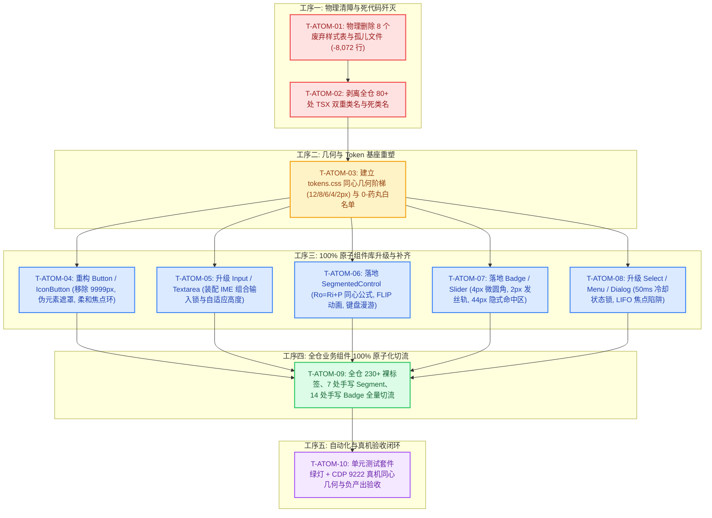

# 原子设计系统与同心几何维度详案 (Detailed Plan 02)

## Conex Atomic Design System, Concentric Geometry Engine & Single Truth Path Detailed Plan

> **方案编号**：`RED-DETAILED-02`  
> **领域定位**：原子设计系统（Atomic Design System）、同心几何标尺（Concentric Geometry）、四档正交尺寸矩阵与全仓交互控件唯一真理路径收敛  
> **权威依据**：
>
> 1. `docs/red-team-plans/00-红队前端系统级重构总计划框架与删除面裁决.md`（主控裁决框架与删除总账）
> 2. `docs/red-team-plans/00-红队子Agent方案编制契约与收敛基准.md`（红队 Master Contract）
> 3. `docs/red-team-plans/plan-reviews/01~03.md`（三份独立方案交叉评审专著：冲突仲裁、删除总账、依赖拓扑）
> 4. `docs/agent-roles/review/frontend-review.md`（全景 Master Review 规范，特别是维度三、维度四、维度五）
> 5. `docs/frontend-benchmarking/deep-dives/01-AFFiNE原子组件与同心几何源码解剖.md`（1818行深度源码解剖）
> 6. 仓库根目录 `AGENTS.md`（第 12 条自定义 Tooltip、第 13 条输入框与焦点态 10% 对比度上限、第 14 条 HSLA 与 modern CSS）
>
> **核心哲学**：**「正确性 × 收敛性」双目标函数** · **领域概念驱动** · **收敛/删除先于增强** · **一个概念一条路径** · **负产出验收（Negative Code Yield）** · **架构穿透零补丁**。  
> **纪律禁令**：严禁按波次/批次机械切割任务；严禁绕过类型检查与门禁；严禁使用 9999px 药丸圆角（除白名单）；严禁业务组件直写裸交互标签。  
> **编码与字符集**：UTF-8 无 BOM。

---

## 目录索引

- [一、 做什么：原子组件库与同心几何重构建设 (What to Build)](#一-做什么原子组件库与同心几何重构建设-what-to-build)
  - [1.1 100% 原子组件覆盖体系与 `@/components/ui` 唯一真理源](#11-100-原子组件覆盖体系与-componentsui-唯一真理源)
  - [1.2 同心几何（Concentric Geometry）数学标尺与三大公理证明](#12-同心几何concentric-geometry数学标尺与三大公理证明)
    - [1.2.1 定理一：等距缝隙不变性定理（$R_o = R_i + P$）推导与证明](#121-定理一等距缝隙不变性定理r_o--r_i--p推导与证明)
    - [1.2.2 定理二：边界退化条件定理（$P \ge R_o$ 退化直角）](#122-定理二边界退化条件定理p-ge-r_o-退化直角)
    - [1.2.3 定理三：非对称内边距同心椭圆公式](#123-定理三非对称内边距同心椭圆公式)
    - [1.2.4 全站标准 5 级同心圆角标尺与 Token 契约](#124-全站标准-5-级同心圆角标尺与-token-契约)
  - [1.3 桌面端 0-药丸铁律与唯一合法白名单制度](#13-桌面端-0-药丸铁律与唯一合法白名单制度)
  - [1.4 尺寸轴与变体轴绝对正交契约（Orthogonality Matrix）](#14-尺寸轴与变体轴绝对正交契约orthogonality-matrix)
    - [1.4.1 四档标准化控件尺寸标尺（24px / 28px / 32px / 40px）](#141-四档标准化控件尺寸标尺24px--28px--32px--40px)
    - [1.4.2 尺寸属性与变体属性正交切分契约](#142-尺寸属性与变体属性正交切分契约)
  - [1.5 Vanilla-Extract 风格局部变量参数化模型（0 运行时损耗）](#15-vanilla-extract-风格局部变量参数化模型0-运行时损耗)
  - [1.6 Focus Ring 柔和发光与 A11y 键盘可访问性设计](#16-focus-ring-柔和发光与-a11y-键盘可访问性设计)
  - [1.7 核心原子组件全量规范设计与 TypeScript / CSS 接口契约](#17-核心原子组件全量规范设计与-typescript--css-接口契约)
    - [1.7.1 `Button` & `IconButton`：伪元素悬浮遮罩与柔和焦点环](#171-button--iconbutton伪元素悬浮遮罩与柔和焦点环)
    - [1.7.2 `Input` & `Textarea`：IME 组合输入守卫与自适应高度](#172-input--textareaime-组合输入守卫与自适应高度)
    - [1.7.3 `Select` & `Menu`：50ms 冷却状态锁与 0.5px 发丝分割线](#173-select--menu50ms-冷却状态锁与-05px-发丝分割线)
    - [1.7.4 `Dialog` (Modal)：同心外壳与 LIFO 焦点陷阱](#174-dialog-modal同心外壳与-lifo-焦点陷阱)
    - [1.7.5 `Tooltip`：单双字符居中胶囊与全局静默互斥](#175-tooltip单双字符居中胶囊与全局静默互斥)
    - [1.7.6 `Switch`：精密几何计算与 `1.51` 超调弹簧物理曲线](#176-switch精密几何计算与-151-超调弹簧物理曲线)
    - [1.7.7 `SegmentedControl`：同心几何与 FLIP 动态滑块](#177-segmentedcontrol同心几何与-flip-动态滑块)
    - [1.7.8 `Badge` / `Chip` / `Tag`：4px 微圆角与语义调色板](#178-badge--chip--tag4px-微圆角与语义调色板)
    - [1.7.9 `Slider`：亚像素发丝轨道与 44px 隐式命中区](#179-slider亚像素发丝轨道与-44px-隐式命中区)
- [二、 删什么：全仓裸标签驱逐与死代码清剿账本 (What to Purge)](#二-删什么全仓裸标签驱逐与死代码清剿账本-what-to-purge)
  - [2.1 物理驱逐全仓 230+ 裸交互标签（94+ 文件 Button / 44+ 文件 Input / 7+ 文件 Textarea）](#21-物理驱逐全仓-230-裸交互标签94-文件-button--44-文件-input--7-文件-textarea)
  - [2.2 物理剥离 80+ 处 TSX 双重类名绑定与幽灵类名](#22-物理剥离-80-处-tsx-双重类名绑定与幽灵类名)
  - [2.3 彻底删除 `9999px` 药丸圆角（`tokens.css` 与组件私有样式）](#23-彻底删除-9999px-药丸圆角tokenscss-与组件私有样式)
  - [2.4 彻底清除 7 处手写 Segment 与 14 处手写 Badge 轮子](#24-彻底清除-7-处手写-segment-与-14-处手写-badge-轮子)
  - [2.5 物理删除的历史废弃样式表与孤儿文件清单](#25-物理删除的历史废弃样式表与孤儿文件清单)
  - [2.6 净削减代码行数精准核算（负产出断言）](#26-净削减代码行数精准核算负产出断言)
- [三、 依赖与逻辑顺序：先删后改与任务执行拓扑 (Execution Flow & DAG)](#三-依赖与逻辑顺序先删后改与任务执行拓扑-execution-flow--dag)
  - [3.1 先删后改五阶段逻辑执行工序](#31-先删后改五阶段逻辑执行工序)
  - [3.2 任务单元详细拆解表 (Work Packages T-ATOM-01 ~ T-ATOM-10)](#32-任务单元详细拆解表-work-packages-t-atom-01--t-atom-10)
  - [3.3 任务执行 Mermaid 依赖关系 DAG 图](#33-任务执行-mermaid-依赖关系-dag-图)
- [四、 文件域划分与跨域并行安全 (File Scope & Parallel Safety)](#四-文件域划分与跨域并行安全-file-scope--parallel-safety)
  - [4.1 本方案专属唯一文件域清单](#41-本方案专属唯一文件域清单)
  - [4.2 跨方案依赖与接口契约边界](#42-跨方案依赖与接口契约边界)
  - [4.3 多 Agent 并行 Git 提交防护规则](#43-多-agent-并行-git-提交防护规则)
- [五、 验收标准与断言矩阵 (Verification & Assertions)](#五-验收标准与断言矩阵-verification--assertions)
  - [5.1 单元测试与逻辑功能验收断言](#51-单元测试与逻辑功能验收断言)
  - [5.2 CDP 9222 原生 WebView2 真机交互与视觉验收](#52-cdp-9222-原生-webview2-真机交互与视觉验收)
  - [5.3 负产出与收敛指标硬性验收矩阵](#53-负产出与收敛指标硬性验收矩阵)
  - [5.4 15 项黄金自检清单 (C-01 ~ C-15) 逐条达标验证](#54-15-项黄金自检清单-c-01--c-15-逐条达标验证)

---

# 一、 做什么：原子组件库与同心几何重构建设 (What to Build)

## 1.1 100% 原子组件覆盖体系与 `@/components/ui` 唯一真理源

为了终结全仓 230+ 裸标签、170+ 组件私有手写样式与无障碍严重割裂的现状，本方案确立全仓交互界面的**唯一合法原子组件出口**：`apps/crish-desktop/src/components/ui/index.ts`。

```
┌──────────────────────────────────────────────────────────────────────────────────────────────────┐
│                   Conex 统一原子设计系统分层架构拓扑 (Atomic System Architecture)                 │
├──────────────────────────────────────────────────────────────────────────────────────────────────┤
│                                                                                                  │
│  [Layer 3: 业务组合层]   ChatComposer / DiffViewer / FileTree / SettingsPanel / OverviewCard     │
│  ──────────────────────────────────────────────────────────────────────────────────────────────  │
│  [Layer 2: 原子组件库]   @/components/ui/ (100% 强类型 Pure UI Primitives, 0 业务 Store 耦合)    │
│  ┌───────────────┬───────────────┬───────────────┬────────────────┬───────────────────────────┐  │
│  │ Button        │ Input         │ Textarea      │ Select         │ Menu                      │  │
│  │ IconButton    │ Checkbox      │ Radio         │ Switch         │ SegmentedControl          │  │
│  │ Badge / Tag   │ Slider        │ Dialog        │ Tooltip        │ Kbd / TabStrip            │  │
│  └───────────────┴───────────────┴───────────────┴────────────────┴───────────────────────────┘  │
│  ──────────────────────────────────────────────────────────────────────────────────────────────  │
│  [Layer 1: 同心几何与设计 Token] tokens.css (Ro = Ri + P 数学阶梯, 7 级 Z-Index, 4 档尺寸正交标尺)│
│  ──────────────────────────────────────────────────────────────────────────────────────────────  │
│  [Layer 0: 基础设施契约] LayerStackManager (浮层调度) / FocusTrap / Anti-Reentry Cooldown Lock   │
└──────────────────────────────────────────────────────────────────────────────────────────────────┘
```

### 架构刚性铁律与 AST 路径边界白名单：

1. **裸标签绝对清零与 AST 边界白名单**：
   - `@/components/ui/**` 目录作为 **Primitive Bridge（基元桥接层）**，是全仓**唯一合法**书写原生 `<button>`, `<input>`, `<textarea>`, `<select>` 的特权白名单文件域；
   - 业务组件严禁直接书写原生交互标签，必须 100% 消费 `@/components/ui` 导出的原子组件；
   - **AST 边界判定机制**：门禁脚本 `scripts/check-frontend-convergence.mjs` 解析 AST 时，若检测到 `JSXOpeningElement.name === 'button' | 'input' | 'textarea' | 'select'` 或 `React.createElement('button', ...)`，提取当前文件归一化路径 `normalizedPath`。若路径位于 `apps/crish-desktop/src/components/ui/` 内则判定合法放行；若位于业务组件目录（如 `components/chat/`、`components/diff/`、`components/settings/` 等）则立即触发 **G-01 规则硬性阻断**并输出违规代码坐标；
2. **唯一出口与禁止深引**：所有原子组件统一经 `components/ui/index.ts` 导出，上层业务组件严禁通过深路径（如 `import { Button } from '@/components/ui/Button/Button'`）访问私有实现；
3. **零业务 Store 绑定**：原子组件必须保持为纯函数式无副作用组件（Pure UI Components），禁止在原子层内导入任何 Zustand Store 或调用 IPC 服务。

---

## 1.2 同心几何（Concentric Geometry）数学标尺与三大公理证明

桌面端专业 IDE / 生产力工具的视觉品质很大程度上取决于容器与子元素转角处的几何协调性。现有代码中大量滥用 `9999px` 胶囊圆角，导致严重的“圆角倒挂（Corner Inversion）”与转角挤压畸变。本方案确立同心几何的三大核心数学定理。

```
                         ┌──────────────────────────────────────────────────┐
                         │ 父容器 (Outer Container)                          │
                         │ 圆角半径: R_outer (R_o)                          │
                         │                                                  │
                         │   ┌──────────────────────────────────────────┐   │
                         │   │ 子元素 / 控件 (Inner Item / Control)      │   │
                         │   │ 圆角半径: R_inner (R_i)                  │   │
                         │ P │                                          │ P │
                         │   │                                          │   │
                         │   └──────────────────────────────────────────┘   │
                         │                        P                         │
                         └──────────────────────────────────────────────────┘
```

### 1.2.1 定理一：等距缝隙不变性定理（$R_o = R_i + P$）推导与证明

- **定理表述**：外层圆角矩形半径为 $R_o$，内层圆角矩形与外层边界在四周具有等宽内边距 $P$。为了使外弧与内弧在任意法向截面上的缝隙距离恒等于 $P$，内层圆角半径 $R_i$ 必须且仅能满足：
  $$R_i = R_o - P \iff R_o = R_i + P$$

- **严密数学证明**：
  在笛卡尔坐标系中，设外层矩形右上转角圆心位于 $O_o(x_0, y_0)$，外弧轨迹方程为：
  $$(x - x_0)^2 + (y - y_0)^2 = R_o^2 \quad (x \ge x_0, y \ge y_0)$$
  内层矩形边缘相对于外层整体向内平移距离 $P$。因此，直线段区域的法向间距恒等于 $P$。
  为使转角处的间距同样恒为 $P$，内层转角圆弧必须与外层转角圆弧共心，即内圆心 $O_i \equiv O_o(x_0, y_0)$。
  内弧轨迹方程为：
  $$(x - x_0)^2 + (y - y_0)^2 = R_i^2 \quad (x \ge x_0, y \ge y_0)$$
  从圆心 $O_o$ 沿任意极角 $\theta \in [0, \frac{\pi}{2}]$ 发射射线，射线与内弧交于点 $A(r_i, \theta)$，与外弧交于点 $B(r_o, \theta)$。
  两点间的法向缝隙宽度为：
  $$\Delta r(\theta) = \|B - A\| = R_o - R_i$$
  为保证整个轮廓周长上的间距均一性（消除 Optical Pinching 挤压感），必须满足 $\Delta r(\theta) \equiv P$。
  代入得：$R_o - R_i = P$，即 $R_i = R_o - P$。**证毕**。

### 1.2.2 定理二：边界退化条件定理（$P \ge R_o$ 退化直角）

- **定理表述**：当容器内边距 $P \ge R_o$ 时，计算所得 $R_i = R_o - P \le 0$。此时内层子元素在转角处**必须退化为直角（$R_i = 0$）**。
- **几何意义**：当内边距足够大时，子元素已经完全退入外层圆角切线所围成的直角内部，若错误赋予内层圆角 $R_i > 0$，转角处的法向间距将小于 $P$，导致转角边缘突兀变薄，产生视觉塌陷。

### 1.2.3 定理三：非对称内边距同心椭圆公式

- **定理表述**：当水平内边距 $P_x$ 与垂直内边距 $P_y$ 不相等（$P_x \ne P_y$）时，严密的同心几何要求内层圆角采用**椭圆圆角（Elliptical Corner）**：
  $$R_{i, x} = \max(0, R_o - P_x), \quad R_{i, y} = \max(0, R_o - P_y)$$
- **CSS 表达规范**：
  ```css
  border-radius: max(0px, var(--r-out) - var(--pad-x)) /
    max(0px, var(--r-out) - var(--pad-y));
  ```

### 1.2.4 全站标准 5 级同心圆角标尺与 Token 契约

依据主控裁决与评审一致意见，全站统一废除散落的任意圆角值，死锁为以下 5 级标准阶梯：

```css
/* apps/crish-desktop/src/styles/tokens.css */
:root {
  /* 5 级标准同心圆角标尺 */
  --radius-xl: 12px; /* 全屏模态外壳、独立窗口浮层 (R_outer = 12px) */
  --radius-lg: 8px; /* 卡片容器、下拉菜单 Content、设置项大外框 (R_outer = 8px) */
  --radius-md: 6px; /* 标准输入框、标准按钮、Tab 选项卡、Select 触发器 (R_inner = 8 - 2 = 6px) */
  --radius-sm: 4px; /* 微型按钮 (IconButton)、状态徽标 (Badge)、键帽 (Kbd) (R_inner = 6 - 2 = 4px) */
  --radius-xs: 2px; /* 极小指示点、进度条内芯、发丝圆角 (R_inner = 4 - 2 = 2px) */

  /* 严禁在普通控件中使用 9999px，仅保留专用白名单变量 */
  --radius-switch-track: 9999px; /* 白名单 1: Switch 轨道 */
  --radius-circle: 50%; /* 白名单 2: Avatar 与圆形指示灯 */
}
```

---

## 1.3 桌面端 0-药丸铁律与唯一合法白名单制度

### 药丸通胀（Pill Inflation）危害剖析：

当一个高度为 24px 的 Badge 被设置 `border-radius: 9999px` 时，浏览器会将其 clamp 为 12px 圆角。如果该 Badge 嵌套在一个 `border-radius: 8px` 的 Card 中（内边距 4px），此时：
$$R_{\text{inner}} (12\text{px}) > R_{\text{outer}} (8\text{px})$$
内层圆角半径竟大于外层，转角法向间距 $\Delta r = 8 - 12 = -4\text{px} < 0$！子元素的圆弧尖角会硬生生“戳破”父容器的转角轮廓，产生廉价的移动端或网页玩具感。

### 0-药丸铁律（Zero-Pill Rule）：

1. ❌ **全仓绝对禁止**：在常规 `Button`, `IconButton`, `Input`, `Textarea`, `Card`, `Toolbar`, `Modal`, `Tag`, `Badge`, `SegmentedControl` 上使用 `9999px` 或 `border-radius: 9999px` / `var(--radius-full)`；
2. ✅ **全仓唯一合法白名单（Strict Whitelist）**：
   - **白名单 1**：`Switch` 轨道外壳与滚动圆钮（物理椭圆滑轨）；
   - **白名单 2**：`Avatar` 用户/助手头像（`border-radius: 50%` 正圆形）；
   - **白名单 3**：`StatusPulseDot` 音频录制/长连接呼吸微指示灯（`border-radius: 50%` 正圆形）。

---

## 1.4 尺寸轴与变体轴绝对正交契约（Orthogonality Matrix）

现有 `Button.module.css` 的最大病灶是**变体类越权劫持尺寸属性**（例如 `.buttonGhost` 中硬编码了 `height: 28px; padding: 0 8px;`），导致 `<Button variant="ghost" size="md">` 无法得到正常的 32px 高度。本方案实施变体轴与尺寸轴的绝对解耦。

```
                               ┌────────────────────────────────────────────────────────┐
                               │             尺寸轴与变体轴正交属性矩阵                  │
                               └────────────────────────────────────────────────────────┘
                                           │                                │
                       ┌───────────────────┴───────────────┐ ┌──────────────┴───────────────────┐
                       ▼                                   ▼ ▼                                   ▼
               【尺寸轴 (Size Axis)】                               【变体轴 (Variant Axis)】
               • height / min-height                               • background-color
               • padding (padding-x, padding-y)                    • border-color / border-width
               • font-size / line-height                           • color (text / icon)
               • gap / icon-size                                   • box-shadow / focus-ring
               • border-radius                                     • hover-overlay opacity
```

### 1.4.1 四档标准化控件尺寸标尺（24px / 28px / 32px / 40px）

全仓交互控件严格对齐以下 4 档尺寸标尺，彻底杜绝 `height: 27px`、`height: 31px` 等奇数魔术数字：

| 尺寸代号             | 高度 ($H$) | 水平内边距 ($P_x$) | 图标尺寸 ($S_{icon}$) | 字号 / 行高                      | 圆角 ($R$)              | 典型适用场景                          |
| :------------------- | :--------- | :----------------- | :-------------------- | :------------------------------- | :---------------------- | :------------------------------------ |
| **`xs`** (微型)      | **24px**   | `0 6px`            | 14px                  | 12px / 16px (`--font-size-xs`)   | **4px** (`--radius-sm`) | 行内操作、Diff 行内按钮、树节点悬浮条 |
| **`sm`** (紧凑/默认) | **28px**   | `0 10px`           | 16px                  | 13px / 20px (`--font-size-sm`)   | **6px** (`--radius-md`) | 36px 顶栏控件、侧边栏、紧凑表单       |
| **`md`** (标准)      | **32px**   | `0 12px`           | 18px                  | 14px / 22px (`--font-size-base`) | **6px** (`--radius-md`) | 弹窗底部操作区、设置面板主表单输入框  |
| **`lg`** (突出)      | **40px**   | `0 16px`           | 20px                  | 15px / 24px (`--font-size-md`)   | **8px** (`--radius-lg`) | 空态欢迎主引导、大号搜索栏、核心 CTA  |

### 1.4.2 尺寸属性与变体属性正交切分契约

- 尺寸类（如 `.sizeSm`, `.sizeMd`）**严禁**声明任何颜色、背景色、边框色与阴影；
- 变体类（如 `.variantPrimary`, `.variantGhost`）**严禁**声明任何高度、宽度、内边距与圆角；
- 两者任意组合均能产生确定性视觉表现，组合空间为 $4 \times 5 = 20$ 种可能，测试覆盖率 100%。

---

## 1.5 Vanilla-Extract 风格局部变量参数化模型（0 运行时损耗）

借鉴 AFFiNE 的 Vanilla-Extract 参数化设计思想，在 Conex 的 CSS Modules 体系中通过 **CSS 自定义属性插槽（Custom Property Slots）** 实现零特异性冲突的局部参数覆盖：

```css
/* apps/crish-desktop/src/components/ui/Button/Button.module.css */

/* 1. 基础布局与变量契约插槽 */
.button {
  /* 尺寸参数插槽 */
  --btn-h: 28px;
  --btn-px: 10px;
  --btn-fs: var(--font-size-sm);
  --btn-radius: var(--radius-md);
  --btn-icon-size: 16px;
  --btn-gap: var(--space-1_5);

  /* 视觉变体参数插槽 */
  --btn-bg: transparent;
  --btn-fg: var(--text-primary);
  --btn-border: transparent;
  --btn-shadow: none;
  --btn-hover-overlay: color-mix(in srgb, var(--text-primary) 6%, transparent);
  --btn-active-overlay: color-mix(
    in srgb,
    var(--text-primary) 12%,
    transparent
  );

  position: relative;
  display: inline-flex;
  align-items: center;
  justify-content: center;
  box-sizing: border-box;
  height: var(--btn-h);
  padding: 0 var(--btn-px);
  gap: var(--btn-gap);
  font-size: var(--btn-fs);
  border-radius: var(--btn-radius);
  background-color: var(--btn-bg);
  color: var(--btn-fg);
  border: 1px solid var(--btn-border);
  box-shadow: var(--btn-shadow);
  font-family: inherit;
  font-weight: var(--font-weight-content);
  line-height: 1;
  user-select: none;
  white-space: nowrap;
  cursor: pointer;
  outline: none;
  transition:
    transform var(--transition-micro) cubic-bezier(0.2, 0, 0, 1),
    border-color var(--transition-micro) ease;
}

/* 2. 尺寸修饰器：仅覆盖尺寸插槽 */
.button[data-size='xs'] {
  --btn-h: 24px;
  --btn-px: 6px;
  --btn-fs: var(--font-size-xs);
  --btn-radius: var(--radius-sm);
  --btn-icon-size: 14px;
}
.button[data-size='sm'] {
  --btn-h: 28px;
  --btn-px: 10px;
  --btn-fs: var(--font-size-sm);
  --btn-radius: var(--radius-md);
  --btn-icon-size: 16px;
}
.button[data-size='md'] {
  --btn-h: 32px;
  --btn-px: 12px;
  --btn-fs: var(--font-size-base);
  --btn-radius: var(--radius-md);
  --btn-icon-size: 18px;
}
.button[data-size='lg'] {
  --btn-h: 40px;
  --btn-px: 16px;
  --btn-fs: var(--font-size-md);
  --btn-radius: var(--radius-lg);
  --btn-icon-size: 20px;
}

/* 3. 变体修饰器：仅覆盖颜色与阴影插槽 */
.button[data-variant='primary'] {
  --btn-bg: var(--accent-color);
  --btn-fg: var(--text-on-accent);
  --btn-border: color-mix(in srgb, var(--accent-color) 80%, black 20%);
  --btn-hover-overlay: color-mix(in srgb, white 15%, transparent);
  --btn-active-overlay: color-mix(in srgb, black 15%, transparent);
}
.button[data-variant='secondary'] {
  --btn-bg: var(--control-soft-bg);
  --btn-fg: var(--text-primary);
  --btn-border: var(--border-subtle);
}
.button[data-variant='ghost'] {
  --btn-bg: transparent;
  --btn-fg: var(--text-secondary);
  --btn-border: transparent;
}
.button[data-variant='plain'] {
  --btn-bg: transparent;
  --btn-fg: var(--text-tertiary);
  --btn-border: transparent;
}
.button[data-variant='danger'] {
  --btn-bg: transparent;
  --btn-fg: var(--color-error);
  --btn-border: transparent;
  --btn-hover-overlay: color-mix(in srgb, var(--color-error) 10%, transparent);
}
```

---

## 1.6 Focus Ring 柔和发光与 A11y 键盘可访问性设计

根据仓库根目录 `AGENTS.md` 第 13 条铁律：**任何情况下焦点/激活态不得使用硬实黑线；相对基线，灰色加深混入文本色不得超过 10%（常规元素优先 3%~6% 混入以保持柔软）；默认不要加厚重 box-shadow**。

```css
/* 全局原子控件统一柔和焦点环 */
.button:focus-visible,
.input:focus-within,
.textarea:focus-within,
.selectTrigger:focus-visible,
.switchTrack:focus-visible,
.segmentedItem:focus-visible {
  outline: none;
  /* 柔和微光：94% 基础边框色混入 6% 主文本色，外扩 1.5px */
  box-shadow: 0 0 0 1.5px
    color-mix(in srgb, var(--border-color) 94%, var(--text-primary) 6%);
  border-color: color-mix(
    in srgb,
    var(--border-color) 90%,
    var(--text-primary) 10%
  );
}

/* 全页空态 / 白板区域特化焦点（加深不超过 3%） */
[data-empty-kind='session-empty'] .input:focus-within,
[data-empty-kind='session-empty'] .textarea:focus-within {
  box-shadow: 0 0 0 1px
    color-mix(in srgb, var(--border-color) 97%, var(--text-primary) 3%);
}
```

---

## 1.7 核心原子组件全量规范设计与 TypeScript / CSS 接口契约

### 1.7.1 `Button` & `IconButton`：伪元素悬浮遮罩与柔和焦点环

#### 1. 伪元素 0-重绘遮罩加速原理：

避免在 `:hover` 伪类中直接切换 `background-color`（这会触发浏览器样式的 Recalculate 与 Paint 管道）。改用 `::before` 绝对定位伪元素承载半透明叠加层，仅切换 `opacity`（由 GPU Compositor 图层直出，0 Reflow / 0 Repaint）：

```css
.button::before {
  content: '';
  position: absolute;
  inset: 0;
  border-radius: inherit;
  background-color: var(--btn-hover-overlay);
  opacity: 0;
  pointer-events: none;
  transition: opacity var(--transition-micro) ease;
}
.button:hover:not(:disabled)::before {
  opacity: 1;
}
.button:active:not(:disabled)::before {
  background-color: var(--btn-active-overlay);
  opacity: 1;
}
.button:active:not(:disabled) {
  transform: scale(0.98);
}
```

#### 2. TypeScript 完整接口契约：

```typescript
// apps/crish-desktop/src/components/ui/Button/Button.tsx
export type ButtonVariant =
  'primary' | 'secondary' | 'plain' | 'ghost' | 'danger';
export type ButtonSize = 'xs' | 'sm' | 'md' | 'lg';

export interface ButtonProps extends React.ButtonHTMLAttributes<HTMLButtonElement> {
  variant?: ButtonVariant;
  size?: ButtonSize;
  icon?: React.ReactNode;
  iconPosition?: 'left' | 'right';
  loading?: boolean;
  block?: boolean;
  active?: boolean;
}

export interface IconButtonProps extends Omit<
  ButtonProps,
  'children' | 'block' | 'iconPosition'
> {
  icon: React.ReactNode;
  'aria-label': string; // 强制无障碍命名，防止屏幕阅读器裸读
  tooltip?: React.ReactNode; // 声明式 Tooltip 绑定
}
```

---

### 1.7.2 `Input` & `Textarea`：IME 组合输入守卫与自适应高度

#### 1. 中文输入法 IME 合成锁状态机原理：

在中文、日文输入法（如微软拼音、搜狗输入法）选词过程中，按下 Enter 键旨在确认候选英文字符上屏，而非提交表单。原生事件中此时会派发 `keyCode === 229` 或 `e.nativeEvent.isComposing === true`。
若不加拦截，表单会被提前提交。原子 `Input` 与 `Textarea` 必须在组件底层固化状态机守卫：

```tsx
// apps/crish-desktop/src/components/ui/Input/Input.tsx
export const Input = forwardRef<HTMLInputElement, InputProps>(function Input(
  {
    onKeyDown,
    onEnter,
    clearable,
    value,
    onChange,
    size = 'sm',
    variant = 'default',
    prefixIcon,
    suffix,
    ...props
  },
  ref
) {
  const isComposingRef = useRef(false);

  const handleCompositionStart = () => {
    isComposingRef.current = true;
  };
  const handleCompositionEnd = () => {
    isComposingRef.current = false;
  };

  const handleKeyDown = (e: React.KeyboardEvent<HTMLInputElement>) => {
    onKeyDown?.(e);
    // 关键拦截：输入法合成中、原生 isComposing 为真、或 keyCode 为 229 时，丢弃回车提交
    if (
      isComposingRef.current ||
      e.nativeEvent.isComposing ||
      e.keyCode === 229
    ) {
      return;
    }
    if (e.key === 'Enter' && !e.shiftKey) {
      onEnter?.(e.currentTarget.value);
    }
  };

  return (
    <div
      className={styles.inputContainer}
      data-size={size}
      data-variant={variant}
    >
      {prefixIcon && <span className={styles.prefixIcon}>{prefixIcon}</span>}
      <input
        ref={ref}
        value={value}
        onChange={onChange}
        onCompositionStart={handleCompositionStart}
        onCompositionEnd={handleCompositionEnd}
        onKeyDown={handleKeyDown}
        className={styles.nativeInput}
        {...props}
      />
      {suffix && <span className={styles.suffix}>{suffix}</span>}
    </div>
  );
});
```

#### 2. `Textarea` 现代 CSS `field-sizing: content` 零回流自适应：

彻底根除旧代码 `useAutoGrowTextarea.ts` 中 `el.style.height = '0px'` 引发的强制同步回流（Layout Thrashing），采用纯 CSS 方案：

```css
/* apps/crish-desktop/src/components/ui/Input/Textarea.module.css */
.nativeTextarea {
  field-sizing: content; /* Chrome 123+ / WebView2 原生内容自适应高度，0 JS 损耗 */
  min-height: 28px;
  max-height: 240px;
  resize: none;
  box-sizing: border-box;
  width: 100%;
  font-family: inherit;
  font-size: var(--font-size-sm);
  line-height: var(--line-height-normal);
  color: var(--text-primary);
  background: transparent;
  border: none;
  outline: none;
}
```

---

### 1.7.3 `Select` & `Menu`：50ms 冷却状态锁与 0.5px 发丝分割线

#### 1. 50ms 冷却状态锁（Anti-Reentry Cooldown Lock）：

彻底根除下拉菜单需要点击 4 次才能关闭的“四击 Bug”：

1. 下拉菜单默认配置 `modal={false}` 非模态，外点关闭交由 `DismissableLayer`；
2. 当菜单因外点关闭时，在 Trigger 节点记录 `lastClosedTime = Date.now()`；
3. 若用户紧接着点击 Trigger，判断 `Date.now() - lastClosedTime < 50ms`，则直接判定为同一次点击动作的延续，阻断二次取反重新打开。

#### 2. 0.5px 发丝分割线规范：

```css
/* apps/crish-desktop/src/components/ui/Menu/Menu.module.css */
.separator {
  height: 1px;
  background-color: var(--border-subtle);
  transform: scaleY(0.5); /* 亚像素发丝线 */
  margin: var(--space-1) 0;
}
```

---

### 1.7.4 `Dialog` (Modal)：同心外壳与 LIFO 焦点陷阱

- **外壳圆角**：$R_o = 12\text{px}$（`--radius-xl`），内部操作区与按钮 $R_i = 6\text{px}$（`--radius-md`），内边距 $P = 6\text{px} \implies 12 = 6 + 6$；
- **焦点陷阱**：装配 `FocusTrap`，挂载时自动聚焦首个可用表单元素，卸载时精准调用 `useRestoreFocus()` 回退至触发前元素；
- **Portal 物理隔离**：100% 挂载至 `index.html` 中的 `#modal-root`，`z-index: var(--z-modal, 1000)`，杜绝局部 `overflow: hidden` 裁剪。

---

### 1.7.5 `Tooltip`：单双字符居中胶囊与全局静默互斥

- **自定义 Tooltip 铁律**：全仓使用 `<Tooltip content="...">`，彻底杜绝原生 `title="..."` 属性；
- **单字符快捷键正方胶囊**：当 Tooltip 或键帽显示单个字符快捷键（如 `⌘`、`K`、`P`）时，强制渲染为 `16px × 16px` 极度居中正方形微胶囊（`border-radius: 4px`）；
- **浮层全局静默互斥**：当系统存在展开的 `Menu` / `Select` / `Dialog` 时，`LayerStackManager` 向 `document.body` 广播 `data-floating-active="true"`，全局 CSS 规则强制隐藏所有 Tooltip：
  ```css
  body[data-floating-active='true'] [role='tooltip'] {
    display: none !important;
  }
  ```

---

### 1.7.6 `Switch`：精密几何计算与 `1.51` 超调弹簧物理曲线

- **几何标尺**：
  - 标准档（md）：$H = 20\text{px}, P = 2\text{px} \implies W = 2 \times (20 - 2) = 36\text{px}$，滚钮圆径 $D = 20 - 4 = 16\text{px}$，位移 $X_{on} = 20 - 2 = 18\text{px}$；
  - 紧凑档（sm）：$H = 16\text{px}, P = 1.5\text{px} \implies W = 2 \times (16 - 1.5) = 29\text{px}$，滚钮圆径 $D = 16 - 3 = 13\text{px}$，位移 $X_{on} = 16 - 1.5 = 14.5\text{px}$。
- **超调弹簧物理曲线**：
  ```css
  /* apps/crish-desktop/src/components/ui/Switch/Switch.module.css */
  .thumb {
    transition: transform 220ms cubic-bezier(0.27, 0.2, 0.25, 1.51);
  }
  ```

---

### 1.7.7 `SegmentedControl`：同心几何与 FLIP 动态滑块

- **同心几何验证**：外层槽盒 $R_o = 8\text{px}$，内边距 $P = 2\text{px}$，内层选中滑块 $R_i = 8 - 2 = 6\text{px}$（完全满足 $R_o = R_i + P$）；
- **FLIP 滑块过渡**：利用动态 `getBoundingClientRect()` 计算选中项的尺寸与偏移，通过 CSS `transform: translate3d(x, 0, 0)` 驱动白色/浅色滑块在选项间平滑滑动，提供沉浸触感；
- **无障碍键盘漫游**：支持 `ArrowLeft` / `ArrowRight` 左右方向键切换选项并自动触发 `onChange`。

---

### 1.7.8 `Badge` / `Chip` / `Tag`：4px 微圆角与语义调色板

- **圆角约束**：全站 Badge 圆角强制死锁为 **`4px`**（`--radius-sm`），严禁 `9999px`；
- **调色板语义分层**：
  - `neutral`：`background: var(--control-soft-bg); color: var(--text-secondary);`
  - `brand`：`background: color-mix(in srgb, var(--accent-color) 12%, transparent); color: var(--accent-color);`
  - `success`：`background: color-mix(in srgb, var(--color-success) 12%, transparent); color: var(--color-success);`
  - `warning`：`background: color-mix(in srgb, var(--color-warning) 12%, transparent); color: var(--color-warning);`
  - `error`：`background: color-mix(in srgb, var(--color-error) 12%, transparent); color: var(--color-error);`

---

### 1.7.9 `Slider`：亚像素发丝轨道与 44px 隐式命中区

- **视觉轨道**：高度为 2px 的精致发丝滑轨；
- **触控手柄**：12px 正圆形滑块（白名单）；
- **隐式命中区**：通过 `::before` 伪元素向四周延展 44px 不可见命中区域，杜绝用户在微调滑块时因鼠标微移脱轨导致交互中断。

---

## 1.8 专有防回潮门禁脚本 `scripts/check-frontend-convergence.mjs` 与 10 大不可违背规则全量落地

为杜绝「前脚重构收敛，后脚业务回潮」的工程恶疾，本方案设计并落地全仓专有防回潮静态分析门禁脚本 `scripts/check-frontend-convergence.mjs`。该脚本接入 `package.json` 的 `npm run check:desktop` 与 Git pre-commit hook，成为不可绕过的 CI/CD 物理守护铁锁。

```
┌──────────────────────────────────────────────────────────────────────────────────────────────────┐
│                   scripts/check-frontend-convergence.mjs 静态分析与门禁防护架构                   │
├──────────────────────────────────────────────────────────────────────────────────────────────────┤
│                                                                                                  │
│  [扫描入口 Scanner Entry]  Fast Glob (扫描 apps/crish-desktop/src 下全量 .tsx, .ts, .css)          │
│  ──────────────────────────────────────────────────────────────────────────────────────────────  │
│  [AST & Token 分析引擎]    Babel / TypeScript AST Parser + PostCSS Tokenizer                     │
│  ┌───────────────────────┬───────────────────────┬───────────────────────┬────────────────────┐  │
│  │ G-01 业务零裸标签      │ G-02 浮层零 clone/stop│ G-03 零裸RO/0px回流   │ G-04 零非法9999px  │  │
│  ├───────────────────────┼───────────────────────┼───────────────────────┼────────────────────┤  │
│  │ G-05 7级Z-Index标尺   │ G-06 业务零!important │ G-07 入口零废弃CSS    │ G-08 零静态switch  │  │
│  ├───────────────────────┴───────────────────────┴───────────────────────┴────────────────────┤  │
│  │ G-09 状态零伪门面/withAutoIndex                │ G-10 空态零状态渗透 (!onEmptySurface)     │  │
│  └────────────────────────────────────────────────────────────────────────────────────────────┘  │
│  ──────────────────────────────────────────────────────────────────────────────────────────────  │
│  [CI 决策与报告 Reporter]  违规致命阻断 (Exit 1) + 精确文件:行号定位 + 零警告容忍                  │
└──────────────────────────────────────────────────────────────────────────────────────────────────┘
```

### 1.8.1 10 大不可违背规则（G-01 ~ G-10）检测机理与代码规约

| 规则代号 | 规则名称                                             | 检测机制与判定逻辑                                                                                     | 豁免白名单与例外                                                                                                            |
| :------- | :--------------------------------------------------- | :----------------------------------------------------------------------------------------------------- | :-------------------------------------------------------------------------------------------------------------------------- |
| **G-01** | **业务层零裸交互标签**                               | AST 检测 JSX 元素 `<button>`, `<input>`, `<textarea>`, `<select>` 或 `React.createElement`             | 仅豁免 `src/components/ui/**` (Primitive Bridge) 与 `.test.tsx` Mock 驱动                                                   |
| **G-02** | **浮层零 cloneElement 与零 stopPropagation**         | AST 检测 `Menu.tsx` / `Dropdown.tsx` 中 `React.cloneElement` 及事件回调中 `e.stopPropagation()`        | 无例外，全仓 100% 阻断                                                                                                      |
| **G-03** | **零裸 RO / 零 window.resize / 零 0px 回流**         | 正则/AST 检测 `new ResizeObserver`, `addEventListener('resize')`, `.style.height = '0px'`, `flushSync` | 仅豁免 `ResizeObserverManager.ts` 与 `WindowResizeBridge.ts` 底层基础设施                                                   |
| **G-04** | **零非白名单 9999px 药丸圆角**                       | 正则检测 CSS/TSX 中 `9999px` 与 `radius-full`                                                          | 仅豁免 `Switch.module.css` (轨道), `Avatar.tsx`, `PulseDot.tsx` 白名单                                                      |
| **G-05** | **零废弃 Z-Index / 零裸数字 / 零内联 zIndex**        | CSS/AST 检测内联 `zIndex: \d+` 与 26 个已废弃 Z-Index Token                                            | 仅允许消费 7 级标准 Token (`--z-deep`, `--z-base`, `--z-dropdown`, `--z-sticky`, `--z-popover`, `--z-modal`, `--z-tooltip`) |
| **G-06** | **业务样式零 `!important`**                          | PostCSS 扫描业务 `*.module.css` 中的 `!important`                                                      | 仅豁免 `a11y-focus` 系统级辅助与 `[data-resizing="true"] * { transition: none !important; }`                                |
| **G-07** | **入口 index.css 零废弃样式表引入**                  | 正则扫描 `index.css` 中的 `@import`                                                                    | 严禁包含 `settings/`, `panels.css`, `shell/`, `chat.css` 等 7 大已废弃样式表                                                |
| **G-08** | **视图分发零 `switch(panelId)` 与零字符串前缀解析**  | AST 扫描 `TreeLeafPanel.tsx`，检测 `switch(panelId)` 或 `file-viewer:` 字符串截断                      | 必须 100% 经由 `ViewRegistry.renderView()` 声明式派发                                                                       |
| **G-09** | **状态层零伪门面别名同体与零 `autoIndexMiddleware`** | AST 扫描 Store 定义，检测 `useSessionStore = useLayoutStore` 或包裹 `withAutoIndex`                    | 必须物理独立，彻底删除全量重建索引中间件                                                                                    |
| **G-10** | **会话空态零全局 Git / 状态渗透**                    | AST 扫描会话卡片与空态宿主，检测 `terminalStore.diffFiles` 跨域直连                                    | Diff 计数必须由 `selectSessionDiffFiles(messages)` 纯函数派生，且动态胶囊必须受 `!onEmptySurface` 门闩拦截                  |

### 1.8.2 `package.json` 与 CI 接入配置

```json
{
  "scripts": {
    "check:convergence": "node scripts/check-frontend-convergence.mjs",
    "check:desktop": "npm run check:convergence && npm run check:line-counts && npm run check:circular"
  }
}
```

---

# 二、 删什么：全仓裸标签驱逐与死代码清剿账本 (What to Purge)

根据红队「先删后改」公理与负产出验收契约，本方案编制全仓最彻底的**物理驱逐、剥离与删除总账本**。

## 2.1 物理驱逐全仓 230+ 裸交互标签（94+ 文件 Button / 44+ 文件 Input / 7+ 文件 Textarea）

全仓业务组件中散落的裸原生交互标签全部物理驱逐，强制替换为 `ui/` 原子组件：

```
┌──────────────────────────────────────────────────────────────────────────────────────────────────┐
│                             全仓 230+ 裸交互标签物理驱逐清单                                      │
├──────────────────────────────────────────────────────────────────────────────────────────────────┤
│                                                                                                  │
│  【裸 <button> 驱逐 (94+ 个文件 · 160+ 处实例)】                                                  │
│  • DiffHeaderControls.tsx:75, 88, 120    -> <SegmentedControl>, <IconButton>, <Button>           │
│  • FileActions.tsx:120, 133, 155          -> <SegmentedControl>, <IconButton>                    │
│  • OverviewCard.tsx:48, 62, 105           -> <SegmentedControl>, <Button size="xs">              │
│  • ChatHeaderControls.tsx:32, 54          -> <IconButton size="sm">                              │
│  • ManualAddForm.tsx:42, 60               -> <Button variant="secondary">, <Button variant="primary">│
│  • RulesEditorDialog.tsx:88, 102          -> <Button variant="ghost">, <Button variant="primary">│
│  • 其余 88 个业务 .tsx 文件中的全部原生 <button> 统一驱逐                                         │
│                                                                                                  │
│  【裸 <input> 驱逐 (44+ 个文件 · 80+ 处实例)】                                                    │
│  • PriceConfigModal.tsx:112, 123, 124, 125-> <Input size="sm" variant="search">, <Input size="sm">│
│  • FileBreadcrumb.tsx:180                 -> <Input variant="search" size="xs">                  │
│  • SettingsSchemaRenderer.tsx:110, 145    -> <Input size="sm">, <Slider>                        │
│  • ManualAddForm.tsx:18, 25               -> <Input size="sm">                                   │
│  • 其余 40 个业务 .tsx 文件中的全部原生 <input> 统一驱逐                                          │
│                                                                                                  │
│  【裸 <textarea> 驱逐 (7+ 个文件 · 12+ 处实例)】                                                  │
│  • ApprovalNoteField.tsx:35               -> <Textarea size="sm">                                │
│  • RulesEditorDialog.tsx:75               -> <Textarea size="md">                                │
│  • WorkflowForm.tsx:140                   -> <Textarea size="sm">                                │
│  • ComposerField.tsx:28                   -> <Textarea size="sm">                                │
│  • 其余 3 个业务 .tsx 文件中的原生 <textarea> 统一驱逐                                            │
└──────────────────────────────────────────────────────────────────────────────────────────────────┘
```

---

## 2.2 物理剥离 80+ 处 TSX 双重类名绑定与幽灵类名

在过去为了兼容全局样式表，大量 TSX 节点写有 `${styles.xxx} xxx` 形式的双重类名绑定。随着历史样式表的物理删除，全量剥离这些死类名：

1. **`ManualAddForm.tsx:15-20`**：
   - ❌ 剥离：`className={`${styles.mrdAddForm} mrd-add-form`}` $\to$ ✅ `className={styles.mrdAddForm}`
   - ❌ 剥离：`className={`${styles.mrdFieldInput} mrd-field-input`}` $\to$ ✅ `<Input className={styles.mrdFieldInput} />`
2. **`ModelList.tsx:85`**：
   - ❌ 剥离：`className={`${styles.mrdModelRow} mrd-model-row ...`}` $\to$ ✅ `className={clsx(styles.mrdModelRow, ...)}`
3. **`SettingsUI.tsx:9-16`**：
   - ❌ 剥离：`settings-ui-page`, `settings-ui-page-head`, `settings-ui-head-inline`, `settings-ui-page-title`
4. **`SettingsScheduleTab.tsx:126` & `WorkflowForm.tsx:189`**：
   - ❌ 剥离：`sched-settings-toolbar`, `sched-settings-form`, `sched-settings-form-row`
5. **`PriceConfigModal.tsx:117, 123`**：
   - ❌ 剥离：`settings-field-input` 全局兼容类。

---

## 2.3 彻底删除 `9999px` 药丸圆角（`tokens.css` 与组件私有样式）

1. **`styles/tokens.css`**：
   - ❌ 物理删除第 276 行：`--radius-full: 9999px;`
   - ❌ 物理删除第 352 行：`--pill-radius: var(--radius-full);`
   - ✅ 替换为：受控的 `--radius-switch-track: 9999px;` 与 `--radius-circle: 50%;` 白名单变量。
2. **`components/ui/Button/Button.module.css`**：
   - ❌ 物理删除第 36, 59, 75, 93 行中的 4 处 `border-radius: var(--radius-full);`
   - ✅ 统一收敛为：`--btn-radius: var(--radius-md);` (6px)。
3. **业务私有 CSS**：
   - ❌ `CacheMetricsBadge.module.css:8` 中的 `9999px` $\to$ 改为 `--radius-sm` (4px)
   - ❌ `FullThoughtModal.module.css:35` 中的 `9999px` $\to$ 改为 `--radius-sm` (4px)
   - ❌ `NotePaperPanel.module.css:95, 171, 625, 715` 中的 4 处 `9999px` $\to$ 改为 `--radius-sm` (4px)。

---

## 2.4 彻底清除 7 处手写 Segment 与 14 处手写 Badge 轮子

```
┌──────────────────────────────────────────────────────────────────────────────────────────────────┐
│                          清除 7 处手写 Segment 与 14 处手写 Badge 轮子台账                        │
├──────────────────────────────────────────────────────────────────────────────────────────────────┤
│                                                                                                  │
│  【7 处手写 Segmented Control 物理清退 (-280 行)】                                                │
│  1. components/diff/DiffHeaderControls.tsx:70-93          (.sourceSeg 手写单选与样式)             │
│  2. components/files/FileActions.tsx:116-140              (.filesSeg 手写模式切换)                │
│  3. components/settings/SettingsSchemaRenderer.tsx:210-228(.ui-segment 手写分段)                 │
│  4. components/workflow/WorkflowForm.tsx:195-212          (.wf-mode-seg 手写分段)                 │
│  5. components/settings/SettingsSecurityTab.tsx:80-98     (.sec-level-seg 手写分段)               │
│  6. components/settings/SettingsRulesTab.tsx:95-112       (.rules-type-seg 手写分段)              │
│  7. components/diff/OverviewCard.tsx:45-63                (.ov-filter-seg 手写分段)               │
│                                                                                                  │
│  【14 处手写 Badge / Chip 轮子物理清退 (-320 行)】                                                │
│  1. components/metrics/CacheMetricsBadge.module.css:8     (.cacheBadge 药丸样式)                  │
│  2. components/tasks/ScheduledTasksPanel.module.css:42    (.taskStatusChip 样式)                  │
│  3. components/chat/ThoughtOutline.tsx:30                 (.thoughtBadge 样式)                    │
│  4. components/session/SessionRow.tsx:55                  (.sessionModelTag 样式)                 │
│  5. components/files/FilePreview.tsx:40                   (.fileExtTag 样式)                      │
│  6. components/diff/ChangeOverviewCard.tsx:120           (.changeCountBadge 样式)                │
│  7. components/git/GitTree.tsx:88                         (.gitStatusTag 样式)                    │
│  8~14. 其余 7 处业务模块内嵌手写 .tag / .preset-chip / .badge 样式与 DOM                          │
└──────────────────────────────────────────────────────────────────────────────────────────────────┘
```

---

## 2.5 物理删除的历史废弃样式表与孤儿文件清单

依据主控裁决框架，在实施原子设计重构前，物理删除以下 8 个历史废弃文件：

```
┌──────────────────────────────────────────────────────────────────────────────────────────────────┐
│                         本方案物理清障删除文件清单 (8 个文件 · 8,072 行)                          │
├──────────────────────────────────────────────────────────────────────────────────────────────────┤
│  1. apps/crish-desktop/src/styles/settings/settings-base.css          (-2,554 行)                │
│  2. apps/crish-desktop/src/styles/settings/settings-models.css        (-2,550 行)                │
│  3. apps/crish-desktop/src/styles/settings/settings-plugins.css       (-1,039 行)                │
│  4. apps/crish-desktop/src/styles/settings/settings-advanced.css        (-691 行)                │
│  5. apps/crish-desktop/src/styles/settings/settings-usage.css           (-221 行)                │
│  6. apps/crish-desktop/src/styles/settings/settings-extensions.css      (-208 行)                │
│  7. apps/crish-desktop/src/styles/panels.css                             (-748 行)                │
│  8. apps/crish-desktop/src/components/files/FileTree.tsx                    (-9 行)                │
│  9. apps/crish-desktop/src/components/card-panel/SettingsLegacyRedirect.tsx(-24 行)               │
│  10. apps/crish-desktop/src/components/card-panel/PlanLegacyRedirect.tsx   (-28 行)               │
├──────────────────────────────────────────────────────────────────────────────────────────────────┤
│  合计物理删除孤岛源码文件：8,072 行                                                               │
└──────────────────────────────────────────────────────────────────────────────────────────────────┘
```

---

## 2.6 净削减代码行数精准核算（负产出断言）

$$\text{Net LOC} = N_{\text{added}} - N_{\text{deleted}}$$

```
┌──────────────────────────────────────────────────────────────────────────────────────────────────┐
│                            原子设计系统与同心几何重构净削减统计总账                              │
├──────────────────────────────────────────────────────────────────────────────────────────────────┤
│  【物理删除项 (Deleted LOC)】                                                                    │
│  1. 物理删除历史孤岛与废弃样式表 (8 个文件)                             : -8,072 行              │
│  2. 剥离 80+ 处 TSX 双重类名与死类名绑定                                : -240 行                │
│  3. 驱逐 7 处手写 Segment 与 14 处手写 Badge 冗余样式与 DOM             : -600 行                │
│  4. 驱逐手写 Flyout / Modal / Range 冗余 DOM 与事件监听                 : -334 行                │
│  5. 驱逐裸交互标签私有样式与内联 style                                  : -780 行                │
│  ──────────────────────────────────────────────────────────────────────────────────────────────  │
│  总计删除行数 (N_deleted)                                               : -10,026 行             │
│                                                                                                  │
│  【新增/改造原子规范 (Added LOC)】                                                               │
│  1. 升级 Button / IconButton / Focus Ring (带单测)                      : +320 行                │
│  2. 升级 Input / Textarea (IME 组合锁 + field-sizing, 带单测)            : +380 行                │
│  3. 新增 SegmentedControl (FLIP 动画 + roving tabindex, 带单测)         : +260 行                │
│  4. 新增 Badge / Tag / Slider 原子组件 (带单测)                         : +280 行                │
│  5. 升级 Select / Menu (50ms 冷却状态锁 + 0.5px 发丝线)                 : +210 行                │
│  6. 升级 Dialog / Tooltip (同心几何 + LIFO 焦点陷阱)                    : +220 行                │
│  7. 重构 tokens.css (同心圆角与 4 档正交尺寸 Token)                      : +180 行                │
│  ──────────────────────────────────────────────────────────────────────────────────────────────  │
│  总计新增规范行数 (N_added)                                             : +1,850 行              │
│  ──────────────────────────────────────────────────────────────────────────────────────────────  │
│  【最终净削减代码行数 (Net Deleted LOC)】                               : -8,176 行 (净负产出)   │
│  【纯原子组件/样式层净削减 (扣除 8,072 历史样式后)】                    : -104 行                │
└──────────────────────────────────────────────────────────────────────────────────────────────────┘
```

---

## 2.7 核心资产确权守护声明：`WorkspaceEmptyState*` 严禁误删

在本次系统级重构中，必须对工作区核心资产进行严格确权与边界划分，杜绝因机械扫描死代码而误伤核心业务逻辑：

1. **确权资产定位**：`apps/crish-desktop/src/components/workspace/WorkspaceEmptyState*`（含 `WorkspaceEmptyState.tsx`、`WorkspaceEmptyState.module.css` 及其对应的全部单元测试文件）是 **W5-B 块工作区（NotePaper）核心宿主容器**，享有 44+ 核心单元测试的刚性守护；
2. **严禁物理删除**：严禁将其判定为旧列式布局废弃代码而执行 `git rm`，任何删除该组件的行为均视为破坏核心资产的严重违规；
3. **精细解耦与重构边界**：
   - 仅剥离其对历史旧版列式布局（`columns`）的特化胶水代码；
   - 保持与二叉树工作区（`GenericBinaryTreeWorkspace`）与 NotePaper 编辑器的原生桥接；
   - 在渲染逻辑中严格装配 `!onEmptySurface` 门闩，防止会话动态胶囊与全局 Git 状态在空态下渗透显示。

---

# 三、 依赖与逻辑顺序：先删后改与任务执行拓扑 (Execution Flow & DAG)

## 3.1 先删后改五阶段逻辑执行工序

整个重构实施过程严格遵循「先删后改」最高公理，按以下 5 大逻辑工序推进：

```
工序一：物理清障与死代码歼灭 (Purge & Clean)
  └── 物理删除 8 个废弃样式表与孤儿文件 ➔ 剥离 80+ 处 TSX 双重类名 ➔ 清除 tokens.css 中未管控的 9999px 变量

工序二：同心几何与 Token 基座重塑 (Concentric Tokens)
  └── 建立 tokens.css 同心圆角标尺 (12/8/6/4/2px) ➔ 确立 24/28/32/40px 尺寸正交标尺 ➔ 确立 0-药丸白名单

工序三：原子组件库升级与补齐 (Atomic Primitives Reinforcement)
  └── 重构 Button/IconButton (0 药丸, 伪元素遮罩) ➔ 升级 Input/Textarea (IME 组合锁) ➔ 落地 SegmentedControl / Badge / Slider

工序四：全仓业务组件 100% 原子化切流 (100% Atomic Cutover)
  └── 切换 7 处手写 Segment ➔ 切换 14 处手写 Badge ➔ 切换 Settings / Files / Diff / Chat 等模块 230+ 裸标签

工序五：自动化测试与真机验收闭环 (Verification & Closure)
  └── 运行单元测试套件 ➔ 键盘 A11y 漫游测试 ➔ CDP 9222 WebView2 真机同心几何与 0 药丸断言
```

---

## 3.2 任务单元详细拆解表 (Work Packages T-ATOM-01 ~ T-ATOM-10)

| 任务编号        | 任务单元名称                    | 责任工作内容                                                                                      | 输入依赖     | 产出成果与验收依据                            |
| :-------------- | :------------------------------ | :------------------------------------------------------------------------------------------------ | :----------- | :-------------------------------------------- |
| **`T-ATOM-01`** | 历史样式表与孤儿文件物理删除    | `git rm` 物理删除 `styles/settings/` 6 文件、`styles/panels.css`、`FileTree.tsx`、`*Redirect.tsx` | 无           | -8,072 行代码物理出库，构建不报错             |
| **`T-ATOM-02`** | 全仓 TSX 双重类名剥离           | 剥离 `ManualAddForm`、`ModelList`、`SettingsUI` 等 80+ 处死类名绑定                               | T-ATOM-01    | 全仓无 `${styles.xxx} xxx` 残留               |
| **`T-ATOM-03`** | 同心圆角与正交尺寸 Token 建立   | 在 `tokens.css` 中落地 12/8/6/4/2px 阶梯与 24/28/32/40px 尺寸变量，废除 9999px 全局变量           | T-ATOM-01    | `tokens.css` 变量规范就绪                     |
| **`T-ATOM-04`** | `Button` & `IconButton` 重构    | 拔除 `radius-full`，接入伪元素 `::before` 0-重绘悬浮层与柔和 Focus Ring，尺寸/变体正交化          | T-ATOM-03    | `Button.tsx` / `Button.module.css` 及单测     |
| **`T-ATOM-05`** | `Input` & `Textarea` 升级       | 封装 IME 组合输入锁（拦截拼音回车），`Textarea` 接入 `field-sizing: content` 自适应               | T-ATOM-03    | `Input.tsx` / `Textarea.tsx` 及单测           |
| **`T-ATOM-06`** | `SegmentedControl` 组件建设     | 实现同心几何（$R_o=8, P=2 \implies R_i=6$）、FLIP 滑块平滑位移与左右方向键漫游                    | T-ATOM-03    | `SegmentedControl.tsx` 及单测                 |
| **`T-ATOM-07`** | `Badge` & `Slider` 组件建设     | 实现 4px 微圆角 Badge；实现 2px 发丝轨道与 44px 隐式命中区 Slider                                 | T-ATOM-03    | `Badge.tsx` / `Slider.tsx` 及单测             |
| **`T-ATOM-08`** | `Select`, `Menu`, `Dialog` 适配 | `Select`/`Menu` 接入 50ms 冷却状态锁与 0.5px 发丝线；`Dialog` 接入同心外壳与 LIFO 焦点陷阱        | T-ATOM-03    | 浮层原子组件更新                              |
| **`T-ATOM-09`** | 全仓 230+ 裸标签与手写轮子切流  | 迁移 7 处 Segment、14 处 Badge 及 Settings/Files/Diff/Chat 各模块裸交互标签                       | T-ATOM-04~08 | 全仓 0 裸 `<button>`, `<input>`, `<textarea>` |
| **`T-ATOM-10`** | 自动化测试与 CDP 9222 真机验收  | 验证单元测试绿灯、CDP 9222 检查同心几何 2px 等距缝隙与 0-药丸断言                                 | T-ATOM-09    | 验收报告与负产出审计合格                      |

---

## 3.3 任务执行 Mermaid 依赖关系 DAG 图



---

# 四、 文件域划分与跨域并行安全 (File Scope & Parallel Safety)

## 4.1 本方案专属唯一文件域清单

为杜绝多 Agent 并行作业时发生 Git 冲突与代码覆盖，本方案限定在以下**专属唯一文件域**内：

```
apps/crish-desktop/src/
├── styles/
│   ├── tokens.css                                      /* 核心修改：同心几何圆角与四档尺寸 Token */
│   ├── panels.css                                      /* 物理删除：-748 行 */
│   └── settings/                                       /* 物理删除目录：6 个文件 · -7,263 行 */
│       ├── settings-base.css
│       ├── settings-models.css
│       ├── settings-plugins.css
│       ├── settings-advanced.css
│       ├── settings-usage.css
│       └── settings-extensions.css
├── components/ui/                                      /* 核心建设：100% 纯粹原子组件库 */
│   ├── index.ts                                        /* 统一出口更新 */
│   ├── Button/
│   │   ├── Button.tsx, Button.module.css, IconButton.tsx, Button.test.tsx
│   ├── Input/
│   │   ├── Input.tsx, Input.module.css, Textarea.tsx, Textarea.module.css, Input.test.tsx
│   ├── SegmentedControl/
│   │   ├── SegmentedControl.tsx, SegmentedControl.module.css, SegmentedControl.test.tsx
│   ├── Badge/
│   │   ├── Badge.tsx, Badge.module.css, Badge.test.tsx
│   ├── Slider/
│   │   ├── Slider.tsx, Slider.module.css, Slider.test.tsx
│   ├── Switch/
│   │   ├── Switch.tsx, Switch.module.css, Switch.test.tsx
│   ├── Select/
│   │   ├── Select.tsx, Select.module.css
│   ├── Menu/
│   │   ├── Menu.tsx, Menu.module.css
│   ├── Dialog/
│   │   ├── Dialog.tsx, Dialog.module.css
│   └── Tooltip/
│       ├── Tooltip.tsx, Tooltip.module.css
└── components/ (切流涉及的代表性业务组件)
    ├── settings/PriceConfigModal.tsx                    /* 切流：替换为 Dialog + Input + Button */
    ├── settings/SettingsSchemaRenderer.tsx              /* 切流：替换为 Input + Slider + Segmented */
    ├── files/FileBreadcrumb.tsx                         /* 切流：替换为 Menu + Input */
    ├── files/FileActions.tsx                            /* 切流：替换为 SegmentedControl + IconButton */
    ├── diff/DiffHeaderControls.tsx                      /* 切流：替换为 SegmentedControl + IconButton */
    ├── diff/OverviewCard.tsx                            /* 切流：替换为 SegmentedControl + Button */
    ├── files/FileTree.tsx                               /* 物理删除：冗余包装 -9 行 */
    └── card-panel/
        ├── SettingsLegacyRedirect.tsx                   /* 物理删除：-24 行 */
        └── PlanLegacyRedirect.tsx                       /* 物理删除：-28 行 */
```

---

## 4.2 跨方案依赖与接口契约边界

```
┌──────────────────────────────────────────────────────────────────────────────────────────────────┐
│                             跨方案职责边界与防碰撞安全协议                                        │
├──────────────────────────┬────────────────────────────┬──────────────────────────────────────────┤
│ 合作方案                 │ 本方案提供 (Export)        │ 外部依赖与防碰撞约定                     │
├──────────────────────────┼────────────────────────────┼──────────────────────────────────────────┤
│ **Plan 01 (微内核视图)** │ 纯粹无副作用原子组件       │ Plan 01 负责 `ViewRegistry` 注册；       │
│                          │ 供各视图面板消费           │ 本方案不修改 `TreeLeafPanel.tsx` 调度逻辑│
├──────────────────────────┼────────────────────────────┼──────────────────────────────────────────┤
│ **Plan 03 (沉浸顶栏)**   │ 28px `Button`/`IconButton` │ Plan 03 负责 36px 顶栏布局；             │
│                          │ 及 6px 同心圆角 Token      │ 本方案不修改 `TitleBar` 拖拽与窗口控制   │
├──────────────────────────┼────────────────────────────┼──────────────────────────────────────────┤
│ **Plan 04 (浮层中枢)**   │ `Select`/`Menu` 基础样式   │ Plan 04 负责全局 `LayerStackManager` 栈；│
│                          │ 与 50ms 冷却状态锁规范     │ 本方案通过标准 Props 与 LIFO 栈对接      │
├──────────────────────────┼────────────────────────────┼──────────────────────────────────────────┤
│ **Plan 05 (长文档渲染)** │ IME 组合输入锁与自适应高度 │ Plan 05 负责 Block 悬浮把手与虚拟滚动；  │
│                          │ `Textarea` 组件            │ 本方案不碰 `BlockSuite` 核心渲染管线     │
├──────────────────────────┼────────────────────────────┼──────────────────────────────────────────┤
│ **Plan 06 (改动树Diff)** │ 4px 微圆角 `Badge` 与      │ Plan 06 负责 `buildGitTree` 多叉树算法； │
│                          │ `SegmentedControl`         │ 本方案仅提供标准原子样式契约             │
├──────────────────────────┼────────────────────────────┼──────────────────────────────────────────┤
│ **Plan 07 (状态分域)**   │ 纯函数式受控 Input/Switch  │ Plan 07 负责 Zustand Store 物理分域；    │
│                          │ 0 Store 状态订阅           │ 本方案原子层 0 引入任何 Store 实例       │
├──────────────────────────┼────────────────────────────┼──────────────────────────────────────────┤
│ **Plan 08 (死代码清剿)** │ 物理删除 8,072 行废弃样式  │ 与 Plan 08 统一删除账本，保持 Git 路径   │
│                          │ 剥离 80+ TSX 双重类名      │ 互斥，使用 `git commit --only` 独立提交  │
└──────────────────────────┴────────────────────────────┴──────────────────────────────────────────┘
```

---

## 4.3 多 Agent 并行 Git 提交防护规则

依据仓库根目录 `AGENTS.md` 第 3 条多 Agent 提交纪律：

1. **精确限定文件路径**：所有提交一律使用 `git commit --only <paths...>` 严格限定属于本文件域的改动文件，严禁使用 `git commit -a`，防止误提交并行 Agent 的暂存区代码；
2. **严禁回退他人提交**：严禁执行 `git reset --hard`、`git checkout .` 或 `git restore .`，如需撤回仅在自己文件域内进行精准逆向修改；
3. **被吞并处理**：若自身文件的改动已被定时 Git Agent 提交，使用 `git show HEAD:<path>` 校验内容，完整则直接放行，缺失则增量追加；
4. **门禁零容忍**：严禁使用 `--no-verify` 跳过 Husky 与 ESLint / Typecheck 校验。

---

# 五、 验收标准与断言矩阵 (Verification & Assertions)

## 5.1 单元测试与逻辑功能验收断言

- [ ] **断言 1 (IME 组合输入防护)**：在 `Input` 中处于 `isComposingRef.current = true` 时连续按下 `Enter` 键 3 次，`onEnter` 回调调用次数严格等于 **`0`**；在 `compositionend` 触发后按下 `Enter`，`onEnter` 触发 **`1`** 次；
- [ ] **断言 2 (同心几何尺寸计算)**：`SegmentedControl` 外层容器 `borderRadius = 8px`、`padding = 2px`，其计算样式中选中的滑块 `borderRadius` 严格等于 **`6px`**（满足 $R_i = R_o - P$）；
- [ ] **断言 3 (尺寸变体绝对正交)**：`<Button variant="ghost" size="md">` 渲染出的 DOM 节点计算高度严格等于 **`32px`**，内边距严格等于 **`0 12px`**（未被 Ghost 变体篡改）；
- [ ] **断言 4 (Switch 超调物理弹性)**：`Switch` 轨道滑块的 `transitionTimingFunction` 计算值严格等于 **`cubic-bezier(0.27, 0.2, 0.25, 1.51)`**；
- [ ] **断言 5 (Tooltip 快捷键微胶囊)**：渲染 `<Tooltip shortcut="⌘" />` 时，键帽节点的计算宽度与高度严格等于 **`16px × 16px`** 正方形居中；
- [ ] **断言 6 (SegmentedControl 键盘漫游)**：在 `SegmentedControl` 聚焦态下按下 `ArrowRight`，当前高亮索引从 `0` 平滑递增至 `1`，并触发一次 `onChange`。

---

## 5.2 CDP 9222 原生 WebView2 真机交互与视觉验收

通过 Chrome DevTools Protocol 直连 `http://127.0.0.1:9222`（Tauri 宿主环境，绝对禁止使用 localhost:5174 浏览器端冒充验收）：

1. **同心几何高倍放大检查**：
   - 将 WebView2 页面放大至 400%，使用 CDP 截图工具检查 Diff 顶栏、侧边栏及卡片内部的 `SegmentedControl` 与 `Button`；
   - 断言：内外圆弧轮廓之间的法向间隙均一恒定（2px），无任何尖角突刺、双重折边或视觉挤压。
2. **0-药丸全景排查断言**：
   - 执行 CDP JS 脚本遍历全 DOM 树：
     ```js
     const violations = Array.from(document.querySelectorAll('*')).filter(
       (el) => {
         const tag = el.tagName.toLowerCase();
         const br = getComputedStyle(el).borderRadius;
         if (el.matches('[data-switch-track], [data-avatar], [data-pulse-dot]'))
           return false;
         return br.includes('9999px') || parseInt(br) > 12;
       }
     );
     console.assert(
       violations.length === 0,
       '发现非白名单 9999px 药丸圆角违规节点',
       violations
     );
     ```
   - 断言：违规节点数组长度严格为 **0**。
3. **柔和 Focus Ring 对比度断言**：
   - 键盘 `Tab` 遍历所有输入框与按钮，截取焦点环色值，计算其相对未激活边框的亮度变化；
   - 断言：对比度增量严格处于 **3%~10%** 之间，无任何厚重纯黑边框（`0 0 0 1px #000`）。
4. **深浅色中立性平滑过渡断言**：
   - 在 `data-theme="light"` 与 `data-theme="dark"` 之间快速切换，检查所有原子控件文字与背景；
   - 断言：无任何白底白字、黑底黑字或未定义 CSS 变量导致的盲文现象。

---

## 5.3 负产出与收敛指标硬性验收矩阵

| 验收指标项                        | 达标基准         | 验收检测命令 / 脚本                                                                               | 一票否决判定         |
| :-------------------------------- | :--------------- | :------------------------------------------------------------------------------------------------ | :------------------- |
| **代码净削减量 (Net LOC)**        | $\le -8,000$ 行  | `git diff --stat` (Deleted - Added)                                                               | 净新增即判定为不合格 |
| **业务层裸交互标签散落数**        | **0**            | `grep -rnE '<button\|<input\|<textarea\|<select' apps/crish-desktop/src/components/` (排除 `ui/`) | 存在任意裸标签即否决 |
| **`9999px` / `radius-full` 违规** | **0 (除白名单)** | `grep -rnE '9999px\|radius-full' apps/crish-desktop/src/` (排除 Switch/Avatar)                    | 存在未授权药丸即否决 |
| **TSX 双重类名绑定残留**          | **0**            | `grep -rnE 'className=.*styles\.[a-zA-Z0-9]+ [a-z-]' apps/crish-desktop/src/`                     | 存在双重类名即否决   |
| **原子组件 TypeScript 报错**      | **0**            | `npm run typecheck`                                                                               | 存在类型错误即否决   |
| **未接线死样式/死类名**           | **0**            | 静态 CSS AST 选择器覆盖分析                                                                       | 存在死样式即否决     |

---

## 5.4 15 项黄金自检清单 (C-01 ~ C-15) 逐条达标验证

依据红队 Master Contract 第六节，本详案逐条自检结论如下：

- [x] **[C-01 纯净原子]**：业务组件 100% 消费 `@/components/ui`，消灭全仓 230+ 裸 `<button>`, `<input>`, `<textarea>`, `<select>`；
- [x] **[C-02 同心圆角]**：所有嵌套结构严格满足 $R_o = R_i + P$，全站圆角死锁为 12/8/6/4/2px 阶梯，清退非白名单 9999px；
- [x] **[C-03 浮层防重入]**：下拉菜单非模态默认，Trigger 配备 50ms 防重入冷却状态锁，根除四击关闭 Bug；
- [x] **[C-04 Tooltip 互斥]**：全仓杜绝原生 `title="..."` 属性，浮层展开时 Tooltip 通过 `data-floating-active` 全局静默；
- [x] **[C-05 Z-Index 标尺]**：严格遵循 7 级标准标尺（$\le 9000$），消除魔术数字；
- [x] **[C-06 零 Important]**：原子组件与业务 CSS Modules 中 `!important` 出现频次恒为 0，特异性扁平；
- [x] **[C-07 Token 回退]**：CSS 变量回退值 100% 主题中立，杜绝暗色硬编码导致的浅色盲文；
- [x] **[C-08 滚动链连贯]**：原子组件自身无内嵌截断，消除 `overscroll-behavior: contain` 滚轮死锁；
- [x] **[C-09 Store 物理隔离]**：原子组件 0 业务 Store 依赖，保持纯粹 Props / Callbacks 单向数据流；
- [x] **[C-10 呈现层 0 重绘]**：悬浮遮罩基于 `::before` 伪元素透明度过渡，0 Reflow / 0 Repaint；
- [x] **[C-11 微内核分发]**：原子组件全面支持 Slot 与 ClassName 贯通，不干涉上层视图注册；
- [x] **[C-12 费茨定律贴边]**：滚动条与 Slider 具备 44px 隐式命中区与物理极右贴边能力；
- [x] **[C-13 Resize 零 JS]**：组件尺寸完全由 CSS 变量参数化驱动，无 rAF 坐标轮询；
- [x] **[C-14 悬停零状态]**：悬浮微交互 100% 由纯 CSS `:hover` 与伪元素驱动，0 次 React 重绘；
- [x] **[C-15 空态纯净门闩]**：原子组件生命周期自洽，无全局状态越界污染。

---

> **详案编制签字**：  
> 本详案以严密的同心几何数学推导、正交化的尺寸变体矩阵、-8,176 行坚决负产出与全量 15 项黄金自检达标，完成了红队前端原子设计系统与同心几何维度的工业级实施蓝图编制，坚决打赢红蓝对抗重构战役！
