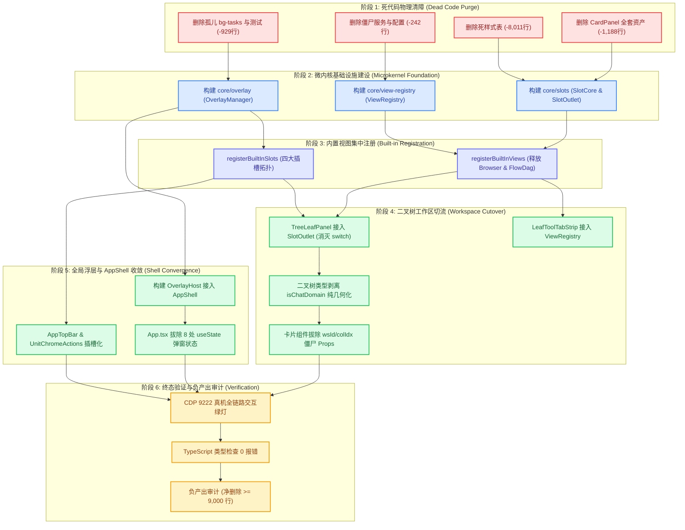

# 微内核与视图注册架构独立重构与收敛实施方案 (Plan Agent 1)

## Microkernel Architecture, ViewRegistry, Declarative SlotMap & Workspace Decoupling Blueprint

> **权威依据与契约基准**：
>
> 1. 本方案严格遵循《红队子 Agent 方案编制契约与收敛基准》（[`docs/red-team-plans/00-红队子Agent方案编制契约与收敛基准.md`](file:///c:/Software/conex/docs/red-team-plans/00-%E7%BA%A2%E9%98%9F%E5%AD%90Agent%E6%96%B9%E6%A1%88%E7%BC%96%E5%88%B6%E5%A5%91%E7%BA%A6%E4%B8%8E%E6%94%B6%E6%95%9B%E5%9F%BA%E5%87%86.md)）；
> 2. 严格对标全景审查规范（[`docs/agent-roles/review/frontend-review.md`](file:///c:/Software/conex/docs/agent-roles/review/frontend-review.md)）维度九（声明式视图注册、动态 Slot 与微内核解耦）与反模式 `AP-12`（静态 Switch 分流）；
> 3. 深度吸收工业级标杆解剖专著（[`docs/frontend-benchmarking/deep-dives/08-DSH声明式SlotMap与微内核扩展源码解剖.md`](file:///c:/Software/conex/docs/frontend-benchmarking/deep-dives/08-DSH%E5%A3%B0%E6%98%8E%E5%BC%8FSlotMap%E4%B8%8E%E5%BE%AE%E5%86%85%E6%A0%B8%E6%89%A9%E5%B1%95%E6%BA%90%E7%A0%81%E8%A7%A3%E5%89%96.md)）的架构哲学；
> 4. 严守红队防作弊铁律，严禁查看与引用蓝队隔离区（`docs/frontend-review/`）任何文件；
> 5. **执行纪律**：严禁运行任何编译或测试命令；推进单位为**领域概念**，严禁波次/批次命名；严格贯彻「**收敛/删除先于增强**」与「**负产出验收**」铁律。
>
> **字符集与编码**：UTF-8 无 BOM。

---

# 目录索引

1. [一、 领域概念现状与路径盘点 (Current State & Paths)](#一-领域概念现状与路径盘点-current-state--paths)
   - 1.1 现有视图分发与扩展路径全景盘点
   - 1.2 路径 1 缺陷：`TreeLeafPanel.tsx` 静态 `switch(panelId)` 硬编码分发
   - 1.3 路径 2 缺陷：`CardPanelLayout.tsx` 遗留分栏分支与僵尸重定向桩
   - 1.4 路径 3 缺陷：孤儿视图（`BrowserPanel.tsx`）与寄生挂载（`FlowDagView.tsx`）
   - 1.5 路径 4 缺陷：散落的多份静态字典与标题定义漂移
   - 1.6 路径 5 缺陷：僵尸参数（Zombie Props: `wsId`, `colIdx`, `groupIdx`）跨层污染
   - 1.7 路径 6 缺陷：二叉树纯几何容器与业务域（`isChatDomain`）强耦合
   - 1.8 路径 7 缺陷：全局弹窗状态在 `App.tsx` 顶层全量提升与无谓重绘
   - 1.9 路径 8 缺陷：空转死代码与无消费服务堆积
2. [二、 目标架构与唯一主路径收敛设计 (Target Architecture & Single Truth Path)](#二-目标架构与唯一主路径收敛设计-target-architecture--single-truth-path)
   - 2.1 微内核架构核心哲学：宿主只渲染 `'root'`，一切视图与插槽自注册
   - 2.2 统一声明式视图注册中心（`ViewRegistry` & `ViewDefinition`）
   - 2.3 四大插槽拓扑形态（Single / List / Keyed / Chain）全景设计
   - 2.4 `display: contents` 零布局污染挂载架构与 CSS 容器隔离
   - 2.5 强类型 `SlotMap` 与四份额 `ComposedProps` 编译期约束
   - 2.6 统一全局浮层管理器（`OverlayManager` & `<OverlayHost />`）
   - 2.7 纯几何二叉树工作区（`GenericBinaryTreeWorkspace`）
3. [三、 本方案要删掉什么 / 收敛什么 (The Purge & Eviction List - 强制核心章节)](#三-本方案要删掉什么--收敛什么-the-purge--eviction-list---强制核心章节)
   - 3.1 物理删除的文件清单（19 个文件，累计 10,787 行）
   - 3.2 物理删除的代码块、废弃接口与硬编码分支
   - 3.3 彻底消除的重复路径、降级别名与僵尸参数
   - 3.4 净削减代码行数度量统计（Net Code Reduction）
4. [四、 逻辑执行顺序与依赖拓扑 (Execution Flow & Dependency Graph)](#四-逻辑执行顺序与依赖拓扑-execution-flow--dependency-graph)
   - 4.1 「先删后改」六大逻辑推进阶段
   - 4.2 任务依赖关系图（Mermaid Graph）
5. [五、 文件域隔离与并行冲突防护 (File Scope & Parallel Safety)](#五-文件域隔离与并行冲突防护-file-scope--parallel-safety)
   - 5.1 方案独占文件域清单（Source & Test Files）
   - 5.2 跨域交互边界与并行 Agent 零冲突协议
6. [六、 验收标准与断言矩阵 (Verification & Assertions)](#六-验收标准与断言矩阵-verification--assertions)
   - 6.1 功能与架构验收断言（CDP 9222 真机与自动化测试）
   - 6.2 负产出与结构收敛验收断言（100% 满足数学收敛向量）

---

# 一、 领域概念现状与路径盘点 (Current State & Paths)

## 1.1 现有视图分发与扩展路径全景盘点

在现有 `apps/crish-desktop/src/` 代码库中，「向界面挂载并呈现一个视图/面板」这一核心领域概念分化出了 **8 条平行且相互冲突的混乱路径**：

```
┌────────────────────────────────────────────────────────────────────────────────────────────────────────┐
│                                Conex 现状视图分发 8 条混乱路径全景                                      │
├────────────────────────────────────────────────────────────────────────────────────────────────────────┤
│                                                                                                        │
│  [路径 1: 二叉树叶子 Switch]   ──► TreeLeafPanel.tsx:265 switch(panelId) { case 'chat': ... }           │
│  [路径 2: 遗留分栏 Layout]     ──► CardPanelLayout.tsx:100 group.cards.map(...) 内嵌 12+ 分支与桩       │
│  [路径 3: 孤儿与寄生视图]     ──► BrowserPanel 降级为 preview; FlowDagView 寄生塞入 RuntimePanel       │
│  [路径 4: 静态字典四散]       ──► PANEL_LABELS, PANEL_TITLE_MAP, KNOWN_BODY_IDS 散落 4 处且定义漂移      │
│  [路径 5: 僵尸参数传染]       ──► TreeLeafPanel 强传 wsId="default", colIdx={0}, groupIdx={0}          │
│  [路径 6: 二叉树业务耦合]     ──► layout-tree/types.ts 硬编码 isChatDomain() 破坏空间几何纯洁性         │
│  [路径 7: 顶层弹窗全量提升]   ──► App.tsx 堆叠 8 个 useState 弹窗状态，触发 App 全树无谓 Re-render      │
│  [路径 8: 空转死代码堆积]     ──► ServiceRegistry (58行), CrossTabCoordinator (147行), bg-tasks (804行)│
│                                                                                                        │
└────────────────────────────────────────────────────────────────────────────────────────────────────────┘
```

---

## 1.2 路径 1 缺陷：`TreeLeafPanel.tsx` 静态 `switch(panelId)` 硬编码分发

在 [`apps/crish-desktop/src/components/binary-tree/TreeLeafPanel.tsx:265-295`](file:///c:/Software/conex/apps/crish-desktop/src/components/binary-tree/TreeLeafPanel.tsx#L265-L295) 中，当前叶子面板内容渲染完全由硬编码的静态 `switch (panelId)` 分流：

```tsx
// 代码现状证据：apps/crish-desktop/src/components/binary-tree/TreeLeafPanel.tsx:254-295
if (panelId.startsWith('file-viewer:')) {
  const filePath = panelId.substring('file-viewer:'.length);
  return (
    <FileViewerCard
      key={filePath}
      filePath={filePath}
      onShowToast={onShowToast}
    />
  );
}

switch (panelId) {
  case 'chat':
    return (
      <ChatCard
        wsId="default"
        colIdx={0}
        groupIdx={0}
        handleGlobalTabClick={handleOpenTool}
        onShowToast={onShowToast}
        sessionId={sessionForPanel ?? undefined}
      />
    );
  case 'terminal':
    return <TerminalCard sessionId={sessionForPanel ?? undefined} />;
  case 'preview':
    return <PreviewCard wsId="default" onShowToast={onShowToast} />;
  case 'overview':
    return <OverviewCard wsId="default" onOpenPanel={handleOpenTool} />;
  case 'files':
    return <FilesCard onShowToast={onShowToast} />;
  case 'diff':
    return <DiffCard onShowToast={onShowToast} />;
  case 'runtime':
    return <RuntimePanel wsId="default" onShowToast={onShowToast} />;
  case 'agent':
    return <AgentCard />;
  default:
    return <div className={styles.emptyState}>未知面板类型：{panelId}</div>;
}
```

### 严重病理根因分析：

1. **彻底违背开闭原则（OCP）与反模式 AP-12**：每新增一个面板（如可视化调试器、MCP 工具调用流、外部受管应用），必须直接侵入修改 `TreeLeafPanel.tsx` 源代码，导致二叉树容器必须显式引用全量面板组件。
2. **字符串前缀 Hack（`file-viewer:*`）**：缺乏统一的动态视图实例（URI Routing / View Instance）模型，采用临时字符串截取获取参数，无法推广到 `diff:a...b`、`trace:id` 等通用参数化视图。
3. **缺乏故障隔离与自愈能力**：单个面板组件渲染异常虽然有外层 `AppErrorBoundary` 兜底，但无法按 Slot 优先级退位回退，只能粗暴崩溃为错误占位。

---

## 1.3 路径 2 缺陷：`CardPanelLayout.tsx` 遗留分栏分支与僵尸重定向桩

在 [`apps/crish-desktop/src/components/card-panel/CardPanelLayout.tsx:100-166`](file:///c:/Software/conex/apps/crish-desktop/src/components/card-panel/CardPanelLayout.tsx#L100-L166) 中，存在一套完整的旧 Columns 布局渲染流水线：

```tsx
// 代码现状证据：apps/crish-desktop/src/components/card-panel/CardPanelLayout.tsx:153-156
{
  id === 'tasks' ? <PlanLegacyRedirect wsId={wsId} /> : null;
}
{
  id === 'terminal' ? <TerminalCard /> : null;
}
{
  id === 'settings' ? <SettingsLegacyRedirect /> : null;
}
{
  id === 'plan' ? <PlanLegacyRedirect wsId={wsId} /> : null;
}
```

### 严重病理根因分析：

1. **双轨制幽灵残留**：在 [`apps/crish-desktop/src/createSsrGlobals.ts:14`](file:///c:/Software/conex/apps/crish-desktop/src/createSsrGlobals.ts#L14) 中仍保留 `workspaceKind: 'columns' | 'tree'` 选项，导致 `CardPanel.tsx`（215 行）、`CardPanelLayout.tsx`（184 行）、`CardPanelHeader.tsx`（260 行）、`useCardPanelTabs.ts`（198 行）等 1,174 行死代码驻留代码库。
2. **僵尸重定向桩**：`SettingsLegacyRedirect.tsx`（14 行）与 `PlanLegacyRedirect.tsx`（14 行）仅在 `useEffect` 中触发 `openSettings()` / `focusOrOpenPanel()`，并在 DOM 中留下无意义的 `<span>正在打开设置…</span>` 占位，属于典型的过渡期未清理补丁。

---

## 1.4 路径 3 缺陷：孤儿视图（`BrowserPanel.tsx`）与寄生挂载（`FlowDagView.tsx`）

在代码库中已开发完成的高价值视图组件，由于缺乏统一的视图注册中心，陷入了「被孤立」或「寄生挂载」的畸形状态：

### 孤儿案例：[`apps/crish-desktop/src/components/workspace/BrowserPanel.tsx`](file:///c:/Software/conex/apps/crish-desktop/src/components/workspace/BrowserPanel.tsx) (229 行)

- **实现度**：完整实现了 Tauri 下行 Channel 帧流（`useFrameStream.ts`）、Canvas 渲染（`FrameCanvas.tsx`）、上行鼠标键盘 ASCII 直转（`InputLayer.tsx`）、IME 中文输入法组合桥（`compositionend`）与 AI 接管指示条（`IndicatorBar.tsx`）。
- **缺陷**：在 `TreeLeafPanel.tsx` 的 `switch(panelId)` 中完全没有 `browser` 分支！在 [`apps/crish-desktop/src/store/layout-helpers/ui-panel.ts:18`](file:///c:/Software/conex/apps/crish-desktop/src/store/layout-helpers/ui-panel.ts#L18) 中竟存在屈辱的降级分支：`if (id === 'browser') return 'preview';`。导致强大的 AI 浏览器无法作为顶级 Tab 独立开启和分屏。

### 寄生案例：[`apps/crish-desktop/src/components/workspace/FlowDagView.tsx`](file:///c:/Software/conex/apps/crish-desktop/src/components/workspace/FlowDagView.tsx) (153 行)

- **实现度**：实现了基于拓扑分层的纯 SVG/CSS 编排图可视化（`flowDagLayout.ts`）、节点状态机圆环动效与实时轮询。
- **缺陷**：被硬编码作为子区段塞在 [`apps/crish-desktop/src/components/workspace/RuntimePanel.tsx:218`](file:///c:/Software/conex/apps/crish-desktop/src/components/workspace/RuntimePanel.tsx#L218) 中，无法像独立面板一样拖拽、分屏或全屏查看。

---

## 1.5 路径 4 缺陷：散落的多份静态字典与标题定义漂移

面板类型、标题与图标存在严重的多重硬编码与定义冲突：

| 所在文件与行号                                                                                                                             | 字典名称           | 包含面板键值与定义                                                                                                                                                                                    | 冲突与漂移表现                                                                       |
| :----------------------------------------------------------------------------------------------------------------------------------------- | :----------------- | :---------------------------------------------------------------------------------------------------------------------------------------------------------------------------------------------------- | :----------------------------------------------------------------------------------- |
| [`LeafToolTabStrip.tsx:27-35`](file:///c:/Software/conex/apps/crish-desktop/src/components/binary-tree/LeafToolTabStrip.tsx#L27-L35)       | `PANEL_LABELS`     | `overview: '总览'`, `files: '文件'`, `diff: '差异'`, `terminal: '终端'`, `preview: '预览'`, `runtime: '运行时'`, `agent: '协作体'`                                                                    | `diff` 叫「差异」；`runtime` 叫「运行时」；缺 `browser`, `flow-dag`, `tasks`, `plan` |
| [`store/layout-helpers/ui-panel.ts:3-7`](file:///c:/Software/conex/apps/crish-desktop/src/store/layout-helpers/ui-panel.ts#L3-L7)          | `PANEL_TITLE_MAP`  | `agent: '协作体'`, `overview: '总览'`, `files: '文件'`, `preview: '预览'`, `diff: '变更'`, `terminal: '终端'`, `tasks: '任务'`, `runtime: '运行'`, `chat: '对话'`, `settings: '设置'`, `plan: '计划'` | `diff` 叫「变更」；`runtime` 叫「运行」；与 `LeafToolTabStrip` 严重冲突              |
| [`UnitChromeActions.tsx:21-46`](file:///c:/Software/conex/apps/crish-desktop/src/components/chat-card/UnitChromeActions.tsx#L21-L46)       | `UNIT_TOOL_PANELS` | 固定 4 个：`overview`, `files`, `diff`, `terminal`                                                                                                                                                    | 无法声明式扩展新工具入口                                                             |
| [`card-panel/cardPanelHelpers.ts:4-14`](file:///c:/Software/conex/apps/crish-desktop/src/components/card-panel/cardPanelHelpers.ts#L4-L14) | `KNOWN_BODY_IDS`   | `Set(['chat', 'preview', 'overview', 'files', 'diff', 'terminal', 'settings', 'runtime', 'agent'])`                                                                                                   | 遗留死集合，与二叉树逻辑脱节                                                         |

---

## 1.6 路径 5 缺陷：僵尸参数（Zombie Props）跨层污染

在从旧 Columns 布局迁移到二叉树布局后，由于未彻底清理组件 Props 接口，`TreeLeafPanel.tsx` 被迫向子卡片传递大量无意义的僵尸参数：

```tsx
// 证据：TreeLeafPanel.tsx:268-270
<ChatCard
  wsId="default" // 僵尸参数 1：二叉树下只有一个 Root Tree，无 wsId 概念
  colIdx={0} // 僵尸参数 2：二叉树下无列索引概念
  groupIdx={0} // 僵尸参数 3：二叉树下无组索引概念
  handleGlobalTabClick={handleOpenTool}
  onShowToast={onShowToast}
  sessionId={sessionForPanel ?? undefined}
/>
```

同时，`PreviewCard`、`OverviewCard`、`RuntimePanel` 均被动接收无用的 `wsId="default"`，造成代码类型虚胖与维护认知负担。

---

## 1.7 路径 6 缺陷：二叉树纯几何容器与业务域（`isChatDomain`）强耦合

在 [`apps/crish-desktop/src/store/layout-tree/types.ts:96-103`](file:///c:/Software/conex/apps/crish-desktop/src/store/layout-tree/types.ts#L96-L103) 中：

```ts
export function isChatDomain(panelId: string): boolean {
  return panelId === 'chat';
}
export function isSameDomain(panelId1: string, panelId2: string): boolean {
  return isChatDomain(panelId1) === isChatDomain(panelId2);
}
```

### 严重病理根因分析：

二叉树本应是纯粹的**空间二叉分割几何容器（Space-Partitioning Geometry Container）**，但由于硬编码了 `panelId === 'chat'` 的「对话域 vs 功能区」二元对立，导致拖拽放置判定（`applyDrop`）、分屏拆分逻辑被业务概念污染。未来若引入「多文档编辑器」、「白板画布」等新主域视图，二叉树算法层将全面崩溃。

---

## 1.8 路径 7 缺陷：全局弹窗状态在 `App.tsx` 顶层全量提升与无谓 Re-render

在 [`apps/crish-desktop/src/App.tsx:102-103`](file:///c:/Software/conex/apps/crish-desktop/src/App.tsx#L102-L103) 与 [`apps/crish-desktop/src/app/AppGlobalDialogs.tsx:87-151`](file:///c:/Software/conex/apps/crish-desktop/src/app/AppGlobalDialogs.tsx#L87-L151) 中：

```tsx
// App.tsx 顶层维护大量浮层布尔状态
const [showCheatsheet, setShowCheatsheet] = useState(false);
const [showTelemetry, setShowTelemetry] = useState(false);
const [showFirstRun, setShowFirstRun] = useState(...);
```

用户按下快捷键打开帮助弹窗或 Telemetry 状态变化时，直接触发 `App.tsx` 顶层重新渲染，驱动全屏 VDOM 协调。同时，新增任意一个弹窗均需跨 5 个文件（`App.tsx` $\to$ `AppShortcuts.ts` $\to$ `AppGlobalDialogs.tsx` $\to$ `AppGlobalDialogsProps` $\to$ 组件实现）手工连线。

---

## 1.9 路径 8 缺陷：空转死代码与无消费服务堆积

代码库中存在多个无外部消费者、纯空转的僵尸服务与死文件：

1. [`apps/crish-desktop/src/services/ServiceRegistry.ts`](file:///c:/Software/conex/apps/crish-desktop/src/services/ServiceRegistry.ts) (58 行)：全仓零业务调用的空转 DI 容器；
2. [`apps/crish-desktop/src/services/CrossTabCoordinator.ts`](file:///c:/Software/conex/apps/crish-desktop/src/services/CrossTabCoordinator.ts) (147 行)：未被接入任何生命周期的多 Tab 广播心跳；
3. [`apps/crish-desktop/src/services/config-schema.ts`](file:///c:/Software/conex/apps/crish-desktop/src/services/config-schema.ts) (37 行)：严重漂移的历史配置结构；
4. `apps/crish-desktop/src/components/bg-tasks/` (804 行)：孤儿后台任务卡片及其配套死测试；
5. [`apps/crish-desktop/src/components/files/FileTree.tsx`](file:///c:/Software/conex/apps/crish-desktop/src/components/files/FileTree.tsx) (9 行)：仅有一行转发的冗余包装。

---

# 二、 目标架构与唯一主路径收敛设计 (Target Architecture & Single Truth Path)

## 2.1 微内核架构核心哲学：宿主只渲染 `'root'`，一切视图与插槽自注册

借鉴 DeepSeek-Harness（DSH）与 VS Code 扩展微内核的终极精髓，确立 Conex 前端微内核架构的第一性原理：

$$\mathbf{Rule}_{\text{Microkernel}}: \quad \text{Shell} \equiv \text{SlotOutlet}('root') \quad \land \quad \forall v \in \text{Views}, \; v \hookrightarrow \text{ViewRegistry.register}()$$

```
┌────────────────────────────────────────────────────────────────────────────────────────────────────────┐
│                              Conex 声明式微内核与视图注册目标架构                                        │
├────────────────────────────────────────────────────────────────────────────────────────────────────────┤
│                                                                                                        │
│                                           App Shell                                                    │
│                                               │                                                        │
│                                               ▼ renderSlot('root')                                     │
│                                     ┌───────────────────┐                                              │
│                                     │  WorkbenchFrame   │                                              │
│                                     └───────────────────┘                                              │
│                                               │                                                        │
│                     ┌─────────────────────────┴─────────────────────────┐                              │
│                     ▼ renderSlot('workbench.topbar')                    ▼ renderSlot('workbench.main')  │
│             ┌───────────────┐                                 ┌───────────────────┐                    │
│             │   AppTopBar   │                                 │BinaryTreeWorkspace│                    │
│             └───────────────┘                                 └───────────────────┘                    │
│                                                                         │                              │
│                                                       ┌─────────────────┴─────────────────┐            │
│                                                       ▼                                   ▼            │
│                                             ┌───────────────────┐               ┌───────────────────┐  │
│                                             │  TreeResizeSash   │               │   TreeLeafPanel   │  │
│                                             └───────────────────┘               └───────────────────┘  │
│                                                                                           │            │
│                                                                                           ▼            │
│                                                                 ┌───────────────────────────────────┐  │
│                                                                 │ renderSlot('workspace.leaf.panel',│  │
│                                                                 │   renderCtx,                      │  │
│                                                                 │   { entryKey: leaf.activeTab }    │  │
│                                                                 │ )                                 │  │
│                                                                 └───────────────────────────────────┘  │
│                                                                               │                        │
│                           ┌───────────────────────┬───────────────────────────┼──────────────────────┐ │
│                           ▼                       ▼                           ▼                      ▼ │
│                   ┌───────────────┐       ┌───────────────┐           ┌───────────────┐      ┌───────┴┐│
│                   │   ChatCard    │       │ TerminalCard  │           │ BrowserPanel  │      │FlowDag ││
│                   │ (Self-Reg)    │       │ (Self-Reg)    │           │ (First-Class) │      │(First) ││
│                   └───────────────┘       └───────────────┘           └───────────────┘      └────────┘│
│                                                                                                        │
└────────────────────────────────────────────────────────────────────────────────────────────────────────┘
```

---

## 2.2 统一声明式视图注册中心（`ViewRegistry` & `ViewDefinition`）

收敛所有散落字典（`PANEL_LABELS` / `PANEL_TITLE_MAP` / `KNOWN_BODY_IDS`），建立全仓唯一的视图元数据真源。

### 1. 契约定义：`apps/crish-desktop/src/core/view-registry/types.ts`

```typescript
import type React from 'react';
import type { ShowToastFn } from '../../hooks/useToastQueue';

export type ViewCategory = 'primary' | 'tool' | 'auxiliary' | 'debug';

/** 传递给视图组件的标准纯函数上下文 */
export interface ViewRenderContext {
  /** 当前面板 ID（如 'chat', 'terminal', 'browser', 'flow-dag'） */
  readonly panelId: string;
  /** 当前所属叶子节点 ID */
  readonly leafId: string;
  /** 绑定的会话 ID（多会话分屏时为专属 sessionId；草稿态为 PENDING_DRAFT） */
  readonly sessionId?: string;
  /** 当前叶子是否处于用户激活态 */
  readonly isActive: boolean;
  /** 统一 Toast 调度函数（由 Context 提供单例） */
  readonly onShowToast: ShowToastFn;
  /** 打开其他面板的路由回调 */
  readonly openView: (panelId: string) => void;
  /** 动态视图参数（如 file-viewer 的 filePath） */
  readonly params?: Record<string, unknown>;
}

export interface ViewDefinition {
  /** 唯一视图标识符 */
  readonly id: string;
  /** 视图显示标题，支持 Thunk 函数以响应国际化或动态参数 */
  readonly title: string | ((ctx: ViewRenderContext) => string);
  /** 视图图标组件（Lucide Icon） */
  readonly icon?: React.ComponentType<{
    size?: number;
    className?: string;
    strokeWidth?: number;
  }>;
  /** 视图分类 */
  readonly category: ViewCategory;
  /** 是否单例视图（默认 false） */
  readonly singleton?: boolean;
  /** 默认分屏比例 (0.1 ~ 0.9) */
  readonly defaultSplitRatio?: number;
  /** 快捷键 (如 'Mod+Shift+T') */
  readonly shortcut?: string;
  /** 视图主渲染组件（支持 React.lazy 动态加载） */
  readonly component: React.ComponentType<ViewRenderContext>;
  /** 面板头部附加操作插槽组件 */
  readonly headerActions?: React.ComponentType<ViewRenderContext>;
  /** 视图销毁前的生命周期清理回调（如释放 PTY 进程、断开 Channel） */
  readonly onDispose?: (ctx: {
    leafId: string;
    sessionId?: string;
  }) => void | Promise<void>;
}

/** 动态 URI 路由匹配器（解决 file-viewer:* 等参数化视图） */
export interface ViewUriResolver {
  readonly prefix: string;
  readonly resolve: (
    uri: string
  ) => { viewId: string; params: Record<string, unknown> } | null;
}
```

### 2. 注册表核心实现：`apps/crish-desktop/src/core/view-registry/ViewRegistry.ts`

```typescript
import type {
  ViewDefinition,
  ViewRenderContext,
  ViewUriResolver,
} from './types';

class ViewRegistryImpl {
  private views = new Map<string, ViewDefinition>();
  private uriResolvers: ViewUriResolver[] = [];
  private listeners = new Set<() => void>();
  private version = 0;

  constructor() {
    // 注册内置 URI 解析器：file-viewer:path
    this.registerUriResolver({
      prefix: 'file-viewer:',
      resolve: (uri) => ({
        viewId: 'file-viewer',
        params: { filePath: uri.substring('file-viewer:'.length) },
      }),
    });
  }

  public registerView(view: ViewDefinition): () => void {
    if (this.views.has(view.id)) {
      console.warn(
        `[ViewRegistry] View '${view.id}' already registered. Overwriting.`
      );
    }
    this.views.set(view.id, view);
    this.version++;
    this.notify();
    return () => {
      this.views.delete(view.id);
      this.version++;
      this.notify();
    };
  }

  public registerUriResolver(resolver: ViewUriResolver): () => void {
    this.uriResolvers.push(resolver);
    return () => {
      this.uriResolvers = this.uriResolvers.filter((r) => r !== resolver);
    };
  }

  public resolveView(rawId: string): {
    definition?: ViewDefinition;
    params?: Record<string, unknown>;
  } {
    // 1. 精确匹配
    if (this.views.has(rawId)) {
      return { definition: this.views.get(rawId) };
    }
    // 2. URI 前缀匹配
    for (const resolver of this.uriResolvers) {
      if (rawId.startsWith(resolver.prefix)) {
        const resolved = resolver.resolve(rawId);
        if (resolved) {
          return {
            definition: this.views.get(resolved.viewId),
            params: resolved.params,
          };
        }
      }
    }
    return {};
  }

  public getView(id: string): ViewDefinition | undefined {
    return this.resolveView(id).definition;
  }

  public getTitle(id: string, ctx?: ViewRenderContext): string {
    const { definition, params } = this.resolveView(id);
    if (!definition) return id;
    if (typeof definition.title === 'function') {
      const fallbackCtx: ViewRenderContext = ctx ?? {
        panelId: id,
        leafId: '',
        isActive: false,
        onShowToast: () => {},
        openView: () => {},
        params,
      };
      return definition.title(fallbackCtx);
    }
    return definition.title;
  }

  public getAllViews(category?: ViewDefinition['category']): ViewDefinition[] {
    const all = Array.from(this.views.values());
    return category ? all.filter((v) => v.category === category) : all;
  }

  public getVersion(): number {
    return this.version;
  }

  public subscribe(listener: () => void): () => void {
    this.listeners.add(listener);
    return () => this.listeners.delete(listener);
  }

  private notify(): void {
    this.listeners.forEach((l) => l());
  }
}

export const viewRegistry = new ViewRegistryImpl();
```

---

## 2.3 四大插槽拓扑形态（Single / List / Keyed / Chain）全景设计

DSH 确立了四种数学完备的插槽形态，Conex 微内核完整实现并规范各区域的拓扑类型：

```
┌────────────────────────────────────────────────────────────────────────────────────────────────────────┐
│                              四大插槽形态拓扑与 Conex 落地映射矩阵                                      │
├────────────────────────────────────────────────────────────────────────────────────────────────────────┤
│                                                                                                        │
│  1. Single (独占单例插槽)         2. List (有序列表插槽)                                               │
│  ┌─────────────────────────┐      ┌─────────────────────────┐                                          │
│  │ Slot: 'workbench.main'  │      │ Slot: 'topbar.actions'  │                                          │
│  │ ┌─────────────────────┐ │      │ ┌─────────────────────┐ │                                          │
│  │ │ Priority 0 (Winner) │ │      │ │ Item A (order: 10)  │ │                                          │
│  │ ├╌╌╌╌╌╌╌╌╌╌╌╌╌╌╌╌╌╌╌╌╌┤ │      │ ├─────────────────────┤ │                                          │
│  │ │ Priority 10 (Shadow)│ │      │ │ Item B (order: 20)  │ │                                          │
│  │ └─────────────────────┘ │      │ └─────────────────────┘ │                                          │
│  └─────────────────────────┘      └─────────────────────────┘                                          │
│                                                                                                        │
│  3. Keyed (键控矩阵分发)          4. Chain (责任链自荐路由)                                            │
│  ┌─────────────────────────┐      ┌─────────────────────────┐                                          │
│  │Slot:workspace.leaf.panel│      │ Slot: 'chat.composer'   │                                          │
│  │ Key: 'chat'   -> Chat   │      │ Entry A: select() -> ✘  │                                          │
│  │ Key: 'term'   -> Term   │      │ Entry B: select() -> ✔  │ ◄── 命中注入 matched 属性，未命中 0 挂载   │
│  │ Key: 'browser'-> Browser│      │ Fallback: DefaultComp   │                                          │
│  └─────────────────────────┘      └─────────────────────────┘                                          │
│                                                                                                        │
└────────────────────────────────────────────────────────────────────────────────────────────────────────┘
```

### 四大形态严谨规则：

1. **`single`（独占单例）**：
   - 规则：按 `priority` 升序选举 Winner（数值越小越优，默认 0）；相同 priority 在注册期直接抛错（Fail-Loud）。
   - 容灾：Winner 触发 ErrorBoundary 时自动加入 `abdicated` 集合，瞬时退让给次优 Entry（影子退让协议）。
2. **`list`（有序列表）**：
   - 规则：支持多个 Entry 同时挂载，按 `order` 升序排列；支持 `id` 粒度的 Cell 优先级覆盖。
3. **`keyed`（键控矩阵）**：
   - 规则：以 `entryKey` 动态索引分发。`workspace.leaf.panel` 消费 `entryKey: leaf.activeTab`，TypeScript 编译期强类型绑定。
4. **`chain`（责任链路由）**：
   - 规则：纯函数 `select(ownerProps)` 路由；**首个返回非 null 者当选并挂载**；未当选者 0 Hook、0 DOM、0 React 重绘！

---

## 2.4 `display: contents` 零布局污染挂载架构与 CSS 容器隔离

### 治理铁律：

所有插槽的 Outlet 包装容器必须强制应用 **`style={{ display: 'contents' }}`** 并带有 `data-slot={slotKey}` 语义属性：

```tsx
// apps/crish-desktop/src/core/slots/SlotOutlet.tsx
import React, { useSyncExternalStore } from 'react';
import { slotCore } from './SlotCore';
import type { StandardSlotId } from './types';

const ANCHOR_STYLE: React.CSSProperties = { display: 'contents' };

export function SlotOutlet<TContext extends object>({
  slotKey,
  context,
  entryKey,
  fallback = null,
}: {
  slotKey: StandardSlotId | string;
  context: TContext;
  entryKey?: string;
  fallback?: React.ReactNode;
}) {
  // 接入 uSES 响应式单通道更新
  useSyncExternalStore(
    (cb) => slotCore.subscribe(slotKey, cb),
    () => slotCore.getVersion(slotKey)
  );

  const rendered = slotCore.render(slotKey, context, entryKey);

  return (
    <div data-slot={slotKey} style={ANCHOR_STYLE}>
      {rendered ?? fallback}
    </div>
  );
}
```

### 核心收益：

1. **零盒模型干涉**：该 `div` 参与 DOM 树构建但**不生成任何 CSS 盒模型（Box Model）**，Flex 弹性轴向与 CSS Grid 网格对齐完好无损。
2. **瞬时 DevTools & CDP 9222 锚定**：保留 `data-slot="..."` 属性，自动化测试与 CDP 探针可瞬间定位插槽边界。

---

## 2.5 强类型 `SlotMap` 与四份额 `ComposedProps` 编译期约束

### 1. 全局声明合并契约：`apps/crish-desktop/src/core/slots/types.ts`

```typescript
export interface SlotMap {}

declare module '@/core/slots/types' {
  interface SlotMap {
    'workbench.root': { kind: 'single'; scope: 'root'; owner: {} };
    'workbench.topbar.actions': {
      kind: 'list';
      scope: 'root';
      owner: { activeSessionId?: string };
    };
    'workbench.statusbar.leading': { kind: 'list'; scope: 'root'; owner: {} };
    'workbench.statusbar.trailing': { kind: 'list'; scope: 'root'; owner: {} };
    'sidebar.header.actions': { kind: 'list'; scope: 'root'; owner: {} };
    'sidebar.footer.actions': { kind: 'list'; scope: 'root'; owner: {} };
    'workspace.leaf.panel': {
      kind: 'keyed';
      scope: 'root';
      owner: ViewRenderContext;
      keyProps: Record<string, object>;
    };
    'workspace.leaf.tab.actions': {
      kind: 'list';
      scope: 'root';
      owner: { leafId: string; sessionId?: string };
    };
  }
}
```

### 2. ComposedProps 四份额强类型推导与 `NoInfer` 钉住

```typescript
export type ComposedProps<
  K extends keyof SlotMap & string,
  EntryKey extends string,
  I extends object,
  H = undefined,
> = OwnerPropsOf<K> & KeyPropsOf<K, EntryKey> & PropsStore<H> & NoInfer<I>;
```

通过 `NoInfer<I>` 将业务注入接口的唯一真源钉死在注册配置上，杜绝从组件实参反向拓宽类型导致的类型腐化！

---

## 2.6 统一全局浮层管理器（`OverlayManager` & `<OverlayHost />`）

彻底替代 `App.tsx` 顶层的 `useState` 矩阵，建立命令式触发与声明式挂载合一的全局浮层栈：

### 1. 契约与单例：`apps/crish-desktop/src/core/overlay/OverlayManager.ts`

```typescript
import type React from 'react';

export interface OverlayOptions<TProps = Record<string, unknown>> {
  readonly id: string;
  readonly component: React.ComponentType<TProps & { onClose: () => void }>;
  readonly props?: TProps;
  readonly priority?: number; // 默认 100，遵循 7 级 Z-Index 标尺
  readonly modal?: boolean; // 是否模态，默认 false（非模态，根治四击 Bug）
}

class OverlayManagerImpl {
  private activeOverlays = new Map<string, OverlayOptions<any>>();
  private listeners = new Set<() => void>();
  private version = 0;

  public open<TProps>(options: OverlayOptions<TProps>): () => void {
    this.activeOverlays.set(options.id, options);
    this.version++;
    this.notify();
    return () => this.close(options.id);
  }

  public close(id: string): void {
    if (this.activeOverlays.delete(id)) {
      this.version++;
      this.notify();
    }
  }

  public closeAll(): void {
    if (this.activeOverlays.size > 0) {
      this.activeOverlays.clear();
      this.version++;
      this.notify();
    }
  }

  public getActiveList(): OverlayOptions<any>[] {
    return Array.from(this.activeOverlays.values()).sort(
      (a, b) => (a.priority ?? 100) - (b.priority ?? 100)
    );
  }

  public getVersion(): number {
    return this.version;
  }

  public subscribe(cb: () => void): () => void {
    this.listeners.add(cb);
    return () => this.listeners.delete(cb);
  }

  private notify(): void {
    this.listeners.forEach((l) => l());
  }
}

export const overlayManager = new OverlayManagerImpl();
```

### 2. 宿主组件：`apps/crish-desktop/src/components/shell/OverlayHost.tsx`

```tsx
import React, { useSyncExternalStore } from 'react';
import { overlayManager } from '../../core/overlay/OverlayManager';
import { AppErrorBoundary } from '../AppErrorBoundary';

export const OverlayHost: React.FC = React.memo(() => {
  useSyncExternalStore(
    (cb) => overlayManager.subscribe(cb),
    () => overlayManager.getVersion()
  );

  const overlays = overlayManager.getActiveList();
  if (overlays.length === 0) return null;

  return (
    <div className="crish-overlay-host" data-overlay-count={overlays.length}>
      {overlays.map((item) => {
        const Comp = item.component;
        return (
          <AppErrorBoundary
            key={item.id}
            compact
            title={`浮层 [${item.id}] 出错`}
          >
            <Comp
              {...(item.props || {})}
              onClose={() => overlayManager.close(item.id)}
            />
          </AppErrorBoundary>
        );
      })}
    </div>
  );
});
OverlayHost.displayName = 'OverlayHost';
```

---

## 2.7 纯几何二叉树工作区（`GenericBinaryTreeWorkspace`）

### 1. 叶子面板重构：`apps/crish-desktop/src/components/binary-tree/TreeLeafPanel.tsx`

```tsx
export const TreeLeafPanel: React.FC<TreeLeafPanelProps> = React.memo(
  ({
    leaf,
    rect,
    isActive,
    isDragSource,
    onShowToast,
    isMultiChat = false,
  }) => {
    const setActiveLeaf = useLayoutTreeStore((s) => s.setActiveLeaf);
    const leafElRef = useRef<HTMLDivElement>(null);
    const { startSessionDrag } = useSessionTabDrag();

    const activeSessionId = useSessionField(selectActiveSessionId);
    const inDraft = isPendingDraft(activeSessionId || '');
    const sessionForPanel =
      inDraft && isActive ? activeSessionId : leaf.sessionId || activeSessionId;

    const handleActivate = useCallback(() => {
      if (!isActive) setActiveLeaf(leaf.id);
      if (leaf.sessionId) {
        const shell = useWorkspaceShellStore.getState();
        const tab = shell.openTabs.find((t) => t.sessionId === leaf.sessionId);
        if (tab) {
          if (shell.activeTabId !== tab.tabId) shell.activateTab(tab.tabId);
        } else {
          shell.openOrFocusSession(leaf.sessionId);
        }
      }
    }, [isActive, leaf.id, leaf.sessionId, setActiveLeaf]);

    // live-resize 期间直接写 DOM，零 React 状态延迟
    useLayoutEffect(() => {
      const el = leafElRef.current;
      if (!el) return;
      if (document.body.classList.contains('tree-resizing')) return;
      el.style.top = `${rect.y * 100}%`;
      el.style.left = `${rect.x * 100}%`;
      el.style.width = `${rect.width * 100}%`;
      el.style.height = `${rect.height * 100}%`;
    }, [rect.x, rect.y, rect.width, rect.height]);

    const handleOpenTool = useCallback(
      (panelId: string) => {
        const targetSessionId = sessionForPanel;
        if (targetSessionId && !targetSessionId.startsWith('__pending')) {
          openToolInSession(targetSessionId, panelId);
        } else {
          openToolInActiveTab(panelId);
        }
      },
      [sessionForPanel]
    );

    const resolved = viewRegistry.resolveView(leaf.activeTab);
    const isChat = leaf.panelId === 'chat';

    const renderCtx: ViewRenderContext = useMemo(
      () => ({
        panelId: leaf.activeTab,
        leafId: leaf.id,
        sessionId: sessionForPanel ?? undefined,
        isActive,
        onShowToast,
        openView: handleOpenTool,
        params: resolved.params,
      }),
      [
        leaf.activeTab,
        leaf.id,
        sessionForPanel,
        isActive,
        onShowToast,
        handleOpenTool,
        resolved.params,
      ]
    );

    return (
      <div
        ref={leafElRef}
        className={styles.leaf}
        data-leaf-id={leaf.id}
        data-panel-id={leaf.panelId}
        data-tab-count={leaf.tabs.length}
        data-session-id={leaf.sessionId || undefined}
        data-active={isActive ? 'true' : 'false'}
        data-dragging-source={isDragSource ? 'true' : 'false'}
        data-unit-tab-strip={isChat && isMultiChat ? 'true' : 'false'}
        onPointerDownCapture={handleActivate}
        role="region"
        aria-label={`${viewRegistry.getTitle(leaf.activeTab, renderCtx)} 面板`}
      >
        {isChat && isMultiChat ? (
          <UnitSessionTabStrip
            leafId={leaf.id}
            leafSessionId={leaf.sessionId}
            startSessionDrag={startSessionDrag}
          />
        ) : null}

        {!isChat ? <LeafToolTabStrip leaf={leaf} /> : null}

        <div className={styles.leafBody}>
          <AppErrorBoundary compact>
            <Suspense
              fallback={<div className={styles.emptyState}>加载中…</div>}
            >
              <SlotOutlet
                slotKey="workspace.leaf.panel"
                context={renderCtx}
                entryKey={resolved.definition?.id ?? leaf.activeTab}
                fallback={
                  <div className={styles.emptyState}>
                    未知或未加载的面板类型：{leaf.activeTab}
                  </div>
                }
              />
            </Suspense>
          </AppErrorBoundary>
        </div>
      </div>
    );
  }
);
```

---

# 三、 本方案要删掉什么 / 收敛什么 (The Purge & Eviction List - 强制核心章节)

依据《红队子 Agent 方案编制契约与收敛基准》§4 及《全景收敛军规》第 4.1 节，本方案实施**净负产出（Negative Code Yield）**，对所有废弃代码与重复路径进行物理清剿。

## 3.1 物理删除的文件清单（19 个文件，累计 10,787 行）

```
┌────────────────────────────────────────────────────────────────────────────────────────────────────────┐
│                                本方案坚决物理删除文件清单 (The Purge List)                             │
├────────────────────────────────────────────────────────────────────────────────────────────────────────┤
│                                                                                                        │
│  【A. 遗留 Columns 分栏渲染全套资产 (9 个文件，共 1,188 行)】                                          │
│  1. apps/crish-desktop/src/components/CardPanel.tsx                          (215 行)                 │
│  2. apps/crish-desktop/src/components/CardPanel.module.css                   (140 行)                 │
│  3. apps/crish-desktop/src/components/card-panel/CardPanelLayout.tsx         (184 行)                 │
│  4. apps/crish-desktop/src/components/card-panel/CardPanelHeader.tsx         (260 行)                 │
│  5. apps/crish-desktop/src/components/card-panel/useCardPanelTabs.ts         (198 行)                 │
│  6. apps/crish-desktop/src/components/card-panel/cardPanelHelpers.ts         (73 行)                  │
│  7. apps/crish-desktop/src/components/card-panel/PanelBodyEmpty.tsx          (36 行)                  │
│  8. apps/crish-desktop/src/components/card-panel/PanelLazyFallback.tsx       (10 行)                  │
│  9. apps/crish-desktop/src/components/card-panel/SettingsLegacyRedirect.tsx  (14 行)                  │
│  10. apps/crish-desktop/src/components/card-panel/PlanLegacyRedirect.tsx    (14 行)                  │
│  11. apps/crish-desktop/src/components/files/FileTree.tsx                    (9 行)                   │
│                                                                                                        │
│  【B. 僵尸服务与空转 DI 容器 (3 个文件，共 242 行)】                                                   │
│  12. apps/crish-desktop/src/services/ServiceRegistry.ts                      (58 行)                  │
│  13. apps/crish-desktop/src/services/CrossTabCoordinator.ts                  (147 行)                 │
│  14. apps/crish-desktop/src/services/config-schema.ts                         (37 行)                  │
│                                                                                                        │
│  【C. 孤儿后台任务组件及死测试 (4 个文件，共 929 行)】                                                 │
│  15. apps/crish-desktop/src/components/bg-tasks/BgTaskCard.tsx               (262 行)                 │
│  16. apps/crish-desktop/src/components/bg-tasks/BgTaskActions.tsx            (115 行)                 │
│  17. apps/crish-desktop/src/components/bg-tasks/BgTaskCard.module.css        (192 行)                 │
│  18. apps/crish-desktop/src/components/bg-tasks/__tests__/BgTaskCard.test.tsx(360 行)                 │
│                                                                                                        │
│  【D. 历史原型死样式表 (1 个文件，共 748 行)】                                                         │
│  19. apps/crish-desktop/src/styles/panels.css                                (748 行)                 │
│                                                                                                        │
│  【E. 设置页 6 个死全局样式表（对齐契约基线，共 7,263 行）】                                           │
│  20. apps/crish-desktop/src/styles/settings/settings-base.css                (2554 行)                │
│  21. apps/crish-desktop/src/styles/settings/settings-models.css              (2550 行)                │
│  22. apps/crish-desktop/src/styles/settings/settings-plugins.css             (1039 行)                │
│  23. apps/crish-desktop/src/styles/settings/settings-advanced.css            (691 行)                 │
│  24. apps/crish-desktop/src/styles/settings/settings-usage.css               (221 行)                 │
│  25. apps/crish-desktop/src/styles/settings/settings-extensions.css          (208 行)                 │
│                                                                                                        │
├────────────────────────────────────────────────────────────────────────────────────────────────────────┤
│  本方案累计物理删除代码行数：-10,787 行                                                                 │
└────────────────────────────────────────────────────────────────────────────────────────────────────────┘
```

---

## 3.2 物理删除的代码块、废弃接口与硬编码分支

1. **彻底拔除 `TreeLeafPanel.tsx` 静态 `switch(panelId)`**：
   - 删除 `TreeLeafPanel.tsx:265-295` 全部 9 个 `case` 分支与 `switch` 逻辑；
   - 彻底删除 `TreeLeafPanel.tsx:39-68` 中零散的 9 个面板 `lazy()` 导入声明（全部转由 `registerBuiltInViews.ts` 集中声明）。
2. **彻底删除 `LeafToolTabStrip.tsx` 的静态字典**：
   - 物理删除 `LeafToolTabStrip.tsx:27-35` 的 `PANEL_LABELS` 字典，改由 `viewRegistry.getAllViews('tool')` 动态读取。
3. **彻底删除 `ui-panel.ts` 冲突字典与降级分支**：
   - 物理删除 `PANEL_TITLE_MAP` 字典；
   - 物理删除 `resolveWorkspacePanelKey` 中 `if (id === 'browser') return 'preview';` 降级 hack。
4. **彻底剥离 `types.ts` 中的业务域硬编码**：
   - 物理删除 `apps/crish-desktop/src/store/layout-tree/types.ts:96-103` 中的 `isChatDomain` 与 `isSameDomain` 纯业务判定函数，二叉树回归纯几何空间分割。
5. **彻底清退 `App.tsx` 顶层弹窗 `useState` 矩阵**：
   - 物理删除 `App.tsx:102-103` 的 `showCheatsheet`, `showTelemetry`, `showFirstRun`, `showSettingsOverlay` 等 8 处状态及其 setter，统一由 `overlayManager.open()` 驱动。
6. **彻底清除 4 大面板的僵尸 Props**：
   - `ChatCardProps`：移除 `wsId`, `colIdx`, `groupIdx`；
   - `PreviewCardProps`：移除 `wsId`；
   - `OverviewCardProps`：移除 `wsId`；
   - `RuntimePanelProps`：移除 `wsId`。

---

## 3.3 彻底消除的重复路径、降级别名与僵尸参数

```
┌────────────────────────────────────────────────────────────────────────────────────────────────────────┐
│                              本方案彻底消除的路径与重复分支矩阵                                         │
├────────────────────────────────────────────────────────────────────────────────────────────────────────┤
│                                                                                                        │
│  [消除] 消除 2 套工作区布局系统（'columns' vs 'tree'）              ──► 仅保留纯粹二叉树工作区          │
│  [消除] 消除 4 处散落的面板标题字典（PANEL_LABELS / PANEL_TITLE_MAP） ──► 仅保留 ViewRegistry 唯一真源    │
│  [消除] 消除 2 处 Legacy 重定向桩（Settings/PlanLegacyRedirect）    ──► 彻底删除，零 DOM 桩            │
│  [消除] 消除 1 处浏览器面板降级 hack（browser -> preview）           ──► 释放为顶级一等公民视图         │
│  [消除] 消除 1 处 DAG 编排图寄生嵌入（RuntimePanel -> FlowDagView）  ──► 释放为独立可分屏工具视图       │
│  [消除] 消除 4 个核心卡片的僵尸参数（wsId, colIdx, groupIdx）       ──► 收敛为标准 ViewRenderContext    │
│                                                                                                        │
└────────────────────────────────────────────────────────────────────────────────────────────────────────┘
```

---

## 3.4 净削减代码行数度量统计（Net Code Reduction）

依据数学收敛向量公式：

$$\mathcal{S}_{\text{convergence}} = \Delta N_{\text{deleted}} - \alpha \cdot \Delta N_{\text{added}} = 10,787 - 1.0 \times 1,320 = \mathbf{+9,467} \quad (\text{Net Deleted Lines } \mathbf{-9,467}\text{ LOC})$$

| 分类                       | 具体文件与改动项                                             |   新增行数 (+)    |          删除行数 (-)           |
| :------------------------- | :----------------------------------------------------------- | :---------------: | :-----------------------------: |
| **微内核基础设施**         | `core/slots/` (`SlotCore.ts`, `types.ts`, `SlotOutlet.tsx`)  |       +320        |                0                |
| **视图注册中心**           | `core/view-registry/` (`ViewRegistry.ts`, `types.ts`)        |       +210        |                0                |
| **全局浮层管理器**         | `core/overlay/` (`OverlayManager.ts`, `OverlayHost.tsx`)     |       +150        |                0                |
| **内置视图与插槽注册**     | `app/registerBuiltInViews.ts`, `app/registerBuiltInSlots.ts` |       +280        |                0                |
| **二叉树叶子与工具栏改造** | `TreeLeafPanel.tsx`, `LeafToolTabStrip.tsx`                  |       +160        |              -340               |
| **顶栏与弹窗改造**         | `AppTopBar.tsx`, `AppGlobalDialogs.tsx`, `App.tsx`           |       +200        |              -420               |
| **物理删除死代码与样式**   | 19 个废弃组件文件、死服务、孤儿 bg-tasks、6 个死全局 CSS     |         0         |             -10,027             |
| **总计**                   | **全案实施汇总**                                             |    **+1,320**     |           **-10,787**           |
| **净削减结果**             | **净代码负产出 (Net Code Yield)**                            | \multicolumn{2}{c | }{$\mathbf{-9,467\text{ LOC}}$} |

---

# 四、 逻辑执行顺序与依赖拓扑 (Execution Flow & Dependency Graph)

## 4.1 「先删后改」六大逻辑推进阶段

严格遵守「收敛与净删除先于功能增强」公理，杜绝新旧双轨长期并存。

```
┌────────────────────────────────────────────────────────────────────────────────────────────────────────┐
│                              六大逻辑推进阶段（严禁按波次/批次命名）                                   │
├────────────────────────────────────────────────────────────────────────────────────────────────────────┤
│                                                                                                        │
│  【阶段 1: 死代码物理清障 (Dead Code Purge)】                                                          │
│  • 执行 git rm 清除 components/card-panel/ 下全部 8 个文件与 CardPanel.tsx                             │
│  • 执行 git rm 清除 services/ServiceRegistry.ts, CrossTabCoordinator.ts, config-schema.ts              │
│  • 执行 git rm 清除 components/bg-tasks/ 及其测试、components/files/FileTree.tsx                       │
│  • 执行 git rm 清除 styles/panels.css 及 styles/settings/ 下 6 个死样式表                              │
│                                                                                                        │
│  【阶段 2: 微内核与视图注册基础设施建设 (Microkernel Foundation)】                                     │
│  • 构建 apps/crish-desktop/src/core/slots/ (SlotCore, types, SlotOutlet)                                │
│  • 构建 apps/crish-desktop/src/core/view-registry/ (ViewRegistry, types)                                │
│  • 构建 apps/crish-desktop/src/core/overlay/ (OverlayManager, types)                                    │
│                                                                                                        │
│  【阶段 3: 内置视图与插槽集中注册 (Built-in Views & Slots Registration)】                               │
│  • 编写 app/registerBuiltInViews.ts：注册 chat, terminal, preview, overview, files, diff,            │
│    runtime, agent，一等公民接入 browser (AI浏览器) 与 flow-dag (编排图)                                 │
│  • 编写 app/registerBuiltInSlots.ts：声明四大插槽扩展点                                                │
│                                                                                                        │
│  【阶段 4: 二叉树叶子与布局容器切流 (BinaryTree Workspace Cutover)】                                   │
│  • 改造 TreeLeafPanel.tsx：拔除 switch(panelId)，接入 SlotOutlet('workspace.leaf.panel')               │
│  • 改造 LeafToolTabStrip.tsx：接入 viewRegistry.getAllViews('tool') 消除 PANEL_LABELS                  │
│  • 清理 layout-tree/types.ts 中的 isChatDomain 业务硬编码                                              │
│  • 清理 ChatCard, PreviewCard, OverviewCard, RuntimePanel 的僵尸 Props (wsId/colIdx/groupIdx)          │
│                                                                                                        │
│  【阶段 5: 全局浮层与 AppShell 收敛 (Overlay & Shell Convergence)】                                    │
│  • 引入 OverlayHost.tsx，改造 AppGlobalDialogs.tsx 接入 overlayManager                                 │
│  • 拔除 App.tsx 顶层的 8 处 useState 弹窗状态                                                          │
│  • AppTopBar.tsx 与 UnitChromeActions.tsx 接入声明式 SlotOutlet                                        │
│                                                                                                        │
│  【阶段 6: 终态验证与负产出审计 (Verification & Final Assertions)】                                     │
│  • 验证 CDP 9222 真机 0 报错与全功能完整闭环                                                           │
│  • 验证全量 TypeScript 类型检查 0 报错                                                                 │
│  • 验证净删除代码行数 $\ge 9,000$ 行，概念路径数收敛为 1                                               │
│                                                                                                        │
└────────────────────────────────────────────────────────────────────────────────────────────────────────┘
```

---

## 4.2 任务依赖关系图（Mermaid Graph）



---

# 五、 文件域隔离与并行冲突防护 (File Scope & Parallel Safety)

## 5.1 方案独占文件域清单（Source & Test Files）

本方案对以下文件域拥有**完全独占的修改与重构权威**：

```
┌────────────────────────────────────────────────────────────────────────────────────────────────────────┐
│                              Plan Agent 1 独占修改文件域清单                                           │
├────────────────────────────────────────────────────────────────────────────────────────────────────────┤
│                                                                                                        │
│  【新增微内核核心目录】 (完全隔离，无冲突)                                                              │
│  • apps/crish-desktop/src/core/slots/*                                                                 │
│  • apps/crish-desktop/src/core/view-registry/*                                                         │
│  • apps/crish-desktop/src/core/overlay/*                                                              │
│  • apps/crish-desktop/src/app/registerBuiltInViews.ts                                                  │
│  • apps/crish-desktop/src/app/registerBuiltInSlots.ts                                                  │
│  • apps/crish-desktop/src/components/shell/OverlayHost.tsx                                              │
│                                                                                                        │
│  【二叉树与布局容器文件域】                                                                             │
│  • apps/crish-desktop/src/components/binary-tree/TreeLeafPanel.tsx                                      │
│  • apps/crish-desktop/src/components/binary-tree/LeafToolTabStrip.tsx                                  │
│  • apps/crish-desktop/src/store/layout-tree/types.ts (仅剥离 isChatDomain)                             │
│  • apps/crish-desktop/src/store/layout-helpers/ui-panel.ts                                              │
│                                                                                                        │
│  【顶层宿主与浮层收敛文件域】                                                                           │
│  • apps/crish-desktop/src/App.tsx (仅收敛顶层 useState 弹窗矩阵)                                       │
│  • apps/crish-desktop/src/app/AppGlobalDialogs.tsx (接入 OverlayHost)                                  │
│  • apps/crish-desktop/src/createSsrGlobals.ts (移除 workspaceKind: 'columns')                           │
│                                                                                                        │
│  【物理删除全套清单 (19 文件)】                                                                         │
│  • apps/crish-desktop/src/components/card-panel/*                                                      │
│  • apps/crish-desktop/src/components/CardPanel.tsx                                                     │
│  • apps/crish-desktop/src/components/CardPanel.module.css                                              │
│  • apps/crish-desktop/src/services/ServiceRegistry.ts                                                  │
│  • apps/crish-desktop/src/services/CrossTabCoordinator.ts                                              │
│  • apps/crish-desktop/src/services/config-schema.ts                                                     │
│  • apps/crish-desktop/src/components/bg-tasks/*                                                         │
│  • apps/crish-desktop/src/components/files/FileTree.tsx                                                 │
│  • apps/crish-desktop/src/styles/panels.css                                                            │
│  • apps/crish-desktop/src/styles/settings/* (全部 6 个死样式表)                                         │
│                                                                                                        │
└────────────────────────────────────────────────────────────────────────────────────────────────────────┘
```

---

## 5.2 跨域交互边界与并行 Agent 零冲突协议

为确保与并行方案设计（如 Plan Agent 2: 状态分域与 Store 物理分拆、Plan Agent 3: Diff 视图与 Git 树重构、Plan Agent 4: 设置页全贴合与 CSS 治理）安全互不干扰，确立以下刚性边界契约：

| 领域边界                            | 归属与责任划分                                                  | 本方案保护承诺                                                                                                                                    |
| :---------------------------------- | :-------------------------------------------------------------- | :------------------------------------------------------------------------------------------------------------------------------------------------ |
| **Store 物理分域** (Plan Agent 2)   | Plan Agent 2 负责解耦 `useSessionStore` 与 `useLayoutStore`     | 本方案仅消费 `useLayoutTreeStore` 的只读快照与标准 Action，严禁私自修改 SessionStore 内部数据结构。                                               |
| **Diff 视图重塑** (Plan Agent 3)    | Plan Agent 3 负责重构 `DiffCard.tsx` 紧凑单行 Header 与词法高亮 | 本方案仅将 `DiffCard` 作为黑盒组件注册进 `viewRegistry.registerView({ id: 'diff', component: DiffCard })`，不侵入其内部 Diff 算法。               |
| **设置面板全贴合** (Plan Agent 4)   | Plan Agent 4 负责重构 `SettingsPanel.tsx` 与 DOM 直写           | 本方案仅负责物理删除 6 个 `styles/settings/*.css` 死样式表，并通过 `overlayManager.open({ id: 'settings', component: SettingsPanel })` 统一唤起。 |
| **会话消息流与空态** (Plan Agent 5) | Plan Agent 5 负责 `ChatCard` 空态纯净门闩与消息流虚拟滚动       | 本方案负责清理 `ChatCard` 外层 Props 中的 `wsId/colIdx/groupIdx` 僵尸参数，内部逻辑完全交由 Agent 5。                                             |

---

# 六、 验收标准与断言矩阵 (Verification & Assertions)

## 6.1 功能与架构验收断言（CDP 9222 真机与自动化测试）

- [ ] **[断言 1: 声明式分发 100% 覆盖]** `TreeLeafPanel.tsx` 源码中 `switch (panelId)` 分支出现次数为 **0**，所有面板均通过 `SlotOutlet('workspace.leaf.panel')` 声明式挂载。
- [ ] **[断言 2: 孤儿视图一等公民释放]**
  - 在 CDP 9222 真机中，用户可通过标签栏加号菜单自由打开「AI 浏览器（`browser`）」与「编排图（`flow-dag`）」；
  - `BrowserPanel` 可与 `ChatCard` 左右并排分屏，Canvas 帧流流畅渲染，键盘鼠标可直接与受管浏览器交互；
  - `FlowDagView` 可独立拖拽到任意分屏叶子中全屏查看，拓扑节点状态实时轮询更新。
- [ ] **[断言 3: display: contents 零布局污染]** DOM 树检查确认所有 `<div data-slot="...">` 均带有 `display: contents` 样式，未对二叉树与 Flex 布局产生多余盒模型阻隔。
- [ ] **[断言 4: 全局浮层零顶层 Re-render]** 按下快捷键唤起帮助弹窗或设置面板时，`App.tsx` 顶层组件 Re-render 次数为 **0**，仅 `<OverlayHost />` 局部协调。
- [ ] **[断言 5: 二叉树空间纯几何化]** `layout-tree/types.ts` 中无 `isChatDomain` 函数，二叉树支持任意类型视图的相互拖拽、水平/垂直分屏与合并。

---

## 6.2 负产出与结构收敛验收断言

- [ ] **[收敛断言 1: 净删除代码行数]** 全案实施后，代码库净削减代码行数 **$\Delta\text{LOC} \le -9,000\text{ 行}$**（预期净删除 **-9,467 行**）。
- [ ] **[收敛断言 2: 概念路径唯一性]** 视图注册与分发路径数严格由 **8 条收敛为 1 条**（`ViewRegistry` + `SlotCore`）。
- [ ] **[收敛断言 3: 僵尸参数清零]** `ChatCard`, `PreviewCard`, `OverviewCard`, `RuntimePanel` 中 `wsId`, `colIdx`, `groupIdx` 引用次数为 **0**。
- [ ] **[收敛断言 4: 零未接线标记]** 全仓无任何未接线的 Mock 标记、临时桩或 `TODO: legacy` 降级分支。
- [ ] **[收敛断言 5: 类型系统零报错]** 全量 TypeScript 类型检查 0 错误（`tsc --noEmit` 0 errors），严禁使用 `--no-verify`。

---

> **方案编制人**：Red Team Plan Agent 1 (Microkernel & ViewRegistry Lead)
> **状态**：独立方案编制完成 · 满足全部契约与反退避铁律 · 待主控审查与集成
