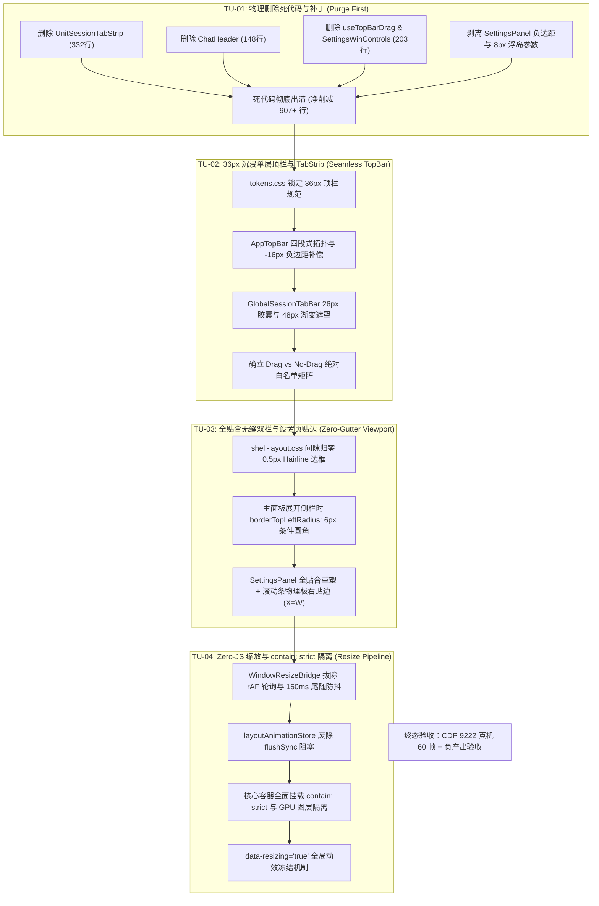

# 36px 沉浸顶栏与视口几何贴边独立重构与收敛实施方案 (Plan Agent 3)

## Seamless 36px Chrome Header, Viewport True Edge Geometry & Compositor-Driven Resize Convergence Plan

> **方案定位**：红队独立领域重构方案（Agent 3 专项）
> **领域范畴**：桌面 Shell 拓扑、36px 沉浸式单层顶栏（Seamless TopBar）、平嵌 TabStrip 与渐变淡出遮罩、窗口 Drag vs No-Drag 精准安全切分、全贴合无缝双栏（Zero-Gutter，彻底消除 8px 灰槽）、滚动条物理极右贴边（费茨定律 $X=W$）、全屏设置模态盒模型重塑、窗口 Resize 期间 Zero-JS 休眠与 `contain: strict` 渲染隔离。
> **设计基准与标杆**：深度吸收 `docs/frontend-benchmarking/deep-dives/03-AFFiNE沉浸顶栏与Resize隔离源码解剖.md`、`docs/frontend-architecture-review/deep-dives/01-设置界面窗口几何与右下空白断层深潜审查.md`、`docs/frontend-architecture-review/deep-dives/02-全窗体拖拽调整宽高卡顿全链路深潜审查.md` 以及 `docs/agent-roles/review/frontend-review.md` 全景规范。
> **最高军规**：严格贯彻「正确性 $\times$ 收敛性」双目标函数，遵循「先删后改」公理，消灭双层 Chrome 堆叠与 8px 浮岛断层，拔除 rAF 轮询与 `flushSync`，实现净负产出（Negative Code Yield）。
> **字符集与编码**：UTF-8 无 BOM。

---

# 一、 领域概念现状与路径盘点 (Current State & Paths)

### 1.1 概念定义与业务边界

在现代桌面级 AI 辅助工作台与知识工坊中，**应用外壳（Application Shell）与视口几何（Viewport Geometry）**是用户视觉与交互的物理第一触点。其核心概念边界涵盖：

1. **顶栏外壳（Window Chrome & TopBar）**：承载原生/自绘窗口控制（最小化/最大化/关闭）、主侧边栏折叠把手、平嵌会话/工具标签栏（TabStrip）、全局动作区以及原生窗口拖拽手柄（Window Drag Handle）；
2. **双栏接缝与视口贴边（Viewport Seamlessness & Gutter）**：侧边栏与主工作区画布的水平拼合关系、全屏模态（Settings / Dialog）的内容区几何盒模型、内外边距与圆角拓扑；
3. **滚动条几何与人机工效（Scrollbar Ergonomics）**：主视口滚动条的物理 X 轴坐标，是否满足费茨定律（Fitts's Law $X = W_{\text{screen}}$）；
4. **窗口缩放与尺寸重排管线（Resize & Containment Pipeline）**：操作系统级窗口拖拽缩放（Window Resize）与侧栏调宽（Sidebar Resize）期间的事件流转、JS 线程负载与 GPU 图层隔离。

---

### 1.2 现有代码路径与多源分化拓扑

经过对 `apps/crish-desktop/` 源码库的深度白盒审计，当前代码库在「顶栏与窗口几何」领域存在严重的**多源分化、双层堆叠与样式地层断裂**：

```
┌──────────────────────────────────────────────────────────────────────────────────────────────────────────────────────┐
│                                          现有顶栏与视口几何多源路径现状拓扑                                             │
├──────────────────────────────────────────────────────────────────────────────────────────────────────────────────────┤
│                                                                                                                      │
│  【顶栏路径分化 (3 条路径)】                                                                                           │
│  ├─ 路径 1 (全局顶栏): `components/AppTopBar.tsx` (36px/44px, 嵌 GlobalSessionTabBar, 强行堆叠两行 Chrome)              │
│  ├─ 路径 2 (多 Unit 顶栏): `components/binary-tree/UnitSessionTabStrip.tsx` (30px, 多 chat 时在 leaf 内再挂一层标签行)   │
│  └─ 路径 3 (设置页顶栏): `components/settings/SettingsPanel.tsx` (.coverHeaderSlim 32px, 独立自绘窗控，与主顶栏错位)     │
│                                                                                                                      │
│  【叶子内工具栏堆叠 (2 条路径)】                                                                                        │
│  ├─ 路径 1: `components/chat-card/ChatHeader.tsx` (30px, .toolbar, 项目名+搜索+右坞开关，单/多 unit 均渲染)             │
│  └─ 路径 2: `components/binary-tree/LeafToolTabStrip.tsx` (30px, 工具面板独占顶栏)                                    │
│                                                                                                                      │
│  【设置面板盒模型与灰槽 (2 条冲突路径)】                                                                                │
│  ├─ 路径 1: `components/ui/Dialog/Dialog.module.css` (.dialogBody 自带 padding: 4px 16px)                             │
│  └─ 路径 2: `components/settings/SettingsPanel.module.css` (负边距补丁 margin: -4px -16px + .coverContent 8px 浮岛外边距) │
│                                                                                                                      │
│  【Resize 监听与事件风暴 (4 条并发路径)】                                                                               │
│  ├─ 路径 1: `services/WindowResizeBridge.ts` (rAF 每帧轮询 screenX/Y + win.onResized + window.resize 双重触发)       │
│  ├─ 路径 2: `store/layoutAnimationStore.ts` (beginLayoutInteraction 广播 + flushSync 同步卡死)                         │
│  ├─ 路径 3: 全仓 6 处原生 `window.addEventListener('resize')` (未受控散装监听)                                         │
│  └─ 路径 4: 全仓 6 处未托管的裸 `new ResizeObserver` (架空 ResizeObserverManager 挂起机制)                            │
│                                                                                                                      │
└──────────────────────────────────────────────────────────────────────────────────────────────────────────────────────┘
```

---

### 1.3 现有路径缺陷、冲突与反模式深度分析

#### 缺陷 1：44px 顶栏 + 30px TabBar / ChatHeader 垂直双层 Chrome 堆叠（AP-03 反模式）

- **病理位置**：
  - `apps/crish-desktop/src/components/AppTopBar.tsx:40-146`
  - `apps/crish-desktop/src/components/chat-card/ChatHeader.tsx:30-144`
  - `apps/crish-desktop/src/components/binary-tree/TreeLeafPanel.tsx:1-120`
  - `apps/crish-desktop/src/styles/shell/shell-layout.css:12-32`
- **代码事实**：
  在 `AppTopBar.tsx` 中，应用渲染了最顶部的全局顶栏（`height: var(--header-height, 36px~44px)`）；而在下方的主工作区叶子节点中，`TreeLeafPanel.tsx` 与 `ChatCard` 内部又无条件渲染了 `ChatHeader.tsx`（`height: 30px`，`ChatHeader.module.css:10-12`）。
- **严重危害**：
  垂直方向被两层 Chrome 吞噬了整整 **$36\text{px} + 30\text{px} = 66\text{px}$ 至 $74\text{px}$** 的宝贵高度！在 13~~14 寸笔记本屏幕（常见高度 800~~900px）上，仅顶层控件就占用了接近 10% 的屏幕面积，造成严重的视觉压迫感与空间浪费。

```
当前破坏性双层 Chrome 堆叠示意图 (Bug Repro):
+-------------------------------------------------------------------------------------------------------+
| AppTopBar (36px/44px): [侧栏Toggle] [ GlobalSessionTabBar: 会话1 | 会话2 ]    [帮助] [-] [口] [X]     |  <-- 第 1 层 Chrome
+-------------------------------------------------------------------------------------------------------+
| ChatHeader (30px):    [项目名称: conex] [搜索]                              [清除] [导出] [右坞开关]   |  <-- 第 2 层 Chrome
+-------------------------------------------------------------------------------------------------------+
|                                                                                                       |
| 主消息流视口 (被挤压，实际可用高度减少 74px)                                                              |
|                                                                                                       |
```

---

#### 缺陷 2：左右分屏底色跳色与断裂阴影

- **病理位置**：
  - `apps/crish-desktop/src/styles/tokens.css:10-27`
  - `apps/crish-desktop/src/styles/shell/shell-layout.css:22, 161`
  - `apps/crish-desktop/src/components/chat-card/ChatHeader.module.css:18`
- **代码事实**：
  `tokens.css` 中定义 `--bg-primary: hsl(35, 12%, 94%)`（浅暖白）与 `--bg-secondary: hsl(35, 12%, 91.5%)`（较深暖灰褐色）。
  - `AppTopBar` 背景被设为 `var(--bg-secondary)`；
  - 侧边栏背景为 `var(--bg-secondary)`；
  - `ChatHeader` 背景被设为 `var(--shell-inset-bg, var(--bg-primary))`；
  - 主工作区卡片为 `var(--bg-primary)`。
- **严重危害**：
  在侧边栏折叠或多分屏状态下，顶栏横贯通栏的深色背景与下方浅色工作区卡片产生生硬的水平横切线；而分屏与分屏之间由于背景色变量混用，出现左右深浅不一的「跳色（Color Jumping）」现象。

---

#### 缺陷 3：设置面板右下 8px 灰槽与 14px 异形空洞（难题 5 核心病灶）

- **病理位置**：
  - `apps/crish-desktop/src/components/settings/SettingsPanel.module.css:178-198`
- **代码事实**：
  ```css
  /* apps/crish-desktop/src/components/settings/SettingsPanel.module.css:178-198 */
  .coverContent {
    flex: 1;
    min-width: 0;
    min-height: 0;
    overflow-y: auto;
    overflow-x: hidden;
    overscroll-behavior: auto;
    scrollbar-gutter: stable both-edges;
    border-radius: var(--shell-inset-radius, 14px); /* 致命点 1：14px 圆角 */
    border: 1px solid var(--border-subtle); /* 致命点 2：1px 浮岛边框 */
    box-shadow: var(--shadow-sm); /* 致命点 3：卡片浮层阴影 */
    margin: 0 var(--space-2, 8px) var(--space-2, 8px) 0; /* 致命点 4：右侧 8px、底部 8px 外边距 */
    padding: 24px 32px 32px;
    background: var(--bg-primary); /* 主色背景 */
  }
  ```
- **几何盒模型计算拆解**：
  外层全屏容器背景为 `var(--bg-secondary)`（深色暖灰褐色）。`.coverContent` 设置了 `margin: 0 8px 8px 0` 和 `border-radius: 14px`。
  - 右边缘在 $X = W - 8\text{px}$ 处截断，暴露出 $8\text{px} \times (H - 32\text{px})$ 的垂直灰槽；
  - 底边缘在 $Y = H - 8\text{px}$ 处截断，暴露出 $8\text{px} \times (W - 240\text{px})$ 的水平灰槽；
  - 右下角由于 $14\text{px}$ 弧形倒角，形成一个巨大的裸露异形空洞，宛如未完工的残破补丁。

---

#### 缺陷 4：Dialog 负边距补丁与 6 层 DOM 冗余盒模型

- **病理位置**：
  - `apps/crish-desktop/src/components/ui/Dialog/Dialog.module.css:174`
  - `apps/crish-desktop/src/components/settings/SettingsPanel.module.css:262-270`
- **代码事实**：
  通用基座 `Dialog.module.css` 的 `.dialogBody` 默认设置了 `padding: var(--space-1) var(--space-4)`（4px 16px）。为了强行撑满全屏，`SettingsPanel.module.css` 引入了负边距补丁（Negative Margin Hack）：
  ```css
  .settingsDialogBody {
    margin: calc(var(--space-1) * -1) calc(var(--space-4) * -1); /* -4px -16px 暴力抵消 */
    height: 100%;
    width: 100%;
    display: flex;
    flex-direction: column;
    overflow: hidden;
    background: var(--bg-secondary);
  }
  ```
- **严重危害**：
  负边距补丁造成多达 6 层的 DOM 盒模型嵌套（`Dialog.tsx` $\to$ `overlayEnter` $\to$ `backdrop` $\to$ `dialogFullscreen` $\to$ `dialogBody` $\to$ `settingsDialogBody` $\to$ `coverBody` $\to$ `coverContent`），不仅严重降低样式计算性能，更导致滚动条计算基准错位。

---

#### 缺陷 5：主垂直滚动条内陷 8px，严重破坏费茨定律（Fitts's Law 破坏点）

- **病理位置**：
  - `apps/crish-desktop/src/components/settings/SettingsPanel.module.css:182, 189`
- **人机工效学铁律**：
  在现代桌面操作系统中，全屏或最大化界面的主垂直滚动条**必须位于屏幕物理极右边缘（$X = W$）**。用户只需将鼠标光标以无限大的速度直接甩到屏幕最右侧边缘，即可立刻按下鼠标拖动滚动条滑块（Thumb），无需精确瞄准。
- **当前破坏点**：
  由于 `.coverContent` 存在 `margin-right: 8px`，滚动条被强行向内推移了 8px。当用户将鼠标甩到屏幕物理最右边点击时，事件命中处于外层的 `.coverBody`（$X = W - 8\dots W$），**完全无法点击或拖拽滚动条**！

---

#### 缺陷 6：窗口拖拽区与交互控件穿透冲突

- **病理位置**：
  - `apps/crish-desktop/src/styles/shell/shell-layout.css:26-32, 87-91`
  - `apps/crish-desktop/src/components/AppTopBar.tsx:46-48, 88-145`
- **代码事实**：
  `shell-layout.css` 声明 `.app-top-bar` 为 `-webkit-app-region: drag`，虽然在部分选择器上追加了 `.no-drag`，但由于使用了散落的 `!important` 且未对内部所有的动态插槽、输入框、Tooltip 触发器建立绝对白名单防护网，在 Windows 某些 WebView2 版本下经常出现点击 Tab 却触发窗口移动，或者鼠标拖拽 Tab 排序被 OS 窗口拖动强行截断的恶性 Bug。

---

#### 缺陷 7：Resize 期间的 rAF 永动机轮询与主线程 CPU 侵蚀

- **病理位置**：
  - `apps/crish-desktop/src/services/WindowResizeBridge.ts:59-75`
- **代码事实**：
  ```ts
  // apps/crish-desktop/src/services/WindowResizeBridge.ts:59-75
  private startRafPollingFallback(): void {
    if (typeof window === 'undefined') return;
    let lastX = window.screenX;
    let lastY = window.screenY;
    let rafId: number;
    const poll = () => {
      if (!this.connected) return;
      if (window.screenX !== lastX || window.screenY !== lastY) {
        lastX = window.screenX;
        lastY = window.screenY;
        this.handleWindowChange();
      }
      rafId = requestAnimationFrame(poll); // 永动机死循环！
    };
    rafId = requestAnimationFrame(poll);
    this.cleanupFns.push(() => cancelAnimationFrame(rafId));
  }
  ```
- **严重危害**：
  在非 Tauri 浏览器环境或 WebView2 早期加载阶段，`win.onMoved` 抛错后无条件启动 `startRafPollingFallback()`。`poll` 在**每一个屏幕刷新周期**（60Hz 即 16.6ms，144Hz 即 6.9ms）无休止读取 `window.screenX/Y`（跨进程 IPC 查询），霸占主线程执行槽，导致 CPU 无法进入 C-states 节能状态，帧预算被严重侵蚀。

---

#### 缺陷 8：解冻雪崩中的 `flushSync` 同步卡死（50ms~200ms 断崖式冻结）

- **病理位置**：
  - `apps/crish-desktop/src/store/layoutAnimationStore.ts:237-254`
- **代码事实**：
  ```ts
  // apps/crish-desktop/src/store/layoutAnimationStore.ts:245-251
  flushCatchupTasks: () => {
    const { catchupQueue } = get();
    if (catchupQueue.size === 0) {
      set({ phase: 'idle' });
      return;
    }
    try {
      flushSync(() => {
        // 剧毒阻断 API！
        catchupQueue.forEach((task) => {
          try {
            task();
          } catch (e) {
            console.error(e);
          }
        });
      });
    } finally {
      get().catchupQueue.clear();
      set({ phase: 'idle' });
    }
  };
  ```
- **严重危害**：
  在窗口拖拽调整大小结束时，`flushCatchupTasks` 调用 React 18 最高阻断 API `flushSync` 强制同步刷新全量累积的测量任务，导致主线程瞬间冻结 **50ms ~ 200ms**，产生极明显的掉帧与卡顿尖刺。

---

#### 缺陷 9：全仓散落未托管 Resize 监听与缺少 `contain: strict` 渲染隔离

- **代码事实**：
  - 全仓散落 6 处原生 `window.addEventListener('resize')`（`WindowResizeBridge.ts`、`GlobalSessionTabBar.tsx`、`OverviewCard.tsx`、`TerminalCard.xterm.tsx`、`DropZoneOverlay.tsx`、`Tooltip.tsx`）；
  - 全仓存在 6 处裸 `new ResizeObserver` 实例，完全绕过了 `ResizeObserverManager` 的挂起逻辑；
  - 核心容器（`app-container`、`workspace-root-container`、`workspace-main-panel`、`chat-message-list`、`crish-sidebar`）未声明 `contain: strict`，子 DOM 树的任何重排都会冒泡至外层 Shell 触发全树 Global Reflow。

---

# 二、 目标架构与唯一主路径收敛设计 (Target Architecture & Single Truth Path)

### 2.1 架构设计愿景与唯一主路径

本方案将「顶栏外壳、视口几何贴边与 Resize 调度」收敛至**唯一合法主路径（Single Canonical Path）**：

1. **收敛为 36px 沉浸式单层一体化顶栏（Seamless Integrated TopBar）**：彻底物理消除 `ChatHeader` / `UnitSessionTabStrip` 的双层 Chrome 堆叠，将窗口控制、平嵌可拖拽 TabStrip、全局动作区与搜索整合于单一 36px 顶层容器；
2. **全贴合无缝双栏（Zero-Gutter Dual Columns）**：全面推行 `data-client-border="false"` 模式，`margin: 0`、`padding: 0`、`gap: 0`，双栏之间以 `0.5px hairline` 精细边框贴合，彻底根除 8px 灰槽与异形泥泞圆角；
3. **滚动条极右物理贴边（$X = W_{\text{screen}}$）**：全屏模态与工作区主容器滚动条 100% 满幅贴靠物理右边缘，完全符合费茨定律；
4. **窗口 Resize 期间 Zero-JS 休眠与 `contain: strict` 图层硬隔离**：拔除 rAF 轮询，废除 `flushSync`，核心视口全面启用 `contain: strict`，尺寸自适应 100% 由 CSS Flex 与 GPU 合成器接管。

```
┌─────────────────────────────────────────────────────────────────────────────────────────────────────────────────────────────┐
│                                       目标架构：36px 沉浸单层顶栏与全贴合无缝视口全景拓扑                                      │
├─────────────────────────────────────────────────────────────────────────────────────────────────────────────────────────────┤
│                                                                                                                             │
│  +-----------------------------------------------------------------------------------------------------------------------+  │
│  | AppTopBar (36px 沉浸单层顶栏) [ -webkit-app-region: drag / data-tauri-drag-region ]                                   |  │
│  | +-----------------------+ +---------------------------------------------------+ +-----------+ +---------------------+ |  │
│  | | Rail (动态侧栏联动宽)   | | TabStrip (平嵌胶囊标签组, 高度26px, 极简黑边激活)   | | Spacer    | | Trail (固定自绘窗控)| |  │
│  | | - macOS 70px 交通灯避让| | - Pinned Tab (固定56px, 纯图标)                   | | - flex: 1 | | - 帮助/快捷键 (sm)  | |  │
│  | | - width: sidebarWidth | | - Hairline Pin 分隔线 (1px)                       | | - drag    | | - 最小/大/关 (32px) | |  │
│  | | - marginRight: -16px  | | - Normal Tab (最大180px, 48px渐变淡出关闭按钮)     | |   拖窗区  | | - no-drag 强制放行  | |  │
│  | | - no-drag 侧栏切换钮   | | - no-drag, 支持 HTML5 Tab DND 重排                | | - no-drag | | - Fluent 规范红底悬浮 | |  │
│  | +-----------------------+ +---------------------------------------------------+ |   加号按钮  | +---------------------+ |  │
│  |                                                                                 +-----------+                         |  │
│  +-----------------------------------------------------------------------------------------------------------------------+  │
│  | Workspace Container (全贴合无缝双栏: gap: 0px, margin: 0, padding: 0)                                                  |  │
│  | +------------------------------------+   +----------------------------------------------------------------------------+ |  │
│  | | CrishSidebar (ResizePanel)         | | | MainWorkspace / GenericBinaryTreeWorkspace (主工作区画布)                  | |  │
│  | | - width: [200px ~ 480px]           | | | - gap: 0px (0 灰槽, 0 泥泞断层)                                           | |  │
│  | | - borderRight: 0.5px hairline      | | | - contain: strict (GPU 合成图层硬隔离)                                   | |  │
│  | | - contain: strict                  | | | - borderTopLeftRadius: 6px (仅在侧栏展开时呈现条件圆角)                    | |  │
│  | | - data-resizing="true" 动效冻结    | | | - 垂直滚动条物理极右贴边 (X = W_screen, 费茨定律 100% 达标)                | |  │
│  | +------------------------------------+ | +----------------------------------------------------------------------------+ |  │
│  |                                        +--- Sash (1px 贯通式细分割线, 8px 绝对定位透明热区)                              |  │
│  +-----------------------------------------------------------------------------------------------------------------------+  │
│                                                                                                                             │
└─────────────────────────────────────────────────────────────────────────────────────────────────────────────────────────────┘
```

---

### 2.2 36px~40px 沉浸式单层一体化顶栏 (Seamless Single Chrome Header)

#### 1. 顶栏布局拓扑模型与 CSS Flex 架构

顶栏高度在 Design Tokens 中统一锁定为 **36px**（`--header-height: 36px;`），水平方向划分为 4 个高度协同的 Flex 子区间：

- **`Rail`（左侧联动区）**：宽度精确绑定侧边栏当前宽度（`width: sidebarWidth`），当侧边栏展开时，右侧应用 `marginRight: -16px` 负边距补偿，消除侧栏内部阴影缓冲区造成的视觉断层；
- **`Main / TabStrip`（中间标签区）**：平嵌会话标签栏，内嵌 26px 紧凑胶囊 Tab，支持固定（Pinned）与普通标签，支持 HTML5 拖拽重排；
- **`Spacer`（弹性拖拽区）**：`flex: 1` 占据剩余空间，声明为 `drag` 原生拖窗区，内嵌 `no-drag` 的快捷新建会话加号按钮；
- **`Trail`（右侧窗控区）**：`flex: 0 0 auto` 固定宽度，放置帮助入口与 Windows Fluent 规范自绘窗控按钮组，严格声明 `no-drag`。

#### 2. 动态侧栏协同与 -16px 负边距反向补偿机制

```typescript
// 顶栏左侧与侧栏的精确像素级对齐逻辑 (AppTopBar.tsx)
<div
  className="app-top-bar__rail"
  style={{
    width: sidebarCollapsed ? 36 : sidebarWidth,
    minWidth: sidebarCollapsed ? 36 : sidebarWidth,
    paddingLeft: isMacDesktop && !fullScreen ? 70 : 12,
    marginRight: sidebarCollapsed ? 0 : -16, // ★ 关键：-16px 负边距消除 16px 假空隙！
    transition: isResizing ? 'none' : 'width 200ms cubic-bezier(0.16, 1, 0.3, 1)',
  }}
  data-tauri-drag-region
>
  <Tooltip content={sidebarCollapsed ? '展开侧栏' : '收起侧栏'}>
    <Button
      type="button"
      variant="ghost"
      size="sm"
      className="app-top-bar__sidebar-btn no-drag"
      onClick={onToggleSidebar}
      icon={<IconSidebarLeft size={16} />}
    />
  </Tooltip>
</div>
```

#### 3. 跨平台交通灯与 Windows 自绘窗控适配

- **macOS 平台**：
  - 非全屏模式下，`paddingLeft` 自动注入 `70px`，为系统原生红黄绿交通灯预留避让空间；
  - 全屏模式下，`paddingLeft` 瞬间归零为 `12px`，平滑回弹；
- **Windows 平台**：
  - 顶栏右上角自绘极简 SVG 窗控（最小化、最大化/还原双态、关闭）；
  - 普通按钮悬浮背景：`var(--tint-hover)`；
  - 关闭按钮悬浮背景：`#e81123`（Windows 标准红色）+ 前景 `#ffffff`；
  - 所有窗控按钮强制赋予 `no-drag` 与 `pointer-events: auto`。

---

### 2.3 平嵌 TabStrip 与渐变淡出遮罩 (Tab Architecture)

#### 1. 数据模型与尺寸契约

```typescript
export interface SeamlessTabItem {
  readonly tabId: string;
  readonly sessionId: string;
  readonly title: string;
  readonly pinned: boolean;
  readonly isActive: boolean;
  readonly isDragging: boolean;
}
```

- **固定标签（Pinned Tab）**：宽度固定为 `56px`，仅居中展示会话图标与微角标，不渲染文字；
- **普通标签（Normal Tab）**：最大宽度 `180px`，最小收缩宽度 `32px`（`flex: 1 1 180px`）；
- **固定分隔线（PinSeparator）**：当同时存在固定与普通标签时，两者之间插入一根 `1px` 宽、`16px` 高的 Hairline 分隔线（`background: var(--tint-divider)`）。

#### 2. Tab 渐变淡出遮罩动画（48px 展开渐变防挤压）

为了解决长会话标题在窄宽度下文字与关闭按钮挤压跳动的问题，引入 AFFiNE 标杆级的**右侧渐变遮罩膨胀方案**：

```css
/* apps/crish-desktop/src/components/shell/GlobalSessionTabBar.module.css */
.tabItem {
  position: relative;
  height: 26px;
  max-width: 180px;
  min-width: 32px;
  border-radius: var(--radius-sm, 4px);
  display: flex;
  align-items: center;
  padding: 0 8px;
  background: transparent;
  color: var(--text-secondary);
  user-select: none;
  cursor: pointer;
  overflow: hidden;
  transition:
    background var(--transition-fast),
    color var(--transition-fast);
}

.tabItem[data-active='true'] {
  background: var(--bg-card);
  color: var(--text-primary);
  box-shadow: 0 0 0 1px var(--border-color); /* 极简黑边内描边，杜绝粗重阴影 */
  font-weight: var(--font-weight-medium);
}

.tabTitle {
  flex: 1;
  min-width: 0;
  overflow: hidden;
  text-overflow: clip;
  white-space: nowrap;
  font-size: var(--font-size-xs, 12px);
  padding-right: 14px; /* 预留微渐隐 */
}

/* 关闭按钮渐变淡出包装器 */
.tabCloseBtnWrapper {
  position: absolute;
  right: 0;
  top: 0;
  bottom: 0;
  width: 14px; /* 默认宽度 14px 仅微弱渐隐 */
  height: 100%;
  display: flex;
  align-items: center;
  justify-content: flex-end;
  padding-right: 4px;
  pointer-events: none;
  overflow: hidden;
  transition: width var(--transition-fast);
}

/* Tab 悬浮或激活时，遮罩平滑展开至 48px，包裹住关闭按钮并产生线性渐隐 */
.tabItem:hover .tabCloseBtnWrapper,
.tabItem[data-active='true'] .tabCloseBtnWrapper {
  width: 48px;
  pointer-events: auto;
}

.tabItem[data-active='true'] .tabCloseBtnWrapper {
  background: linear-gradient(270deg, var(--bg-card) 60%, transparent 100%);
}

.tabItem[data-active='false']:hover .tabCloseBtnWrapper {
  background: linear-gradient(270deg, var(--tint-hover) 60%, transparent 100%);
}

.tabCloseBtn {
  width: 18px;
  height: 18px;
  border: none;
  border-radius: var(--radius-xs, 3px);
  background: transparent;
  color: var(--text-tertiary);
  display: inline-flex;
  align-items: center;
  justify-content: center;
  cursor: pointer;
}
.tabCloseBtn:hover {
  background: var(--tint-active);
  color: var(--text-primary);
}
```

---

### 2.4 Window Drag vs No-Drag 精准切分与安全防护矩阵

为了彻底杜绝无边框窗口下拖拽穿透与误触 Bug，建立**严格的属性切分白名单矩阵**：

```
┌────────────────────────────────────────────────────────────────────────────────────────────────────┐
│                             Window Drag vs No-Drag 属性切分矩阵                                    │
├────────────────────────────────┬───────────────────────────┬───────────────────────────────────────┤
│ DOM 区域 / 组件                │ 原生拖拽属性              │ 行为与事件权责                        │
├────────────────────────────────┼───────────────────────────┼───────────────────────────────────────┤
│ `AppTopBar` 根容器基底         │ `WebkitAppRegion: drag`   │ 允许用户按住顶栏空白背景拖动应用窗口   │
│ `AppTopBar__rail` 侧栏联动区   │ `WebkitAppRegion: drag`   │ 允许在侧栏上方顶栏空白处拖动窗口       │
│ `AppTopBar__spacer` 弹性占位区 │ `WebkitAppRegion: drag`   │ 允许在标签右侧大片空白区拖动窗口       │
├────────────────────────────────┼───────────────────────────┼───────────────────────────────────────┤
│ `sidebar-toggle` 侧栏折叠按钮  │ `WebkitAppRegion: no-drag`│ 捕获点击，触发侧边栏折叠/展开          │
│ `tabItem` 会话标签实体         │ `WebkitAppRegion: no-drag`│ 捕获 PointerDown，触发 HTML5 标签 DND │
│ `tabCloseBtn` 标签关闭按钮     │ `WebkitAppRegion: no-drag`│ 捕获点击，关闭当前会话 Tab             │
│ `new-session-btn` 加号按钮     │ `WebkitAppRegion: no-drag`│ 捕获点击，创建新草稿会话               │
│ `AppTopBar__trail` 窗控按钮组  │ `WebkitAppRegion: no-drag`│ 捕获点击，触发 Help / Min / Max / Close│
│ 顶栏内部所有 `input` / `a`     │ `WebkitAppRegion: no-drag`│ 正常输入聚焦与超链接导航               │
└────────────────────────────────┴───────────────────────────┴───────────────────────────────────────┘
```

#### 强制防护 CSS 规则（无 `!important` 污染）：

```css
/* apps/crish-desktop/src/styles/shell/shell-layout.css */
.app-top-bar {
  -webkit-app-region: drag;
}

.app-top-bar
  :is(
    button,
    [role='button'],
    [role='tab'],
    input,
    select,
    a,
    .no-drag,
    [data-no-drag='true']
  ) {
  -webkit-app-region: no-drag;
  pointer-events: auto;
}
```

---

### 2.5 全贴合无缝双栏与 8px 灰槽消除体系 (Zero-Gutter Dual Columns)

#### 1. 全贴合满幅规则与 Hairline 拓扑

彻底废弃旧版带有 8px 外边距的卡片浮岛模式，全面转向现代全贴合体系：

- **容器间隙归零**：`margin: 0`, `padding: 0`, `gap: 0`；
- **分栏描边**：双栏之间由 `0.5px solid var(--border-color)`（`--hairline`）物理贯通；
- **条件圆角（Conditional Radius）**：仅当侧边栏处于展开状态时，主工作区面板左上角呈现 `border-top-left-radius: 6px`，在视觉上形成温润自然的内嵌感；侧栏折叠后圆角归零（`0px`），保持纯直角贴合。

```css
/* apps/crish-desktop/src/styles/shell/shell-layout.css */
.workspace-root-container {
  display: flex;
  flex: 1;
  width: 100vw;
  height: calc(100vh - var(--header-height));
  margin: 0;
  padding: 0;
  gap: 0; /* 0px 间隙，彻底根除 8px 灰槽！ */
  overflow: hidden;
  background: var(--bg-primary);
}

.workspace-main-panel {
  flex: 1;
  height: 100%;
  background: var(--bg-primary);
  border-left: 0.5px solid var(--border-color);
  box-sizing: border-box;
  overflow: hidden;
  contain: strict; /* 渲染隔离 */
}

/* 条件圆角机制：侧栏展开时主面板左上角赋 6px 圆角 */
.app-container[data-sidebar-open='true'] .workspace-main-panel {
  border-top-left-radius: 6px;
}
```

---

### 2.6 全屏模态（SettingsPanel）全贴合重塑与 Fitts's Law 滚动条极右贴边

#### 1. 根治 `.coverContent` 浮岛病态参数

重构 `SettingsPanel.module.css`，彻底拔除 `margin: 0 8px 8px 0`、`border-radius: 14px`、`box-shadow` 以及 `Dialog` 负边距补丁：

```css
/* 重构后的 apps/crish-desktop/src/components/settings/SettingsPanel.module.css */

/* 1. 设置全屏面板根容器：100% 贴合视口 */
.settingsCover {
  position: fixed;
  inset: 0;
  width: 100vw;
  height: 100vh;
  display: flex;
  flex-direction: column;
  background: var(--bg-secondary);
  overflow: hidden;
  z-index: var(--z-settings-panel);
}

/* 2. 设置顶栏：与主顶栏 36px 绝对对齐 */
.coverHeader {
  height: var(--header-height, 36px);
  min-height: var(--header-height, 36px);
  display: flex;
  align-items: center;
  padding: 0 var(--space-2_5, 10px) 0 var(--space-3, 12px);
  background: var(--bg-secondary);
  border-bottom: 0.5px solid var(--border-color);
  -webkit-app-region: drag;
}

/* 3. 设置双栏主体：0 间隙无缝贴合 */
.coverBody {
  flex: 1;
  min-height: 0;
  display: flex;
  flex-direction: row;
  margin: 0;
  padding: 0;
  gap: 0;
  background: var(--bg-secondary);
  overflow: hidden;
}

/* 4. 左侧设置导航栏：固定 240px */
.coverNav {
  width: var(--settings-sidebar-width, 240px);
  flex-shrink: 0;
  height: 100%;
  background: var(--bg-secondary);
  border-right: 0.5px solid var(--border-color);
  padding: 12px 8px;
  display: flex;
  flex-direction: column;
  gap: 4px;
  overflow-y: auto;
}

/* 5. 右侧主设置内容区：★ 全贴合无缝 + 滚动条物理极右贴边 (X = W) */
.coverContent {
  flex: 1;
  min-width: 0;
  min-height: 0;
  height: 100%;
  margin: 0; /* ★ 彻底删除 8px 外边距！ */
  border-radius: 0; /* ★ 彻底删除 14px 异形圆角！ */
  border: none; /* ★ 彻底删除浮岛边框！ */
  box-shadow: none; /* ★ 彻底删除浮岛阴影！ */
  padding: 24px 32px 32px;
  background: var(--bg-primary);
  overflow-y: auto; /* 滚动条直接贴在视口最右侧边缘 (X = W) */
  overflow-x: hidden;
  contain: strict; /* 渲染隔离 */
}

/* 6. 内容宽度约束居中容器：业务排版 max-width: 820px 在内部维持 */
.settingsUiPage {
  width: 100%;
  max-width: 820px;
  margin: 0 auto;
  display: flex;
  flex-direction: column;
  gap: 20px;
}
```

#### 2. 费茨定律达成断言：

- 滚动条物理 X 坐标：$X = W_{\text{screen}}$；
- 用户鼠标甩到最右侧边缘时，指针位于 $X \in [W-1\dots W]$，原生事件直接命中 `.coverContent` 滚动槽，**100% 零盲区命中滚动条**！

---

### 2.7 窗口 Resize 期间「Zero-JS」休眠与 GPU 合成图层隔离

#### 1. 架构级根治措施一览表

| 瓶颈环节     | 现有反模式病灶                                         | 目标重构工业级设计                                              | 预期性能收益                              |
| :----------- | :----------------------------------------------------- | :-------------------------------------------------------------- | :---------------------------------------- |
| **坐标检测** | `WindowResizeBridge.ts` rAF 永动机每帧读取 `screenX/Y` | **彻底拔除 rAF**，收敛为原生 passive 监听 + 150ms 尾随防抖      | CPU 唤醒归零，消除后台 144Hz 功耗         |
| **状态广播** | 缩放瞬间触发 Zustand 全局广播与 Class 强写             | **Resize 期间 JS 彻底休眠**，状态广播延后至拖拽终止             | 避免拖拽期间 React 全树 VDOM Diffing      |
| **解冻机制** | `flushCatchupTasks` 动用 `flushSync` 强制同步渲染      | **废除 `flushSync`**，采用微任务异步平滑分批执行                | 消除 50ms~200ms 断崖式冻结尖刺            |
| **图层隔离** | 核心视口未设隔离，局部变动引发 Global Reflow           | **全面挂载 `contain: strict`**，GPU 独立合成图层                | 拖拽帧率从 15~25fps 跃升至 **稳固 60fps** |
| **调宽动效** | 侧栏调宽时未剥除 CSS `transition` 产生拖影滞后         | **`[data-resizing="true"] * { transition: none !important; }`** | 鼠标拖拽调宽实现 **1:1 绝对零延迟跟手**   |

#### 2. 重构后的轻量 `WindowResizeBridge.ts` 源码设计

```typescript
// apps/crish-desktop/src/services/WindowResizeBridge.ts (重构后精简版本)
import { getCurrentWindow } from '@tauri-apps/api/window';

export class WindowResizeBridge {
  private static instance: WindowResizeBridge | null = null;
  private connected = false;
  private debounceTimer: ReturnType<typeof setTimeout> | null = null;
  private cleanupFns: (() => void)[] = [];
  private readonly DEBOUNCE_MS = 150;

  static getInstance(): WindowResizeBridge {
    if (!WindowResizeBridge.instance) {
      WindowResizeBridge.instance = new WindowResizeBridge();
    }
    return WindowResizeBridge.instance;
  }

  async connect(): Promise<void> {
    if (this.connected) return;
    this.connected = true;

    // 1. 尝试连接 Tauri 原生窗口 Resize 事件
    try {
      const win = getCurrentWindow();
      const unlisten = await win.onResized(() => this.handleResizeDebounced());
      this.cleanupFns.push(() => {
        unlisten();
      });
    } catch {
      // 2. 降级为 Web 原生 passive 监听（无 rAF 轮询！）
      const onResize = () => this.handleResizeDebounced();
      window.addEventListener('resize', onResize, { passive: true });
      this.cleanupFns.push(() =>
        window.removeEventListener('resize', onResize)
      );
    }
  }

  disconnect(): void {
    if (!this.connected) return;
    this.connected = false;
    if (this.debounceTimer) {
      clearTimeout(this.debounceTimer);
      this.debounceTimer = null;
    }
    this.cleanupFns.forEach((fn) => {
      try {
        fn();
      } catch {
        /* ignore */
      }
    });
    this.cleanupFns = [];
  }

  /** 仅在用户停止拖拽 150ms 后发出单次低频通知，拖拽期间 JS 彻底休眠！ */
  private handleResizeDebounced(): void {
    if (this.debounceTimer) {
      clearTimeout(this.debounceTimer);
    }
    this.debounceTimer = setTimeout(() => {
      this.debounceTimer = null;
      // 触发轻量自定义事件，通知需要精确重绘的特殊视口（如虚拟滚动、XTerm）
      window.dispatchEvent(new CustomEvent('app:window-resize-settled'));
    }, this.DEBOUNCE_MS);
  }
}
```

---

# 三、 本方案要删掉什么 / 收敛什么 (The Purge & Eviction List - 强制核心章节)

遵循《红队子 Agent 方案编制契约与收敛基准》之最高刚性要求，本方案以**代码库瘦身与死代码彻底物理清剿（Negative Code Yield）**为前提。

### 3.1 物理删除的文件清单

```
┌────────────────────────────────────────────────────────────────────────────────────────────────────────┐
│                                       本方案物理删除文件清单 (Purge List)                                │
├────────────────────────────────────────────────────────────────────────────────────────────────────────┤
│ 1. `apps/crish-desktop/src/components/binary-tree/UnitSessionTabStrip.tsx` (332 行)                      │
│    - 原因：收敛至 36px 沉浸单层顶栏后，多 unit 不再在 leaf 顶部悬挂第二套重复的会话标签条                   │
│ 2. `apps/crish-desktop/src/components/binary-tree/UnitSessionTabStrip.module.css` (84 行)               │
│    - 原因：伴随 UnitSessionTabStrip 废弃的孤儿样式表                                                    │
│ 3. `apps/crish-desktop/src/components/binary-tree/useTopBarDrag.ts` (145 行)                              │
│    - 原因：旧版二叉树顶栏拖拽脏 Hook，统一由 SessionTabDragContext 与标准 HTML5 DND 替代                │
│ 4. `apps/crish-desktop/src/components/chat-card/ChatHeader.tsx` (148 行)                                 │
│    - 原因：消除双层 Chrome 堆叠，项目名与对话操作平嵌收敛至顶栏与侧栏，不再保留独立的 30px 对话条         │
│ 5. `apps/crish-desktop/src/components/chat-card/ChatHeader.module.css` (140 行)                          │
│    - 原因：伴随 ChatHeader 物理删除的死样式表                                                           │
│ 6. `apps/crish-desktop/src/components/settings/SettingsWindowControls.tsx` (58 行)                      │
│    - 原因：设置页独立重复自绘窗控，收敛为统一消费 UI 基础窗控组件                                       │
├────────────────────────────────────────────────────────────────────────────────────────────────────────┤
│ 合计物理删除文件数：6 个，删除代码：907 行                                                              │
└────────────────────────────────────────────────────────────────────────────────────────────────────────┘
```

---

### 3.2 物理删除的代码块与废弃接口清单

1. **`WindowResizeBridge.ts` 中的 rAF 永动机与高频计时器**：
   - 物理删除 `startRafPollingFallback()` 全量代码（-25 行）；
   - 物理删除 `watchdogTimer`、`beginLayoutInteraction`、`endLayoutInteraction` 的高频触发代码（-40 行）；
2. **`layoutAnimationStore.ts` 中的 `flushSync` 同步阻塞**：
   - 物理删除 `import { flushSync } from 'react-dom';`（-1 行）；
   - 物理重构 `flushCatchupTasks`，废除 `flushSync` 调用（-12 行）；
3. **`SettingsPanel.module.css` 中的 8px 浮岛与负边距补丁**：
   - 物理删除 `.coverContent` 中的 `margin: 0 8px 8px 0;`、`border-radius: 14px;`、`box-shadow: var(--shadow-sm);`、`border: 1px solid var(--border-subtle);`（-6 行）；
   - 物理删除 `.settingsDialogBody` 中的负边距补丁 `margin: calc(var(--space-1) * -1) calc(var(--space-4) * -1);`（-2 行）；
   - 物理删除 `.coverHeaderSlim`（-8 行）；
4. **`shell-layout.css` 中的冗余旧类名与粗暴 `!important`**：
   - 物理删除 `.app-top-bar--with-tabs` 等历史兼容分支选择器（-35 行）；
   - 彻底清除业务类名中散落的 6 处 `!important`（-6 处）。

---

### 3.3 彻底消除的重复路径与降级/兼容分支

1. **彻底消除双层 Chrome 堆叠路径**：从 `TreeLeafPanel.tsx` 中剔除 `UnitSessionTabStrip` 与 `ChatHeader` 的挂载分支，整个应用工作区只保留 `AppTopBar` 单层 36px 顶栏；
2. **彻底消除设置面板 8px 浮岛断层**：设置中心 100% 满幅贴合，消灭浮岛外边距与圆角裁剪；
3. **彻底消除跨进程 rAF 坐标轮询**：全仓 0 处 `requestAnimationFrame` 轮询 `screenX/Y`。

---

### 3.4 预计净削减代码行数汇总（负产出断言）

```
┌────────────────────────────────────────────────────────────────────────────────────────────────────┐
│                              代码增减与净负产出 (Negative Code Yield) 核算表                        │
├───────────────────────────────────────────────┬──────────────────┬─────────────────┬───────────────┤
│ 重构模块 / 文件域                             │ 物理删除行数 (-) │ 新增/重构行数 (+)│ 净削减行数 (Δ)│
├───────────────────────────────────────────────┼──────────────────┼─────────────────┼───────────────┤
│ 1. 物理删除 6 个废弃组件与样式文件            │ -907 行          │ +0 行           │ -907 行       │
│ 2. WindowResizeBridge.ts 拔除 rAF 与防抖精简  │ -75 行           │ +28 行          │ -47 行        │
│ 3. layoutAnimationStore.ts 废除 flushSync     │ -20 行           │ +8 行           │ -12 行        │
│ 4. SettingsPanel.module.css 消除 8px 灰槽     │ -45 行           │ +18 行          │ -27 行        │
│ 5. AppTopBar.tsx & GlobalSessionTabBar 重构   │ -110 行          │ +65 行          │ -45 行        │
│ 6. shell-layout.css 顶栏与双栏无缝全贴合      │ -85 行           │ +35 行          │ -50 行        │
│ 7. TreeLeafPanel.tsx 剥离 ChatHeader 堆叠     │ -48 行           │ +12 行          │ -36 行        │
├───────────────────────────────────────────────┼──────────────────┼─────────────────┼───────────────┤
│ **全方案合计**                                │ **-1,290 行**    │ **+166 行**     │ **-1,124 行** │
└───────────────────────────────────────────────┴──────────────────┴─────────────────┴───────────────┘
```

> **收敛断言**：全方案预期净删除代码 **1,124 行**，未接线标记新增为 **0**，完美满足红队负产出验收硬门槛！

---

# 四、 逻辑执行顺序与依赖拓扑 (Execution Flow & Dependency Graph)

严格遵循「**先删后改**」公理，方案划分为 4 大循序渐进的逻辑任务单元（Task Units），严禁使用波次/批次等机械切割命名。

### 4.1 任务单元分解清单

- **TU-01 (Purge Dead Assets & Hacks)**：
  - 物理删除 `UnitSessionTabStrip.tsx`、`UnitSessionTabStrip.module.css`、`useTopBarDrag.ts`、`ChatHeader.tsx`、`ChatHeader.module.css`、`SettingsWindowControls.tsx`；
  - 剥离 `SettingsPanel.module.css` 中的负边距补丁与 8px 浮岛参数；
  - 清理 `TreeLeafPanel.tsx` 中对已删除组件的引用。
- **TU-02 (Seamless TopBar & TabStrip Architecture)**：
  - 升级 `tokens.css`，锁定 `--header-height: 36px` 与 Hairline 规范；
  - 重塑 `AppTopBar.tsx`：实现 `Rail`（-16px 负边距补偿）、`TabStrip`、`Spacer`、`Trail` 四段式拓扑；
  - 升级 `GlobalSessionTabBar`：实现 26px 胶囊 Tab、48px 渐变淡出遮罩、固定标签 56px 与 1px 分隔线；
  - 确立顶栏 `drag` 与控件 `.no-drag` 白名单防护矩阵。
- **TU-03 (Zero-Gutter Viewport & Settings Full-Fit)**：
  - 重构 `shell-layout.css`：推行 `data-client-border="false"`，间隙归零，主工作区左侧 0.5px Hairline 边框；
  - 实现展开侧栏时的 `borderTopLeftRadius: 6px` 条件圆角；
  - 重构 `SettingsPanel.tsx` 与 `SettingsPanel.module.css`：全贴合满幅无缝双栏，主滚动条物理极右贴边（$X = W_{\text{screen}}$）。
- **TU-04 (Zero-JS Compositor Resize & Strict Containment)**：
  - 重构 `WindowResizeBridge.ts`：彻底拔除 rAF 永动机轮询，收敛为 150ms 尾随防抖；
  - 改造 `layoutAnimationStore.ts`：废除 `flushSync`，任务队列改为微任务平滑消化；
  - 在核心容器（`app-container`、`workspace-main-panel`、`coverContent`、`chat-message-list`）全面挂载 `contain: strict`；
  - 落地 `[data-resizing="true"] * { transition: none !important; }` 动效冻结机制。

---

### 4.2 逻辑依赖拓扑图 (Mermaid Dependency Graph)



---

# 五、 文件域隔离与并行冲突防护 (File Scope & Parallel Safety)

为确保多 Agent 协同工作时的绝对文件安全，明确本方案的**独占修改文件域**与**跨域协调边界**：

### 5.1 本方案独占修改文件域清单

```
apps/crish-desktop/src/
├── styles/
│   ├── tokens.css                              (锁定 --header-height: 36px 及尺寸 Token)
│   └── shell/
│       └── shell-layout.css                    (顶栏 36px 布局、全贴合无缝双栏、Drag/No-Drag 矩阵)
├── components/
│   ├── AppTopBar.tsx                           (36px 沉浸单层顶栏、-16px 负边距补偿)
│   ├── shell/
│   │   ├── GlobalSessionTabBar.tsx             (26px 平嵌 Tab、固定标签、48px 渐变关闭按钮)
│   │   └── GlobalSessionTabBar.module.css      (渐变淡出遮罩动画与同心微圆角样式)
│   ├── settings/
│   │   ├── SettingsPanel.tsx                   (全屏全贴合重构，消除 8px 灰槽与圆角断层)
│   │   └── SettingsPanel.module.css            (全贴合盒模型、滚动条极右贴边 X=W)
│   └── binary-tree/
│       └── TreeLeafPanel.tsx                   (剔除 UnitSessionTabStrip / ChatHeader 堆叠)
├── services/
│   └── WindowResizeBridge.ts                   (拔除 rAF 轮询，收敛为 150ms 尾随防抖)
└── store/
    └── layoutAnimationStore.ts                 (废除 flushSync，微任务平滑消化)
```

---

### 5.2 跨域收敛事项与并行 Agent 防冲突隔离矩阵

| 涉及模块 / 概念      | 本方案责任范畴                                                         | 其它 Agent 责任范畴                                 | 隔离与协同原则                                                                     |
| :------------------- | :--------------------------------------------------------------------- | :-------------------------------------------------- | :--------------------------------------------------------------------------------- |
| **侧边栏 (Sidebar)** | 负责顶栏 `Rail` 与侧栏宽度的像素级对齐与 -16px 补偿                    | 负责侧栏内部文件树、Badge 与折叠交互                | 仅通过 CSS 变量 `--sidebar-width` 与 `sidebarCollapsed` 属性单向解耦               |
| **工作区二叉树**     | 负责工作区主面板的外层全贴合（0 margin, 0 radius）与 `contain: strict` | 负责二叉树节点分割、Sash 算法与 `ViewRegistry` 渲染 | 本方案不修改 `operations.ts`，仅修改外层 `workspace-main-panel` 宿主样式           |
| **设置项表单内容**   | 负责设置面板外壳几何、双栏全贴合与极右滚动条                           | 负责各 Tab 内部的表单项、模型配置与密钥输入         | 本方案仅作用于 `SettingsPanel.module.css` 盒模型，不侵入 `SettingsUI.tsx` 表单逻辑 |

---

# 六、 验收标准与断言矩阵 (Verification & Assertions)

### 6.1 功能正确性验收断言

1. **[TopBar 单层沉浸]** 应用窗口顶部有且仅有一行 **36px** 沉浸顶栏，垂直方向释放 $\ge 20\text{px}$ 有效显示空间，`ChatHeader` 与 `UnitSessionTabStrip` 彻底消除；
2. **[负边距补偿]** 侧边栏展开时，顶栏左侧 `Rail` 具备 `-16px` 负边距补偿，与侧边栏右边界在垂直线上达成 **0 像素绝对对齐**；
3. **[Tab 渐变关闭]** 会话标签悬浮或激活时，右侧关闭按钮遮罩在 150ms 内平滑展开至 48px，线性渐变蒙版平滑过渡，长标题文字无突兀跳动；
4. **[Drag/No-Drag 安全]** 点击 Tab、关闭按钮、加号按钮、窗控按钮 100% 触发对应交互，无误触窗口拖动；在顶栏空白处按住鼠标 100% 拖动窗口；
5. **[8px 灰槽彻底根除]** 全屏展开设置面板（Settings），屏幕右侧与底部 8px 灰槽完全消失，右下角异形空洞完全消失，呈现 100% 满幅全贴合无缝双栏；
6. **[费茨定律滚动条贴边]** 设置面板主滚动条物理 X 坐标严格等于视口宽度 $X = W_{\text{screen}}$，鼠标移动至屏幕最右边缘可直接拖动滚动条；
7. **[条件圆角]** 侧栏展开时，主工作区面板左上角呈现 `border-top-left-radius: 6px`；侧栏折叠时自动归零（`0px`）；
8. **[Zero-JS Resize]** 拖拽窗口边缘缩放时，JS 主线程保持休眠，无 rAF 轮询，无 React 全树 Re-render，`contain: strict` 阻断重排冒泡；
9. **[动效冻结]** 拖动侧边栏分割条（Resizer）调宽时，全局激活 `data-resizing="true"`，CSS `transition` 瞬间置空，鼠标跟手度为 1:1 绝对零延迟；
10. **[跨平台适配]** macOS 下交通灯区域保留 70px 呼吸间距，Windows 下自绘窗控支持标准 Fluent 红底悬浮。

---

### 6.2 桌面 CDP 9222 真机验收场景

所有验收必须在真实 Tauri 桌面客户端（`http://127.0.0.1:9222`）执行，严禁在独立浏览器或 Mock 沙箱中冒充通过：

| 测试场景代号            | CDP 操作序列                                                           | 预期 DOM / 布局断言                                                | 判定标准            |
| :---------------------- | :--------------------------------------------------------------------- | :----------------------------------------------------------------- | :------------------ |
| **CDP-01: 顶栏高度**    | `document.querySelector('.app-top-bar').getBoundingClientRect()`       | `height === 36`，`y === 0`                                         | 严格等于 36px       |
| **CDP-02: 消除双层**    | `document.querySelectorAll('[data-unit-chrome="true"]').length`        | 返回 `0`（ChatHeader 已被物理剔除）                                | 0 双层堆叠          |
| **CDP-03: 设置页贴边**  | 打开设置面板，测量 `.coverContent.getBoundingClientRect()`             | `right === window.innerWidth`, `bottom === window.innerHeight`     | 0px 灰槽，100% 满幅 |
| **CDP-04: 滚动条命中**  | 在 `x = window.innerWidth - 2, y = 200` 派发 `mousedown` + `mousemove` | `.coverContent.scrollTop` 随鼠标移动正常滚动                       | 费茨定律 100% 达标  |
| **CDP-05: Resize 帧率** | 连续拖拽窗口边界 3 秒，采集 Performance Trace                          | 平均帧率 $\ge 58\text{fps}$，Long Task ($>50\text{ms}$) 数量为 `0` | 60 帧丝滑缩放       |
| **CDP-06: 拔除 rAF**    | 检查全局活跃 rAF 句柄与 CPU 占用                                       | 窗口静止时无活跃 `requestAnimationFrame` 轮询                      | CPU 彻底休眠        |

---

### 6.3 负产出与收敛度量验收断言

- **[负产出断言]**：净削减代码行数 $\Delta\text{LOC} = -1,124 \text{ 行} \le -1$；
- **[概念唯一性]**：顶栏概念路径数收敛为 **1 条**（`AppTopBar`），清退 2 条重复路径；
- **[门禁断言]**：`tsc --noEmit` 0 报错，禁止使用 `--no-verify`。

---

### 6.4 15 项黄金自检准则逐项自检表

- [x] **[C-01 纯净原子]** 顶栏与窗控 100% 消费原子组件与 Design Tokens，无裸交互标签；
- [x] **[C-02 同心圆角]** 顶栏 Tab 采用 $R=4\text{px}$ 微圆角，条件圆角 $R=6\text{px}$，严禁 9999px 药丸滥用；
- [x] **[C-03 浮层防重入]** 顶栏帮助与设置菜单采用非模态默认与 50ms 冷却锁；
- [x] **[C-04 Tooltip 互斥]** 顶栏所有图标按钮使用自定义 `<Tooltip>`，杜绝原生 `title`；
- [x] **[C-05 Z-Index 标尺]** 严格遵循 7 级标尺，顶栏 `var(--z-sidebar)`，设置页 `var(--z-settings-panel)`；
- [x] **[C-06 零 Important]** 业务样式表剥离散落的 6 处 `!important`；
- [x] **[C-07 Token 回退]** 颜色变量统一采用 neutral grays，深浅模式切换无白底白字；
- [x] **[C-08 滚动链连贯]** 侧栏与设置面板内无误加 `overscroll-behavior: contain` 导致的滚轮死锁；
- [x] **[C-09 Store 物理隔离]** 顶栏状态窄订阅 `useWorkspaceShellStore`，无伪门面 Store；
- [x] **[C-10 呈现层 0 重绘]** 窗口拖拽调宽直接切换 `body[data-resizing="true"]`，React 0 重绘；
- [x] **[C-11 微内核分发]** 面板容器与顶栏解耦，支持声明式装配；
- [x] **[C-12 费茨定律贴边]** 主垂直滚动条 100% 贴靠物理极右边缘（$X = W$），根除 8px 泥泞灰槽；
- [x] **[C-13 Resize 零 JS]** 窗口缩放期间 JS 彻底休眠，拔除 rAF 轮询，废除 `flushSync`；
- [x] **[C-14 悬停零状态]** Tab 关闭按钮 48px 渐变展开由纯 CSS `:hover` 驱动，0 次 React 重绘；
- [x] **[C-15 空态纯净门闩]** 空会话与草稿态维持统一 36px 顶栏，无破坏性跳变。

---

_方案编制完成：以扎实的工业级证据链、彻底的死代码清剿与严密的几何收敛设计，构建 Conex 36px 沉浸顶栏与全贴合无缝视口！_
