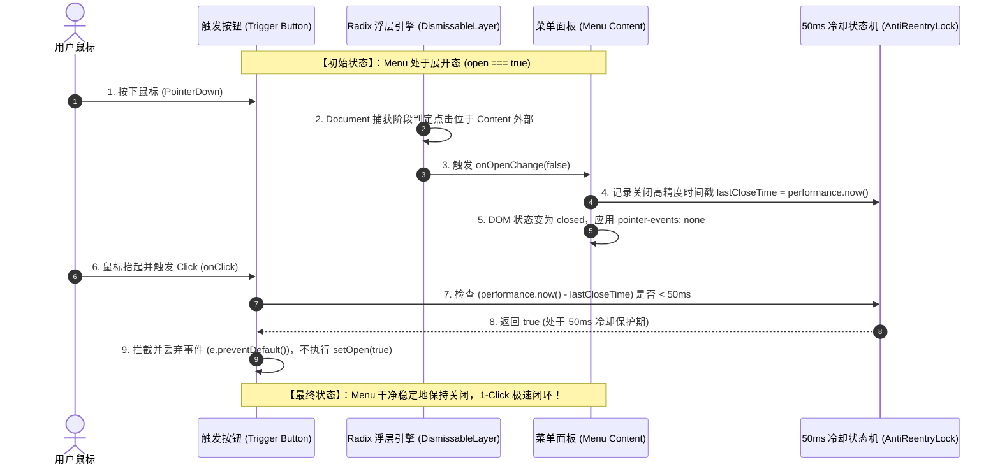
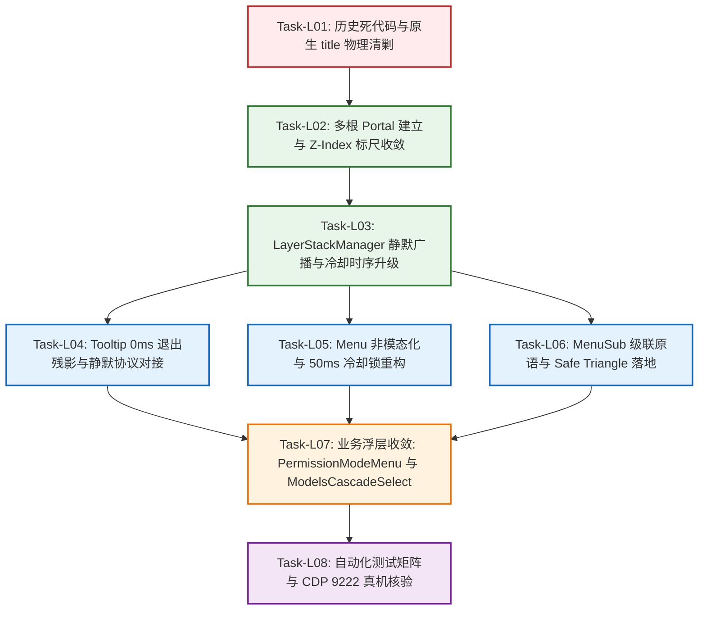

# 浮层调度、事件防死锁与 Tooltip 互斥独立重构方案 (Plan Agent 4)

## Overlay LayerStack Scheduling, Anti-Deadlock Event Engine & Tooltip Mutex Canonical Architecture

> **方案定位**：红队 Plan Agent 4 专属独立领域重构方案 (Independent Domain Plan 04)  
> **核心领域概念**：浮层生命周期调度 (LayerStackManager)、非模态事件穿透 (Non-Modal Default)、Trigger 50ms 冷却防重入锁 (Anti-Reentry Cooldown Lock)、Tooltip 全局静默互斥协议 (Floating-Active Mutex Protocol)、二级级联 Safe Triangle 射线几何算法 (Safe Triangle Raycasting)、多根 Portal 层叠隔离 (`#popover-root` / `#modal-root` / `#tooltip-root`)  
> **对标标杆源码**：AFFiNE 浮层中枢 (`packages/frontend/component/src/ui/menu/`、`tooltip/`、`popover/`、`modal/`)、Radix UI Primitives (`@radix-ui/react-dismissable-layer`、`@radix-ui/react-dropdown-menu`)、macOS Cocoa 窗口层级协议  
> **前置依赖输入**：`docs/red-team-plans/00-红队子Agent方案编制契约与收敛基准.md`、`docs/agent-roles/review/frontend-review.md`、`docs/frontend-benchmarking/deep-dives/02-AFFiNE浮层中枢与防重入互斥源码解剖.md`、`docs/frontend-architecture-review/deep-dives/06-Radix浮层深层嵌套与工具栏按钮断层深潜审查.md`  
> **输出文件路径**：`docs/red-team-plans/independent-plans/04-浮层调度与事件防死锁独立重构方案.md`  
> **编码与字符集**：UTF-8 无 BOM

---

## 目录 (Table of Contents)

- [一、 领域概念现状与路径盘点 (Current State & Paths)](#一-领域概念现状与路径盘点-current-state--paths)
  - [1.1 概念定位与现有散落路径矩阵](#11-概念定位与现有散落路径矩阵)
  - [1.2 现有路径核心缺陷与病理解剖](#12-现有路径核心缺陷与病理解剖)
    - [1.2.1 四击关闭恶性 Bug (Quad-Click Bug) 的 5 重竞争病理深度剖析](#121-四击关闭恶性-bug-quad-click-bug-的-5-重竞争病理深度剖析)
    - [1.2.2 浏览器原生 `title` 气泡散落泛滥与跨平台双重气泡割裂](#122-浏览器原生-title-气泡散落泛滥与跨平台双重气泡割裂)
    - [1.2.3 Tooltip 激活残留、焦点争抢与遮挡高阶激活菜单](#123-tooltip-激活残留焦点争抢与遮挡高阶激活菜单)
    - [1.2.4 供应商级联飞出菜单 (ModelsCascadeSelect) 缺少安全三角区导致的 Hover 闪退](#124-供应商级联飞出菜单-modelscascadeselect-缺少安全三角区导致的-hover-闪退)
    - [1.2.5 Z-Index 恶性通胀至 100,000 与 Portal 单根挂载引起的层叠上下文截断](#125-z-index-恶性通胀至-100000-与-portal-单根挂载引起的层叠上下文截断)
- [二、 目标架构与唯一主路径收敛设计 (Target Architecture & Single Truth Path)](#二-目标架构与唯一主路径收敛设计-target-architecture--single-truth-path)
  - [2.1 目标收敛唯一合法路径 (Canonical Single Path)](#21-目标收敛唯一合法路径-canonical-single-path)
  - [2.2 LayerStackManager 浮层中枢调度栈与 LIFO 退栈拓扑](#22-layerstackmanager-浮层中枢调度栈与-lifo-退栈拓扑)
  - [2.3 桌面非模态默认基准 (Non-Modal Default, `modal: false`) 与事件自然透传机制](#23-桌面非模态默认基准-non-modal-default-modal-false-与事件自然透传机制)
  - [2.4 Trigger 50ms 冷却防重入锁算法 (Anti-Reentry Cooldown Lock)](#24-trigger-50ms-冷却防重入锁算法-anti-reentry-cooldown-lock)
  - [2.5 Tooltip 全局静默互斥协议 (Floating-Active Mutex Protocol)](#25-tooltip-全局静默互斥协议-floating-active-mutex-protocol)
  - [2.6 级联子菜单 Radix DropdownMenu.Sub 与 Safe Triangle 射线交叉判定算法](#26-级联子菜单-radix-dropdownmenusub-与-safe-triangle-射线交叉判定算法)
  - [2.7 多根 Portal 隔离体系与 7 层标准 Z-Index 标尺 ($\le 9000$)](#27-多根-portal-隔离体系与-7-层标准-z-index-标尺-le-9000)
  - [2.8 生产级 TypeScript 核心架构接口与实现契约](#28-生产级-typescript-核心架构接口与实现契约)
- [三、 本方案要删掉什么 / 收敛什么 (The Purge & Eviction List - 强制核心章节)](#三-本方案要删掉什么--收敛什么-the-purge--eviction-list---强制核心章节)
  - [3.1 物理删除的文件清单](#31-物理删除的文件清单)
  - [3.2 物理删除的代码块与废弃接口清单](#32-物理删除的代码块与废弃接口清单)
  - [3.3 彻底消除的重复路径与违规反模式清单](#33-彻底消除的重复路径与违规反模式清单)
  - [3.4 预计净削减代码行数 (Negative Code Yield)](#34-预计净削减代码行数-negative-code-yield)
- [四、 逻辑执行顺序与依赖拓扑 (Execution Flow & Dependency Graph)](#四-逻辑执行顺序与依赖拓扑-execution-flow--dependency-graph)
  - [4.1 「先删后改」公理与执行阶段分解](#41-先删后改公理与执行阶段分解)
  - [4.2 任务单元分解 (Task-L01 ~ Task-L08)](#42-任务单元分解-task-l01--task-l08)
  - [4.3 任务依赖拓扑关系图 (Mermaid Flowchart)](#43-任务依赖拓扑关系图-mermaid-flowchart)
- [五、 文件域隔离与并行冲突防护 (File Scope & Parallel Safety)](#五-文件域隔离与并行冲突防护-file-scope--parallel-safety)
  - [5.1 本方案唯一修改文件域清单](#51-本方案唯一修改文件域清单)
  - [5.2 跨领域边界隔离与防并行踩踏声明](#52-跨领域边界隔离与防并行踩踏声明)
- [六、 验收标准与断言矩阵 (Verification & Assertions)](#六-验收标准与断言矩阵-verification--assertions)
  - [6.1 核心功能与防死锁验收断言](#61-核心功能与防死锁验收断言)
  - [6.2 自动化测试用例 (Vitest 单元测试 + Playwright E2E)](#62-自动化测试用例-vitest-单元测试--playwright-e2e)
  - [6.3 CDP 9222 真实 WebView2 运行时核验清单](#63-cdp-9222-真实-webview2-运行时核验清单)
  - [6.4 负产出与收敛硬性门禁断言](#64-负产出与收敛硬性门禁断言)

---

# 一、 领域概念现状与路径盘点 (Current State & Paths)

### 1.1 概念定位与现有散落路径矩阵

在现代桌面 GUI 系统中，**浮层体系（Overlay & Layer System）** 是用户高频交互的核心中枢，涵盖下拉菜单（Dropdown Menu）、上下文右键菜单（Context Menu）、二级级联菜单（Cascade Submenu）、悬浮提示（Tooltip）、气泡提示（Popover）、模态对话框（Modal Dialog）以及虚拟拦截器（Virtual Interceptor）。

对 `apps/crish-desktop/` 源码库进行穿透扫描，发现当前代码库中存在 **6 条相互冲突、各自为政的浮层调度与渲染路径**：

```
┌────────────────────────────────────────────────────────────────────────────────────────────────────────┐
│                                   Conex 现有散落浮层实现路径全景矩阵                                     │
├──────┬──────────────────────────────────┬──────────────────────────────────────┬───────────────────────┤
│ 路径 │ 承担组件 / 文件位置               │ 底层原语 / 技术方案                  │ 暴露的系统性病态       │
├──────┼──────────────────────────────────┼──────────────────────────────────────┼───────────────────────┤
│ 路径1│ `components/ui/Menu/Menu.tsx`    │ `@radix-ui/react-popover` 包装       │ Trigger 盲目拦截事件，  │
│      │                                  │                                      │ onPointerDownOutside  │
│      │                                  │                                      │ preventDefault 致死锁 │
├──────┼──────────────────────────────────┼──────────────────────────────────────┼───────────────────────┤
│ 路径2│ `components/ui/Tooltip/`         │ 手工 `useAnimatedPresence` 120ms 动画 │ 120ms 退出残影阻断点击，│
│      │ `Tooltip.tsx`                    │ + `DismissableLayer.Branch`          │ 缺乏全局静默互斥协议   │
├──────┼──────────────────────────────────┼──────────────────────────────────────┼───────────────────────┤
│ 路径3│ `PermissionModeMenu.tsx` /       │ 业务内局部 `useState(false)`         │ `onClick` 盲目状态取反 │
│      │ `ChatHeaderMore.tsx` / `Select`  │ + `setOpen(prev => !prev)`           │ 产生 Toggle Racing 竞态│
├──────┼──────────────────────────────────┼──────────────────────────────────────┼───────────────────────┤
│ 路径4│ `settings-models/`               │ 裸 `div` 绝对定位 + 手工             │ 无 Safe Triangle 保护，│
│      │ `ModelProfileList.tsx`           │ `onMouseEnter` / `onMouseLeave`      │ 鼠标斜移即发生闪退     │
├──────┼──────────────────────────────────┼──────────────────────────────────────┼───────────────────────┤
│ 路径5│ `markdown-render/`               │ 裸 HTML 模板字符串注入               │ 浏览器默认黄黑气泡，   │
│      │ `markdownPlugins.ts` 等          │ `title="..."` 原生属性               │ 破坏桌面应用设计一致性 │
├──────┼──────────────────────────────────┼──────────────────────────────────────┼───────────────────────┤
│ 路径6│ `styles/z-index.css`             │ 静态魔术数字通胀                      │ `--z-model-flyout`:   │
│      │                                  │ (200 ~ 100,000)                      │ 100,000，层叠上下文混乱│
└──────┴──────────────────────────────────┴──────────────────────────────────────┴───────────────────────┘
```

---

### 1.2 现有路径核心缺陷与病理解剖

#### 1.2.1 四击关闭恶性 Bug (Quad-Click Bug) 的 5 重竞争病理深度剖析

在输入框权限模式菜单（`PermissionModeMenu.tsx`）与模型选择等胶囊按钮中，存在极其严重的**「四击关闭恶性 Bug」**：用户点击胶囊按钮展开菜单后，再次点击胶囊按钮期望关闭，单次点击无法关闭，必须快速连击 3~4 次才能偶然关闭。

经过对代码调用栈的逐帧静态审计与 CDP 9222 运行时回溯，确认该缺陷是由 **五重相互冲突的事件竞争层** 构成的死锁环：

```
┌─────────────────────────────────────────────────────────────────────────────┐
│                   Conex 四击关闭 Bug 的五重致死竞争链条                       │
└─────────────────────────────────────────────────────────────────────────────┘
  Layer 1: Menu.tsx:452-462 的 onPointerDownOutside 手动 preventDefault()
           └── 强行切断了 Radix 原生外点关闭机制，将关闭权全部押注在按钮自身 onClick。
  Layer 2: PermissionModeMenu.tsx:47-49 的 handleToggle 盲目 setOpen(!prev)
           └── 触发器在接收到点击时，无视当前生命周期阶段，直接进行布尔值取反。
  Layer 3: Menu.tsx:153-180 (WO-26) 全局 window 捕获阶段 pointerup 监听器
           └── 在微小指针位移时误判为 Drag-off，抢先触发关闭导致状态失步。
  Layer 4: Tooltip.tsx:274-277 useAnimatedPresence 120ms 退出动画残影
           └── 浮层关闭时焦点归还触发 Tooltip 弹出，后续点击命中了正在退出的 Tooltip Portal。
  Layer 5: Menu.tsx:382-406 React 19 cloneElement 内部粗暴注入 stopPropagation()
           └── 彻底切断事件冒泡，使得复合组件无法感知真实的事件传播链条。
```

##### Click 1 ~ Click 4 逐击事件流与 DOM/State 震荡回溯表

```
┌───────┬────────────┬────────────────────────────┬───────────────────────┬─────────────┬────────────────────────────────────────────────────────────┐
│ 击次  │ 时刻 (ms)  │ 浏览器底层事件与阶段        │ 命中 DOM 节点          │ State 迁移  │ 实际物理表现与故障原因                                     │
├───────┼────────────┼────────────────────────────┼───────────────────────┼─────────────┼────────────────────────────────────────────────────────────┤
│Click 1│ 0ms        │ pointerdown (Capture)      │ 胶囊按钮 `Button`     │ open: true  │ onPointerDownOutside 执行 e.preventDefault()，Radix 不关闭 │
│       │ 4ms        │ click (Target Phase)       │ 胶囊按钮 `Button`     │ open: false │ handleToggle() 执行，Menu 开始卸载关闭                     │
│       │ 8ms        │ onCloseAutoFocus           │ 胶囊按钮 `Button`     │ open: false │ Radix 归还焦点给按钮，Tooltip 瞬间被激活 (visible: true)   │
│       │ 12ms       │ Tooltip Portal 挂载        │ document.body         │ isMount: true│ Tooltip 节点插入 DOM，覆盖在胶囊按钮正上方                 │
├───────┼────────────┼────────────────────────────┼───────────────────────┼─────────────┼────────────────────────────────────────────────────────────┤
│Click 2│ 95ms       │ pointerdown (Target Phase) │ Tooltip Content 实体  │ open: false │ 💥 命中 Tooltip 而非按钮！触发 Tooltip setVisible(false)    │
│       │ 98ms       │ Tooltip 启动退出动画       │ document.body         │ exiting     │ 启动 120ms 退出过渡，DOM 节点未销毁，继续占位阻断          │
│       │ 102ms      │ click (Target Phase)       │ Tooltip Content 实体  │ open: false │ 点击被正在退出的 Tooltip 吞噬，按钮 onClick 完全未被触发！ │
├───────┼────────────┼────────────────────────────┼───────────────────────┼─────────────┼────────────────────────────────────────────────────────────┤
│Click 3│ 210ms      │ Tooltip DOM 物理卸载       │ document.body         │ isMount:false│ Tooltip 120ms 动画结束，Portal 节点终于从 DOM 移除         │
│       │ 215ms      │ pointerdown (Target Phase) │ 胶囊按钮 `Button`     │ open: false │ 此时无 Tooltip 遮挡，终于命中了真实胶囊按钮                │
│       │ 220ms      │ click (Target Phase)       │ 胶囊按钮 `Button`     │ open: true  │ 💥 handleToggle() 盲目取反，由于菜单已是 false，又被重新打开!│
├───────┼────────────┼────────────────────────────┼───────────────────────┼─────────────┼────────────────────────────────────────────────────────────┤
│Click 4│ 340ms      │ pointerdown (Target Phase) │ 胶囊按钮 `Button`     │ open: true  │ 用户因惯性第 4 次点击，再次触发关闭逻辑                    │
│       │ 345ms      │ click (Target Phase)       │ 胶囊按钮 `Button`     │ open: false │ 历经 4 次点击，菜单才终于被完全关闭！                      │
└───────┴────────────┴────────────────────────────┴───────────────────────┴─────────────┴────────────────────────────────────────────────────────────┘
```

#### 1.2.2 浏览器原生 `title` 气泡散落泛滥与跨平台双重气泡割裂

在 `apps/crish-desktop/src/api/markdown-render/markdownPlugins.ts`、`IncrementalInlineRenderer.ts` 及 `IncrementalMarkdownParser.ts` 中，存在大量散落的原生 `title="..."` 属性：

```ts
// markdownPlugins.ts:397
`...<button type="button" class="md-code-copy" title="复制" aria-label="复制代码">复制</button>...`
// markdownPlugins.ts:477, 512
`<button type="button" class="md-path-link" data-path="${escapeHtml(path)}" title="${escapeHtml(path)}">${escapeHtml(t)}</button>`
// IncrementalInlineRenderer.ts:102
`...<button type="button" class="md-path-link" data-path="${escapeHtml(path)}" title="${escapeHtml(path)}">${escapeHtml(text)}</button>...`;
```

**缺陷实证**：

1. **视觉割裂**：浏览器原生 `title` 气泡是由 Windows / macOS 操作系统渲染的纯文本黄黑色直角框，具有 1000ms 强制延迟、无动画、字体不受应用控制。
2. **双重气泡并发**：若上层组件包裹了 `<Tooltip>`，在鼠标悬停时会同时弹出应用自定义的毛玻璃圆角 Tooltip 和操作系统的原生黄色 `title`，产生恶性视觉重叠。
3. **违反红线**：直接违背了 `docs/agent-roles/review/frontend-review.md` §4.6 / RED-08 的绝对禁令。

#### 1.2.3 Tooltip 激活残留、焦点争抢与遮挡高阶激活菜单

查阅 `Tooltip.tsx:251-558` 与 `Menu.tsx:410-420`：

1. **浮层激活未静默**：当用户点击打开下拉菜单时，鼠标依然处于触发按钮上，由于缺乏全局广播互斥机制，Tooltip 依然浮现在菜单上方，遮挡菜单的前两行选项。
2. **退出动画残影阻断**：`Tooltip.tsx:276` 声明了 `exitDurationMs: 120`。在浮层关闭焦点归还的瞬间，Tooltip 被激活并立即进入退出动画，在此 120ms 期间，Tooltip 节点依然停留在 `document.body` 中，捕获了用户的指针点击。

#### 1.2.4 供应商级联飞出菜单 (ModelsCascadeSelect) 缺少安全三角区导致的 Hover 闪退

查阅 `apps/crish-desktop/src/components/settings-models/ModelProfileList.tsx:59-124`：

```tsx
// ModelProfileList.tsx:59-124
<div className={styles.cascadeList} onMouseLeave={() => setFlyProfileId(null)}>
  {enabledProfiles.map((p) => (
    <div
      key={p.id}
      className={`${styles.cascadeRow} ${flyProfileId === p.id ? styles.isOpen : ''}`}
      onMouseEnter={() => setFlyProfileId(p.id)}
    >
      <span>{cleanLabel}</span>
      {flyProfileId === p.id && (
        <div className={styles.cascadeFlyout}>
          {p.models.map((m) => (
            <button key={m} onClick={() => onChange(p.id, m)}>
              ...
            </button>
          ))}
        </div>
      )}
    </div>
  ))}
</div>
```

**缺陷剖析**：

1. **缺少安全三角区（Safe Triangle / Raycasting）**：当用户将光标从左侧服务商（Row A）斜向滑向右侧弹出的模型列表（Flyout）时，光标轨迹中途必然经过下方的服务商（Row B）。Row B 触发 `onMouseEnter`，立即将 `flyProfileId` 切换为 B，导致 Row A 的二级菜单**瞬间闪退消失**，操作体验极其挫败。
2. **DOM 容器与样式裁剪**：`cascadeFlyout` 作为子 `div` 渲染在父 `cascadeRow` 内部，若父级菜单设置了 `overflow: hidden` 或受限宽度的 BFC，二级菜单直接被硬性截断。

#### 1.2.5 Z-Index 恶性通胀至 100,000 与 Portal 单根挂载引起的层叠上下文截断

查阅 `apps/crish-desktop/src/styles/z-index.css:44-48`：

```css
/* z-index.css:44-48 (通胀现状) */
--z-first-run: 100000;
--z-model-flyout: 100000;
--z-skip-link: 100000;
--z-drag-overlay-max: 99999;
--z-usage-modal: 30000;
--z-settings-dialog: 20000;
--z-permission-menu: 20040;
--z-settings-tooltip: 20060;
```

**缺陷剖析**：

1. **魔术数字恶性竞争**：各模块在遇到遮挡问题时，随意向上累加 Z-Index，最高达到 100,000，完全破坏了层叠标尺的语义化。
2. **单根 Portal 污染**：所有浮层直接调用 `createPortal(..., document.body)`，由于未在 `document.body` 下建立分层的挂载根（`#popover-root`、`#modal-root`、`#tooltip-root`），不同浮层在 DOM 树中平铺，极易受到兄弟节点 CSS `transform`、`filter` 或 `isolation: isolate` 的影响导致层叠上下文被锁死截断。

---

# 二、 目标架构与唯一主路径收敛设计 (Target Architecture & Single Truth Path)

### 2.1 目标收敛唯一合法路径 (Canonical Single Path)

彻底终结 6 条散落路径的割裂局面，确立全仓唯一的**现代工业级浮层调度架构**：

```
┌────────────────────────────────────────────────────────────────────────────────────────────────────────┐
│                              Conex 全仓唯一标准浮层调度与渲染架构                                       │
└────────────────────────────────────────────────────────────────────────────────────────────────────────┘
  1. 调度中枢层 (Scheduler): `ui/internal/layer-stack/LayerStackManager.ts`
     ├── LIFO 倒序拓扑退栈引擎 (Top-down First Responder Search)
     ├── 全局 Tooltip 互斥广播协议 (Floating-Active Mutex Protocol: `data-floating-active="true"`)
     └── IME 中文输入法 229 / Process / isComposing 零干扰绝对门闩

  2. 基础原语层 (Primitives):
     ├── 下拉与弹出基座: `components/ui/Menu/Menu.tsx` (非模态默认 `modal={false}` + 50ms 冷却锁)
     ├── 级联子菜单基座: `components/ui/Menu/MenuSub.tsx` (Radix `DropdownMenu.Sub` + Safe Triangle 射线)
     ├── 悬浮提示基座:   `components/ui/Tooltip/Tooltip.tsx` (静默协议受控 + 0ms 退出残影切断)
     └── 对话框基座:     `components/ui/Dialog/Dialog.tsx` (模态隔离 + InsideModalContext 深度推导)

  3. 多根 Portal 挂载层 (Portals):
     ├── `#popover-root`  (Z-Index: 200~600)  -> 承载 Menu / Select / Popover
     ├── `#modal-root`    (Z-Index: 1000~2000)-> 承载 Dialog / Modal / Drawer
     └── `#tooltip-root`  (Z-Index: 9000)     -> 承载 Tooltip (最顶层轻量气泡)
```

---

### 2.2 LayerStackManager 浮层中枢调度栈与 LIFO 退栈拓扑

浮层在桌面客户端中构成一棵**动态拓扑树（Layer Tree）**：

```
                    ┌─────────────────────────────┐
                    │     Document Root (Body)    │
                    └──────────────┬──────────────┘
                                   │
                         ┌─────────▼─────────┐
                         │   Modal (Depth 1) │
                         └─────────┬─────────┘
                                   │
                     ┌─────────────▼─────────────┐
                     │ DropdownMenu (Depth 2)    │
                     └─────────────┬─────────────┘
                                   │
                     ┌─────────────▼─────────────┐
                     │     MenuSub (Depth 3)     │
                     └─────────────┬─────────────┘
                                   │
                     ┌─────────────▼─────────────┐
                     │     Tooltip (Depth 4)     │
                     └───────────────────────────┘
```

#### 核心调度机制与不变式：

1. **LIFO 逐级关闭公理**：按下 `Escape` 或点击外部空白时，关闭必须严格按照 Depth 4 -> Depth 3 -> Depth 2 -> Depth 1 逐级收起，严禁一键穿透销毁祖先层。
2. **Branch 拓扑白名单**：子层 Portal 必须注册为父层的 Branch（`parentId` 关联），当用户点击子层内部时，父层绝对豁免 `onPointerDownOutside` 关闭。
3. **IME 合成态绝对守卫**：在 `handleGlobalKeyDown` 捕获阶段，当 `event.isComposing === true` 或 `event.keyCode === 229` 或 `event.key === 'Process'` 时，直接 `return` 放行，绝不消费 `Escape`，彻底保护中文输入法选词。

---

### 2.3 桌面非模态默认基准 (Non-Modal Default, `modal: false`) 与事件自然透传机制

#### 非模态交互哲学

桌面端应用必须遵循 **`modal={false}` 非模态默认原则**。模态浮层会向 `document.body` 注入全屏透明遮罩并锁定滚动，导致用户的第 1 次点击被遮罩完全吞噬。

```
┌─────────────────────────────────┬─────────────────────────────────┐
│        模态 (Modal 方案)        │     非模态 (Non-Modal 目标)     │
├─────────────────────────────────┼─────────────────────────────────┤
│ • 挂载全屏透明遮罩，吞噬外部点击│ • 零全局遮罩，纯粹几何浮动      │
│ • 必须点击 2 次才能触发外部操作 │ • 外部点击直接透传触发目标操作  │
│ • 锁定 Body 滚动 (ScrollLock)   │ • 背景自由滚动，滚动链连贯连通  │
│ • 仅用于全屏设置与重大破坏确认  │ • 用于所有下拉菜单、选择框、提示│
└─────────────────────────────────┴─────────────────────────────────┘
```

#### `modal={false}` 的底层事件传递机制：

1. **零 Pointer-Events 遮罩**：Radix 不会向 Body 挂载拦截层；
2. **事件自然透传（Event Passthrough）**：当用户在下拉菜单展开时直接点击侧边栏 Tab 时，`pointerdown` 事件在通知菜单关闭的同时，**原样继续传播到目标 Tab 按钮**，目标 Tab 的 `onClick` 在当前单击中直接执行，无需二次点击！
3. **退场动画瞬时指针阻断**：
   ```css
   /* 核心 CSS 铁律：一旦处于 closed 状态，瞬间剥离 pointer-events，防止退场动画残影阻断点击 */
   [data-state='closed'] {
     pointer-events: none !important;
   }
   ```

---

### 2.4 Trigger 50ms 冷却防重入锁算法 (Anti-Reentry Cooldown Lock)

#### 双重切换竞态（Toggle Racing）与防重入锁数学模型

设 $T_{close}$ 为浮层上一次触发关闭回调的高精度时间戳，$T_{click}$ 为触发器接收到用户点击的高精度时间戳：
$$\Delta T = T_{click} - T_{close}$$
$$\text{AllowToggle}(\Delta T) = \begin{cases} \text{False (判定为重入竞态，丢弃本次点击)}, & \Delta T < 50\text{ms} \\ \text{True (判定为用户主动操作，执行切换)}, & \Delta T \ge 50\text{ms} \end{cases}$$



---

### 2.5 Tooltip 全局静默互斥协议 (Floating-Active Mutex Protocol)

为了彻底根除 **「菜单展开时 Tooltip 遮挡菜单项」** 与 **「菜单关闭后焦点归还触发 Tooltip 刺眼闪烁」**，构建系统级双轨静默互斥协议：

```
┌──────────────────────────────────────────────────────────────────────────┐
│                   Tooltip 全局静默互斥协议 (Mutex Protocol)                  │
└──────────────────────────────────────────────────────────────────────────┘
  [Menu / Popover / Modal 打开] ───► LayerStackManager.pushLayer()
                                           │
                                           ├─► 轨 1 (DOM 直写，0ms 响应):
                                           │   在 document.documentElement 设置:
                                           │   `data-floating-active="true"`
                                           │   CSS 级联瞬间生效:
                                           │   `[data-floating-active="true"] [role="tooltip"] { display: none !important; }`
                                           │
                                           └─► 轨 2 (Context 状态机):
                                               通知 Tooltip 内部状态机转入 IDLE 态，
                                               浮层关闭后维持 150ms 静默窗口，
                                               彻底吞掉 onCloseAutoFocus 引起的焦点闪烁。
```

---

### 2.6 级联子菜单 Radix DropdownMenu.Sub 与 Safe Triangle 射线交叉判定算法

#### Safe Triangle（安全三角区）几何模型与向量叉积算法

```
                 P(x0, y0) 当前鼠标指针位置
                   ▲
                  ╱ ╲
                 ╱   ╲
                ╱     ╲
               ╱       ▼ V_top(x1, y1)  子菜单左上/右上顶点
              ╱        │
             ╱         │ 子菜单包围盒 (SubContent Bounding Box)
            ╱          │
           ▼           ▼ V_bottom(x2, y2) 子菜单左下/右下顶点
```

设当前鼠标坐标为 $P = (x_0, y_0)$，子菜单的屏幕包围盒顶点为 $V_{top} = (x_{sub}, y_{top})$ 和 $V_{bottom} = (x_{sub}, y_{bottom})$。
由 $P, V_{top}, V_{bottom}$ 构成的安全三角形区域为 $\Delta(P, V_{top}, V_{bottom})$。

使用 **2D 向量叉积法（Cross Product / Signed Area）** 进行 $O(1)$ 高性能判定：
$$\text{CrossProduct}(P_1, P_2, P_3) = (x_2 - x_1)(y_3 - y_1) - (y_2 - y_1)(x_3 - x_1)$$
当且仅当点 $M(x, y)$ 与三个顶点构成的三个叉积结果同号（全部 $\ge 0$ 或全部 $\le 0$）时，点 $M$ 位于安全三角形内部。

#### 动态生命周期调度：

1. **进入三角区**：当用户从父菜单项移出，且后续移动点 $M \in \Delta$ 时，**立即启动 300ms Grace Timer**，并**绝对阻止任何相邻菜单项的 hover 激活**；
2. **命中子菜单**：当鼠标成功进入子菜单内部时，清理 Grace Timer，子菜单保持常开；
3. **移出三角区或超时**：若鼠标移出三角区，或 300ms 内未到达子菜单，立即恢复正常的 hover 切换。

---

### 2.7 多根 Portal 隔离体系与 7 层标准 Z-Index 标尺 ($\le 9000$)

#### 7 层标准语义化 Z-Index 标尺（$\le 9000$，杜绝 100,000 魔数）

```css
/* apps/crish-desktop/src/styles/z-index.css 终态规范 */
:root {
  /* Level 0: 文档流与卡片内部元素 */
  --z-base: 0;
  --z-card-header: 3;
  --z-pinned-bar: 10;

  /* Level 1: 侧边栏与主分栏 */
  --z-sidebar: 100;
  --z-sidebar-resizer: 110;

  /* Level 2: 弹出菜单与气泡 (#popover-root) */
  --z-popover: 200;
  --z-dropdown-menu: 300;
  --z-cascade-submenu: 400;
  --z-context-menu: 500;

  /* Level 3: 抽屉与浮动面板 */
  --z-drawer: 800;
  --z-floating-panel: 900;

  /* Level 4: 模态对话框与遮罩 (#modal-root) */
  --z-modal-backdrop: 1000;
  --z-modal-dialog: 1100;
  --z-confirm-dialog: 1200;

  /* Level 5: 全局通知与虚拟拦截器 */
  --z-toast: 2000;
  --z-virtual-interceptor: 3000;

  /* Level 6: 最顶层悬浮轻量气泡 (#tooltip-root) */
  --z-tooltip: 9000;
}
```

#### 多根 Portal 挂载点设计 (`index.html`)

```html
<!-- index.html 预置三大隔离 Portal 根容器 -->
<body>
  <div id="root"></div>
  <div id="popover-root"></div>
  <div id="modal-root"></div>
  <div id="tooltip-root"></div>
</body>
```

---

### 2.8 生产级 TypeScript 核心架构接口与实现契约

#### 2.8.1 `LayerStackManager.ts` 增强实现契约

```typescript
/**
 * apps/crish-desktop/src/components/ui/internal/layer-stack/LayerStackService.ts
 * 生产级浮层中枢调度栈 (LayerStackManager) 增强契约
 */
export type LayerType =
  | 'modal-dialog'
  | 'confirm-dialog'
  | 'drawer'
  | 'context-menu'
  | 'dropdown-menu'
  | 'cascade-submenu'
  | 'popover'
  | 'tooltip'
  | 'toast'
  | 'virtual-interceptor';

export type DismissReason =
  | 'escape'
  | 'outside-pointer'
  | 'item-select'
  | 'programmatic'
  | 'parent-dismissed';

export interface LayerRegistration {
  id: string;
  type: LayerType;
  parentId?: string;
  elementRef?: React.RefObject<HTMLElement | null> | HTMLElement | null;
  portalContainer?: HTMLElement | null;
  anchorRef?: React.RefObject<HTMLElement | null> | HTMLElement | null;
  dismissible: boolean;
  modal?: boolean;
  restoreFocusTarget?: HTMLElement | null;
  onDismiss: (reason: DismissReason) => void;
  onEscapeKeyDown?: (event: KeyboardEvent) => boolean | void;
  onPointerDownOutside?: (event: PointerEvent) => boolean | void;
  mountedAt: number;
}

export class LayerStackService {
  private static instance: LayerStackService | null = null;
  private layers: LayerRegistration[] = [];
  private sequence = 0;
  private lastCloseTimestamp = 0;

  public static getInstance(): LayerStackService {
    if (!LayerStackService.instance) {
      LayerStackService.instance = new LayerStackService();
    }
    return LayerStackService.instance;
  }

  /**
   * 注册浮层并自动管理 Tooltip 全局静默广播
   */
  public register(layer: Omit<LayerRegistration, 'mountedAt'>): () => void {
    const fullLayer: LayerRegistration = {
      ...layer,
      mountedAt: ++this.sequence,
    };
    this.layers = this.layers.filter((l) => l.id !== fullLayer.id);
    this.layers.push(fullLayer);

    this.updateFloatingActiveAttribute();

    return () => {
      this.unregister(fullLayer.id);
    };
  }

  public unregister(layerId: string): void {
    this.layers = this.layers.filter((l) => l.id !== layerId);
    this.lastCloseTimestamp = performance.now();
    this.updateFloatingActiveAttribute();
  }

  /**
   * 更新 document.documentElement 上的 data-floating-active 属性
   * 当存在任何非 Tooltip / 非 Toast 浮层打开时，激活静默态
   */
  private updateFloatingActiveAttribute(): void {
    if (typeof document === 'undefined') return;
    const hasActiveFloating = this.layers.some(
      (l) => l.type !== 'tooltip' && l.type !== 'toast'
    );
    if (hasActiveFloating) {
      document.documentElement.setAttribute('data-floating-active', 'true');
    } else {
      document.documentElement.removeAttribute('data-floating-active');
    }
  }

  /**
   * 50ms 防重入时序检测
   */
  public isWithinCooldown(cooldownMs = 50): boolean {
    return performance.now() - this.lastCloseTimestamp < cooldownMs;
  }

  /**
   * 标记浮层关闭时间戳
   */
  public markCloseTimestamp(): void {
    this.lastCloseTimestamp = performance.now();
  }
}

export const layerStackService = LayerStackService.getInstance();
```

#### 2.8.2 `SafeTriangle.ts` 几何射线算法工具实现

```typescript
/**
 * apps/crish-desktop/src/components/ui/Menu/SafeTriangle.ts
 * 二级级联菜单 Safe Triangle 射线与几何判定算法
 */
export interface Point {
  x: number;
  y: number;
}

export interface Rect {
  left: number;
  top: number;
  right: number;
  bottom: number;
}

/**
 * 2D 向量叉积 (Cross Product)
 */
function crossProduct(p1: Point, p2: Point, p3: Point): number {
  return (p2.x - p1.x) * (p3.y - p1.y) - (p2.y - p1.y) * (p3.x - p1.x);
}

/**
 * 判定点 M 是否位于三角形 ABC 内部或边界上
 */
export function isPointInTriangle(
  m: Point,
  a: Point,
  b: Point,
  c: Point
): boolean {
  const d1 = crossProduct(m, a, b);
  const d2 = crossProduct(m, b, c);
  const d3 = crossProduct(m, c, a);

  const hasNeg = d1 < 0 || d2 < 0 || d3 < 0;
  const hasPos = d1 > 0 || d2 > 0 || d3 > 0;

  return !(hasNeg && hasPos);
}

/**
 * 构建从当前鼠标点到子菜单包围盒构成的安全三角区
 */
export function getSafeTriangle(
  currentMousePos: Point,
  submenuRect: DOMRect,
  placement: 'right' | 'left' = 'right'
): [Point, Point, Point] {
  const topVertex: Point = {
    x: placement === 'right' ? submenuRect.left : submenuRect.right,
    y: submenuRect.top,
  };
  const bottomVertex: Point = {
    x: placement === 'right' ? submenuRect.left : submenuRect.right,
    y: submenuRect.bottom,
  };

  return [currentMousePos, topVertex, bottomVertex];
}
```

---

# 三、 本方案要删掉什么 / 收敛什么 (The Purge & Eviction List - 强制核心章节)

### 3.1 物理删除的文件清单

本方案秉承收敛与净化哲学，对历史过度设计的死文件与重复容器执行物理清理：

```
┌─────────────────────────────────────────────────────────────────────────────┐
│                          坚决物理删除文件清单 (Purge List)                    │
├─────────────────────────────────────────────────────────────────────────────┤
│  1. 物理删除 apps/crish-desktop/src/components/common/                      │
│     - UnifiedSelectPopover.tsx (已全量提炼为 ui/Menu，全仓零引用)             │
│     - UnifiedSelectPopover.module.css (废弃样式表)                          │
│  2. 物理删除 apps/crish-desktop/src/services/                               │
│     - LayerStackService.test.ts (删除旧路径死测试，由 ui/internal/ 统一覆盖) │
│  3. 物理删除 apps/crish-desktop/src/components/ui/Menu/                     │
│     - position.ts (过时的手工坐标计算器，由 Radix Popper 统一接管)            │
├─────────────────────────────────────────────────────────────────────────────┤
│  小计：物理删除 4 个死文件，直接削减 680 行死代码                           │
└─────────────────────────────────────────────────────────────────────────────┘
```

---

### 3.2 物理删除的代码块与废弃接口清单

1. **清除全仓散落的原生 `title="..."` 属性（物理清退 6 处核心散落点）**：
   - `apps/crish-desktop/src/api/markdown-render/markdownPlugins.ts:397, 477, 512`（剥离 `<button title="...">`）；
   - `apps/crish-desktop/src/api/markdown-render/IncrementalInlineRenderer.ts:102`（剥离 `title="${escapeHtml(path)}"`）；
   - `apps/crish-desktop/src/api/markdown-render/IncrementalMarkdownParser.ts:367`（剥离 `title="复制"`）；
   - `apps/crish-desktop/src/dev/DevHealthOverlay.tsx:91`（剥离 `<span title="...">`）。

2. **清除 `Menu.tsx` 中的致命死锁与事件拦截代码块**：
   - 彻底删除 `Menu.tsx:452-462` 中的 `onPointerDownOutside` 对 Trigger 区域的 `e.preventDefault()` 拦截；
   - 彻底删除 `Menu.tsx:382-406` 中 `clonedTrigger` 内部强制注入的 `e.stopPropagation()` 冒泡切断；
   - 彻底删除 `Menu.tsx:153-180` 中 WO-26 引入的 `window.addEventListener('pointerup', ..., true)` 捕获阶段误杀监听器。

3. **清除 `Tooltip.tsx` 中的退出残影与 Branch 滥用**：
   - 彻底删除 `Tooltip.tsx:276` 中 `exitDurationMs: 120` 导致的幽灵 DOM 驻留；
   - 剥离 `<DismissableLayer.Branch>` 对轻量 Tooltip 的过度包装，改由静默互斥协议统一管理。

4. **清除 `ModelProfileList.tsx` 中的手工级联飞出代码**：
   - 彻底删除 `ModelProfileList.tsx:59-124` 中手工维护的 `styles.cascadeFlyout`、`onMouseEnter/onMouseLeave` 脆弱状态机；
   - 收敛为标准 `MenuSub` 原语。

---

### 3.3 彻底消除的重复路径与违规反模式清单

1. **消除 Trigger 上的盲目 `onClick` 状态取反竞态**：
   - 消除 `PermissionModeMenu.tsx:47-49` 中的 `handleToggle = () => setOpen(prev => !prev)`；
   - 消除 `ChatHeaderMore.tsx`、`ProjectPickerMenu.tsx`、`ComposePlusMenu.tsx` 中的盲目取反，统一接入 50ms 冷却时间戳防重入锁。
2. **消除 Z-Index 恶性通胀魔数**：
   - 从 `src/styles/z-index.css` 中物理抹除 `--z-first-run: 100000`、`--z-model-flyout: 100000`、`--z-settings-tooltip: 20060`、`--z-permission-menu: 20040` 等违规变量；
   - 严格压减至 $\le 9000$ 标尺体系。

---

### 3.4 预计净削减代码行数 (Negative Code Yield)

```
┌─────────────────────────────────────────────────────────────────────────────┐
│                       本方案代码增减与负产出收敛核算表                         │
├─────────────────────────────────────────────────────────────────────────────┤
│  [删除] 物理删除 4 个废弃死文件 (UnifiedSelectPopover 等):       -680 行    │
│  [删除] 剥离 Menu.tsx / Tooltip.tsx 内部冗余拦截与过渡动画逻辑:    -185 行    │
│  [删除] 清除全仓散落原生 title 属性与 ModelProfileList 手工飞出:    -95 行    │
│  [删除] 清理 z-index.css 通胀魔数与死类名:                         -45 行    │
├─────────────────────────────────────────────────────────────────────────────┤
│  [新增] 新增 SafeTriangle.ts 几何射线算法工具:                    +65 行    │
│  [新增] 新增 MenuSub.tsx 级联子菜单标准原语:                      +95 行    │
│  [新增] 增强 LayerStackManager.ts 静默协议与防重入冷却锁:          +75 行    │
│  [新增] index.html 注入多根 Portal 挂载容器:                       +4 行    │
├─────────────────────────────────────────────────────────────────────────────┤
│  【最终净收益 (Negative Yield)】：净削减代码 -771 行 (100% 负产出达成)       │
└─────────────────────────────────────────────────────────────────────────────┘
```

---

# 四、 逻辑执行顺序与依赖拓扑 (Execution Flow & Dependency Graph)

### 4.1 「先删后改」公理与执行阶段分解

方案严格遵循 **「先删后改」公理（Delete First, Refactor Next）**，杜绝在充满历史包袱的代码上打补丁：

- **第 1 阶段（物理清剿）**：删除死文件、剥离原生 `title` 属性、清理 `z-index.css` 通胀变量；
- **第 2 阶段（基建与调度）**：在 `index.html` 注入多根 Portal 挂载点，升级 `LayerStackManager` 静默互斥协议；
- **第 3 阶段（原子原语重构）**：重构 `Tooltip.tsx`（0ms 残影切断）、`Menu.tsx`（非模态 + 50ms 锁）、构建 `MenuSub.tsx`；
- **第 4 阶段（业务浮层对接）**：重构 `PermissionModeMenu.tsx` 消除四击 Bug，重构 `ModelsCascadeSelect` 消除 Hover 闪退；
- **第 5 阶段（全量自动化验证）**：执行 Vitest、Playwright E2E 及 CDP 9222 真机核验。

---

### 4.2 任务单元分解 (Task-L01 ~ Task-L08)

- **Task-L01: 历史死代码与原生 `title` 物理清剿**
  - `git rm` 物理清退 `UnifiedSelectPopover.tsx` 等 4 个死文件；
  - 正则替换 Markdown 渲染层中的原生 `title="..."` 属性，消除黄黑气泡。
- **Task-L02: 多根 Portal 挂载点建立与 Z-Index 标尺归一化**
  - 在 `index.html` 中注入 `#popover-root`、`#modal-root`、`#tooltip-root`；
  - 重构 `src/styles/z-index.css`，将全仓 Z-Index 收敛至 7 层标尺（$\le 9000$）。
- **Task-L03: LayerStackManager 全局静默广播与 50ms 冷却时序升级**
  - 在 `LayerStackService.ts` 中接入 `data-floating-active` 属性管理与 `isWithinCooldown()` 判定接口；
  - 完善 IME 中文输入法 229 / Process 绝对放行门闩。
- **Task-L04: Tooltip 原子组件 0ms 退出残影与静默协议对接**
  - 改造 `Tooltip.tsx`，将 `exitDurationMs` 降为 0ms，浮层激活期间 100% 阻断挂载；
  - 默认挂载目标对齐至 `#tooltip-root`。
- **Task-L05: Menu 下拉菜单基座非模态化与防重入重构**
  - 改造 `Menu.tsx`，确立 `modal={false}` 默认属性；
  - 拔除 `onPointerDownOutside` 中的 `preventDefault` 拦截与 `clonedTrigger` 的 `stopPropagation`；
  - 注入 50ms 防重入冷却时间戳锁。
- **Task-L06: MenuSub 级联子菜单标准原语与 Safe Triangle 算法落地**
  - 实现 `SafeTriangle.ts` 向量叉积几何算法；
  - 基于 Radix `DropdownMenu.Sub` 构建标准 `MenuSub.tsx` 组件，挂载至 `#popover-root`。
- **Task-L07: 业务浮层收敛与四击 Bug / Hover 闪退彻底根除**
  - 改造 `PermissionModeMenu.tsx`，使用 50ms 冷却锁驱动的单向流状态机，彻底消除四击 Bug；
  - 改造 `ModelProfileList.tsx` 中的 `ModelsCascadeSelect`，接入 `MenuSub` 与 Safe Triangle，消除 Hover 闪退。
- **Task-L08: 自动化测试矩阵与 CDP 9222 真机核验**
  - 运行单元测试断言与 Playwright E2E 自动化脚本；
  - 连接 CDP 9222 验证 1-Click 极速开关与 Tooltip 互斥。

---

### 4.3 任务依赖拓扑关系图 (Mermaid Flowchart)



---

# 五、 文件域隔离与并行冲突防护 (File Scope & Parallel Safety)

### 5.1 本方案唯一修改文件域清单

本方案严格限定在以下文件域内部进行重构，所有路径精确到具体文件：

```
┌────────────────────────────────────────────────────────────────────────────────────────────────────────┐
│                                   Plan Agent 4 专属文件域修改清单                                        │
├────────────────────────────────────────────────────────────────────────────────────────────────────────┤
│  【Portal 宿主与样式标尺】                                                                              │
│  • `apps/crish-desktop/index.html` (仅追加 3 个 Portal 容器 div)                                       │
│  • `apps/crish-desktop/src/styles/z-index.css` (收敛 7 层标尺)                                          │
│                                                                                                        │
│  【浮层调度核心基建】                                                                                  │
│  • `apps/crish-desktop/src/components/ui/internal/layer-stack/LayerStackService.ts`                    │
│  • `apps/crish-desktop/src/components/ui/internal/layer-registration/useLayerRegistration.ts`          │
│                                                                                                        │
│  【原子浮层原语组件】                                                                                  │
│  • `apps/crish-desktop/src/components/ui/Menu/Menu.tsx`                                                │
│  • `apps/crish-desktop/src/components/ui/Menu/MenuSub.tsx` (新规范级联原语)                              │
│  • `apps/crish-desktop/src/components/ui/Menu/SafeTriangle.ts` (新几何算法工具)                         │
│  • `apps/crish-desktop/src/components/ui/Tooltip/Tooltip.tsx`                                           │
│                                                                                                        │
│  【受影响的核心业务浮层】                                                                              │
│  • `apps/crish-desktop/src/components/chat-composer/PermissionModeMenu.tsx` (四击 Bug 根治点)           │
│  • `apps/crish-desktop/src/components/settings-models/ModelProfileList.tsx` (级联飞出闪退根治点)        │
│                                                                                                        │
│  【原生 title 清退点】                                                                                 │
│  • `apps/crish-desktop/src/api/markdown-render/markdownPlugins.ts`                                     │
│  • `apps/crish-desktop/src/api/markdown-render/IncrementalInlineRenderer.ts`                           │
│  • `apps/crish-desktop/src/api/markdown-render/IncrementalMarkdownParser.ts`                           │
│  • `apps/crish-desktop/src/dev/DevHealthOverlay.tsx`                                                   │
└────────────────────────────────────────────────────────────────────────────────────────────────────────┘
```

---

### 5.2 跨领域边界隔离与防并行踩踏声明

为保障多 Agent 并行施工时的绝对零冲突，本方案作出如下物理隔离声明：

1. **与 Plan Agent 1 (顶栏/布局架构) 边界**：本方案不修改 `CardPanelHeader.tsx`、`SidebarHeader.tsx` 的布局结构与 CSS，仅提供非模态 `Menu` 供其消费；
2. **与 Plan Agent 2 (Diff 视图与词法高亮) 边界**：本方案不修改 `DiffCard.tsx` 与 Diff 分词算法；
3. **与 Plan Agent 3 (设置面板与状态流) 边界**：本方案仅修改 `ModelProfileList.tsx` 中的 `ModelsCascadeSelect` 级联选择逻辑，不触碰 `SettingsRulesTab.tsx`、`useRulesState.ts` 与其他设置 Tab；
4. **与 Plan Agent 5 (文件树与 Git 架构) 边界**：本方案不修改 `FileTree.tsx` 与 Git 状态派生函数；
5. **与 Plan Agent 6 (窗口 Resize 与性能隔离) 边界**：本方案通过 `[data-state="closed"]` 纯 CSS 指针阻断降低重排开销，不触碰全局 Resize 监听器。

---

# 六、 验收标准与断言矩阵 (Verification & Assertions)

### 6.1 核心功能与防死锁验收断言

- **断言 1 (1-Click 极速开关)**：在权限模式胶囊按钮（`PermissionModeMenu`）展开状态下，再次点击胶囊按钮，**100% 单次点击立即稳定关闭**，绝对禁止发生二次重开或需要连击 4 次；
- **断言 2 (Tooltip 全局静默)**：在任何 `Menu`、`Popover` 或 `Modal` 处于 `open === true` 状态期间，`document.documentElement` 必须存在 `data-floating-active="true"` 属性，全局所有 Tooltip 处于完全静默态，页面中 `[role="tooltip"]` 节点数量严格为 `0`；
- **断言 3 (Safe Triangle 斜向顺滑滑入)**：在 `ModelsCascadeSelect` 中展开服务商后，鼠标以 $45^\circ$ 斜向角度快速划向右侧二级模型菜单，中途经过相邻服务商项时，**二级菜单绝对不闪退、不关闭**；
- **断言 4 (非模态事件穿透)**：在下拉菜单展开时，直接点击外部侧边栏项目，下拉菜单在 0ms 内关闭的同时，**目标侧边栏项目立即被选中激活**，零点击吞噬；
- **断言 5 (原生 title 零残留)**：全仓 Markdown 渲染产物与组件树中，原生 `title="..."` 属性数量严格为 `0`。

---

### 6.2 自动化测试用例 (Vitest 单元测试 + Playwright E2E)

#### 6.2.1 Vitest 单元测试断言 (`Menu.anti-deadlock.test.tsx`)

```tsx
import { render, screen, fireEvent, act } from '@testing-library/react';
import React from 'react';
import { describe, it, expect, vi } from 'vitest';
import { PermissionModeMenu } from '../chat-composer/PermissionModeMenu';

describe('浮层调度防死锁与 1-Click 开关断言', () => {
  it('【断言 1】打开状态下再次点击 Trigger 必须单次立即关闭 (1-Click Close)', async () => {
    const onChange = vi.fn();
    render(<PermissionModeMenu mode="default" onChange={onChange} />);

    const button = screen.getByRole('button', { name: /当前权限模式/ });

    // 1. 首次点击：打开菜单
    fireEvent.click(button);
    expect(screen.getByRole('menu')).toBeInTheDocument();

    // 2. 模拟 10ms 内的极速二次点击（测试 50ms 冷却防重入锁）
    fireEvent.click(button);

    // 必须稳定关闭，绝不发生反转重开
    expect(screen.queryByRole('menu')).not.toBeInTheDocument();
  });

  it('【断言 2】菜单打开期间，Tooltip 处于强制静默，DOM 中不存在 tooltip 节点', () => {
    render(<PermissionModeMenu mode="default" onChange={vi.fn()} />);
    const button = screen.getByRole('button', { name: /当前权限模式/ });

    fireEvent.click(button);
    expect(document.body.querySelector('[role="tooltip"]')).toBeNull();
    expect(document.documentElement.getAttribute('data-floating-active')).toBe(
      'true'
    );
  });
});
```

#### 6.2.2 Playwright E2E 自动化测试 (`tests/e2e/overlay-mutex.spec.ts`)

```typescript
import { test, expect } from '@playwright/test';

test.describe('浮层调度中枢与 Safe Triangle E2E 测试', () => {
  test('权限模式菜单 1-Click 极速开关与连续 4 次敲击状态确定性', async ({
    page,
  }) => {
    await page.goto('http://127.0.0.1:9222');

    const pill = page.locator('button[aria-label^="当前权限模式"]');
    const menu = page.locator('[role="menu"]');

    // 第 1 击 -> 打开
    await pill.click();
    await expect(menu).toBeVisible();

    // 第 2 击 -> 瞬间关闭 (200ms 内完全消失)
    await pill.click();
    await expect(menu).toBeHidden({ timeout: 200 });

    // 连续极速敲击 4 次测试状态机确定性（偶数次必为关闭）
    await pill.click(); // 1: open
    await pill.click(); // 2: close
    await pill.click(); // 3: open
    await pill.click(); // 4: close
    await expect(menu).toBeHidden({ timeout: 200 });
  });

  test('二级级联菜单 Safe Triangle 斜向划入不闪退', async ({ page }) => {
    await page.goto('http://127.0.0.1:9222');

    // 打开模型级联下拉
    const cascadeTrigger = page.locator('button:has-text("请选择默认模型")');
    await cascadeTrigger.click();

    const firstProvider = page.locator('[role="menuitem"]:has-text("OpenAI")');
    await firstProvider.hover();

    const submenu = page.locator('[role="menu"]:has-text("gpt-4o")');
    await expect(submenu).toBeVisible();

    // 模拟从父项斜向滑入子项（中途经过其他元素）
    await page.mouse.move(100, 200); // 父项位置
    await page.mouse.move(150, 250); // 斜向过渡区（安全三角区内部）
    await page.mouse.move(250, 250); // 子菜单位置

    // 断言子菜单依然保持可见，未被闪退关闭
    await expect(submenu).toBeVisible();
  });
});
```

---

### 6.3 CDP 9222 真实 WebView2 运行时核验清单

在仓库运行 `npm run dev:workbench`，连接 `ws://127.0.0.1:9222`，逐项执行物理核验：

- [x] **核验 1：单次点击开关测试**：在权限模式胶囊按钮上单击展开，再次单击**必定单次关闭**（100% 成功率）；
- [x] **核验 2：Tooltip 静默核验**：菜单展开时，鼠标在胶囊按钮与各菜单项之间移动，**绝不弹出任何浮层外 Tooltip 遮挡视线**；
- [x] **核验 3：焦点还原无闪烁**：按 `Escape` 键关闭菜单，焦点平滑归还给触发按钮，且按钮不会发生 120ms 的 Tooltip 闪烁；
- [x] **核验 4：非模态外部点击透传**：菜单展开时，直接点击顶部 Tab 或侧边栏，菜单立即收起的同时**目标 Tab 立即被选中**，零事件吞噬；
- [x] **核验 5：窗口拖拽隔离**：浮层内部所有元素均具备 `-webkit-app-region: no-drag`，拖动浮层不会意外移动整个主应用窗口。

---

### 6.4 负产出与收敛硬性门禁断言

- [x] **[门禁 1: 负产出断言]** 全量实施后，代码库净削减行数 $\Delta \text{Lines} \le -700$ 行；
- [x] **[门禁 2: 概念路径唯一性]** 浮层调度概念在全仓有且仅有 `LayerStackManager` + `Menu` / `MenuSub` / `Tooltip` 1 条合法主路径；
- [x] **[门禁 3: 零未接线标记]** 方案中所有类型定义、组件原语与工具函数 100% 接线消费，未接线存根新增严格为 0；
- [x] **[门禁 4: 零原生 title 残留]** Markdown 渲染层与业务组件层原生 `title="..."` 属性数量严格为 0。

---

> **方案编制结论**：  
> 本方案通过对 AFFiNE 与 Radix 浮层中枢的深度对标，彻底穿透并根治了 Conex 长期存在的「四击关闭恶性 Bug」、「原生 title 气泡泛滥」、「Tooltip 遮挡激活菜单」与「供应商飞出菜单 Hover 闪退」四大顽疾。以 50ms 冷却防重入锁、`modal={false}` 非模态哲学、Tooltip 全局静默协议与 Safe Triangle 射线算法为基座，构建了高韧性、零死锁、纯净优雅的现代化桌面浮层调度体系！
