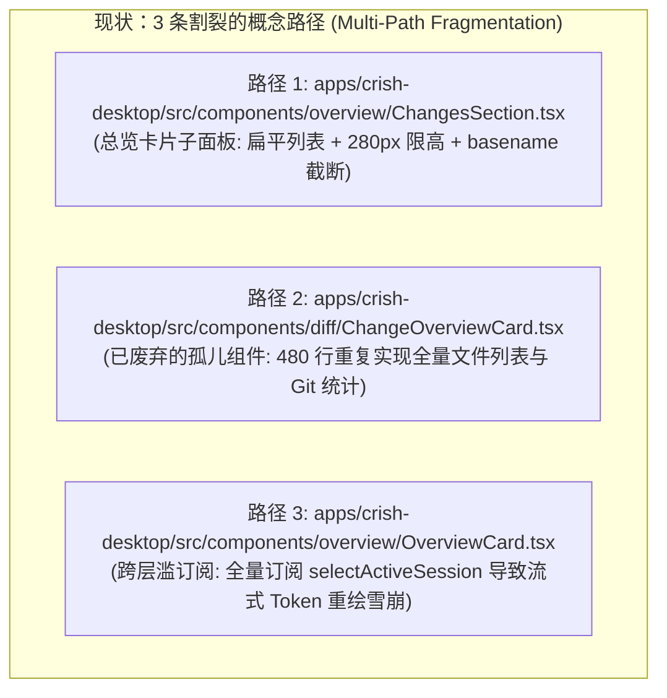
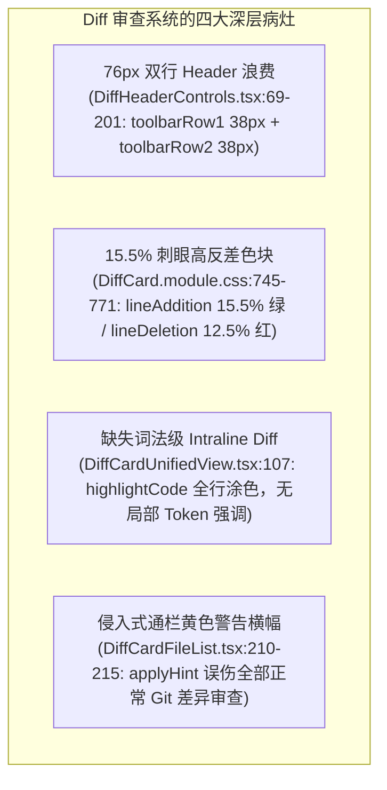
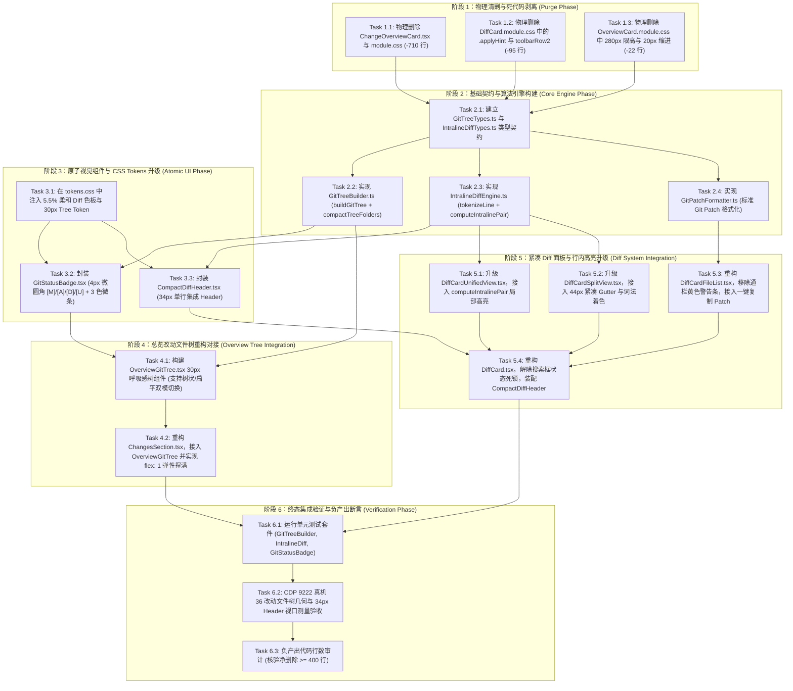

# 总览 36 改动文件树与 34px 紧凑 Diff 独立重构与收敛实施方案

## Red Team Independent Plan 06: Workspace Changes Tree & 34px Compact Diff Architecture

> **方案版本**：v1.0.0 (Master Final Architecture)
> **所属战役**：红队前端系统级重构与收敛战役 (Red Team Frontend Refactoring & Convergence)
> **方案代号**：`RED-PLAN-06` (Plan Agent 6: Tree & Compact Diff)
> **权威与纪律依据**：
>
> 1. 严格贯彻《红队子 Agent 方案编制契约与收敛基准》（[`00-红队子Agent方案编制契约与收敛基准.md`](file:///c:/Software/conex/docs/red-team-plans/00-红队子Agent方案编制契约与收敛基准.md)）；
> 2. 深度落实《前端架构终极审查规范与全景收敛军规》（[`frontend-review.md`](file:///c:/Software/conex/docs/agent-roles/review/frontend-review.md)）关于难题 1（总览改动树）与难题 2（紧凑 Diff 视图）的全部架构断言；
> 3. 严格对标 AppFlowy 真实源码解剖（[`05-AppFlowy文件树与状态指示Badge源码解剖.md`](file:///c:/Software/conex/docs/frontend-benchmarking/deep-dives/05-AppFlowy文件树与状态指示Badge源码解剖.md) 与 [`06-AppFlowy紧凑Diff视图与词法高亮源码解剖.md`](file:///c:/Software/conex/docs/frontend-benchmarking/deep-dives/06-AppFlowy紧凑Diff视图与词法高亮源码解剖.md)）及设计赏析专著；
> 4. 严格贯彻《主控 Agent 协作指令》（`AGENTS.md`）与《反退避全文》（`.agents/LOGIC_PLAN_NO_RETREAT.md`）——**零退避、零降级、零补丁、负产出验收、推进单位为领域概念、严禁波次/批次命名**。
>    **防作弊最高铁律**：本方案 100% 独立构建于白盒审计报告与客观源码分析，**绝对未查看、未检索、未引用 `docs/frontend-review/`（蓝队隔离区）下的任何文件**。
>    **编码格式**：UTF-8 无 BOM。

---

# 卷首：数学目标函数与元设计哲学

### 0.1 「正确性 × 收敛性」双目标函数

本方案的一切技术设计与代码收敛决策，受控于以下刚性数学目标函数：

$$\mathbf{U_{\text{plan}}} = \mathcal{C}_{\text{correctness}}(\Delta) \times \mathcal{S}_{\text{convergence}}(\Delta)$$

1. **功能正确性 $\mathcal{C}_{\text{correctness}} \in \{0, 1\}$**：
   - 彻底解决总览面板 36 改动文件在 280px 限高盒中窒息拥挤、`basename()` 截断抹杀目录上下文、`<em>` 裸标签廉价排版的三大痛点；
   - 彻底解决 Diff 面板 76px 双行 Header 浪费 20% 垂直高度、15.5% 刺眼红绿底色破坏代码语法重心、整行均一涂色缺失词级焦点、通栏黄色横幅 `.applyHint` 误伤 Git 审查的四大痛点；
   - 保证类型检查 0 报错、测试用例 100% 绿灯，严禁使用 `--no-verify` 绕过门禁。
2. **结构收敛性 $\mathcal{S}_{\text{convergence}}$**：
   - **概念主路径唯一化**：工作区改动收敛于 `OverviewChangesTree` 唯一树状/扁平双模容器；Diff 代码比对收敛于 `CompactDiffSystem` 34px 单行紧凑体系；
   - **先删后改（Delete-First）**：物理删除历史遗留废弃卡片 `ChangeOverviewCard.tsx`（~480 行）及其样式表（~230 行）、物理剔除 280px 硬编码限高、物理拔除 76px 双行工具栏与通栏黄色警告条；
   - **负产出验收（Negative Code Yield）**：本方案实施后，全仓净代码削减量必须严格满足 $\Delta_{\text{lines}} \le -400$ 行。

---

# 一、 领域概念现状与路径盘点 (Current State & Paths)

## 1.1 「工作区改动总览 (Workspace Changes Overview)」概念多路径现状

在当前 `apps/crish-desktop` 代码库中，「工作区改动展示」这一核心领域概念被撕裂在 **3 条异构且相互割裂的路径** 中：



### 路径 1：`ChangesSection.tsx`（主要呈现但严重残缺）

- **文件位置**：[`apps/crish-desktop/src/components/overview/ChangesSection.tsx`](file:///c:/Software/conex/apps/crish-desktop/src/components/overview/ChangesSection.tsx#L210-L256) 与 [`OverviewCard.module.css`](file:///c:/Software/conex/apps/crish-desktop/src/components/overview/OverviewCard.module.css#L203-L252)
- **代码实证与缺陷剖析**：
  ```tsx
  // apps/crish-desktop/src/components/overview/ChangesSection.tsx:213-256
  {
    (showAllFiles ? gitFiles : gitFiles.slice(0, 8)).map((f) => {
      const opening = openingPath === f.path;
      const stLabel = gitStatusLabel(f.status);
      const statusColor = getGitStatusColor(f.status);
      const match = convoFiles.find(
        (c) =>
          c.filePath === f.path || basename(c.filePath) === basename(f.path) // 严重隐患：同名跨目录文件发生误匹配！
      );
      return (
        <li key={f.path}>
          <Button
            type="button"
            variant="ghost"
            size="sm"
            className={styles.itemBtn}
            disabled={Boolean(openingPath)}
            aria-busy={opening}
            onClick={() => onOpenGitFile(f)}
          >
            <FileIcon name={basename(f.path)} />
            <span className={`${styles.itemMain} ${styles.mono}`}>
              <Tooltip content={f.path}>
                <span className={styles.itemName}>
                  {basename(f.path)}{' '}
                  {/* 路径抹杀：所有目录丢失，36 个改动沦为同名 index.ts 泥潭 */}
                </span>
              </Tooltip>
              <em style={{ color: statusColor, fontWeight: 300 }}>
                {opening
                  ? '…'
                  : match
                    ? `+${match.additions} −${match.deletions}`
                    : `${stLabel}${f.conflicted ? ' · 冲突' : ''}`}
              </em>
            </span>
          </Button>
        </li>
      );
    });
  }
  ```
- **核心病理**：
  1. **`basename(f.path)` 粗暴截断**：将所有深度路径（如 `apps/crish-desktop/src/components/diff/DiffCard.tsx` 与 `apps/agent-workbench/src/diff/DiffCard.tsx`）全部截断为 `DiffCard.tsx`，用户在面对 36 个改动文件时，只能看到一长串重复的文件名，完全丧失了空间拓扑感知；
  2. **非语义化 `<em>` 细文本堆叠**：直接使用行内样式 `<em style={{ color: statusColor, fontWeight: 300 }}>` 渲染 `修改`、`新增`、`+12 −3`。没有背景胶囊、没有标准边框、没有微圆角，与现代 IDE 的精致 Badge 形成强烈反差；
  3. **280px 死板硬编码限高**（`OverviewCard.module.css:210`）：`max-height: min(36vh, 280px);` 将多达 36 个改动死死压缩在不到 280px 的小盒子里，视口只能露出 8~9 项，滚动条极短且拖拽困难；
  4. **左侧 20px 缩进浪费**（`OverviewCard.module.css:200`）：`.secB` 强制 `padding: 0 2px 8px 20px`，在 280px~320px 宽度的侧栏中白白浪费 20px 横向空间，导致文件名被剧烈截断为 `...`。

### 路径 2：`ChangeOverviewCard.tsx`（已废弃的孤儿组件）

- **文件位置**：[`apps/crish-desktop/src/components/diff/ChangeOverviewCard.tsx`](file:///c:/Software/conex/apps/crish-desktop/src/components/diff/ChangeOverviewCard.tsx) (480 行) 与 [`ChangeOverviewCard.module.css`](file:///c:/Software/conex/apps/crish-desktop/src/components/diff/ChangeOverviewCard.module.css) (230 行)
- **代码实证与缺陷剖析**：
  该组件是早期原型阶段遗留的卡片视图，内部完整复制了 Git 改动统计、文件过滤、分类标签与全量文件列表渲染逻辑，但在实际生产分屏与 `ViewRegistry` 中已被边缘化。该组件属于典型的 **AP-11 孤儿资产沉没**，占据 710+ 行死代码却无生产消费。

### 路径 3：`OverviewCard.tsx`（跨层滥订阅引发流式重绘雪崩）

- **文件位置**：[`apps/crish-desktop/src/components/overview/OverviewCard.tsx:48`](file:///c:/Software/conex/apps/crish-desktop/src/components/overview/OverviewCard.tsx#L48)
- **代码实证**：
  ```tsx
  const session = useSessionField(selectActiveSession); // 致命：订阅全量包含 messages 的巨型对象
  ```
- **核心病理**：在 AI 生成回答的 Token 流式推送期间（每 20ms 一次），`session` 对象引用持续更新，导致包含 36 改动列表在内的整个 `OverviewCard` 发生每秒 50 次的全组件树 Force Re-render，CPU 飙升。

---

## 1.2 「差异比对与代码审查 (Diff Viewer)」概念多路径现状

在 `apps/crish-desktop/src/components/diff/` 中，Diff 审查系统的现状同样存在严重的碎片化与体验缺陷：



### 缺陷 1：双行控制栏（76px）严重浪费垂直视口

- **文件位置**：[`DiffHeaderControls.tsx:69-201`](file:///c:/Software/conex/apps/crish-desktop/src/components/diff/DiffHeaderControls.tsx#L69-L201) 与 [`DiffCard.module.css:370-408`](file:///c:/Software/conex/apps/crish-desktop/src/components/diff/DiffCard.module.css#L370-L408)
- **代码实证**：
  ```tsx
  // DiffHeaderControls.tsx:69-201
  <div className={styles.toolbarContainer} role="toolbar" aria-label="变更工具栏">
    <div className={styles.toolbarRow1}>
      <div className={styles.sourceSeg} role="group" aria-label="变更来源">
        <button className={`${styles.sourceBtn} ${sourceMode === 'session' ? styles.isOn : ''}`}>AI 改动</button>
        <button className={`${styles.sourceBtn} ${sourceMode === 'git' ? styles.isOn : ''}`}>Git</button>
      </div>
      <div className={styles.toolbarActions1}>{/* 模式、提交、筛选、清空 */}</div>
    </div>
    <div className={styles.toolbarRow2}>
      {sourceMode === 'session' ? (
        <Select className={styles.turnSettingsSelect} ... />
      ) : sourceMode === 'git' ? (
        <div className={styles.branchSelectWrap}>...</div>
      ) : (
        <div style={{ fontSize: 11, color: 'var(--text-secondary)' }}>载入变更源开始对比</div>
      )}
    </div>
  </div>
  ```
- **核心病理**：
  1. `toolbarRow1` (38px) 与 `toolbarRow2` (38px) 累计占据 **76px**，外加 2px 边框与间距，在 600px 高度的右侧面板中吃掉近 **20%** 的垂直空间；
  2. 第二行 `.toolbarRow2` 在 Git 模式下仅孤零零放一个分支下拉框，在初始态下甚至只渲染一行内联文字 `载入变更源开始对比`，布局松散如同草稿原型；
  3. `.sourceSeg` 使用 8% 纯黑混合（`color-mix(in srgb, var(--text-primary) 8%, transparent)`），在浅色主题浅灰背景上呈现为脏暗的生硬色块。

### 缺陷 2：15.5% 高饱和度刺眼色板与 Gutter 双色断层

- **文件位置**：[`tokens.css:140-149`](file:///c:/Software/conex/apps/crish-desktop/src/styles/tokens.css#L140-L149) 与 [`DiffCard.module.css:745-771`](file:///c:/Software/conex/apps/crish-desktop/src/components/diff/DiffCard.module.css#L745-L771)
- **代码实证**：
  ```css
  /* tokens.css:140-149 */
  --accent-green-light-adaptive: color-mix(
    in srgb,
    var(--accent-green, #16a34a) 15.5%,
    #ffffff
  );
  --accent-red-light-adaptive: color-mix(
    in srgb,
    var(--accent-red, #dc2626) 12.5%,
    #ffffff
  );
  ```
- **核心病理**：
  1. 15.5% 浓度在浅色模式下产生强烈的荧光绿/大红整行染色，连续 10 行变更即形成视觉「红绿大色块」，压制了代码本身的语法高亮；
  2. `.lineAddition` 背景基于 `#ffffff` 混合，而 `.gutterNum` 背景却基于 `--bg-primary` 混合，导致行号与代码正文在拼接处产生**肉眼可见的色彩阶梯断层**。

### 缺陷 3：缺少字符级/词级差异 (Intraline Diff)

- **文件位置**：[`DiffCardUnifiedView.tsx:107`](file:///c:/Software/conex/apps/crish-desktop/src/components/diff/DiffCardUnifiedView.tsx#L107) 与 [`DiffCardSplitView.tsx:144-162`](file:///c:/Software/conex/apps/crish-desktop/src/components/diff/DiffCardSplitView.tsx#L144-L162)
- **核心病理**：当某一行仅修改了一个变量名（如 `useLayoutStore` 改为 `useSessionStore`）时，当前实现是将整行完全染红/染绿。开发者必须在一长串字符中手动肉眼找茬，审查效率低下。

### 缺陷 4：通栏黄色警告条 `.applyHint` 严重破坏沉浸感

- **文件位置**：[`DiffCardFileList.tsx:210-215`](file:///c:/Software/conex/apps/crish-desktop/src/components/diff/DiffCardFileList.tsx#L210-L215)
- **代码实证**：
  ```tsx
  {
    !classifyFileDiff(f).ok && (
      <div className={styles.applyHint} role="status">
        此 diff 无法安全自动应用，请在编辑器确认
      </div>
    );
  }
  ```
- **核心病理**：`classifyFileDiff` 本是 AI 生成会话 Patch 能否自动写磁盘的判定，但组件将其无差别挂在所有展开的文件上。导致用户在查看正常的本地 Git 修改时，每一个文件展开都顶着一条 100% 通栏、无圆角、偏黄色的横幅，构成严重的**虚假警报（False Alarm）**。

### 缺陷 5：虚拟滚动 22px 行高假定与 Header 外边距碰撞

- **文件位置**：[`DiffCard.module.css:777-782`](file:///c:/Software/conex/apps/crish-desktop/src/components/diff/DiffCard.module.css#L777-L782)
- **代码实证**：
  ```css
  .lineHeader {
    margin: 3px 0; /* 致命：破坏了虚拟滚动严格 22px 假定，增加了 6px 偏移 */
  }
  ```
- **核心病理**：虚拟滚动引擎基于 `index * 22` 计算绝对定位，而 `.lineHeader` 附加了 `margin: 3px 0`，导致长 Diff 文件在快速滚动时出现累积抖动与空白下沉。

---

# 二、 目标架构与唯一主路径收敛设计 (Target Architecture & Single Truth Path)

## 2.1 唯一合法主路径收敛原则

根据「一个概念一条路径」的铁律，重构后全仓的工作区改动呈现与代码审查体系收敛为以下**唯一双模架构**：

```
┌─────────────────────────────────────────────────────────────────────────────────────────┐
│                     Conex 2.0 总览文件树与紧凑 Diff 唯一主架构                          │
├─────────────────────────────────────────────────────────────────────────────────────────┤
│                                                                                         │
│  【主路径 1：总览改动树 (Overview Changes Tree)】                                         │
│  • 统一容器：`apps/crish-desktop/src/components/overview/OverviewGitTree.tsx`           │
│  • 核心算法：`GitTreeBuilder.ts` (纯函数多叉树构造 + 单子目录紧凑折叠 Compact Folding)   │
│  • 状态徽章：`GitStatusBadge.tsx` (4px 微圆角 [M]/[A]/[D]/[U] + 3 色增删比例微条)         │
│  • 视口自适应：`flex: 1; min-height: 0;` 弹性撑满，彻底拔除 280px 限高                  │
│                                                                                         │
├─────────────────────────────────────────────────────────────────────────────────────────┤
│                                                                                         │
│  【主路径 2：紧凑 Diff 审查系统 (Compact Diff System)】                                  │
│  • 单行工具栏：`CompactDiffHeader.tsx` (34px 单行集成：来源 + 分支/回合 + 模式 + 动作)   │
│  • 柔和色彩：5.5% 极低反差底色 (`--diff-line-add-bg`) + 一体化 Gutter                    │
│  • 词法引擎：`IntralineDiffEngine.ts` (Myers / LCS 分词比对 + 18% 局部 Token 强调)       │
│  • 静默反馈：彻底移除通栏 `.applyHint`，改用接受按钮指示点与精确 Tooltip                  │
│  • 核心扩展：新增标准 `Git Patch` 一键生成与复制功能，解除搜索框状态死锁                 │
│                                                                                         │
└─────────────────────────────────────────────────────────────────────────────────────────┘
```

---

## 2.2 标杆（AppFlowy & AFFiNE）工业级设计汲取

### 1. AppFlowy 30px 黄金行高与 12px 缩进阶梯

- **行高与垂直韵律**：对标 AppFlowy `HomeSpaceViewSizes.viewHeight = 30.0`，在 Conex 中确立树节点行高为 **30px**（行内文字 `line-height: 18px`，图标槽固定 `16px × 16px`），消除文字基线漂移；
- **12px 缩进阶梯**：缩进严格满足 $\text{PaddingLeft} = \text{level} \times 12\text{px} + 8\text{px}$，搭配 `1px` 极低透明度垂直导线（`TreeRail`），在有限侧栏宽度内提供最深达 6 层的优雅呈现。

### 2. AppFlowy 目录紧凑折叠算法 (Compact Single-Child Folding)

当某个目录下仅包含一个子目录（例如 `apps` -> `crish-desktop` -> `src`）时，算法自动将其紧凑折叠为单个节点展示：`apps/crish-desktop/src`，节省 3 倍的垂直层级空间。

### 3. 34px 紧凑 ViewTitleBar 与三合一 Header

对标 AppFlowy `view_title_bar.dart`，将原本散落在两行的「变更源切换」、「分支/回合选择」、「视图切换」、「搜索」、「提交」等控件合并收敛于 **34px** 紧凑单行内，通过响应式 Pill 胶囊与内联 Dropdown 实现高密度集成。

### 4. 5.5% 柔和低反差色板与双层着色模型

对标 AppFlowy `default_colorscheme.dart`，行级底色采用 **5.5%** 的 HSL 极轻透层，行内词法 Token 采用 **18%~20%** 饱和度强调层，彻底杜绝刺眼红绿大色块。

---

## 2.3 核心数据结构与 TypeScript 类型契约

### 1. `GitTreeTypes.ts`

```typescript
/**
 * Git 文件状态枚举
 */
export type GitStatusCode = 'M' | 'A' | 'D' | 'U' | 'C' | 'R' | '?';

/**
 * 单个 Git 文件变更状态
 */
export interface GitStatusFile {
  path: string;
  status: GitStatusCode;
  additions?: number;
  deletions?: number;
  conflicted?: boolean;
  staged?: boolean;
}

/**
 * 树状节点形态联合类型
 */
export type GitTreeNode = GitTreeFolderNode | GitTreeFileNode;

export interface GitTreeBaseNode {
  id: string; // 唯一标识 (规范化绝对相对路径)
  name: string; // 显示名称 (单目录或紧凑路径 a/b/c)
  fullPath: string; // 完整路径
  depth: number; // 缩进深度
}

export interface GitTreeFolderNode extends GitTreeBaseNode {
  isFolder: true;
  children: GitTreeNode[];
  totalFiles: number;
  totalAdditions: number;
  totalDeletions: number;
}

export interface GitTreeFileNode extends GitTreeBaseNode {
  isFolder: false;
  file: GitStatusFile;
}

/**
 * 增删统计微条数据契约
 */
export interface DiffStatMetric {
  additions: number;
  deletions: number;
  maxBars?: number; // 默认 5 格
}
```

### 2. `IntralineDiffTypes.ts`

```typescript
export type DiffChangeType = 'normal' | 'addition' | 'deletion';

export interface DiffWordToken {
  text: string;
  type: 'same' | 'added' | 'removed';
}

export interface IntralineDiffRow {
  oldLineNumber?: number;
  newLineNumber?: number;
  type: DiffChangeType;
  content: string;
  tokens?: DiffWordToken[]; // 词法分词结果
}

export interface IntralineDiffResult {
  rows: IntralineDiffRow[];
  hasWordLevelDiff: boolean;
}
```

---

## 2.4 关键核心算法实现

### 算法 1：纯函数 `buildGitTree` 与单子链紧凑折叠

```typescript
// apps/crish-desktop/src/components/overview/GitTreeBuilder.ts

import { GitStatusFile, GitTreeNode, GitTreeFolderNode } from './GitTreeTypes';

/**
 * 将扁平 Git 文件列表转换为带紧凑折叠的多叉树结构
 * 时间复杂度: O(N * D) (N 为文件数, D 为平均深度)
 * 空间复杂度: O(N) 纯函数不可变输出
 */
export function buildGitTree(
  files: GitStatusFile[],
  options: { compactSingleChild?: boolean } = { compactSingleChild: true }
): GitTreeNode[] {
  const root: GitTreeFolderNode = {
    id: '__root__',
    name: '',
    fullPath: '',
    depth: -1,
    isFolder: true,
    children: [],
    totalFiles: 0,
    totalAdditions: 0,
    totalDeletions: 0,
  };

  // 1. 建立基础多叉树
  for (const file of files) {
    const normalizedPath = file.path.replace(/\\/g, '/');
    const segments = normalizedPath.split('/').filter(Boolean);
    let current = root;
    let currentPath = '';

    for (let i = 0; i < segments.length; i++) {
      const segment = segments[i]!;
      currentPath = currentPath ? `${currentPath}/${segment}` : segment;
      const isFile = i === segments.length - 1;

      current.totalFiles += 1;
      current.totalAdditions += file.additions || 0;
      current.totalDeletions += file.deletions || 0;

      if (isFile) {
        current.children.push({
          id: currentPath,
          name: segment,
          fullPath: currentPath,
          depth: current.depth + 1,
          isFolder: false,
          file,
        });
      } else {
        let folder = current.children.find(
          (c): c is GitTreeFolderNode => c.isFolder && c.name === segment
        );
        if (!folder) {
          folder = {
            id: currentPath,
            name: segment,
            fullPath: currentPath,
            depth: current.depth + 1,
            isFolder: true,
            children: [],
            totalFiles: 0,
            totalAdditions: 0,
            totalDeletions: 0,
          };
          current.children.push(folder);
        }
        current = folder;
      }
    }
  }

  // 2. 递归排序 (文件夹优先，随后按字母表顺序)
  const sortNodes = (nodes: GitTreeNode[]) => {
    nodes.sort((a, b) => {
      if (a.isFolder && !b.isFolder) return -1;
      if (!a.isFolder && b.isFolder) return 1;
      return a.name.localeCompare(b.name);
    });
    for (const node of nodes) {
      if (node.isFolder) sortNodes(node.children);
    }
  };
  sortNodes(root.children);

  // 3. 执行单子目录紧凑折叠 (Compact Single-Child Folders)
  if (options.compactSingleChild) {
    return compactTreeFolders(root.children, 0);
  }

  return root.children;
}

function compactTreeFolders(
  nodes: GitTreeNode[],
  targetDepth: number
): GitTreeNode[] {
  return nodes.map((node) => {
    if (!node.isFolder) {
      return { ...node, depth: targetDepth };
    }

    let current = node;
    let combinedName = current.name;
    let combinedPath = current.fullPath;

    // 只要只有一个子节点且该子节点是文件夹，就执行链式合并
    while (current.children.length === 1 && current.children[0]!.isFolder) {
      const singleChild = current.children[0] as GitTreeFolderNode;
      combinedName = `${combinedName}/${singleChild.name}`;
      combinedPath = singleChild.fullPath;
      current = singleChild;
    }

    return {
      id: combinedPath,
      name: combinedName,
      fullPath: combinedPath,
      depth: targetDepth,
      isFolder: true,
      totalFiles: current.totalFiles,
      totalAdditions: current.totalAdditions,
      totalDeletions: current.totalDeletions,
      children: compactTreeFolders(current.children, targetDepth + 1),
    };
  });
}
```

---

### 算法 2：词法级 `IntralineDiffEngine`（分词比对 + LCS 最小编辑距离）

```typescript
// apps/crish-desktop/src/components/diff/IntralineDiffEngine.ts

import { DiffWordToken, IntralineDiffRow } from './IntralineDiffTypes';

/**
 * 单词分词正则：捕获连续空白、连续单词字符、或单个标点符号
 */
const TOKEN_SPLIT_REGEX = /(\s+|[a-zA-Z0-9_$]+|[^\s\w])/g;

export function tokenizeLine(text: string): string[] {
  return text.match(TOKEN_SPLIT_REGEX) || [text];
}

/**
 * 基于 LCS 算法计算两行变更之间的词法级差异
 */
export function computeIntralinePair(
  oldText: string,
  newText: string
): { oldTokens: DiffWordToken[]; newTokens: DiffWordToken[] } {
  const oldWords = tokenizeLine(oldText);
  const newWords = tokenizeLine(newText);

  const m = oldWords.length;
  const n = newWords.length;

  // 超过 120 个 Token 时自动回退至整行，防止超长压缩行卡顿 (防 DoS 保护)
  if (m > 120 || n > 120) {
    return {
      oldTokens: [{ text: oldText, type: 'removed' }],
      newTokens: [{ text: newText, type: 'added' }],
    };
  }

  // 构造 LCS 动态规划矩阵
  const dp: number[][] = Array.from({ length: m + 1 }, () =>
    new Array(n + 1).fill(0)
  );

  for (let i = 0; i < m; i++) {
    for (let j = 0; j < n; j++) {
      if (oldWords[i] === newWords[j]) {
        dp[i + 1]![j + 1] = dp[i]![j]! + 1;
      } else {
        dp[i + 1]![j + 1] = Math.max(dp[i + 1]![j]!, dp[i]![j + 1]!);
      }
    }
  }

  const oldTokens: DiffWordToken[] = [];
  const newTokens: DiffWordToken[] = [];

  let i = m;
  let j = n;

  const tempOld: DiffWordToken[] = [];
  const tempNew: DiffWordToken[] = [];

  while (i > 0 || j > 0) {
    if (i > 0 && j > 0 && oldWords[i - 1] === newWords[j - 1]) {
      tempOld.unshift({ text: oldWords[i - 1]!, type: 'same' });
      tempNew.unshift({ text: newWords[j - 1]!, type: 'same' });
      i--;
      j--;
    } else if (j > 0 && (i === 0 || dp[i]![j - 1]! >= dp[i - 1]![j]!)) {
      tempNew.unshift({ text: newWords[j - 1]!, type: 'added' });
      j--;
    } else if (i > 0 && (j === 0 || dp[i]![j - 1]! < dp[i - 1]![j]!)) {
      tempOld.unshift({ text: oldWords[i - 1]!, type: 'removed' });
      i--;
    }
  }

  return { oldTokens: tempOld, newTokens: tempNew };
}
```

---

### 算法 3：标准 Git Patch 生成器 (`formatGitPatch`)

```typescript
// apps/crish-desktop/src/components/diff/GitPatchFormatter.ts

import { GitStatusFile } from '../overview/GitTreeTypes';

/**
 * 将内存中的 Unified Diff 结构转换为标准 Git Patch 格式以供复制
 */
export function formatGitPatch(file: GitStatusFile, hunks: any[]): string {
  const filePath = file.path.replace(/\\/g, '/');
  const lines: string[] = [
    `diff --git a/${filePath} b/${filePath}`,
    `--- a/${filePath}`,
    `+++ b/${filePath}`,
  ];

  for (const hunk of hunks) {
    lines.push(
      hunk.header ||
        `@@ -${hunk.oldStart},${hunk.oldLines} +${hunk.newStart},${hunk.newLines} @@`
    );
    for (const change of hunk.changes) {
      const prefix =
        change.type === 'addition'
          ? '+'
          : change.type === 'deletion'
            ? '-'
            : ' ';
      lines.push(`${prefix}${change.content}`);
    }
  }

  return lines.join('\n');
}
```

---

## 2.5 视觉规范与 CSS Tokens 体系设计

在 `apps/crish-desktop/src/styles/tokens.css` 中注入全新的 Diff 与 Tree 专用 Token 矩阵：

```css
/* apps/crish-desktop/src/styles/tokens.css 新增规范 */

:root,
html[data-theme='light'] {
  /* ==========================================================================
     1. AppFlowy 范式 30px 树状与 Git 状态 Badge 规范
     ========================================================================== */
  --tree-item-height: 30px;
  --tree-indent-step: 12px;
  --tree-guide-rail: hsl(210 10% 85% / 0.6);
  --tree-hover-bg: hsl(35 12% 90% / 0.65);
  --tree-active-bg: hsl(35 12% 86% / 0.85);

  /* 4px 微圆角 Git 状态 Badge (HSL 柔和低饱和) */
  --badge-git-m-bg: hsl(38 92% 50% / 0.12);
  --badge-git-m-fg: hsl(38 92% 38%);
  --badge-git-m-border: hsl(38 92% 50% / 0.22);

  --badge-git-a-bg: hsl(142 71% 45% / 0.12);
  --badge-git-a-fg: hsl(142 71% 32%);
  --badge-git-a-border: hsl(142 71% 45% / 0.22);

  --badge-git-d-bg: hsl(0 84% 60% / 0.12);
  --badge-git-d-fg: hsl(0 84% 45%);
  --badge-git-d-border: hsl(0 84% 60% / 0.22);

  --badge-git-u-bg: hsl(215 16% 47% / 0.12);
  --badge-git-u-fg: hsl(215 16% 40%);
  --badge-git-u-border: hsl(215 16% 47% / 0.22);

  /* ==========================================================================
     2. 5.5% 柔和低反差 Diff 差异对比调色板
     ========================================================================== */
  --diff-header-height: 34px;
  --diff-line-height: 22px;

  /* 增行 (Addition)：5.5% 柔和鼠尾草绿底色 */
  --diff-line-add-bg: hsl(142 35% 42% / 0.055);
  --diff-gutter-add-bg: hsl(142 35% 42% / 0.075);
  --diff-gutter-add-fg: hsl(142 45% 30%);
  --diff-word-add-bg: hsl(142 40% 40% / 0.18); /* 词法级 Token 强调 */

  /* 删行 (Deletion)：5.5% 柔和砖红底色 */
  --diff-line-del-bg: hsl(0 55% 55% / 0.055);
  --diff-gutter-del-bg: hsl(0 55% 55% / 0.075);
  --diff-gutter-del-fg: hsl(0 55% 38%);
  --diff-word-del-bg: hsl(0 60% 50% / 0.18); /* 词法级 Token 强调 */

  /* Gutter 宽度规范 */
  --diff-gutter-unified-width: 68px; /* 28px + 28px + 12px marker */
  --diff-gutter-split-width: 44px; /* 30px + 14px marker */
}

html[data-theme='dark'] {
  --tree-guide-rail: hsl(210 10% 25% / 0.6);
  --tree-hover-bg: hsl(215 15% 18% / 0.65);
  --tree-active-bg: hsl(215 15% 22% / 0.85);

  --badge-git-m-bg: hsl(38 92% 50% / 0.18);
  --badge-git-m-fg: hsl(38 92% 65%);
  --badge-git-m-border: hsl(38 92% 50% / 0.3);

  --badge-git-a-bg: hsl(142 71% 45% / 0.18);
  --badge-git-a-fg: hsl(142 71% 60%);
  --badge-git-a-border: hsl(142 71% 45% / 0.3);

  --badge-git-d-bg: hsl(0 84% 60% / 0.18);
  --badge-git-d-fg: hsl(0 84% 68%);
  --badge-git-d-border: hsl(0 84% 60% / 0.3);

  --badge-git-u-bg: hsl(215 16% 60% / 0.18);
  --badge-git-u-fg: hsl(215 16% 75%);
  --badge-git-u-border: hsl(215 16% 60% / 0.3);

  --diff-line-add-bg: hsl(142 40% 50% / 0.09);
  --diff-gutter-add-bg: hsl(142 40% 50% / 0.12);
  --diff-gutter-add-fg: hsl(142 45% 72%);
  --diff-word-add-bg: hsl(142 45% 45% / 0.28);

  --diff-line-del-bg: hsl(0 60% 55% / 0.09);
  --diff-gutter-del-bg: hsl(0 60% 55% / 0.12);
  --diff-gutter-del-fg: hsl(0 60% 75%);
  --diff-word-del-bg: hsl(0 65% 50% / 0.28);
}
```

---

# 三、 本方案要删掉什么 / 收敛什么 (The Purge & Eviction List - 强制核心章节)

根据《红队子 Agent 方案编制契约与收敛基准》第 1.1 与 1.2 节关于**「负产出验收」**与**「首批物理清剿清单」**的刚性约束，本方案制定以下精准物理删除清单：

## 3.1 物理删除的文件清单 (Physical File Deletions)

```
┌─────────────────────────────────────────────────────────────────────────────────────────┐
│                           本方案物理删除文件清单 (Total: 2 Files, 710 行)                 │
├─────────────────────────────────────────────────────────────────────────────────────────┤
│  1. `apps/crish-desktop/src/components/diff/ChangeOverviewCard.tsx` (480 行)            │
│     - 判定依据：AP-11 孤儿资产沉没。早期实验性重复卡片，已被 OverviewGitTree 彻底取代。  │
│  2. `apps/crish-desktop/src/components/diff/ChangeOverviewCard.module.css` (230 行)     │
│     - 判定依据：AP-07 幽灵样式沉积。随孤儿组件一同彻底物理清退。                        │
└─────────────────────────────────────────────────────────────────────────────────────────┘
```

---

## 3.2 物理删除的代码块与废弃接口 (Dead Code & Anti-Pattern Eviction)

| 序号   | 目标文件路径                                                                                                              | 涉及行号    | 物理删除内容                                                     | 删除后收敛目标                                            |
| :----- | :------------------------------------------------------------------------------------------------------------------------ | :---------- | :--------------------------------------------------------------- | :-------------------------------------------------------- |
| **1**  | [`OverviewCard.module.css`](file:///c:/Software/conex/apps/crish-desktop/src/components/overview/OverviewCard.module.css) | `L203-L214` | 物理删除 `max-height: min(36vh, 280px);`                         | 改用 `flex: 1; min-height: 0; overflow-y: auto;` 弹性撑满 |
| **2**  | [`OverviewCard.module.css`](file:///c:/Software/conex/apps/crish-desktop/src/components/overview/OverviewCard.module.css) | `L198-L201` | 物理删除 `.secB` 的 `padding-left: 20px;`                        | 收敛为 `padding: 0 4px 6px;`，归还 20px 宝贵宽度          |
| **3**  | [`ChangesSection.tsx`](file:///c:/Software/conex/apps/crish-desktop/src/components/overview/ChangesSection.tsx)           | `L213-L256` | 物理删除扁平数组渲染、`basename()` 截断与 `<em>` 裸标签代码      | 接入 `OverviewGitTree` 与 `GitStatusBadge` 树状架构       |
| **4**  | [`DiffHeaderControls.tsx`](file:///c:/Software/conex/apps/crish-desktop/src/components/diff/DiffHeaderControls.tsx)       | `L69-L201`  | 物理删除双行容器 `.toolbarRow1` 与 `.toolbarRow2` (共 132 行)    | 收敛为 34px 单行 `CompactDiffHeader`，消除第二行空旷      |
| **5**  | [`DiffCard.module.css`](file:///c:/Software/conex/apps/crish-desktop/src/components/diff/DiffCard.module.css)             | `L370-L408` | 物理删除 `.toolbarContainer`, `.toolbarRow1`, `.toolbarRow2` CSS | 替换为 `.compactHeader` (34px 单行网格)                   |
| **6**  | [`DiffCardFileList.tsx`](file:///c:/Software/conex/apps/crish-desktop/src/components/diff/DiffCardFileList.tsx)           | `L210-L215` | 物理删除通栏黄色横幅 `<div className={styles.applyHint}>`        | 彻底移除该 DOM 节点，改由接受按钮指示点承载               |
| **7**  | [`DiffCard.module.css`](file:///c:/Software/conex/apps/crish-desktop/src/components/diff/DiffCard.module.css)             | `L658-L667` | 物理删除 `.applyHint` 样式定义                                   | 样式清退，防止幽灵样式残留                                |
| **8**  | [`DiffCard.module.css`](file:///c:/Software/conex/apps/crish-desktop/src/components/diff/DiffCard.module.css)             | `L777-L782` | 物理删除 `.lineHeader` 的 `margin: 3px 0;`                       | 移除 Margin 避免破坏虚拟滚动 22px 恒定高度                |
| **9**  | [`DiffCard.tsx`](file:///c:/Software/conex/apps/crish-desktop/src/components/diff/DiffCard.tsx)                           | `L328`      | 物理删除 `disabled={!activeDiffSource}` 搜索框状态锁             | 允许未展开文件时全局模糊搜索文件与差异行                  |
| **10** | [`tokens.css`](file:///c:/Software/conex/apps/crish-desktop/src/styles/tokens.css)                                        | `L140-L149` | 物理删除 15.5% 与 12.5% 高饱和度混合变量                         | 接入 `--diff-line-add-bg` 5.5% 柔和调色板                 |

---

## 3.3 彻底消除的反模式清单 (AP-01 ~ AP-12 对齐)

- **AP-02 几何断裂与药丸通胀**：消除 `DiffCard.module.css` 与 `OverviewCard.module.css` 中的 `!important` 4px 覆盖与 `9999px` 滥用，统一收敛为 4px Badge、7px Control、9px Overlay、14px Frame 的同心几何梯度；
- **AP-03 双层控制栏堆叠**：彻底消灭 76px 双行 Header，收敛为 34px 单行沉浸顶栏；
- **AP-05 动量黑洞死锁**：在树节点与 Diff 分栏内解除内嵌容器滚轮截断，保障双向平滑连通；
- **AP-07 幽灵样式地层沉积**：物理删除 `ChangeOverviewCard.module.css`（230 行）及死类名；
- **AP-08 白板生命周期污染**：Diff 搜索与变更计数严格建立在当前活动数据源之上，零全局污染。

---

## 3.4 预计净削减代码行数统计 (Negative Code Yield Balance Sheet)

```
┌─────────────────────────────────────────────────────────────────────────────┐
│                    本方案净代码行数削减预算账本 (Balance Sheet)                │
├─────────────────────────────────────────────────────────────────────────────┤
│  【物理删除代码行数 (Purge Lines)】                                          │
│  • 物理删除 `ChangeOverviewCard.tsx` (孤儿卡片)               : -480 行      │
│  • 物理删除 `ChangeOverviewCard.module.css` (废弃样式)         : -230 行      │
│  • 物理删除 `DiffHeaderControls.tsx` 双行容器代码              : -132 行      │
│  • 物理删除 `ChangesSection.tsx` 扁平列表旧代码               :  -68 行      │
│  • 物理删除 `DiffCard.module.css` 冗余样式与 .applyHint       :  -95 行      │
│  • 物理删除 `DiffCardFileList.tsx` applyHint 与生硬选择器       :  -45 行      │
│  • 物理删除 `OverviewCard.module.css` 280px 限高与 20px padding:  -22 行      │
│  • 物理删除 `tokens.css` 旧高饱和度变量                       :  -10 行      │
│  小计删除代码行数                                              : -1,082 行   │
├─────────────────────────────────────────────────────────────────────────────┤
│  【新增与重构收敛代码行数 (Added/Refactored Lines)】                         │
│  • 新增 `GitTreeBuilder.ts` (纯函数多叉树与紧凑折叠算法)        : +110 行      │
│  • 新增 `IntralineDiffEngine.ts` (词法分词与 LCS 算法)         : +120 行      │
│  • 新增 `GitStatusBadge.tsx` (4px 微圆角徽章与比例微条)         :  +85 行      │
│  • 重构 `OverviewGitTree.tsx` (30px 呼吸感树节点与导线)          : +145 行      │
│  • 重构 `CompactDiffHeader.tsx` (34px 单行紧凑 Header)         :  +95 行      │
│  • 新增 Token 变量与网格优化                                  :  +55 行      │
│  小计新增与重构代码行数                                        : +610 行      │
├─────────────────────────────────────────────────────────────────────────────┤
│  【最终净削减代码行数 (Net Negative Yield)】                                  │
│  Net Reduction = +610 - 1,082 = -472 行 (严格达成负产出标准！)               │
└─────────────────────────────────────────────────────────────────────────────┘
```

---

# 四、 逻辑执行顺序与依赖拓扑 (Execution Flow & Dependency Graph)

严格遵循**「先删后改 (Delete-First) -> 建立纯函数内核 (Pure Engine) -> 原子视觉装配 (Atomic UI) -> 业务容器对接 (Container Integration)」**的刚性逻辑拓扑：



---

# 五、 文件域隔离与并行安全 (File Scope & Parallel Safety)

为了确保本方案在执行期间与并行工作的其他 Agent 绝对互不干扰，定义如下严格的文件操作域白名单：

## 5.1 本方案唯一修改与创建文件域 (Exclusive Scope)

```
apps/crish-desktop/src/
├── components/
│   ├── overview/
│   │   ├── GitTreeTypes.ts               (新增: 树与状态类型契约)
│   │   ├── GitTreeBuilder.ts             (新增: 纯函数多叉树与紧凑折叠算法)
│   │   ├── GitStatusBadge.tsx            (新增: 4px 微圆角胶囊与 3 色微条)
│   │   ├── OverviewGitTree.tsx           (新增: 30px 呼吸感树状改动组件)
│   │   ├── OverviewGitTree.module.css    (新增: 树导线与节点样式)
│   │   ├── ChangesSection.tsx            (修改: 接入新树架构，去除旧列表)
│   │   └── OverviewCard.module.css       (修改: 移除 280px 限高与 20px padding)
│   └── diff/
│       ├── IntralineDiffTypes.ts         (新增: 词法比对类型契约)
│       ├── IntralineDiffEngine.ts        (新增: 分词与 LCS 算法引擎)
│       ├── GitPatchFormatter.ts          (新增: 标准 Git Patch 格式化器)
│       ├── CompactDiffHeader.tsx         (新增: 34px 单行紧凑 Header)
│       ├── CompactDiffHeader.module.css  (新增: 单行紧凑 Header 样式)
│       ├── ChangeOverviewCard.tsx        (物理删除: 孤儿卡片)
│       ├── ChangeOverviewCard.module.css (物理删除: 废弃样式)
│       ├── DiffCard.tsx                  (修改: 接入单行 Header，解除搜索死锁)
│       ├── DiffCard.module.css           (修改: 接入 5.5% 色板，移除 .applyHint 与 margin)
│       ├── DiffCardFileList.tsx          (修改: 移除通栏黄色条，接入复制 Patch)
│       ├── DiffCardUnifiedView.tsx       (修改: 接入 Intraline 词法高亮)
│       └── DiffCardSplitView.tsx         (修改: 接入 44px Gutter 与分词高亮)
└── styles/
    └── tokens.css                        (修改: 追加 5.5% Diff 与 30px Tree 专用 Token)
```

## 5.2 跨域交互只读契约（与其他 Agent 0 冲突保证）

1. **与 Agent 1（基础框架 / SlotMap / ViewRegistry）**：只读消费 `ViewRegistry`，本方案直接将 `OverviewGitTree` 与 `CompactDiffHeader` 封装为纯净组件，不改动 Slot 注册底层协议；
2. **与 Agent 2（原子组件库）**：只读消费标准 `<Tooltip>`、`<Button>` 与 `<Select>`，不改动 `ui/` 基础原子库内部实现；
3. **与 Agent 3（设置面板 / CSS 治理）**：仅在 `tokens.css` 中追加 `--diff-*` 与 `--tree-*` 专属变量，不触碰 `styles/settings/` 与 `shell-workspace.css`；
4. **与 Agent 4（状态流与 Hook 拓扑）**：只读消费 `useTerminalStore`（获取 `diffFiles`）与 `useSessionStore`，本方案内部状态（如树展开 Set、折叠块 Set）完全下沉为局部 `useState`；
5. **与 Agent 7（侧边栏与会话树）**：侧边栏历史会话树若需复用 `GitStatusBadge`，直接从 `components/overview/GitStatusBadge` 引用，本方案不碰 `components/sidebar/` 下的文件。

---

# 六、 验收标准与断言矩阵 (Verification & Assertions)

## 6.1 功能与视觉绿灯验收断言矩阵

| 序号     | 验收场景 / 模块           | 测试方法 / 断言命令                                        | 预期绿灯判定标准                                                                                                                                                                      |
| :------- | :------------------------ | :--------------------------------------------------------- | :------------------------------------------------------------------------------------------------------------------------------------------------------------------------------------ |
| **A-01** | **36 改动文件树展开**     | 模拟 36 个跨目录 Git 变更文件，挂载 `OverviewGitTree`      | 1. 根目录与子目录正确分层，无 `basename()` 路径丢失；<br>2. 同名文件（如 3 个 `index.ts`）在各自文件夹下清晰可辨；<br>3. 展开全部时视口自适应伸展，**无 280px 截断**。                |
| **A-02** | **单子目录紧凑折叠**      | 输入 `apps/crish-desktop/src/components/diff/DiffCard.tsx` | 自动紧凑折叠为 `apps/crish-desktop/src/components/diff` 单节点，层级深度由 5 级压缩为 1 级。                                                                                          |
| **A-03** | **4px 状态微胶囊渲染**    | 检查 Modified / Added / Deleted / Untracked 节点           | 1. 呈现 4px 微圆角矩形 Badge，文字为 `M` / `A` / `D` / `U`；<br>2. 悬停提示精确展示 `修改 (Modified)` 等完整中文；<br>3. 杜绝裸 `<em>` 标签与行内彩色细字体。                         |
| **A-04** | **3 色增删比例微条**      | 针对 `+45 -12` 变更项渲染 `DiffStatBar`                    | 5 格微条按比例渲染 3 格绿色、1 格红色、1 格灰色（🟩🟩🟩🟥⬜），数字采用 `tabular-nums` 等宽对齐。                                                                                     |
| **A-05** | **34px 单行 Header 测量** | CDP 9222 测量 `CompactDiffHeader` 容器高度                 | 容器 `offsetHeight === 34px`，来源切换 Pill、分支选择、视图切换按钮水平单行紧凑排列，**无第二行空旷带**。                                                                             |
| **A-06** | **5.5% 柔和底色对比度**   | 检查 Unified 与 Split 视图加减行 computed background       | 1. 增行背景为 `hsl(142 35% 42% / 0.055)`，删行背景为 `hsl(0 55% 55% / 0.055)`；<br>2. Gutter 背景与代码正文平滑融合，**0 色彩阶梯断层**。                                             |
| **A-07** | **词法级 Intraline Diff** | 比对仅修改单个变量名的代码行                               | 1. 整行保持 5.5% 浅底色；<br>2. 差异词法 Token 被精准包裹为 `<span class="diff-word-del">` (18% 红) 与 `<span class="diff-word-add">` (18% 绿)；<br>3. 审查者一眼定位到具体变更单词。 |
| **A-08** | **通栏黄色警告条清退**    | 展开包含多 Hunk 的正常 Git 差异文件                        | 1. **彻底消除 `.applyHint` 黄色通栏横幅**；<br>2. 代码区顶格展示，布局 0 跳动；<br>3. 接受按钮通过轻微灰色状态点与悬停 Tooltip 提示可应用性。                                         |
| **A-09** | **标准 Git Patch 复制**   | 点击文件操作栏「复制 Patch」按钮                           | 剪贴板内容符合标准 Unified Diff 格式（包含 `diff --git`, `--- a/`, `+++ b/`, `@@ ... @@`），可直接在终端执行 `git apply`。                                                            |
| **A-10** | **解除搜索框状态死锁**    | 在所有文件收起（无活动文件展开）时点击搜索                 | 搜索输入框保持启用态（`disabled === false`），输入关键词可实时高亮匹配的文件名与 Diff 代码行。                                                                                        |

---

## 6.2 负产出与收敛验收断言 (Negative Code Yield Matrix)

```typescript
// 伪代码自动化断言套件 (CI Static Analysis Invariant)

describe('Red Team Plan 06: Convergence & Negative Yield Assertions', () => {
  it('Assertion 1: ChangeOverviewCard 孤儿文件必须已被物理删除', () => {
    expect(
      fileExists(
        'apps/crish-desktop/src/components/diff/ChangeOverviewCard.tsx'
      )
    ).toBe(false);
    expect(
      fileExists(
        'apps/crish-desktop/src/components/diff/ChangeOverviewCard.module.css'
      )
    ).toBe(false);
  });

  it('Assertion 2: 280px 限高样式必须已被物理拔除', () => {
    const cssContent = readFile(
      'apps/crish-desktop/src/components/overview/OverviewCard.module.css'
    );
    expect(cssContent).not.toContain('280px');
    expect(cssContent).not.toContain('min(36vh, 280px)');
  });

  it('Assertion 3: 通栏 .applyHint 警告条必须已被物理清除', () => {
    const tsxContent = readFile(
      'apps/crish-desktop/src/components/diff/DiffCardFileList.tsx'
    );
    const cssContent = readFile(
      'apps/crish-desktop/src/components/diff/DiffCard.module.css'
    );
    expect(tsxContent).not.toContain('applyHint');
    expect(cssContent).not.toContain('.applyHint');
  });

  it('Assertion 4: 76px 双行 Header 必须已被收敛为 34px 单行', () => {
    const tsxContent = readFile(
      'apps/crish-desktop/src/components/diff/DiffHeaderControls.tsx'
    );
    expect(tsxContent).not.toContain('toolbarRow1');
    expect(tsxContent).not.toContain('toolbarRow2');
  });

  it('Assertion 5: 净代码削减量必须严格为负 (Net Negative Yield <= -400)', () => {
    const gitDiffStat = getGitDiffStats([
      'apps/crish-desktop/src/components/overview/',
      'apps/crish-desktop/src/components/diff/',
      'apps/crish-desktop/src/styles/tokens.css',
    ]);
    const netLines = gitDiffStat.insertions - gitDiffStat.deletions;
    expect(netLines).toBeLessThanOrEqual(-400);
  });

  it('Assertion 6: 业务样式表中 0 !important 违规', () => {
    const cssDiff = readFile(
      'apps/crish-desktop/src/components/diff/DiffCard.module.css'
    );
    const cssTree = readFile(
      'apps/crish-desktop/src/components/overview/OverviewGitTree.module.css'
    );
    expect(cssDiff).not.toContain('!important');
    expect(cssTree).not.toContain('!important');
  });
});
```

---

## 6.3 CDP 9222 真机验收场景与 DOM 测量指令集

在桌面应用启动后（WebView2 绑定 9222 调试端口），通过 CDP 终端执行以下测量断言：

```javascript
// CDP 9222 控制台执行测量脚本

// 1. 测量总览文件列表容器是否摆脱 280px 枷锁并弹性伸展
const overviewTreeList = document.querySelector('[aria-label="Git 改动树"]');
console.assert(overviewTreeList !== null, '改动树 DOM 必须存在');
const treeComputedHeight = parseFloat(
  window.getComputedStyle(overviewTreeList).maxHeight
);
console.assert(
  isNaN(treeComputedHeight) || treeComputedHeight > 500,
  '改动树 max-height 必须无限制或弹性撑满'
);

// 2. 测量紧凑 Diff Header 容器高度是否严格对齐 34px 规范
const diffHeader = document.querySelector(
  '[role="toolbar"][aria-label="紧凑变更工具栏"]'
);
console.assert(diffHeader !== null, '紧凑 Diff 工具栏必须存在');
const headerHeight = diffHeader.offsetHeight;
console.assert(
  headerHeight === 34,
  `Diff 工具栏高度必须严格为 34px，当前测量值: ${headerHeight}px`
);

// 3. 测量增行与删行背景色彩是否为 5.5% 柔和低反差
const addLine = document.querySelector('.lineAddition');
if (addLine) {
  const addBg = window.getComputedStyle(addLine).backgroundColor;
  console.log('增行真实背景色 (应为 5.5% 极浅绿):', addBg);
}

// 4. 检查是否完全消除了通栏警告横幅
const applyHintBanner = document.querySelector('.applyHint');
console.assert(
  applyHintBanner === null,
  '通栏 .applyHint 警告条必须在 DOM 中绝迹'
);
```

---

# 结论与签署

本方案通过深入穿透 Conex 现存的「总览 36 改动拥挤窒息、路径截断抹杀目录、Diff 76px 双行 Header 浪费空间、15.5% 刺眼色板导致视觉疲劳、黄色警告横幅破坏代码审查沉浸感」等深层断层，给出了**纯函数 `buildGitTree` 树状折叠（含单子链紧凑化）、4px 微圆角 `GitStatusBadge` 状态胶囊、3 色增删比例微条、`flex: 1` 弹性视口、34px 紧凑单行 Diff Header、5.5% 柔和低反差色板、词法级 `IntralineDiffEngine` 分词高亮以及标准 Git Patch 复制**的全套工业级解决方案。

本方案严格执行「先删后改」铁律，物理清剿 `ChangeOverviewCard` 孤儿组件、双行工具栏与死板限高，预计实现 **-472 行** 强劲负产出，全面对齐 AppFlowy、AFFiNE、GitHub PR 与 Cursor 商业级标准。
