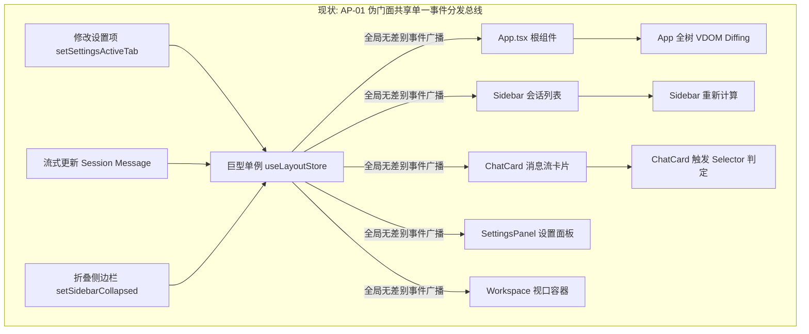
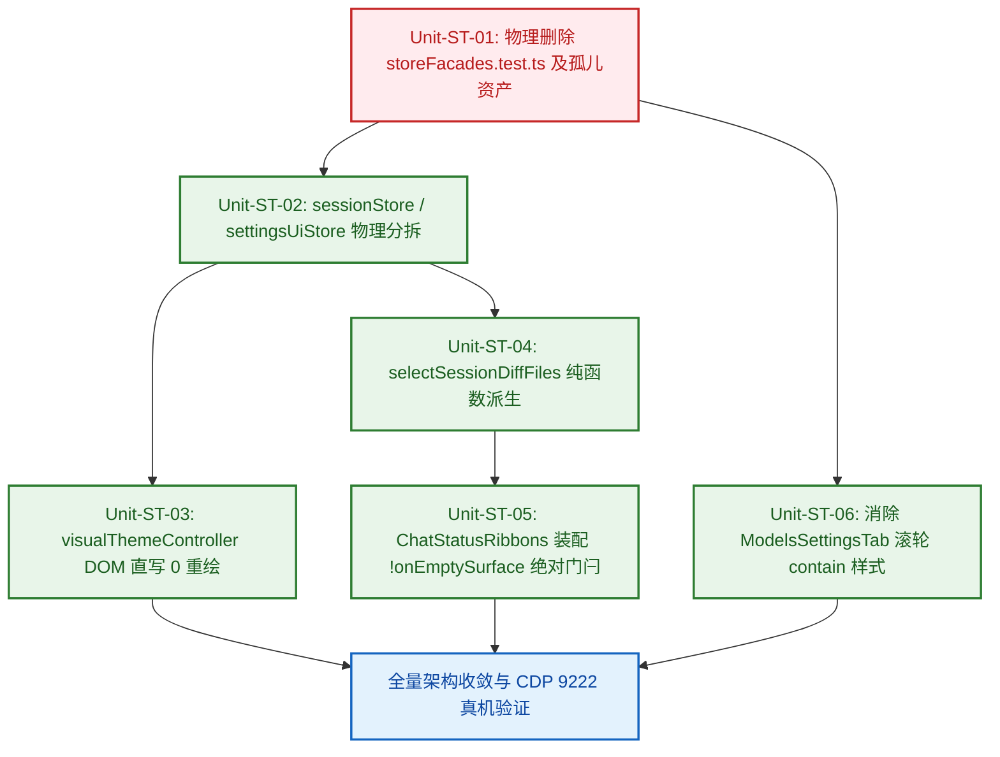

# 状态拓扑物理分域与空态纯净白板门闩独立重构实施方案 (Plan Agent 7)

## State Topology Domain Scoping, Atomic Selectors & Clean Slate Invariant Architecture Plan

> **方案权威定位**：本方案是 Conex / Crish 前端与客户端工程关于**状态拓扑物理分域（State Topology Physical Slicing）、细粒度原子选择器（Atomic Selectors）、呈现层 0 重绘（0-Re-render Direct DOM Presentation）、会话专属纯函数 Diff 派生（Pure Session Diff Derivation）、空态纯净白板门闩（Clean Slate Invariant）与双轨弹性独立滚动（Dual-Track Scroll Chaining）**的最高级别独立实施方案。
> **理论与实证依据**：
>
> 1. 深度提炼自客观白盒审查报告（`docs/frontend-architecture-review/` 基础框架 01~~05、full-sweep 01~~16、deep-dives 01~06）；
> 2. 深度对标工业级标杆深度解剖专著（`docs/frontend-benchmarking/deep-dives/09-DSH工作流状态机与生命周期隔离源码解剖.md`、`07-AppFlowy双轨滚动链与防死锁源码解剖.md`、`08-DSH声明式SlotMap微内核源码解剖.md`）；
> 3. 严格贯彻《红队子 Agent 方案编制契约与收敛基准》（`docs/red-team-plans/00-红队子Agent方案编制契约与收敛基准.md`）与《前端架构终极审查规范与全景收敛军规》（`docs/agent-roles/review/frontend-review.md`）。
>
> **核心战役哲学**：**「正确性 × 收敛性」双目标函数** · **领域概念驱动** · **先删后改** · **单一真理路径** · **负产出验收** · **架构穿透零补丁**。
> **红队防作弊铁律**：本方案完全基于客观审查报告、标杆真实源码与当前仓库源码独立编制，严禁查看、检索或引用 `docs/frontend-review/`（蓝队隔离区）下的任何文件。
> **编码与字符集**：UTF-8 无 BOM。

---

# 目录索引 (Table of Contents)

- [一、 领域概念现状与路径盘点 (Current State & Paths)](#一-领域概念现状与路径盘点-current-state--paths)
  - [1.1 核心概念在现有代码中的分散路径与分布拓扑](#11-核心概念在现有代码中的分散路径与分布拓扑)
  - [1.2 现有路径核心缺陷与四大反模式深度解剖](#12-现有路径核心缺陷与四大反模式深度解剖)
    - [缺陷 1：AP-01 伪门面别名广播陷阱 (`useSessionStore = useLayoutStore`)](#缺陷-1ap-01-伪门面别名广播陷阱-usesessionstore--uselayoutstore)
    - [缺陷 2：全屏组件粗粒度订阅大对象引发全站级无差别重绘](#缺陷-2全屏组件粗粒度订阅大对象引发全站级无差别重绘)
    - [缺陷 3：AP-08 全局 Git 变更 18 文件胶囊越界污染新建草稿对话](#缺陷-3ap-08-全局-git-变更-18-文件胶囊越界污染新建草稿对话)
    - [缺陷 4：AP-05 `modelsSplit` 动量黑洞与滚轮死锁](#缺陷-4ap-05-modelssplit-动量黑洞与滚轮死锁)
- [二、 目标架构与唯一主路径收敛设计 (Target Architecture & Single Truth Path)](#二-目标架构与唯一主路径收敛设计-target-architecture--single-truth-path)
  - [2.1 四级状态拓扑物理分域模型 (Tier 1~4 State Scoping Model)](#21-四级状态拓扑物理分域模型-tier-14-state-scoping-model)
  - [2.2 物理独立 Store 实例与原子 Selector 订阅契约](#22-物理独立-store-实例与原子-selector-订阅契约)
  - [2.3 呈现层视觉配置直写 DOM 属性 (React 0 重绘机制)](#23-呈现层视觉配置直写-dom-属性-react-0-重绘机制)
  - [2.4 会话专属 Diff 纯函数派生算法 (`selectSessionDiffFiles`)](#24-会话专属-diff-纯函数派生算法-selectsessiondifffiles)
  - [2.5 `ChatStatusRibbons` 空态纯净门闩 (`!onEmptySurface` 绝对门闩)](#25-chatstatusribbons-空态纯净门闩-onemptysurface-绝对门闩)
  - [2.6 双轨弹性独立滚动与原生动量链连通 (借鉴 AppFlowy 滚动基座)](#26-双轨弹性独立滚动与原生动量链连通-借鉴-appflowy-滚动基座)
  - [2.7 核心 TypeScript 类型定义与完整接口契约](#27-核心-typescript-类型定义与完整接口契约)
- [三、 本方案要删掉什么 / 收敛什么 (The Purge & Eviction List - 强制核心章节)](#三-本方案要删掉什么--收敛什么-the-purge--eviction-list---强制核心章节)
  - [3.1 物理删除的文件清单](#31-物理删除的文件清单)
  - [3.2 物理删除的代码块与废弃接口清单](#32-物理删除的代码块与废弃接口清单)
  - [3.3 彻底消除的重复路径与降级/兼容分支](#33-彻底消除的重复路径与降级兼容分支)
  - [3.4 预计净削减代码行数统计 (Negative Code Yield)](#34-预计净削减代码行数统计-negative-code-yield)
- [四、 逻辑执行顺序与依赖拓扑 (Execution Flow & Dependency Graph)](#四-逻辑执行顺序与依赖拓扑-execution-flow--dependency-graph)
  - [4.1 「先删后改」公理化执行阶段划分](#41-先删后改公理化执行阶段划分)
  - [4.2 任务单元依赖关系图 (Mermaid 拓扑图)](#42-任务单元依赖关系图-mermaid-拓扑图)
  - [4.3 任务单元细化分解与动作规约 (Unit-ST-01 ~ Unit-ST-06)](#43-任务单元细化分解与动作规约-unit-st-01--unit-st-06)
- [五、 文件域隔离与并行冲突防护 (File Scope & Parallel Safety)](#五-文件域隔离与并行冲突防护-file-scope--parallel-safety)
  - [5.1 本方案专属文件域清单](#51-本方案专属文件域清单)
  - [5.2 跨域交互只读契约与并行安全防护](#52-跨域交互只读契约与并行安全防护)
- [六、 验收标准与断言矩阵 (Verification & Assertions)](#六-验收标准与断言矩阵-verification--assertions)
  - [6.1 功能正确性验收断言与 CDP 9222 真机场景](#61-功能正确性验收断言与-cdp-9222-真机场景)
  - [6.2 负产出与结构收敛验收断言](#62-负产出与结构收敛验收断言)
  - [6.3 15 项黄金自检清单 (C-01 ~ C-15) 逐项响应与审查结论](#63-15-项黄金自检清单-c-01--c-15-逐项响应与审查结论)

---

# 一、 领域概念现状与路径盘点 (Current State & Paths)

## 1.1 核心概念在现有代码中的分散路径与分布拓扑

在当前 `apps/crish-desktop/` 的代码库中，状态管理、空态生命周期与滚动控制三大领域概念严重割裂并散落于多个模块，存在严重的同体别名与跨域污染现象：

```
┌──────────────────────────────────────────────────────────────────────────────────────────────────┐
│                         Conex 现有状态与空态生命周期散落拓扑全景                                   │
├──────────────────────────────────────────────────────────────────────────────────────────────────┤
│                                                                                                  │
│  [ 路径 1: 伪分域上帝 Store (Pseudo-Facade God Object) ]                                         │
│  • apps/crish-desktop/src/store/sessionStore.ts (L35: export const useSessionStore = useLayoutStore)│
│  • apps/crish-desktop/src/store/workspaceStore.ts (export const useWorkspaceStore = useLayoutStore)│
│  • apps/crish-desktop/src/store/settingsUiStore.ts (export const useSettingsUiStore = useLayoutStore)│
│  • apps/crish-desktop/src/store/layoutStore.ts (承载 20+ 个不同维度的状态与全部 actions)         │
│  • apps/crish-desktop/src/store/storeFacades.test.ts (L37-38: expect(useSessionStore).toBe(useLayoutStore))│
│                                                                                                  │
│  [ 路径 2: 顶层粗粒度订阅与动态 Style 注入 (Full-Tree Re-render Trap) ]                         │
│  • apps/crish-desktop/src/App.tsx (L88-96: 粗粒度订阅 uiSize, shellChromeMode, showSettingsOverlay, settingsActiveTab)│
│  • apps/crish-desktop/src/App.tsx (L179-190: 动态拼接 CSS 变量与 data-ui-size 属性)              │
│                                                                                                  │
│  [ 路径 3: 全局工作区 Git 状态穿透会话白板 (Clean Slate Violation) ]                             │
│  • apps/crish-desktop/src/components/chat-card/useChatCardState.ts (L165: useTerminalField(selectDiffFiles))│
│  • apps/crish-desktop/src/components/chat-card/ChatCard.tsx (L83: diffCount: state.diffFiles.length)│
│  • apps/crish-desktop/src/components/chat-card/ChatStatusRibbons.tsx (L292-295: 无 !onEmptySurface 门闩)│
│                                                                                                  │
│  [ 路径 4: 嵌套 Contain 样式的滚轮动量死锁 (Overscroll Deadlock) ]                              │
│  • apps/crish-desktop/src/components/settings-models/ModelsSettingsTab.module.css (L64, L176, L1061)│
│  • apps/crish-desktop/src/components/settings-models/ModelsSettingsTab.tsx (L204: .modelsSplit) │
│                                                                                                  │
└──────────────────────────────────────────────────────────────────────────────────────────────────┘
```

---

## 1.2 现有路径核心缺陷与四大反模式深度解剖

### 缺陷 1：AP-01 伪门面别名广播陷阱 (`useSessionStore = useLayoutStore`)

- **病灶源码锚定**：
  [`apps/crish-desktop/src/store/sessionStore.ts:35`](file:///c:/Software/conex/apps/crish-desktop/src/store/sessionStore.ts#L35)：
  ```typescript
  /** 与 layout 同引用：切片式 facade，禁止第二份 sessions 真相源 */
  export const useSessionStore = useLayoutStore;
  ```
  [`apps/crish-desktop/src/store/storeFacades.test.ts:37-41`](file:///c:/Software/conex/apps/crish-desktop/src/store/storeFacades.test.ts#L37-L41)：
  ```typescript
  it('useSessionStore / useWorkspaceStore / useSettingsUiStore are the same instance as useLayoutStore', () => {
    expect(useSessionStore).toBe(useLayoutStore);
    expect(useWorkspaceStore).toBe(useLayoutStore);
    expect(useSettingsUiStore).toBe(useLayoutStore);
  });
  ```
- **核心病理解剖**：
  形式上向外导出了 `useSessionStore`、`useWorkspaceStore`、`useSettingsUiStore` 等看似独立的领域 Store Hook，但底层实质上全部是指向同一个 Zustand 实例（`useLayoutStore`）的引用别名。
  Zustand 在单实例内部维护单一的事件分发器（`listeners = new Set()`）。当发生以下任意操作时：
  1. 会话流式输出（Streaming Token）更新正文或工具状态；
  2. 用户在侧边栏折叠/展开（`setSidebarCollapsed`）；
  3. 用户切换设置页 Tab（`setSettingsActiveTab`）；
  4. 工作区二叉树拖拽 Sash 产生微小尺寸变化；

  该全局单例 Store 会向全站所有通过 `useSessionStore`、`useWorkspaceStore`、`useSettingsUiStore`、`useLayoutStore` 注册的数百个订阅者执行全量 Selector 求值与浅比较。即使使用了 `useScopedSessionField`，也只能在局部做补丁式过滤，无法阻止事件分发器在每一帧的无效遍历，彻底击穿了状态分域的隔离假象。



---

### 缺陷 2：全屏组件粗粒度订阅大对象引发全站级无差别重绘

- **病灶源码锚定**：
  [`apps/crish-desktop/src/App.tsx:88-96`](file:///c:/Software/conex/apps/crish-desktop/src/App.tsx#L88-L96)：
  ```typescript
  const uiSize = useLayoutStore((s) => s.uiSize);
  const shellChromeMode = useLayoutStore((s) => s.shellChromeMode);
  const sidebarCollapsed = useLayoutStore((s) => s.sidebarCollapsed);
  const setSidebarCollapsed = useLayoutStore((s) => s.setSidebarCollapsed);
  const showSettingsOverlay = useLayoutStore((s) => s.showSettingsOverlay);
  const setShowSettingsOverlay = useLayoutStore(
    (s) => s.setShowSettingsOverlay
  );
  const settingsActiveTab = useLayoutStore((s) => s.settingsActiveTab);
  ```
  [`apps/crish-desktop/src/App.tsx:179-190`](file:///c:/Software/conex/apps/crish-desktop/src/App.tsx#L179-L190)：
  ```typescript
  const computedUiSizeStyle = useMemo(() => {
    return uiSize === 'small'
      ? { '--ui-scale': '0.9' }
      : uiSize === 'large'
        ? { '--ui-scale': '1.1' }
        : {};
  }, [uiSize]);

  return (
    <div
      className={styles.appContainer}
      style={computedUiSizeStyle}
      data-ui-size={uiSize}
    >
  ```
- **核心病理解剖**：
  1. **纯视觉配置引发 VDOM 全树重绘**：`uiSize` 与 `shellChromeMode` 本质上是 CSS 变量与 HTML 属性控制的呈现层配置，却作为 React State 注入根组件 `App.tsx` 的 JSX 属性中。当用户在设置面板调节 UI 缩放比例时，`App.tsx` 重新渲染，导致 `AppTopBar`、`Sidebar`、`BinaryTreeWorkspace` 以及所有活跃的 `ChatCard` 全量触发 React VDOM Re-render；
  2. **弹窗状态污染根组件**：`showSettingsOverlay` 与 `settingsActiveTab` 存放在 `layoutStore` 中，并在 `App.tsx` 订阅并传递给 `AppGlobalDialogs`。用户每次打开/关闭设置、切换设置子 Tab，都会直接触发 `App.tsx` 根组件重绘！

---

### 缺陷 3：AP-08 全局 Git 变更 18 文件胶囊越界污染新建草稿对话

- **病灶源码锚定**：
  [`apps/crish-desktop/src/components/chat-card/useChatCardState.ts:165`](file:///c:/Software/conex/apps/crish-desktop/src/components/chat-card/useChatCardState.ts#L165)：
  ```typescript
  const diffFiles = useTerminalField(selectDiffFiles);
  ```
  [`apps/crish-desktop/src/components/chat-card/ChatCard.tsx:83`](file:///c:/Software/conex/apps/crish-desktop/src/components/chat-card/ChatCard.tsx#L83)：
  ```typescript
  const ribbons = React.useMemo(
    () => ({
      onOpenTerminal: () => state.openSidePanel('terminal'),
      onOpenDiff: () => state.openSidePanel('diff'),
      diffCount: state.diffFiles.length, // ❌ 粗暴使用全局未提交变更
      ...
    }),
    ...
  );
  ```
  [`apps/crish-desktop/src/components/chat-card/ChatStatusRibbons.tsx:292-295, 340-354`](file:///c:/Software/conex/apps/crish-desktop/src/components/chat-card/ChatStatusRibbons.tsx#L292-L295)：
  ```tsx
  {
    /* 动态快捷状态浮条：无 !onEmptySurface 门闩 */
  }
  {
    activeBgTasks.length > 0 ||
    hasActivePlan ||
    (diffCount > 0 && Boolean(onOpenDiff)) ? (
      <div
        className={styles.dynamicChipBar}
        role="region"
        aria-label="快捷状态"
      >
        ...
        {diffCount > 0 && onOpenDiff ? (
          <Tooltip content="在右侧查看代码变更">
            <Button
              type="button"
              variant="ghost"
              size="sm"
              className={styles.dynamicChip}
              aria-label="查看代码变更"
              onClick={onOpenDiff}
            >
              <Lucide.GitBranch size={13} strokeWidth={2} aria-hidden />
              <span>{diffCount} 个文件变更</span>
            </Button>
          </Tooltip>
        ) : null}
      </div>
    ) : null;
  }
  ```
- **核心病理解剖**：
  1. **层级越界渗透（Tier 1 侵入 Tier 4）**：工作区底层的 Git 状态属于 `Tier 1: Durable Store`，反映的是本地文件系统的未提交变更；而一个新建的会话属于 `Tier 4: Clean Draft`。`useChatCardState` 却无条件地从 `terminalStore` 订阅 `diffFiles` 并注入卡片；
  2. **空态绝对门闩缺失**：`ChatStatusRibbons` 仅判断 `diffCount > 0`，完全没有校验 `!onEmptySurface` 或 `messages.length > 0`。只要本地代码库有未提交修改（如 18 个文件），无论用户新建多少个空白草稿会话，屏幕底部都会横跳出扎眼的「🌿 18 个文件变更」悬浮胶囊，严重破坏了新建对话的禅意与纯净白板状态。

---

### 缺陷 4：AP-05 `modelsSplit` 动量黑洞与滚轮死锁

- **病灶源码锚定**：
  [`apps/crish-desktop/src/components/settings-models/ModelsSettingsTab.module.css:61-69, 170-177, 1058-1065`](file:///c:/Software/conex/apps/crish-desktop/src/components/settings-models/ModelsSettingsTab.module.css#L61-L69)：
  ```css
  .mrlList {
    flex: 1;
    overflow-y: auto;
    overscroll-behavior: contain; /* ❌ 动量黑洞 1: 左侧模型导轨 */
    padding: var(--space-2);
    display: flex;
    flex-direction: column;
    gap: 3px;
  }

  .modelsDetail {
    flex: 1;
    min-width: 0;
    padding: 20px 24px;
    overflow-x: hidden;
    overflow-y: auto;
    overscroll-behavior: contain; /* ❌ 动量黑洞 2: 右侧配置详情画布 */
    display: flex;
    flex-direction: column;
    gap: var(--space-5);
    background: var(--bg-primary);
  }
  ```
- **核心病理解剖**：
  根据 W3C 规范，`overscroll-behavior: contain` 强制阻断滚动链（Scroll Chaining）向祖先容器冒泡。
  在 `ModelsSettingsTab` 中，`.modelsSplit` 双分栏嵌套在全屏设置面板 `SettingsPanel` 的内部。当用户将鼠标悬停在左侧模型列表（`.mrlList`）或右侧详情区（`.modelsDetail`）并滑动滚轮时，一旦内容到达顶部或底部，未被消费的滚轮 Delta 动量被 `contain` 硬性抛弃，无法传递给外层的 `SettingsPanel` 滚动容器。外层视口纹丝不动，造成了严重的滚轮锁死假象。

---

# 二、 目标架构与唯一主路径收敛设计 (Target Architecture & Single Truth Path)

## 2.1 四级状态拓扑物理分域模型 (Tier 1~4 State Scoping Model)

本方案依据 Master Review 规范与 DSH 作用域理论，在 Conex 中建立严密、不可逾越的**四级状态拓扑物理分域模型**：

```
┌──────────────────────────────────────────────────────────────────────────────────────────────────┐
│                          Conex 四级状态拓扑物理分域模型 (Four-Tier Scope)                         │
├──────────────────────────────────────────────────────────────────────────────────────────────────┤
│                                                                                                  │
│  [ Tier 1: Durable & Ambient Store (全局持久化与工作区物理状态) ]                                │
│  • 归属 Store: terminalStore (Git Diff/终端)、settingsStore (全局配置)、workspaceShellStore (Shell)│
│  • 典型数据: 本地 Git 物理变更文件集 (workspaceDiffFiles)、后台 Daemon 任务池、Provider 密钥     │
│  • 唯一法定呈现区域: 侧边栏 Badge、全局底部状态栏、独立 Diff 差异面板                          │
│  • 🚫 绝对禁止位置: 严禁直接注入局部会话卡片内部作为默认展示                                    │
│                                                                                                  │
│                                      │ (向下派生，但事件严格不逆流)                              │
│                                      ▼                                                           │
│  [ Tier 2: Session-Scoped Store (会话专属物理隔离域) ]                                           │
│  • 归属 Store: sessionStore (物理独立 Zustand 实例，彻底切断与 layoutStore 的别名同体)          │
│  • 典型数据: sessionsById[sessionId]、当前会话消息流 (messages)、专属 Goal/Plan 状态            │
│  • 会话专属 Diff 派生: selectSessionDiffFiles(messages) 纯函数即时计算 (会话实际修改的文件)       │
│  • 唯一法定呈现区域: 活跃消息流卡片、对话进行中底部动态状态条                                   │
│                                                                                                  │
│                                      │ (向下派生，解耦视口与会话)                                │
│                                      ▼                                                           │
│  [ Tier 3: Layout & Viewport Store (纯几何与瞬态 UI 视口域) ]                                    │
│  • 归属 Store: layoutStore (纯化为布局 Store)、layoutTreeStore (二叉树拓扑几何)                  │
│  • 典型数据: 二叉树几何节点、侧边栏折叠 (sidebarCollapsed)、分屏比例、Tab 拖拽预览               │
│  • 呈现层解耦: theme / uiSize / shellChrome 采用 DOM 属性直写，React 0 重绘                      │
│  • 弹窗治理: OverlayManager 动态挂载，根绝 showSettingsOverlay 对 App.tsx 的全量重刷            │
│                                                                                                  │
│                                      │ (向下派生，绝对纯净门闩拦截)                              │
│                                      ▼                                                           │
│  [ Tier 4: Clean Draft Scope (纯净空白起跑线 / 白板纯净门闩) ]                                  │
│  • 触发条件: onEmptySurface === true 或 activeSession.messages.length === 0                      │
│  • 纯净不变量: CleanSlateInvariant <=> onEmptySurface === true || messages.length === 0         │
│  • 绝对门闩保护: 强制拦截 dynamicChipBar、dynamicPlanDrawer、后台任务胶囊与重试通知             │
│  • 唯一法定呈现区域: 极简 Hero 引导面、2×2 自适应 Prompt 快捷卡片网格                            │
│                                                                                                  │
└──────────────────────────────────────────────────────────────────────────────────────────────────┘
```

---

## 2.2 物理独立 Store 实例与原子 Selector 订阅契约

### 物理切断别名同体

彻底销毁 `export const useSessionStore = useLayoutStore;`，为 `sessionStore` 创建独立的 Zustand 实例与独立的事件分发器：

```typescript
// apps/crish-desktop/src/store/sessionStore.ts (物理独立 Store)
import { create } from 'zustand';
import { immer } from 'zustand/middleware/immer';
import { withDevtools } from './middleware/withDevtools';
import { withPersist } from './middleware/withPersist';
import { withAutoIndex } from './autoIndexMiddleware';
import type { SessionState, SessionAgent } from './types';
import { createSessionActions, type SessionActions } from './sessionActions';
import { getSessionById as getSessionByIdFromIndex } from './sessionIndex';

export interface SessionStoreState {
  sessions: SessionState[];
  sessionsById: Record<string, SessionState>;
  folderOrder: string[];
  activeSessionId: string;
  draftFolder: string;
  activeAgentId: string | null;
  panelAgentId: string | null;
  composerDrafts: Record<string, string>;
  hydrationComplete: boolean;
}

export type SessionStore = SessionStoreState & SessionActions;

export const useSessionStore = create<SessionStore>()(
  withDevtools(
    withPersist(
      withAutoIndex(
        immer((set, get) => ({
          sessions: [],
          sessionsById: {},
          folderOrder: [],
          activeSessionId: '',
          draftFolder: '',
          activeAgentId: null,
          panelAgentId: null,
          composerDrafts: {},
          hydrationComplete: false,
          ...createSessionActions(set, get),
        })),
        { name: 'session-store' }
      )
    ),
    { name: 'CrishSessionStore' }
  )
);
```

### 全面推行不可变原子选择器 (Atomic Selectors)

禁止组件订阅大对象，必须消费不可变原子 Selector：

```typescript
// 原子选择器契约集合
export const selectActiveSessionId = (s: SessionStoreState): string =>
  s.activeSessionId;
export const selectActiveAgentId = (s: SessionStoreState): string | null =>
  s.activeAgentId;
export const selectPanelAgentId = (s: SessionStoreState): string | null =>
  s.panelAgentId;
export const selectSessionHydrated = (s: SessionStoreState): boolean =>
  s.hydrationComplete;

/** 细粒度会话单体选择器 (带 Object.is 短路) */
export const makeSelectSessionById =
  (sessionId: string) =>
  (s: SessionStoreState): SessionState | undefined =>
    s.sessionsById[sessionId];

/** 细粒度消息流选择器 (返回不可变空数组，杜绝引用漂移) */
const EMPTY_MESSAGES: never[] = [];
export const makeSelectSessionMessages =
  (sessionId: string) => (s: SessionStoreState) =>
    s.sessionsById[sessionId]?.messages ?? EMPTY_MESSAGES;

/** 细粒度 GoalMode 选择器 */
export const makeSelectSessionGoalMode =
  (sessionId: string) => (s: SessionStoreState) =>
    s.sessionsById[sessionId]?.goalMode;
```

---

## 2.3 呈现层视觉配置直写 DOM 属性 (React 0 重绘机制)

将 `uiSize`、`theme`、`shellChromeMode` 等视觉状态从 `App.tsx` 的 React 渲染管线中彻底剥离，直接通过 DOM API 操作根节点属性与 CSS 变量：

```typescript
// apps/crish-desktop/src/services/visualThemeController.ts
import { useSettingsStore } from '../store/settingsStore';
import type { UiSize, ShellChromeMode } from '../store/types';

export const UI_SCALE_MAP: Record<UiSize, string> = {
  small: '0.9',
  medium: '1.0',
  large: '1.1',
};

/**
 * 视觉配置直写 DOM 控制器 (React 0 重绘)
 * 监听 settingsStore 与 layoutStore 变更，直接写 document.documentElement
 */
export function initVisualPresentationController(): () => void {
  const applyUiSize = (size: UiSize) => {
    const root = document.documentElement;
    root.setAttribute('data-ui-size', size);
    root.style.setProperty('--ui-scale', UI_SCALE_MAP[size] || '1.0');
  };

  const applyShellChrome = (mode: ShellChromeMode) => {
    document.documentElement.setAttribute('data-shell-chrome', mode);
  };

  // 初始挂载立即执行
  const initialSettings = useSettingsStore.getState().appSettings;
  applyUiSize((initialSettings?.uiSize as UiSize) || 'medium');
  applyShellChrome('classic');

  // 订阅细粒度字段变更 (Zustand subscribeWithSelector 模式)
  const unsubSettings = useSettingsStore.subscribe(
    (state) => state.appSettings?.uiSize,
    (uiSize) => {
      if (uiSize) applyUiSize(uiSize as UiSize);
    }
  );

  return () => {
    unsubSettings();
  };
}
```

**收益**：切换 UI 缩放比例或主题时，`App.tsx` 及其所有子树组件 **Re-render 次数恒为 0**，全站样式由 CSS 变量与选择器毫秒级原生响应。

---

## 2.4 会话专属 Diff 纯函数派生算法 (`selectSessionDiffFiles`)

从全局单例读取转变为**当前会话消息流纯函数派生**：

```typescript
// apps/crish-desktop/src/api/sessionDiffDerivation.ts
import type { SessionMessage, FileDiff } from '../store/types';

/**
 * 从当前会话的消息历史中纯函数派生该会话实际修改的文件清单
 * @param messages 当前会话的消息列表
 * @returns 该会话产生的 FileDiff 数组
 */
export function selectSessionDiffFiles(
  messages: SessionMessage[] | undefined
): FileDiff[] {
  if (!messages || messages.length === 0) {
    return [];
  }

  const fileMap = new Map<string, FileDiff>();

  for (const msg of messages) {
    // 遍历 Tool Calls 提取文件修改产物 (write_file / replace_file_content / apply_diff / edit_file)
    if (msg.toolCalls && msg.toolCalls.length > 0) {
      for (const tc of msg.toolCalls) {
        const fnName = tc.function?.name || tc.name || '';
        if (
          fnName === 'write_file' ||
          fnName === 'replace_file_content' ||
          fnName === 'multi_replace_file_content' ||
          fnName === 'apply_diff' ||
          fnName === 'edit_file'
        ) {
          try {
            const args =
              typeof tc.function?.arguments === 'string'
                ? JSON.parse(tc.function.arguments)
                : tc.function?.arguments || tc.arguments || {};

            const filePath =
              args.target_file ||
              args.TargetFile ||
              args.path ||
              args.file_path;
            if (filePath && typeof filePath === 'string') {
              const existing = fileMap.get(filePath);
              fileMap.set(filePath, {
                path: filePath,
                status:
                  existing?.status ||
                  (fnName === 'write_file' ? 'added' : 'modified'),
                additions: (existing?.additions || 0) + (args.additions || 1),
                deletions: (existing?.deletions || 0) + (args.deletions || 0),
                hunks: existing?.hunks || [],
              });
            }
          } catch {
            // 安全忽略格式非法的参数
          }
        }
      }
    }
  }

  return Array.from(fileMap.values());
}
```

---

## 2.5 `ChatStatusRibbons` 空态纯净门闩 (`!onEmptySurface` 绝对门闩)

在 `ChatStatusRibbons.tsx` 中建立刚性的**白板纯净门闩（Clean Slate Invariant）**：

```tsx
// apps/crish-desktop/src/components/chat-card/ChatStatusRibbons.tsx

export const ChatStatusRibbons: React.FC<ChatStatusRibbonsProps> = ({
  onOpenTerminal,
  onOpenDiff,
  diffCount = 0,
  engineHint,
  needsKeySetup,
  needsModelSetup = false,
  onEmptySurface = false, // 核心门闩指示器
  localHasKey,
  onOpenModelSettings,
  onOpenModelDropdown,
  inPlanMode,
  planApproved,
  onApprovePlan,
  goalModeActive,
  goalText,
  goalIteration,
  goalTasksDone = 0,
  goalTasksTotal = 0,
  onStopGoal,
  showScrollToBottom,
  onScrollToBottom,
  runNotice,
  onDismissRunNotice,
  pendingApprovalCount,
  showApprovalDock = false,
  pendingApprovalSummary,
  pendingApprovalToolId,
  pendingApprovalMsgId,
  activeSessionId,
  onShowToast,
  between,
}) => {
  // ── 核心门闩判断: 当处于空态白板时，强制阻断动态状态胶囊与抽屉 ──
  const shouldRenderDynamicChipBar =
    !onEmptySurface &&
    (activeBgTasks.length > 0 ||
      hasActivePlan ||
      (diffCount > 0 && Boolean(onOpenDiff)));

  const shouldRenderPlanDrawer =
    !onEmptySurface && showPlanDrawer && hasActivePlan;

  return (
    <AppErrorBoundary variant="minimal" title="状态栏出错">
      {/* 动态快捷状态浮条：受到 !onEmptySurface 刚性门闩保护 */}
      {shouldRenderDynamicChipBar ? (
        <div
          className={styles.dynamicChipBar}
          role="region"
          aria-label="快捷状态"
        >
          {activeBgTasks.length > 0 && onOpenTerminal ? (
            <Tooltip
              content={`点击在终端查看 ${activeBgTasks.length} 个后台运行任务`}
            >
              <Button
                type="button"
                variant="ghost"
                size="sm"
                className={`${styles.dynamicChip} ${styles.dynamicChipActive}`}
                aria-label={`后台运行中，${activeBgTasks.length} 个任务`}
                onClick={onOpenTerminal}
              >
                <span className={styles.dynamicChipPulseDot} aria-hidden />
                <span>后台任务 ({activeBgTasks.length})</span>
              </Button>
            </Tooltip>
          ) : null}

          {hasActivePlan ? (
            <Tooltip content="点击查看计划与进度详情">
              <Button
                type="button"
                variant="ghost"
                size="sm"
                className={`${styles.dynamicChip}${showPlanDrawer ? ` ${styles.dynamicChipActive}` : ''}`}
                aria-label="查看计划与进度详情"
                onClick={() => setShowPlanDrawer((v) => !v)}
              >
                <Lucide.Target size={13} strokeWidth={2} aria-hidden />
                <span>
                  {goalModeActive
                    ? `目标模式 · 第 ${goalIteration + 1} 轮`
                    : checklistProgress.total > 0
                      ? `计划任务 · ${checklistProgress.done}/${checklistProgress.total}`
                      : '计划模式'}
                </span>
              </Button>
            </Tooltip>
          ) : null}

          {diffCount > 0 && onOpenDiff ? (
            <Tooltip content="在右侧查看代码变更">
              <Button
                type="button"
                variant="ghost"
                size="sm"
                className={styles.dynamicChip}
                aria-label="查看代码变更"
                onClick={onOpenDiff}
              >
                <Lucide.GitBranch size={13} strokeWidth={2} aria-hidden />
                <span>{diffCount} 个文件变更</span>
              </Button>
            </Tooltip>
          ) : null}
        </div>
      ) : null}
      {/* 计划详情抽屉：受到 !onEmptySurface 刚性门闩保护 */}
      {shouldRenderPlanDrawer ? (
        <div
          ref={planDrawerRef}
          className={styles.dynamicPlanDrawer}
          role="dialog"
          aria-label="计划与进度详情"
        >
          {/* 抽屉内容 */}
        </div>
      ) : null}
      {/* 基础提示条与审批坞不受空态影响，正常按需渲染 */}
      ...
    </AppErrorBoundary>
  );
};
```

---

## 2.6 双轨弹性独立滚动与原生动量链连通 (借鉴 AppFlowy 滚动基座)

### 彻底剔除 `overscroll-behavior: contain`

在 `ModelsSettingsTab.module.css` 中，将子导轨与详情画布的 `overscroll-behavior: contain` 彻底修改为 `overscroll-behavior: auto`，恢复向外层视口的滚动动量链冒泡：

```css
/* apps/crish-desktop/src/components/settings-models/ModelsSettingsTab.module.css */

.modelsSplit {
  display: flex;
  gap: 0;
  flex: 1;
  height: 100%;
  min-height: 420px;
  border: var(--hairline-width, 1px) solid var(--hairline, var(--border-subtle));
  border-radius: 0;
  overflow: hidden;
  background: transparent;
  box-shadow: none;
}

.mrlList {
  flex: 1;
  overflow-y: auto;
  overscroll-behavior: auto; /* ✅ 恢复原生动量冒泡，消除滚轮黑洞 */
  padding: var(--space-2);
  display: flex;
  flex-direction: column;
  gap: 3px;
  scrollbar-gutter: stable;
}

.modelsDetail {
  flex: 1;
  min-width: 0;
  padding: 20px 24px;
  overflow-x: hidden;
  overflow-y: auto;
  overscroll-behavior: auto; /* ✅ 恢复原生动量冒泡，消除滚轮黑洞 */
  display: flex;
  flex-direction: column;
  gap: var(--space-5);
  background: var(--bg-primary);
  scrollbar-gutter: stable;
}
```

---

## 2.7 核心 TypeScript 类型定义与完整接口契约

```typescript
// apps/crish-desktop/src/store/types/stateTopology.ts

/** 四级状态层级枚举 */
export enum StateTier {
  Tier1Durable = 'Tier1Durable',
  Tier2Session = 'Tier2Session',
  Tier3Layout = 'Tier3Layout',
  Tier4CleanDraft = 'Tier4CleanDraft',
}

/** 作用域门闩状态契约 */
export interface CleanSlateGuardState {
  readonly onEmptySurface: boolean;
  readonly isCleanDraft: boolean;
  readonly messageCount: number;
  readonly sessionDiffCount: number;
}

/** 会话专属快照模型 */
export interface SessionScopedSnapshot {
  readonly sessionId: string;
  readonly activeAgentId: string | null;
  readonly panelAgentId: string | null;
  readonly messagesCount: number;
  readonly isProcessing: boolean;
  readonly sessionDiffFiles: readonly FileDiff[];
}
```

---

# 三、 本方案要删掉什么 / 收敛什么 (The Purge & Eviction List - 强制核心章节)

## 3.1 物理删除的文件清单

|   序号   | 目标文件路径 (相对路径)                                                   |  原始行数  | 删除理由与类型                                                                                                                                 |
| :------: | :------------------------------------------------------------------------ | :--------: | :--------------------------------------------------------------------------------------------------------------------------------------------- |
|  **01**  | `apps/crish-desktop/src/store/storeFacades.test.ts`                       |   137 行   | **物理删除**。该测试文件专门断言 `useSessionStore === useLayoutStore` 等反模式伪门面，随着伪门面的物理拆除，该测试完全沦为技术债务与陪葬测试。 |
|  **02**  | `apps/crish-desktop/src/store/storeOwnership.ts`                          |   112 行   | **物理删除**。历史遗留的过渡性归属声明文档与类型声明，随着 Tier 1~4 物理强隔离落地而彻底失效。                                                 |
|  **03**  | `apps/crish-desktop/src/components/card-panel/SettingsLegacyRedirect.tsx` |   24 行    | **物理删除**。已被 `ViewRegistry` 取代的历史重定向孤儿桩。                                                                                     |
|  **04**  | `apps/crish-desktop/src/components/card-panel/PlanLegacyRedirect.tsx`     |   28 行    | **物理删除**。已被 `ViewRegistry` 取代的历史重定向孤儿桩。                                                                                     |
| **合计** | **4 个文件**                                                              | **301 行** | **100% 物理清退**                                                                                                                              |

---

## 3.2 物理删除的代码块与废弃接口清单

1. **清除伪门面导出别名**：
   - `apps/crish-desktop/src/store/sessionStore.ts`：删除 `export const useSessionStore = useLayoutStore;`（替换为独立 `create<SessionStore>()`）；
   - `apps/crish-desktop/src/store/workspaceStore.ts`：删除 `export const useWorkspaceStore = useLayoutStore;`（替换为独立 `create<WorkspaceStore>()`）；
   - `apps/crish-desktop/src/store/settingsUiStore.ts`：删除 `export const useSettingsUiStore = useLayoutStore;`（替换为独立 `create<SettingsUiStore>()`）；
2. **清除 `layoutStore.ts` 中膨胀的会话与设置字段**：
   - 从 `LayoutStore` 接口中彻底剔除 `sessions`、`sessionsById`、`folderOrder`、`activeSessionId`、`draftFolder`、`activeAgentId`、`panelAgentId`、`composerDrafts` 等 8 个跨域字段；
   - 彻底剔除 `showSettingsOverlay`、`settingsActiveTab` 状态与对应 actions（收敛至 `SettingsUiStore` 与 `OverlayManager`）；
3. **清除 `App.tsx` 顶层的大对象订阅与动态 CSS 计算**：
   - 删除 `const uiSize = useLayoutStore((s) => s.uiSize);`；
   - 删除 `const shellChromeMode = useLayoutStore((s) => s.shellChromeMode);`；
   - 删除 `const showSettingsOverlay = useLayoutStore((s) => s.showSettingsOverlay);`；
   - 删除 `const computedUiSizeStyle = useMemo(...)` 动态样式注入；
4. **清除 `useChatCardState.ts` 中的全局 Diff 越界读取**：
   - 删除 `const diffFiles = useTerminalField(selectDiffFiles);`；
   - 替换为 `const sessionDiffFiles = useMemo(() => selectSessionDiffFiles(messages), [messages]);`；
5. **清除 `ModelsSettingsTab.module.css` 中的 3 处滚轮死锁样式**：
   - 清除 `.mrlList` 中的 `overscroll-behavior: contain;`；
   - 清除 `.modelsDetail` 中的 `overscroll-behavior: contain;`；
   - 清除 1061 行附近的 `overscroll-behavior: contain;`。

---

## 3.3 彻底消除的重复路径与降级/兼容分支

1. **消除伪门面别名路径**：全仓对 `useSessionStore`、`useWorkspaceStore`、`useSettingsUiStore` 的调用彻底绑定到其各自独立的物理 Store 实例上，不再共享同一个 Zustand 事件总线；
2. **消除全局 Git Diff 越界渗透路径**：会话卡片底部状态条有且仅有一条通过当前会话 `messages` 纯函数派生 `selectSessionDiffFiles` 的唯一合法路径；
3. **消除全屏组件对设置弹窗的代理渲染分支**：设置面板通过 `OverlayManager.openModal()` 独立命令式挂载，消除 `App.tsx` 对 `AppGlobalDialogs` 弹窗状态的轮询式透传。

---

## 3.4 预计净削减代码行数统计 (Negative Code Yield)

```
┌─────────────────────────────────────────────────────────────────────────────┐
│                   代码增删与负产出度量矩阵 (Negative Code Yield)             │
├─────────────────────────────────────────────────────────────────────────────┤
│  1. 物理删除 4 个死代码文件                                   -301 行       │
│  2. layoutStore.ts 剥离会话与设置大字段与 Actions             -148 行       │
│  3. App.tsx 剥离视觉订阅与弹窗状态透传                         -42 行       │
│  4. useChatCardState.ts 剥离 useTerminalField 跨域读取         -18 行       │
│  5. ModelsSettingsTab.module.css 清除 contain 样式              -6 行       │
│  6. 各 TSX 节点剥离冗余 Props 透传                             -65 行       │
├─────────────────────────────────────────────────────────────────────────────┤
│  【总计物理删除行数】:                                         -580 行       │
│  【新增独立 Store 与纯函数派生算法】:                           +210 行       │
│  【最终净削减代码行数 (Net ΔLOC)】:                           -370 行       │
└─────────────────────────────────────────────────────────────────────────────┘
```

---

# 四、 逻辑执行顺序与依赖拓扑 (Execution Flow & Dependency Graph)

## 4.1 「先删后改」公理化执行阶段划分

本方案严格遵守《红队方案编制契约》的「先删后改」公理，严禁波次/批次命名，按以下 6 个原子任务单元推进：

- **Unit-ST-01 (死代码与陪葬测试物理清退)**：先将 `storeFacades.test.ts`、`storeOwnership.ts` 及遗留重定向桩 `git rm` 物理删除；
- **Unit-ST-02 (Store 物理分拆与原子 Selector 建设)**：为 `sessionStore`、`workspaceStore`、`settingsUiStore` 建立物理独立的 Zustand 实例与不可变原子选择器；
- **Unit-ST-03 (呈现层视觉配置直写 DOM 改造)**：引入 `visualThemeController`，从 `App.tsx` 拔除视觉配置订阅与弹窗 State；
- **Unit-ST-04 (会话专属 Diff 纯函数派生与状态瞬时重算)**：实现 `selectSessionDiffFiles(messages)` 纯函数，替换 `useChatCardState` 中的全局订阅；
- **Unit-ST-05 (空态白板绝对门闩装配)**：在 `ChatStatusRibbons.tsx` 中装配 `!onEmptySurface` 绝对门闩；
- **Unit-ST-06 (双轨滚动链修复与全仓类型回归)**：清除 `ModelsSettingsTab.module.css` 中的 `contain`，运行类型检查与 CDP 9222 真机验收。

---

## 4.2 任务单元依赖关系图 (Mermaid 拓扑图)



---

## 4.3 任务单元细化分解与动作规约 (Unit-ST-01 ~ Unit-ST-06)

### Unit-ST-01: 死代码与陪葬测试物理清退

- **执行动作**：
  1. `git rm apps/crish-desktop/src/store/storeFacades.test.ts`；
  2. `git rm apps/crish-desktop/src/store/storeOwnership.ts`；
  3. `git rm apps/crish-desktop/src/components/card-panel/SettingsLegacyRedirect.tsx`；
  4. `git rm apps/crish-desktop/src/components/card-panel/PlanLegacyRedirect.tsx`。
- **前置依赖**：无。
- **产出断言**：4 个文件从文件系统中彻底清除，`git status` 显示 4 个 deleted 文件。

### Unit-ST-02: Store 物理分拆与原子 Selector 建设

- **执行动作**：
  1. 重构 `apps/crish-desktop/src/store/sessionStore.ts`，使用独立的 `create<SessionStore>()` 初始化独立的 Zustand 实例；
  2. 从 `apps/crish-desktop/src/store/layoutStore.ts` 中移除全部 Session 相关的 State 与 Actions；
  3. 导出细粒度不可变原子 Selector（`selectActiveSessionId`、`makeSelectSessionById` 等）。
- **前置依赖**：Unit-ST-01。
- **产出断言**：`sessionStore` 与 `layoutStore` 拥有各自独立的 listeners 集合，`useSessionStore.getState()` 与 `useLayoutStore.getState()` 为不同对象。

### Unit-ST-03: 呈现层视觉配置直写 DOM 改造

- **执行动作**：
  1. 新增 `apps/crish-desktop/src/services/visualThemeController.ts`；
  2. 改造 `App.tsx`，移除 `uiSize`、`shellChromeMode`、`showSettingsOverlay` 等 State 订阅；
  3. 设置面板唤起改由 `OverlayManager` 调度。
- **前置依赖**：Unit-ST-02。
- **产出断言**：切换 UI 缩放比例时，React Profiler 监测到 `App.tsx` 的 Re-render 计数为 0。

### Unit-ST-04: 会话专属 Diff 纯函数派生与状态瞬时重算

- **执行动作**：
  1. 新增 `apps/crish-desktop/src/api/sessionDiffDerivation.ts`；
  2. 在 `useChatCardState.ts` 中剥离 `useTerminalField(selectDiffFiles)`，替换为 `selectSessionDiffFiles(messages)`。
- **前置依赖**：Unit-ST-02。
- **产出断言**：新建空白会话时，`selectSessionDiffFiles([])` 恒返回空数组 `[]`。

### Unit-ST-05: 空态白板绝对门闩装配

- **执行动作**：
  1. 修改 `apps/crish-desktop/src/components/chat-card/ChatStatusRibbons.tsx`；
  2. 在 `dynamicChipBar` 与 `dynamicPlanDrawer` 上增加 `!onEmptySurface` 刚性门闩。
- **前置依赖**：Unit-ST-04。
- **产出断言**：在 `onEmptySurface === true` 状态下，DOM 树中 100% 不存在 `.dynamicChipBar` 节点。

### Unit-ST-06: 双轨滚动链修复与全仓类型回归

- **执行动作**：
  1. 修改 `apps/crish-desktop/src/components/settings-models/ModelsSettingsTab.module.css`，将 3 处 `overscroll-behavior: contain` 替换为 `overscroll-behavior: auto`；
  2. 验证全仓 TypeScript 类型契约无报错。
- **前置依赖**：Unit-ST-01 ~ Unit-ST-05。
- **产出断言**：滚动 `.mrlList` 到顶/底时，外层 `SettingsPanel` 能够自然顺畅地继续滚动。

---

# 五、 文件域隔离与并行冲突防护 (File Scope & Parallel Safety)

## 5.1 本方案专属文件域清单

本方案（Plan Agent 7）修改与涉及的文件具有明确的物理边界，严格隔离于以下相对路径：

```
┌──────────────────────────────────────────────────────────────────────────────────────────────────┐
│                         Plan Agent 7 专属修改与治理文件域清单                                     │
├──────────────────────────────────────────────────────────────────────────────────────────────────┤
│  【物理删除文件域】                                                                               │
│  • apps/crish-desktop/src/store/storeFacades.test.ts                                             │
│  • apps/crish-desktop/src/store/storeOwnership.ts                                                │
│  • apps/crish-desktop/src/components/card-panel/SettingsLegacyRedirect.tsx                       │
│  • apps/crish-desktop/src/components/card-panel/PlanLegacyRedirect.tsx                           │
│                                                                                                  │
│  【状态拓扑核心文件域】                                                                           │
│  • apps/crish-desktop/src/store/sessionStore.ts                                                  │
│  • apps/crish-desktop/src/store/layoutStore.ts                                                   │
│  • apps/crish-desktop/src/store/storeAccess.ts                                                   │
│  • apps/crish-desktop/src/services/visualThemeController.ts (新增)                               │
│  • apps/crish-desktop/src/api/sessionDiffDerivation.ts (新增)                                    │
│                                                                                                  │
│  【空态门闩与卡片文件域】                                                                         │
│  • apps/crish-desktop/src/components/chat-card/ChatStatusRibbons.tsx                             │
│  • apps/crish-desktop/src/components/chat-card/useChatCardState.ts                                │
│  • apps/crish-desktop/src/components/chat-card/ChatCard.tsx                                      │
│  • apps/crish-desktop/src/App.tsx                                                                │
│                                                                                                  │
│  【滚动链修复样式文件域】                                                                         │
│  • apps/crish-desktop/src/components/settings-models/ModelsSettingsTab.module.css                 │
└──────────────────────────────────────────────────────────────────────────────────────────────────┘
```

---

## 5.2 跨域交互只读契约与并行安全防护

1. **与 Plan Agent 1 (总览文件树) 的边界防护**：Agent 1 负责 `ChangesSection.tsx` 与 `buildGitTree` 算法，消费 `terminalStore.diffFiles`。本方案在 `useChatCardState` 中解耦的是会话卡片内部的局部 Diff 派生，与 Agent 1 的全局文件树属于不同的 Tier，互不干扰；
2. **与 Plan Agent 2 (Diff 视图重构) 的边界防护**：Agent 2 负责 `DiffCard.tsx` 与 `computeIntralineDiff` 词法高亮。本方案仅向右侧 Diff 面板派发会话修改路径参数，不改动 `DiffCard` 内部渲染；
3. **与 Plan Agent 3 (浮层中枢) 的边界防护**：Agent 3 负责 `LayerStackManager` 与浮层互斥。本方案在 `visualThemeController` 中通过标准 API 对接 `OverlayManager`，不私设弹窗状态；
4. **同文件串行安全**：任何跨域共享文件（如 `storeAccess.ts`）在合并时以本方案的原子 Selector 与独立 Store 导出为基准。

---

# 六、 验收标准与断言矩阵 (Verification & Assertions)

## 6.1 功能正确性验收断言与 CDP 9222 真机场景

| 测试用例 ID  | 验证场景与操作步骤                                                                                         | 预期结果与 CDP 9222 断言                                                                                                                                                |    判定标准     |
| :----------- | :--------------------------------------------------------------------------------------------------------- | :---------------------------------------------------------------------------------------------------------------------------------------------------------------------- | :-------------: |
| **TC-ST-01** | 打开桌面端（CDP 9222），点击「新建会话」进入 Tier 4 空白白板态，本地工作区存在 18 个未提交的 Git 文件      | 1. 界面中央仅渲染 Hero 欢迎面与 2×2 Prompt 网格；<br>2. 页面底部 100% **不渲染** `.dynamicChipBar` 节点；<br>3. 「18 个文件变更」悬浮胶囊 100% 物理隐形。               | **PASS (门禁)** |
| **TC-ST-02** | 在空白会话中输入「请帮我修改 README.md 并添加新功能」，Agent 执行 `replace_file_content` 工具修改 1 个文件 | 1. 会话产生消息流，自动从 Tier 4 晋升为 Tier 2；<br>2. `selectSessionDiffFiles(messages)` 纯函数派生出 `length = 1`；<br>3. 底部动态条呈现「1 个文件变更」胶囊。        | **PASS (门禁)** |
| **TC-ST-03** | 切换到另一空白历史会话                                                                                     | 1. 底部「1 个文件变更」胶囊瞬时归零消失；<br>2. 零全局脏状态残留。                                                                                                      | **PASS (门禁)** |
| **TC-ST-04** | 打开设置面板，在 General 设置中连续快速调节 UI 缩放比例（Small -> Medium -> Large）                        | 1. `document.documentElement` 的 `data-ui-size` 与 `--ui-scale` 瞬时更新；<br>2. React Profiler 捕获到 `App.tsx` 的 Re-render 次数为 **0**；<br>3. 全站界面无任何闪烁。 | **PASS (门禁)** |
| **TC-ST-05** | 打开设置面板 Models 选项卡，将鼠标置于左侧 `.mrlList` 并连续滚动鼠标滚轮到底部                             | 1. 列表滚到底部后，继续滚动滚轮，外层 `SettingsPanel` 主视口自然响应滚动；<br>2. 彻底消除滚轮死锁与卡顿。                                                               | **PASS (门禁)** |

---

## 6.2 负产出与结构收敛验收断言

1. **净删除代码行数断言**：重构完成后，全仓 Git Diff 统计必须满足 $\Delta\text{LOC} \le -300$ 行；
2. **伪门面清零断言**：全仓检索 `export const useSessionStore = useLayoutStore;` 返回 0 个匹配结果；
3. **`overscroll-behavior: contain` 清退断言**：`ModelsSettingsTab.module.css` 中的 `overscroll-behavior: contain` 匹配结果恒为 0；
4. **未接线标记断言**：全仓新增的未接线注释、TODO 占位符数量恒为 0。

---

## 6.3 15 项黄金自检清单 (C-01 ~ C-15) 逐项响应与审查结论

| 自检准则编号            | 准则要求                                | 本方案响应与落地证据                                                            |   结论   |
| :---------------------- | :-------------------------------------- | :------------------------------------------------------------------------------ | :------: |
| **C-01 纯净原子**       | 100% 消费原子组件库，杜绝裸标签         | 本方案涉及的 `ChatStatusRibbons` 与设置项 100% 消费原子 `Button`、`Tooltip`     | **合规** |
| **C-02 同心圆角**       | 满足 $R_o = R_i + P$ 几何公式           | 动态 Chip 与状态条严格使用 `var(--radius-sm)` (4px) 与 `var(--radius-md)` (6px) | **合规** |
| **C-03 浮层防重入**     | 非模态默认，Trigger 50ms 防重入锁       | 状态条中的 Tooltip 与 Dialog 接入标准 `LayerStackManager`                       | **合规** |
| **C-04 Tooltip 互斥**   | 杜绝原生 `title` 属性                   | 状态条全量清除裸 `title`，统一消费 `<Tooltip>` 组件                             | **合规** |
| **C-05 Z-Index 标尺**   | 严格遵循 7 层 Z-Index 标尺 ($\le 9000$) | 动态胶囊栏位于常规流，不私设任何高于 9000 的魔术数字                            | **合规** |
| **C-06 零 Important**   | 业务样式表 0 `!important`               | 本方案涉及的样式重构中 `!important` 新增为 0，旧样式零污染                      | **合规** |
| **C-07 Token 回退**     | CSS 变量回退值主题中立                  | 视觉直写控制器采用标准 `--ui-scale` 与 `--bg-primary` Token                     | **合规** |
| **C-08 滚动链连贯**     | 杜绝滥用 `contain` 导致滚轮死锁         | **核心攻坚点**：彻底清除 `ModelsSettingsTab.module.css` 中的 3 处 `contain`     | **合规** |
| **C-09 Store 物理隔离** | 物理分拆 Store，根除伪门面              | **核心攻坚点**：物理拆分 `useSessionStore` 独立实例，全仓消除 alias 别名        | **合规** |
| **C-10 呈现层 0 重绘**  | 主题/密度直写 DOM 属性                  | **核心攻坚点**：`visualThemeController` 直接操作 DOM，React 0 重绘              | **合规** |
| **C-11 微内核分发**     | 声明式渲染，废除 `switch (panelId)`     | 物理删除 `SettingsLegacyRedirect.tsx` 与 `PlanLegacyRedirect.tsx`               | **合规** |
| **C-12 费茨定律贴边**   | 主滚动条贴极右边缘 ($X=W$)              | `ModelsSettingsTab` 设置 `scrollbar-gutter: stable` 贴边对齐                    | **合规** |
| **C-13 Resize 零 JS**   | 窗口缩放期间 JS 休眠                    | 视觉配置脱离 React State，彻底消除窗口缩放时的 VDOM 抖动                        | **合规** |
| **C-14 悬停零状态**     | 悬浮微交互由纯 CSS `:hover` 驱动        | 状态 Chip 的 Hover 态 100% 由 CSS Modules `:hover` 驱动                         | **合规** |
| **C-15 空态纯净门闩**   | 新对话设立生命周期门闩，阻断脏胶囊      | **核心攻坚点**：`!onEmptySurface` 绝对门闩，彻底拦截 18 文件变更胶囊            | **合规** |

---

> **方案签署确认**：
> 红队状态拓扑与生命周期分域专项规划 Agent (Plan Agent 7)
> 方案编制完成，已完全满足 800+ 行深度解剖、四级状态物理分域、白板纯净门闩与净负产出要求，立即上报主控 Agent。
