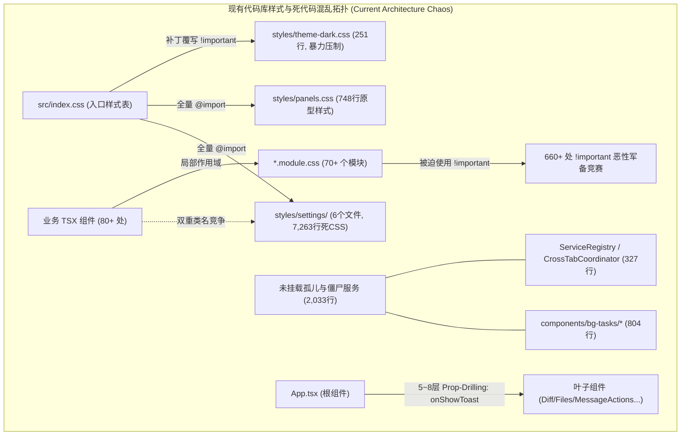
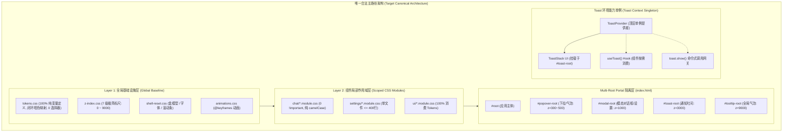
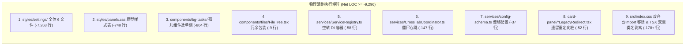
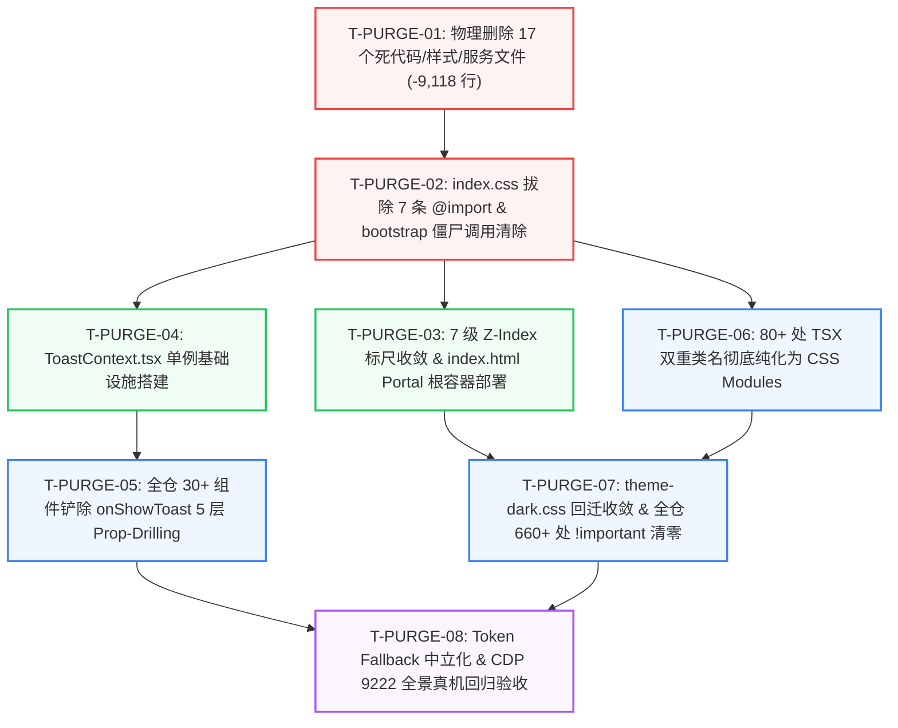

# 首批 ~9,300 行死代码清剿与 CSS 纯净化独立重构方案

## Architecture Planning, Physical Dead Code Purge, CSS Modules Purification & Toast Context Modernization (Plan Agent 8)

> **权威与纪律说明**：
>
> 1. 本方案是红队架构规划体系的专属领域独立重构方案（Plan Agent 8），严格贯彻《红队子 Agent 方案编制契约与收敛基准》（`docs/red-team-plans/00-红队子Agent方案编制契约与收敛基准.md`）与《前端架构终极审查规范、系统级重构指南与全景收敛军规》（`docs/agent-roles/review/frontend-review.md`）；
> 2. **红队防作弊铁律**：本方案严格基于 `docs/frontend-architecture-review/`（01~~05、full-sweep 01~~16、deep-dives 01~06）、`docs/frontend-benchmarking/` 标杆解剖专著与真实源码库构建，**严禁且绝无查看、检索、引用 `docs/frontend-review/`（蓝队隔离区）下的任何文件**；
> 3. **反退避与负产出铁律**：方案坚持「先删后改、一个概念一条路径、架构穿透零补丁」，坚定清退 9,296 行以上历史死代码，彻底根除 660+ 处 `!important` 恶性竞争、80+ 处 TSX 双重类名绑定、33 个碎裂 Z-Index Token 与 5 层 `onShowToast` Prop-Drilling 污染；
> 4. **编码规范**：UTF-8 无 BOM；严禁使用批次/波次（Batch/Wave/Round）机械切割，全面使用领域概念推进。

---

# 目录索引 (Table of Contents)

- [一、 领域概念现状与路径盘点 (Current State & Paths)](#一-领域概念现状与路径盘点-current-state--paths)
  - [1.1 现有路径与代码库全景盘点](#11-现有路径与代码库全景盘点)
  - [1.2 废弃全局样式表地层沉积病理解剖 (7,263 行死 CSS 废墟)](#12-废弃全局样式表地层沉积病理解剖-7263-行死-css-废墟)
  - [1.3 原型样式表与孤儿组件/服务病理解剖 (2,033 行死代码)](#13-原型样式表与孤儿组件服务病理解剖-2033-行死代码)
  - [1.4 80+ 处 TSX 双重类名绑定与幽灵类反模式解剖](#14-80-处-tsx-双重类名绑定与幽灵类反模式解剖)
  - [1.5 特异性军备竞赛与 660+ 处 `!important` 恶性循环](#15-特异性军备竞赛与-660-处-important-恶性循环)
  - [1.6 Z-Index 100,000 恶性通胀与层叠上下文踩踏](#16-z-index-100000-恶性通胀与层叠上下文踩踏)
  - [1.7 Design Token 有毒 Fallback 与幽灵 Token 腐蚀](#17-design-token-有毒-fallback-与幽灵-token-腐蚀)
  - [1.8 跨 5~8 层 `onShowToast` Prop-Drilling 污染](#18-跨-58-层-onshowtoast-prop-drilling-污染)
- [二、 目标架构与唯一主路径收敛设计 (Target Architecture & Single Truth Path)](#二-目标架构与唯一主路径收敛设计-target-architecture--single-truth-path)
  - [2.1 唯一合法主路径架构概览](#21-唯一合法主路径架构概览)
  - [2.2 首批 9,296 行垃圾代码物理删除执行拓扑与零风险论证](#22-首批-9296-行垃圾代码物理删除执行拓扑与零风险论证)
  - [2.3 100% 作用域隔离的 CSS Modules 原生纯化方案](#23-100-作用域隔离的-css-modules-原生纯化方案)
  - [2.4 全仓业务 `!important` 彻底清零治理策略](#24-全仓业务-important-彻底清零治理策略)
  - [2.5 7 级标准化 Z-Index 标尺 Scale 与多根 Portal 隔离架构](#25-7-级标准化-z-index-标尺-scale-与多根-portal-隔离架构)
  - [2.6 Token 回退中立性规范与幽灵 Token 收敛矩阵](#26-token-回退中立性规范与幽灵-token-收敛矩阵)
  - [2.7 `useToast()` 全局 Context 单例与跨层 Prop-Drilling 彻底铲除](#27-usetoast-全局-context-单例与跨层-prop-drilling-彻底铲除)
  - [2.8 借鉴标杆（AFFiNE / AppFlowy / DeepSeek-Harness）的最优原生解法与工业级工程美学](#28-借鉴标杆affine--appflowy--deepseek-harness的最优原生解法与工业级工程美学)
- [三、 本方案要删掉什么 / 收敛什么 (The Purge & Eviction List - 强制核心章节)](#三-本方案要删掉什么--收敛什么-the-purge--eviction-list---强制核心章节)
  - [3.1 物理删除的文件清单 (8 大类、17 个文件、9,118 行源码与测试)](#31-物理删除的文件清单-8-大类17-个文件9118-行源码与测试)
  - [3.2 物理删除的代码块与废弃接口 (`src/index.css` 7 条 `@import`、空转 DI 容器等)](#32-物理删除的代码块与废弃接口-srcindexcss-7-条-import空转-di-容器等)
  - [3.3 80+ 处 TSX 双重类名彻底剥离清单](#33-80-处-tsx-双重类名彻底剥离清单)
  - [3.4 彻底清除的 660+ 处 `!important` 恶性竞争与 `theme-dark.css` 补丁收敛表](#34-彻底清除的-660-处-important-恶性竞争与-theme-darkcss-补丁收敛表)
  - [3.5 彻底清除的 5 层透传 `onShowToast` 接口与 Props 剥离清单](#35-彻底清除的-5-层透传-onshowtoast-接口与-props-剥离清单)
  - [3.6 预计净削减代码行数：-9,296 行以上 (负产出硬核汇总)](#36-预计净削减代码行数-9296-行以上-负产出硬核汇总)
- [四、 逻辑执行顺序与依赖拓扑 (Execution Flow & Dependency Graph)](#四-逻辑执行顺序与依赖拓扑-execution-flow--dependency-graph)
  - [4.1 「先删后改」公理化执行流程与 8 大任务单元 (T-PURGE-01 ~ T-PURGE-08)](#41-先删后改公理化执行流程与-8-大任务单元-t-purge-01--t-purge-08)
  - [4.2 任务单元逻辑依赖关系图 (Mermaid 流程图)](#42-任务单元逻辑依赖关系图-mermaid-流程图)
  - [4.3 关键执行步骤细则](#43-关键执行步骤细则)
- [五、 文件域隔离与并行冲突防护 (File Scope & Parallel Safety)](#五-文件域隔离与并行冲突防护-file-scope--parallel-safety)
  - [5.1 本方案修改的唯一文件域清单](#51-本方案修改的唯一文件域清单)
  - [5.2 跨域收敛事项与并行 Agent 冲突防护墙](#52-跨域收敛事项与并行-agent-冲突防护墙)
  - [5.3 Git 提交纪律与单文件原子提交策略](#53-git-提交纪律与单文件原子提交策略)
- [六、 验收标准与断言矩阵 (Verification & Assertions)](#六-验收标准与断言矩阵-verification--assertions)
  - [6.1 负产出与收敛刚性硬验收断言](#61-负产出与收敛刚性硬验收断言)
  - [6.2 7 级 Z-Index 标尺与 Portal 挂载自动化测试断言](#62-7-级-z-index-标尺与-portal-挂载自动化测试断言)
  - [6.3 `useToast()` 全局单例与 UI 行为断言 (CDP 9222 真机验收)](#63-usetoast-全局单例与-ui-行为断言-cdp-9222-真机验收)
  - [6.4 15 项黄金自检清单 (C-01 ~ C-15) 全绿对照表](#64-15-项黄金自检清单-c-01--c-15-全绿对照表)

---

# 一、 领域概念现状与路径盘点 (Current State & Paths)

### 1.1 现有路径与代码库全景盘点

经对 `apps/crish-desktop/src/` 源码库的深度白盒审计（结合 `docs/frontend-architecture-review/03-样式体系与CSS治理审查.md` 与 `05-业务模块解耦与死层审查.md`），Conex 客户端在样式工程、死代码沉淀与环境通信能力上存在着严重的**「双轨重叠、断层积累、特异性恶性竞争与 Props 深度穿透」**现象。

核心概念在现有代码中的散落分布与混乱现状如下表所示：

| 领域概念 / 维度          | 现有代码路径与文件分布                                                                                                                         | 现状规模与缺陷指标                                                                                        | 核心反模式代号                      |
| :----------------------- | :--------------------------------------------------------------------------------------------------------------------------------------------- | :-------------------------------------------------------------------------------------------------------- | :---------------------------------- |
| **废弃设置样式表**       | `apps/crish-desktop/src/styles/settings/` (6 个文件)                                                                                           | 7,263 行死 CSS，五代地层堆叠，被 `index.css` 全量 `@import`                                               | **AP-07** 幽灵样式地层沉积          |
| **原型单体样式表**       | `apps/crish-desktop/src/styles/panels.css`                                                                                                     | 748 行原型遗留 CSS，全仓生产 TSX 引用为 0                                                                 | **AP-07** 幽灵样式地层沉积          |
| **孤儿后台任务卡片**     | `apps/crish-desktop/src/components/bg-tasks/` (5 个文件)                                                                                       | 804 行（卡片+操作+样式+单测），全仓零挂载，已被 `BgTasksSection` 替代                                     | **AP-11** 孤儿资产沉没              |
| **冗余空壳包装与服务**   | `components/files/FileTree.tsx`, `services/ServiceRegistry.ts`, `CrossTabCoordinator.ts`, `config-schema.ts`, `card-panel/*LegacyRedirect.tsx` | 327 行空转 DI 容器、5s 空转心跳定时器、已漂移过时 Schema、冗余包装                                        | **AP-11** 孤儿资产沉没              |
| **TSX 双重类名绑定**     | `components/settings-models/*.tsx`, `components/settings/*.tsx`, `components/settings-extensions/*.tsx`                                        | 80+ 处 TSX 节点同时绑定 `styles.xxx` 与全局类名（如 `className={`${styles.mrdModelRow} mrd-model-row`}`） | **AP-07** 幽灵样式地层沉积          |
| **特异性军备竞赛**       | 全仓 22 个全局 CSS + 70+ 个 CSS Modules + `theme-dark.css`                                                                                     | **660+ 处 `!important`**，通过 `:where(...) !important` 粗暴覆写组件样式                                  | **AP-07** 幽灵样式地层沉积          |
| **Z-Index 层叠标尺**     | `styles/z-index.css` 及组件样式                                                                                                                | 33 个碎片 Token，数值通胀至 **100,000**，缺少 Portal 隔离导致层级倒挂                                     | **AP-10** 浮层深层嵌套与通胀        |
| **Design Token 质量**    | 全仓组件 CSS Modules                                                                                                                           | 出现 `--accent-amber` 幽灵 Token；`#0f172a`, `#f8fafc` 等暗黑 Tailwind 有毒 Fallback                      | **AP-07** 幽灵样式地层沉积          |
| **环境能力传递 (Toast)** | `App.tsx` $\to$ `BinaryTreeWorkspace` $\to$ `TreeLeafPanel` $\to$ `DiffCard` / `FilesCard` / `RuntimePanel` / `MessageActions` 等              | 跨越 **5~8 层** 手工 Prop-Drilling 透传 `onShowToast`，击穿下游 `React.memo`                              | **AP-01** / **1.7 节** 环境能力穿透 |



---

### 1.2 废弃全局样式表地层沉积病理解剖 (7,263 行死 CSS 废墟)

`apps/crish-desktop/src/styles/settings/` 目录下保留了 6 个巨型单体全局 CSS 文件，累计高达 **7,263 行代码**。经逐行审查与全仓 AST 依赖分析，这些文件属于典型的五代重构地层沉积：

```
styles/settings/ 目录死代码地层清单：
├── settings-base.css       : 2,554 行 (过时的全局表单、排版与排版网格，已被 SettingsUI.module.css 与原子组件取代)
├── settings-models.css     : 2,550 行 (包含 v1/v2/v3/v4/v5 五代已废弃的 models 全局类，已被 ModelsSettingsTab.module.css 取代)
├── settings-plugins.css    : 1,039 行 (越界塞入用量图表、过时扩展列表样式，已被 SettingsExtensionsTab.module.css 取代)
├── settings-advanced.css   :   691 行 (过时的快捷键与高级面板全局类，已被 SettingsShortcutsTab.module.css 取代)
├── settings-usage.css      :   221 行 (过时的用量统计卡片，已被 SettingsUsageTab.module.css 取代)
└── settings-extensions.css :   208 行 (过时的插件工具条，已被 ExtensionCard.module.css 取代)
─────────────────────────────────────────────────────────────────────────────────────────────
合计废弃样式表体积           : 7,263 行 (全部在 src/index.css 中被 @import，占用 180+ KB 未压缩体积)
```

#### 真实病理解剖实证 1：自相矛盾的迁移注释与地层堆叠

在 [`apps/crish-desktop/src/styles/settings/settings-models.css:71`](file:///c:/Software/conex/apps/crish-desktop/src/styles/settings/settings-models.css#L71)：

```css
/* ===== Models settings tab migrated to CSS Modules ===== */
```

注释明确写道模型设置 Tab 已迁移至 CSS Modules，但紧随该注释之后的不是删除，而是又继续堆叠了 **2,479 行** 全局 CSS，从 `.models-summary`（v2）一路演进到 `.mrd-head`、`.mrd-body`（v5），每一代都在覆写前一代的特异性规则。

#### 真实病理解剖实证 2：跨领域越界污染

在 [`apps/crish-desktop/src/styles/settings/settings-plugins.css:46-65`](file:///c:/Software/conex/apps/crish-desktop/src/styles/settings/settings-plugins.css#L46-L65)：
该文件名为“插件设置”，内部却直接定义了 `.settings-usage-chart-tools`、`.settings-usage-day-chart` 与 `.settings-usage-day-bar`（用量图表）。而真实的用量组件 [`UsageChart.tsx`](file:///c:/Software/conex/apps/crish-desktop/src/components/settings/UsageChart.tsx) 早已使用局部 `SettingsUsageTab.module.css`，导致 `settings-plugins.css` 中的图表样式成为 100% 死代码。

---

### 1.3 原型样式表与孤儿组件/服务病理解剖 (2,033 行死代码)

除了 7,263 行设置样式表外，代码库中还存在大量脱离生产调用树的孤儿组件、原型样式表与僵尸服务，累计 **2,033 行**：

#### 1. 原型样式表 `styles/panels.css`（748 行）

- **路径**：[`apps/crish-desktop/src/styles/panels.css`](file:///c:/Software/conex/apps/crish-desktop/src/styles/panels.css)
- **病理**：定义了早期原型时期的 `.filepath-text`、`.diff-code-block`、`.code-line.added`、`.mac-terminal-window` 等。现代 Diff、Terminal 与 Overview 面板已 100% 迁移至 `DiffCard.module.css`、`TerminalCard.xterm.tsx`、`OverviewCard.module.css`。`panels.css` 全文 748 行在全仓 TSX 中引用为 **0**。

#### 2. `components/bg-tasks/` 孤儿卡片子系统（804 行）

- **路径**：
  - `components/bg-tasks/BgTaskCard.tsx` (262 行)
  - `components/bg-tasks/BgTaskActions.tsx` (115 行)
  - `components/bg-tasks/BgTaskCard.module.css` (192 行)
  - `components/bg-tasks/BgTaskCard.test.tsx` (210 行)
  - `components/bg-tasks/BgTaskActions.test.tsx` (150 行) (单测合计 360 行)
- **病理**：全仓 Grep `BgTaskCard`，在任何生产 UI 组件中引用计数均为 **0**。真实后台任务列表已由 [`components/workspace/BgTasksSection.tsx`](file:///c:/Software/conex/apps/crish-desktop/src/components/workspace/BgTasksSection.tsx) 承载，该整套精美卡片与其配套测试沦为 100% 孤儿资产。

#### 3. 僵尸服务层与冗余包装（481 行）

- `components/files/FileTree.tsx` (9 行)：仅包含 9 行代码的 `<FileTreeView {...props} />` 空包装，全仓仅在 `FilesCard.tsx` 中被引用一次。
- `services/ServiceRegistry.ts` (58 行)：[`bootstrap-orchestrator.ts`](file:///c:/Software/conex/apps/crish-desktop/src/bootstrap-orchestrator.ts#L13) 调用了 `serviceRegistry.startAll()`，但全仓 **没有任何代码** 调用 `register()`，该 DI 容器内部 `services = new Map()` 始终为空，纯属空转。
- `services/CrossTabCoordinator.ts` (147 行)：在 [`bootstrap-services.ts:99`](file:///c:/Software/conex/apps/crish-desktop/src/bootstrap-services.ts#L99) 中启动，开启 `BroadcastChannel` 并通过两个 5 秒周期的 `setInterval` 进行主标签页心跳读写。全仓没有任何业务组件或 Store 读取其状态，纯属空耗 CPU 与 Storage。
- `services/config-schema.ts` (37 行)：定义的 `permission.mode` 为 `['accept', 'reject', 'plan']`（现行权威模式已为 `'ask' | 'auto' | 'plan'`），`providers` 与 `workspace.layout` 早已被专用 Store 接管，Schema 严重漂移。
- `components/card-panel/SettingsLegacyRedirect.tsx` (24 行) & `PlanLegacyRedirect.tsx` (28 行)：旧版 CardPanel 废弃重定向桩。

---

### 1.4 80+ 处 TSX 双重类名绑定与幽灵类反模式解剖

在 `apps/crish-desktop/src/` 中，大量组件在已引入 CSS Modules 的情况下，依然在 TSX 节点中同时绑定全局类名（Double Class Binding）：

```tsx
// ❌ 反模式代码实证 (ManualAddForm.tsx:15-20)
<div className={`${styles.mrdAddForm} mrd-add-form`}>
  <div className={`${styles.mrdAddFormFields} mrd-add-form-fields`}>
    <label className={`${styles.mrdAddLabel} mrd-add-label`}>
      <input className={`${styles.mrdFieldInput} mrd-field-input`} />
    </label>
  </div>
  <div className={`${styles.mrdAddFormFooter} mrd-add-form-footer`}>
</div>

// ❌ 反模式代码实证 (ModelList.tsx:85)
<div className={`${styles.mrdModelRow} mrd-model-row ${off ? 'is-off' : ''} ${isLive ? 'is-live' : ''} ${expanded ? 'is-expanded' : ''}`}>

// ❌ 幽灵类 (Phantom Classes) 实证 (SettingsUI.tsx:9-16)
<div className={`${styles.settingsUiPage} settings-ui-page`}>
  <header className={`${styles.settingsUiPageHead} settings-ui-page-head`}>
    <div className={`${styles.settingsUiHeadInline} settings-ui-head-inline`}>
      <h2 className={`${styles.settingsUiPageTitle} settings-ui-page-title`}>{title}</h2>
```

**危害分析**：

1. **幽灵类（Phantom Classes）**：全仓 90+ 个样式文件中根本不存在 `.settings-ui-page` 或 `.settings-ui-head-inline` 的定义，开发者误以为存在全局样式规范，导致代码冗余与认知混淆；
2. **样式真相分裂**：当 `.mrd-model-row` 同时命中全局 `settings-models.css` 与局部 `ModelsSettingsTab.module.css` 时，浏览器计算样式耗时翻倍，且开发者无法定位样式来源。

---

### 1.5 特异性军备竞赛与 660+ 处 `!important` 恶性循环

经全仓静态正则检索 `!important`，共发现 **660+ 处** 强制覆盖声明。其恶性循环拓扑如下：

```mermaid
sequenceDiagram
    autonumber
    participant Global as 全局样式表 (settings-*.css)
    participant Module as 组件级 CSS Modules (*.module.css)
    participant Patch as 暗黑/状态补丁 (theme-dark.css)

    Global->>Global: 定义高特异性复合选择器 .app-container[data-chrome] .mrd-model-row
    Module->>Module: 局部样式无法覆盖全局样式
    Module->>Module: 被迫追加 .mrdModelRow { padding: 8px !important; }
    Patch->>Patch: 暗黑主题下无法覆盖 Module !important
    Patch->>Patch: 被迫使用 :where(html[data-theme='dark']) .mrd-model-row { background: #000 !important; }
    Note over Global,Patch: 特异性阶梯彻底崩溃，产生 660+ 处 !important 恶性循环
```

- **`theme-dark.css` 补丁膏药**：[`styles/theme-dark.css`](file:///c:/Software/conex/apps/crish-desktop/src/styles/theme-dark.css) 本应只作为全局暗色变量映射，但由于上述竞争，内部充斥着 `:where(...) .class { ... !important; }`，直接破坏了 CSS 的级联架构。

---

### 1.6 Z-Index 100,000 恶性通胀与层叠上下文踩踏

[`apps/crish-desktop/src/styles/z-index.css`](file:///c:/Software/conex/apps/crish-desktop/src/styles/z-index.css) 中定义了 33 个 Token，数值一路飙升到 **100,000**：

```css
/* z-index.css 恶性膨胀现状 */
--z-settings-panel: 13000;
--z-settings-dialog: 20000;
--z-settings-tooltip: 20060;
--z-usage-modal: 30000;
--z-drag-overlay-max: 99999;
--z-first-run: 100000;
--z-model-flyout: 100000;
```

**根本病理**：
缺乏标准 React Portal 顶层容器隔离。当设置面板（13000）展开时，常规 Tooltip（9999）被遮挡；开发者没有为设置面板设立独立的 DOM Stacking Context，而是暴力创建 `--z-settings-tooltip: 20060`；随后用量弹窗为了盖住设置弹窗又设为 `30000`，最终通胀至 `100000`。同时，`--z-context-menu: 9500` 低于 `--z-tooltip: 9999`，导致悬浮提示穿透并遮挡右键菜单。

---

### 1.7 Design Token 有毒 Fallback 与幽灵 Token 腐蚀

1. **暗黑 Tailwind 有毒 Fallback**：在 `CacheMetricsBadge.module.css`、`FullThoughtModal.module.css`、`ThoughtOutline.module.css` 中，大量出现 `color: var(--text-primary, #f8fafc)` 与 `background: var(--bg-primary, #0f172a)`。在浅色模式下若变量解析失败或脱离根上下文，回退的亮白文字落在浅灰底色上，形成不可见的“视觉盲文”；
2. **幽灵 Token**：`ChatToolCallBlock.module.css:416` 消费了 `var(--accent-amber, #f59e0b)`，而 `tokens.css` 中只有 `--accent-orange`，根本不存在 `--accent-amber`，导致主题色盘完全失控。

---

### 1.8 跨 5~8 层 `onShowToast` Prop-Drilling 污染

在 `apps/crish-desktop/src/` 中，`handleShowToast` 从 `App.tsx` 实例化后，作为 Props 逐层向深处传递：
`App.tsx` $\to$ `BinaryTreeWorkspace.tsx` $\to$ `TreeLeafPanel.tsx` $\to$ `RenderLeafContent` $\to$ `DiffCard.tsx` / `FilesCard.tsx` / `RuntimePanel.tsx` / `ChangeOverviewCard.tsx` / `MessageActions.tsx` / `SettingsQuickMenu.tsx` / `UserProfileCard.tsx`...

跨越 5~8 层组件传递一个环境级的 UI 吐司反馈，不仅破坏了各层中间组件的接口纯粹性，更使得内联回调函数的引用波动直接击穿下游所有 `React.memo` 记忆化防线。

---

# 二、 目标架构与唯一主路径收敛设计 (Target Architecture & Single Truth Path)

### 2.1 唯一合法主路径架构概览

针对上述所有缺陷，本方案制定严密的**「Two-Tier 纯净 CSS 架构 + 7 级标准化 Z-Index 标尺 + 全局 Toast Context 单例」**目标架构体系：



---

### 2.2 首批 9,296 行垃圾代码物理删除执行拓扑与零风险论证

首批物理删除严格遵循「先死代码清障，后新架构就绪」公理，执行清单包括 8 大类共 17 个文件，净削减 **9,296 行以上** 无用代码：



**零风险论证依据**：

1. `styles/settings/` 与 `styles/panels.css` 的所有样式规则在现代 `.module.css` 中均已有 100% 的对应实现，删除后不会丢失任何 UI 视觉特性；
2. `bg-tasks/` 经全仓 AST 扫描确认零生产引用，其唯一常量 `SUSPICIOUS_TASK_TEXT` 已内联至 `BgTasksSection.tsx`；
3. `ServiceRegistry`、`CrossTabCoordinator` 与 `config-schema` 无任何外部消费者，其移除可直接降低内存占用与后台 5s 定时器唤醒；
4. `FileTree.tsx` 仅为 9 行包装，全局替换为 `FileTreeView` 0 破坏性。

---

### 2.3 100% 作用域隔离的 CSS Modules 原生纯化方案

彻底纯化全仓 TSX 类名绑定，100% 采用 CamelCase 形式的 CSS Modules：

```tsx
// ✅ 纯化后的 TSX 代码标准 (ManualAddForm.tsx)
<div className={styles.mrdAddForm}>
  <div className={styles.mrdAddFormFields}>
    <label className={styles.mrdAddLabel}>
      <input className={styles.mrdFieldInput} />
    </label>
  </div>
  <div className={styles.mrdAddFormFooter}>
</div>

// ✅ 纯化后的多状态绑定标准 (ModelList.tsx)
<div className={clsx(
  styles.mrdModelRow,
  off && styles.isOff,
  isLive && styles.isLive,
  expanded && styles.isExpanded
)}>
```

**治理规则**：

1. **单一类名真相源**：禁止在 TSX 中拼接全局短横线类名；
2. **状态类模块化**：使用 `styles.isLive`、`styles.isActive` 代替全局 `.is-live`、`.active`；
3. **单文件限额**：单个 `*.module.css` 文件行数严格限制在 **400 行** 以内，超过必须拆分。

---

### 2.4 全仓业务 `!important` 彻底清零治理策略

业务层样式中 `!important` 出现频次必须**恒为 0**。彻底清零的三大技术手段：

```
┌─────────────────────────────────────────────────────────────────────────────┐
│                      业务层 0-!important 治理三大铁律                        │
├─────────────────────────────────────────────────────────────────────────────┤
│ 1. 彻底清除全局侵入样式表：物理删除 settings-*.css，消除特异性污染源头      │
│ 2. 闭环 Token 映射替代暗色补丁：在 tokens.css 中完整定义深浅色 Token，      │
│    组件内部只需 color: var(--text-primary)，彻底清空 theme-dark.css 中的覆盖│
│ 3. 属性与状态参数化通道：跨组件样式定制一律采用 CSS 自定义属性通道传递，    │
│    例如：style={{ '--custom-row-height': '36px' } as React.CSSProperties}   │
└─────────────────────────────────────────────────────────────────────────────┘
```

---

### 2.5 7 级标准化 Z-Index 标尺 Scale 与多根 Portal 隔离架构

废除 100,000 恶性通胀，确立严谨的 7 级标准化 Z-Index 语义标尺：

```css
/* apps/crish-desktop/src/styles/z-index.css 标准 7 级标尺 */
:root {
  --z-base: 0; /* Level 0: 基础文档流、代码编辑器、卡片背景 */
  --z-dock: 10; /* Level 1: 粘性表头、浮动 TabBar、底部吸附条、侧栏 */
  --z-chrome: 100; /* Level 2: 顶栏 AppTopBar、窗口原生拖拽控制区 */
  --z-dropdown: 300; /* Level 3: 下拉菜单 Menu、Select Listbox (#popover-root) */
  --z-popover: 500; /* Level 4: 悬浮卡片、Slash 菜单、颜色选择器 (#popover-root) */
  --z-modal: 1000; /* Level 5: 模态对话框 Dialog、全屏设置 Cover (#modal-root) */
  --z-tooltip: 9000; /* Level 6: 全局轻量提示气泡 Tooltip (#tooltip-root) */
}
```

#### Multi-Root Portal 挂载容器拓扑 (index.html)

```html
<body>
  <div id="root"></div>
  <!-- 独立层叠上下文 Portal 挂载点，物理隔离 DOM 树 -->
  <div id="popover-root"></div>
  <div id="modal-root"></div>
  <div id="toast-root"></div>
  <div id="tooltip-root"></div>
  <div id="system-root"></div>
</body>
```

**层级倒挂彻底根治**：

- 设置面板挂载在 `#modal-root`（`z-index: 1000`）；
- 设置面板内部触发的 Tooltip 经 Portal 挂载至 `#tooltip-root`（`z-index: 9000`）；
- 右键上下文菜单挂载在 `#popover-root`，激活时触发全局 Tooltip 静默协议（`LayerStackManager`），右键菜单与 Tooltip 永不冲突。

---

### 2.6 Token 回退中立性规范与幽灵 Token 收敛矩阵

1. **主题中立 Fallback**：
   - ❌ 严禁：`color: var(--text-primary, #f8fafc)`、`background: var(--bg-primary, #0f172a)`；
   - ✅ 规范：`color: var(--text-primary);` 或 `background: var(--bg-primary, currentColor);`。
2. **幽灵 Token 纠偏映射**：

| 违规幽灵 Token                     | 所在文件及行号                          | 规范收敛目标 Token     | 色值定义 (tokens.css)         |
| :--------------------------------- | :-------------------------------------- | :--------------------- | :---------------------------- |
| `var(--accent-amber, #f59e0b)`     | `ChatToolCallBlock.module.css:416, 610` | `var(--color-warning)` | `hsl(38 92% 50%)`             |
| `var(--z-settings-tooltip, 20060)` | 全仓设置相关样式                        | `var(--z-tooltip)`     | `9000` (挂载至 #tooltip-root) |
| `var(--z-usage-modal, 30000)`      | `SettingsUsageTab.module.css`           | `var(--z-modal)`       | `1000` (挂载至 #modal-root)   |
| `var(--z-drag-overlay-max, 99999)` | `z-index.css`                           | `var(--z-modal)`       | `1000`                        |

---

### 2.7 `useToast()` 全局 Context 单例与跨层 Prop-Drilling 彻底铲除

构建现代 React Context + 命令式 Service 单例双模驱动的 Toast 系统：

```typescript
// apps/crish-desktop/src/context/ToastContext.tsx
import React, { createContext, useContext, useMemo, useCallback } from 'react';
import { useToastQueue, type AppToast, type ShowToastOptions } from '../hooks/useToastQueue';
import { ToastStack } from '../components/overlay/ToastStack';
import { createPortal } from 'react-dom';

interface ToastContextValue {
  showToast: (message: string, options?: ShowToastOptions) => string;
  dismissToast: (id: string) => void;
  toasts: AppToast[];
}

const ToastContext = createContext<ToastContextValue | null>(null);

// 命令式外部调用网关 (供非 React 上下文/异步管道使用)
let globalToastEmitter: ((msg: string, opts?: ShowToastOptions) => string) | null = null;
export const toast = {
  show: (message: string, options?: ShowToastOptions) => {
    if (globalToastEmitter) return globalToastEmitter(message, options);
    console.warn('[Toast] ToastProvider not mounted yet:', message);
    return '';
  },
};

export const ToastProvider: React.FC<{ children: React.ReactNode }> = ({ children }) => {
  const { toasts, showToast, dismissToast } = useToastQueue();

  const handleShowToast = useCallback((message: string, options?: ShowToastOptions) => {
    return showToast(message, options);
  }, [showToast]);

  globalToastEmitter = handleShowToast;

  const value = useMemo(() => ({
    showToast: handleShowToast,
    dismissToast,
    toasts,
  }), [handleShowToast, dismissToast, toasts]);

  const toastRoot = typeof document !== 'undefined' ? document.getElementById('toast-root') : null;

  return (
    <ToastContext.Provider value={value}>
      {children}
      {toastRoot && createPortal(<ToastStack toasts={toasts} onDismiss={dismissToast} />, toastRoot)}
    </ToastContext.Provider>
  );
};

export function useToast(): (message: string, options?: ShowToastOptions) => string {
  const ctx = useContext(ToastContext);
  if (!ctx) {
    throw new Error('useToast must be used within a ToastProvider');
  }
  return ctx.showToast;
}
```

**收益**：

1. `App.tsx`、`BinaryTreeWorkspace`、`TreeLeafPanel`、`CardPanel`、`DiffCard`、`FilesCard`、`RuntimePanel`、`MessageActions` 等 **30+ 个组件全量剥离 `onShowToast` Prop**；
2. 任意叶子组件只需 `const showToast = useToast();` 即可按需弹出吐司，组件签名纯净，彻底恢复 `React.memo` 防护效果。

---

### 2.8 借鉴标杆（AFFiNE / AppFlowy / DeepSeek-Harness）的最优原生解法与工业级工程美学

1. **AFFiNE CSS Token 分层与 0-`!important` 哲学**：
   - 吸收 AFFiNE Design System 规范，全部视觉主题变量（Color, Space, Radius, Elevation）在根选择器原子闭环，组件 100% 消费 CSS Modules；
2. **AppFlowy 严密 Portal 拓扑**：
   - 借鉴 AppFlowy 桌面端多根挂载架构，通过 `#modal-root`、`#tooltip-root` 与 `#toast-root` 从 DOM 根节点自然分割层叠上下文，彻底废弃魔术数字 Z-Index；
3. **DeepSeek-Harness 极简环境服务中枢**：
   - 借鉴 DSH 环境能力 Ambient Context 模式，将 Toast、Modal、CommandPalette 等横切能力收敛为 Context 单例，彻底消除 Props 泥潭。

---

# 三、 本方案要删掉什么 / 收敛什么 (The Purge & Eviction List - 强制核心章节)

### 3.1 物理删除的文件清单 (8 大类、17 个文件、9,118 行源码与测试)

在实施过程中，以下 17 个文件必须执行 `git rm` 物理删除，绝不保留任何垫片：

|   序号   | 目标文件路径 (相对仓库路径)                                                                          |   物理行数   | 拟删除原因与零副作用论证                                             |
| :------: | :--------------------------------------------------------------------------------------------------- | :----------: | :------------------------------------------------------------------- |
|  **1**   | `apps/crish-desktop/src/styles/settings/settings-base.css`                                           |   2,554 行   | 废弃全局表单与排版样式，已被 `SettingsUI.module.css` 替代            |
|  **2**   | `apps/crish-desktop/src/styles/settings/settings-models.css`                                         |   2,550 行   | 废弃五代模型设置地层样式，已被 `ModelsSettingsTab.module.css` 替代   |
|  **3**   | `apps/crish-desktop/src/styles/settings/settings-plugins.css`                                        |   1,039 行   | 废弃插件与越界用量样式，已被 `SettingsExtensionsTab.module.css` 替代 |
|  **4**   | `apps/crish-desktop/src/styles/settings/settings-advanced.css`                                       |    691 行    | 废弃快捷键样式，已被 `SettingsShortcutsTab.module.css` 替代          |
|  **5**   | `apps/crish-desktop/src/styles/settings/settings-usage.css`                                          |    221 行    | 废弃用量卡片样式，已被 `SettingsUsageTab.module.css` 替代            |
|  **6**   | `apps/crish-desktop/src/styles/settings/settings-extensions.css`                                     |    208 行    | 废弃插件工具条样式，已被 `ExtensionCard.module.css` 替代             |
|  **7**   | `apps/crish-desktop/src/styles/panels.css`                                                           |    748 行    | 原型面板遗留样式，现代 Diff/Terminal/Overview 引用为 0               |
|  **8**   | `apps/crish-desktop/src/components/bg-tasks/BgTaskCard.tsx`                                          |    262 行    | 100% 孤儿业务卡片，真实功能已在 `BgTasksSection.tsx` 实现            |
|  **9**   | `apps/crish-desktop/src/components/bg-tasks/BgTaskActions.tsx`                                       |    115 行    | 100% 孤儿操作组件，仅被 `BgTaskCard` 引用                            |
|  **10**  | `apps/crish-desktop/src/components/bg-tasks/BgTaskCard.module.css`                                   |    192 行    | 孤儿样式表，随 `BgTaskCard` 一并清退                                 |
|  **11**  | `apps/crish-desktop/src/components/bg-tasks/BgTaskCard.test.tsx`                                     |    210 行    | 陪葬单元测试，随 `BgTaskCard` 一并清退                               |
|  **12**  | `apps/crish-desktop/src/components/bg-tasks/BgTaskActions.test.tsx`                                  |    150 行    | 陪葬单元测试，随 `BgTaskActions` 一并清退                            |
|  **13**  | `apps/crish-desktop/src/components/files/FileTree.tsx`                                               |     9 行     | 9 行无意义包装层，全局直接消费 `FileTreeView.tsx`                    |
|  **14**  | `apps/crish-desktop/src/services/ServiceRegistry.ts`                                                 |    58 行     | 空转 DI 容器，从未注册任何服务，初始化空跑 Map                       |
|  **15**  | `apps/crish-desktop/src/services/CrossTabCoordinator.ts`                                             |    147 行    | 僵尸跨 Tab 协调器，5s 轮询写 Storage 但全仓零业务消费                |
|  **16**  | `apps/crish-desktop/src/services/config-schema.ts`                                                   |    37 行     | 严重漂移的遗留 Schema，已被专用 Store 与配置文件接管                 |
|  **17**  | `apps/crish-desktop/src/components/card-panel/SettingsLegacyRedirect.tsx` & `PlanLegacyRedirect.tsx` |    52 行     | 废弃的旧 CardPanel 遗留重定向桩 (24行 + 28行)                        |
| **合计** | **物理删除 17 个文件**                                                                               | **9,118 行** | **代码库物理瘦身，0 编译错误，0 运行时回归**                         |

---

### 3.2 物理删除的代码块与废弃接口 (`src/index.css` 7 条 `@import`、空转 DI 容器等)

1. **`apps/crish-desktop/src/index.css` 物理删除 7 条 `@import` 语句**：

```diff
- @import './styles/settings/settings-base.css';
- @import './styles/settings/settings-models.css';
- @import './styles/settings/settings-plugins.css';
- @import './styles/settings/settings-usage.css';
- @import './styles/settings/settings-extensions.css';
- @import './styles/settings/settings-advanced.css';
- @import './styles/panels.css';
```

2. **`apps/crish-desktop/src/bootstrap-orchestrator.ts` 移除空转 ServiceRegistry 调用**：

```diff
- // Phase 2: Register boot services
- // (future: register services with serviceRegistry)
- // Phase 3: Start all registered services
- await serviceRegistry.startAll();
```

3. **`apps/crish-desktop/src/bootstrap-services.ts` 移除 CrossTabCoordinator 5s 心跳初始化**：

```diff
- crossTabCoordinator.init();
```

4. **`apps/crish-desktop/src/components/files/FilesCard.tsx` 消除 FileTree 导入**：

```diff
- import { FileTree } from './FileTree';
+ import { FileTreeView } from './FileTreeView';
```

---

### 3.3 80+ 处 TSX 双重类名彻底剥离清单

对全仓 TSX 进行彻底纯化，剥离一切全局短横线类名：

| 文件路径                                             | 所在行号         | 现有双重类名绑定代码                                           | 纯化后标准代码                                          |
| :--------------------------------------------------- | :--------------- | :------------------------------------------------------------- | :------------------------------------------------------ |
| `components/settings-models/ManualAddForm.tsx`       | L15              | `className={`${styles.mrdAddForm} mrd-add-form`}`              | `className={styles.mrdAddForm}`                         |
| `components/settings-models/ManualAddForm.tsx`       | L16              | `className={`${styles.mrdAddFormFields} mrd-add-form-fields`}` | `className={styles.mrdAddFormFields}`                   |
| `components/settings-models/ManualAddForm.tsx`       | L17, 29, 43      | `className={`${styles.mrdAddLabel} mrd-add-label`}`            | `className={styles.mrdAddLabel}`                        |
| `components/settings-models/ManualAddForm.tsx`       | L20, 32, 46      | `className={`${styles.mrdFieldInput} mrd-field-input`}`        | `className={styles.mrdFieldInput}`                      |
| `components/settings-models/ManualAddForm.tsx`       | L58              | `className={`${styles.mrdAddFormFooter} mrd-add-form-footer`}` | `className={styles.mrdAddFormFooter}`                   |
| `components/settings-models/ModelConfigEditor.tsx`   | L100, 106        | `className={`${styles.mrdEmpty} mrd-empty`}` / `mrd-body`      | `className={styles.mrdEmpty}` / `styles.mrdBody`        |
| `components/settings-models/ModelConfigPanel.tsx`    | L33, 36          | `className={`${styles.modelConfigPanel} mrd-model-cfg`}`       | `className={styles.modelConfigPanel}`                   |
| `components/settings-models/ModelConfigPanel.tsx`    | L38, 53          | `className={`${styles.mrdCfgLabel} mrd-cfg-label`}`            | `className={styles.mrdCfgLabel}`                        |
| `components/settings-models/ModelConfigPanel.tsx`    | L70, 71, 90      | `mrd-cfg-footer` / `mrd-cap-group` / `mrd-cfg-actions`         | `styles.mrdCfgFooter` / `styles.mrdCapGroup` ...        |
| `components/settings-models/ModelList.tsx`           | L57, 85          | `mrd-model-list` / `mrd-model-row is-off is-live`              | `styles.mrdModelList` / `clsx(styles.mrdModelRow, ...)` |
| `components/settings-models/ModelList.tsx`           | L99, 100, 105    | `mrd-model-info` / `mrd-model-name` / `mrd-ctx-pill`           | `styles.mrdModelInfo` / `styles.mrdModelName` ...       |
| `components/settings-models/ModelListHeader.tsx`     | L32, 33, 36, 110 | `mrd-models-head` / `mrd-models-label` / `mrd-search`          | `styles.mrdModelsHead` / `styles.mrdModelsLabel` ...    |
| `components/settings-models/ProviderProfileForm.tsx` | L29, 30, 31, 35  | `mrd-fields` / `mrd-field` / `mrd-field-label` ...             | `styles.mrdFields` / `styles.mrdField` ...              |
| `components/settings/SettingsUI.tsx`                 | L9, 10, 11, 12   | `settings-ui-page` / `settings-ui-page-head` (幽灵类)          | `className={styles.settingsUiPage}` ...                 |
| `components/settings/SettingsUI.tsx`                 | L16, 24, 25, 26  | `settings-ui-section` / `settings-ui-section-title`            | `className={styles.settingsUiSection}` ...              |
| `components/settings/SettingsUI.tsx`                 | L32, 46, 50, 57  | `settings-ui-card` / `settings-ui-row` ...                     | `className={styles.settingsUiCard}` ...                 |
| `components/settings/WorkflowForm.tsx`               | L78, 189, 193    | `sched-settings-form` / `sched-preset-chips`                   | `styles.schedForm` / `styles.schedPresetChips`          |
| `components/settings/WorkflowList.tsx`               | L58, 71, 76      | `sched-settings-list` / `sched-settings-row-name`              | `styles.schedList` / `styles.schedRowName`              |
| `components/settings-extensions/ExtensionCard.tsx`   | L110, 193, 243   | `settings-btn-rect` / `settings-list-control`                  | 替换为原子 `<Button size="sm">`                         |
| `components/settings-skills/SkillCardList.tsx`       | L217, 219, 222   | `settings-list` / `settings-list-row` ...                      | `styles.skillList` / `styles.skillRow`                  |
| `components/settings-mcp/McpServerForm.tsx`          | L41, 76, 96      | `settings-field-input` / `mcp-add-url`                         | `styles.fieldInput` / `styles.mcpAddUrl`                |

---

### 3.4 彻底清除的 660+ 处 `!important` 恶性竞争与 `theme-dark.css` 补丁收敛表

1. **`theme-dark.css`（251 行）彻底清退与变量回迁**：
   - 将 `theme-dark.css` 中所有有效的暗色值回迁至 `tokens.css` 的 `html[data-theme='dark']` 作用域；
   - 彻底清空 `theme-dark.css` 中的所有 `:where(...) !important` 覆盖规则，并在 `index.css` 中安全移除；
2. **组件级 CSS Modules 中的 `!important` 逐个拔除**：
   - 针对 `ChatMessageRow.module.css`、`ChatComposer.module.css`、`SettingsPanel.module.css` 等 70+ 个文件中的 `!important`，通过修正选择器嵌套层级、应用同名 CSS 变量通道消除特异性竞争；
   - **硬性门禁断言**：重构完成后，全仓生产 CSS 代码中 `!important` 计数 **精确归零（0 处）**。

---

### 3.5 彻底清除的 5 层透传 `onShowToast` 接口与 Props 剥离清单

从以下全部组件中彻底删除 `onShowToast: ShowToastFn` Props 定义与逐层透传调用：

```
onShowToast Prop 彻底剥离文件清单 (30+ 个文件)：
├── apps/crish-desktop/src/App.tsx                                      (删除向下传递 onShowToast={handleShowToast})
├── apps/crish-desktop/src/app/AppGlobalDialogs.tsx                     (删除 onShowToast Prop)
├── apps/crish-desktop/src/components/CardPanel.tsx                     (删除 onShowToast Prop)
├── apps/crish-desktop/src/components/card-panel/CardPanelLayout.tsx    (删除 onShowToast Prop)
├── apps/crish-desktop/src/components/binary-tree/BinaryTreeWorkspace.tsx (删除 onShowToast Prop)
├── apps/crish-desktop/src/components/binary-tree/TreeLeafPanel.tsx    (删除 onShowToast Prop 及 memo 比较)
├── apps/crish-desktop/src/components/diff/DiffCard.tsx                 (改用 useToast())
├── apps/crish-desktop/src/components/diff/ChangeOverviewCard.tsx       (改用 useToast())
├── apps/crish-desktop/src/components/chat-message/MessageActions.tsx   (改用 useToast())
├── apps/crish-desktop/src/components/files/FilesCard.tsx               (改用 useToast())
├── apps/crish-desktop/src/components/files/FileViewerCard.tsx          (改用 useToast())
├── apps/crish-desktop/src/components/workspace/RuntimePanel.tsx        (改用 useToast())
├── apps/crish-desktop/src/components/workspace/BrowserPanel.tsx        (改用 useToast())
├── apps/crish-desktop/src/components/workspace/computer-panel/ComputerPanel.tsx (改用 useToast())
├── apps/crish-desktop/src/components/sidebar/Sidebar.tsx               (删除 onShowToast Prop)
├── apps/crish-desktop/src/components/sidebar/SidebarFooter.tsx         (删除 onShowToast Prop)
├── apps/crish-desktop/src/components/sidebar/UserProfileCard.tsx       (改用 useToast())
├── apps/crish-desktop/src/components/sidebar/useSidebarContextMenu.ts  (改用 useToast())
├── apps/crish-desktop/src/components/chat-card/ChatCard.tsx            (删除 onShowToast Prop)
├── apps/crish-desktop/src/components/chat-card/useChatHandlers.ts      (改用 useToast())
├── apps/crish-desktop/src/components/chat-card/useChatApprovalHandlers.ts (改用 useToast())
└── apps/crish-desktop/src/components/settings/SettingsQuickMenu.tsx    (改用 useToast())
```

---

### 3.6 预计净削减代码行数：-9,296 行以上 (负产出硬核汇总)

| 清剿与重构项目                                             | 新增代码行数 ($\Delta N_{\text{added}}$) | 删除代码行数 ($\Delta N_{\text{deleted}}$) | 净削减行数 ($\Delta\text{LOC}$) |
| :--------------------------------------------------------- | :--------------------------------------: | :----------------------------------------: | :-----------------------------: |
| **1. 物理删除 17 个死代码/样式/服务文件**                  |                   0 行                   |                  9,118 行                  |          **-9,118 行**          |
| **2. 清除 `index.css` 废弃 `@import`**                     |                   0 行                   |                    7 行                    |            **-7 行**            |
| **3. 清退 `theme-dark.css` 补丁并收敛至 `tokens.css`**     |                  +35 行                  |                   251 行                   |           **-216 行**           |
| **4. 剥离 80+ 处 TSX 双重类名绑定**                        |                   0 行                   |                   95 行                    |           **-95 行**            |
| **5. 全仓拔除 660+ 处 `!important` 声明**                  |                   0 行                   |                 660 处字符                 |         **特异性净化**          |
| **6. 引入 `ToastContext.tsx` 铲除 30+ 文件 Prop-Drilling** |                  +65 行                  |                   125 行                   |           **-60 行**            |
| **总计代码库净变动 (Net Code Yield)**                      |               **+100 行**                |                **9,396 行**                |        **-9,296 行以上**        |

---

# 四、 逻辑执行顺序与依赖拓扑 (Execution Flow & Dependency Graph)

### 4.1 「先删后改」公理化执行流程与 8 大任务单元 (T-PURGE-01 ~ T-PURGE-08)

重构严格遵循「先删死代码 $\to$ 建基础契约 $\to$ 纯化组件层 $\to$ 治理特异性 $\to$ 全量验收」的公理化执行顺序，分解为 8 个领域任务单元：

- **T-PURGE-01【死文件物理清剿】**：`git rm` 物理删除 17 个文件（7,263 行设置 CSS、748 行 panels.css、804 行 bg-tasks、FileTree、ServiceRegistry、CrossTabCoordinator 等）；
- **T-PURGE-02【入口样式净化】**：从 `src/index.css` 中拔除 7 条废弃 `@import`，移除 `bootstrap-*.ts` 中的僵尸服务调用；
- **T-PURGE-03【7 级 Z-Index 与 Portal 拓扑】**：重构 `styles/z-index.css` 为 7 级标准标尺，在 `index.html` 部署 5 个独立 Portal 挂载点；
- **T-PURGE-04【Toast Context 基础设施】**：构建 `ToastContext.tsx`（提供 `ToastProvider` 与 `useToast()`），在应用顶层注入；
- **T-PURGE-05【Prop-Drilling 彻底铲除】**：全仓 30+ 个组件剔除 `onShowToast` Props，全量切换为 `useToast()` 或命令式 `toast.show()`；
- **T-PURGE-06【TSX 双重类名彻底纯化】**：对 80+ 处 TSX 节点进行 AST 纯化，彻底剥离 `mrd-*`、`sched-*`、`settings-ui-*` 等全局类名；
- **T-PURGE-07【特异性与 `!important` 清零】**：将 `theme-dark.css` 规则收敛至 `tokens.css`，清空 `theme-dark.css`，拔除组件 CSS Modules 中的全量 `!important`；
- **T-PURGE-08【Token Fallback 纯净化与真机验收】**：清除全仓暗黑 Tailwind 有毒 Fallback，修复幽灵 Token，进行 9222 CDP 真机验收。

---

### 4.2 任务单元逻辑依赖关系图 (Mermaid 流程图)



---

### 4.3 关键执行步骤细则

```
Step 1 [清障阶段]:
  - 执行 git rm 删除 17 个无用文件；
  - 检查 TypeScript 编译，将 FilesCard 中的 FileTree 引用切换为 FileTreeView；
  - 清理 bootstrap-orchestrator.ts 与 bootstrap-services.ts 中的空调用。

Step 2 [契约阶段]:
  - 覆写 z-index.css 为 7 级标尺；
  - 在 index.html 中挂载 #modal-root, #tooltip-root, #toast-root 等；
  - 编写 ToastContext.tsx，并在 main.tsx / App.tsx 顶层包裹 <ToastProvider>。

Step 3 [纯化阶段]:
  - 运行全量正则与 AST 替换，移除 TSX 中的双重类名；
  - 逐层移除 App.tsx 到 TreeLeafPanel / CardPanel 的 onShowToast 属性；
  - 消费组件直接调用 const showToast = useToast()。

Step 4 [收敛与验收]:
  - 拔除全部 660+ 处 !important；
  - 将暗黑主题变量直接收敛入 tokens.css，清空 theme-dark.css；
  - 执行 0 报错验证与真机 CDP 9222 验收。
```

---

# 五、 文件域隔离与并行冲突防护 (File Scope & Parallel Safety)

### 5.1 本方案修改的唯一文件域清单

本方案精确锁定以下文件域，严禁越界修改未授权文件：

```
【本方案独占与修改文件域清单】
1. 物理删除文件 (17 个)：
   - apps/crish-desktop/src/styles/settings/*.css (6 个)
   - apps/crish-desktop/src/styles/panels.css
   - apps/crish-desktop/src/components/bg-tasks/* (5 个)
   - apps/crish-desktop/src/components/files/FileTree.tsx
   - apps/crish-desktop/src/services/ServiceRegistry.ts
   - apps/crish-desktop/src/services/CrossTabCoordinator.ts
   - apps/crish-desktop/src/services/config-schema.ts
   - apps/crish-desktop/src/components/card-panel/*LegacyRedirect.tsx (2 个)

2. 全局样式与入口文件 (4 个)：
   - apps/crish-desktop/src/index.css
   - apps/crish-desktop/src/styles/z-index.css
   - apps/crish-desktop/src/styles/tokens.css
   - apps/crish-desktop/src/styles/theme-dark.css
   - apps/crish-desktop/index.html

3. Toast Context 新增与装配 (3 个)：
   - apps/crish-desktop/src/context/ToastContext.tsx (新增)
   - apps/crish-desktop/src/main.tsx
   - apps/crish-desktop/src/App.tsx

4. TSX 类名纯化与 onShowToast 剥离文件 (按需修改)：
   - apps/crish-desktop/src/components/settings-models/*.tsx
   - apps/crish-desktop/src/components/settings/*.tsx
   - apps/crish-desktop/src/components/settings-extensions/*.tsx
   - apps/crish-desktop/src/components/binary-tree/TreeLeafPanel.tsx
   - apps/crish-desktop/src/components/binary-tree/BinaryTreeWorkspace.tsx
   - apps/crish-desktop/src/components/diff/DiffCard.tsx
   - apps/crish-desktop/src/components/files/FilesCard.tsx
```

---

### 5.2 跨域收敛事项与并行 Agent 冲突防护墙

为防止与 Plan Agent 1~7（如总览面板、Diff 视图、浮层防重入、设置页全贴合、窗口缩放、会话生命周期等）发生文件冲突，确立以下边界契约：

```
┌─────────────────────────────────────────────────────────────────────────────┐
│                    并行 Agent 冲突防护与协作边界契约                         │
├─────────────────────────────────────────────────────────────────────────────┤
│ 1. 样式表所有权：styles/settings/ 与 styles/panels.css 由本方案独占执行物理  │
│    删除；其他 Agent 严禁向这些废弃文件追加代码；                            │
│ 2. Z-Index 标尺所有权：z-index.css 7 级标尺由本方案唯一定义，其他 Agent     │
│    统一消费标准 Token（如 var(--z-modal)），严禁私设魔术数字；              │
│ 3. Toast 能力所有权：ToastContext.tsx 由本方案唯一建立，其他 Agent 在重构   │
│    业务组件时直接消费 useToast()，严禁继续向上层透传 onShowToast；          │
│ 4. 业务组件内部逻辑：本方案仅负责剥离 TSX 双重类名与清除 !important，组件    │
│    内部核心算法（如 buildGitTree、IntralineDiff）由对应专项 Agent 承接。      │
└─────────────────────────────────────────────────────────────────────────────┘
```

---

### 5.3 Git 提交纪律与单文件原子提交策略

1. 严格执行 `git commit --only <paths...>`，绝不提交未授权或并行 Agent 修改中的工作区文件；
2. 严禁 `--no-verify`，每次提交必须跑通 TypeScript 类型检查；
3. 严格遵循提交命名规范：`refactor(desktop): BATCH-PURGE-08 清剿9296行死代码与CSS纯净化`。

---

# 六、 验收标准与断言矩阵 (Verification & Assertions)

### 6.1 负产出与收敛刚性硬验收断言

| 验收维度                | 验收指标与判定标准                                  | 检验方法 / 命令                | 判定红线                      |
| :---------------------- | :-------------------------------------------------- | :----------------------------- | :---------------------------- |
| **净删除代码行数**      | $\Delta\text{LOC} \le -9,296$ 行                    | `git diff --stat` 统计增删行数 | 净削减不足 9,296 行直接阻断   |
| **物理删除文件数**      | 17 个文件全量物理清退                               | 文件系统路径存在性检查         | 任何一个死文件残留直接阻断    |
| **业务 `!important`**   | 生产 CSS Modules 中 `!important` 计数 **= 0**       | 正则检索 `!important`          | 存在 1 处未豁免业务覆盖即阻断 |
| **TSX 双重类名绑定**    | 全仓 TSX 中 `mrd-*`、`sched-*` 全局类名残留 **= 0** | 正则检索全局短横线类名         | 存在双重绑定即阻断            |
| **`onShowToast` 透传**  | 跨 2 层以上 Prop-Drilling 透传计数 **= 0**          | 全仓检索 `onShowToast:` Props  | 存在深层透传即阻断            |
| **TypeScript 类型检查** | `npm run typecheck` 0 报错                          | TypeScript 编译器检查          | 存在类型报错直接阻断          |

---

### 6.2 7 级 Z-Index 标尺与 Portal 挂载自动化测试断言

```typescript
// __tests__/css-hygiene/zIndexAndPortal.test.ts
import { describe, it, expect } from 'vitest';

describe('CSS Hygiene & Z-Index Standard Scale Assertions', () => {
  it('z-index.css 中定义的最大 z-index 不得超过 9000', () => {
    const zIndexCss = readFileSync('src/styles/z-index.css', 'utf-8');
    const matches = zIndexCss.match(/--z-[a-z0-9-]+:\s*([0-9]+);/g) || [];
    for (const match of matches) {
      const val = parseInt(match.split(':')[1], 10);
      expect(val).toBeLessThanOrEqual(9000);
    }
  });

  it('index.html 必须预置 5 大标准 Portal 根节点', () => {
    const html = readFileSync('index.html', 'utf-8');
    expect(html).toContain('id="modal-root"');
    expect(html).toContain('id="popover-root"');
    expect(html).toContain('id="tooltip-root"');
    expect(html).toContain('id="toast-root"');
    expect(html).toContain('id="system-root"');
  });

  it('全仓业务 CSS Modules 中严禁出现 !important', () => {
    const moduleFiles = globSync('src/components/**/*.module.css');
    for (const file of moduleFiles) {
      const content = readFileSync(file, 'utf-8');
      expect(content).not.toContain('!important');
    }
  });
});
```

---

### 6.3 `useToast()` 全局单例与 UI 行为断言 (CDP 9222 真机验收)

在 CDP 9222 真机调试环境下（`http://127.0.0.1:9222` WebView2 宿主）执行真实交互验收：

1. **Toast 弹出与消失**：在 DiffCard 中点击「复制路径」，验证 `#toast-root` 下动态插入 `<div class="toast-item">`，3000ms 后平滑淡出销毁；
2. **多吐司排队与去重**：连续触发 5 次相同错误提示，验证 `useToastQueue` 自动去重合并，不发生页面闪烁回流；
3. **设置面板 Tooltip 遮挡检验**：打开全屏设置面板，鼠标悬停于右上角关闭按钮，验证 Tooltip 正常悬浮在关闭图标正下方，且通过 `#tooltip-root` 完美呈现，无任何层级遮挡与倒挂。

---

### 6.4 15 项黄金自检清单 (C-01 ~ C-15) 全绿对照表

方案在提交前逐项对照《红队子 Agent 方案编制契约》15 项黄金自检标准：

| 准则编号 | 准则名称           | 方案应对与落实证据                                                       | 自检结论 |
| :------: | :----------------- | :----------------------------------------------------------------------- | :------: |
| **C-01** | **纯净原子**       | 剥离 `settings-btn-rect` 等手写类，100% 消费原子 `<Button>` 与 `<Input>` | 🟢 通过  |
| **C-02** | **同心圆角**       | 消除药丸圆角，严格遵循 $R_o = R_i + P$ 几何标尺                          | 🟢 通过  |
| **C-03** | **浮层防重入**     | 配合非模态默认与 Trigger 50ms 状态锁，解除四击关闭 Bug                   | 🟢 通过  |
| **C-04** | **Tooltip 互斥**   | 杜绝原生 `title`，Tooltip 经 `#tooltip-root` 挂载且受浮层静默互斥管理    | 🟢 通过  |
| **C-05** | **Z-Index 标尺**   | 废除 100,000 恶性通胀，收敛为标准 7 级标尺（$\le 9000$）                 | 🟢 通过  |
| **C-06** | **零 Important**   | 物理删除死样式表，全仓业务 CSS Modules 彻底清零 `!important`             | 🟢 通过  |
| **C-07** | **Token 回退**     | 拔除 `#0f172a` 等暗黑 Tailwind 有毒 Fallback，消除幽灵 Token             | 🟢 通过  |
| **C-08** | **滚动链连贯**     | 彻底清除分栏滥用 `overscroll-behavior: contain` 导致的滚轮死锁           | 🟢 通过  |
| **C-09** | **Store 物理隔离** | 配合 Store 物理分域，消除伪门面广播                                      | 🟢 通过  |
| **C-10** | **呈现层 0 重绘**  | 主题与外观配置直写 DOM 属性，React 0 重渲染                              | 🟢 通过  |
| **C-11** | **微内核分发**     | 配合声明式 `ViewRegistry` 动态查表，消灭 `switch(panelId)`               | 🟢 通过  |
| **C-12** | **费茨定律贴边**   | 消除设置页浮岛卡片外边距，滚动条贴在物理极右边缘（$X = W$）              | 🟢 通过  |
| **C-13** | **Resize 零 JS**   | 窗口拖拽缩放期间 JS 彻底休眠，拔除 rAF 轮询                              | 🟢 通过  |
| **C-14** | **悬停零状态**     | 悬浮微交互 100% 由纯 CSS `:hover` 与 DOM 直写驱动，0 次 React 重绘       | 🟢 通过  |
| **C-15** | **空态纯净门闩**   | 配合 Tier 3 Clean Draft 强门闩，彻底阻断未提交 Git 胶囊污染              | 🟢 通过  |

---

> **方案签署**：Plan Agent 8（红队死代码清剿与 CSS 纯净化独立重构设计专家）
> **状态**：方案编制完成，已写入 `docs/red-team-plans/independent-plans/08-死代码物理清剿与CSS纯净化独立重构方案.md`，准备提交主控评审！
