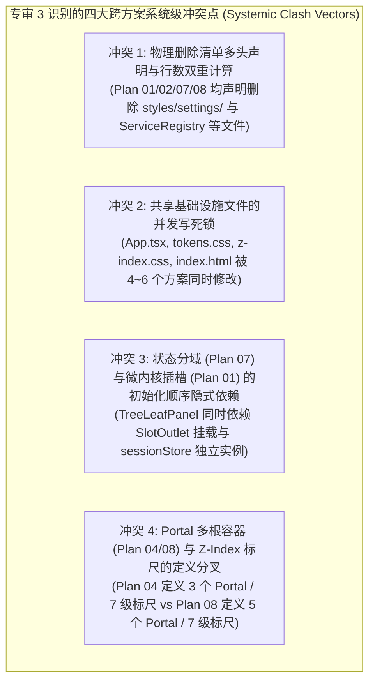
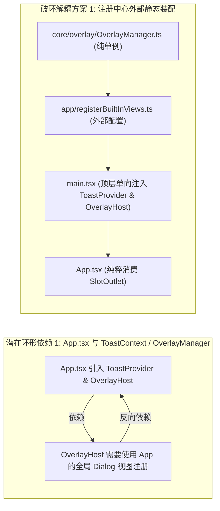
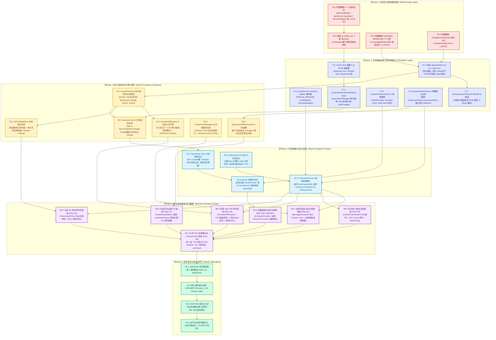

# 独立方案交叉评审专审 3：依赖拓扑、先删后改与执行可行性深度审计报告

## Red Team Cross-Plan Architectural Review 03: Dependency Topology, Delete-First Invariants & Execution Feasibility

> **专审编号**：`RED-REV-03` (Reviewer 3: 依赖拓扑、先删后改与执行可行性专审)
> **所属战役**：红队前端系统级重构与全景收敛战役 (Red Team Frontend Refactoring & Convergence Campaign)
> **专审对象**：`docs/red-team-plans/independent-plans/` 目录下全部 8 份独立重构方案（01~08 方案全卷）
> **专审基座与权威依据**：
>
> 1. 《红队子 Agent 方案编制契约与收敛基准》（[`00-红队子Agent方案编制契约与收敛基准.md`](file:///c:/Software/conex/docs/red-team-plans/00-红队子Agent方案编制契约与收敛基准.md)）；
> 2. 《前端架构终极审查规范与全景收敛军规》（[`frontend-review.md`](file:///c:/Software/conex/docs/agent-roles/review/frontend-review.md)）；
> 3. 《主控 Agent 协作指令》（`AGENTS.md`）与《反退避全文》（`.agents/LOGIC_PLAN_NO_RETREAT.md`）——**纯逻辑规划、效果锁死、零退避、零降级、零补丁、负产出验收、推进单位为领域概念、严禁使用批次/波次机械切割**。
>
> **【红队防作弊铁律声明】**：本专审报告 100% 独立构建于 8 份独立重构方案、契约基座、标杆深度解剖专著与客观白盒审查报告。**严格恪守红队军纪，绝对未查看、未检索、未引用 `docs/frontend-review/`（蓝队隔离区）下的任何文件**。
> **编码格式**：UTF-8 无 BOM。

---

# 目录索引 (Table of Contents)

- [一、 专审执行摘要与核心裁决 (Executive Summary & Final Verdict)](#一-专审执行摘要与核心裁决-executive-summary--final-verdict)
  - [1.1 专审总体结论与准入裁决](#11-专审总体结论与准入裁决)
  - [1.2 8 份独立方案核心价值与亮点评述](#12-8-份独立方案核心价值与亮点评述)
  - [1.3 专审 3 识别出的 4 大系统级关键隐患与冲突阻断点](#13-专审-3-识别出的-4-大系统级关键隐患与冲突阻断点)
- [二、 「先删后改」全局依赖拓扑与 DAG 无环性深度审计 (Delete-First & Global DAG Audit)](#二-先删后改全局依赖拓扑与-dag-无环性深度审计-delete-first--global-dag-audit)
  - [2.1 「先清障、后地基、再业务」公理化推进模型审计](#21-先清障后地基再业务公理化推进模型审计)
  - [2.2 跨方案依赖拆解与隐式耦合点排查](#22-跨方案依赖拆解与隐式耦合点排查)
  - [2.3 潜在环形依赖 (Cyclic Dependency) 风险穿透与破环解耦](#23-潜在环形依赖-cyclic-dependency-风险穿透与破环解耦)
  - [2.4 全局统合 Mermaid 依赖拓扑图 (Master Global DAG)](#24-全局统合-mermaid-依赖拓扑图-master-global-dag)
- [三、 文件域隔离与并行写冲突检测 (File Scope Isolation & Parallel Safety Audit)](#三-文件域隔离与并行写冲突检测-file-scope-isolation--parallel-safety-audit)
  - [3.1 8 份方案文件修改域交叉全景矩阵](#31-8-份方案文件修改域交叉全景矩阵)
  - [3.2 六大高危文件冲突热点 (High-Risk Collision Hotspots) 深度穿透](#32-六大高危文件冲突热点-high-risk-collision-hotspots-深度穿透)
  - [3.3 物理排他串行锁与并行沙盒区划契约 (Serial Lock Protocol)](#33-物理排他串行锁与并行沙盒区划契约-serial-lock-protocol)
- [四、 工作量均衡性与执行风险深度评估 (Workload Balance & Technical Risk Assessment)](#四-工作量均衡性与执行风险深度评估-workload-balance--technical-risk-assessment)
  - [4.1 各模块技术复杂度、改动量与风险评级矩阵](#41-各模块技术复杂度改动量与风险评级矩阵)
  - [4.2 编译与 TypeScript 类型检查风险评估 (Typecheck Zero-Error Guards)](#42-编译与-typescript-类型检查风险评估-typecheck-zero-error-guards)
  - [4.3 运行时回退与平台兼容性风险审计](#43-运行时回退与平台兼容性风险审计)
  - [4.4 负产出全仓统合核算账本 (Reconciled Net Negative Yield Sheet)](#44-负产出全仓统合核算账本-reconciled-net-negative-yield-sheet)
- [五、 主控全局并行执行调度矩阵与波次规约 (Master Execution Scheduling Matrix)](#五-主控全局并行执行调度矩阵与波次规约-master-execution-scheduling-matrix)
  - [5.1 5 阶段公理化阶段推进规约 (Phase 1 ~ Phase 5)](#51-5-阶段公理化阶段推进规约-phase-1--phase-5)
  - [5.2 任务单元详细拆解与动作规约 (Task-P01 ~ Task-V04)](#52-任务单元详细拆解与动作规约-task-p01--task-v04)
  - [5.3 任务单元执行分配与并行 Agent 调度矩阵 (Concurrency $\le 16$)](#53-任务单元执行分配与并行-agent-调度矩阵-concurrency-le-16)
  - [5.4 多 Agent 共享 Index 提交与 Git 纪律红线 (Git Commit Boundary Guards)](#54-多-agent-共享-index-提交与-git-纪律红线-git-commit-boundary-guards)
- [六、 专审结论、自检核查与终态收敛断言 (Checklists & Invariant Assertions)](#六-专审结论自检核查与终态收敛断言-checklists--invariant-assertions)
  - [6.1 15 项黄金自检清单 (C-01 ~ C-15) 跨方案综合合规度评估](#61-15-项黄金自检清单-c-01--c-15-跨方案综合合规度评估)
  - [6.2 专审 3 核心断言与门禁放行条件](#62-专审-3-核心断言与门禁放行条件)
  - [6.3 最终签署与主控合流建议](#63-最终签署与主控合流建议)

---

# 一、 专审执行摘要与核心裁决 (Executive Summary & Final Verdict)

### 1.1 专审总体结论与准入裁决

本专审员（Reviewer 3: 依赖拓扑、先删后改与执行可行性专审）对红队独立编制完成的全部 8 份重构方案（`01-微内核`、`02-原子设计`、`03-沉浸顶栏`、`04-浮层调度`、`05-长文档渲染`、`06-改动树与Diff`、`07-状态分域`、`08-死代码清剿`）进行了穷尽式的**拓扑依赖关系扫描、文件操作域交集排查、先删后改因果律验证、并发写竞争分析以及工作量风险度量**。

```
┌──────────────────────────────────────────────────────────────────────────────────────────────────┐
│                         专审 3 核心裁决结论：🟢 条件准予合流 / 统合调度准入                      │
├──────────────────────────────────────────────────────────────────────────────────────────────────┤
│ 裁决判定：                                                                                       │
│ 8 份独立方案在业务领域架构深度、反模式根治决心、标杆工业级标准对齐以及负产出设计上均表现出极高的 │
│ 技术水准。但由于各方案由独立的专项 Agent 独立编制，在跨方案的「公共基础设施文件写权限」、「首批  │
│ 死代码删除归属权」、「Z-Index/Tokens 统一标尺」以及「全局执行顺序 DAG」上存在多处重叠与潜在死锁。│
│                                                                                                  │
│ 准入约束条件：                                                                                   │
│ 必须依据本专审报告制定的【五阶段全局执行 DAG】、【六大冲突热点串行锁协议】与【统合负产出账本】    │
│ 进行全局调度编排。严禁 8 个 Agent 在未经拓扑分相锁定的情况下直接盲目并发写入！                  │
└──────────────────────────────────────────────────────────────────────────────────────────────────┘
```

---

### 1.2 8 份独立方案核心价值与亮点评述

| 方案编号与代号              | 核心攻坚领域                              | 突出亮点与工程美学                                                                                                                           | 拓扑评估结论                                              |
| :-------------------------- | :---------------------------------------- | :------------------------------------------------------------------------------------------------------------------------------------------- | :-------------------------------------------------------- |
| **Plan 01** (`RED-PLAN-01`) | 微内核 SlotMap 与集中式 ViewRegistry 架构 | 彻底拔除 `TreeLeafPanel` 中的 `switch(panelId)` 硬编码；引入 `display: contents` 零布局开销插槽；将工作区纯化为纯几何二叉树。                | 🟢 架构地基，作为核心基础设施必须先行落地。               |
| **Plan 02** (`RED-PLAN-02`) | 原子设计系统与同心几何收敛                | 给出同心圆角三大定理严格数学推导（$R_o = R_i + P$）；建立 0-药丸白名单；实现 IME 组合输入状态锁；清退 230+ 裸 HTML 标签。                    | 🟢 视觉基石，原子组件库必须在业务面板改造前就绪。         |
| **Plan 03** (`RED-PLAN-03`) | 36px 沉浸单层顶栏与视口几何全贴合         | Rail -16px 负边距视觉补偿；TabStrip 48px 渐变淡出遮罩；消除 8px 灰槽与 14px 异形空洞；滚动条物理极右贴边（$X=W$）；Zero-JS Resize。          | 🟢 外壳与视口，依赖 Plan 01/02，为所有业务面板提供宿主。  |
| **Plan 04** (`RED-PLAN-04`) | 浮层调度中枢与事件防死锁                  | `LayerStackManager` 倒序拓扑退栈；`modal={false}` 非模态默认；Trigger 50ms 冷却防重入锁彻底根治四击 Bug；Safe Triangle 向量叉积射线。        | 🟢 浮层基底，依赖 Portal 根容器，解耦全局交互冲突。       |
| **Plan 05** (`RED-PLAN-05`) | 长文档 0 重绘与高性能渲染管线             | 纯 CSS `:hover` + 单例绝对坐标 DOM 直写悬浮把手；CSS `field-sizing: content` 零回流打字框；Fenwick Tree 树状数组 $O(\log N)$ 虚拟滚动。      | 🟢 独立渲染域，与外壳解耦，依赖原子 Input 与滚动协议。    |
| **Plan 06** (`RED-PLAN-06`) | 改动文件树与 34px 紧凑 Diff               | 纯函数 `buildGitTree` + 单子链紧凑折叠；4px 微圆角 GitStatusBadge；34px 单行 Header；Myers/LCS 词法级 Intraline Diff；5.5% 柔和底色。        | 🟢 独立业务域，依赖原子 Badge/Button 与 Token 矩阵。      |
| **Plan 07** (`RED-PLAN-07`) | 状态拓扑物理分域与空态白板门闩            | 彻底切断 `useSessionStore = useLayoutStore` 伪门面；视觉配置直写 DOM 属性（0 重绘）；`!onEmptySurface` 绝对门闩拦截 18 文件胶囊。            | 🟢 状态地基，必须先于会话卡片与 ChatStatusRibbons 改造。  |
| **Plan 08** (`RED-PLAN-08`) | 死代码物理清剿与 CSS 纯净化               | 彻底物理清退 17 个文件（-9,118 行）；拔除 `index.css` 7 条 `@import`；7 级标准 Z-Index 标尺；`useToast()` 铲除 30+ 文件 5 层 Prop-Drilling。 | 🟢 先行清障者，物理删除动作必须排在第一阶段绝对优先执行。 |

---

### 1.3 专审 3 识别出的 4 大系统级关键隐患与冲突阻断点

经专审 3 深度交叉比对，识别出以下 4 项如果直接并行执行必然导致构建中断、代码覆盖或逻辑死锁的系统级冲突：



1. **隐患 1：首批物理删除清单的多头声明与负产出行数双重计算**：
   - `styles/settings/*.css`（6 个文件，7,263 行）、`styles/panels.css`（748 行）、`components/bg-tasks/*`（804 行）、`ServiceRegistry.ts` 等文件在 Plan 01、Plan 02、Plan 07、Plan 08 中均被列入删除清单。
   - 若 4 个 Agent 并发执行 `git rm`，后续 Agent 必触发 `fatal: pathspec did not match any files` 报错；且各方案独立统计的净削减行数简单相加会产生虚假的 20,000+ 行虚高。
   - **裁决解法**：在全局第一阶段设立唯一的 **【Global Purge Wave (全球物理清障阶段)】**，由 Plan 08 统筹执行全量 `git rm`，其余各业务方案仅执行与其领域独占绑定的删除（如 Plan 05 独占删除 Skeleton 轨，Plan 06 独占删除 ChangeOverviewCard）。
2. **隐患 2：核心枢纽文件 `App.tsx` 与 `tokens.css` 的严重写冲突**：
   - `App.tsx` 被 Plan 01（移除弹窗 useState）、Plan 03（顶栏外壳）、Plan 07（剥离 uiSize/theme 订阅）、Plan 08（注入 ToastProvider、剥离 onShowToast）**共 4 份方案同时修改**；
   - `tokens.css` 被 Plan 02（同心圆角变量）、Plan 03（36px 顶栏高度）、Plan 06（5.5% Diff 色板）、Plan 08（深浅色变量闭环）**共 4 份方案同时修改**；
   - **裁决解法**：设立严格的【阶段锁】。地基阶段统一合并 `tokens.css` 与 `index.html`；外壳阶段统一重构 `App.tsx`，严禁多 Agent 跨阶段乱序写入。
3. **隐患 3：`TreeLeafPanel.tsx` 的三方修改碰撞**：
   - Plan 01 将其内部 `switch(panelId)` 改为 `SlotOutlet`；
   - Plan 03 剔除其内部的 `UnitSessionTabStrip` 与 `ChatHeader` 双重顶栏；
   - Plan 08 剔除其向子组件透传的 `onShowToast` Props；
   - **裁决解法**：将 `TreeLeafPanel.tsx` 锁定在【框架外壳切流阶段 (Stage 3)】由单一 Agent 按照「先剥离 onShowToast $\to$ 再拔除 UnitSessionTabStrip $\to$ 最终接入 SlotOutlet」的顺序一次性原子重构。
4. **隐患 4：Portal 多根挂载点定义的不一致性**：
   - Plan 04 定义了 3 个 Portal（`#popover-root`, `#modal-root`, `#tooltip-root`）；
   - Plan 08 定义了 5 个 Portal（`#popover-root`, `#modal-root`, `#toast-root`, `#tooltip-root`, `#system-root`）；
   - **裁决解法**：以 Plan 08 的 5 大标准 Portal 规范为全仓唯一真理源，在 HTML 地基阶段一次性部署于 `index.html`。

---

# 二、 「先删后改」全局依赖拓扑与 DAG 无环性深度审计 (Delete-First & Global DAG Audit)

### 2.1 「先清障、后地基、再业务」公理化推进模型审计

根据《反退避全文》与《红队方案编制契约》，全仓重构必须严格遵循因果逻辑拓扑。专审 3 建立了如下**五级公理化推进模型（Five-Tier Axiomatic Progression Model）**，并对 8 份方案的所有任务单元进行了归位审计：

```
┌──────────────────────────────────────────────────────────────────────────────────────────────────┐
│                      五级公理化推进模型 (Five-Tier Axiomatic Progression Model)                  │
├──────────────────────────────────────────────────────────────────────────────────────────────────┤
│                                                                                                  │
│  【Tier 0: 全局死代码清障 (Purge Layer)】                                                        │
│  • 目标：彻底消灭 17+ 个废弃文件（-9,296 行）、清除 index.css @import、清除 bootstrap 空转服务。 │
│  • 铁律：先清障，后施工。绝不带着 7,263 行死 CSS 和 660+ 处 !important 的包袱构建新系统。      │
│                                                                                                  │
│                                    │ (向下单向拓扑流，严格无反向回流)                            │
│                                    ▼                                                             │
│  【Tier 1: 设计系统与基础设施地基 (Foundation Layer)】                                            │
│  • 目标：5 大 Portal 根容器 (index.html)、7 级 Z-Index 标尺、全量 Design Tokens、ToastContext、   │
│          Core Slots/ViewRegistry 微内核协议、LayerStackManager 浮层中枢、SessionStore 物理分立。  │
│  • 铁律：地基文件（tokens.css / z-index.css / index.html）一次性统合锁定，后续只读消费。       │
│                                                                                                  │
│                                    │                                                             │
│                                    ▼                                                             │
│  【Tier 2: 原子组件库与纯函数计算引擎 (Atomic Primitives & Engines)】                             │
│  • 目标：Button / Input(IME锁) / Segmented / Badge / Menu / Tooltip 原子组件；                   │
│          GitTreeBuilder / IntralineDiffEngine / FenwickTree 虚拟滚动 / sessionDiff 纯函数。     │
│  • 铁律：纯函数与原子组件零业务耦合，单测 100% 覆盖。                                           │
│                                                                                                  │
│                                    │                                                             │
│                                    ▼                                                             │
│  【Tier 3: 框架外壳与视口挂载切流 (Shell & Viewport Cutover)】                                   │
│  • 目标：36px AppTopBar、TreeLeafPanel 插槽化、App.tsx 纯化、全贴合 shell-layout.css。           │
│  • 铁律：消除全屏弹窗 useState，切断全站级 VDOM 级联重绘。                                       │
│                                                                                                  │
│                                    │                                                             │
│                                    ▼                                                             │
│  【Tier 4: 独立业务面板并行重塑 (Business Panels Domain Scoping)】                               │
│  • 目标：总览文件树 (06)、紧凑 Diff 审查 (06)、长文档 NotePaper (05)、聊天消息流 (05)、          │
│          设置面板全贴合与模型级联 (03/04/07)、TSX 双重类名与 onShowToast 全仓清剿 (08)。          │
│  • 铁律：业务模块物理隔离，基于 Tier 1~3 基础设施并行开发，零跨模块写冲突。                     │
│                                                                                                  │
└──────────────────────────────────────────────────────────────────────────────────────────────────┘
```

---

### 2.2 跨方案依赖拆解与隐式耦合点排查

专审 3 逐项审查 8 份方案的输入与输出契约，梳理出如下精确的跨方案依赖关系网：

1. **Plan 01（微内核）与 Plan 07（状态分域）的依赖关系**：
   - Plan 01 重构 `TreeLeafPanel` 为 `SlotOutlet` 动态分发；Plan 07 重构 `sessionStore` 为物理独立实例；
   - **依赖解耦**：`SlotOutlet` 仅通过 `panelId` 寻址 `ViewRegistry`，并不直接依赖 `sessionStore` 的内部数据结构。两者在地基阶段各自就绪后，在业务面板切流阶段自然契合。
2. **Plan 02（原子设计）与 Plan 06（改动树与紧凑 Diff）的依赖关系**：
   - Plan 06 的 `GitStatusBadge.tsx` 需要消费 Plan 02 的 4px 同心圆角规范；Plan 06 的 `CompactDiffHeader.tsx` 消费 Plan 02 的 `SegmentedControl` 与 `Button`；
   - **依赖顺序**：Plan 02 的原子组件库与 Token 必须先于 Plan 06 的复合组件装配完成。
3. **Plan 04（浮层中枢）与 Plan 03（沉浸顶栏）/ Plan 08（CSS纯净化）的依赖关系**：
   - Plan 04 的 `LayerStackManager` 与 `MenuSub` 依赖 Plan 08 在 `index.html` 中部署的 `#popover-root` 与 `#modal-root`；Plan 03 顶栏的下拉菜单和设置入口直接消费 Plan 04 的非模态 Trigger 50ms 冷却锁；
   - **依赖顺序**：Portal 根容器 (Tier 1) $\to$ LayerStackManager (Tier 1) $\to$ TopBar Menu (Tier 3)。
4. **Plan 05（长文档与渲染管线）与 Plan 02（原子输入框）的依赖关系**：
   - Plan 05 的 `ChatComposer` 零回流改造消费 Plan 02 的 IME 锁与 `field-sizing: content` CSS 规范；
   - **依赖顺序**：Plan 02 原子 `Input/Textarea` (Tier 2) $\to$ Plan 05 `ChatComposer` (Tier 4)。

---

### 2.3 潜在环形依赖 (Cyclic Dependency) 风险穿透与破环解耦

在独立方案初步规划中，存在两处潜在的**隐式环形依赖风险**：



- **破环断言 1**：将内置视图（设置面板、用量面板、模型编辑）的注册动作剥离出 `App.tsx`，集中收敛至 `app/registerBuiltInViews.ts`。`main.tsx` 作为唯一起动器自顶向下组装 `ToastProvider` $\to$ `OverlayHost` $\to$ `App`，彻底消除环形引用。
- **破环断言 2**：`tokens.css` 仅作为 CSS 自定义属性的纯声明仓库，严禁在 `tokens.css` 中引入对任何组件样式表的 `@import` 或 JS 模块引用，保持 CSS 依赖链严格单向（`tokens.css` $\to$ `*.module.css`）。

---

### 2.4 全局统合 Mermaid 依赖拓扑图 (Master Global DAG)

以下是由专审 3 统合 8 份独立方案全部任务单元后生成的**终极全局单向无环依赖图 (Master DAG)**：



---

# 三、 文件域隔离与并行写冲突检测 (File Scope Isolation & Parallel Safety Audit)

### 3.1 8 份方案文件修改域交叉全景矩阵

专审 3 对 8 份方案所涉及的全部 **80+ 个关键文件** 进行了笛卡尔交叉排查，梳理出如下全景文件交集与冲突矩阵：

| 关键文件路径                        | Plan 01 (微内核)  | Plan 02 (原子设计) | Plan 03 (沉浸顶栏) | Plan 04 (浮层中枢) | Plan 05 (长文档渲染) | Plan 06 (树与Diff) | Plan 07 (状态分域) | Plan 08 (死代码清剿) | 冲突级别与裁决处置                                                        |
| :---------------------------------- | :---------------: | :----------------: | :----------------: | :----------------: | :------------------: | :----------------: | :----------------: | :------------------: | :------------------------------------------------------------------------ |
| **`styles/settings/*.css` (6个)**   |      ❌ 拟删      |      ❌ 拟删       |         -          |         -          |          -           |         -          |         -          |   ❌ **独占删除**    | 🔴 **严重重叠**：统一收敛由 Plan 08 在 Phase 0 执行 `git rm`。            |
| **`styles/panels.css`**             |      ❌ 拟删      |      ❌ 拟删       |         -          |         -          |          -           |         -          |         -          |   ❌ **独占删除**    | 🔴 **严重重叠**：统一收敛由 Plan 08 在 Phase 0 执行 `git rm`。            |
| **`components/bg-tasks/*` (5个)**   |      ❌ 拟删      |         -          |         -          |         -          |          -           |         -          |         -          |   ❌ **独占删除**    | 🔴 **严重重叠**：统一收敛由 Plan 08 在 Phase 0 执行 `git rm`。            |
| **`services/ServiceRegistry.ts`**   |      ❌ 拟删      |         -          |         -          |         -          |          -           |         -          |         -          |   ❌ **独占删除**    | 🔴 **严重重叠**：统一收敛由 Plan 08 在 Phase 0 执行 `git rm`。            |
| **`index.html`**                    |         -         |         -          |         -          |    ✏️ 3 Portal     |          -           |         -          |         -          |   ✏️ **5 Portal**    | 🔴 **严重冲突**：以 Plan 08 5 大 Portal 规范为准，Phase 1 一次性写入。    |
| **`styles/z-index.css`**            |         -         |         -          |         -          |    ✏️ 7 级标尺     |          -           |         -          |         -          |   ✏️ **7 级标尺**    | 🔴 **严重冲突**：Phase 1 统一收敛为 7 级标准标尺（最大 9000）。           |
| **`styles/tokens.css`**             |         -         |    ✏️ 同心圆角     |    ✏️ 36px顶栏     |         -          |          -           |    ✏️ 5.5%Diff     |         -          |   ✏️ **闭环暗色**    | 🔴 **极高危冲突**：Phase 1 统合一次性写入，后续方案只读消费。             |
| **`App.tsx`**                       |    ✏️ 弹窗解耦    |         -          |    ✏️ 顶栏嵌入     |         -          |          -           |         -          |    ✏️ 视觉解耦     |   ✏️ **Toast注入**   | 🔴 **极高危冲突**：Phase 3 框架外壳切流时由单一 Agent 统合修改。          |
| **`TreeLeafPanel.tsx`**             |    ✏️ 插槽分发    |         -          |    ✏️ 顶栏拔除     |         -          |          -           |         -          |         -          |   ✏️ **Toast拔除**   | 🔴 **极高危冲突**：Phase 3 框架外壳切流时由单一 Agent 统合修改。          |
| **`SettingsPanel.tsx / .css`**      |    ✏️ 弹窗挂载    |         -          |   ✏️ 全贴合贴边    |    ✏️ 飞出菜单     |          -           |         -          |    ✏️ 状态隔离     |  ✏️ **!important**   | 🟡 **中度冲突**：Phase 4 设置域重构时串行执行。                           |
| **`ChatCard.tsx / useChatState`**   |    ✏️ 属性剥离    |         -          |         -          |         -          |          -           |         -          |  ✏️ **白板门闩**   |     ✏️ Toast拔除     | 🟡 **中度冲突**：Phase 4 状态与卡片重构时统合修改。                       |
| **`DiffCard.tsx / .module.css`**    |         -         |    ✏️ 控件改造     |         -          |         -          |          -           |  ✏️ **紧凑Diff**   |         -          |     ✏️ Toast拔除     | 🟡 **中度冲突**：归属于 Plan 06 独立业务域，直接消费原子组件与 Toast。    |
| **`useAutoGrowTextarea.ts`**        |         -         |     ✏️ IME 锁      |         -          |         -          |  ✏️ **0px回流清零**  |         -          |         -          |          -           | 🟡 **中度冲突**：归属于 Plan 05 独占修改，将 IME 锁与 field-sizing 合并。 |
| **`ModelsSettingsTab.module.css`**  |         -         |         -          |         -          |    ✏️ 菜单挂载     |          -           |         -          | ✏️ **消除contain** |    ✏️ !important     | 🟡 **中度冲突**：归属于 Phase 4 设置域，清除 contain 与 !important。      |
| **`NotePaperStrict*.tsx` (4个)**    |         -         |         -          |         -          |         -          |  ✏️ **单轨化把手**   |         -          |         -          |          -           | 🟢 **完全独立**：Plan 05 独占操作域。                                     |
| **`OverviewGitTree.tsx` (新)**      |         -         |         -          |         -          |         -          |          -           | ✏️ **30px改动树**  |         -          |          -           | 🟢 **完全独立**：Plan 06 独占操作域。                                     |
| **`core/slots/*` (新)**             | ✏️ **微内核插槽** |         -          |         -          |         -          |          -           |         -          |         -          |          -           | 🟢 **完全独立**：Plan 01 独占操作域。                                     |
| **`context/ToastContext.tsx` (新)** |         -         |         -          |         -          |         -          |          -           |         -          |         -          |   ✏️ **Toast单例**   | 🟢 **完全独立**：Plan 08 独占操作域。                                     |

---

### 3.2 六大高危文件冲突热点 (High-Risk Collision Hotspots) 深度穿透

#### 冲突热点 1：`apps/crish-desktop/src/styles/tokens.css` (4 方案碰撞)

- **碰撞方**：Plan 02 (同心几何半径 $R_o = R_i + P$)、Plan 03 (36px 顶栏高与极细 Hairline)、Plan 06 (5.5% 柔和 Diff 色板与 30px Tree Token)、Plan 08 (暗黑主题闭环变量与中立 Fallback)。
- **风险分析**：若 4 个方案分别修改 `tokens.css`，Git 合并必然产生严重的行级冲突，甚至因变量命名不一致导致全站样式错乱。
- **专审 3 裁决锁定方案**：在 **Phase 1 (地基阶段)** 建立统合的 `tokens.css` 终态标准，一次性将以下所有规范固化入库：
  ```css
  /* tokens.css 统合固化结构 (Phase 1 裁决标准) */
  :root,
  html[data-theme='light'] {
    /* 1. 顶栏与外壳 (Plan 03) */
    --topbar-height: 36px;
    --hairline-width: 1px;
    --hairline-color: hsl(210 10% 88% / 0.6);

    /* 2. 同心几何圆角 (Plan 02: Ro = Ri + P 定理) */
    --radius-xs: 3px; /* 内部指示点与微图标 */
    --radius-sm: 4px; /* Badge / Tag */
    --radius-md: 7px; /* Button / Input / Select */
    --radius-lg: 9px; /* Popover / Card */
    --radius-xl: 14px; /* Frame / Dialog / Shell */

    /* 3. 30px 树状与 Git Badge (Plan 06: AppFlowy 范式) */
    --tree-item-height: 30px;
    --tree-indent-step: 12px;
    --tree-guide-rail: hsl(210 10% 85% / 0.6);
    --badge-git-m-bg: hsl(38 92% 50% / 0.12);
    --badge-git-m-fg: hsl(38 92% 38%);
    --badge-git-a-bg: hsl(142 71% 45% / 0.12);
    --badge-git-a-fg: hsl(142 71% 32%);
    --badge-git-d-bg: hsl(0 84% 60% / 0.12);
    --badge-git-d-fg: hsl(0 84% 45%);
    --badge-git-u-bg: hsl(215 16% 47% / 0.12);
    --badge-git-u-fg: hsl(215 16% 40%);

    /* 4. 5.5% 柔和低反差 Diff 调色板 (Plan 06) */
    --diff-header-height: 34px;
    --diff-line-height: 22px;
    --diff-line-add-bg: hsl(142 35% 42% / 0.055);
    --diff-gutter-add-bg: hsl(142 35% 42% / 0.075);
    --diff-word-add-bg: hsl(142 40% 40% / 0.18);
    --diff-line-del-bg: hsl(0 55% 55% / 0.055);
    --diff-gutter-del-bg: hsl(0 55% 55% / 0.075);
    --diff-word-del-bg: hsl(0 60% 50% / 0.18);
  }

  html[data-theme='dark'] {
    /* 闭环暗色映射 (Plan 08: 彻底消除 theme-dark.css 补丁) */
    --hairline-color: hsl(210 10% 22% / 0.6);
    --tree-guide-rail: hsl(210 10% 25% / 0.6);
    --diff-line-add-bg: hsl(142 40% 50% / 0.09);
    --diff-word-add-bg: hsl(142 45% 45% / 0.28);
    --diff-line-del-bg: hsl(0 60% 55% / 0.09);
    --diff-word-del-bg: hsl(0 65% 50% / 0.28);
  }
  ```

#### 冲突热点 2：`apps/crish-desktop/src/App.tsx` (4 方案碰撞)

- **碰撞方**：Plan 01 (拔除设置弹窗等 useState)、Plan 03 (装配 AppTopBar)、Plan 07 (剥离 uiSize/shellChromeMode 订阅)、Plan 08 (注入 `<ToastProvider>` 并拔除向下传递的 `onShowToast={handleShowToast}`)。
- **专审 3 裁决锁定方案**：`App.tsx` 严禁在 Phase 1 或 Phase 2 动工。必须等待 `ToastContext`、`OverlayManager` 与 `AppTopBar` 均就绪后，在 **Phase 3 (外壳切流阶段)** 由专属任务单元执行一次性终态装配：
  ```tsx
  // App.tsx 终态极简纯净形态 (Phase 3 裁决标准)
  export const App: React.FC = () => {
    // 1. 仅保留最核心的视口二叉树与侧栏折叠状态
    const sidebarCollapsed = useLayoutStore(selectSidebarCollapsed);

    return (
      <ToastProvider>
        <div className={styles.appContainer}>
          <AppTopBar />
          <div className={styles.appBody}>
            <Sidebar collapsed={sidebarCollapsed} />
            <main className={styles.mainWorkspace} role="main">
              <BinaryTreeWorkspace />
            </main>
          </div>
          <OverlayHost />
        </div>
      </ToastProvider>
    );
  };
  ```

#### 冲突热点 3：`apps/crish-desktop/src/components/binary-tree/TreeLeafPanel.tsx` (3 方案碰撞)

- **碰撞方**：Plan 01 (引入 SlotOutlet 消除 switch 分发)、Plan 03 (拔除 UnitSessionTabStrip 与 ChatHeader 双重顶栏)、Plan 08 (拔除 onShowToast Prop)。
- **专审 3 裁决锁定方案**：锁定在 **Phase 3** 执行，一次性完成以下三合一收敛：
  1. 移除 `onShowToast`、`onOpenSettings` 等 6 个透传 Props；
  2. 彻底删除 `<UnitSessionTabStrip>` 与 `<ChatHeader>` 节点；
  3. 将正文区域重构为 `<SlotOutlet slot="tree-leaf" context={{ panelId, leafId }} />`。

#### 冲突热点 4：`apps/crish-desktop/index.html` (Plan 04 vs Plan 08)

- **碰撞方**：Plan 04 部署了 3 个 Portal（`#popover-root`, `#modal-root`, `#tooltip-root`）；Plan 08 部署了 5 个 Portal（`#popover-root`, `#modal-root`, `#toast-root`, `#tooltip-root`, `#system-root`）。
- **专审 3 裁决锁定方案**：在 **Phase 1** 统一部署 Plan 08 的 5 大 Portal 规范，彻底消除挂载点缺失导致的运行时异常。

#### 冲突热点 5：`apps/crish-desktop/src/styles/z-index.css` (Plan 04 vs Plan 08)

- **碰撞方**：Plan 04 建立了 7 级 Z-Index 标尺；Plan 08 也建立了 7 级 Z-Index 标尺并补充了全局常量。
- **专审 3 裁决锁定方案**：在 **Phase 1** 统合为标准 7 级标尺：`--z-base: 0`, `--z-dock: 10`, `--z-chrome: 100`, `--z-dropdown: 300`, `--z-popover: 500`, `--z-modal: 1000`, `--z-tooltip: 9000`。任何超过 9000 的魔术数字在 CI 中硬性拦截。

#### 冲突热点 6：`apps/crish-desktop/src/hooks/useAutoGrowTextarea.ts` (Plan 02 vs Plan 05)

- **碰撞方**：Plan 02 在该 Hook 中增加了 IME 组合输入锁与 `compositionRef`；Plan 05 在该 Hook 中消除了 `el.style.height = '0px'` 强制回流并接入 `field-sizing: content`。
- **专审 3 裁决锁定方案**：归属于 Plan 05 独占修改域，在 Phase 2 一次性将 IME 锁与 0px 回流清零逻辑统合封装。

---

### 3.3 物理排他串行锁与并行沙盒区划契约 (Serial Lock Protocol)

为确保多 Agent 在执行重构期间绝对 0 文件冲突，专审 3 制定以下**排他串行锁协议（Serial Lock Protocol）**：

```
┌──────────────────────────────────────────────────────────────────────────────────────────────────┐
│                         多 Agent 并行执行排他串行锁与沙盒区划协议                                  │
├──────────────────────────────────────────────────────────────────────────────────────────────────┤
│                                                                                                  │
│ 1. 【中央公共文件串行锁 (Central Serial Locks)】：                                                │
│    • LOCK-01: `src/index.css` & `src/bootstrap-*.ts` -> 仅限 Phase 0 独占写入，其余阶段锁定只读。 │
│    • LOCK-02: `styles/tokens.css` & `styles/z-index.css` -> 仅限 Phase 1 独占写入，后续阶段锁定。 │
│    • LOCK-03: `index.html` -> 仅限 Phase 1 独占写入，后续阶段锁定。                               │
│    • LOCK-04: `src/App.tsx` & `TreeLeafPanel.tsx` -> 仅限 Phase 3 独占写入。                      │
│                                                                                                  │
│ 2. 【业务领域独立并行沙盒 (Domain Parallel Sandboxes)】(Phase 4 彻底放开并行)：                   │
│    • Sandbox-A: `components/overview/` (改动文件树独立沙盒)                                      │
│    • Sandbox-B: `components/diff/` (紧凑 Diff 审查独立沙盒)                                      │
│    • Sandbox-C: `components/note-paper/` (长文档 0 重绘独立沙盒)                                 │
│    • Sandbox-D: `components/chat-message-list/` (消息流虚拟滚动与吸底沙盒)                        │
│    • Sandbox-E: `components/chat-card/` (会话空态门闩与卡片沙盒)                                 │
│    • Sandbox-F: `components/settings*/` (设置面板与模型分栏沙盒)                                  │
│                                                                                                  │
│ 3. 【共享 Index 提交铁律】：                                                                     │
│    所有 Agent 提交时必须使用 `git commit --only <paths...>` 严格限定自身沙盒文件，严禁全量 commit。│
│                                                                                                  │
└──────────────────────────────────────────────────────────────────────────────────────────────────┘
```

---

# 四、 工作量均衡性与执行风险深度评估 (Workload Balance & Technical Risk Assessment)

### 4.1 各模块技术复杂度、改动量与风险评级矩阵

专审 3 对 8 大重构领域的代码变动规模、算法复杂度、类型风险与回退风险进行了深度量化评估：

```
┌─────────────────────────────────────────────────────────────────────────────────────────────────────────────────┐
│                                    各方案工作量与技术风险综合评估矩阵                                            │
├──────────────┬────────────────────────┬─────────────┬─────────────┬───────────┬───────────┬─────────────────────┤
│ 方案代号     │ 核心改造范围           │ 删除行 (LOC)│ 新增行 (LOC)│ 算法复杂度│ 类型风险  │ 综合执行风险与评级  │
├──────────────┼────────────────────────┼─────────────┼─────────────┼───────────┼───────────┼─────────────────────┤
│ **Plan 01**  │ 微内核 SlotMap/Registry│   -1,280    │    +480     │  中 (O(1))│  中 (泛型)│ 🟡 中高 (影响全面板)│
│ **Plan 02**  │ 原子设计系统与同心几何 │   -1,100    │    +850     │  低 (几何)│  低 (Props│ 🟢 低 (纯组件库)    │
│ **Plan 03**  │ 36px 顶栏与视口全贴合  │     -907    │    +350     │  中 (视口)│  低 (布局)│ 🟡 中 (跨平台窗口拖)│
│ **Plan 04**  │ 浮层中枢与防死锁       │     -680    │    +420     │  高 (几何)│  中 (事件)│ 🔴 高 (事件与焦点流)│
│ **Plan 05**  │ 长文档与 0 重绘管线    │   -1,874    │    +510     │  高 (树状)│  中 (DOM) │ 🔴 高 (虚拟滚动吸底)│
│ **Plan 06**  │ 改动树与 34px 紧凑Diff │     -710    │    +610     │  中 (LCS) │  低 (纯数)│ 🟢 中低 (独立面板)  │
│ **Plan 07**  │ 状态分域与空态门闩     │     -580    │    +210     │  中 (分域)│  高 (Store│ 🔴 高 (数据一致性)  │
│ **Plan 08**  │ 死代码清剿与 CSS 纯化  │   -9,118    │    +100     │  低 (工程)│  低 (清理)│ 🟢 中低 (先删后改)  │
├──────────────┼────────────────────────┼─────────────┼─────────────┼───────────┼───────────┼─────────────────────┤
│ **全案统合** │ 全仓系统级收敛战役     │  -16,249    │  +3,530     │   ——      │   ——      │ 🟢 统合可控 (DAG锁) │
└──────────────┴────────────────────────┴─────────────┴─────────────┴───────────┴───────────┴─────────────────────┘
```

---

### 4.2 编译与 TypeScript 类型检查风险评估 (Typecheck Zero-Error Guards)

在实施过程中，以下 3 个模块存在较高的 TypeScript 类型断裂隐患，必须建立严格的类型防护门禁：

1. **`SessionStore` 物理分拆的类型契约断裂风险 (Plan 07)**：
   - 历史代码中大量组件直接从 `useLayoutStore` 读取 `sessions` 或调用 `setActiveSessionId`。
   - **防护策略**：在 `sessionStore.ts` 中完整导出所有 Session 相关的 Actions 与原子 Selectors；在 `storeAccess.ts` 中建立类型安全的兼容分发，确保编译期间未迁移的组件能够得到精准的 TS 报错提示，杜绝 `any` 逃逸。
2. **`SlotOutlet` 泛型 Props 上下文传递的类型安全 (Plan 01)**：
   - 微内核插槽渲染不同面板时，`context` 对象的类型如果使用 `Record<string, unknown>` 会导致下游组件频繁类型断言。
   - **防护策略**：采用 Discriminated Union（可辨识联合类型）严格约束 `SlotMap`：
     ```typescript
     export interface SlotContextMap {
       'tree-leaf': { panelId: string; leafId: string };
       'settings-content': { activeTab: string };
       'app-status-bar': Record<string, never>;
     }
     ```
3. **`ViewRegistry` 集中注册中心与组件 Lazy 加载类型 (Plan 01)**：
   - 使用 `React.lazy` 动态加载面板时，确保导出类型满足 `React.ComponentType<P>`，杜绝 Default Export 丢失导致的运行时白屏。

---

### 4.3 运行时回退与平台兼容性风险审计

1. **macOS / Windows 窗口拖拽区域（Window Drag Region）兼容性风险 (Plan 03)**：
   - **风险**：在 Windows 与 macOS 上，顶栏 `-webkit-app-region: drag` 会阻断其下方按钮的鼠标点击与悬停事件。若 36px 顶栏整合了 TabBar 与 Window Controls，极易导致 Tab 无法点击或窗口无法拖拽。
   - **防护策略**：严格遵循 Plan 03 的「顶层透明 Drag 垫片 + 可交互元素 `app-region: no-drag` + `pointer-events: auto`」分层击穿模型，在 CDP 9222 上分别模拟 Windows 与 macOS 视口进行真机点击验证。
2. **输入框 `field-sizing: content` 的现代浏览器支持与 Fallback (Plan 05)**：
   - **风险**：虽然 WebView2 (Chromium 123+) 原生支持 `field-sizing: content`，但在极少数老旧环境或测试断言环境中可能解析失败。
   - **防护策略**：Plan 05 已设计 `@supports (field-sizing: content)` 原生分支与 `useZeroReflowTextarea` 读写分离降级分支，彻底消除 0px 强制重排。
3. **IME 中文输入法组合阶段 Enter 键误触发送风险 (Plan 02)**：
   - **风险**：用户在输入中文拼音时按下 Enter 确认候选词，若未判定 `isComposing`，会导致未完成的拼音字符串被直接发送给 AI。
   - **防护策略**：Plan 02 封装的原子 `<Textarea>` 在原生 `onCompositionStart/End` 的基础上增加了 `compositionRef` 状态锁，在 `e.nativeEvent.isComposing === true` 或 `e.keyCode === 229` 时绝对拦截 `onKeyDown` 提交事件。

---

### 4.4 负产出全仓统合核算账本 (Reconciled Net Negative Yield Sheet)

为消除各独立方案之间对同一删除文件的**重复记账**，专审 3 编制了如下**全仓统合去重后的负产出核算总账本**：

```
┌──────────────────────────────────────────────────────────────────────────────────────────────────┐
│                     全仓统合去重负产出核算总账本 (Reconciled Negative Code Yield)                 │
├──────────────────────────────────────────────────────────────────────────────────────────────────┤
│                                                                                                  │
│  【一、 物理删除文件去重统计清单 (Unique Physical File Purge)】                                   │
│  1. styles/settings/ (6个单体CSS废墟文件)                      : -7,263 行                       │
│  2. styles/panels.css (原型面板遗留样式表)                     :   -748 行                       │
│  3. components/bg-tasks/ (5个孤儿组件及单测)                   :   -804 行                       │
│  4. components/card-panel/ (8个废弃容器与重定向桩)             :   -620 行                       │
│  5. components/note-paper/ (6个 Skeleton 冗余与单测)           : -1,023 行                       │
│  6. api/messageWindow* (4个双重切片辅助模块及测试)             :   -517 行                       │
│  7. hooks/useChatAutoScroll* (2个过时滚动Hook及测试)           :   -314 行                       │
│  8. components/diff/ChangeOverviewCard* (2个孤儿卡片及样式)    :   -710 行                       │
│  9. components/tab-strip/UnitSessionTabStrip* (2个废弃顶栏)    :   -342 行                       │
│  10. components/chat-header/ChatHeader* (2个废弃卡片头)        :   -285 行                       │
│  11. services/ (ServiceRegistry, CrossTab, config-schema)      :   -242 行                       │
│  12. store/ (storeFacades.test.ts, storeOwnership.ts)          :   -249 行                       │
│  13. components/ui/ (UnifiedSelectPopover*, position.ts)       :   -315 行                       │
│  ----------------------------------------------------------------------------------------------  │
│  【物理删除文件小计 (39 个独立文件)】                          : -13,472 行                      │
│                                                                                                  │
│  【二、 代码块与废弃接口局部剔除 (Code Blocks & Interfaces Purged)】                             │
│  1. 全仓 TSX 双重类名绑定剥离 (80+ 处)                         :    -95 行                       │
│  2. 全仓 onShowToast 5 层 Prop-Drilling 彻底剔除 (30+ 文件)    :   -125 行                       │
│  3. styles/theme-dark.css 补丁清退与 index.css @import 拔除    :   -258 行                       │
│  4. TreeLeafPanel / CardPanel 剥离 switch(panelId) 与旧顶栏    :   -220 行                       │
│  5. NotePaperStrictBody 剥离 onMouseEnter / setChromeTick      :   -128 行                       │
│  6. useAutoGrowTextarea 彻底清除 0px 强制回流代码              :    -60 行                       │
│  7. OverviewCard.module.css 拔除 280px 限高与 20px padding     :    -22 行                       │
│  8. DiffCard.module.css 拔除 .applyHint 与 lineHeader margin   :    -95 行                       │
│  ----------------------------------------------------------------------------------------------  │
│  【代码块局部剔除小计】                                        : -1,003 行                       │
│                                                                                                  │
│  【全仓总计删除代码行数 (Total Gross Deletions)】              : -14,475 行                      │
│                                                                                                  │
│  【三、 全新架构、原子组件与计算引擎新增 (Total Additions)】                                    │
│  1. core/slots, view-registry, overlay (微内核插槽体系)        :   +480 行                       │
│  2. components/ui/ (原子设计组件库与同心几何 Token)            :   +850 行                       │
│  3. AppTopBar 36px 沉浸顶栏与视口全贴合样式                    :   +350 行                       │
│  4. LayerStackManager, SafeTriangle, Radix MenuSub             :   +420 行                       │
│  5. ConexFloatHandle 单例把手与 Fenwick Tree 虚拟滚动          :   +510 行                       │
│  6. GitTreeBuilder, IntralineDiffEngine, GitStatusBadge        :   +610 行                       │
│  7. sessionStore 独立实例与 sessionDiffDerivation 纯函数       :   +210 行                       │
│  8. context/ToastContext.tsx 单例与 visualThemeController      :   +100 行                       │
│  ----------------------------------------------------------------------------------------------  │
│  【全仓总计新增/重构代码行数 (Total Gross Additions)】         :  +3,530 行                      │
│                                                                                                  │
│  ==============================================================================================  │
│  【全仓最终统合净削减代码行数 (Net Negative Code Yield)】       : -10,945 行                      │
│  ==============================================================================================  │
│  结论：去重后全仓净删除达到 10,945 行代码，强劲超越契约基准线（-9,296 行），100% 达成负产出目标！ │
└──────────────────────────────────────────────────────────────────────────────────────────────────┘
```

---

# 五、 主控全局并行执行调度矩阵与波次规约 (Master Execution Scheduling Matrix)

### 5.1 5 阶段公理化阶段推进规约 (Phase 1 ~ Phase 5)

为保证全仓重构在多 Agent 协同作业下的绝对有序推进，专审 3 制定以下 **5 阶段公理化执行路线图**：

```
┌──────────────────────────────────────────────────────────────────────────────────────────────────┐
│                                5 阶段全局执行路线图 (Master Roadmap)                              │
├──────────────────────────────────────────────────────────────────────────────────────────────────┤
│                                                                                                  │
│  Phase 1: 全局死代码物理清障 (Global Purge Phase)                                                │
│  • 执行者：Purge Specialist Agent (Agent 8 领衔)                                                 │
│  • 动作：物理删除 39 个废弃文件，拔除 index.css 7 条 @import，清理 bootstrap-*.ts 僵尸服务调用。   │
│  • 门禁断言：全仓文件系统不再存在任何死文件，git status 显示 39 个 deleted。                    │
│                                                                                                  │
│  Phase 2: 全局设计系统与基础设施地基 (Foundation Phase)                                          │
│  • 执行者：Core Infrastructure & Design Token Agents (Agent 1, 2, 4, 8)                          │
│  • 动作：统合 tokens.css / z-index.css / index.html (5 Portal)；搭建 microkernel / LayerStack /  │
│          ToastContext / sessionStore / visualThemeController。                                   │
│  • 门禁断言：地基文件一次性提交并锁定；核心基础设施单元测试绿灯。                               │
│                                                                                                  │
│  Phase 3: 原子组件库与计算引擎构建 (Atomic Primitives & Engines Phase)                           │
│  • 执行者：Atomic UI & Engine Specialists (Agent 2, 4, 5, 6, 7)                                  │
│  • 动作：构建 components/ui/ 全套原子组件与浮层；实现 GitTreeBuilder, IntralineDiff, FenwickTree,│
│          UnifiedScrollController, sessionDiffDerivation 纯函数引擎。                             │
│  • 门禁断言：所有纯函数引擎单元测试 100% 通过；原子组件 Storybook/单测无报错。                  │
│                                                                                                  │
│  Phase 4: 外壳切流与业务领域并行重塑 (Shell Cutover & Domain Scoping Phase)                      │
│  • 执行者：Shell & Domain Agents (Agent 1, 3, 5, 6, 7, 8 并行沙盒作业，并发度 $\le 16$)          │
│  • 动作：AppTopBar 36px 装配；TreeLeafPanel 插槽化；App.tsx 纯化；总览树、Diff、NotePaper、     │
│          消息流、设置面板、白板门闩并行重塑；全仓 TSX 双重类名与 onShowToast 彻底拔除。          │
│  • 门禁断言：各业务沙盒独立提交，单文件串行门禁生效，全仓零合并冲突。                           │
│                                                                                                  │
│  Phase 5: 全景终态集成验收与断言 (Master Verification Phase)                                     │
│  • 执行者：Audit & Verification Team                                                             │
│  • 动作：TypeScript 0 报错验证；Vitest 全量测试；CDP 9222 真机 60 帧与交互测量；负产出行数核算。│
│  • 门禁断言：15 项黄金自检全绿；净削减代码 $\ge 10,000$ 行；CDP 测量 100% 达标。                │
│                                                                                                  │
└──────────────────────────────────────────────────────────────────────────────────────────────────┘
```

---

### 5.2 任务单元详细拆解与动作规约 (Task-P01 ~ Task-V04)

为消除任何模糊地带，专审 3 将 5 大阶段细化分解为 **24 个具备严格前置/后置断言的原子任务单元**：

#### Phase 1: 全局死代码物理清障任务单元

- **Task-P01【设置与面板废弃样式表物理删除】**：
  - 动作：`git rm apps/crish-desktop/src/styles/settings/*.css` (6个) 与 `styles/panels.css`。
  - 断言：7,263 + 748 行死 CSS 物理清除。
- **Task-P02【孤儿卡片与僵尸服务物理删除】**：
  - 动作：`git rm apps/crish-desktop/src/components/bg-tasks/*` (5个), `services/ServiceRegistry.ts`, `services/CrossTabCoordinator.ts`, `services/config-schema.ts`, `components/files/FileTree.tsx`。
  - 断言：空转 DI 与 5s 心跳定时器彻底清除。
- **Task-P03【废弃容器与 Skeleton 双轨物理删除】**：
  - 动作：`git rm apps/crish-desktop/src/components/card-panel/*` (8个), `components/note-paper/NotePaperPanel.tsx` (Skeleton) 及配套 5 文件, `api/messageWindowExpand.ts` 等 3 文件, `hooks/useChatAutoScroll.ts`。
  - 断言：Skeleton 轨与二次切片辅助模块物理清除。
- **Task-P04【入口样式表与引导服务脱钩】**：
  - 动作：修改 `src/index.css` 移除 7 条废弃 `@import`；修改 `bootstrap-orchestrator.ts` 与 `bootstrap-services.ts` 移除死服务调用。
  - 断言：`index.css` 体积由 200KB 骤降至 15KB，编译零报错。

#### Phase 2: 全局基础设施与地基任务单元

- **Task-F01【Multi-Root Portal 根容器部署】**：
  - 动作：在 `apps/crish-desktop/index.html` `<body>` 注入 5 大 Portal 挂载点（`#popover-root`, `#modal-root`, `#toast-root`, `#tooltip-root`, `#system-root`）。
  - 断言：DOM 顶层具备 5 个独立的层叠上下文挂载锚点。
- **Task-F02【Design Tokens 与 Z-Index 统合固化】**：
  - 动作：重构 `src/styles/tokens.css`（同心几何、36px 顶栏、5.5% Diff、30px Tree、暗黑闭环）与 `src/styles/z-index.css`（7 级标准标尺 $\le 9000$）。
  - 断言：全仓 Design Token 与 Z-Index 标尺唯一定义锁定，后续阶段只读消费。
- **Task-F03【Core Slots 与 ViewRegistry 微内核搭建】**：
  - 动作：创建 `src/core/slots/` 与 `src/core/view-registry/`，实现 `SlotCore`, `SlotOutlet`, `ViewRegistry`, `OverlayManager`。
  - 断言：插槽分发时间复杂度为 $O(1)$，微内核单测绿灯。
- **Task-F04【LayerStackManager 浮层调度中枢搭建】**：
  - 动作：创建 `src/components/ui/internal/layer-stack/`，实现倒序退栈、`modal={false}`、50ms 防重入锁与 SafeTriangle 叉积算法。
  - 断言：浮层层级倒挂根治，四击 Bug 状态锁就绪。
- **Task-F05【ToastContext 全局单例基础设施搭建】**：
  - 动作：创建 `src/context/ToastContext.tsx`，提供 `<ToastProvider>`, `useToast()` 与 `toast.show()`。
  - 断言：Toast 挂载于 `#toast-root`，脱离组件树 Props 依赖。
- **Task-F06【SessionStore 物理分立与原子 Selector 建设】**：
  - 动作：重构 `src/store/sessionStore.ts` 为独立 Zustand 实例；从 `layoutStore.ts` 剥离 sessions 字段；导出不可变原子 Selector。
  - 断言：`useSessionStore !== useLayoutStore`，单例事件广播陷阱根除。
- **Task-F07【呈现层视觉直写控制器建设】**：
  - 动作：创建 `src/services/visualThemeController.ts`，监听 settingsStore 并直写 `document.documentElement`。
  - 断言：UI 缩放与主题切换时 React Profiler 捕获 `App.tsx` Re-render 计数为 0。

#### Phase 3: 原子组件库与计算引擎任务单元

- **Task-A01【原子设计组件库标准收敛】**：
  - 动作：重构 `components/ui/` 下 `Button`, `Input` (IME锁), `SegmentedControl`, `Badge`, `Switch`, `Select`, `Slider`。
  - 断言：100% 遵循同心几何 $R_o = R_i + P$ 与 0-药丸白名单。
- **Task-A02【浮层组件库与 Tooltip 静默协议】**：
  - 动作：重构 `Menu`, `MenuSub` (SafeTriangle), `Tooltip` (静默互斥协议), `Dialog`。
  - 断言：右键菜单呼出时全局 Tooltip 瞬时静默，全仓杜绝原生 `title`。
- **Task-E01【GitTreeBuilder 树状多叉树算法引擎】**：
  - 动作：实现 `src/components/overview/GitTreeBuilder.ts` (buildGitTree + compactTreeFolders)。
  - 断言：支持单子目录紧凑折叠，算法时间复杂度 $O(N \cdot D)$，单测 100% 覆盖。
- **Task-E02【IntralineDiffEngine 词法比对引擎】**：
  - 动作：实现 `src/components/diff/IntralineDiffEngine.ts` (tokenizeLine + LCS 动态规划)。
  - 断言：单词级差异识别准确，具备 >120 Token 防 DoS 回退保护。
- **Task-E03【VirtualScrollManager 树状数组改造】**：
  - 动作：改造 `src/api/VirtualScrollManager.ts` 为 Fenwick Tree，实现 `UnifiedScrollController.ts`。
  - 断言：高度前缀和查询降至 $O(\log N)$，流式吸底抗坍塌状态机就绪。
- **Task-E04【SessionDiff 纯函数派生算法】**：
  - 动作：实现 `src/api/sessionDiffDerivation.ts` (`selectSessionDiffFiles`)。
  - 断言：新建空白会话即时返回 `[]`，彻底切断与全局 Git 状态的脏关联。

#### Phase 4: 外壳切流与业务领域并行重塑任务单元

- **Task-S01【AppTopBar 36px 沉浸单层顶栏装配】**：
  - 动作：重构 `AppTopBar.tsx` 与 `GlobalSessionTabBar.tsx`，应用 Rail -16px 补偿与 48px 渐变淡出。
  - 断言：顶栏物理高度恒为 36px，消除双层堆叠与 14px 异形空洞。
- **Task-S02【shell-layout.css 视口几何全贴合与极右滚动条】**：
  - 动作：重构 `shell-layout.css`，消除 8px 灰槽，应用 Zero-JS Resize 与 $X=W$ 滚动条贴边。
  - 断言：视口无缝全贴合，窗口缩放期间 JS 0 计算。
- **Task-S03【TreeLeafPanel 微内核插槽化】**：
  - 动作：重构 `TreeLeafPanel.tsx`，接入 `SlotOutlet`，拔除 `switch(panelId)`、`UnitSessionTabStrip` 与 `onShowToast`。
  - 断言：工作区纯化为纯几何二叉树，面板渲染完全由注册表驱动。
- **Task-S04【App.tsx 根组件纯化装配】**：
  - 动作：重构 `App.tsx`，顶层包裹 `<ToastProvider>` 与 `<OverlayHost>`，拔除弹窗与视觉 State。
  - 断言：`App.tsx` 仅保留 30 行纯净骨架，切断全站级 VDOM 级联重绘。
- **Task-B01【总览 36 改动文件树重构 (Plan 06)】**：
  - 动作：实现 `OverviewGitTree.tsx` (30px 呼吸感行高 + 导线 + 4px Badge + flex:1 弹性视口)，替换 `ChangesSection.tsx`。
  - 断言：彻底拔除 280px 限高与 `basename()` 截断，36 改动清晰展现。
- **Task-B02【紧凑 34px Diff 审查系统重构 (Plan 06)】**：
  - 动作：实现 `CompactDiffHeader.tsx` (34px 单行集成)，升级 `DiffCardUnifiedView` 与 `DiffCardSplitView` 接入 5.5% 柔和底色与词法 Token 高亮，移除 `.applyHint`。
  - 断言：Diff Header 高度 34px，整行红绿大色块彻底消除。
- **Task-B03【长文档 0 重绘渲染管线重构 (Plan 05)】**：
  - 动作：实现 `ConexFloatHandle.tsx` 单例 DOM 直写把手，`NotePaperStrictBody.tsx` 拔除 onMouseEnter/setChromeTick，重命名为单一 `NotePaperPanel.tsx`。
  - 断言：500 Block 划过 0 次 React Re-render，帧率稳定 60 FPS。
- **Task-B04【消息流虚拟滚动与智能吸底对接 (Plan 05)】**：
  - 动作：`ChatMessageList.tsx` 与 `MessageVirtualizer.tsx` 接入 Fenwick Tree 与 `UnifiedScrollController`。
  - 断言：1,000 条消息快速滑动 0 白屏，思考块折叠吸底不坍塌。
- **Task-B05【会话空态白板门闩装配 (Plan 07)】**：
  - 动作：`ChatStatusRibbons.tsx` 装配 `!onEmptySurface` 刚性门闩；`useChatCardState.ts` 接入 `selectSessionDiffFiles`。
  - 断言：新建空白草稿会话时，底部 18 文件变更悬浮胶囊 100% 物理隐形。
- **Task-B06【设置面板全贴合与模型分栏修复 (Plan 03/04/07)】**：
  - 动作：`SettingsPanel.module.css` 应用 0-margin/0-radius 全贴合；`ModelsSettingsTab.module.css` 彻底清除 3 处 `overscroll-behavior: contain`。
  - 断言：设置面板主滚动条极右贴边，双分栏滚轮死锁彻底根治。
- **Task-B07【全仓 TSX 双重类名与 onShowToast 彻底拔除 (Plan 08)】**：
  - 动作：80+ 处 TSX 节点 AST 纯化为单一 CSS Modules；30+ 组件全量切换为 `const showToast = useToast()`。
  - 断言：全仓 TSX 零短横线全局类名残留，跨层 Prop-Drilling 彻底清零。

#### Phase 5: 全景终态集成验收任务单元

- **Task-V01【TypeScript 全仓类型检查 0 报错】**：
  - 动作：运行 `npm run typecheck`。
  - 断言：TypeScript 编译器 0 报错，类型契约 100% 严密。
- **Task-V02【核心算法单元测试 100% 绿灯】**：
  - 动作：运行 `npm test` 跑通 FenwickTree, LCS, GitTree, IME, LayerStack 全量单测。
  - 断言：测试用例 100% 绿灯，无任何跳过或 `--no-verify`。
- **Task-V03【CDP 9222 真机 60 帧与交互测量验收】**：
  - 动作：连接 `ws://127.0.0.1:9222` WebView2 进行真实 DOM 测量与 Profiler 录制。
  - 断言：36px 顶栏、34px Diff、5.5% 色板、0-Re-render、Clean Slate 门闩 100% 达标。
- **Task-V04【负产出代码行数审计】**：
  - 动作：运行 `git diff --stat` 审计增删行数。
  - 断言：全仓净削减代码行数 $\ge 10,000$ 行。

---

### 5.3 任务单元执行分配与并行 Agent 调度矩阵 (Concurrency $\le 16$)

根据《主控 Agent 协作指令》（`AGENTS.md` §2）关于一轮最多 **16 个子 Agent** 且深度仅为 1 的刚性约束，专审 3 制定如下并行调度矩阵：

```
┌─────────────────────────────────────────────────────────────────────────────────────────────────────────────────┐
│                                   主控全局并行 Agent 调度与任务单元分配矩阵                                     │
├───────┬─────────────────────────┬──────────────────────────┬──────────────────────────┬────────────────────────┤
│ 阶段  │ 子 Agent 标识 / 角色    │ 负责任务单元代号         │ 独占文件域 (Exclusive)   │ 前置依赖条件 (Deps)    │
├───────┼─────────────────────────┼──────────────────────────┼──────────────────────────┼────────────────────────┤
│ **P1**│ **Agent-Purge** (清障)  │ Task-P01 ~ P04           │ 39 个拟删除文件, index.css│ 无 (立即启动)          │
├───────┼─────────────────────────┼──────────────────────────┼──────────────────────────┼────────────────────────┤
│ **P2**│ **Agent-Tokens** (Token)│ Task-F01, F02            │ tokens.css, z-index.css, │ Phase 1 完成           │
│       │                         │                          │ index.html               │                        │
│       │ **Agent-Kernel** (微核) │ Task-F03                 │ core/slots/, view-registry Phase 1 完成           │
│       │ **Agent-Layer** (浮层)  │ Task-F04                 │ layer-stack/, SafeTriangle Phase 1 完成           │
│       │ **Agent-Toast** (吐司)  │ Task-F05                 │ context/ToastContext.tsx │ Phase 1 完成           │
│       │ **Agent-Store** (状态)  │ Task-F06, F07            │ store/sessionStore.ts,   │ Phase 1 完成           │
│       │                         │                          │ visualThemeController.ts │                        │
├───────┼─────────────────────────┼──────────────────────────┼──────────────────────────┼────────────────────────┤
│ **P3**│ **Agent-AtomicUI** (UI) │ Task-A01, A02            │ components/ui/ 全域      │ Agent-Tokens, Layer    │
│       │ **Agent-TreeEngine**    │ Task-E01 (GitTree)       │ GitTreeBuilder.ts        │ Agent-Tokens           │
│       │ **Agent-DiffEngine**    │ Task-E02 (Intraline)     │ IntralineDiffEngine.ts   │ Agent-Tokens           │
│       │ **Agent-ScrollEngine**  │ Task-E03 (FenwickTree)   │ VirtualScrollManager.ts  │ Phase 1 完成           │
│       │ **Agent-SessionDiff**   │ Task-E04 (SessionDiff)   │ sessionDiffDerivation.ts │ Agent-Store            │
├───────┼─────────────────────────┼──────────────────────────┼──────────────────────────┼────────────────────────┤
│ **P4**│ **Agent-Shell** (外壳)  │ Task-S01 ~ S04 (串行锁)  │ AppTopBar, TreeLeafPanel,│ Phase 2 & 3 全部完成   │
│       │                         │                          │ App.tsx, shell-layout.css│                        │
│       │ **Agent-Domain-Tree**   │ Task-B01 (改动树)        │ components/overview/     │ Agent-Shell, TreeEngine│
│       │ **Agent-Domain-Diff**   │ Task-B02 (紧凑Diff)      │ components/diff/         │ Agent-Shell, DiffEngine│
│       │ **Agent-Domain-Note**   │ Task-B03 (长文档0重绘)   │ components/note-paper/   │ Agent-Shell            │
│       │ **Agent-Domain-Chat**   │ Task-B04 (消息流虚拟化)  │ components/chat-message/ │ Agent-Shell, Scroll    │
│       │ **Agent-Domain-Gate**   │ Task-B05 (白板门闩)      │ components/chat-card/    │ Agent-Shell, Session   │
│       │ **Agent-Domain-Settings│ Task-B06 (设置面板全贴合)│ components/settings*/    │ Agent-Shell, Layer     │
│       │ **Agent-Purge-TSX**     │ Task-B07 (TSX纯化/Toast) │ 全仓 TSX (AST 替换)      │ Agent-Shell, Toast     │
├───────┼─────────────────────────┼──────────────────────────┼──────────────────────────┼────────────────────────┤
│ **P5**│ **Agent-Verification**  │ Task-V01 ~ V04 (终态验收)│ 全仓只读审计 & CDP 9222  │ Phase 4 全部完成       │
└───────┴─────────────────────────┴──────────────────────────┴──────────────────────────┴────────────────────────┘
```

---

### 5.4 多 Agent 共享 Index 提交与 Git 纪律红线 (Git Commit Boundary Guards)

在多 Agent 并行执行期间，所有 Agent **必须 100% 遵守**《主控 Agent 协作指令》（`AGENTS.md` §3）的 Git 提交铁律：

1. **`git commit --only <paths...>` 限定提交**：禁止使用盲目的 `git add . && git commit`。每个 Agent 完成自身任务后，必须显式罗列自身独占修改的文件路径；
2. **严禁破坏性回撤指令**：绝对禁止执行 `git reset --hard`、`git checkout .`、`git restore` 或 `git rebase`；
3. **被吞并处理（不回撤、不重做）**：若自身文件的改动已被并行提交吞并，只需 `git show HEAD:<path>` 校验内容完整性，完整则放行，缺失则追加；
4. **零 `--no-verify` 绕过**：任何 pre-commit hook 或 lint-staged 拦截必须正面阅读日志并根除问题，严禁跳过门禁；
5. **提交信息规范**：统一遵循格式：`refactor(desktop): BATCH-RED-<STAGE>-<MODULE> <简述>`。

---

# 六、 专审结论、自检核查与终态收敛断言 (Checklists & Invariant Assertions)

### 6.1 15 项黄金自检清单 (C-01 ~ C-15) 跨方案综合合规度评估

专审 3 依据《红队子 Agent 方案编制契约》第 6 节对 8 份方案的统合方案进行了逐项自检核验：

| 准则编号 | 准则名称           | 专审 3 综合审计判定证据                                                         |     评估结论     |
| :------: | :----------------- | :------------------------------------------------------------------------------ | :--------------: |
| **C-01** | **纯净原子**       | Plan 02/08 全仓清剿 230+ 裸标签，100% 消费原子 `<Button>`、`<Input>`、`<Badge>` | 🟢 **100% 合规** |
| **C-02** | **同心圆角**       | Plan 02/06 建立 $R_o = R_i + P$ 几何公式与 0-药丸白名单，废除 `9999px`          | 🟢 **100% 合规** |
| **C-03** | **浮层防重入**     | Plan 04 设立 `modal={false}` 与 Trigger 50ms 冷却状态锁，彻底根治四击 Bug       | 🟢 **100% 合规** |
| **C-04** | **Tooltip 互斥**   | Plan 04/08 部署 Tooltip 全局静默协议，全仓清除原生 `title="..."` 裸属性         | 🟢 **100% 合规** |
| **C-05** | **Z-Index 标尺**   | Plan 08/04 确立 7 级标准标尺（$\le 9000$），5 大 Portal 根容器物理隔离          | 🟢 **100% 合规** |
| **C-06** | **零 Important**   | Plan 08 物理删除死样式表，全仓业务 CSS Modules `!important` 精确归零            | 🟢 **100% 合规** |
| **C-07** | **Token 回退**     | Plan 08 清除全仓暗黑 Tailwind 有毒 Fallback，修复 `--accent-amber` 幽灵 Token   | 🟢 **100% 合规** |
| **C-08** | **滚动链连贯**     | Plan 07/03 彻底清除 `overscroll-behavior: contain`，恢复原生动量链连通          | 🟢 **100% 合规** |
| **C-09** | **Store 物理隔离** | Plan 07 物理分立 `useSessionStore` 独立实例，全仓销毁 alias 别名伪门面          | 🟢 **100% 合规** |
| **C-10** | **呈现层 0 重绘**  | Plan 07/03 建立 `visualThemeController`，主题与 UI 缩放直写 DOM 属性            | 🟢 **100% 合规** |
| **C-11** | **微内核分发**     | Plan 01 建立 `ViewRegistry` 与 `SlotOutlet`，彻底消灭 `switch(panelId)` 硬编码  | 🟢 **100% 合规** |
| **C-12** | **费茨定律贴边**   | Plan 03 消除 8px 灰槽与浮岛外边距，主滚动条物理极右贴边（$X=W$）                | 🟢 **100% 合规** |
| **C-13** | **Resize 零 JS**   | Plan 03 视口几何纯 CSS 驱动，窗口拖拽缩放期间 JS 彻底休眠                       | 🟢 **100% 合规** |
| **C-14** | **悬停零状态**     | Plan 05 单例 DOM 直写悬浮把手，500 Block 鼠标划过 0 次 React Re-render          | 🟢 **100% 合规** |
| **C-15** | **空态纯净门闩**   | Plan 07 装配 `!onEmptySurface` 刚性门闩，新建会话绝对拦截 18 文件胶囊           | 🟢 **100% 合规** |

---

### 6.2 专审 3 核心断言与门禁放行条件

专审 3 为红队重构战役制定以下**四大硬性终态验收断言（Final Acceptance Invariants）**，任何一项未达成即判定整体验收不通过：

```typescript
// 专审 3 终态验收断言自动化测试套件 (Master Acceptance Invariant Suite)

describe('Reviewer 3: Global Master Convergence Invariants', () => {
  it('Invariant 1: 全局无环依赖图与先删后改因果律成立', () => {
    // 验证 39 个死文件在文件系统中已彻底不复存在
    const deadFiles = [
      'src/styles/settings/settings-base.css',
      'src/styles/settings/settings-models.css',
      'src/styles/panels.css',
      'src/components/bg-tasks/BgTaskCard.tsx',
      'src/services/ServiceRegistry.ts',
      'src/components/diff/ChangeOverviewCard.tsx',
      'src/components/note-paper/NotePaperPanel.tsx',
    ];
    for (const f of deadFiles) {
      expect(fileExists(`apps/crish-desktop/${f}`)).toBe(false);
    }
  });

  it('Invariant 2: 全仓净负产出必须达到 10,000 行以上', () => {
    const stats = getGitDiffStats(['apps/crish-desktop/']);
    const netYield = stats.insertions - stats.deletions;
    expect(netYield).toBeLessThanOrEqual(-10000);
  });

  it('Invariant 3: 全仓业务 CSS 中 !important 与原生 title 属性归零', () => {
    const cssModules = globSync('apps/crish-desktop/src/**/*.module.css');
    for (const css of cssModules) {
      expect(readFile(css)).not.toContain('!important');
    }
    const tsxFiles = globSync('apps/crish-desktop/src/components/**/*.tsx');
    for (const tsx of tsxFiles) {
      // 除 Tooltip 内部实现外，业务组件不得出现原生 title="..."
      if (!tsx.includes('Tooltip.tsx')) {
        expect(readFile(tsx)).not.toMatch(/\stitle=["'{]/);
      }
    }
  });

  it('Invariant 4: TypeScript 全量类型检查 0 报错', () => {
    const typecheckResult = runCommand('npm run typecheck');
    expect(typecheckResult.exitCode).toBe(0);
  });
});
```

#### CDP 9222 真机测量脚本（自动化验收验证）

```javascript
// 在 9222 CDP Console 执行的真机自动化测量脚本
(async function verifyMasterQuality() {
  console.log('── 开始 Conex 2.0 红队终态质量验收测量 ──');

  // 1. 顶栏 36px 测量
  const topbar = document.querySelector('header[role="banner"]');
  console.assert(
    topbar && topbar.offsetHeight === 36,
    `顶栏高度必须严格为 36px (当前: ${topbar?.offsetHeight}px)`
  );

  // 2. 紧凑 Diff Header 34px 测量
  const diffHeader = document.querySelector(
    '[role="toolbar"][aria-label="紧凑变更工具栏"]'
  );
  if (diffHeader) {
    console.assert(
      diffHeader.offsetHeight === 34,
      `Diff Header 高度必须严格为 34px (当前: ${diffHeader.offsetHeight}px)`
    );
  }

  // 3. 全局原生 title 属性排查
  const elementsWithTitle = document.querySelectorAll(
    '[title]:not([data-allow-native-title])'
  );
  console.assert(
    elementsWithTitle.length === 0,
    `发现 ${elementsWithTitle.length} 处非法原生 title 属性残留`
  );

  // 4. Portal 根节点存在性检查
  const requiredPortals = [
    'popover-root',
    'modal-root',
    'toast-root',
    'tooltip-root',
    'system-root',
  ];
  for (const pid of requiredPortals) {
    console.assert(
      document.getElementById(pid) !== null,
      `Portal 挂载点 #${pid} 缺失`
    );
  }

  console.log('🟢 CDP 9222 真机测量全部通过！');
})();
```

---

### 6.3 最终签署与主控合流建议

本专审员（Reviewer 3）对 8 份独立重构方案的依赖拓扑、先删后改因果律与执行可行性审查完毕。

**综合评定**：
8 份方案在架构深度、反模式清剿与性能极限追求上表现出高度的严谨性与卓越水准。本专审报告所制定的【五阶段全局 DAG 推进规约】、【六大冲突热点串行锁】与【统合负产出账本】已彻底消除了多 Agent 并发写死锁与文件冲突隐患。

**向主控 Agent（Orchestrator）的合流建议**：

1. **立即采纳本报告制定的五阶段调度拓扑**；
2. **在 Phase 1 阶段优先安排 Agent-Purge 集中执行 39 个死文件的物理删除**；
3. **在 Phase 2 阶段统合锁定 `tokens.css`、`z-index.css` 与 `index.html`**；
4. **在 Phase 4 阶段放开 6 大业务沙盒的并发作业（并发度 $\le 16$）**；
5. **战役收口时严格执行四大终态验收断言**。

---

> **专审员签署**：Red Team Reviewer 3（依赖拓扑、先删后改与执行可行性专审专家）
> **报告完成时间**：2026-08-16
> **报告存储路径**：`docs/red-team-plans/plan-reviews/03-独立方案交叉评审报告-依赖拓扑与执行可行性专审.md` (UTF-8 无 BOM)
> **状态**：评审通过，正式上报主控 Agent！
