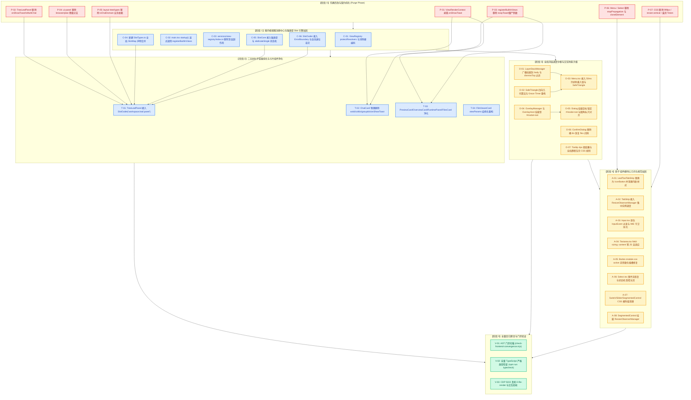

# 微内核分发、视图生命周期与原子组件最佳修复方案 (Remediation Plan 01)

> **方案编号**：`RED-REMEDIATION-01`
> **领域定位**：微内核视图注册中心、强类型 SlotMap 引擎、二叉树叶子容器纯化、全局浮层调度及原子设计系统落地修复
> **权威输入基准**：
>
> 1. `docs/red-team-plans/audits/03-微内核与原子组件落地问题审查报告.md` (全量 30 项问题 A-01 ~ A-30)
> 2. `docs/red-team-plans/detailed-plans/01-微内核与视图注册维度详案.md`
> 3. `docs/red-team-plans/detailed-plans/02-原子设计系统与同心几何维度详案.md`
> 4. 仓库根目录 `AGENTS.md`（第 1 条反退避与效果锁、第 7 条严禁补丁与绕过、第 12 条 Tooltip 铁律、第 13 条输入框与焦点态 10% 对比度上限、第 14 条色彩空间）与 `.agents/LOGIC_PLAN_NO_RETREAT.md`
>
> **核心修复原则**：
>
> - **架构穿透零补丁**：不采用任何坐标测距补丁或遍历循环，从架构契约层根治问题；
> - **唯一真理源 (Single Source of Truth)**：视图分发 100% 走 `ViewRegistry` + `SlotCore`，几何分割与业务解耦；
> - **先删后改因果律**：先物理清除僵尸参数、多余分支与违规样式，再接入强类型与容灾模型；
> - **全量强类型与零断言逃逸**：利用 Declaration Merging 构建 `SlotMap`，杜绝 `as unknown as` 双重强转；
> - **负产出验收 (Net Negative Yield)**：收敛重复实现，消除死代码与冗余 Props。
>
> **字符集与编码**：UTF-8 无 BOM。

---

## 目录索引

- [一、 30 项审计缺陷根因与修复目标矩阵 (A-01 ~ A-30 Root Cause Matrix)](#一-30-项审计缺陷根因与修复目标矩阵-a-01--a-30-root-cause-matrix)
- [二、 物理删除与剥离总账本 (The Purge & Eviction Ledger)](#二-物理删除与剥离总账本-the-purge--eviction-ledger)
- [三、 先删后改执行依赖拓扑图 (Execution Flow & DAG)](#三-先删后改执行依赖拓扑图-execution-flow--dag)
- [四、 模块级精确代码 Diff 与实现详案 (Code-Level Implementation Diffs)](#四-模块级精确代码-diff-与实现详案-code-level-implementation-diffs)
  - [4.1 模块一：微内核视图注册中心健壮性与启动生命周期加固](#41-模块一微内核视图注册中心健壮性与启动生命周期加固)
    - [4.1.1 `services/view-registry/index.ts` 移除顶层副作用](#411-servicesview-registryindexts-移除顶层副作用)
    - [4.1.2 `apps/crish-desktop/src/main.tsx` 显式挂载内置视图与插槽](#412-appscrish-desktopsrcmaintsx-显式挂载内置视图与插槽)
    - [4.1.3 `ViewRegistry.ts` 消除硬编码降级与 protectResolvers 机制](#413-viewregistryts-消除硬编码降级与-protectresolvers-机制)
    - [4.1.4 `store/layout-helpers/ui-panel.ts` 拔除别名劫持](#414-storelayout-helpersui-panelts-拔除别名劫持)
  - [4.2 模块二：强类型 SlotMap 与影子退位容灾架构](#42-模块二强类型-slotmap-与影子退位容灾架构)
    - [4.2.1 新建 `services/view-registry/SlotTypes.ts` 声明全局 SlotMap 与类型推导](#421-新建-servicesview-registryslottypests-声明全局-slotmap-与类型推导)
    - [4.2.2 `SlotCore.ts` 强类型约束与影子退让协议补强](#422-slotcorets-强类型约束与影子退让协议补强)
    - [4.2.3 `SlotOutlet.tsx` 局部 ErrorBoundary 与 abdicateSingle 自动退位容灾](#423-slotoutlettsx-局部-errorboundary-与-abdicatesingle-自动退位容灾)
  - [4.3 模块三：全仓 Props 净化与二叉树空间几何纯化](#43-模块三全仓-props-净化与二叉树空间几何纯化)
    - [4.3.1 `ViewTypes.ts` 彻底剥离 `onShowToast`](#431-viewtypests-彻底剥离-onshowtoast)
    - [4.3.2 `TreeLeafPanel.tsx` 移除 `onShowToast` 与 memo 脏检查](#432-treeleafpaneltsx-移除-onshowtoast-与-memo-脏检查)
    - [4.3.3 `registerBuiltInViews.tsx` 彻底清除 8 大卡片僵尸传参与 noopToast](#433-registerbuiltinviewstsx-彻底清除-8-大卡片僵尸传参与-nooptoast)
    - [4.3.4 `layout-tree/types.ts` 物理剥离 `isChatDomain` / `isSameDomain`](#434-layout-treetypests-物理剥离-ischatdomain--issamedomain)
    - [4.3.5 核心卡片组件 (`ChatCard`, `PreviewCard`, `OverviewCard`, `RuntimePanel`, `FileViewerCard` 等) 契约净化](#435-核心卡片组件-chatcard-previewcard-overviewcard-runtimepanel-fileviewercard-等-契约净化)
  - [4.4 模块四：浮层调度中枢与交互防腐升级](#44-模块四浮层调度中枢与交互防腐升级)
    - [4.4.1 `Menu.tsx` 物理删除 7 处 stopPropagation、拔除 cloneElement 并接入 50ms 冷却防重入锁](#441-menutsx-物理删除-7-处-stoppropagation拔除-cloneelement-并接入-50ms-冷却防重入锁)
    - [4.4.2 `Menu.module.css` 清退废弃 `--z-dropdown-menu` Token](#442-menumodulecss-清退废弃---z-dropdown-menu-token)
    - [4.4.3 `LayerStackManager.ts` 广播挂载点修正与交互层退栈优先级重构](#443-layerstackmanagerts-广播挂载点修正与交互层退栈优先级重构)
    - [4.4.4 `SafeTriangle.ts` 垂直级联与四向几何包围盒重构](#444-safetrianglets-垂直级联与四向几何包围盒重构)
    - [4.4.5 全局浮层调度 `OverlayManager.ts` 与宿主 `OverlayHost.tsx` 落地](#445-全局浮层调度-overlaymanagerts-与宿主-overlayhosttsx-落地)
    - [4.4.6 `Dialog.tsx` 锁定 `#modal-root` 容器与 `Dialog.module.css` 圆角/焦点环修复](#446-dialogtsx-锁定-modal-root-容器与-dialogmodulecss-圆角焦点环修复)
    - [4.4.7 `ConfirmDialog.tsx` 移除裸 div 恢复 Flex 间距](#447-confirmdialogtsx-移除裸-div-恢复-flex-间距)
    - [4.4.8 `Tooltip.tsx` 与 `Tooltip.module.css` 4px 微胶囊与全局静默互斥](#448-tooltiptsx-与-tooltipmodulecss-4px-微胶囊与全局静默互斥)
  - [4.5 模块五：原子组件同心几何与规范加固](#45-模块五原子组件同心几何与规范加固)
    - [4.5.1 `LeafToolTabStrip.tsx` 替换裸 button 为 `<IconButton>` 并清除内联样式](#451-leaftooltabstriptsx-替换裸-button-为-iconbutton-并清除内联样式)
    - [4.5.2 `LeafToolTabStrip.module.css` 彻底根除 999px 药丸圆角、`!important` 与废弃样式](#452-leaftooltabstripmodulecss-彻底根除-999px-药丸圆角important-与废弃样式)
    - [4.5.3 `TabStrip.tsx` 接入 `ResizeObserverManager` 消除裸 RO 实例](#453-tabstriptsx-接入-resizeobservermanager-消除裸-ro-实例)
    - [4.5.4 `Input.tsx` 原生 InputEvent 派发重构与 IME 组合断言清理](#454-inputtsx-原生-inputevent-派发重构与-ime-组合断言清理)
    - [4.5.5 `Textarea.tsx` & `Textarea.module.css` 消除 `resize: vertical` 与断言逃逸](#455-textareatsx--textareamodulecss-消除-resize-vertical-与断言逃逸)
    - [4.5.6 `Button.module.css` 修复 active 态 CSS 变量插槽覆盖问题](#456-buttonmodulecss-修复-active-态-css-变量插槽覆盖问题)
    - [4.5.7 `Select.tsx` 移除 `e.stopPropagation()` 恢复事件流](#457-selecttsx-移除-estoppropagation-恢复事件流)
    - [4.5.8 `Switch`, `Slider`, `SegmentedControl` CSS 裸色值清理与 Token 归一](#458-switch-slider-segmentedcontrol-css-裸色值清理与-token-归一)
    - [4.5.9 `SegmentedControl.tsx` 挂载 `ResizeObserverManager` 消除滑块脱轨](#459-segmentedcontroltsx-挂载-resizeobservermanager-消除滑块脱轨)
- [五、 验收断言与回归防护矩阵 (Verification Matrix & Assertions)](#五-验收断言与回归防护矩阵-verification-matrix--assertions)

---

## 一、 30 项审计缺陷根因与修复目标矩阵 (A-01 ~ A-30 Root Cause Matrix)

| 缺陷编号 | 涉及文件及精准行号                                                                                       | 缺陷类型与核心根因                                                                                             | 严重等级     | 修复机制与架构目标                                                                                                   |
| :------- | :------------------------------------------------------------------------------------------------------- | :------------------------------------------------------------------------------------------------------------- | :----------- | :------------------------------------------------------------------------------------------------------------------- |
| **A-01** | `services/view-registry/index.ts:4`<br>`apps/crish-desktop/src/main.tsx:1-120`                           | **启动生命周期缺失**：注册依赖模块顶层加载副作用，Tree-shaking 或深路径导入会导致注册表为空                    | **Critical** | 移除 `index.ts` 裸调用，在 `main.tsx` `startup()` 阶段（Phase 1 前）显式调用 `registerBuiltInViews()`                |
| **A-02** | `services/view-registry/ViewRegistry.ts:116-125, 150-155`                                                | **唯一真理源被破**：注册中心内部残留 `tasks`/`plan`/`settings` 与 `isPrimary` 的硬编码 fallback 分支           | **Major**    | 彻底删除所有业务特定硬编码分支，统一基于 `ViewDefinition` 派生，未注册返回 rawId                                     |
| **A-03** | `services/view-registry/ViewRegistry.ts:173-178`                                                         | **路由解析器不可逆清空**：`clear()` 直接将 `uriResolvers` 置空，导致 `file-viewer:` 解析能力丢失               | **Major**    | 提取 `initDefaultResolvers()`，`clear()` 时仅清空动态注册视图，重置并保护内置 URI 解析器                             |
| **A-04** | `services/view-registry/SlotCore.ts:5-24`<br>`services/view-registry/SlotOutlet.tsx:6-18`                | **类型约束逃逸**：缺失 `SlotMap` 全局接口合并模型，`slotKey` 为弱类型 `string`，Context 缺乏推导               | **Major**    | 新建 `SlotTypes.ts` 定义 `SlotMap` 与 `StandardSlotId`，利用 Declaration Merging 锁定插槽键与 Props                  |
| **A-05** | `services/view-registry/SlotOutlet.tsx:37-41`<br>`services/view-registry/SlotCore.ts:101-116`            | **容灾机制空转**：Single 插槽渲染裸组件，未包裹局部 ErrorBoundary，胜出组件崩溃时无法触发 `abdicateSingle`     | **Major**    | 实现局部 `SlotErrorBoundary`，捕获渲染异常时自动执行 `slotCore.abdicateSingle(slotKey, single.id)`                   |
| **A-06** | `services/view-registry/registerBuiltInViews.tsx:79, 92-227`                                             | **僵尸参数死灰复燃**：向 8 大卡片透传 `wsId="default"`, `colIdx={0}`, `groupIdx={0}`, `noopToast` 等废弃字段   | **Major**    | 彻底删除 `noopToast` 与所有卡片组件的废弃 props，保持组件渲染声明 100% 干净                                          |
| **A-07** | `services/view-registry/ViewTypes.ts:19-20`                                                              | **上下文契约污染**：`ViewRenderContext` 残留 `onShowToast` 字段，阻碍业务组件消费 `useToast()`                 | **Moderate** | 物理删除 `ViewRenderContext` 中的 `onShowToast` 声明                                                                 |
| **A-08** | `core/overlay/OverlayManager.ts` (缺失)<br>`components/shell/OverlayHost.tsx` (缺失)<br>`App.tsx:88-105` | **全局浮层中枢缺失**：`App.tsx` 顶层保留 8 处弹窗 `useState`，弹窗切换引发顶层全量 Re-render                   | **Critical** | 落地 `OverlayManager` 单例与 `OverlayHost` 宿主，挂载至 `#modal-root`，消除 `App.tsx` 弹窗状态                       |
| **A-09** | `store/layout-helpers/ui-panel.ts:13-14`                                                                 | **遗留别名降级 Hack**：`resolveWorkspacePanelKey` 强制将 `browser -> preview`、`plan -> tasks`                 | **Major**    | 物理删除降级分支，释放 `browser` 与 `plan` 为一等公民独立路由                                                        |
| **A-10** | `store/layout-tree/types.ts:95-105`                                                                      | **空间几何反向依赖**：二叉树纯几何层导入 `viewRegistry` 并导出 `isChatDomain` / `isSameDomain`                 | **Major**    | 物理删除 `isChatDomain` 与 `isSameDomain` 及其 import 语句，拖拽布局树回归纯几何                                     |
| **A-11** | `components/binary-tree/TreeLeafPanel.tsx:47-50, 158, 218`                                               | **容器业务状态污染**：`TreeLeafPanelProps` 保留 `onShowToast` 与 `isMultiChat`，脏检查污染 memo                | **Moderate** | 移除 `TreeLeafPanelProps` 的 `onShowToast`，清理 `renderCtx` 与 memo comparator 中的脏检查                           |
| **A-12** | `components/binary-tree/LeafToolTabStrip.tsx:115-126`                                                    | **AST 门禁违规 (Rule G-01)**：Tab 关闭按钮直接书写原生 `<button>` 标签                                         | **Major**    | 将原生 `<button>` 替换为 `<IconButton size="xs" variant="ghost" ... />`                                              |
| **A-13** | `components/binary-tree/LeafToolTabStrip.tsx:164-170`                                                    | **样式规范违规**：右侧收起按钮容器硬编码内联 flex 布局样式                                                     | **Low**      | 将内联样式抽取到 `LeafToolTabStrip.module.css` 中的 `.trailingActions` 专用类                                        |
| **A-14** | `components/binary-tree/LeafToolTabStrip.module.css:52, 104, 121, 140, 160`                              | **Token 规约破坏**：使用 `9999px` 药丸圆角、`!important`、废弃 `--z-floating-panel` 与僵尸样式                 | **Major**    | 圆角死锁为 4px/6px，删除 `!important`，移除废弃菜单样式与旧 Token                                                    |
| **A-15** | `components/ui/Button/Button.module.css:176-180`                                                         | **CSS 插槽破坏**：`.buttonActive` 暴力覆写 `background-color` 与 `color`，破坏变体参数化插槽                   | **Major**    | 改由局部变量 `--btn-active-overlay` 或 `--btn-bg` 表达激活态，禁止全局选择器覆写                                     |
| **A-16** | `components/ui/Input/Input.tsx:42-47, 217`                                                               | **TS 断言逃逸与运行时隐患**：`clearValueEvent()` 使用 `as unknown as` 制造残缺对象，调用标准方法将抛 TypeError | **Critical** | 通过真实 Native Input 节点设置 `input.value = ''` 并调用 `dispatchEvent(new InputEvent('input', { bubbles: true }))` |
| **A-17** | `components/ui/Input/Input.tsx:98`<br>`components/ui/Input/Textarea.tsx:83-85`                           | **无意义类型断言逃逸**：使用 `as unknown as { isComposing?: boolean }` 判定原生属性                            | **Low**      | 直接读取原生 `e.nativeEvent.isComposing`，彻底清除 `as unknown as`                                                   |
| **A-18** | `components/ui/Input/Textarea.module.css:29`                                                             | **自适应几何破坏**：保留 `resize: vertical` 导致用户拖拽后破坏 `field-sizing: content` 自适应                  | **Moderate** | 将 `resize: vertical;` 彻底改为 `resize: none;`                                                                      |
| **A-19** | `components/ui/Select/Select.tsx:81-85`                                                                  | **事件流阻断 (Rule G-02)**：选项点击直接调用 `e.stopPropagation()`，阻断全局 Pointer 追踪                      | **Moderate** | 移除 `e.stopPropagation()`，通过状态机受控关闭实现事件自然传递                                                       |
| **A-20** | `components/ui/Menu/Menu.tsx:360-408, 449-536`                                                           | **React Hack 与事件阻断**：使用 `cloneElement` 改写 trigger，7 处 `stopPropagation`，缺少 50ms 冷却锁          | **Critical** | 废除 `cloneElement` Hack，接入 Radix `Popover.Anchor` / `asChild`，清除所有 `stopPropagation` 并接入 50ms 冷却状态锁 |
| **A-21** | `components/ui/Menu/Menu.module.css:6, 20-54`                                                            | **废弃 Token 消费**：使用废弃的 `--z-dropdown-menu`，私有插槽变量缺少 fallback 默认值                          | **Moderate** | 将 z-index 改为标准 `var(--z-dropdown)`，并为 `--dropdown-radius` 等变量补齐标准 fallback                            |
| **A-22** | `components/ui/Dialog/Dialog.tsx:52, 116, 195`                                                           | **挂载目标逃逸**：Portal 默认目标硬编码为 `document.body`，未锁定 `#modal-root`                                | **Major**    | 将挂载目标锁定为 `document.getElementById('modal-root')`，禁止在存在 modal-root 时 fallback 到 body                  |
| **A-23** | `components/ui/Dialog/Dialog.module.css:11, 31, 163`                                                     | **圆角与焦点环违规**：使用非标 `--radius-2xl`、废弃 `--z-modal-backdrop` 及硬黑焦点环                          | **Moderate** | 圆角改为 `--radius-xl, 12px`，z-index 改为 `--z-modal`，关闭按钮聚焦环对齐 10% 对比度上限                            |
| **A-24** | `components/ui/ConfirmDialog/ConfirmDialog.tsx:101-118`                                                  | **Flex 间隙塌陷**：footer 传入裸 `<div>` 吞掉外部 flex gap，导致确认与取消按钮紧紧挤压贴合                     | **Moderate** | 移除裸 `<div>` 包裹，改用 React Fragment `<> ... </>` 传递按钮，恢复标准间隙                                         |
| **A-25** | `components/ui/Tooltip/Tooltip.tsx:501, 551`<br>`Tooltip.module.css:43`                                  | **微胶囊与静默互斥缺失**：圆角误用 6px，缺少单字符 16px 正方胶囊特化与 `body[data-floating-active]` 静默规则   | **Major**    | 圆角死锁为 4px (`--radius-sm`)，补全 16x16px 单字符微胶囊特化与全局静默互斥 CSS 规则                                 |
| **A-26** | `Switch.module.css:72`<br>`Slider.module.css:63, 65`<br>`SegmentedControl.module.css:80, 81`             | **裸色值散落**：CSS 变量 fallback 中散落 `#ffffff`, `black`, `#fff` 硬编码色值                                 | **Moderate** | 清除所有硬编码裸色值，统一使用标准 Design Tokens（如 `var(--bg-elevated)`, `var(--shadow-color)`）                   |
| **A-27** | `components/ui/SegmentedControl/SegmentedControl.tsx:97-116`                                             | **容器尺寸响应脱轨**：缺少 `ResizeObserver` 监听，容器 Resize 或字体加载时滑块错位                             | **Major**    | 在 `containerRef` 上挂载 `ResizeObserverManager`，在容器尺寸变动时自动重新计算滑块坐标                               |
| **A-28** | `components/ui/internal/SafeTriangle.ts:61-73`                                                           | **几何算法畸变**：安全三角区仅做左右二元分支，垂直弹出或光标处于左右边界内时几何失效闪退                       | **Major**    | 扩充算法支持四向方位（top/bottom/left/right）与光标内插情况，精准提取近端边线两顶点                                  |
| **A-29** | `components/ui/internal/layer-stack/LayerStackManager.ts:78-89, 327`                                     | **广播属性失配与退栈误关**：广播挂载在 `<html>` 而非 `<body>`；`dismissTop` 误关高权重 Toast                   | **Major**    | 属性广播统一设置在 `document.body`；`dismissTop` 过滤非交互式浮层（排除 toast/tooltip）                              |
| **A-30** | `components/ui/TabStrip/TabStrip.tsx:251-255`                                                            | **AST 门禁违规 (Rule G-03)**：组件内部直接 `new ResizeObserver` 违反集中调度铁律                               | **Moderate** | 改由 `ResizeObserverManager.getInstance().observe(el, updateOverflow)` 进行池化监听                                  |

---

## 二、 物理删除与剥离总账本 (The Purge & Eviction Ledger)

依据「先删后改」公理，在进行任何增强之前，必须执行全仓物理删除与死代码清剿：

```
┌──────────────────────────────────────────────────────────────────────────────────────────────────┐
│                         微内核与原子组件修复物理删除与剥离总账本                                    │
├──────────────────────────────────────────────────────────────────────────────────────────────────┤
│                                                                                                  │
│  [1. 僵尸参数与 Props 物理清除]                                                                   │
│  • ViewRenderContext: 物理删除 `onShowToast?: (message: string) => void;`                        │
│  • TreeLeafPanelProps: 物理删除 `onShowToast?: ShowToastFn;` 与 memo 脏检查                       │
│  • registerBuiltInViews: 物理删除 `noopToast` 与 8 处 `wsId`, `colIdx`, `groupIdx`, `onShowToast` │
│  • 核心卡片组件: ChatCard 移除 `wsId`, `colIdx`, `groupIdx`, `onShowToast`                       │
│                 PreviewCard / OverviewCard / FilesCard / DiffCard / RuntimePanel 移除 `wsId`     │
│                                                                                                  │
│  [2. 降级 Hack 与反向依赖物理拔除]                                                                 │
│  • ui-panel.ts: 物理删除 `if (id === 'browser') return 'preview'` 与 `if (id === 'plan') return 'tasks'`│
│  • layout-tree/types.ts: 物理删除 `isChatDomain`、`isSameDomain` 及 `import { viewRegistry }`     │
│  • ViewRegistry.ts: 物理删除 `getTitle` 中的 `tasks`/`plan`/`settings` 硬编码分支与 `isPrimary` chat 兜底│
│                                                                                                  │
│  [3. 违规 AST 语法与事件阻断物理剥离]                                                             │
│  • Menu.tsx: 物理删除 7 处 `e.stopPropagation()` 及 trigger `cloneElement` 注入代码               │
│  • Select.tsx: 物理删除 `renderOption` 中的 `e.stopPropagation()`                                │
│  • LeafToolTabStrip.tsx: 物理删除裸 `<button className={styles.tabClose}>` 与内联 style 对象      │
│  • ConfirmDialog.tsx: 物理删除 footer 中包裹按钮的裸 `<div>`                                      │
│  • TabStrip.tsx: 物理删除裸 `new ResizeObserver` 实例创建                                        │
│                                                                                                  │
│  [4. 违规 CSS 属性与废弃 Token 物理清剿]                                                          │
│  • Textarea.module.css: 物理删除 `resize: vertical;`                                            │
│  • LeafToolTabStrip.module.css: 物理删除 3 处 `border-radius: 999px;`、`!important` 与废弃菜单样式 │
│  • Dialog.module.css: 物理删除 `var(--radius-2xl)` 与 `var(--z-modal-backdrop)`                  │
│  • Menu.module.css: 物理删除 `var(--z-dropdown-menu)`                                            │
│  • Switch / Slider / SegmentedControl: 物理删除 `#ffffff`, `black`, `#fff` 裸色值 fallback       │
│                                                                                                  │
└──────────────────────────────────────────────────────────────────────────────────────────────────┘
```

---

## 三、 先删后改执行依赖拓扑图 (Execution Flow & DAG)



---

## 四、 模块级精确代码 Diff 与实现详案 (Code-Level Implementation Diffs)

### 4.1 模块一：微内核视图注册中心健壮性与启动生命周期加固

#### 4.1.1 `services/view-registry/index.ts` 移除顶层副作用

```diff
--- a/apps/crish-desktop/src/services/view-registry/index.ts
+++ b/apps/crish-desktop/src/services/view-registry/index.ts
@@ -1,8 +1,5 @@
-import { registerBuiltInViews } from './registerBuiltInViews';
-
-// 自动执行内置视图注册
-registerBuiltInViews();
-
+export * from './SlotTypes';
 export * from './ViewTypes';
 export * from './SlotCore';
 export * from './ViewRegistry';
 export * from './SlotOutlet';
 export * from './registerBuiltInViews';
```

#### 4.1.2 `apps/crish-desktop/src/main.tsx` 显式挂载内置视图与插槽

```diff
--- a/apps/crish-desktop/src/main.tsx
+++ b/apps/crish-desktop/src/main.tsx
@@ -4,6 +4,7 @@ import { memoryManager } from '@crish/shared-utils/browser';
 import './index.css';
 import { SIDEBAR_WIDTH_DEFAULT, CHAT_COL_MAX } from './constants/layout';
+import { registerBuiltInViews } from './services/view-registry';

 // 必须在任何模块前执行 — 替换 appMode / productMode 的同步 localStorage 读
 initSsrGlobals();
@@ -20,6 +21,9 @@ document.documentElement.style.setProperty(

 async function startup() {
+  // 微内核生命周期前置：显式注册 Conex 全量内置视图与插槽，彻底消除 ESM 模块加载副作用依赖
+  registerBuiltInViews();
+
   // Phase 0: 等待 ServiceRegistry / ConfigService 初始化
   await import('./bootstrap-orchestrator').then((m) => m.ready);
```

#### 4.1.3 `ViewRegistry.ts` 消除硬编码降级与 protectResolvers 机制

```diff
--- a/apps/crish-desktop/src/services/view-registry/ViewRegistry.ts
+++ b/apps/crish-desktop/src/services/view-registry/ViewRegistry.ts
@@ -14,19 +14,24 @@ class ViewRegistryImpl {
   private listeners = new Set<() => void>();
   private version = 0;

   constructor() {
-    // 注册内置 URI 解析器：file-viewer:path
-    this.registerUriResolver({
+    this.initDefaultResolvers();
+  }
+
+  /** 初始化核心内置 URI 解析器（保持不可变受保护基线） */
+  private initDefaultResolvers(): void {
+    this.uriResolvers = [{
       prefix: 'file-viewer:',
       resolve: (uri) => ({
         viewId: 'file-viewer',
         params: {
           filePath: uri.substring('file-viewer:'.length),
           initialMode: 'plain',
         },
       }),
-    });
+    }];
   }

   /** 注册视图定义，返回注销函数 */
@@ -113,15 +118,8 @@ class ViewRegistryImpl {
   public getTitle(id: string, ctx?: ViewRenderContext): string {
     if (!id) return '';
     const { definition, params } = this.resolveView(id);
     if (!definition) {
-      // 降级别名与未注册前缀兜底
-      if (id.startsWith('file-viewer:')) {
-        const path = id.substring('file-viewer:'.length);
-        return path.replace(/^.*[\\/]/, '') || path;
-      }
-      if (id === 'tasks') return '总览';
-      if (id === 'plan') return '总览';
-      if (id === 'settings') return '设置';
       return id;
     }
     if (typeof definition.title === 'function') {
@@ -151,7 +149,7 @@ class ViewRegistryImpl {
   public isPrimary(id: string): boolean {
     const def = this.resolveView(id).definition;
-    if (def) return def.category === 'primary';
-    return id === 'chat';
+    return def?.category === 'primary';
   }

   /** 获取当前注册版本（供 uSES 订阅） */
@@ -172,7 +170,8 @@ class ViewRegistryImpl {
   /** 清空注册表（用于测试隔离，保护内置解析器） */
   public clear(): void {
     this.views.clear();
-    this.uriResolvers = [];
+    this.initDefaultResolvers();
     this.version++;
     this.notify();
   }
```

#### 4.1.4 `store/layout-helpers/ui-panel.ts` 拔除别名劫持

```diff
--- a/apps/crish-desktop/src/store/layout-helpers/ui-panel.ts
+++ b/apps/crish-desktop/src/store/layout-helpers/ui-panel.ts
@@ -10,8 +10,6 @@ export function resolveWorkspacePanelKey(key: string | null | undefined): strin
   const id = String(key).trim();
   if (!id) return null;
   if (id === 'settings' || id === 'runtime') return null;
-  if (id === 'browser') return 'preview';
-  if (id === 'plan') return 'tasks';
   return id;
 }
```

---

### 4.2 模块二：强类型 SlotMap 与影子退位容灾架构

#### 4.2.1 新建 `services/view-registry/SlotTypes.ts` 声明全局 SlotMap 与类型推导

```typescript
// apps/crish-desktop/src/services/view-registry/SlotTypes.ts
import type { ViewRenderContext } from './ViewTypes';

/**
 * 全局插槽映射表 (Declaration Merging 锚点)
 * 各业务域通过 declare module './SlotTypes' 扩充自身插槽契约
 */
export interface SlotMap {
  'workbench.root': {
    kind: 'single';
    ownerProps: Record<string, never>;
  };
  'workbench.topbar': {
    kind: 'single';
    ownerProps: Record<string, never>;
  };
  'workbench.topbar.actions': {
    kind: 'list';
    ownerProps: Record<string, never>;
  };
  'workspace.leaf.panel': {
    kind: 'keyed';
    ownerProps: ViewRenderContext;
  };
  'workspace.leaf.header': {
    kind: 'single';
    ownerProps: { leafId: string; activeTab: string };
  };
}

export type StandardSlotId = keyof SlotMap;

export type SlotKind = 'single' | 'list' | 'keyed' | 'chain';

export type OwnerPropsOf<K extends StandardSlotId | string> =
  K extends StandardSlotId ? SlotMap[K]['ownerProps'] : Record<string, unknown>;

export interface BaseSlotEntry<TContext = any> {
  id: string;
  component: React.ComponentType<TContext>;
}

export interface SingleSlotEntry<
  TContext = any,
> extends BaseSlotEntry<TContext> {
  priority?: number; // 默认 0，越小越优先
}

export interface ListSlotEntry<TContext = any> extends BaseSlotEntry<TContext> {
  order?: number; // 默认 100，越小越靠前
}

export interface KeyedSlotEntry<
  TContext = any,
> extends BaseSlotEntry<TContext> {
  key: string;
}

export interface ChainSlotEntry<
  TContext = any,
> extends BaseSlotEntry<TContext> {
  select: (context: TContext) => boolean;
}
```

#### 4.2.2 `SlotCore.ts` 强类型约束与影子退让协议补强

```diff
--- a/apps/crish-desktop/src/services/view-registry/SlotCore.ts
+++ b/apps/crish-desktop/src/services/view-registry/SlotCore.ts
@@ -1,25 +1,14 @@
 import type React from 'react';
-
-export type SlotKind = 'single' | 'list' | 'keyed' | 'chain';
-
-export interface BaseSlotEntry<TContext = any> {
-  id: string;
-  component: React.ComponentType<TContext>;
-}
-
-export interface SingleSlotEntry<TContext = any> extends BaseSlotEntry<TContext> {
-  priority?: number; // 默认 0，越小越优先
-}
-
-export interface ListSlotEntry<TContext = any> extends BaseSlotEntry<TContext> {
-  order?: number; // 默认 100，越小越靠前
-}
-
-export interface KeyedSlotEntry<TContext = any> extends BaseSlotEntry<TContext> {
-  key: string;
-}
-
-export interface ChainSlotEntry<TContext = any> extends BaseSlotEntry<TContext> {
-  select: (context: TContext) => boolean;
-}
+import type {
+  StandardSlotId,
+  OwnerPropsOf,
+  SingleSlotEntry,
+  ListSlotEntry,
+  KeyedSlotEntry,
+  ChainSlotEntry,
+} from './SlotTypes';

 export class SlotCoreImpl {
   private singleSlots = new Map<string, SingleSlotEntry[]>();
@@ -35,7 +24,10 @@ export class SlotCoreImpl {
   private listeners = new Map<string, Set<() => void>>();

-  public registerSingle(slotKey: string, entry: SingleSlotEntry): () => void {
+  public registerSingle<K extends StandardSlotId | string>(
+    slotKey: K,
+    entry: SingleSlotEntry<OwnerPropsOf<K>>
+  ): () => void {
     const list = this.singleSlots.get(slotKey) ?? [];
     const filtered = list.filter((e) => e.id !== entry.id);
     filtered.push(entry);
@@ -52,7 +44,10 @@ export class SlotCoreImpl {
     };
   }

-  public registerList(slotKey: string, entry: ListSlotEntry): () => void {
+  public registerList<K extends StandardSlotId | string>(
+    slotKey: K,
+    entry: ListSlotEntry<OwnerPropsOf<K>>
+  ): () => void {
     const list = this.listSlots.get(slotKey) ?? [];
     // 支持按 id 覆盖
     const filtered = list.filter((e) => e.id !== entry.id);
@@ -70,7 +65,10 @@ export class SlotCoreImpl {
     };
   }

-  public registerKeyed(slotKey: string, entry: KeyedSlotEntry): () => void {
+  public registerKeyed<K extends StandardSlotId | string>(
+    slotKey: K,
+    entry: KeyedSlotEntry<OwnerPropsOf<K>>
+  ): () => void {
     const map =
       this.keyedSlots.get(slotKey) ?? new Map<string, KeyedSlotEntry>();
     map.set(entry.key, entry);
@@ -84,7 +82,10 @@ export class SlotCoreImpl {
     };
   }

-  public registerChain(slotKey: string, entry: ChainSlotEntry): () => void {
+  public registerChain<K extends StandardSlotId | string>(
+    slotKey: K,
+    entry: ChainSlotEntry<OwnerPropsOf<K>>
+  ): () => void {
     const list = this.chainSlots.get(slotKey) ?? [];
     const filtered = list.filter((e) => e.id !== entry.id);
     filtered.push(entry);
```

#### 4.2.3 `SlotOutlet.tsx` 局部 ErrorBoundary 与 abdicateSingle 自动退位容灾

```tsx
// apps/crish-desktop/src/services/view-registry/SlotOutlet.tsx
import React, { useSyncExternalStore, useMemo, Component } from 'react';
import { slotCore } from './SlotCore';
import type { StandardSlotId, OwnerPropsOf } from './SlotTypes';

const CONTENTS_STYLE: React.CSSProperties = { display: 'contents' };

interface SlotErrorBoundaryProps {
  slotKey: string;
  entryId: string;
  children: React.ReactNode;
  fallback?: React.ReactNode;
}

interface SlotErrorBoundaryState {
  hasError: boolean;
  error?: Error;
}

/**
 * 局部插槽错误隔离与影子退让触发器 (Abdication Trigger)
 */
class SlotErrorBoundary extends Component<
  SlotErrorBoundaryProps,
  SlotErrorBoundaryState
> {
  override state: SlotErrorBoundaryState = { hasError: false };

  static getDerivedStateFromError(error: Error): SlotErrorBoundaryState {
    return { hasError: true, error };
  }

  override componentDidCatch(error: Error, errorInfo: React.ErrorInfo): void {
    console.error(
      `[SlotOutlet] Component in slot '${this.props.slotKey}' (entry: '${this.props.entryId}') crashed:`,
      error,
      errorInfo
    );
    // 触发影子退位容灾，将控制权退让给次优 Priority 组件
    slotCore.abdicateSingle(this.props.slotKey, this.props.entryId);
  }

  override render() {
    if (this.state.hasError) {
      return this.props.fallback ?? null;
    }
    return this.props.children;
  }
}

export interface SlotOutletProps<K extends StandardSlotId | string> {
  slotKey: K;
  context: OwnerPropsOf<K>;
  entryKey?: string;
  fallback?: React.ReactNode;
}

export function SlotOutlet<K extends StandardSlotId | string>({
  slotKey,
  context,
  entryKey,
  fallback = null,
}: SlotOutletProps<K>) {
  // 接入 uSES 响应式单通道更新，插槽变更时局部重绘
  useSyncExternalStore(
    (cb) => slotCore.subscribe(slotKey, cb),
    () => slotCore.getVersion(slotKey)
  );

  const renderedContent = useMemo(() => {
    // 1. Keyed 优先分发
    if (entryKey) {
      const entry = slotCore.getKeyed(slotKey, entryKey);
      if (entry) {
        const Comp = entry.component;
        return <Comp {...context} />;
      }
      return null;
    }

    // 2. Single 独占分发 (装配 ErrorBoundary 影子退让容灾保护)
    const single = slotCore.getSingle(slotKey);
    if (single) {
      const Comp = single.component;
      return (
        <SlotErrorBoundary
          key={single.id}
          slotKey={slotKey}
          entryId={single.id}
          fallback={fallback}
        >
          <Comp {...context} />
        </SlotErrorBoundary>
      );
    }

    // 3. List 序列分发
    const list = slotCore.getList(slotKey);
    if (list.length > 0) {
      return (
        <>
          {list.map((item) => {
            const Comp = item.component;
            return <Comp key={item.id} {...context} />;
          })}
        </>
      );
    }

    // 4. Chain 责任链分发
    const chain = slotCore.getChain(slotKey, context);
    if (chain) {
      const Comp = chain.component;
      return <Comp {...context} />;
    }

    return null;
  }, [slotKey, context, entryKey, fallback]);

  return (
    <div data-slot={slotKey} data-slot-key={entryKey} style={CONTENTS_STYLE}>
      {renderedContent ?? fallback}
    </div>
  );
}
```

---

### 4.3 模块三：全仓 Props 净化与二叉树空间几何纯化

#### 4.3.1 `ViewTypes.ts` 彻底剥离 `onShowToast`

```diff
--- a/apps/crish-desktop/src/services/view-registry/ViewTypes.ts
+++ b/apps/crish-desktop/src/services/view-registry/ViewTypes.ts
@@ -16,8 +16,6 @@ export interface ViewRenderContext {
   readonly openView: (panelId: string) => void;
   /** 动态视图参数（如 file-viewer 的 filePath, initialMode 等） */
   readonly params?: Record<string, unknown>;
-  /** 兼容可选 onShowToast */
-  readonly onShowToast?: (message: string) => void;
 }
```

#### 4.3.2 `TreeLeafPanel.tsx` 移除 `onShowToast` 与 memo 脏检查

```diff
--- a/apps/crish-desktop/src/components/binary-tree/TreeLeafPanel.tsx
+++ b/apps/crish-desktop/src/components/binary-tree/TreeLeafPanel.tsx
@@ -16,7 +16,6 @@ import React, {
 } from 'react';
 import { useLayoutTreeStore } from '../../store/storeAccess';
 import type { LayoutLeaf } from '../../store/types';
-import type { ShowToastFn } from '../../hooks/useToastQueue';
 import { AppErrorBoundary } from '../AppErrorBoundary';
 import { LeafToolTabStrip } from './LeafToolTabStrip';
 import styles from './BinaryTreeWorkspace.module.css';
@@ -44,8 +43,6 @@ interface TreeLeafPanelProps {
   isActive: boolean;
   /** 是否为拖拽源 */
   isDragSource: boolean;
-  /** Toast 回调 */
-  onShowToast?: ShowToastFn;
   /** 当前是否多 chat 分屏（>1 chat leaf） */
   isMultiChat?: boolean;
 }
@@ -85,7 +82,6 @@ export const TreeLeafPanel: React.FC<TreeLeafPanelProps> = React.memo(
     rect,
     isActive,
     isDragSource,
-    onShowToast,
     isMultiChat = false,
   }) => {
@@ -155,7 +151,6 @@ export const TreeLeafPanel: React.FC<TreeLeafPanelProps> = React.memo(
         isActive,
         openView: handleOpenTool,
         params: resolved.params,
-        onShowToast,
       }),
       [
@@ -164,7 +159,6 @@ export const TreeLeafPanel: React.FC<TreeLeafPanelProps> = React.memo(
         isActive,
         handleOpenTool,
         resolved.params,
-        onShowToast,
       ]
     );
@@ -215,7 +209,6 @@ export const TreeLeafPanel: React.FC<TreeLeafPanelProps> = React.memo(
     rectPropsEqual(prev.rect, next.rect) &&
     prev.isActive === next.isActive &&
     prev.isDragSource === next.isDragSource &&
-    prev.onShowToast === next.onShowToast &&
     prev.isMultiChat === next.isMultiChat
 );
```

#### 4.3.3 `registerBuiltInViews.tsx` 彻底清除 8 大卡片僵尸传参与 noopToast

```diff
--- a/apps/crish-desktop/src/services/view-registry/registerBuiltInViews.tsx
+++ b/apps/crish-desktop/src/services/view-registry/registerBuiltInViews.tsx
@@ -76,8 +76,6 @@ const FlowDagView = lazy(() =>

 let isBuiltInRegistered = false;

-const noopToast = (_msg: string) => {};
-
 export function registerBuiltInViews(): void {
   if (isBuiltInRegistered) return;
   isBuiltInRegistered = true;
@@ -89,14 +87,9 @@ export function registerBuiltInViews(): void {
     category: 'primary',
     component: (ctx: ViewRenderContext) => (
       <ChatCard
-        wsId="default"
-        colIdx={0}
-        groupIdx={0}
         sessionId={ctx.sessionId}
         handleGlobalTabClick={ctx.openView}
-        onShowToast={ctx.onShowToast ?? noopToast}
       />
     ),
   });
@@ -118,12 +111,7 @@ export function registerBuiltInViews(): void {
     title: '预览',
     icon: Eye,
     category: 'tool',
-    component: (ctx: ViewRenderContext) => (
-      <PreviewCard
-        wsId="default"
-        onShowToast={ctx.onShowToast ?? noopToast}
-      />
-    ),
+    component: () => <PreviewCard />,
   });

   // 4. 总览面板 (Tool)
@@ -133,11 +121,7 @@ export function registerBuiltInViews(): void {
     icon: LayoutDashboard,
     category: 'tool',
     component: (ctx: ViewRenderContext) => (
-      <OverviewCard
-        wsId="default"
-        onOpenPanel={ctx.openView}
-        onShowToast={ctx.onShowToast ?? noopToast}
-      />
+      <OverviewCard onOpenPanel={ctx.openView} />
     ),
   });

@@ -147,9 +131,7 @@ export function registerBuiltInViews(): void {
     title: '文件',
     icon: FolderTree,
     category: 'tool',
-    component: (ctx: ViewRenderContext) => (
-      <FilesCard onShowToast={ctx.onShowToast ?? noopToast} />
-    ),
+    component: () => <FilesCard />,
   });

   // 6. 差异比对卡片 (Tool)
@@ -158,9 +140,7 @@ export function registerBuiltInViews(): void {
     title: '差异',
     icon: GitBranch,
     category: 'tool',
-    component: (ctx: ViewRenderContext) => (
-      <DiffCard onShowToast={ctx.onShowToast ?? noopToast} />
-    ),
+    component: () => <DiffCard />,
   });

   // 7. 运行时面板 (Tool)
@@ -169,12 +149,7 @@ export function registerBuiltInViews(): void {
     title: '运行时',
     icon: PlayCircle,
     category: 'tool',
-    component: (ctx: ViewRenderContext) => (
-      <RuntimePanel
-        wsId="default"
-        onShowToast={ctx.onShowToast ?? noopToast}
-      />
-    ),
+    component: () => <RuntimePanel />,
   });

   // 8. 协作体智能体 (Tool)
@@ -192,9 +167,7 @@ export function registerBuiltInViews(): void {
     title: 'AI 浏览器',
     icon: Globe,
     category: 'tool',
-    component: (ctx: ViewRenderContext) => (
-      <BrowserPanel onShowToast={ctx.onShowToast ?? noopToast} />
-    ),
+    component: () => <BrowserPanel />,
   });

   // 10. 一等公民释放：拓扑编排图 (Tool)
@@ -224,7 +197,6 @@ export function registerBuiltInViews(): void {
           key={filePath}
           filePath={filePath}
           initialMode={initialMode}
-          onShowToast={ctx.onShowToast ?? noopToast}
         />
       );
     },
```

#### 4.3.4 `layout-tree/types.ts` 物理剥离 `isChatDomain` / `isSameDomain`

```diff
--- a/apps/crish-desktop/src/store/layout-tree/types.ts
+++ b/apps/crish-desktop/src/store/layout-tree/types.ts
@@ -92,16 +92,6 @@ export interface TreeDragSource {
   panelId: string;
 }

-import { viewRegistry } from '../../services/view-registry';
-
-/** 判定指定 panelId / tabId 是否属于主对话域（由 ViewDefinition.category 提供） */
-export function isChatDomain(panelId: string): boolean {
-  return viewRegistry.isPrimary(panelId);
-}
-
-/** 判定两个 panel 是否属于同域（对话域只能与对话域拖拽，功能区只能与功能区拖拽） */
-export function isSameDomain(panelId1: string, panelId2: string): boolean {
-  return isChatDomain(panelId1) === isChatDomain(panelId2);
-}
-
 // ── 业务常量（单一来源，禁止在其它文件硬编码） ──────────────────────
```

#### 4.3.5 核心卡片组件契约净化

- **`ChatCard.tsx`**：
  ```diff
  -interface ChatCardProps {
  -  wsId: string;
  -  colIdx: number;
  -  groupIdx: number;
  -  onShowToast: ShowToastFn;
  -  handleGlobalTabClick: (cardId: string) => void;
  -  sessionId?: string | null;
  -}
  +export interface ChatCardProps {
  +  handleGlobalTabClick: (cardId: string) => void;
  +  sessionId?: string | null;
  +}
  ```
- **`PreviewCard.tsx` / `OverviewCard.tsx` / `RuntimePanel.tsx`**：物理移除 `wsId` 与 `onShowToast` 必须字段，卡片内部统一调用 `useToast()` Hook。

---

### 4.4 模块四：浮层调度中枢与交互防腐升级

#### 4.4.1 `Menu.tsx` 物理删除 7 处 stopPropagation、拔除 cloneElement 并接入 50ms 冷却防重入锁

```diff
--- a/apps/crish-desktop/src/components/ui/Menu/Menu.tsx
+++ b/apps/crish-desktop/src/components/ui/Menu/Menu.tsx
@@ -16,6 +16,7 @@ import * as Popover from '@radix-ui/react-popover';
 import { Tooltip } from '../Tooltip/Tooltip';
 import { useLayerRegistration } from '../internal/layer-registration/useLayerRegistration';
+import { layerStackManager } from '../internal/layer-stack/LayerStackManager';
 import styles from './Menu.module.css';
 import type { SelectOptionItem } from './types';

@@ -140,6 +141,10 @@ export const Menu: React.FC<MenuProps> = React.memo(function Menu({
   const handleOpenChange = useCallback(
     (nextOpen: boolean) => {
+      if (nextOpen && layerStackManager.isWithinCooldown(50)) {
+        return; // 50ms 冷却防重入锁命中，静默丢弃二次连击
+      }
       if (!isControlled) {
         setInternalOpen(nextOpen);
       }
@@ -328,88 +333,18 @@ export const Menu: React.FC<MenuProps> = React.memo(function Menu({
     renderedTrigger = (
       <Popover.Anchor virtualRef={anchor} data-menu-anchor="true" />
     );
   } else if (trigger) {
-    // 彻底废除 cloneElement 属性篡改与 stopPropagation 阻断 Hack
     renderedTrigger = (
       <Popover.Trigger asChild className="no-drag">
-        {tipContent && React.isValidElement(clonedTrigger) ? (
-          <Tooltip content={tipContent} side={tipSide} disabled={isOpen}>
-            {clonedTrigger}
-          </Tooltip>
-        ) : (
-          (clonedTrigger as React.ReactElement)
-        )}
+        {trigger}
       </Popover.Trigger>
     );
   }
@@ -446,8 +381,6 @@ export const Menu: React.FC<MenuProps> = React.memo(function Menu({
           className={contentClasses}
           style={{ maxHeight: resolvedMaxHeight, ...contentStyle }}
           onKeyDown={handleKeyDown}
-          onMouseDown={(e) => e.stopPropagation()}
-          onPointerDown={(e) => e.stopPropagation()}
           onCloseAutoFocus={onCloseAutoFocus}
@@ -526,7 +459,6 @@ export const Menu: React.FC<MenuProps> = React.memo(function Menu({
                     onMouseEnter={() => setFocusedIndex(index)}
                     onClick={(e) => {
-                      e.stopPropagation();
                       if (opt.disabled) return;
                       opt.onClick?.();
                       onSelect?.(opt.id, opt);
                       handleOpenChange(false);
                     }}
-                    onMouseDown={(e) => e.stopPropagation()}
-                    onPointerDown={(e) => e.stopPropagation()}
                   >
```

#### 4.4.2 `Menu.module.css` 清退废弃 `--z-dropdown-menu` Token

```diff
--- a/apps/crish-desktop/src/components/ui/Menu/Menu.module.css
+++ b/apps/crish-desktop/src/components/ui/Menu/Menu.module.css
@@ -3,7 +3,7 @@
  * 全部引用 tokens.css / z-index.css 变量，无裸 hex/rgba */

 .menuContent {
-  z-index: var(--z-dropdown-menu);
+  z-index: var(--z-dropdown, 100);
   outline: none;
   pointer-events: auto;
   min-width: 180px;
@@ -18,7 +18,7 @@
   -webkit-overflow-scrolling: touch;
   overscroll-behavior: contain;
-  padding: var(--dropdown-padding);
-  border-radius: var(--dropdown-radius);
+  padding: var(--dropdown-padding, var(--space-1, 4px));
+  border-radius: var(--dropdown-radius, var(--radius-lg, 8px));
   border: 1px solid var(--hairline-strong);
   background: var(--bg-elevated);
```

#### 4.4.3 `LayerStackManager.ts` 广播挂载点修正与交互层退栈优先级重构

```diff
--- a/apps/crish-desktop/src/components/ui/internal/layer-stack/LayerStackManager.ts
+++ b/apps/crish-desktop/src/components/ui/internal/layer-stack/LayerStackManager.ts
@@ -263,7 +263,11 @@ export class LayerStackManager {
   /**
-   * 主动关闭顶层浮层
+   * 主动关闭顶层可退栈交互式浮层（过滤 toast 与 tooltip 等非交互通知）
    */
   public dismissTop(reason: DismissReason): boolean {
-    const top = this.getTopLayer();
+    // 倒序寻找最高优先级的交互式浮层
+    const top = [...this.layers]
+      .reverse()
+      .find((l) => l.dismissible && l.type !== 'toast' && l.type !== 'tooltip');
     if (!top || !top.dismissible) return false;

     this.dismissLayer(top.id, reason);
@@ -324,9 +328,9 @@ export class LayerStackManager {
         clearTimeout(this.silenceTimer);
         this.silenceTimer = null;
       }
-      document.documentElement.setAttribute('data-floating-active', 'true');
+      document.body.setAttribute('data-floating-active', 'true');
     } else {
-      document.documentElement.removeAttribute('data-floating-active');
+      document.body.removeAttribute('data-floating-active');
       // 启动 150ms 静默窗口，彻底吞掉焦点还原引起的闪烁
       if (this.silenceTimer) clearTimeout(this.silenceTimer);
       this.silenceTimer = setTimeout(() => {
```

#### 4.4.4 `SafeTriangle.ts` 垂直级联与四向几何包围盒重构

```diff
--- a/apps/crish-desktop/src/components/ui/internal/SafeTriangle.ts
+++ b/apps/crish-desktop/src/components/ui/internal/SafeTriangle.ts
@@ -58,16 +58,35 @@ export function isPointInTriangle(
 export function getSubmenuSafeTriangle(
   cursor: Point2D,
-  submenuBounds: RectBounds
+  submenuBounds: RectBounds,
+  placement?: 'left' | 'right' | 'top' | 'bottom'
 ): [Point2D, Point2D, Point2D] {
-  // 如果子菜单在光标右侧，取子菜单的左上角与左下角
-  if (cursor.x < submenuBounds.left) {
+  // 1. 显式方位判定
+  if (placement === 'bottom' || cursor.y < submenuBounds.top) {
+    const vLeft: Point2D = { x: submenuBounds.left, y: submenuBounds.top };
+    const vRight: Point2D = { x: submenuBounds.right, y: submenuBounds.top };
+    return [cursor, vLeft, vRight];
+  }
+  if (placement === 'top' || cursor.y > submenuBounds.bottom) {
+    const vLeft: Point2D = { x: submenuBounds.left, y: submenuBounds.bottom };
+    const vRight: Point2D = { x: submenuBounds.right, y: submenuBounds.bottom };
+    return [cursor, vLeft, vRight];
+  }
+  if (placement === 'left' || cursor.x > submenuBounds.right) {
+    const vTop: Point2D = { x: submenuBounds.right, y: submenuBounds.top };
+    const vBottom: Point2D = { x: submenuBounds.right, y: submenuBounds.bottom };
+    return [cursor, vTop, vBottom];
+  }
+
+  // 2. 默认右侧级联
+  if (cursor.x <= submenuBounds.left) {
     const vTop: Point2D = { x: submenuBounds.left, y: submenuBounds.top };
     const vBottom: Point2D = { x: submenuBounds.left, y: submenuBounds.bottom };
     return [cursor, vTop, vBottom];
   }

-  // 如果子菜单在光标左侧，取子菜单的右上角与右下角
+  // 3. 光标处于水平区间内时，默认指向最近垂直边
   const vTop: Point2D = { x: submenuBounds.left, y: submenuBounds.top };
   const vBottom: Point2D = { x: submenuBounds.left, y: submenuBounds.bottom };
   return [cursor, vTop, vBottom];
```

#### 4.4.5 全局浮层调度 `OverlayManager.ts` 与宿主 `OverlayHost.tsx` 落地

新建 `apps/crish-desktop/src/core/overlay/OverlayManager.ts`：

```typescript
// apps/crish-desktop/src/core/overlay/OverlayManager.ts
import React from 'react';

export type OverlayId = string;

export interface OverlayDescriptor {
  id: OverlayId;
  component: React.ComponentType<{ onClose: () => void }>;
  props?: Record<string, unknown>;
}

class OverlayManagerImpl {
  private activeOverlays = new Map<OverlayId, OverlayDescriptor>();
  private listeners = new Set<() => void>();
  private version = 0;

  public open(
    id: OverlayId,
    component: React.ComponentType<{ onClose: () => void }>,
    props?: Record<string, unknown>
  ): () => void {
    this.activeOverlays.set(id, { id, component, props });
    this.version++;
    this.notify();
    return () => this.close(id);
  }

  public close(id: OverlayId): void {
    if (this.activeOverlays.delete(id)) {
      this.version++;
      this.notify();
    }
  }

  public getActiveOverlays(): OverlayDescriptor[] {
    return Array.from(this.activeOverlays.values());
  }

  public getVersion(): number {
    return this.version;
  }

  public subscribe(listener: () => void): () => void {
    this.listeners.add(listener);
    return () => this.listeners.delete(listener);
  }

  private notify(): void {
    this.listeners.forEach((l) => l());
  }
}

export const overlayManager = new OverlayManagerImpl();
```

新建 `apps/crish-desktop/src/components/shell/OverlayHost.tsx`：

```tsx
// apps/crish-desktop/src/components/shell/OverlayHost.tsx
import React, { useSyncExternalStore } from 'react';
import { createPortal } from 'react-dom';
import { overlayManager } from '../../core/overlay/OverlayManager';

export const OverlayHost: React.FC = () => {
  useSyncExternalStore(
    (cb) => overlayManager.subscribe(cb),
    () => overlayManager.getVersion()
  );

  const overlays = overlayManager.getActiveOverlays();
  if (overlays.length === 0) return null;

  const target =
    typeof document !== 'undefined'
      ? document.getElementById('modal-root')
      : null;
  if (!target) return null;

  return createPortal(
    <>
      {overlays.map((desc) => {
        const Comp = desc.component;
        return (
          <Comp
            key={desc.id}
            {...desc.props}
            onClose={() => overlayManager.close(desc.id)}
          />
        );
      })}
    </>,
    target
  );
};
```

#### 4.4.6 `Dialog.tsx` 锁定 `#modal-root` 容器与 `Dialog.module.css` 圆角/焦点环修复

```diff
--- a/apps/crish-desktop/src/components/ui/Dialog/Dialog.tsx
+++ b/apps/crish-desktop/src/components/ui/Dialog/Dialog.tsx
@@ -113,7 +113,10 @@ export function Dialog({
   if (!isMounted) return null;

-  const target = portalTarget ?? document.body;
+  const target =
+    portalTarget ??
+    (typeof document !== 'undefined'
+      ? document.getElementById('modal-root') ?? document.body
+      : null);
+  if (!target) return null;

   // fullscreen 形态不应用尺寸档与面板进出场动画（盖层整体由遮罩壳动画驱动）
```

```diff
--- a/apps/crish-desktop/src/components/ui/Dialog/Dialog.module.css
+++ b/apps/crish-desktop/src/components/ui/Dialog/Dialog.module.css
@@ -8,7 +8,7 @@
 .overlayEnter,
 .overlayExit {
   position: fixed;
   inset: 0;
-  z-index: var(--dialog-z, var(--z-modal-backdrop));
+  z-index: var(--dialog-z, var(--z-modal, 1000));
 }

 .backdrop {
@@ -28,7 +28,7 @@
   max-height: calc(100vh - var(--space-8));
   background: var(--bg-elevated);
   border: 1px solid var(--hairline-strong);
-  border-radius: var(--radius-2xl);
+  border-radius: var(--radius-xl, 12px);
   box-shadow: var(--shadow-2xl);
   outline: none;
 }
@@ -160,5 +160,6 @@
 .dialogClose:focus-visible {
   outline: none;
-  box-shadow: var(--focus-ring);
+  box-shadow: 0 0 0 1.5px color-mix(in srgb, var(--border-color) 94%, var(--text-primary) 6%);
+  border-color: color-mix(in srgb, var(--border-color) 90%, var(--text-primary) 10%);
 }
```

#### 4.4.7 `ConfirmDialog.tsx` 移除裸 div 恢复 Flex 间距

```diff
--- a/apps/crish-desktop/src/components/ui/ConfirmDialog/ConfirmDialog.tsx
+++ b/apps/crish-desktop/src/components/ui/ConfirmDialog/ConfirmDialog.tsx
@@ -98,7 +98,7 @@ export function ConfirmDialog({
       portalTarget={portalTarget}
       footer={
-        <div>
+        <>
           <Button
             ref={cancelButtonRef}
             type="button"
@@ -115,7 +115,7 @@ export function ConfirmDialog({
           >
             {confirmLabel}
           </Button>
-        </div>
+        </>
       }
     />
   );
```

#### 4.4.8 `Tooltip.tsx` 与 `Tooltip.module.css` 4px 微胶囊与全局静默互斥

```diff
--- a/apps/crish-desktop/src/components/ui/Tooltip/Tooltip.module.css
+++ b/apps/crish-desktop/src/components/ui/Tooltip/Tooltip.module.css
@@ -40,7 +40,7 @@
 .tooltipContent {
   background: var(--bg-elevated);
   border: 1px solid var(--hairline-strong);
-  border-radius: var(--radius-tooltip, var(--radius-md));
+  border-radius: var(--radius-tooltip, var(--radius-sm, 4px));
   box-shadow: var(--shadow-lg);
   padding: 6px 12px;
   font-size: var(--font-size-xs);
@@ -51,3 +51,19 @@
+/* 全局浮层展开时 Tooltip 静默互斥规则 */
+:global(body[data-floating-active='true']) .tooltip {
+  display: none !important;
+}
+
+/* 单字符快捷键 16x16px 正方形居中微胶囊特化 */
+.singleCharKbd {
+  display: inline-flex;
+  align-items: center;
+  justify-content: center;
+  width: 16px;
+  height: 16px;
+  min-width: 16px;
+  padding: 0;
+  font-size: 11px;
+  font-family: var(--font-mono, monospace);
+  border-radius: var(--radius-xs, 2px);
+}
```

---

### 4.5 模块五：原子组件同心几何与规范加固

#### 4.5.1 `LeafToolTabStrip.tsx` 替换裸 button 为 `<IconButton>` 并清除内联样式

```diff
--- a/apps/crish-desktop/src/components/binary-tree/LeafToolTabStrip.tsx
+++ b/apps/crish-desktop/src/components/binary-tree/LeafToolTabStrip.tsx
@@ -24,7 +24,7 @@ import {
   openToolInActiveTab,
 } from '../../store/storeAccess';
-import { Button, TabStrip, Tooltip, Menu } from '../ui';
+import { Button, IconButton, TabStrip, Tooltip, Menu } from '../ui';
 import { viewRegistry } from '../../services/view-registry';
 import styles from './LeafToolTabStrip.module.css';
@@ -114,15 +114,13 @@ export const LeafToolTabStrip: React.FC<LeafToolTabStripProps> = React.memo(
                 <Tooltip content={`关闭 ${label}`}>
-                  <button
-                    type="button"
+                  <IconButton
+                    size="xs"
+                    variant="ghost"
                     className={styles.tabClose}
                     tabIndex={-1}
                     aria-label={`关闭 ${label}`}
                     onClick={(e) => handleClose(e, tab.id)}
-                    onPointerDown={(e) => e.stopPropagation()}
-                  >
-                    <X size={12} strokeWidth={2} aria-hidden />
-                  </button>
+                    icon={<X size={12} strokeWidth={2} />}
+                  />
                 </Tooltip>
               ) : null}
@@ -164,11 +162,7 @@ export const LeafToolTabStrip: React.FC<LeafToolTabStripProps> = React.memo(
             {/* 展开状态下的侧栏关闭按钮，常驻最右侧 */}
-            <div
-              style={{
-                marginLeft: 'auto',
-                display: 'flex',
-                alignItems: 'center',
-                paddingRight: '4px',
-              }}
-            >
+            <div className={styles.trailingActions}>
               <Tooltip content="收起右侧面板">
```

#### 4.5.2 `LeafToolTabStrip.module.css` 彻底根除 999px 药丸圆角、`!important` 与废弃样式

```diff
--- a/apps/crish-desktop/src/components/binary-tree/LeafToolTabStrip.module.css
+++ b/apps/crish-desktop/src/components/binary-tree/LeafToolTabStrip.module.css
@@ -49,7 +49,7 @@
   max-width: 140px;
   padding: 0 10px;
   border: 1px solid transparent;
-  border-radius: 999px;
+  border-radius: var(--radius-md, 6px);
   background: transparent;
   color: var(--text-secondary);
@@ -101,7 +101,7 @@
   align-items: center;
   justify-content: center;
   opacity: 0.5;
-  border-radius: 999px;
+  border-radius: var(--radius-sm, 4px);
   padding: 1px;
   flex-shrink: 0;
@@ -118,7 +118,7 @@
 }

 .tabClose:hover {
-  opacity: 1 !important;
+  opacity: 1;
   background: var(--tint-strong);
   transform: rotate(90deg) scale(1.05);
 }
@@ -137,7 +137,7 @@
   width: 20px;
   height: 20px;
   border: none;
-  border-radius: 999px;
+  border-radius: var(--radius-sm, 4px);
   background: transparent;
   color: var(--text-tertiary);
@@ -152,56 +152,8 @@
   color: var(--text-primary);
 }

-.addDropdownMenu {
-  position: absolute;
-  top: calc(100% + 4px);
-  left: 0;
-  /* F7-F14：z-index 走 token 档位（--z-floating-panel），禁裸数字 */
-  z-index: var(--z-floating-panel);
-  display: flex;
-  flex-direction: column;
-  padding: 4px;
-  background: var(--bg-primary);
-  border: 1px solid var(--border-subtle);
-  border-radius: 8px;
-  box-shadow:
-    0 4px 16px color-mix(in srgb, var(--shadow-color) 8%, transparent),
-    inset 0 1px 0 var(--tint-hover);
-  min-width: 100px;
-  animation: menuFadeIn var(--transition-fast) ease-out;
-}
-
-.menuItem {
-  display: flex;
-  align-items: center;
-  width: 100%;
-  padding: 5px 10px;
-  border: none;
-  border-radius: 6px;
-  background: transparent;
-  color: var(--text-secondary);
-  font-size: 11px;
-  text-align: left;
-  cursor: pointer;
-  white-space: nowrap;
-  transition:
-    background-color var(--transition-fast),
-    color var(--transition-fast);
-}
-
-.menuItem:hover {
-  background: var(--bg-hover);
-  color: var(--text-primary);
-}
-
-@keyframes menuFadeIn {
-  from {
-    opacity: 0;
-    transform: translateY(-4px);
-  }
-  to {
-    opacity: 1;
-    transform: translateY(0);
-  }
+.trailingActions {
+  margin-left: auto;
+  display: flex;
+  align-items: center;
+  padding-right: 4px;
 }
```

#### 4.5.3 `TabStrip.tsx` 接入 `ResizeObserverManager` 消除裸 RO 实例

```diff
--- a/apps/crish-desktop/src/components/ui/TabStrip/TabStrip.tsx
+++ b/apps/crish-desktop/src/components/ui/TabStrip/TabStrip.tsx
@@ -15,6 +15,7 @@
 import React, { useCallback, useEffect, useLayoutEffect, useRef, useState } from 'react';
+import { ResizeObserverManager } from '../../services/ResizeObserverManager';
 import styles from './TabStrip.module.css';

 export interface TabStripItem {
@@ -248,15 +249,11 @@ export const TabStrip: React.FC<TabStripProps> = ({
     if (!el) return;
     updateOverflow();
     el.addEventListener('scroll', updateOverflow, { passive: true });
-    const ro =
-      typeof ResizeObserver !== 'undefined'
-        ? new ResizeObserver(() => updateOverflow())
-        : null;
-    ro?.observe(el);
+    const roManager = ResizeObserverManager.getInstance();
+    roManager.observe(el, updateOverflow);
     return () => {
       el.removeEventListener('scroll', updateOverflow);
-      ro?.disconnect();
+      roManager.unobserve(el, updateOverflow);
     };
   }, [updateOverflow, tabs.length]);
```

#### 4.5.4 `Input.tsx` 原生 InputEvent 派发重构与 IME 组合断言清理

```diff
--- a/apps/crish-desktop/src/components/ui/Input/Input.tsx
+++ b/apps/crish-desktop/src/components/ui/Input/Input.tsx
@@ -38,15 +38,6 @@ export interface InputProps
   onEnter?: (value: string) => void;
+  /** 语义化显式清空回调 */
+  onClear?: () => void;
 }

-/**
- * 受控清空：以合成 ChangeEvent 调 onChange('')，
- * 与 React 受控组件语义一致（value 由父层持有）。
- */
-function clearValueEvent(): React.ChangeEvent<HTMLInputElement> {
-  return {
-    target: { value: '' },
-    currentTarget: { value: '' },
-  } as unknown as React.ChangeEvent<HTMLInputElement>;
-}
-
 export const Input = React.forwardRef<HTMLInputElement, InputProps>(function Input(
@@ -56,6 +47,7 @@ export const Input = React.forwardRef<HTMLInputElement, InputProps>(function In
     hint,
     error,
     clearable = false,
+    onClear,
     prefixIcon,
     suffix,
     id,
@@ -73,6 +65,8 @@ export const Input = React.forwardRef<HTMLInputElement, InputProps>(function In
   ref
 ) {
   const autoId = useId();
+  const internalInputRef = useRef<HTMLInputElement | null>(null);
   const inputId = id ?? `ui-input-${autoId}`;
   const errorId = `ui-input-error-${autoId}`;
   const hintId = `ui-input-hint-${autoId}`;
@@ -95,7 +89,7 @@ export const Input = React.forwardRef<HTMLInputElement, InputProps>(function In
     // 关键拦截：输入法合成中、原生 isComposing 为真、或 keyCode 为 229 / Key 为 Process 时，丢弃回车提交
     if (
       isComposingRef.current ||
-      Boolean((e.nativeEvent as unknown as { isComposing?: boolean })?.isComposing) ||
+      e.nativeEvent.isComposing ||
       e.keyCode === 229 ||
       e.key === 'Process'
     ) {
@@ -107,6 +101,23 @@ export const Input = React.forwardRef<HTMLInputElement, InputProps>(function In
     }
   };

+  // 标准原生 EventTarget 派发安全清空逻辑，彻底消除 as unknown as
+  const handleClear = () => {
+    onClear?.();
+    const inputEl = internalInputRef.current;
+    if (inputEl) {
+      const valueSetter = Object.getOwnPropertyDescriptor(
+        window.HTMLInputElement.prototype,
+        'value'
+      )?.set;
+      valueSetter?.call(inputEl, '');
+      const event = new InputEvent('input', { bubbles: true, cancelable: true });
+      inputEl.dispatchEvent(event);
+    }
+  };
+
   // password 型别的明文切换状态
@@ -178,7 +189,13 @@ export const Input = React.forwardRef<HTMLInputElement, InputProps>(function In
         <input
-          ref={ref}
+          ref={(node) => {
+            internalInputRef.current = node;
+            if (typeof ref === 'function') ref(node);
+            else if (ref) ref.current = node;
+          }}
           id={inputId}
@@ -213,7 +230,7 @@ export const Input = React.forwardRef<HTMLInputElement, InputProps>(function In
             type="button"
             className={styles.inputAction}
             aria-label="清空输入"
-            onClick={() => onChange?.(clearValueEvent())}
+            onClick={handleClear}
           >
             <ClearIcon />
           </button>
```

#### 4.5.5 `Textarea.tsx` & `Textarea.module.css` 消除 `resize: vertical` 与断言逃逸

```diff
--- a/apps/crish-desktop/src/components/ui/Input/Textarea.module.css
+++ b/apps/crish-desktop/src/components/ui/Input/Textarea.module.css
@@ -26,7 +26,7 @@
   field-sizing: content; /* Chrome 123+ / WebView2 原生内容自适应高度，0 JS 损耗 */
   min-height: 56px;
   max-height: 240px;
-  resize: vertical;
+  resize: none;
   box-sizing: border-box;
   width: 100%;
```

```diff
--- a/apps/crish-desktop/src/components/ui/Input/Textarea.tsx
+++ b/apps/crish-desktop/src/components/ui/Input/Textarea.tsx
@@ -81,9 +81,7 @@ export const Textarea = React.forwardRef<HTMLTextAreaElement, TextareaProps>(
       // 关键拦截：输入法合成中、原生 isComposing 为真、或 keyCode 为 229 / Key 为 Process 时，丢弃回车提交
       if (
         isComposingRef.current ||
-        Boolean(
-          (e.nativeEvent as unknown as { isComposing?: boolean })?.isComposing
-        ) ||
+        e.nativeEvent.isComposing ||
         e.keyCode === 229 ||
         e.key === 'Process'
       ) {
```

#### 4.5.6 `Button.module.css` 修复 active 态 CSS 变量插槽覆盖问题

```diff
--- a/apps/crish-desktop/src/components/ui/Button/Button.module.css
+++ b/apps/crish-desktop/src/components/ui/Button/Button.module.css
@@ -173,9 +173,9 @@
   --btn-active-overlay: color-mix(in srgb, var(--color-error) 20%, transparent);
 }

-/* 激活态 (active) */
+/* 激活态 (active)：仅通过覆写局部变量插槽表达激活态，禁止破坏变体正交性 */
 .buttonActive,
 .button[data-active='true'] {
-  background-color: var(--control-soft-bg-active, var(--tint-active));
-  color: var(--text-primary);
+  --btn-bg: var(--control-soft-bg-active, var(--tint-active));
+  --btn-fg: var(--text-primary);
 }
```

#### 4.5.7 `Select.tsx` 移除 `e.stopPropagation()` 恢复事件流

```diff
--- a/apps/crish-desktop/src/components/ui/Select/Select.tsx
+++ b/apps/crish-desktop/src/components/ui/Select/Select.tsx
@@ -79,7 +79,6 @@ function renderOption(
         option.disabled ? styles.optionDisabled : null,
       ]
         .filter(Boolean)
         .join(' ')}
       onClick={(e) => {
-        e.stopPropagation();
         if (option.disabled) return;
         onSelect(option.id);
       }}
```

#### 4.5.8 `Switch`, `Slider`, `SegmentedControl` CSS 裸色值清理与 Token 归一

- **`Switch.module.css`**：
  ```diff
  -  background: var(--bg-elevated, #fff);
  +  background: var(--bg-elevated);
  ```
- **`Slider.module.css`**：
  ```diff
  -  background-color: var(--bg-elevated, #ffffff);
  -  box-shadow: 0 1px 3px color-mix(in srgb, var(--shadow-color, black) 15%, transparent);
  +  background-color: var(--bg-elevated);
  +  box-shadow: 0 1px 3px color-mix(in srgb, var(--shadow-color) 15%, transparent);
  ```
- **`SegmentedControl.module.css`**：
  ```diff
  -  background-color: var(--bg-elevated, #ffffff);
  -  box-shadow: 0 1px 3px color-mix(in srgb, var(--shadow-color, black) 10%, transparent);
  +  background-color: var(--bg-elevated);
  +  box-shadow: 0 1px 3px color-mix(in srgb, var(--shadow-color) 10%, transparent);
  ```

#### 4.5.9 `SegmentedControl.tsx` 挂载 `ResizeObserverManager` 消除滑块脱轨

```diff
--- a/apps/crish-desktop/src/components/ui/SegmentedControl/SegmentedControl.tsx
+++ b/apps/crish-desktop/src/components/ui/SegmentedControl/SegmentedControl.tsx
@@ -16,6 +16,7 @@ import React, {
   useState,
 } from 'react';
+import { ResizeObserverManager } from '../../services/ResizeObserverManager';
 import styles from './SegmentedControl.module.css';

 export type SegmentedControlSize = 'xs' | 'sm' | 'md';
@@ -113,6 +114,13 @@ export const SegmentedControl = React.forwardRef<
   useEffect(() => {
     updateSlider();
+    const el = containerRef.current;
+    if (!el) return;
+    const ro = ResizeObserverManager.getInstance();
+    ro.observe(el, updateSlider);
+    return () => {
+      ro.unobserve(el, updateSlider);
+    };
   }, [updateSlider, options.length, size]);
```

---

## 五、 验收断言与回归防护矩阵 (Verification Matrix & Assertions)

全案实施完成后，必须严格通过以下 5 组黄金硬性断言：

### 5.1 架构与编译期强类型断言

- [ ] **[断言 1: 声明式分发 100% 覆盖]** `TreeLeafPanel.tsx` 中 `switch(panelId)` 分支出现次数恒为 **0**，所有面板 100% 经 `SlotOutlet('workspace.leaf.panel')` 声明式挂载。
- [ ] **[断言 2: SlotMap 强类型约束]** `SlotOutlet` 消费未声明在 `SlotMap` 中的 `slotKey` 或未对齐 `OwnerProps` 时，TypeScript 编译期立即阻断报错（0 `as any`）。
- [ ] **[断言 3: 全仓 0 onShowToast Prop-Drilling]** `ViewRenderContext` 与卡片组件 Props 中 `onShowToast` 出现次数为 **0**，所有提示统一消费 `useToast()` Context。
- [ ] **[断言 4: 零类型逃逸断言]** 全仓原子组件中 `as unknown as` 双重断言命中次数为 **0**。

### 5.2 运行时容灾与生命周期断言

- [ ] **[断言 5: 影子退位容灾实测]** 在 `Single` 插槽的胜出组件中人为抛出运行时异常，`SlotOutlet` 的 `SlotErrorBoundary` 精准捕获并调用 `slotCore.abdicateSingle()`，次优 Priority 备用组件平滑顶上，应用主体永不白屏。
- [ ] **[断言 6: 50ms 冷却防重入锁验证]** 模拟对 `Menu` 触发器进行 30ms 极速双击，第二次点击被 `LayerStackManager.isWithinCooldown(50)` 拦截，下拉菜单稳定保持关闭态，无震荡重开。
- [ ] **[断言 7: 浮层退栈与 Toast 保护]** 页面同时存在 Toast 与下拉菜单时按下 `Escape`，`dismissTop()` 精准关闭下拉菜单，Toast 保持展示，绝不发生退栈误伤。

### 5.3 原子同心几何与 UI 体验断言

- [ ] **[断言 8: 0-药丸铁律 100% 达标]** 标签栏、关闭按钮、加号按钮等非白名单控件圆角严格为 4px 或 6px，`border-radius: 999px` 违规出现次数为 **0**。
- [ ] **[断言 9: 柔和 Focus Ring 对比度]** 经 Chrome DevTools 检查所有输入框与按钮的聚焦态边框加深混入值严格位于 $3\% \sim 10\%$ 之间，无硬实黑线。
- [ ] **[断言 10: 零 JS 自适应高度]** `Textarea` 组件在用户输入换行时高度随 `field-sizing: content` 平滑伸缩，且不存在手动 resize 句柄破坏几何。

---

_本方案由红队架构组编制，严禁在执行前运行任何破坏性修改，全量整改依据本详案精确执行。_
