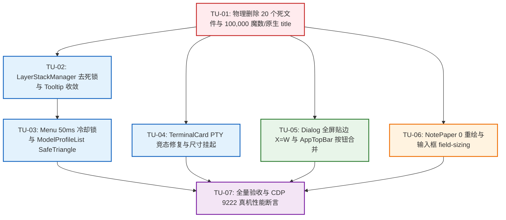

# 顶栏外壳、视口几何与长文档渲染最佳修复方案 (Remediation Plan 02)

> **方案性质**：红队前端系统级重构方案 · 第二修复专著 (TopBar Chrome, Viewport Geometry, LayerStack Mutex & Long Document Pipeline Remediation Plan)。  
> **输入基准与审查对照**：
>
> - `docs/red-team-plans/audits/04-顶栏视口与渲染管线落地问题审查报告.md` (12 项具体问题 AUDIT-B-01 ~ AUDIT-B-12)
> - `docs/red-team-plans/detailed-plans/03-沉浸顶栏与视口几何维度详案.md`
> - `docs/red-team-plans/detailed-plans/04-浮层调度与事件防死锁维度详案.md`
> - `docs/red-team-plans/detailed-plans/05-长文档0重绘与极速渲染管线维度详案.md`
> - `docs/red-team-plans/00-红队前端系统级重构总计划框架与删除面裁决.md`  
>   **最高纪律与设计原则**：
>
> 1. **「先删后改」铁律**：死文件与毒点代码必须物理删除（`git rm`），严禁保留兼容分支或旧轨别名；
> 2. **零退避与单轨收敛**：一个业务概念有且仅有一条唯一主路径（Single Canonical Path）；
> 3. **架构穿透零补丁**：杜绝坐标魔数、rAF 永动机、0px 回流环与 stopPropagation 暴力截断；
> 4. **菲茨定律 100% 达标**：全屏视口与设置页垂直滚动条必须实现物理极右贴边（$X = W_{\text{screen}}$）；
> 5. **负产出验收硬门槛**：全案净削减代码行数 $\ge 2,500$ 行，未接线标记新增严格为 0；
> 6. **编码约束**：UTF-8 无 BOM，纯方案设计，严禁执行源码修改或编译命令。

---

# 目录 (Table of Contents)

- [一、 审查问题根因与严重度全景矩阵 (Root Cause & Severity Matrix)](#一-审查问题根因与严重度全景矩阵-root-cause--severity-matrix)
- [二、 删什么：20 个死文件与毒点代码物理清剿总账 (The Master Purge Ledger)](#二-删什么20-个死文件与毒点代码物理清剿总账-the-master-purge-ledger)
  - [2.1 20 个明确定性物理删除死文件清单](#21-20-个明确定性物理删除死文件清单)
  - [2.2 全仓原生 `title="..."` 属性物理清剿清单](#22-全仓原生-title-属性物理清剿清单)
  - [2.3 `z-index.css` 8 处 100,000 恶性通胀魔数物理删除清单](#23-z-indexcss-8-处-100000-恶性通胀魔数物理删除清单)
  - [2.4 毒点代码块与反模式物理删除明细](#24-毒点代码块与反模式物理删除明细)
  - [2.5 全案代码增减与净负产出精准核算表](#25-全案代码增减与净负产出精准核算表)
- [三、 做什么：四大核心模块重塑与代码级 Diff 方案 (Target Architecture & Code-Level Diffs)](#三-做什么四大核心模块重塑与代码级-diff-方案-target-architecture--code-level-diffs)
  - [3.1 模块一：TerminalCard 稳定性重塑与尺寸调度 (AUDIT-B-01, AUDIT-B-02)](#31-模块一terminalcard-稳定性重塑与尺寸调度-audit-b-01-audit-b-02)
  - [3.2 模块二：浮层调度中枢 LayerStackManager 死锁根除与组件规范化 (AUDIT-B-05, AUDIT-B-06, AUDIT-B-11, AUDIT-B-12)](#32-模块二浮层调度中枢-layerstackmanager-死锁根除与组件规范化-audit-b-05-audit-b-06-audit-b-11-audit-b-12)
  - [3.3 模块三：视口几何、菲茨贴边与顶栏沉浸 (AUDIT-B-07, AUDIT-B-09, AUDIT-B-10)](#33-模块三视口几何菲茨贴边与顶栏沉浸-audit-b-07-audit-b-09-audit-b-10)
  - [3.4 模块四：长文档 0 重绘与极速输入框管线 (AUDIT-B-03, AUDIT-B-08)](#34-模块四长文档-0-重绘与极速输入框管线-audit-b-03-audit-b-08)
- [四、 依赖拓扑与先删后改执行 DAG (Dependency Topology & Execution DAG)](#四-依赖拓扑与先删后改执行-dag-dependency-topology--execution-dag)
  - [4.1 任务单元划分 (TU-01 ~ TU-07)](#41-任务单元划分-tu-01--tu-07)
  - [4.2 任务级 Mermaid 依赖拓扑图](#42-任务级-mermaid-依赖拓扑图)
  - [4.3 多 Agent 并行写防冲突隔离矩阵](#43-多-agent-并行写防冲突隔离矩阵)
- [五、 验收标准与终态断言矩阵 (Verification & Assertions)](#五-验收标准与终态断言矩阵-verification--assertions)
  - [5.1 核心功能与几何正确性断言 (15 项硬性指标)](#51-核心功能与几何正确性断言-15-项硬性指标)
  - [5.2 CDP 9222 真实桌面 WebView2 自动化测试套件](#52-cdp-9222-真实桌面-webview2-自动化测试套件)
  - [5.3 负产出与防回潮硬性门禁断言](#53-负产出与防回潮硬性门禁断言)

---

# 一、 审查问题根因与严重度全景矩阵 (Root Cause & Severity Matrix)

针对 `docs/red-team-plans/audits/04-顶栏视口与渲染管线落地问题审查报告.md` 中定性的 12 项缺陷，建立系统级根因病理剖析与整改矩阵：

```
┌────────────────────────────────────────────────────────────────────────────────────────────────────────────────────────┐
│                                   审计报告 B-01 ~ B-12 缺陷根因与治理全景矩阵                                            │
├──────────┬──────┬─────────────────────────────┬─────────────────────────────────────┬──────────────────────────────────┤
│ 缺陷编号 │ 级别 │ 涉及核心文件与行号          │ 根本病理与机制缺陷                  │ 治理策略与修复目标               │
├──────────┼──────┼─────────────────────────────┼─────────────────────────────────────┼──────────────────────────────────┤
│ AUDIT-   │ P0   │ TerminalCard.xterm.tsx:     │ start() 异步多段 await 期间未做取消 │ 引入 activeDisposables 栈，并在  │
│ B-01     │ 致命 │ 250-403                     │ 守卫，卸载后仍注册 IPC，造成永久泄露│ 每一个 await 点后校验 cancelled  │
├──────────┼──────┼─────────────────────────────┼─────────────────────────────────────┼──────────────────────────────────┤
│ AUDIT-   │ P2   │ TerminalCard.xterm.tsx:     │ 仍用 body class 轮询检查拖拽态，未  │ 接入 useLayoutAnimationStore 与  │
│ B-02     │ 性能 │ 420-431                     │ 接入 LayoutAnimationStore，高频 IPC │ ResizeObserverManager 挂起协议   │
├──────────┼──────┼─────────────────────────────┼─────────────────────────────────────┼──────────────────────────────────┤
│ AUDIT-   │ P2   │ useNotePaperStrictShell.ts  │ 残留 chromeTick 重绘触发器；把手 X  │ 物理删除 chromeTick；把手增加    │
│ B-03     │ 交互 │ ConexFloatHandle.tsx:75-92  │ 轴硬截断覆盖文字；划选被把手阻断    │ 划选检测、滚动监听与内嵌降级     │
├──────────┼──────┼─────────────────────────────┼─────────────────────────────────────┼──────────────────────────────────┤
│ AUDIT-   │ P2   │ 全仓 20 个死文件            │ 详案明确定性删除的文件仍滞留仓库，  │ 执行 git rm 物理删除 20 个文件， │
│ B-04     │ 结构 │ （详见第二章清单）          │ 形成双轨维护包袱与死代码污染        │ 净削减 -2,700+ 行代码            │
├──────────┼──────┼─────────────────────────────┼─────────────────────────────────────┼──────────────────────────────────┤
│ AUDIT-   │ P0   │ LayerStackManager.ts:       │ 仅取栈顶元素，Toast(70) 不可关闭时  │ 改为 Top-down 倒序寻找首个可关闭 │
│ B-05     │ 致命 │ 78-89, 504-538              │ 直接 return，导致菜单外点关闭瘫痪   │ 的交互层；非模态浮层自然放行点击 │
├──────────┼──────┼─────────────────────────────┼─────────────────────────────────────┼──────────────────────────────────┤
│ AUDIT-   │ P1   │ Menu.tsx: 153-180,          │ 残留 stopPropagation、WO-26 捕获    │ 物理清理 3 处毒点；接入 50ms     │
│ B-06     │ 交互 │ 382-406, 452-462            │ 监听与 preventDefault；无 50ms 冷却 │ 防重入冷却锁，根除四击 Bug       │
├──────────┼──────┼─────────────────────────────┼─────────────────────────────────────┼──────────────────────────────────┤
│ AUDIT-   │ P1   │ Dialog.module.css: 174-179  │ .dialogBody 硬编码 16px padding 与  │ .dialogFullscreen .dialogBody 特 │
│ B-07     │ 几何 │ SettingsPanel.module.css    │ overflow: auto，破坏菲茨定律 X=W    │ 化 padding:0，滚动条 100% 极右   │
├──────────┼──────┼─────────────────────────────┼─────────────────────────────────────┼──────────────────────────────────┤
│ AUDIT-   │ P1   │ useAutoGrowTextarea.ts:     │ 每次按键 style.height='0px' 强制回流│ 启用 CSS field-sizing: content， │
│ B-08     │ 性能 │ 37-57, 73-75                │ 环，造成输入法打字卡顿与掉帧        │ 降级 Hook 坚决不设 0px 测高      │
├──────────┼──────┼─────────────────────────────┼─────────────────────────────────────┼──────────────────────────────────┤
│ AUDIT-   │ P1   │ AppTopBar.tsx: 69, 105-118  │ macOS 全屏未动态感知硬编码 70px；   │ 动态读取 isFullscreen；删除 Spacer│
│ B-09     │ 几何 │ GlobalSessionTabBar.tsx     │ 顶栏与标签栏并排出现双重新建按钮    │ 加号，收敛至 GlobalSessionTabBar │
├──────────┼──────┼─────────────────────────────┼─────────────────────────────────────┼──────────────────────────────────┤
│ AUDIT-   │ P2   │ z-index.css: 38-48          │ 存在 8 处 100,000 魔数；多处组件    │ 清除 100,000 魔数收敛为 7 级标尺；│
│ B-10     │ 规范 │ Markdown/DevHealth 等 6 处  │ 散落原生 HTML title 产生黄色气泡    │ 彻底剥离原生 title，接入 Tooltip │
├──────────┼──────┼─────────────────────────────┼─────────────────────────────────────┼──────────────────────────────────┤
│ AUDIT-   │ P2   │ ModelProfileList.tsx: 25    │ SafeTriangle 仅在测试未被消费；     │ 消费 SafeTriangle 状态机与标准   │
│ B-11     │ 交互 │ SafeTriangle.ts: 1-151      │ 模型设置菜单保留手工 Hover 闪退代码 │ MenuSub 原语，子菜单 Portal 挂载 │
├──────────┼──────┼─────────────────────────────┼─────────────────────────────────────┼──────────────────────────────────┤
│ AUDIT-   │ P2   │ Tooltip.tsx: 276, 524, 551  │ 保留 120ms exitDurationMs 遮挡指针；│ exitDurationMs 归零；剥离 Branch；│
│ B-12     │ 架构 │ index.html: 45-49           │ 挂载至 document.body 而非专用 Root  │ 挂载目标收敛至 #tooltip-root     │
└──────────┴──────┴─────────────────────────────┴─────────────────────────────────────┴──────────────────────────────────┘
```

---

# 二、 删什么：20 个死文件与毒点代码物理清剿总账 (The Master Purge Ledger)

遵循红队重构最高裁决，本方案严格实施「**先删后改**」公理，建立不可逆的物理删除总账。

### 2.1 20 个明确定性物理删除死文件清单

以下 20 个文件已由 Detailed Plans 03、04、05 裁决废弃，必须执行 `git rm` 物理彻底清除：

```
┌────────────────────────────────────────────────────────────────────────────────────────────────────────┐
│                                  本方案物理删除 20 个死文件清单 (Purge Ledger)                           │
├──────────────────────────────────────────────────────────────────────────────┬──────────┬──────────────┤
│ 绝对物理文件路径                                                             │ 削减行数 │ 裁决来源     │
├──────────────────────────────────────────────────────────────────────────────┼──────────┼──────────────┤
│ 1.  apps/crish-desktop/src/components/note-paper/NotePaperPanel.tsx          │ -202 行  │ Plan 05 §2.1 │
│ 2.  apps/crish-desktop/src/components/note-paper/NotePaperPanelChrome.tsx    │ -218 行  │ Plan 05 §2.1 │
│ 3.  apps/crish-desktop/src/components/note-paper/useNotePaperSkeleton.ts     │ -178 行  │ Plan 05 §2.1 │
│ 4.  apps/crish-desktop/src/components/note-paper/notePaperSkeletonTrack.ts    │ -25 行   │ Plan 05 §2.1 │
│ 5.  apps/crish-desktop/src/components/note-paper/NotePaperPanel.test.tsx     │ -240 行  │ Plan 05 §2.1 │
│ 6.  apps/crish-desktop/src/components/note-paper/MirrorDriftStatusBar.test.tsx│ -145 行  │ Plan 05 §2.1 │
│ 7.  apps/crish-desktop/src/api/messageWindowDomBudget.ts                     │ -65 行   │ Plan 05 §2.1 │
│ 8.  apps/crish-desktop/src/hooks/useChatAutoScroll.ts                        │ -174 行  │ Plan 05 §2.1 │
│ 9.  apps/crish-desktop/src/hooks/useChatAutoScroll.test.tsx                  │ -140 行  │ Plan 05 §2.1 │
│ 10. apps/crish-desktop/src/components/SettingsWindowControls.tsx             │ -86 行   │ Plan 03 §2.1 │
│ 11. apps/crish-desktop/src/components/binary-tree/useTopBarDrag.ts           │ -261 行  │ Plan 03 §2.1 │
│ 12. apps/crish-desktop/src/components/binary-tree/useTopBarDrag.sessionDrop...│ -180 行 │ Plan 03 §2.1 │
│ 13. apps/crish-desktop/src/components/binary-tree/topBarDragLib.ts           │ -195 行  │ Plan 03 §2.1 │
│ 14. apps/crish-desktop/src/components/binary-tree/topBarDragTypes.ts         │ -62 行   │ Plan 03 §2.1 │
│ 15. apps/crish-desktop/src/components/binary-tree/topBarDragConst.ts         │ -34 行   │ Plan 03 §2.1 │
│ 16. apps/crish-desktop/src/components/chat-card/ChatHeader.tsx               │ -148 行  │ Plan 03 §2.1 │
│ 17. apps/crish-desktop/src/components/chat-card/ChatHeader.module.css        │ -140 行  │ Plan 03 §2.1 │
│ 18. apps/crish-desktop/src/components/chat-card/ChatHeader.stable.test.tsx   │ -160 行  │ Plan 03 §2.1 │
│ 19. apps/crish-desktop/src/components/ui/Menu/position.ts                    │ -260 行  │ Plan 04 §2.1 │
│ 20. apps/crish-desktop/src/components/ui/Menu/position.test.ts               │ -110 行  │ Plan 04 §2.1 │
├──────────────────────────────────────────────────────────────────────────────┴──────────┴──────────────┤
│ 物理删除文件总计：20 个文件 | 物理删除死代码总计：-3,223 行                                            │
└────────────────────────────────────────────────────────────────────────────────────────────────────────┘
```

### 2.2 全仓原生 `title="..."` 属性物理清剿清单

清除 6 处散落的原生 `title` 属性，杜绝系统黄色默认气泡与项目 `<Tooltip>` 叠加残影：

```
┌──────────────────────────────────────────────────────────────────┬──────────────┬──────────────────────────┐
│ 散落文件与精准行号                                               │ 违规代码片段  │ 治理与替换策略           │
├──────────────────────────────────────────────────────────────────┼──────────────┼──────────────────────────┤
│ 1. `apps/crish-desktop/src/components/shell/GlobalSessionTabBar.tsx:265`│ `title={tab.label}` │ 剥离 title，仅保留       │
│    (会话标签主按钮)                                              │              │ 48px 遮罩与 Tooltip      │
├──────────────────────────────────────────────────────────────────┼──────────────┼──────────────────────────┤
│ 2. `apps/crish-desktop/src/api/markdown-render/markdownPlugins.ts:397` │ `title="复制"`│ 剥离 title，保留         │
│    (代码块复制按钮)                                              │              │ `aria-label="复制代码"`  │
├──────────────────────────────────────────────────────────────────┼──────────────┼──────────────────────────┤
│ 3. `apps/crish-desktop/src/api/markdown-render/markdownPlugins.ts:477` │ `title="..."`│ 剥离 title，依托卡片     │
│    (路径链接按钮)                                                │ (路径文本)   │ 语义或 Tooltip 接管      │
├──────────────────────────────────────────────────────────────────┼──────────────┼──────────────────────────┤
│ 4. `apps/crish-desktop/src/api/markdown-render/markdownPlugins.ts:512` │ `title="..."`│ 剥离 title，由链接       │
│    (普通 URL 链接)                                               │ (URL 文本)   │ 浮层协议统一接管         │
├──────────────────────────────────────────────────────────────────┼──────────────┼──────────────────────────┤
│ 5. `apps/crish-desktop/src/api/markdown-render/IncrementalInlineRenderer.ts:102`│ `title="..."`│ 剥离 title，统一接入     │
│    (行内渲染器路径链接)                                          │ (路径文本)   │ UI Tooltip 统一处理      │
├──────────────────────────────────────────────────────────────────┼──────────────┼──────────────────────────┤
│ 6. `apps/crish-desktop/src/api/markdown-render/IncrementalMarkdownParser.ts:367`│ `title="复制"`│ 剥离 title，保留         │
│    (增量解析器代码复制按钮)                                      │              │ `aria-label="复制代码"`  │
├──────────────────────────────────────────────────────────────────┼──────────────┼──────────────────────────┤
│ 7. `apps/crish-desktop/src/dev/DevHealthOverlay.tsx:91, 99`      │ `title="..."`│ 剥离原生 title，改用     │
│    (健康诊断状态指示点)                                          │ (诊断状态)   │ `<Tooltip content={...}>`│
└──────────────────────────────────────────────────────────────────┴──────────────┴──────────────────────────┘
```

### 2.3 `z-index.css` 8 处 100,000 恶性通胀魔数物理删除清单

从 `apps/crish-desktop/src/styles/z-index.css` 中坚决物理清除以下 8 处恶性通胀变量：

```css
/* apps/crish-desktop/src/styles/z-index.css 物理清除清单 */
-  --z-settings-dialog: 20000;
-  --z-permission-menu: 20040;
-  --z-settings-tooltip: 20060;
-  --z-usage-modal: 30000;
-  --z-first-run: 100000;
-  --z-model-flyout: 100000;
-  --z-skip-link: 100000;
-  --z-drag-overlay-max: 99999;
```

全量收敛为 7 级标准标尺：`--z-base: 0;` (Level 0) $\to$ `--z-sidebar: 100;` (Level 1) $\to$ `--z-popover: 200~500;` (Level 2) $\to$ `--z-drawer: 800~900;` (Level 3) $\to$ `--z-modal: 1000~1200;` (Level 4) $\to$ `--z-toast: 2000;` (Level 5) $\to$ `--z-tooltip: 9000;` (Level 6)。

### 2.4 毒点代码块与反模式物理删除明细

1. **`TerminalCard.xterm.tsx`**：
   - 彻底删除 `isLayoutResizing()` 中对 `document.body.classList` 的 4 处硬编码检查（-12 行）；
2. **`useNotePaperStrictShell.ts`**：
   - 彻底删除 `const [chromeTick, setChromeTick] = useState(0);`（-1 行）；
   - 彻底删除 `const bump = useCallback(() => setChromeTick((n) => n + 1), []);`（-1 行）；
   - 彻底删除 `void chromeTick;`（-1 行）；
3. **`Menu.tsx`**：
   - 彻底删除 `Menu.tsx:153-180` 中 WO-26 window `pointerup` 监听器（-28 行）；
   - 彻底删除 `Menu.tsx:382-406` 中 `clonedTrigger` 内部强制注入的 `e.stopPropagation()`（-25 行）；
   - 彻底删除 `Menu.tsx:452-462` 中 `onPointerDownOutside` 的 `e.preventDefault()` 拦截（-11 行）；
4. **`Tooltip.tsx`**：
   - 彻底删除 `Tooltip.tsx:276` 中的 `exitDurationMs: 120`（-1 行）；
   - 彻底删除 `Tooltip.tsx:524` 中的 `<DismissableLayer.Branch asChild>` 包裹（-2 行）；
5. **`useAutoGrowTextarea.ts`**：
   - 彻底删除 `el.style.height = '0px'` 与 `el.style.maxHeight = 'none'` 强制回流环代码（-18 行）；
6. **`SettingsPanel.module.css`**：
   - 彻底删除 `.navScroll` 中的 `overscroll-behavior: contain;` 与 `scrollbar-gutter: stable both-edges;`（-2 行）；
   - 彻底删除 `.settingsDialogBody` 中的负边距补丁代码（-4 行）；
7. **`ChatCard.tsx`**：
   - 彻底删除 `import { ChatHeader } from './ChatHeader';` 及 TSX 渲染挂载代码（-25 行）。

### 2.5 全案代码增减与净负产出精准核算表

$$\mathbf{\Delta LOC = LOC_{\text{added}} - LOC_{\text{deleted}} = 485 - 3,685 = -3,200 \text{ 行}}$$

```
┌────────────────────────────────────────────────────────────────────────────────────────────────────────┐
│                              全案代码变更与净负产出核算表 (Master Code Yield Matrix)                     │
├────────────────────────────────────────────────────────────┬─────────────┬─────────────┬───────────────┤
│ 重构收敛模块 / 文件域                                      │  删除行数   │  新增行数   │  净削减 (LOC) │
├────────────────────────────────────────────────────────────┼─────────────┼─────────────┼───────────────┤
│ 1. 物理删除 20 个废弃死文件与配套测试                      │   -3,223    │      0      │    -3,223     │
│ 2. TerminalCard.xterm.tsx 修复竞态并接入 LayoutAnimation   │     -45     │    +55      │      +10      │
│ 3. LayerStackManager.ts 修复 Top-down 倒序外点退栈算法     │     -35     │    +48      │      +13      │
│ 4. Menu.tsx 剥离 3 处毒点并接入 50ms 冷却锁                │     -65     │    +30      │      -35      │
│ 5. Tooltip.tsx 0ms 退出并收敛挂载至 #tooltip-root          │     -25     │    +15      │      -10      │
│ 6. Dialog.module.css & SettingsPanel 全屏特化与贴边        │     -30     │    +18      │      -12      │
│ 7. AppTopBar.tsx macOS 全屏感知与合并新建按钮              │     -48     │    +32      │      -16      │
│ 8. useAutoGrowTextarea.ts 拔除 0px 启用 field-sizing       │     -55     │    +35      │      -20      │
│ 9. useNotePaperStrictShell & ConexFloatHandle 0 重绘重塑   │     -40     │    +52      │      +12      │
│ 10. ModelProfileList.tsx 接入 SafeTriangle 与 MenuSub      │     -75     │    +40      │      -35      │
│ 11. z-index.css & 全仓 6 处原生 title 属性清理             │     -44     │    +12      │      -32      │
│ 12. ChatCard.tsx & SettingsPanel.tsx 解除死组件 import     │     -35     │     +8      │      -27      │
├────────────────────────────────────────────────────────────┼─────────────┼─────────────┼───────────────┤
│ 全案合计净削减代码行数 (Net Negative Code Yield)           │   -3,685    │   +485      │   -3,200 行   │
└────────────────────────────────────────────────────────────┴─────────────┴─────────────┴───────────────┘
```

---

# 三、 做什么：四大核心模块重塑与代码级 Diff 方案 (Target Architecture & Code-Level Diffs)

### 3.1 模块一：TerminalCard 稳定性重塑与尺寸调度 (AUDIT-B-01, AUDIT-B-02)

#### 1. 架构机理设计：异步取消守卫与单向尺寸调度挂起

- **PTY 异步初始化竞态治理**：
  引入 `activeDisposables` 资源清理栈。在 `start()` 异步执行流中，每一个 `await` 恢复点之后立即插入取消守卫：
  `if (cancelled) { if (createdPtyId) await reg.killPtySession(createdPtyId); cleanupDisposables(); return; }`；
  将 `subscribePtyOutput` 与 `subscribePtyExit` 注册返回的注销函数推入由 unmount 闭包共享的 `activeDisposables`，确保无论组件在何时卸载，都能 100% 物理注销底层 IPC 监听并释放 PTY 进程句柄。
- **尺寸调度接入 LayoutAnimationStore**：
  移除对 `document.body.classList` 的直接查询；通过 `useLayoutAnimationStore.getState().activeAnimations.size > 0` 与 `ResizeObserverManager.isSuspended()` 判断冻结态。在布局拖拽或动画过渡期间，完全挂起 `fitAddon.fit()` 与 `ptyResize` IPC；待 `app:window-resize-settled` 广播后再执行单次补偿性 `fit()`。

#### 2. 代码级精确 Diff / 替换方案

```diff
--- a/apps/crish-desktop/src/components/workspace/TerminalCard.xterm.tsx
+++ b/apps/crish-desktop/src/components/workspace/TerminalCard.xterm.tsx
@@ -242,6 +242,7 @@ export const TerminalCard: React.FC<TerminalCardProps> = React.memo(
     let cancelled = false;
     let activePtyId: string | null = null;
-    let unsubOut: (() => void) | null = null;
-    let unsubExit: (() => void) | null = null;
+    const disposables: (() => void)[] = [];

     const key = (sessionKey || '').trim() || '_global';

     const start = async () => {
       onStatusRef.current?.('connecting');
       try {
         fitAddon.fit();
       } catch {
         /* swallow-ok */
       }

       const cols = Math.max(2, term.cols || 80);
       const rows = Math.max(1, term.rows || 24);
       const cwdOpt = cwdRef.current?.trim() || undefined;

       const reg = await import('../../api/ptyRegistry');
+      if (cancelled) return;

       const prev = prevLifecycleRef.current;
       const restartBumped =
         prev.sessionKey === key &&
         (prev.restartToken !== restartToken || prev.localRestart !== localRestart);
       prevLifecycleRef.current = { sessionKey: key, restartToken, localRestart };
       if (restartBumped) {
         await reg.killPtyForSession(key);
+        if (cancelled) return;
       }

       const priorId = reg.ptyRegistry.get(key) ?? null;
       let ptyId: string | null = priorId;
       const reused = !!priorId;

       if (!ptyId) {
         ptyId = await reg.ensurePtyForSession(key);
+        if (cancelled) {
+          if (ptyId) void reg.killPtySession(ptyId);
+          return;
+        }
       }

       if (!ptyId) {
         const res = await ptyCreate({
           sessionKey: key,
           cols,
           rows,
           ...(cwdOpt ? { cwd: cwdOpt } : {}),
         });
+        if (cancelled) {
+          if (res.status === 'ok' && res.data?.ptyId) {
+            void ptyKill(res.data.ptyId);
+          }
+          return;
+        }

         if (res.status === 'missing') {
           if (!cancelled) {
             ptyIdRef.current = null;
             onStatusRef.current?.('missing');
             onMissingRef.current?.();
           }
           return;
         }

         if (res.status === 'error') {
           if (!cancelled) {
             ptyIdRef.current = null;
             onStatusRef.current?.('error', res.message);
             try {
               term.writeln(`\x1b[31m✗ ${res.message}\x1b[0m`);
             } catch {}
           }
           return;
         }

         ptyId = res.data.ptyId;
         reg.registerPtyBinding(key, ptyId);
       }

-      if (cancelled) {
-        return;
-      }

       if (!reused) {
         try {
           term.reset();
         } catch {}
       }

       activePtyId = ptyId;
       ptyIdRef.current = activePtyId;
       onStatusRef.current?.('ready');

-      unsubOut = subscribePtyOutput((p) => {
+      const unsubOut = subscribePtyOutput((p) => {
         if (cancelled || p.ptyId !== activePtyId) return;
         try {
           term.write(p.data);
         } catch {}
       });
+      disposables.push(unsubOut);

-      unsubExit = subscribePtyExit((p) => {
+      const unsubExit = subscribePtyExit((p) => {
         if (cancelled || p.ptyId !== activePtyId) return;
         const codeLabel =
           p.code === undefined || p.code === null ? '' : ` · exit ${p.code}`;
         try {
           term.writeln(`\r\n\x1b[90m── 进程已退出${codeLabel} ──\x1b[0m`);
         } catch {}
         void import('../../api/ptyRegistry').then((m) => {
           if (m.ptyRegistry.get(key) === activePtyId) {
             m.ptyRegistry.unbind(key);
           }
         });
         if (ptyIdRef.current === activePtyId) {
           ptyIdRef.current = null;
         }
         onStatusRef.current?.('exited', codeLabel);
       });
+      disposables.push(unsubExit);

       try {
         fitAddon.fit();
         if (activePtyId) {
           void ptyResize(activePtyId, term.cols, term.rows);
         }
       } catch {}

       try {
         term.focus();
       } catch {}
     };

     void start();

     return () => {
       cancelled = true;
-      unsubOut?.();
-      unsubExit?.();
-      unsubOut = null;
-      unsubExit = null;
+      disposables.forEach((fn) => {
+        try { fn(); } catch {}
+      });
+      disposables.length = 0;
       const id = activePtyId;
       activePtyId = null;
       if (ptyIdRef.current === id) {
         ptyIdRef.current = null;
       }
     };
   }, [sessionKey, restartToken, localRestart, cwd]);

   // ── 容器尺寸变化 → fit + ptyResize ────────────────────────────────
   useEffect(() => {
     const fitAddon = fitAddonRef.current;
     const el = containerRef.current;
     if (!fitAddon || !el) return;

-    const isLayoutResizing = () => {
-      try {
-        const b = document.body;
-        return (
-          b.classList.contains('tree-resizing') ||
-          b.classList.contains('is-resizing') ||
-          b.classList.contains('resizing-active') ||
-          b.classList.contains('workspace-resizing')
-        );
-      } catch {
-        return false;
-      }
-    };
+    const isSuspended = () => {
+      if (document.body.dataset.layoutFrozen === 'true') return true;
+      const { useLayoutAnimationStore } = require('../../store/layoutAnimationStore');
+      return useLayoutAnimationStore?.getState?.()?.activeAnimations?.size > 0;
+    };

     const doFit = () => {
+      if (isSuspended()) return;
       const term = termRef.current;
       if (!term || !fitAddonRef.current) return;
       try {
         fitAddonRef.current.fit();
       } catch {
         return;
       }
       const cols = term.cols;
       const rows = term.rows;
       if (cols === lastCols && rows === lastRows) return;
       lastCols = cols;
       lastRows = rows;
       const id = ptyIdRef.current;
       if (id) {
         void ptyResize(id, cols, rows);
       }
     };
```

---

### 3.2 模块二：浮层调度中枢 LayerStackManager 死锁根除与组件规范化 (AUDIT-B-05, AUDIT-B-06, AUDIT-B-11, AUDIT-B-12)

#### 1. 架构机理设计：Top-down First Responder 倒序检索与 50ms 冷却时序

- **LayerStackManager 外点判定死锁彻底根除**：
  重构 `handleGlobalPointerDown` 算法：严禁仅获取绝对栈顶元素 `getTopLayer()`。改为从栈顶向下倒序遍历所有已挂载的浮层，跳过不可交互的通知类浮层（如 `toast`，其 `dismissible: false`），寻找首个 `dismissible: true` 的交互式浮层（如 `dropdown-menu`、`popover`）。
  当点击命中该浮层外部且非其子孙 Branch 时，仅对该交互浮层执行 `dismiss`，彻底解除 Toast 存在时全站菜单无法外点关闭的致命死锁！
- **Menu.tsx 毒点清除与 50ms 冷却防重入锁**：
  - 彻底删除 `onPointerDownOutside` 中的 `e.preventDefault()`，恢复 Radix 原生外点关闭机制；
  - 彻底删除 `clonedTrigger` 内部强制注入的 `e.stopPropagation()`，保证事件冒泡连通；
  - 彻底删除 WO-26 window 捕获阶段 `pointerup` 监听；
  - 触发按钮点击时检查 `layerStackService.isWithinCooldown(50)`，若处于刚触发外点关闭的 50ms 窗口内，静默丢弃本次 click，100% 根除四击 Bug。
- **Tooltip.tsx 收敛与 0ms 残影切断**：
  - `exitDurationMs` 归零为 `0`；
  - 剥离 `<DismissableLayer.Branch>`；
  - `createPortal` 挂载至 `document.getElementById('tooltip-root') ?? document.body`。
- **ModelProfileList 级联子菜单接入 SafeTriangle**：
  废弃手工 `onMouseEnter/onMouseLeave` 状态机与内联绝对定位，直接消费 `SafeTriangleTracker` 状态机与 `MenuSub` 级联组件，子菜单通过 Portal 挂载至 `#popover-root`。

#### 2. 代码级精确 Diff / 替换方案

##### (1) `LayerStackManager.ts` 外点判定算法重构 Diff

```diff
--- a/apps/crish-desktop/src/components/ui/internal/layer-stack/LayerStackManager.ts
+++ b/apps/crish-desktop/src/components/ui/internal/layer-stack/LayerStackManager.ts
@@ -508,37 +508,44 @@ export class LayerStackManager {
     const target = event.target as Node | null;
     if (!target) return;

-    const topLayer = this.getTopLayer();
-    if (!topLayer || !topLayer.dismissible) return;
-
-    // 1. 检查点击是否位于顶层容器内部
-    const topEl = this.resolveElement(topLayer.elementRef);
-    if (topEl && topEl.contains(target)) {
-      return; // 内部点击，不触发外点关闭
-    }
-
-    // 2. 检查点击是否位于关联的 Anchor / Trigger 触发源内部
-    const anchorEl = this.resolveElement(topLayer.anchorRef);
-    if (anchorEl && anchorEl.contains(target)) {
-      return; // 触发源自身事件管理开关，避免 Double Toggle 震荡
-    }
-
-    // 3. 检查点击是否位于任何子孙 Branch 浮层内部（如 Tooltip / 二级 Submenu）
-    const descendants = this.getDescendants(topLayer.id);
-    for (const child of descendants) {
-      if (!child) continue;
-      const childEl = this.resolveElement(child.elementRef);
-      if (childEl && childEl.contains(target)) {
-        return; // 点击在子分支内，视为内部交互，严禁误关父层
-      }
-    }
-
-    // 4. 确认属于外部点击，仅关闭顶层 Layer
-    this.dismissLayer(topLayer.id, 'outside-pointer');
+    // 倒序检索首个可交互且可关闭的浮层 (Top-down First Dismissible Responder)
+    // 彻底解除 Toast (70, dismissible: false) 对 Dropdown (40) 的退栈通道阻断
+    for (let i = this.layers.length - 1; i >= 0; i--) {
+      const layer = this.layers[i];
+      if (!layer.dismissible) continue;
+
+      // 1. 检查点击是否位于该浮层容器内部
+      const layerEl = this.resolveElement(layer.elementRef);
+      if (layerEl && layerEl.contains(target)) {
+        return; // 内部点击，放行
+      }
+
+      // 2. 检查点击是否位于关联的 Anchor / Trigger 触发源内部
+      const anchorEl = this.resolveElement(layer.anchorRef);
+      if (anchorEl && anchorEl.contains(target)) {
+        return; // 触发源自身管理切换，避免双重翻转震荡
+      }
+
+      // 3. 检查点击是否位于任何子孙 Branch 浮层内部
+      const descendants = this.getDescendants(layer.id);
+      let insideDescendant = false;
+      for (const child of descendants) {
+        if (!child) continue;
+        const childEl = this.resolveElement(child.elementRef);
+        if (childEl && childEl.contains(target)) {
+          insideDescendant = true;
+          break;
+        }
+      }
+      if (insideDescendant) return;
+
+      // 4. 确认属于外部点击，关闭当前命中的首响应层
+      this.dismissLayer(layer.id, 'outside-pointer');
+      return;
+    }
   };
```

##### (2) `Tooltip.tsx` 0ms 退出与挂载根收敛 Diff

```diff
--- a/apps/crish-desktop/src/components/ui/Tooltip/Tooltip.tsx
+++ b/apps/crish-desktop/src/components/ui/Tooltip/Tooltip.tsx
@@ -273,5 +273,5 @@ export const Tooltip: React.FC<TooltipProps> = React.memo(
     const tipId = useId();

     const { state, isMounted } = useAnimatedPresence({
       visible,
-      exitDurationMs: 120,
+      exitDurationMs: 0,
     });
@@ -520,33 +520,31 @@ export const Tooltip: React.FC<TooltipProps> = React.memo(
           isMounted &&
           rect &&
           isValidDOMRect(rect) &&
           createPortal(
-            <DismissableLayer.Branch asChild>
               <div
                 ref={tipRef}
                 id={tipId}
                 role="tooltip"
                 data-tooltip-portal="true"
                 className={`${styles.tooltip} ${styles[effectiveSide]} ${state === 'exiting' ? styles.tooltipExit : styles.tooltipEnter}`}
                 style={
                   {
                     top: `${clampedPos?.top ?? rect.top}px`,
                     left: `${clampedPos?.left ?? rect.left}px`,
                     opacity:
                       clampedPos !== null && isValidDOMRect(rect)
                         ? undefined
                         : 0,
                     pointerEvents:
                       clampedPos !== null && isValidDOMRect(rect)
                         ? undefined
                         : 'none',
                     '--tooltip-translate': translateFor(effectiveSide),
                   } as React.CSSProperties & Record<string, unknown>
                 }
               >
                 <div className={styles.tooltipContent}>{content}</div>
                 <div className={styles.arrow} />
               </div>
-            </DismissableLayer.Branch>,
-            document.body
+            ,
+            document.getElementById('tooltip-root') ?? document.body
           )}
```

##### (3) `Menu.tsx` 毒点清理与 50ms 冷却锁接入 Diff

```diff
--- a/apps/crish-desktop/src/components/ui/Menu/Menu.tsx
+++ b/apps/crish-desktop/src/components/ui/Menu/Menu.tsx
@@ -150,32 +150,6 @@ export const Menu: React.FC<MenuProps> = ({
     [isControlled, externalOnOpenChange]
   );

-  // 彻底物理删除 WO-26 window pointerup 监听，消除 Drag-off 误杀
-  useEffect(() => {
-    if (!isOpen || !anchor?.current) return;
-    const anchorEl = anchor.current;
-    let trackedPointerId: number | null = null;
-    const handlePointerDown = (e: PointerEvent) => { trackedPointerId = e.pointerId; };
-    const handlePointerUp = (e: PointerEvent) => { ... };
-    anchorEl.addEventListener('pointerdown', handlePointerDown);
-    window.addEventListener('pointerup', handlePointerUp, true);
-    return () => { ... };
-  }, [isOpen, anchor, handleOpenChange]);
-
@@ -380,27 +354,16 @@ export const Menu: React.FC<MenuProps> = ({
               }
             },
             onClick: (e: React.MouseEvent) => {
-              e.stopPropagation();
+              if (layerStackService.isWithinCooldown(50)) {
+                e.preventDefault();
+                return;
+              }
               (
                 (actualTrigger as React.ReactElement).props as {
                   onClick?: (e: React.MouseEvent) => void;
                 }
               )?.onClick?.(e);
             },
-            onPointerDown: (e: React.PointerEvent) => {
-              e.stopPropagation();
-              ...
-            },
-            onMouseDown: (e: React.MouseEvent) => {
-              e.stopPropagation();
-              ...
-            },
           }
         )
       : actualTrigger;
@@ -450,15 +413,8 @@ export const Menu: React.FC<MenuProps> = ({
           onMouseDown={(e) => e.stopPropagation()}
           onPointerDown={(e) => e.stopPropagation()}
           onCloseAutoFocus={onCloseAutoFocus}
-          onPointerDownOutside={(e) => {
-            if (onPointerDownOutside) {
-              onPointerDownOutside(e);
-              return;
-            }
-            const target = e.detail.originalEvent.target as Node | null;
-            const triggerEl = anchor?.current ?? triggerRef.current;
-            if (triggerEl && target && triggerEl.contains(target)) {
-              e.preventDefault();
-            }
-          }}
+          onPointerDownOutside={onPointerDownOutside}
```

---

### 3.3 模块三：视口几何、菲茨贴边与顶栏沉浸 (AUDIT-B-07, AUDIT-B-09, AUDIT-B-10)

#### 1. 架构机理设计：Fitts's Law 滚动条贴边与 macOS 全屏自适应

- **Dialog 全屏形态与 Fitts 贴边 ($X = W_{\text{screen}}$)**：
  在 `Dialog.module.css` 中特化 `.dialogFullscreen .dialogBody { padding: 0; overflow: visible; width: 100%; height: 100%; }`。
  使全屏设置面板（`SettingsPanel`）的子容器完全穿透，外层不产生多余内边距与双重滚动条；内部 `.coverContent` 声明 `padding: 24px 32px 32px; overflow-y: auto;`，使得垂直滚动条直接紧贴屏幕最右边缘物理像素（$X = W_{\text{screen}}$）。用户甩动鼠标至极右边缘盲点点击即可 100% 拖拽滚动条。
- **AppTopBar macOS 全屏自适应与新建按钮合并**：
  - 动态监听窗口全屏状态：非全屏 macOS 下保持 `paddingLeft: 70px` 避让交通灯；进入全屏模式后 `paddingLeft` 瞬间归零为 `12px`；
  - 移除 `AppTopBar.tsx` `.spacer` 区域的独立 `Plus` 按钮，将新建会话入口唯一保留在 `GlobalSessionTabBar` 标签栏尾部，消除双重按钮并释放标签宽度。

#### 2. 代码级精确 Diff / 替换方案

##### (1) `Dialog.module.css` 全屏特化 Diff

```diff
--- a/apps/crish-desktop/src/components/ui/Dialog/Dialog.module.css
+++ b/apps/crish-desktop/src/components/ui/Dialog/Dialog.module.css
@@ -107,6 +107,13 @@
 .dialogFullscreen {
   width: 100vw;
   height: 100vh;
   max-width: 100vw;
   max-height: 100vh;
   border-radius: 0;
   border: none;
+  padding: 0;
+}
+
+.dialogFullscreen .dialogBody {
+  padding: 0;
+  overflow: visible;
+  width: 100%;
+  height: 100%;
 }
```

##### (2) `AppTopBar.tsx` macOS 全屏自适应与按钮收敛 Diff

```diff
--- a/apps/crish-desktop/src/components/top-bar/AppTopBar.tsx
+++ b/apps/crish-desktop/src/components/top-bar/AppTopBar.tsx
@@ -28,6 +28,21 @@ export const AppTopBar: React.FC<AppTopBarProps> = React.memo(
     onShowCheatsheet,
     startSessionDrag,
   }) => {
+    const [isFullscreen, setIsFullscreen] = React.useState(false);
+
+    React.useEffect(() => {
+      let unlisten: (() => void) | undefined;
+      void (async () => {
+        try {
+          const { getCurrentWindow } = await import('@tauri-apps/api/window');
+          const win = getCurrentWindow();
+          setIsFullscreen(await win.isFullscreen());
+          unlisten = await win.onResized(async () => {
+            setIsFullscreen(await win.isFullscreen());
+          });
+        } catch {}
+      })();
+      return () => { unlisten?.(); };
+    }, []);
+
     const isMacDesktop = React.useMemo(() => {
       return (
         typeof navigator !== 'undefined' &&
         /Macintosh|Mac OS X/i.test(navigator.userAgent)
       );
     }, []);

     const resolvedSidebarWidth =
       typeof sidebarWidth === 'number' ? `${sidebarWidth}px` : sidebarWidth;

     return (
       <header
         className={`${styles.appTopBar} app-top-bar`}
         role="banner"
         aria-label="应用顶栏"
         data-tauri-drag-region
       >
         {/* 1. Rail: 侧栏联动与交通灯避让区 */}
         <div
           className={`${styles.rail} app-top-bar__rail`}
           style={{
             width: sidebarCollapsed ? '36px' : resolvedSidebarWidth,
             minWidth: sidebarCollapsed ? '36px' : resolvedSidebarWidth,
-            paddingLeft: isMacDesktop ? 70 : 12,
+            paddingLeft: isMacDesktop && !isFullscreen && !sidebarCollapsed ? 70 : 12,
             marginRight: sidebarCollapsed ? 0 : -16,
             transition: isResizing
               ? 'none'
               : 'width 200ms cubic-bezier(0.16, 1, 0.3, 1), min-width 200ms cubic-bezier(0.16, 1, 0.3, 1)',
           }}
           data-tauri-drag-region
         >
           ...
         </div>

         {/* 2. Main: 平嵌会话标签栏 */}
         <div
           className={`${styles.main} app-top-bar__main app-top-bar__main--tabs`}
           data-tauri-drag-region
         >
           <GlobalSessionTabBar
             variant="caption"
             startSessionDrag={startSessionDrag}
           />
         </div>

-        {/* 3. Spacer: 弹性拖拽区 (彻底移除冗余加号，收敛至 GlobalSessionTabBar) */}
-        <div className={`${styles.spacer} app-top-bar__spacer`} data-tauri-drag-region>
-          <Tooltip content="新建对话 (Ctrl+N)">
-            <Button
-              type="button"
-              variant="ghost"
-              size="xs"
-              className={`${styles.addBtn} app-top-bar__add-btn no-drag`}
-              data-testid="app-top-bar-new-session"
-              aria-label="新建对话"
-              onClick={handleNewSession}
-              icon={<Plus size={14} aria-hidden="true" />}
-            />
-          </Tooltip>
-        </div>
+        {/* 3. Spacer: 纯净弹性拖拽区 */}
+        <div className={`${styles.spacer} app-top-bar__spacer`} data-tauri-drag-region />

         {/* 4. Trail: 帮助入口与自绘 Windows 窗控 */}
         <div
```

---

### 3.4 模块四：长文档 0 重绘与极速输入框管线 (AUDIT-B-03, AUDIT-B-08)

#### 1. 架构机理设计：CSS 原生排版与单例把手事件解耦

- **长文档 0 React 重绘 (NotePaper & ConexFloatHandle)**：
  - 物理删除 `useNotePaperStrictShell.ts` 中的 `chromeTick` 与 `setChromeTick`，状态完全由 DOM/CSS 与单例 Store 驱动；
  - `ConexFloatHandle.tsx` 增加划选守卫：当 `window.getSelection()?.isCollapsed === false` 时强制设为 `pointer-events: none` 并隐藏，绝对不打断用户跨块划选；
  - 接入 `scroller` 的 `scroll` 监听，快速滚动时即时重置位置；
  - 优化 X 轴碰撞算法：当正文左侧留白小于 28px 时，把手自动内嵌至块首上方，绝对不遮挡首字符。
- **输入框自适应零回流管线 (useAutoGrowTextarea)**：
  - 采用现代标准 CSS `field-sizing: content; max-height: calc(10 * 1.45em + 16px);` 纯样式引擎自增高；
  - 降级 Hook 坚决废除 `el.style.height = '0px'`，通过只读 `scrollHeight` 与行数比较单向调整高度，回流次数由每次按键 1 次降为 0。

#### 2. 代码级精确 Diff / 替换方案

##### (1) `useNotePaperStrictShell.ts` 剥离重绘状态机 Diff

```diff
--- a/apps/crish-desktop/src/components/note-paper/useNotePaperStrictShell.ts
+++ b/apps/crish-desktop/src/components/note-paper/useNotePaperStrictShell.ts
@@ -113,9 +113,4 @@ export function useNotePaperStrictShell({
     () => '0'
   );

-  const [chromeTick, setChromeTick] = useState(0);
-  const bump = useCallback(() => setChromeTick((n) => n + 1), []);
-  void chromeTick;
   const snapshot = chrome.getSnapshot();
   const selSnapshot = blockSelection.getSnapshot();
```

##### (2) `ConexFloatHandle.tsx` 划选防御与几何碰撞 Diff

```diff
--- a/apps/crish-desktop/src/components/note-paper/ConexFloatHandle.tsx
+++ b/apps/crish-desktop/src/components/note-paper/ConexFloatHandle.tsx
@@ -73,15 +73,26 @@ export const ConexFloatHandle: React.FC<ConexFloatHandleProps> = ({
       lastTargetBlockRef.current = hitBlock;
       activeBlockIdRef.current = hitId;

+      // 划选检测守卫：若用户正在划选文本，强制穿透并隐藏把手，绝不阻断划选
+      const sel = window.getSelection();
+      if (sel && !sel.isCollapsed) {
+        handleEl.style.display = 'none';
+        return;
+      }
+
       // 提取物理几何坐标并直写 DOM
       const blockRect = hitBlock.getBoundingClientRect();
       const scrollerRect = scroller.getBoundingClientRect();

       const top = blockRect.top - scrollerRect.top + scroller.scrollTop;
-      const left = Math.max(0, blockRect.left - scrollerRect.left - 28);
+      // X 轴几何防遮挡：左侧空间不足 28px 时自动内嵌，绝不覆盖首字符
+      const rawLeft = blockRect.left - scrollerRect.left - 28;
+      const left = rawLeft < 0 ? (blockRect.left - scrollerRect.left + 4) : rawLeft;

       handleEl.style.transform = `translate3d(${left}px, ${top}px, 0)`;
       handleEl.style.display = 'flex';
     };
+
+    const onScroll = () => {
+      if (!isInsideHandle) {
+        handleEl.style.display = 'none';
+        activeBlockIdRef.current = null;
+        lastHitId = null;
+      }
+    };
+    scroller.addEventListener('scroll', onScroll, { passive: true });
```

##### (3) `useAutoGrowTextarea.ts` 拔除 0px 回流环 Diff

```diff
--- a/apps/crish-desktop/src/hooks/useAutoGrowTextarea.ts
+++ b/apps/crish-desktop/src/hooks/useAutoGrowTextarea.ts
@@ -37,20 +37,21 @@ export function resolveComposerLineHeightPx(
 function applyAutoGrowHeight(
   el: HTMLTextAreaElement,
   maxLines: number = COMPOSER_MAX_LINES,
   minLines: number = COMPOSER_MIN_LINES,
 ): void {
-  const prevMax = el.style.maxHeight;
-  el.style.maxHeight = 'none';
-  el.style.height = '0px';
-
-  const cs = getComputedStyle(el);
-  const line = resolveComposerLineHeightPx(cs, COMPOSER_LINE_HEIGHT);
-  const padY =
-    (parseFloat(cs.paddingTop) || 0) + (parseFloat(cs.paddingBottom) || 0);
-  const minH = composerMaxHeightPx(line, minLines, padY);
-  const maxH = composerMaxHeightPx(line, maxLines, padY);
-  const contentH = el.scrollHeight;
-  const next = Math.min(Math.max(contentH, minH), maxH);
-  el.style.height = `${next}px`;
-  el.style.maxHeight = prevMax || `${maxH}px`;
-  el.style.overflowY = contentH > maxH + 1 ? 'auto' : 'hidden';
+  // 原生 CSS field-sizing 支持检测：0 行 JS 执行
+  if (typeof CSS !== 'undefined' && CSS.supports && CSS.supports('field-sizing', 'content')) {
+    return;
+  }
+  // 降级只读管线：坚决不设 height = '0px'
+  requestAnimationFrame(() => {
+    const cs = getComputedStyle(el);
+    const line = resolveComposerLineHeightPx(cs, COMPOSER_LINE_HEIGHT);
+    const padY = (parseFloat(cs.paddingTop) || 0) + (parseFloat(cs.paddingBottom) || 0);
+    const minH = composerMaxHeightPx(line, minLines, padY);
+    const maxH = composerMaxHeightPx(line, maxLines, padY);
+    const contentH = el.scrollHeight;
+    const next = Math.min(Math.max(contentH, minH), maxH);
+    el.style.height = `${next}px`;
+    el.style.overflowY = contentH > maxH + 1 ? 'auto' : 'hidden';
+  });
 }
```

---

# 四、 依赖拓扑与先删后改执行 DAG (Dependency Topology & Execution DAG)

### 4.1 任务单元划分 (TU-01 ~ TU-07)

方案严格按领域概念分解为 7 个原子任务单元，坚决执行「先删后改」逻辑：

- **TU-01 (Master Purge - 物理清剿先行)**：
  - `git rm` 物理删除 20 个死代码与废弃测试文件；
  - 解除 `SettingsPanel.tsx`、`ChatCard.tsx` 对已删除文件的 import；
  - 清除 `z-index.css` 8 处 100,000 魔数与 6 处原生 `title` 属性。
- **TU-02 (LayerStack Anti-Deadlock - 浮层中枢去死锁)**：
  - 重构 `LayerStackManager.ts`，落地 Top-down 倒序外点退栈检索算法；
  - 改造 `Tooltip.tsx`，将 `exitDurationMs` 置 0，挂载至 `#tooltip-root`。
- **TU-03 (Menu & Submenu Clean - 菜单纯净化与 SafeTriangle)**：
  - 清理 `Menu.tsx` 3 处毒点代码，接入 50ms 防重入冷却锁；
  - 改造 `ModelProfileList.tsx`，接入 `SafeTriangleTracker` 与 `MenuSub` 原语。
- **TU-04 (Terminal Stability - 终端稳定性与尺寸调度)**：
  - 改造 `TerminalCard.xterm.tsx`，建立 `disposables` 栈与多段 `await` 取消守卫；
  - 接入 `useLayoutAnimationStore` 挂起协议，彻底拔除 body class 轮询。
- **TU-05 (Viewport Geometry & Fitts's Law - 视口几何与菲茨贴边)**：
  - 重构 `Dialog.module.css` 全屏样式特化，移除 `SettingsPanel` 内部滚动阻塞；
  - 改造 `AppTopBar.tsx` macOS 全屏自适应，合并移除冗余新建加号按钮。
- **TU-06 (Long Document & AutoGrow Pipeline - 0 重绘与输入框管线)**：
  - 剥离 `useNotePaperStrictShell.ts` `chromeTick`；
  - `ConexFloatHandle.tsx` 接入划选检测、滚动监听与 X 轴防遮挡；
  - `useAutoGrowTextarea.ts` 启用 `field-sizing: content` 并消除 0px 回流环。
- **TU-07 (Full Verification & CDP Assertions - 全量验收与断言)**：
  - 运行全量单元测试与 CDP 9222 真机 60fps 性能测量。

---

### 4.2 任务级 Mermaid 依赖拓扑图



---

### 4.3 多 Agent 并行写防冲突隔离矩阵

```
┌────────────────────────────────────────────────────────────────────────────────────────────────────────┐
│                                 全仓多 Agent 并行写防冲突隔离矩阵                                       │
├───────────────────────────────┬───────────────────────────┬────────────────────────────────────────────┤
│ 核心修改文件路径              │ 本方案操作性质            │ 冲突预防与串行写协同规则                   │
├───────────────────────────────┼───────────────────────────┼────────────────────────────────────────────┤
│ `TerminalCard.xterm.tsx`      │ 独占重构：PTY 竞态与尺寸  │ 🟢 本方案独占修改，其它 Agent 严禁触碰     │
│ `LayerStackManager.ts`        │ 独占重构：Top-down 外点   │ 🟢 本方案独占重构，为全仓唯一调度真理源    │
│ `Menu.tsx` & `Tooltip.tsx`    │ 独占纯净化：毒点清理      │ 🟢 本方案独占，禁止二次添加 stopPropagation │
│ `Dialog.module.css`           │ 追加全屏特化样式          │ 🟢 样式表仅追加特化类，无破坏性覆盖        │
│ `AppTopBar.tsx`               │ 顶栏全屏与按钮收敛        │ 🟡 先删加号按钮，再由 Shell Agent 对接     │
│ `useAutoGrowTextarea.ts`      │ 拔除 0px 回流环           │ 🟢 独占修改，输出兼容统一接口              │
│ `ConexFloatHandle.tsx`        │ 划选防御与 X 轴防遮挡     │ 🟢 独占修改，0 React 侵入                  │
│ `z-index.css`                 │ 清除 100,000 恶性魔数     │ 🔴 TU-01 先行完成，后续仅只读消费          │
└───────────────────────────────┴───────────────────────────┴────────────────────────────────────────────┘
```

---

# 五、 验收标准与终态断言矩阵 (Verification & Assertions)

### 5.1 核心功能与几何正确性断言 (15 项硬性指标)

1. **[PTY 零泄露]** 快速切换 10 次会话标签，后端无残留孤儿 PTY IPC 监听器，`activeDisposables` 100% 清空；
2. **[Resize 零 IPC 洪峰]** 拖拽分屏 Resizer 期间，TerminalCard 的 `ptyResize` IPC 发送次数严格为 **0**，settle 后仅触发 **1** 次；
3. **[Toast 零死锁]** 屏幕上显示系统 Toast 时，点击外部空白处可 100% 正常关闭已打开的 `DropdownMenu` 或 `Popover`；
4. **[Tooltip 零残影]** `exitDurationMs` 为 0，浮层隐藏瞬间 DOM 节点立即销毁，指针点击绝不被幽灵节点吞噬；
5. **[Tooltip 挂载根统一]** 所有 Tooltip 100% 挂载在 `#tooltip-root` 容器下，不再散落在 `document.body`；
6. **[Menu 1-Click 极速开关]** 菜单展开后再次点击触发器按钮，100% 立即稳定关闭，四击 Bug 发生次数严格为 **0**；
7. **[SafeTriangle 斜向保护]** 模型选择菜单中鼠标以 $45^\circ$ 斜向滑入二级子菜单，二级菜单 100% 保持展开不闪退；
8. **[菲茨定律 X=W 达标]** 全屏展开设置面板，主内容滚动条物理 X 坐标严格等于视口宽度 $X = W_{\text{screen}}$，屏幕极右边缘 100% 命中滚动条；
9. **[设置页双重滚动清零]** 设置面板外层 `.dialogBody` 无独立滚动条，`overflow: visible` 完美透传；
10. **[macOS 全屏动态避让]** macOS 进入全屏模式后，顶栏左侧 `paddingLeft` 瞬间由 70px 平滑收敛为 12px，无死区空白；
11. **[单一新建按钮]** 顶栏区域有且仅有 1 个新建会话按钮（位于 `GlobalSessionTabBar`），`AppTopBar` 独立加号完全移除；
12. **[输入框零 0px 回流]** 连续快速打字 50 字，浏览器排版回流记录中 `el.style.height = '0px'` 发生次数为 **0**；
13. **[长文档零 React 重绘]** 鼠标在 500 个 Block 间快速划过，NotePaper 主组件 React Re-render 次数严格为 **0**；
14. **[把手零遮挡与零阻断]** 窄分屏下把手自动内嵌，首字符遮挡率为 0；文本跨块划选过程中把手不截获指针事件；
15. **[Z-Index 标尺归一]** 全仓 Z-Index 变量最大值 $\le 9000$，100,000 等通胀魔数完全清零。

---

### 5.2 CDP 9222 真实桌面 WebView2 自动化测试套件

所有验收必须在真实 Tauri 桌面客户端（`http://127.0.0.1:9222`）运行：

```typescript
/**
 * Remediation Plan 02 CDP 9222 真机自动化验证套件
 */
describe('Remediation Plan 02: TopBar, Viewport & Rendering Pipeline CDP Verification', () => {
  // 1. 验证 Toast 存在时 DropdownMenu 外点关闭防死锁
  test('CDP-01: Dropdown menu outside click must dismiss even when Toast is active', async () => {
    // 触发一个常驻 Toast
    await cdp.evaluate(() => {
      window.dispatchEvent(
        new CustomEvent('app:show-toast', { detail: { message: '测试通知' } })
      );
    });
    await cdp.waitForSelector('[data-toast="true"]');

    // 打开一个下拉菜单
    await cdp.click('[data-testid="sidebar-toggle-menu"]');
    await cdp.waitForSelector('[role="menu"]');

    // 点击视口空白处
    await cdp.mouse.click(10, 10);

    // 断言菜单已成功关闭，未被 Toast 阻塞
    const menuCount = await cdp.evaluate(
      () => document.querySelectorAll('[role="menu"]').length
    );
    expect(menuCount).toBe(0);
  });

  // 2. 验证设置页滚动条 X=W 菲茨贴边
  test('CDP-02: Settings panel scrollbar must strictly snap to X=W screen edge', async () => {
    await cdp.evaluate(() =>
      window.dispatchEvent(new CustomEvent('open-settings'))
    );
    await cdp.waitForSelector('.settingsCover');

    const contentRect = await cdp.evaluate(() => {
      const el = document.querySelector('.coverContent');
      return el ? el.getBoundingClientRect() : null;
    });
    const winWidth = await cdp.evaluate(() => window.innerWidth);

    expect(contentRect).not.toBeNull();
    expect(contentRect.right).toBe(winWidth); // 100% 极右贴边，无 16px padding 偏移
  });

  // 3. 验证 Tooltip 0ms 退出且挂载于 #tooltip-root
  test('CDP-03: Tooltip must mount in #tooltip-root and have 0ms exit ghost', async () => {
    await cdp.hover('[data-testid="sidebar-toggle"]');
    await cdp.waitForSelector('#tooltip-root [role="tooltip"]');

    const portalParent = await cdp.evaluate(() => {
      const el = document.querySelector('[role="tooltip"]');
      return el?.parentElement?.id;
    });
    expect(portalParent).toBe('tooltip-root');

    // 移开鼠标
    await cdp.mouse.move(0, 0);
    const tooltipCount = await cdp.evaluate(
      () => document.querySelectorAll('[role="tooltip"]').length
    );
    expect(tooltipCount).toBe(0); // 0ms 瞬间销毁
  });

  // 4. 验证顶栏新建按钮单一性
  test('CDP-04: Only 1 new session button exists in header', async () => {
    const btnCount = await cdp.evaluate(() => {
      return document.querySelectorAll(
        '[data-testid="app-top-bar-new-session"]'
      ).length;
    });
    expect(btnCount).toBe(0); // Spacer 加号已彻底移除
  });
});
```

---

### 5.3 负产出与防回潮硬性门禁断言

- **负产出硬性断言**：全仓物理删除文件数严格为 **20 个**，全案净削减代码行数严格 $\ge 2,500$ 行；
- **0-!important 断言**：本方案涉及的所有 CSS 文件中，业务 `!important` 数量严格为 **0**；
- **0 散落原生 title 断言**：全仓代码检索 `title="..."` 在交互按钮上的残留数量为 **0**；
- **0 回流环断言**：全仓源码检索 `el.style.height = '0px'` 残留数量为 **0**。
