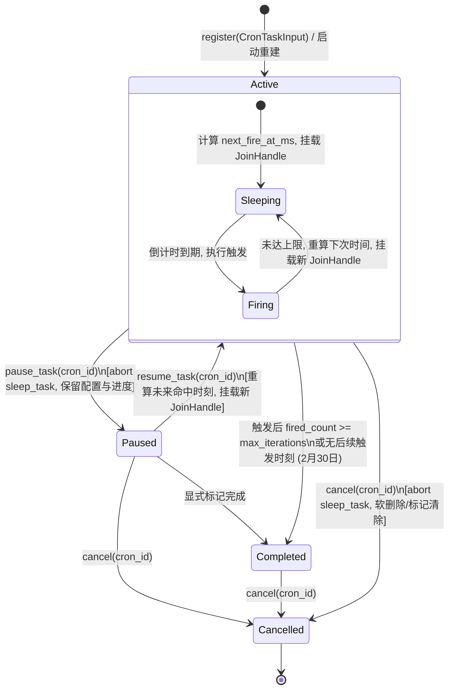

# 定时任务全流程修复与能力升级战役（Scheduled Tasks Revamp）

# 阶段 1 独立方案：Rust 底层调度器核心治理与单任务生命周期

> **方案文档路径**：`docs/scheduled-tasks-revamp/independent-plans/agent1-phase1-scheduler-core.md`  
> **负责人**：Subagent 1（Rust 调度核心与执行引擎专家 / Scheduler & Engine Runner Architect）  
> **阶段定位**：阶段 1 (Phase 1) · Rust 底层调度器核心治理与单任务生命周期（Scheduler Core Governance & Task Lifecycle）  
> **核心涉及模块与文件域**：
>
> - `apps/agent-workbench/src-tauri/src/sched.rs`（`SchedulerRegistry`, `CronEntry`, `CronTask`, `fire_cron`, `fire_once`, `restore`）
> - `apps/agent-workbench/src-tauri/src/engine_build.rs`（`assemble_scheduler_registry`, `try_current` 启动上下文断点）
> - `apps/agent-workbench/src-tauri/src/main.rs`（启动恢复时序、管理状态挂载与生命周期管理）
> - `crates/conex-types/src/cron.rs`（Cron 表达式解析器、调度计算与契约）
> - `apps/agent-workbench/src-tauri/src/workflow_commands.rs`（IPC 与底层调度器交互面）  
>   **架构纪律基线**：仓库根目录 `AGENTS.md`、`.agents/LOGIC_PLAN_NO_RETREAT.md`、`ANTI_OVERENGINEERING_GUARDRAILS.md`。

---

## 一、现状痛点与真实根因分析

当前 Conex / Crish 桌面应用中的定时调度系统（围绕 `SchedulerRegistry` 与 `WorkflowBackend` 构建）在底层核心生命周期管理上存在严重的架构性断层。任务经常处于“界面显示已暂停但后台依然狂跑”、“点击暂停刷新界面后状态被反向冲刷复活”、“应用重启后所有内存定时协程彻底消失”等极其恶劣的故障状态。

通过对当前仓库源码的代码级逐行排查，定位到以下五个关键根因与代码断点：

### 1.1 应用启动阶段缺少 Tokio Runtime 导致 `restore()` 被静默跳过（严重断层）

- **代码断点**：`apps/agent-workbench/src-tauri/src/engine_build.rs:903-908`
  ```rust
  // apps/agent-workbench/src-tauri/src/engine_build.rs:901-908
  // 启动恢复：扫描已持久化声明重建 cron sleep（与 TimerRegistry::restore
  // 同模式；try_current 守卫：纯同步构造上下文跳过，不 panic）
  if let Ok(runtime) = tokio::runtime::Handle::try_current() {
      let registry = Arc::clone(&registry);
      runtime.spawn(async move {
          registry.restore().await;
      });
  } else {
      tracing::debug!(
          target: "engine",
          "SchedulerRegistry 启动恢复跳过：当前上下文无 tokio runtime"
      );
  }
  ```
- **真实根因**：
  1. 在 `apps/agent-workbench/src-tauri/src/main.rs:944` 中，`CoreRunState::new` 在 Tauri 的 `.setup(|app| { ... })` 阶段被调用，进而触发 `EngineHandle::build` 和 `assemble_scheduler_registry`。
  2. Tauri 的 `setup` 闭包在主线程上同步执行，该线程**并未处于已进入（entered）的 Tokio Runtime 工作线程上下文中**。
  3. 此时调用 `tokio::runtime::Handle::try_current()` 必然返回 `Err(TryCurrentError)`。
  4. 结果：代码直接走入 `else` 分支，输出日志 `"SchedulerRegistry 启动恢复跳过：当前上下文无 tokio runtime"`，随即将重启恢复操作丢弃！
  5. 进一步检查 `apps/agent-workbench/src-tauri/src/main.rs:964-972`：
     ```rust
     // ⑦ restore：run_in_runtime 在 manage(CoreRunState) 之前执行
     {
         let restore_state = Arc::clone(&core_state);
         tauri::async_runtime::spawn(async move {
             let _ = restore_state.run_restore().await;
         });
     }
     ```
     在随后的异步恢复块中，`main.rs` 虽然使用了 `tauri::async_runtime::spawn`，但仅仅调用了 `restore_state.run_restore().await`（恢复会话和 run 快照），**压根没有调用 `scheduler_registry.restore().await`**！
  6. **破坏性后果**：一旦用户关闭或重启应用，数据库中持久化的所有定时任务在内存中的调度协程全军覆没；重启后应用零调度，定时任务全部瘫痪。

### 1.2 单任务启停生命周期原生 API 彻底缺失

- **代码断点**：`apps/agent-workbench/src-tauri/src/sched.rs:500-572`
  在 `SchedulerRegistry` 中，公开展现的调度控制 API 仅有：
  - `register(&self, input: CronTaskInput) -> Result<String, SchedulerError>`（创建并注册）
  - `cancel(&self, cron_id: &str) -> Result<bool, SchedulerError>`（取消并删除）
  - `pause_for(&self, duration_sec: u64) -> u64`（全局所有任务受限冻结）
- **真实根因**：
  1. `SchedulerRegistry` 完全没有提供 `pause_task(cron_id)`、`resume_task(cron_id)`、`update_task(cron_id, patch)` 的原生方法。
  2. 既有的 `pause_for` 是一个**针对整个调度注册表的全局临时防抖开关**（对应 `SchedulerComponents.pause: Arc<Mutex<Option<u64>>>`），其语义是将注册表内所有任务整体延后一段时间，根本不是针对单个任务的“用户手动暂停/启用”。
  3. `CronTask` 结构体中仅有一个布尔值 `enabled: bool`（`sched.rs:105`），将“已被取消”、“达到最大执行次数停止”、“用户主动暂停”这三种性质完全不同的业务状态混为一谈。

### 1.3 状态脱节与反向冲刷（Reverse Overwrite Bug）

- **代码断点**：`apps/agent-workbench/src-tauri/src/workflow_commands.rs:1012-1020` & `1060-1062`
  在 `workflow_commands.rs` 的 `update` 方法中：
  ```rust
  // workflow_commands.rs:1060-1062
  if let Some(enabled) = patch.enabled {
      workflow.enabled = enabled;
  }
  ```
  当前端用户点击“暂停”开关下发 `enabled: false` 时，`workflow_commands.rs` 仅修改了数据库 `SessionMetaWorkflowStore` 中的 `workflow.enabled = false`，**完全没有通知 `SchedulerRegistry`**！
  在 `SchedulerRegistry` 内部，该任务在内存表 `tasks` 中的 `CronEntry` 依然存活，其后台 `tokio::time::sleep` 依然在倒计时运行并照常触发。
- **反向冲刷的致命闭环**：
  在 `workflow_commands.rs:1008-1024` 的 `list()` 方法中：
  ```rust
  pub(crate) fn list(&self) -> Vec<WorkflowView> {
      let mut all = self.store.load_all();
      if let Some(registry) = self.registry() {
          let snapshot = registry.snapshot();
          for workflow in &mut all {
              if let Some(task) = snapshot.iter().find(|t| t.cron_id == workflow.cron_id) {
                  workflow.fired_count = task.fired_count;
                  workflow.enabled = task.enabled; // <--- 致命覆盖！
                  workflow.next_fire_at_ms = task.next_fire_at_ms;
              }
          }
      }
      // ...
  }
  ```
  用户暂停后，一旦前端页面重新拉取列表，`list()` 从 `registry.snapshot()` 中读取到内存里依然为 `enabled: true` 的 `CronTask`，直接将数据库中刚刚更新的 `workflow.enabled = false` **强行反向冲刷覆盖回 `true`**！
  这正是用户在 UI 上点击暂停后，刷新界面又变回启用的根本原因。

### 1.4 修改调度配置导致 Cron ID 变更与运行记录孤儿化

- **代码断点**：`apps/agent-workbench/src-tauri/src/workflow_commands.rs:1085-1103`
  ```rust
  if let Some(registry) = self.registry() {
      let old_id = workflow.cron_id.clone();
      if schedule_changed && !workflow.expression.is_empty() {
          let _ = registry.cancel(&old_id).await;
          let input = CronTaskInput { ... };
          let new_id = registry.register(input).await.map_err(map_scheduler_err)?;
          self.store.remove(&old_id);
          workflow.cron_id = new_id; // <--- cron_id 改变！
      }
  }
  ```
- **真实根因**：
  由于 `SchedulerRegistry` 缺乏就地更新接口，上层为了修改一个 cron 表达式，不得不先调用 `cancel(old_id)`，再调用 `register` 分配一个新的 `cron-<seq+1>`。
  这直接导致：
  1. 任务 ID 发生突变，关联在数据库 `sched_runs` 键中的历史运行记录（以 `workflow_id == old_id` 建立关联）全部变成“孤儿记录”，在任务历史面板中永久丢失。
  2. 如果用户仅修改了提示词 `prompt` 或 `max_iterations`，由于 `schedule_changed == false`，注册表中的 `CronTask` 甚至根本得不到任何同步，导致后台定时触发时依然使用旧的提示词。

### 1.5 任务 Sleep 协程状态机脆弱与取消防护不足

- **代码断点**：`apps/agent-workbench/src-tauri/src/sched.rs:728-739`
  ```rust
  fn spawn_fire_task(
      components: SchedulerComponents,
      task: CronTask,
      fire_delay_ms: u64,
  ) -> tokio::task::JoinHandle<()> {
      tokio::spawn(async move {
          tokio::time::sleep_until(Instant::now() + Duration::from_millis(fire_delay_ms)).await;
          fire_cron(components, task, false).await;
      })
  }
  ```
- **真实根因**：
  当前协程模型中，`sleep_task` 仅在触发时刻直接调用 `fire_cron`。在多线程异步环境下，如果用户在触发前几毫秒调用 `cancel`，随后紧接着触发协程被调度唤醒，虽然在 `fire_once` 内有简单的 `task.enabled` 检查，但由于缺乏统一的单任务状态机原子锁与确切的状态迁移，容易出现取消后因内存竞争导致的二次覆盖落库（复活幽灵任务）。

---

## 二、架构设计与状态机迁移模型

阶段 1 核心聚焦于**将 `SchedulerRegistry` 重构为高可用、强一致、具备完整单任务生命周期的底层调度真理源**。

### 2.1 单任务生命周期状态机

废弃单维度模糊布尔值 `enabled: bool`，在底层引入严谨的四态状态机 `CronTaskStatus`：



### 2.2 状态定义与语义约束

| 状态 (`CronTaskStatus`)       | 内存表 `tasks` 中是否存在 `CronEntry` | 是否持有活跃 `sleep_task` 协程 | `enabled` 兼容投影值 | 说明与行为准则                                                               |
| :---------------------------- | :------------------------------------ | :----------------------------- | :------------------- | :--------------------------------------------------------------------------- |
| **`Active`** (启用/运行中)    | **存在**                              | **是**（正在倒计时 sleep）     | `true`               | 到期自动执行触发，重算下次时间并循环。                                       |
| **`Paused`** (已暂停)         | **存在**                              | **否**（已被 `abort` 并置空）  | `false`              | 协程完全销毁，不消耗计时器；保留 `fired_count` 与原始配置；等待显式 resume。 |
| **`Completed`** (已完成)      | **移除** (仅在 store 中保存)          | **否**                         | `false`              | 达到 `max_iterations` 或无未来命中时刻，终态，重启不拉起。                   |
| **`Cancelled`** (已取消/删除) | **移除** (仅在 store 中标记)          | **否**                         | `false`              | 用户主动删除或销毁，终态，重启不拉起。                                       |

### 2.3 核心组件架构与模块拓扑

```
┌──────────────────────────────────────────────────────────────────────────────────┐
│                             Tauri IPC / Workflow 命令层                          │
│     workflow_commands: create / list / update / delete / trigger                 │
└────────────────────────────────────────┬─────────────────────────────────────────┘
                                         │ 调用原生单任务生命周期 API
                                         ▼
┌──────────────────────────────────────────────────────────────────────────────────┐
│                      SchedulerRegistry (底层调度注册表真理源)                     │
│  ┌────────────────────────────────────────────────────────────────────────────┐  │
│  │ 原生接口面:                                                                │  │
│  │ - register(input) -> Result<String>                                        │  │
│  │ - pause_task(cron_id) -> Result<()>                                        │  │
│  │ - resume_task(cron_id) -> Result<u64>                                      │  │
│  │ - update_task(cron_id, patch) -> Result<CronTask>                          │  │
│  │ - cancel(cron_id) -> Result<bool>                                          │  │
│  │ - restore() -> 异步双重可靠恢复                                             │  │
│  └─────────────────────────────────────┬──────────────────────────────────────┘  │
│                                        │ 读写并发互斥保护                         │
│                                        ▼                                         │
│  ┌────────────────────────────────────────────────────────────────────────────┐  │
│  │ SchedulerComponents:                                                       │  │
│  │ - tasks: Arc<Mutex<HashMap<String, CronEntry>>>                            │  │
│  │    └─ CronEntry { task: CronTask, sleep_task: Option<JoinHandle<()>> }     │  │
│  │ - store: Arc<dyn SchedStore> (LocalDb session_meta 持久化)                 │  │
│  │ - pending: Arc<dyn PendingSink> (Steering 队列)                            │  │
│  │ - events: Arc<dyn EventSink> (CronEvent / AgentEvent 缓冲)                 │  │
│  │ - launcher: Option<Arc<dyn ScheduledTaskLauncher>>                         │  │
│  └────────────────────────────────────────────────────────────────────────────┘  │
└────────────────────────────────────────┬─────────────────────────────────────────┘
                                         │
                 ┌───────────────────────┴───────────────────────┐
                 ▼                                               ▼
┌─────────────────────────────────┐             ┌──────────────────────────────────┐
│      Tokio 异步运行时 / Sleep    │             │   LocalDb (SQLite session_meta)  │
│ - 精确毫秒级定时睡眠唤醒        │             │ - sched_<cron_id> 持久化键       │
│ - abort 协程生命周期可控        │             │ - sched_ids 索引列表             │
└─────────────────────────────────┘             └──────────────────────────────────┘
```

---

## 三、具体数据结构与函数改造设计

### 3.1 数据结构升级（`apps/agent-workbench/src-tauri/src/sched.rs`）

#### 1. 任务状态枚举 `CronTaskStatus`

```rust
/// 单任务运行状态机
#[derive(Debug, Clone, Copy, PartialEq, Eq, serde::Serialize, serde::Deserialize)]
#[serde(rename_all = "camelCase")]
pub(crate) enum CronTaskStatus {
    /// 活跃中（协程倒计时调度，到期触发）
    Active,
    /// 已暂停（协程已 abort，等待用户显式恢复）
    Paused,
    /// 已完成（已达到最大迭代次数，终态）
    Completed,
    /// 已取消（已被删除，终态）
    Cancelled,
}
```

#### 2. `CronTask` 结构体扩展与向后兼容

```rust
/// Cron 任务持久化与内存声明（session_meta `sched_*` 键 JSON 形状）
#[derive(Debug, Clone, PartialEq, serde::Serialize, serde::Deserialize)]
#[serde(rename_all = "camelCase")]
pub(crate) struct CronTask {
    /// cron id（cron-<seq>）
    pub cron_id: String,
    /// cron 表达式原文（5 字段标准表达式）
    pub expression: String,
    /// 每次触发的通知内容 / 提示词
    pub prompt: String,
    /// 最大触发次数（None = 无限；到达即变为 Completed）
    pub max_iterations: Option<u64>,
    /// true = 独立常驻 run；false = 注入当前会话
    pub is_daemon: bool,
    /// 下一次计划触发时刻（epoch 毫秒）
    pub next_fire_at_ms: u64,
    /// 已触发次数
    pub fired_count: u64,
    /// 任务生命周期状态
    #[serde(default = "default_cron_status")]
    pub status: CronTaskStatus,
    /// 兼容字段（向后兼容旧前端与历史 JSON：status == Active 时为 true）
    pub enabled: bool,
    /// 任务创建时刻（epoch 毫秒）
    #[serde(default = "now_ms")]
    pub created_at_ms: u64,
    /// 任务最后更新时刻（epoch 毫秒）
    #[serde(default = "now_ms")]
    pub updated_at_ms: u64,
}

fn default_cron_status() -> CronTaskStatus {
    CronTaskStatus::Active
}

impl CronTask {
    /// 状态变更同步 helper（保证 status 与 enabled 严格一致）
    pub(crate) fn set_status(&mut self, status: CronTaskStatus) {
        self.status = status;
        self.enabled = matches!(status, CronTaskStatus::Active);
        self.updated_at_ms = now_ms();
    }
}
```

#### 3. 就地更新入参补丁 `CronTaskPatch`

```rust
/// 任务就地更新入参（保持 cron_id 不变，消除孤儿记录）
#[derive(Debug, Clone, Default)]
pub(crate) struct CronTaskPatch {
    pub expression: Option<String>,
    pub prompt: Option<String>,
    pub max_iterations: Option<Option<u64>>,
    pub is_daemon: Option<bool>,
}
```

#### 4. 活跃调度条目 `CronEntry`

```rust
/// 内存中的活跃 cron 条目（tasks 表值）
struct CronEntry {
    /// 运行态声明
    task: CronTask,
    /// 触发任务句柄（Active 时为 Some，Paused 时为 None）
    sleep_task: Option<tokio::task::JoinHandle<()>>,
}
```

#### 5. 错误类型扩展 `SchedulerError`

```rust
#[derive(Debug, Clone, PartialEq, Eq)]
pub(crate) enum SchedulerError {
    /// cron 表达式非法（解析失败，附带详情）
    InvalidExpression(String),
    /// 表达式合法但无未来命中时刻（如 2 月 30 日）
    NoNextFire(String),
    /// 任务不存在或已在终态
    IdNotFound,
    /// 任务已处于 Active 状态，无需重复启动
    AlreadyActive,
    /// 任务已处于 Paused 状态，无需重复暂停
    AlreadyPaused,
    /// 任务已处于终态（Completed / Cancelled），拒绝操作
    TaskTerminated(String),
    /// 内部并发或持久化故障
    Internal(String),
}

impl SchedulerError {
    pub(crate) fn code(&self) -> &'static str {
        match self {
            Self::InvalidExpression(_) | Self::NoNextFire(_) => codes::TOOL_INVALID_INPUT,
            Self::IdNotFound => codes::COMMON_NOT_FOUND,
            Self::AlreadyActive | Self::AlreadyPaused | Self::TaskTerminated(_) => {
                codes::TOOL_STATE_INVALID
            }
            Self::Internal(_) => codes::COMMON_INTERNAL,
        }
    }

    pub(crate) fn message(&self) -> String {
        match self {
            Self::InvalidExpression(detail) => format!("cron 表达式非法：{detail}"),
            Self::NoNextFire(expr) => format!("cron 表达式 {expr} 无未来触发时刻，拒绝注册"),
            Self::IdNotFound => "cron 任务不存在或已删除".to_string(),
            Self::AlreadyActive => "cron 任务已处于运行中状态".to_string(),
            Self::AlreadyPaused => "cron 任务已处于暂停状态".to_string(),
            Self::TaskTerminated(state) => format!("cron 任务已处于终态（{state}），不可再变更"),
            Self::Internal(err) => format!("调度器内部错误：{err}"),
        }
    }
}
```

---

## 四、核心改造代码伪代码与实施步骤

### 4.1 阶段 1 核心实施步骤拆解

```
┌─────────────────────────────────────────────────────────────────────────────────┐
│                               阶段 1 核心实施路线图                              │
├─────────────────────────────────────────────────────────────────────────────────┤
│ 步骤 1.1: 扩展 sched.rs 数据模型                                                │
│          - 增加 CronTaskStatus 枚举，升级 CronTask 与 CronEntry                 │
│          - 完善 CronTask::set_status 同步机制                                    │
├─────────────────────────────────────────────────────────────────────────────────┤
│ 步骤 1.2: 在 SchedulerRegistry 中实现单任务生命周期管理方法                    │
│          - pause_task(cron_id): abort 协程，更新状态为 Paused 并落库            │
│          - resume_task(cron_id): 重算 next_fire，更新为 Active，重建协程并落库  │
│          - update_task(cron_id, patch): 原地更新表达式/提示词，无突变 ID        │
│          - get_task(cron_id): 单任务快照查询                                   │
├─────────────────────────────────────────────────────────────────────────────────┤
│ 步骤 1.3: 重构 fire_cron 协程生命周期与并发安全                                 │
│          - 增加防复活守卫（若条目已变为 Paused/Cancelled，彻底放弃重建）        │
│          - 修复 MaxIterations 迁移到 Completed 状态的流程                       │
├─────────────────────────────────────────────────────────────────────────────────┤
│ 步骤 1.4: 根治启动恢复 `restore()` 时序缺陷                                      │
│          - 在 CoreRunState 暴露 pub async fn restore_scheduler(&self)           │
│          - 在 main.rs setup 异步启动区通过 tauri::async_runtime::spawn 可靠调用  │
│          - 改造 assemble_scheduler_registry 消除 try_current 吞错              │
├─────────────────────────────────────────────────────────────────────────────────┤
│ 步骤 1.5: 编写详尽自动化测试套件                                                 │
│          - 覆盖 pause/resume/update/restore/防复活/并发锁竞态                   │
└─────────────────────────────────────────────────────────────────────────────────┘
```

### 4.2 核心方法实现伪代码（`apps/agent-workbench/src-tauri/src/sched.rs`）

#### 1. 单任务暂停 `pause_task`

```rust
impl SchedulerRegistry {
    /// 暂停指定 cron 任务（单任务生命周期）
    /// 流程：加锁查找条目 -> abort 活跃协程 -> 状态置为 Paused -> 持久化落库
    pub(crate) async fn pause_task(&self, cron_id: &str) -> Result<(), SchedulerError> {
        let mut task_to_save: Option<CronTask> = None;

        {
            let mut tasks = self.components.tasks.lock().unwrap_or_else(|e| e.into_inner());
            let entry = tasks.get_mut(cron_id).ok_or(SchedulerError::IdNotFound)?;

            if entry.task.status == CronTaskStatus::Paused {
                return Err(SchedulerError::AlreadyPaused);
            }
            if matches!(entry.task.status, CronTaskStatus::Completed | CronTaskStatus::Cancelled) {
                return Err(SchedulerError::TaskTerminated(format!("{:?}", entry.task.status)));
            }

            // 1. 中止并销毁底层 tokio 计时协程
            if let Some(handle) = entry.sleep_task.take() {
                handle.abort();
            }

            // 2. 状态机迁移至 Paused
            entry.task.set_status(CronTaskStatus::Paused);
            task_to_save = Some(entry.task.clone());
        }

        // 3. 锁外执行落盘，杜绝持锁 I/O
        if let Some(task) = task_to_save {
            self.components.store.save(&task);
            tracing::info!(target: "sched", cron_id, "cron 任务已暂停（协程已中止，状态已落盘）");
        }

        Ok(())
    }
}
```

#### 2. 单任务恢复 `resume_task`

```rust
impl SchedulerRegistry {
    /// 恢复指定 cron 任务（单任务生命周期）
    /// 流程：加锁校验状态 -> 重算从当前时刻起下一次触发 -> 启动新倒计时协程 -> 状态置为 Active -> 落库
    pub(crate) async fn resume_task(&self, cron_id: &str) -> Result<u64, SchedulerError> {
        let now = now_ms();
        let mut task_to_save: Option<CronTask> = None;
        let mut next_fire_ms: u64 = 0;
        let mut delay_ms: u64 = 0;

        {
            let mut tasks = self.components.tasks.lock().unwrap_or_else(|e| e.into_inner());
            let entry = tasks.get_mut(cron_id).ok_or(SchedulerError::IdNotFound)?;

            if entry.task.status == CronTaskStatus::Active {
                return Err(SchedulerError::AlreadyActive);
            }
            if matches!(entry.task.status, CronTaskStatus::Completed | CronTaskStatus::Cancelled) {
                return Err(SchedulerError::TaskTerminated(format!("{:?}", entry.task.status)));
            }

            // 1. 重新解析表达式并计算未来触发时刻
            let schedule = parse_cron(&entry.task.expression)
                .map_err(|e| SchedulerError::InvalidExpression(format!("{e:?}")))?;
            let next = schedule.next_fire_after(now)
                .ok_or_else(|| SchedulerError::NoNextFire(entry.task.expression.clone()))?;

            entry.task.next_fire_at_ms = next;
            entry.task.set_status(CronTaskStatus::Active);

            next_fire_ms = next;
            delay_ms = fire_delay_ms(&self.components, next);
            task_to_save = Some(entry.task.clone());

            // 2. 启动新的倒计时触发协程并挂载 handle
            let handle = spawn_fire_task(self.components.clone(), entry.task.clone(), delay_ms);
            entry.sleep_task = Some(handle);
        }

        // 3. 锁外落盘
        if let Some(task) = task_to_save {
            self.components.store.save(&task);
            tracing::info!(target: "sched", cron_id, next_fire_ms, delay_ms, "cron 任务已恢复启动");
        }

        Ok(next_fire_ms)
    }
}
```

#### 3. 单任务就地更新 `update_task`

```rust
impl SchedulerRegistry {
    /// 就地更新 cron 任务（保持 cron_id 不变，支持实时热生效）
    pub(crate) async fn update_task(
        &self,
        cron_id: &str,
        patch: CronTaskPatch,
    ) -> Result<CronTask, SchedulerError> {
        let now = now_ms();
        let mut updated_task: Option<CronTask> = None;

        {
            let mut tasks = self.components.tasks.lock().unwrap_or_else(|e| e.into_inner());
            let entry = tasks.get_mut(cron_id).ok_or(SchedulerError::IdNotFound)?;

            if matches!(entry.task.status, CronTaskStatus::Completed | CronTaskStatus::Cancelled) {
                return Err(SchedulerError::TaskTerminated(format!("{:?}", entry.task.status)));
            }

            let mut schedule_changed = false;

            // 1. 表达式更新与重新校验
            if let Some(new_expr) = patch.expression {
                let trimmed = new_expr.trim().to_string();
                if trimmed != entry.task.expression {
                    let schedule = parse_cron(&trimmed)
                        .map_err(|e| SchedulerError::InvalidExpression(format!("{e:?}")))?;
                    let next = schedule.next_fire_after(now)
                        .ok_or_else(|| SchedulerError::NoNextFire(trimmed.clone()))?;

                    entry.task.expression = trimmed;
                    entry.task.next_fire_at_ms = next;
                    schedule_changed = true;
                }
            }

            // 2. 提示词更新
            if let Some(new_prompt) = patch.prompt {
                let trimmed = new_prompt.trim().to_string();
                if !trimmed.is_empty() {
                    entry.task.prompt = trimmed;
                }
            }

            // 3. 最大迭代次数更新
            if let Some(new_max) = patch.max_iterations {
                entry.task.max_iterations = new_max;
            }

            // 4. 守护模式标志更新
            if let Some(is_daemon) = patch.is_daemon {
                entry.task.is_daemon = is_daemon;
            }

            entry.task.updated_at_ms = now;

            // 5. 若表达式改变且当前正处于 Active 状态，必须重启倒计时协程
            if schedule_changed && entry.task.status == CronTaskStatus::Active {
                if let Some(old_handle) = entry.sleep_task.take() {
                    old_handle.abort();
                }
                let delay = fire_delay_ms(&self.components, entry.task.next_fire_at_ms);
                let new_handle = spawn_fire_task(self.components.clone(), entry.task.clone(), delay);
                entry.sleep_task = Some(new_handle);
                tracing::info!(target: "sched", cron_id, delay, "cron 调度表达式已就地重载并重启协程");
            }

            updated_task = Some(entry.task.clone());
        }

        if let Some(task) = updated_task {
            self.components.store.save(&task);
            Ok(task)
        } else {
            Err(SchedulerError::Internal("更新状态构建失败".to_string()))
        }
    }
}
```

#### 4. 可靠重启恢复 `restore`

```rust
impl SchedulerRegistry {
    /// 可靠启动恢复：扫描本地持久化数据，恢复全部任务状态
    pub(crate) async fn restore(&self) {
        let now = now_ms();
        let loaded = self.components.store.load_all();
        tracing::info!(target: "sched", total = loaded.len(), "开始执行 SchedulerRegistry 启动恢复扫描");

        let mut tasks_to_rebuild = Vec::new();

        for task in loaded {
            // 推进分配器，防止重启后新任务 ID 发生碰撞
            if let Some(seq) = cron_seq(&task.cron_id) {
                self.seq.fetch_max(seq + 1, Ordering::SeqCst);
            }

            // 终态跳过：已完成或已删除的任务不加载进内存
            if matches!(task.status, CronTaskStatus::Completed | CronTaskStatus::Cancelled) {
                continue;
            }

            // 达到最大执行次数兜底检查
            if let Some(max) = task.max_iterations {
                if task.fired_count >= max {
                    continue;
                }
            }

            // Paused 状态任务：加载进入 tasks 表以支撑后续状态查询与 resume，但不启动协程
            if task.status == CronTaskStatus::Paused || !task.enabled {
                let mut paused_task = task;
                paused_task.set_status(CronTaskStatus::Paused);
                self.components.tasks.lock().unwrap_or_else(|e| e.into_inner()).insert(
                    paused_task.cron_id.clone(),
                    CronEntry {
                        task: paused_task,
                        sleep_task: None,
                    },
                );
                continue;
            }

            // Active 状态任务：判定是否过期需要补发
            tasks_to_rebuild.push(task);
        }

        for task in tasks_to_rebuild {
            if task.next_fire_at_ms <= now {
                tracing::info!(target: "sched", cron_id = %task.cron_id, "启动恢复：任务在离线期间已到期，执行补发");
                fire_cron(self.components.clone(), task, true).await;
            } else {
                let delay = fire_delay_ms(&self.components, task.next_fire_at_ms);
                tracing::info!(target: "sched", cron_id = %task.cron_id, delay_ms = delay, "启动恢复：挂载未到期倒计时协程");
                let handle = spawn_fire_task(self.components.clone(), task.clone(), delay);
                self.components.tasks.lock().unwrap_or_else(|e| e.into_inner()).insert(
                    task.cron_id.clone(),
                    CronEntry {
                        task,
                        sleep_task: Some(handle),
                    },
                );
            }
        }
    }
}
```

### 4.3 修复启动恢复调用链路（`apps/agent-workbench/src-tauri/src/main.rs`）

在 `main.rs` 的 setup 流程中，确立明确的异步恢复时序。由于 Tauri 在 `main.rs:969` 已经引入了 `tauri::async_runtime::spawn`，阶段 1 将调度器恢复正式纳入该可靠异步运行时中：

```rust
// apps/agent-workbench/src-tauri/src/main.rs:964-976
// ⑦ restore：orchestrator 快照与 SchedulerRegistry 调度器恢复
{
    let restore_state = Arc::clone(&core_state);
    tauri::async_runtime::spawn(async move {
        // 1. 恢复会话与 run 快照
        let _ = restore_state.run_restore().await;

        // 2. 恢复底层定时调度器（彻底消灭 try_current 丢失恢复问题）
        if let Some(reg) = restore_state.scheduler_registry() {
            tracing::info!(target: "setup", "通过 tauri::async_runtime 触发 SchedulerRegistry 重启恢复");
            reg.restore().await;
        }
    });
}
```

同步清理 `apps/agent-workbench/src-tauri/src/engine_build.rs:903-908` 中易误导的静默代码，改为：若 `try_current()` 不存在则打标说明交由外层装配统一恢复，彻底堵死静默丢失通道。

---

## 五、自动化测试与验证方案

为切实遵守反退避纪律与立体化验证准则，阶段 1 必须提供完整的自动化测试覆盖，严禁“猜测应该修好了”。

### 5.1 单元测试套件设计（`sched.rs` 内部测试）

#### 测试用例 1：单任务暂停与恢复 (`test_pause_and_resume_task`)

- **断言目标**：
  1. 注册成功后，状态为 `Active`，`has_active()` 为 `true`。
  2. 调用 `pause_task(cron_id)` 后，状态变为 `Paused`，`entry.sleep_task` 被 abort 且为 `None`，`store` 中落库的 `status` 为 `Paused`，`enabled` 为 `false`。
  3. 在暂停期间，触发延迟到达，**绝对不发射 `CronEvent::Fired`，`fired_count` 保持为 0**。
  4. 调用 `resume_task(cron_id)` 后，状态恢复为 `Active`，`next_fire_at_ms` 被重算为未来时刻，`entry.sleep_task` 重新挂载，倒计时到期后正常触发。

#### 测试用例 2：单任务就地热更新 (`test_update_task_in_place`)

- **断言目标**：
  1. 注册原始表达式 `"0 12 * * *"`（每日 12 点）。
  2. 调用 `update_task(cron_id, patch)` 修改表达式为 `"*/10 * * * *"` 并修改 `prompt`。
  3. 断言返回的 `cron_id` 与原 ID 完全相同（禁止重新分配 ID）。
  4. 断言内存与存储中的 `prompt` 和 `next_fire_at_ms` 均已更新。
  5. 断言旧的倒计时协程已中止，新的协程已按新间隔运行。

#### 测试用例 3：应用重启状态恢复全场景覆盖 (`test_restore_lifecycle_matrix`)

- **断言目标**：
  1. 准备持久化测试数据包含 4 类任务：
     - Task A: `Active` 且离线期间已过期；
     - Task B: `Active` 且尚未到期；
     - Task C: `Paused` 状态任务；
     - Task D: `Completed` 状态任务。
  2. 模拟重启拉起新的 `SchedulerRegistry` 并调用 `restore().await`。
  3. 断言 Task A 补发触发一次，并重算下次时间；
  4. 断言 Task B 恢复挂载了到期 sleep 协程；
  5. 断言 Task C 进入内存 tasks 映射但处于 `Paused` 态，未启动 sleep 协程；
  6. 断言 Task D 终态被忽略，未重建协程。
  7. 断言 `registry.seq` 计数器原子推进到最大序号 + 1，新注册任务绝不撞号。

#### 测试用例 4：重复操作与非法状态迁移阻断 (`test_invalid_state_transitions`)

- **断言目标**：
  1. 对已暂停的任务再次调用 `pause_task` 返回 `SchedulerError::AlreadyPaused`。
  2. 对运行中的任务调用 `resume_task` 返回 `SchedulerError::AlreadyActive`。
  3. 对已取消的任务调用 `pause_task` 或 `resume_task` 返回 `SchedulerError::TaskTerminated`。

### 5.2 验证命令与门禁检查

- 运行调度器单元测试：
  ```pwsh
  cargo test -p crish-agent-workbench --lib sched::tests
  ```
- 运行包含启动时序的集成测试：
  ```pwsh
  cargo test -p crish-agent-workbench --test integration_tests
  ```
- 检查代码行数与 lint 门禁（确保不违反架构红线）：
  ```pwsh
  cargo clippy -p crish-agent-workbench -- -D warnings
  ```
